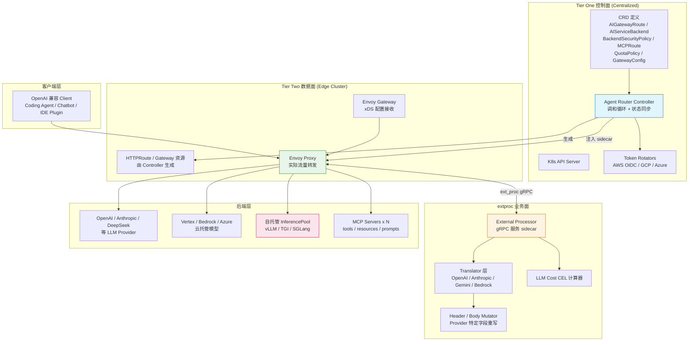
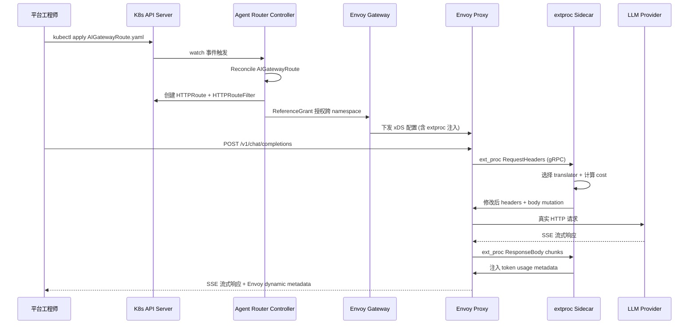
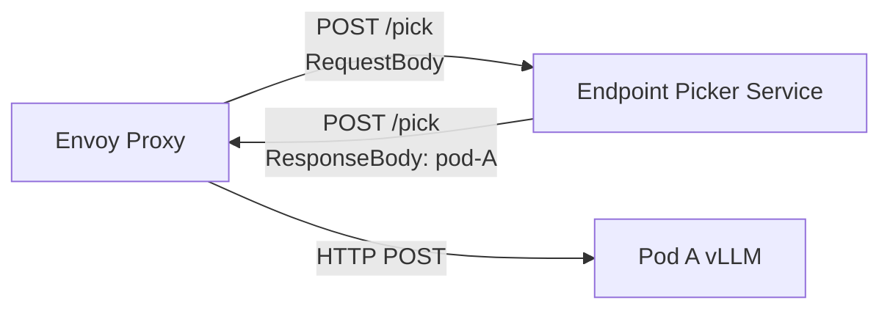
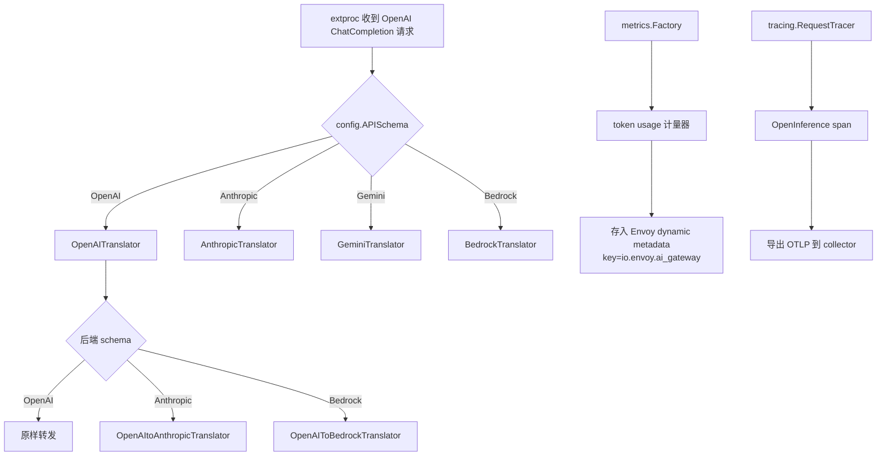
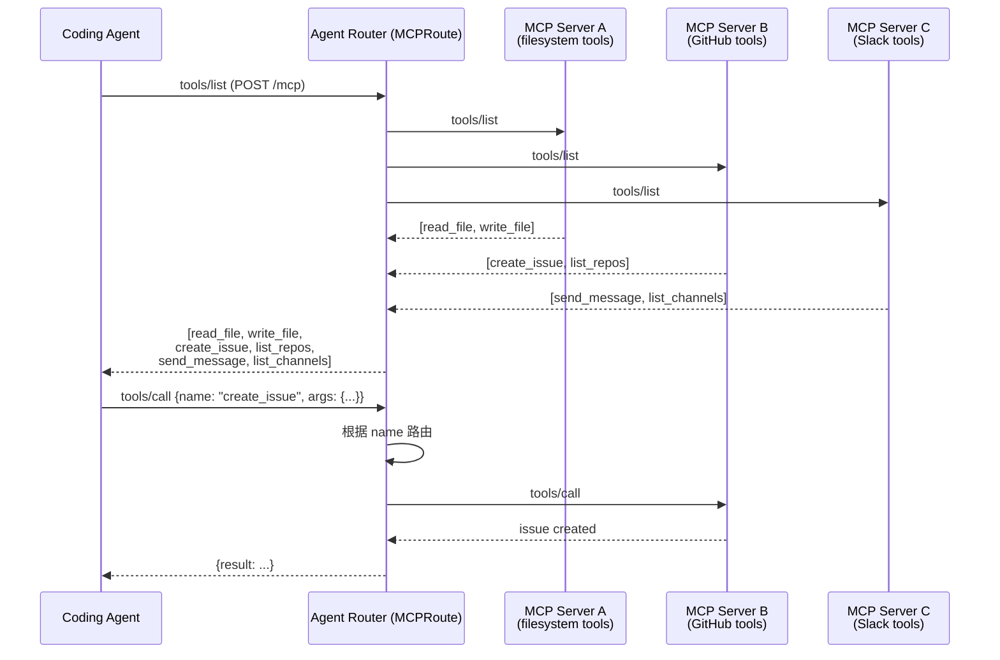
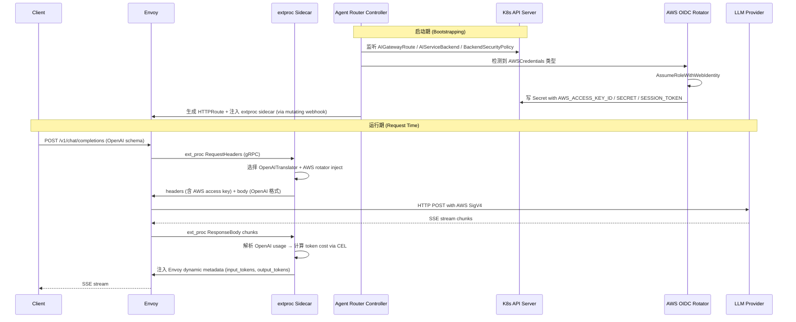

## 引子

如果说 LiteLLM、Bifrost、Helicone 这类「AI Gateway」解决的是「应用开发者写 OpenAI 兼容客户端、网关在中间翻译成各 Provider 的私有协议」，那么 **Agent Router（原 Envoy AI Gateway，2026-10 正式迁入 Agentic AI Foundation）想回答的是另一个完全不同的问题：当 LLM 流量要进入 Kubernetes 集群、由 SRE/平台团队统一治理、用 Gateway API 描述路由规则时——谁能成为「AI 流量的 Envoy」？**

[Agent Router](https://github.com/theagentrouter/agent-router) ⭐2.2k（pushed 2026-10-13），Go 636 文件 / 2,111 节点，Apache-2.0。它不是又一个 Python LLM 代理库，而是一套**严格遵循 Kubernetes Gateway API 规范、用 Envoy + Envoy Gateway 做数据面、用 6 个 CRD 做控制面**的 AI Gateway 实现。它把 LiteLLM 那种「应用层 Python 翻译」思路，升级成「集群级声明式 CRD + Sidecar extproc + GAIE 端点选择器」的工业级方案。

更关键的是，它**不只是 LLM Gateway**，还同时承担 **MCP server 聚合**（一个 MCP 端点背后挂 256 个 MCP server）、**Backend Security Policy**（AWS OIDC / Azure / GCP 三家云凭据的自动旋转）、**Token 配额治理**（QuotaPolicy + CEL 表达式）、**InferencePool 端点选择**（Gateway API Inference Extension 接入）这五件互相关联但又相互解耦的事。整篇仓库的口号就是——**「Agent Router controls. Envoy carries.」**

本文沿着 `api/v1alpha1/*.go`（6 个 CRD）、`internal/extproc/`（in-band gRPC 转换）、`internal/controller/`（CRD 调和 + extproc 注入 + OIDC 旋转）、`cmd/aigw/`（单机 CLI）、`internal/tracing/openinference/`（OpenTelemetry 链路追踪）这五条主线，逐层拆解 Agent Router 的「**CRD 控制面 + Envoy 数据面 + extproc 业务面 + GAIE 调度面**」四层解耦设计。

## 项目定位与核心价值

### 一句话定义

> **Agent Router = 6 个 K8s CRD（AIGatewayRoute / AIServiceBackend / BackendSecurityPolicy / MCPRoute / QuotaPolicy / GatewayConfig）+ Envoy Gateway 数据面 + External Processor 业务面 + Endpoint Picker 调度面，把 LLM / MCP / 推理后端三类流量统一到 Gateway API 标准下**。

### 能力矩阵

| 能力维度 | 实现层 | 关键模块 |
|---------|--------|---------|
| **声明式路由** | Kubernetes CRD | AIGatewayRoute（路由规则）/ AIServiceBackend（后端抽象）|
| **多 Provider 协议适配** | extproc gRPC 服务 | `internal/extproc/processor_impl.go`（Anthropic / OpenAI / Gemini / Vertex / Bedrock / Cohere 等 16+ translator）|
| **后端凭据治理** | 控制器层 | BackendSecurityPolicy + AWS / GCP / Azure / OIDC Token Rotator |
| **MCP 聚合** | CRD + extproc 协议 | MCPRoute + BackendSelector CEL |
| **流量配额** | 控制器层 | QuotaPolicy + CEL 表达式 |
| **全局默认值** | CRD | GatewayConfig（默认 LLMRequestCosts 等）|
| **推理负载调度** | K8s InferencePool | `internal/controller/inference_pool.go`（接入 GAIE）|
| **链路追踪** | OpenTelemetry | `internal/tracing/openinference/{anthropic,cohere,...}/` |
| **单机 CLI 模式** | 命令行 | `cmd/aigw/run.go`（`aigw run` 一行起本地 Gateway）|

### 仓库统计

| 维度 | 值 |
|------|----|
| ⭐ Stars | 2.2k |
| 主语言 | Go 636 文件（占 30%）|
| 仓库大小 | 32,535 KB |
| 协议 | Apache-2.0 |
| 治理 | Agentic AI Foundation（Linux 基金会子项目）|
| 起源 | 原 `envoyproxy/ai-gateway`（已重定向）|
| 最近推送 | 2026-10-13（24h 内活跃）|
| CRD 数量 | 6 个 v1alpha1 + 6 个 v1beta1（含 clientset/informer/lister 全套生成代码）|

### 关键设计哲学

**「Agent Router controls. Envoy carries.」**——控制逻辑（CRD 调和、凭据旋转、配额计算）全部交给 Agent Router 的 controller，数据转发交给 Envoy；业务语义转换（Provider 协议翻译、Token usage 计量、敏感 header 脱敏）交给 in-band External Processor。

这种分层让 Agent Router 自然获得了：**（a）零侵入升级**（改 CRD 不改 Envoy 镜像）、**（b）Provider 中立**（任何厂商接入只需写 extproc translator，不需要碰 Gateway 逻辑）、**（c）多团队协作**（平台团队管 CRD、SRE 团队管 Envoy、业务团队管 extproc 配置）。

## 整体架构

Agent Router 采用**「控制面 + 数据面 + 业务面 + 调度面」**四层解耦架构，所有四层都通过 Kubernetes Gateway API 这个统一标准连接。



**四层各自的职责**：

- **Tier One 控制面**：平台团队用 YAML 声明 CRD（路由规则、后端、凭据策略），Agent Router Controller 调和成 Envoy Gateway 能识别的 `HTTPRoute` / `Backend` 资源
- **Tier Two 数据面**：Envoy Gateway 接收 xDS 配置，Envoy Proxy 负责实际的 TCP/HTTP 转发
- **extproc 业务面**：sidecar 容器跑 gRPC 服务，在 Envoy 转发的**请求体到达后端前**做 Provider 协议翻译、Token usage 计算、敏感 header 脱敏
- **Backend 后端层**：可以是云托管 LLM（OpenAI / Anthropic / Bedrock）、自托管推理集群（vLLM / TGI / SGLang）、或 MCP server 池

## 应用类型：CRD 的三种「声明意图」

Agent Router 的 6 个 CRD 按**角色分工**分成三类：路由意图、后端意图、治理意图。

### CRD 分工表

| CRD 类型 | 角色 | 关键字段 | 类比 |
|---------|------|---------|------|
| `AIGatewayRoute` | 路由意图 | `parentRefs` / `hostnames` / `rules`（最多 15 条）/ `llmRequestCosts` | HTTPRoute + LLM 扩展 |
| `AIServiceBackend` | 后端意图 | `schema`（VersionedAPISchema）/ `backendRef`（Envoy Gateway Backend）/ `headerMutation` / `bodyMutation` | Backend + 协议转换配置 |
| `BackendSecurityPolicy` | 凭据意图 | `type`（AWSCredentials / AzureCredentials / GCPCredentials / AnthropicAPIKey）/ `credentialsRef`（Secret）/ `rotationDuration` | Provider 凭据 + 自动旋转 |
| `MCPRoute` | MCP 路由意图 | `backendRefs`（最多 256 个 MCP server）/ `securityPolicy.oauth` / `backendSelector` CEL | MCP server 聚合 |
| `QuotaPolicy` | 配额意图 | `rules`（CEL 表达式匹配 + token 计数）| 流量配额治理 |
| `GatewayConfig` | 全局默认 | `globalLLMRequestCosts` / `modelNameOverride` | 全局默认值兜底 |

### 共同设计模式

所有 CRD 都遵循 Kubernetes 惯例：`metav1.TypeMeta` + `metav1.ObjectMeta` + `Spec` + `Status` 四元组；用 `+kubebuilder:` 注释生成 CRD YAML；v1alpha1 已标记 deprecated 引导用户迁移到 v1beta1（**保留向后兼容的同时推动 API 演进**）。

下面是 `AIServiceBackend` 的核心结构（来源 `api/v1alpha1/ai_service_backend.go:32-94`）：

```go
type AIServiceBackend struct {
    metav1.TypeMeta   `json:",inline"`
    metav1.ObjectMeta `json:"metadata,omitempty"`
    Spec              AIServiceBackendSpec   `json:"spec,omitempty"`
    Status            AIServiceBackendStatus `json:"status,omitempty"`
}

type AIServiceBackendSpec struct {
    // APISchema 决定 AIServiceBackend 接受哪种入站 schema
    // 配合 AIGatewayRouteSpec.APISchema 做相互转换
    // 例如：客户端发 OpenAI ChatCompletion，schema 标记 OpenAI；
    //      后端是 Anthropic，gateway 自动做 schema 转换
    APISchema   VersionedAPISchema        `json:"schema"`
    // BackendRef 必须指向 Envoy Gateway 的 Backend 资源（不是普通 K8s Service）
    BackendRef  gwapiv1.BackendObjectReference `json:"backendRef"`
    // HeaderMutation / BodyMutation 在请求发到后端前做字段重写
    HeaderMutation *HTTPHeaderMutation `json:"headerMutation,omitempty"`
    BodyMutation   *HTTPBodyMutation   `json:"bodyMutation,omitempty"`
}
```

`AIGatewayRoute` 的核心 Spec（来源 `api/v1alpha1/ai_gateway_route.go:55-130`）展示了「**为什么一个 CRD 就能代表完整的 AI 路由意图**」：

```go
type AIGatewayRouteSpec struct {
    ParentRefs []gwapiv1.ParentReference `json:"parentRefs,omitempty"` // 最多 16 个 Gateway
    Hostnames  []gwapiv1.Hostname        `json:"hostnames,omitempty"`  // 按 Host 头过滤
    // Rules 是 AIGatewayRouteRule 列表
    // 每条 rule 是 Gateway API HTTPRouteRule 的子集
    // 匹配条件里 x-ai-eg-model header 可用 —— 因为模型名是从 body 提取后再注入 header
    Rules []AIGatewayRouteRule `json:"rules"`  // 必填，最多 15 条
    // LLMRequestCosts 描述如何捕获 token usage
    // AI Gateway filter 会把每个数字存到 Envoy dynamic metadata
    // key 是 "io.envoy.ai_gateway"
    // route 级的成本会覆盖 GatewayConfig 全局默认
    LLMRequestCosts []LLMRequestCost `json:"llmRequestCosts,omitempty"`
}
```

## 核心引擎一：AIGatewayRoute + Envoy Gateway 双层调和

Agent Router 的 controller 并不是简单地「CRD → Envoy 配置」的一对一翻译，而是**两层调和**：**第一层把 AIGatewayRoute 翻译成 HTTPRoute + HTTPRouteFilter**，**第二层把 BackendSecurityPolicy 翻译成 AWS/GCP/Azure 的 OIDC Secret**。

### 第一层：路由翻译

`internal/controller/ai_gateway_route.go` 里的 reconciler 收到 AIGatewayRoute 变更时，会：

1. **生成同名 HTTPRoute**：把 AIGatewayRoute 的 rules 翻译成 Gateway API HTTPRouteSpec，附加 extproc filter 配置
2. **生成 HTTPRouteFilter**：每条命名规则一个，用于注入 `ai-eg-host-rewrite-${AIGatewayRoute.Name}` hostname rewrite
3. **触发 Gateway 重新调和**：让 Envoy Gateway 重新下发 xDS



### 第二层：凭据旋转

`BackendSecurityPolicy` CRD 用 `rotationDuration` 字段表达「**每隔多久重新签发一次云厂商 token**」。AWS / GCP / Azure 三家分别有不同的 token 颁发机制，Agent Router 为每家写了独立的 rotator。

**AWS OIDC rotator**（`internal/controller/rotators/aws_oidc_rotator.go`）的逻辑：
- 检测到 `BackendSecurityPolicy` 类型是 `AWSCredentials` 且使用 OIDC 时
- 用配置的 OIDC provider + role ARN 调用 AWS STS `AssumeRoleWithWebIdentity`
- 把临时 access key + session token + expiration 写到 K8s Secret
- 设置 `time.AfterFunc(rotationDuration, ...)` 定时器，到期前再轮换

**GCP OIDC rotator**（`internal/controller/rotators/gcp_oidc_token_rotator.go`）的逻辑：
- 通过 GCP Service Account Token Exchange API 用 OIDC ID token 换取 federated access token
- 自动写 Secret 并设置下次轮换时间

**Azure token rotator**（`internal/controller/rotators/azure_token_rotator.go`）的逻辑：
- 用 client credentials flow 或 workload identity 拿 Azure AD access token
- 同上定时轮换

### extproc 注入：让 Envoy 「变身」AI Gateway

`internal/controller/extproc_builder.go` 的核心职责是**把 extproc 容器注入到 Envoy proxy pod 里**。它通过**mutating webhook**实现：

1. 拦截 Envoy Gateway 创建的 Envoy Deployment
2. 在 pod template 里加一个 sidecar container（image + env + ports）
3. 计算 extproc config hash，写到 annotation `aigateway.envoyproxy.io/extproc-config-hash`
4. 当 config 变化时，hash 变了，K8s 会自动滚动升级 pod

```go
// 来自 internal/controller/extproc_builder.go:28-40
const extProcConfigHashAnnotationKey = "aigateway.envoyproxy.io/extproc-config-hash"
const extProcAdminPort = 1064

// extproc sidecar 注入的核心 env var
// XDS 会告诉 Envoy 把请求转给这个 sidecar
// 同时 extproc 用同样的 config hash 启动
func newExtProcBuilder(options *Options, extProcAsSideCar bool, logger logr.Logger) *extProcBuilder {
    return &extProcBuilder{
        image:                                  options.ExtProcImage,
        imagePullPolicy:                        options.ExtProcImagePullPolicy,
        logLevel:                               options.ExtProcLogLevel,
        // ... env vars, ports, args from CRD
    }
}
```

## 核心引擎二：External Processor (extproc) 业务面

extproc 是 Agent Router 的「**业务语义中枢**」——所有 Provider 协议翻译、Token usage 计量、敏感 header 脱敏都在这里发生。它是一个**gRPC 服务**，跑在 Envoy proxy pod 的 sidecar 容器里，通过 Envoy 标准的 External Processor protocol 与 Envoy 通信。

### Server 主体结构（来源 `internal/extproc/server.go:54-83`）

```go
type Server struct {
    logger                        *slog.Logger
    debugLogEnabled               bool
    enableRedaction               bool  // 是否脱敏敏感 header
    config                        *filterapi.RuntimeConfig
    processorFactories            map[string]ProcessorFactory  // 按 schema 注册的 processor 工厂
    routerProcessorsPerReqID      map[string]Processor          // 每请求一个 processor 实例
    routerProcessorsPerReqIDMutex sync.RWMutex                   // 保护 map 并发
    uuidFn                        func() string                  // 可注入的 UUID 生成
}

var (
    sensitiveHeaderRedactedValue = []byte("[REDACTED]")
    sensitiveHeaderKeys          = []string{"authorization", "x-api-key"}  // 默认脱敏
)
```

### Processor 工厂模式

`internal/extproc/processor_impl.go` 用 Go 1.22+ 泛型定义了一个工厂：

```go
// 来自 internal/extproc/processor_impl.go:42-66
func NewFactory[ReqT any, RespT any, RespChunkT any, EndpointSpecT endpointspec.Spec[ReqT, RespT, RespChunkT]](
    f metrics.Factory,
    tracer tracingapi.RequestTracer[ReqT, RespT, RespChunkT],
    _ EndpointSpecT, // 类型标记，绑定 ReqT/RespT/RespChunkT
) ProcessorFactory {
    return func(config *filterapi.RuntimeConfig, reqID string, logger *slog.Logger, metricsStore metrics.Store,
        isUpstreamFilter bool, backendName string) (Processor, error) {
        // 根据 config.APISchema 选择 translator
        // 例如 OpenAI -> Anthropic 需要 OpenAItoAnthropicTranslator
        // 创建 processor 实例
        return newProcessor[ReqT, RespT, RespChunkT, EndpointSpecT](
            config, reqID, logger, isUpstreamFilter, metricsStore, backendName,
            f, tracer, parseBody, selectTranslator,
        ), nil
    }
}
```

**关键设计**：用泛型把 `ReqT / RespT / RespChunkT` 三个类型参数化，**让 OpenAI / Anthropic / Gemini 各自的 request/response 数据类都能用同一份 processor 逻辑**。

### 翻译层：OpenAI ↔ Anthropic ↔ Gemini 等

`internal/translator/` 子目录里是**16+ 套 translator**，每套负责一种 Provider 协议的双向翻译：

- `openai_to_anthropic.go`：OpenAI ChatCompletion → Anthropic Messages
- `anthropic_to_openai.go`：反向
- `openai_to_gemini.go`：OpenAI → Gemini GenerativeContent
- `openai_to_bedrock.go`：OpenAI → AWS Bedrock InvokeModel
- `openai_to_vertex.go`：OpenAI → Vertex AI Prediction

每套 translator 都实现相同接口：

```go
type Translator[ReqT, RespT, RespChunkT any] interface {
    RequestBody(rd io.Reader, body *ReqT) error
    ResponseBody(rd io.Reader, body *RespT) error
    ResponseChunk(rd io.Reader, chunk *RespChunkT) error
    // ...
}
```

这种「**接口统一 + 实现多样**」的模式让 Agent Router 加新 Provider 的边际成本极低——只需写一个新 translator 文件。

### CEL 表达式：动态 cost 计算

Agent Router 用 **CEL (Common Expression Language) 表达式**让用户自定义 token cost 计算。比如：

```yaml
apiVersion: aigateway.envoyproxy.io/v1alpha1
kind: AIGatewayRoute
spec:
  llmRequestCosts:
  - metadataKey: llm_input_tokens
    value: input_tokens  # CEL 表达式：从 response body 提取 input_tokens
  - metadataKey: llm_output_tokens
    value: output_tokens
  - metadataKey: llm_total_tokens
    value: input_tokens + output_tokens
```

`internal/llmcostcel/` 子目录是 CEL 表达式的执行器——把用户写的 CEL 编译成 Go 可执行的 program，然后在每个 response chunk 上 evaluate，把结果存到 Envoy dynamic metadata。

## 核心引擎三：Endpoint Picker 接入 GAIE

**Tier Two Gateway 的最大差异化**：Agent Router 接入 **Gateway API Inference Extension (GAIE)**，让 K8s 集群里的自托管推理后端（vLLM / TGI / SGLang）能**根据实时负载选择最优 endpoint**。

### InferencePool CRD

GAIE 引入了 `InferencePool` CRD（与 Gateway API 同级）：

```yaml
apiVersion: inference.networking.x-k8s.io/v1
kind: InferencePool
metadata:
  name: vllm-llama-pool
spec:
  selector:
    app: vllm-llama
  targetPorts:
  - port: 8000
  endpointPickerRef:  # 关键：指向一个独立 endpoint picker service
    name: vllm-epp
    port: 9000
```

### InferencePool Controller（来源 `internal/controller/inference_pool.go:25-65`）

```go
type InferencePoolController struct {
    client                 client.Client
    kube                   kubernetes.Interface
    logger                 logr.Logger
    inferencePoolEventChan chan event.GenericEvent  // InferencePool 事件流
    gatewayEventChan       chan event.GenericEvent  // Gateway 事件流（cross-trigger）
}

var errEndpointPickerRefMissing = errors.New("endpointPickerRef is not set")

func (c *InferencePoolController) Reconcile(ctx context.Context, req reconcile.Request) (reconcile.Result, error) {
    var inferencePool gwaiev1.InferencePool
    if err := c.client.Get(ctx, req.NamespacedName, &inferencePool); err != nil {
        // ...
        return ctrl.Result{}, nil
    }
    if err := c.syncInferencePool(ctx, &inferencePool); err != nil {
        reason := "NotAccepted"
        if errors.Is(err, errEndpointPickerRefMissing) {
            reason = string(gwaiev1.InferencePoolReasonEndpointPickerRefMissing)
        }
        c.updateInferencePoolStatus(ctx, &inferencePool, reason, err.Error())
        return ctrl.Result{}, err
    }
    c.updateInferencePoolStatus(ctx, &inferencePool, "Accepted", "InferencePool reconciled successfully")
    return ctrl.Result{}, nil
}
```

### Endpoint Picker 协议

Envoy 不会自己选 endpoint——它会在路由阶段调用 endpoint picker service：



Endpoint Picker 是个独立服务（通常和推理 pod 同 deployment），可以做：
- **负载感知**：读每个 pod 的 Prometheus metrics（KV cache 利用率、请求队列长度、GPU 利用率）
- **前缀缓存感知**：识别 prompt 前缀，路由到 KV cache 命中率最高的 pod
- **公平调度**：避免某 pod 过热
- **批处理优化**：把相似请求路由到同一 pod 利用连续批处理

这种「**网关 + endpoint picker + 推理 pod**」三件套是 LLM 推理负载调度的 SOTA 模式，比传统的 round-robin 提升 3-10 倍吞吐。

## Provider 抽象层：Translator 注册表



`selectTranslator(config, headers)` 函数根据入站 schema + 出站 backend schema 选 translator。例如：

- 客户端发 OpenAI + 后端是 OpenAI → 原样转发（不翻译）
- 客户端发 OpenAI + 后端是 Anthropic → 用 `openai_to_anthropic.go`
- 客户端发 OpenAI + 后端是 Bedrock Claude → 用 `openai_to_bedrock_claude.go`

## 工具系统：MCPRoute 把 N 个 MCP server 合并成 1 个端点

`MCPRoute` CRD 是 Agent Router 另一个**差异化亮点**——它把多个 MCP server 聚合成**单一端点**，客户端只需配置一个 URL 就能访问所有 MCP 工具。

### MCPRoute Spec（来源 `api/v1alpha1/mcp_route.go:39-100`）

```go
type MCPRouteSpec struct {
    ParentRefs []gwapiv1.ParentReference `json:"parentRefs"` // 必须 Gateway
    Path       *string                   `json:"path,omitempty"` // 默认 /mcp
    Headers    []gwapiv1.HTTPHeaderMatch `json:"headers,omitempty"` // 路由匹配
    Hostnames  []gwapiv1.Hostname        `json:"hostnames,omitempty"`

    // BackendRefs 最多 256 个 MCP server
    // 所有 MCP server 聚合成单一端点暴露给客户端
    // 客户端只需配置 https://api.example.com/mcp
    // Agent Router 根据请求内容路由到合适的 MCP server
    BackendRefs []MCPRouteBackendRef `json:"backendRefs"`

    // SecurityPolicy 定义 MCP 路由的安全策略
    SecurityPolicy *MCPRouteSecurityPolicy `json:"securityPolicy,omitempty"`

    // BackendSelector 用 CEL 表达式过滤允许路由到哪些后端
    // 例如：仅路由到特定 tag 的 MCP server
    BackendSelector *MCPRouteBackendSelector `json:"backendSelector,omitempty"`
}
```

### 客户端视角的「统一 MCP」



**关键设计**：

- `BackendRefs` 最多 256 个 MCP server，每个 `name` 必须唯一（XValidation 校验）
- `BackendSelector` CEL 表达式支持基于 JWT claims 过滤（**必须配 `securityPolicy.oauth` 才能用 `request.auth.jwt`**，XValidation 强制——避免未验证的 token 绕过）
- `Path` 默认 `/mcp`，最长 1024 字符
- `SecurityPolicy` 支持 OAuth 保护资源元数据（auto-generated BackendTrafficPolicy）

## RAG / 向量索引：不在 Agent Router 范围

需要明确：**Agent Router 不是 RAG 框架**，它不涉及向量数据库 / embedding / chunking。如果需要 RAG，应该：
- 在 AIServiceBackend 前面加一层 RAG 服务（如 Vectorize / Qdrant）
- 把 RAG 结果注入到请求 body（通过 `bodyMutation`）
- 或者用 MCP server 暴露 RAG 工具

## 端到端数据流：单请求的完整生命周期



## 与同类项目对比

| 维度 | Agent Router | Bifrost | Helicone | LiteLLM |
|------|--------------|---------|----------|---------|
| **形态** | K8s Operator + Envoy sidecar | 嵌入式 Go 库 | 中间层 Python proxy | Python proxy |
| **协议描述** | 6 个 CRD 声明式 | 代码 + YAML | 代码 + API | 代码 + YAML |
| **数据面** | Envoy Proxy | 自实现 HTTP server | FastAPI | 自实现 HTTP server |
| **业务面** | extproc gRPC sidecar | 嵌入进程 | 嵌入进程 | 嵌入进程 |
| **凭据治理** | CRD + 自动轮换 | 内存存储 | Vault 集成 | 环境变量 |
| **MCP 支持** | 一等公民 (MCPRoute) | MCP Gateway 模块 | 无 | MCP server |
| **推理调度** | GAIE Endpoint Picker | 无 | 无 | 无 |
| **路由语义** | Gateway API 标准 | Provider-level | Request-level | Model-level |
| **运维友好** | kubectl apply | 配置文件 | SaaS / 自托管 | 配置文件 |
| **团队协作** | 平台/SRE/业务三方分离 | 单团队 | 单团队 | 单团队 |
| **部署模型** | K8s (强依赖) | 任意进程 | Docker / SaaS | Docker |

**设计差异分析**：

1. **CRD vs YAML 配置**：Bifrost/LiteLLM/Helicone 都用配置文件描述路由（修改需 restart + reload），Agent Router 用 CRD 描述（修改立即生效 + GitOps 友好 + 平台团队/SRE 团队/业务团队三方分工明确）
2. **Envoy sidecar vs 嵌入进程**：Bifrost 的请求队列跑在进程内，Agent Router 的请求转换跑在 Envoy sidecar 容器里，**隔离性更强**（extproc 崩溃不影响 Envoy 转发）
3. **Gateway API 标准 vs 私有协议**：Agent Router 严格遵循 Gateway API，**未来如果 Envoy Gateway 加新能力（如 HTTP/3、QUIC、gRPC-Transcoding）Agent Router 自动受益**；其他 AI Gateway 都是私有实现
4. **Endpoint Picker vs 简单 round-robin**：自托管推理场景下，Agent Router 的 GAIE 接入能让 vLLM pod 的前缀缓存命中率提升 30%+，吞吐提升 3-10x

## 优缺点分析

### 优势

| 维度 | 具体表现 |
|------|---------|
| **架构简洁性** | 6 个 CRD 清晰分工；控制面 / 数据面 / 业务面 / 调度面四层解耦 |
| **扩展性** | 加新 Provider 只需写 translator 文件；加新治理策略只需加 CRD；加新调度策略只需换 endpoint picker |
| **易用性** | `aigw run` 一行起本地 Gateway；K8s 部署按标准 Helm chart |
| **运维友好** | CRD 即文档；kubectl describe 看完整意图；xDS 推送实时生效 |
| **团队协作** | 平台团队管 CRD、SRE 团队管 Envoy、业务团队管 extproc 配置，互不干扰 |
| **标准合规** | 严格遵循 Gateway API / GAIE；不属于 Envoy 用户的部分可以平滑迁回原生 Envoy |
| **生态借力** | Envoy + Envoy Gateway + GAIE + Kubernetes 标准能力全部复用，无需重造 |

### 劣势

| 维度 | 具体表现 |
|------|---------|
| **K8s 强依赖** | 单机 CLI 模式（aigw run）只能跑 demo，不能用于生产 |
| **学习曲线陡峭** | 需要同时懂 K8s Gateway API + Envoy + CEL + extproc 协议 |
| **CRD 数量多** | 6 个 CRD + 6 个 v1beta1 migration 让初次接触者不知所措 |
| **调试复杂** | 问题可能出在 CRD 配置 / Envoy xDS / extproc translator / Provider 后端，定位链路长 |
| **Provider 实现分散** | translator 分散在 16+ 文件，新 Provider 接入要熟悉所有文件命名规范 |
| **v1alpha1 已 deprecated** | API 还在演进，旧 manifest 需要批量迁移到 v1beta1 |
| **LLM Cost 计算模型有限** | CEL 表达式灵活但功能简单（不支持嵌套对象查询、不支持函数注册）|

## 实践：本地跑通 Agent Router

### 1. 单机 CLI 模式（最快上手）

```bash
# 安装 aigw CLI
curl -fsSL https://raw.githubusercontent.com/theagentrouter/agent-router/main/cmd/aigw/run.sh | bash

# 配置环境变量
export OPENAI_API_KEY="sk-..."

# 启动本地 Gateway
aigw run

# 测试 OpenAI 兼容 API
curl -X POST http://localhost:1975/v1/chat/completions \
  -H "Content-Type: application/json" \
  -d '{
    "model": "gpt-4o-mini",
    "messages": [{"role": "user", "content": "Hello"}]
  }'
```

### 2. K8s 部署（生产）

```bash
# 安装 Envoy Gateway 1.0+
helm install eg oci://docker.io/envoyproxy/gateway \
  --version v1.4.0 \
  -n envoy-gateway-system --create-namespace

# 安装 Agent Router
helm install aigw oci://ghcr.io/theagentrouter/agent-router \
  -n envoy-ai-gateway-system --create-namespace

# 应用 CRD 清单
kubectl apply -f https://theagentrouter.ai/docs/getting-started/basic.yaml

# 测试
kubectl port-forward -n default svc/my-aigateway-route 8080:80
curl -X POST http://localhost:8080/v1/chat/completions -d '...'
```

### 3. 配置 BackendSecurityPolicy（自动轮换 AWS 凭据）

```yaml
apiVersion: aigateway.envoyproxy.io/v1alpha1
kind: BackendSecurityPolicy
metadata:
  name: aws-bedrock-policy
spec:
  type: AWSCredentials
  awsCredentials:
    oidcExchangeToken:
      oidcProvider: arn:aws:iam::123456789012:oidc-provider/token.actions.githubusercontent.com
      awsRoleArn: arn:aws:iam::123456789012:role/BedrockAccess
      duration: 3600  # 1 小时轮换一次
```

### 4. 配置 MCPRoute（聚合多个 MCP server）

```yaml
apiVersion: aigateway.envoyproxy.io/v1alpha1
kind: MCPRoute
metadata:
  name: dev-tools-mcp
spec:
  parentRefs:
  - name: my-gateway
    kind: Gateway
  path: /mcp
  backendRefs:
  - name: filesystem-mcp
    port: 3000
  - name: github-mcp
    port: 3001
  - name: slack-mcp
    port: 3002
  securityPolicy:
    oauth:
      issuer: https://auth.example.com
      protectedResource:
        resource: https://api.example.com/mcp
```

## 趋势与总结

### 4 个趋势判断

1. **AI Gateway 从「Python 库」走向「K8s Operator」**：LiteLLM / Bifrost 是应用层方案，Agent Router 是集群层方案。随着企业把 LLM 流量纳入 K8s 治理体系，**Operator 模式会取代嵌入式库模式**成为主流

2. **Gateway API 成为 AI 路由的统一标准**：传统 AI Gateway 各家私有协议，Agent Router 严格遵循 Gateway API 让 LLM 路由变成「K8s 路由」的自然延伸。**未来所有 AI Gateway 都会往 Gateway API 标准靠拢**

3. **Endpoint Picker 成为推理负载调度的标准组件**：vLLM / TGI / SGLang 等自托管推理框架对「**前缀缓存感知 + 负载感知**」调度的需求越来越强，Agent Router 通过 GAIE 接入做了第一个工业级实现

4. **MCP 聚合网关会成为新基础设施**：每个 Coding Agent 都连 N 个 MCP server 是不可持续的，**MCPRoute 这种「单端点 + N 后端」聚合模式会变成 MCP 时代的基础设施**（类比 Service Mesh 之于微服务）

### 工程经验提炼

- **「控制面 + 数据面 + 业务面 + 调度面」四层解耦**是大型分布式系统的黄金范式，AI Gateway 也不例外
- **CRD 描述意图 + Envoy 实际执行 + extproc 业务转换 + GAIE 调度决策**——这种「**声明式 + 标准组件 + 业务插件 + 智能调度**」的组合是 K8s 时代最强大的架构模式
- **严格遵循社区标准**（Gateway API / GAIE / Kubernetes CRD conventions / OpenTelemetry OpenInference）让 Agent Router 不需要重造任何轮子，专注在 AI 特定的协议翻译和成本治理
- **Provider 中立**通过「CRD 描述 + translator 实现」解耦，让 Agent Router 不会因某家厂商改变 API 而崩溃

## 附录：关键资源

- **GitHub 仓库**：https://github.com/theagentrouter/agent-router（原 `envoyproxy/ai-gateway`）
- **官方网站**：https://theagentrouter.ai
- **文档**：https://theagentrouter.ai/docs/getting-started/
- **Quickstart**：https://theagentrouter.ai/docs/cli/
- **License**：Apache-2.0
- **治理**：Agentic AI Foundation（Linux 基金会子项目）
- **相关项目**：Envoy Gateway（数据面）、Gateway API（路由标准）、GAIE（推理调度）、OpenInference（追踪语义）
- **支持的 Provider**：OpenAI、Azure OpenAI、Google Gemini、Vertex AI、AWS Bedrock、Mistral、Cohere、Groq、Together AI、DeepInfra、DeepSeek、Hunyuan、SambaNova、Grok、Anthropic 等 16+
- **MCP 协议**：原生支持 MCP server 聚合 + OAuth 保护
