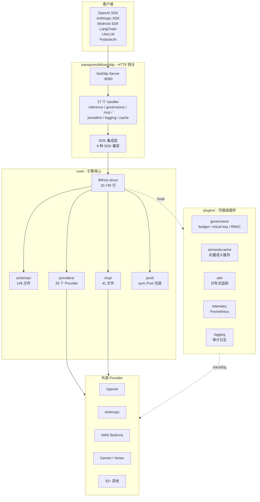
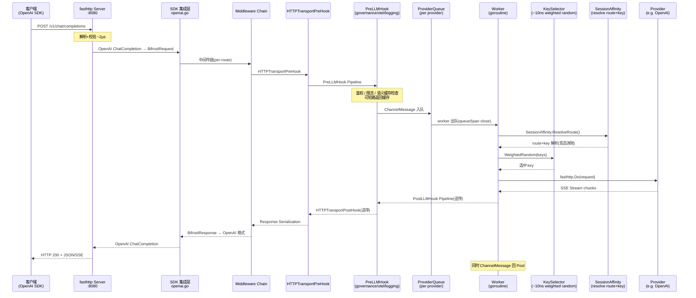

## 引子

在 LLM 应用从 demo 走向生产的路上，「AI Gateway」几乎是绕不开的一层基础设施 — 想象一下：你的产品同时调用 OpenAI、Anthropic、Bedrock、Gemini、DeepSeek、Ollama 等 6+ 个 Provider，每个 Provider 的鉴权方式、错误码、限流策略、流式 chunk 格式都不一样；如果再加上自动 failover、跨 Provider 路由、按 Key 权重选择、虚拟密钥治理、Web Search 等 MCP 工具的服务端注入 — 这就不是「if-else」能解决的复杂度了。

[Bifrost](https://github.com/maximhq/bifrost)（北欧神话里连接天界与人间的那座彩虹桥）正是为这一层复杂度而生：**把 23+ Provider 收敛到一个 OpenAI 兼容 API 之后，再把请求队列、Key 选择、失败分类、Session 粘性、MCP 网关、跨 Provider 的 encrypted reasoning 重写 — 这些「生产可观测性」的基础设施**做成可复用的 Go 核心库**。** 它在 GitHub 上 ⭐8.7k（pushed 2026-10-11），是 2026 H2 工业级 AI Gateway 赛道最具工程纵深的代表。

本文将沿着 Bifrost 的源码（`core/bifrost.go` 10,749 行、`core/schemas/` 149 个文件、`core/providers/` 33 个 Provider 实现、`core/mcp/` 41 个 MCP 文件），从「ChannelMessage 通道 → Provider 接口 → FailureClass 分类 → SessionAffinity 竞态 → InjectedTools 注入 → EncryptedReasoning 重写」六个层级，逐层拆解这套「把 LLM Gateway 写成数据面」的设计哲学。

## 项目定位与核心价值

### 一句话定义

> **Bifrost = OpenAI 兼容 API + 33 Provider 适配 + 11µs P50 延迟 + FailureClass 驱动的智能 failover + 服务端 MCP 工具注入 + 企业级 Key/治理/预算插件**。

它不是 LiteLLM 的 Go 重写那么简单 — 它在三个维度上走出了自己的路：

| 维度 | Bifrost | LiteLLM | Portkey | Helicone |
|------|---------|---------|---------|----------|
| 语言 | **Go（fasthttp）** | Python | TypeScript | TypeScript |
| P50 延迟 | **~11µs** | ~500µs | ~100µs | ~150µs |
| Provider 数 | 23+ | 100+ | 20+ | 20+ |
| MCP Gateway | **是** | 否 | 否 | 否 |
| 失败分类 | **9 类** | 4 类 | 2 类 | 2 类 |
| Session 粘性 | **是（KV store + 竞态解决）** | 否 | 限流粒度 | 否 |
| 服务端 Web Search | **是（InjectedTools）** | 否 | 否 | 否 |
| OpenAI/Anthropic/Bedrock SDK 兼容 | **是（6 种）** | 是 | 是 | 否 |
| 治理插件 | **是（governance plugin）** | 否 | 是 | 否 |
| License | **Apache-2.0** | MIT | Apache-2.0 | Apache-2.0 |

**关键差异化**：

- **Go 协程 + Channel 模型**（不是 Python asyncio）→ 真正的高并发 + 低延迟
- **fasthttp 零分配**（不是 net/http）→ 把 LLM Gateway 推到 ~11µs 延迟
- **Provider 接口 30+ 方法强约束**（不是 duck typing）→ 加新 Provider 时漏方法编译就挂
- **FailureClass 9 类精细化分类**（不是单纯按 HTTP status code）→ 「同一 429 是 quota 还是 rate limit」「同一 400 是 credential 还是 caller fault」分得清清楚楚
- **MCP Gateway + 服务端 InjectedTools**（不只是 proxy）→ 模型不需要自带工具能力，Bifrost 在服务端注入 web_search 等 MCP 工具

### 仓库统计

| 指标 | 值 |
|------|----|
| Stars | **⭐8.7k** |
| 主语言 | **Go 100%** |
| License | Apache-2.0 |
| pushed_at | 2026-10-11 |
| 仓库大小 | ~1.06 GB |
| Go 版本 | **1.27.0** |
| 模块数 | 4 个 Go workspace（core / framework / transports / plugins/* 共 9 个 plugin） |
| Provider 集成 | **33** 个 |
| Schema 文件 | 149 个 |
| MCP 文件 | 41 个 |
| 最大单文件 | `core/bifrost.go` **10,749 行 / 441KB** |
| E2E 测试 | Playwright（27 个 endpoint handler + 48 个 LLM test 文件） |

## 整体架构：Channel × Provider × Plugin 三轴交织

Bifrost 的代码结构在 `AGENTS.md` 里画得很清楚——一个 **Go workspace** 拆成 4 类模块：



**核心循环（来自 AGENTS.md）**：

```text
Client HTTP Request
  → FastHTTP Transport (parsing, validation ~2µs)
    → SDK Integration Layer (OpenAI/Anthropic/Bedrock format → Bifrost format)
      → Middleware Chain (lib.ChainMiddlewares, applied per-route)
        → HTTPTransportPreHook (HTTP-level plugins, can short-circuit)
          → PreLLMHook Pipeline (auth, rate-limit, cache check — registration order)
            → MCP Tool Discovery & Injection (if tool_choice present)
              → Provider Queue (channel-based, per-provider isolation)
                → Worker picks up request
                  → Key Selection (~10ns weighted random)
                    → Provider API Call (fasthttp client, connection pooling)
                      → Response / SSE Stream
                → PostLLMHook Pipeline (reverse order of PreLLMHooks)
              → Tool Execution Loop (if tool_calls in response, MCP agent loop)
            → HTTPTransportPostHook (reverse order)
          → Response Serialization
        → HTTP Response to Client
```

注意几个关键设计：

1. **每个 Provider 独立 worker pool + queue**——一个 Provider 挂了不会拖垮其他 Provider
2. **Plugin 钩子对称**：Pre-hooks 按注册顺序执行，Post-hooks 按**逆序**（LIFO）执行，每个 Pre 都保证对应 Post 必跑
3. **Object pool 满地开花**：`sync.Pool` 包装覆盖了 `channelMessage / responseChannel / errorChannel / streamChannel / pluginPipeline / bifrostRequest / httpRequest/Response` —— 「**GC 不该是 AI Gateway 的瓶颈**」
4. **Streaming 流式 chunk 走 `chan chan *BifrostStreamChunk`**：双层 channel，外层是 SSE 流本身，内层是 chunk 队列

## Provider 接口：30+ 方法的强约束契约

`core/schemas/provider.go`（50,456 字节）定义了 Bifrost 的 **Provider 接口**——这是它与 LiteLLM「鸭子类型」最大的区别：**所有 Provider 必须实现 30+ 方法，不支持的返回「not supported」**。

```go
// 来自 core/schemas/provider.go
type Provider interface {
    // 列表
    ListModels(ctx *BifrostContext, key Key) (*BifrostListModelsResponse, *BifrostError)

    // Chat Completion + 流式
    ChatCompletion(ctx *BifrostContext, postHookRunner PostHookRunner,
                   key Key, request *BifrostChatRequest) (*BifrostChatResponse, *BifrostError)
    ChatCompletionStream(ctx *BifrostContext, postHookRunner PostHookRunner,
                          key Key, request *BifrostChatRequest) (chan *BifrostStreamChunk, *BifrostError)

    // Responses API（OpenAI Responses）
    Responses(...) (...)
    ResponsesStream(...) (...)

    // 文本补全
    TextCompletion(...) (...)
    TextCompletionStream(...) (...)

    // 多模态
    Embedding(...) (...)
    Speech / SpeechStream / Transcription / TranscriptionStream
    ImageGeneration / ImageGenerationStream
    ImageEdit / ImageEditStream / ImageVariation

    // Token 计数
    CountTokens(...) (...)

    // Batch 操作（5 个方法）
    BatchCreate / BatchList / BatchRetrieve / BatchCancel / BatchResults

    // 文件管理（5 个方法）
    FileUpload / FileList / FileRetrieve / FileDelete / FileContent

    // 容器管理（5 个方法）
    ContainerCreate / ContainerList / ContainerRetrieve / ContainerDelete
    ContainerFileCreate / ContainerFileList / ContainerFileRetrieve / ContainerFileDelete
}
```

**为什么这样设计**？

- **OpenAI 兼容 Provider**（Groq / Cerebras / Ollama / Perplexity / OpenRouter / Parasail / Nebius / xAI / SGL）**全部委托给 `openai.HandleOpenAI*` 函数**——`provider/<name>.go` 只剩 ~100 行的 constructor + 委派逻辑。这意味着 OpenAI converter 改一行会**影响 9 个 Provider**，必须 `make test-core` 全量回归
- **非 OpenAI 兼容 Provider**（Anthropic / Bedrock / Gemini / Cohere / HuggingFace / Replicate / ElevenLabs）每个 Provider 一个完整目录：`<name>.go` + `types.go` + `errors.go` + `chat.go` + `responses.go` + `embedding.go` + `images.go` + `speech.go`
- **Converter 函数命名严格**： `To<ProviderName><Feature>Request()`（Bifrost → Provider）和 `ToBifrost<Feature>Response()`（Provider → Bifrost）— **必须是纯转换函数**，不能有 HTTP 调用、不能有日志、不能有副作用

**SDK 兼容性矩阵**（`transports/bifrost-http/integrations/`）：

```text
├── openai.go         OpenAI SDK drop-in
├── anthropic.go      Anthropic SDK
├── bedrock.go        AWS Bedrock SDK
├── genai.go          Google GenAI SDK
├── langchain.go      LangChain
├── litellm.go        LiteLLM
└── pydanticai.go     PydanticAI
```

这是「**让现有用户的代码 0 改动迁移到 Bifrost**」的关键 — 你用 LangChain 写的 chat 链、把 `ChatOpenAI(base_url="http://bifrost:8080/v1")` 就行，剩下的 Provider failover、限流、MCP 工具注入全部透明。

## 核心引擎一：ChannelMessage 通道模型与 Provider 队列

`core/bifrost.go` 的 `ChannelMessage` 结构是整个请求生命周期的最小单元：

```go
// 来自 core/bifrost.go
type ChannelMessage struct {
    schemas.BifrostRequest
    Context        *schemas.BifrostContext
    Response       chan *schemas.BifrostResponse
    ResponseStream chan chan *schemas.BifrostStreamChunk
    Err            chan schemas.BifrostError
    queueSpan      schemas.SpanHandle  // 入队时开的 span,worker 出队时关
    sentAt         time.Time            // worker 发送结果前的时刻,用于测 worker→caller 延迟
    firstTokenTimeout time.Duration     // 流式首 token 超时 deadline
    streamPostHooksRan bool             // 流错误 post-hooks 是否已跑
    handoff        atomic.Int32         // 非流请求的「终值归属」仲裁
}
```

每个 Provider 维护一个独立的 `ProviderQueue`：

```go
// 来自 AGENTS.md 描述的 ProviderQueue 模式
type ProviderQueue struct {
    queue      chan *ChannelMessage
    done       chan struct{}
    closing    uint32         // atomic: 0=open, 1=closing
    signalOnce sync.Once      // 确保 signal 只发一次
    closeOnce  sync.Once      // 确保 close 只发一次
}
```

**关键设计**：

- **`atomic.Closing + sync.Once`**：防止「send on closed channel」panic —— 这是 Go 并发代码的经典坑
- **`handoff atomic.Int32`**：解决 worker 发送 vs caller context 取消之间的竞态 — 注释里写得很清楚：

  > "The claim makes it deterministic: the worker claims before it sends and the caller then must receive, or the caller abandons first and the worker bills and releases. (#6972)"

  这是一个「终值归属」的 CAS（Compare-And-Swap）问题——双方都想 set 自己的值，handoff 字段决定谁先 set。

- **`sync.Pool` 复用 ChannelMessage**：每个请求都新建 `ChannelMessage` 会造成大量 GC 压力；Bifrost 给它做了对象池（`channelMessagePool`），用完 reset 字段再 `Put`。

**Stream 流的双层 channel**：

```go
// Streaming 流式 chunk 走 chan chan *BifrostStreamChunk
// 外层 channel 是「流本身」的句柄 — caller 用它 listen
// 内层 channel 是「每个 chunk」的队列 — worker 用它 send
ResponseStream chan chan *schemas.BifrostStreamChunk
```

为什么是双层？因为一个 client stream 可能跨多个 upstream stream（比如 `InjectedTools` 模式下，每轮 LLM 流结束后 Bifrost 执行 MCP 工具，再发起下一轮 LLM 流）—— 外层 channel 表示「整个流对客户端是连续的」，内层 channel 是「每个上游流内部的 chunk」。

## 核心引擎二：KeySelector 10ns 加权随机与 SessionAffinity 竞态

### KeySelector：~10ns 的加权随机

`core/keyselectors/weightedrandom.go`（67 行）实现了一个朴素但严密的加权 Key 抽取：

```go
// 来自 core/keyselectors/weightedrandom.go:12-37
func WeightedRandom(ctx *schemas.BifrostContext, keys []schemas.Key,
                    providerKey schemas.ModelProvider, model string) (schemas.Key, error) {
    totalWeight := 0.0
    for _, key := range keys {
        totalWeight += usableWeight(key.Weight)
    }
    if totalWeight == 0 {
        return keys[rand.Intn(len(keys))], nil   // 全部 weight=0 → 均匀回退
    }
    // float 溢出保护:sum 接近 +Inf 时除以 maxWeight 重缩放
    scale := 1.0
    if math.IsInf(totalWeight, 1) {
        maxWeight := 0.0
        for _, key := range keys {
            maxWeight = max(maxWeight, usableWeight(key.Weight))
        }
        scale = 1 / maxWeight
        totalWeight = 0
        for _, key := range keys {
            totalWeight += usableWeight(key.Weight) * scale
        }
    }
    randomValue := rand.Float64() * totalWeight
    currentWeight := 0.0
    for _, key := range keys {
        currentWeight += usableWeight(key.Weight) * scale
        if randomValue < currentWeight {
            return key, nil
        }
    }
    return keys[0], nil
}

func usableWeight(weight float64) float64 {
    if weight < 0 || math.IsNaN(weight) || math.IsInf(weight, 0) {
        return 0   // 负数/NaN/Inf 视为 0 — 防 panic
    }
    return weight
}
```

**4 个防 panic 设计**：

1. **负 weight 视为 0**：写路径应该拒绝，但读路径防御性兜底
2. **NaN/Inf 视为 0**：同上
3. **sum 溢出重缩放**：所有 weight 之和接近 `+Inf` 时除以 maxWeight
4. **`rand.Float64()` 不是 `rand.Intn(totalWeight*1000)`**：直接用 float，避免 `int` 转换时丢精度

### SessionAffinity：跨请求的「粘性 + 竞态消除」

`core/sessionaffinity.go`（521 行）是 Bifrost 的「**把 session 路由钉在同一个 Provider + 同一个 Key 上**」核心机制：

```go
// 来自 core/sessionaffinity.go
const sessionStateKeyPrefix = "session:v2:"

const (
    SessionStateKindRoute = "route"  // session 的 route 绑定
    SessionStateKindKey   = "key"    // session 在该 Provider 内的 key 绑定
    sessionAffinityResolvedKey schemas.BifrostContextKey = "bifrost-session-affinity-resolved"
)

type sessionResolution struct {
    route    string        // session 在哪个 route 上服务的
    keyRoute schemas.Route // ResolveKey 给出的具体 route
    keyID    string        // session 在该 route 上的具体 key
}

type sessionAffinity struct {
    kv     schemas.KVStore
    logger schemas.Logger
}
```

**4 个核心行为**（注释里写得极其精炼）：

1. **「session stays on the provider that last served it」**—— 只有当 routing 链里还有该 Provider 时才把它前移
2. **「a fallback that served becomes the session's new home」**—— failover 成功后，session 绑定的 Provider 跟着换
3. **「a key that only ever failed is never bound」**—— 只记录成功的 key，不绑定失败过的 key
4. **「A binding the request followed into a failure is dropped」**—— 进入失败的绑定会被丢弃，不让 session「锁死」在失败的 Provider

**race resolution**（这是 SessionAffinity 最精巧的设计）：

并行 fallback 时，两个 worker 可能同时 resolve 同一个 session，结果一个 fallback 成功、一个 fallback 失败 — 如果「失败的 binding」先写入 KV store，后续请求会路由到失败的 Provider。`sessionAffinityResolvedKey` 字段在 `ctx` 上做 CAS：worker 在 resolve 时**先 claim**（原子写），claim 成功的 worker 才写入绑定，失败的 worker 看到已被 claim 则放弃。

这与之前 `ChannelMessage.handoff` 是同一类问题（CAS 终值归属），但场景不同：
- `handoff`：解决「worker 发结果 vs caller ctx 取消」
- `resolvedKey`：解决「两个 worker 并行写 session binding」

## 核心引擎三：FailureClass 9 类精细化分类

`core/failureclass.go` 是 Bifrost 「**和 Naive retry loop 不一样**」的核心。**LiteLLM / Portkey / Helicone 大都按 HTTP status code 简单分类（4 类），Bifrost 做了 9 类精细化分类**，区分「**是 key 死了还是 quota 没了还是 model 没了还是 region 被封了**」—— 不同类别触发不同 retry 策略。

```go
// 来自 core/schemas/failureclass.go
const (
    FailureClassCredential   FailureClass = "credential"     // key 死了 — revoke/malformed/account locked
    FailureClassModelAccess  FailureClass = "model_access"   // 这个 key 访问不到这个 model
    FailureClassQuota        FailureClass = "quota"          // 账户余额/账单超限 — 等是没用的
    FailureClassModelGone    FailureClass = "model_gone"     // model 被 Provider 退役
    FailureClassRegionBlocked FailureClass = "region_blocked" // Provider 拒绝请求的地理位置
    FailureClassRateLimit    FailureClass = "rate_limit"     // rate limit — 同一个 key 可能很快恢复
    FailureClassCallerFault  FailureClass = "caller_fault"   // 请求本身被拒绝 — 换 key 也没用
    FailureClassTransient    FailureClass = "transient"      // 上游挂了,与 key/request 无关
    FailureClassUnknown      FailureClass = "unknown"        // 没识别出来的失败 — 不 retry 不 rotate
    FailureClassTimeout      FailureClass = "timeout"        // 超时
    FailureClassCancelled    FailureClass = "cancelled"      // 调用者取消
)
```

`ClassifyFailure()` 函数（约 200 行）的核心决策树：

```go
// 来自 core/failureclass.go（简化版）
func ClassifyFailure(err *schemas.BifrostError) schemas.FailureClass {
    // 1. Bifrost 自己引发的失败 — 优先识别
    if err.IsBifrostError { return FailureClassUnknown }
    if err.Error.Type != nil {
        switch *err.Error.Type {
        case schemas.RequestTimedOut: return FailureClassTimeout
        case schemas.RequestCancelled: return FailureClassCancelled
        }
    }

    // 2. transport 失败 — 与 key 无关
    if message == ErrProviderDoRequest || message == ErrProviderNetworkError {
        return FailureClassTransient
    }

    // 3. quota 必须在 rate limit 之前识别
    //    因为 OpenAI/Gemini/Anthropic 的 exhausted balance 也走 429 + rate-limit 风格 message
    if !transient && (status == 402 || slices.Contains(quotaCodes, code) || ...) {
        return FailureClassQuota
    }

    // 4. rate limit — 包括不返 429 但 message 含 rate limit 词的那些 Provider
    if status == 429 || (status != 401 && status != 403 && hasRateLimitSignal(err)) {
        return FailureClassRateLimit
    }

    // 5. transient 5xx — 同一个 key 重试
    if transient { return FailureClassTransient }

    // 6. region block
    if code == "unsupported_country_region_territory" || ... {
        return FailureClassRegionBlocked
    }

    // 7. credential — 401 + 类型识别 + message 识别
    if status == 401 || ... { return FailureClassCredential }

    // 8. model access vs model gone — 同 signals 不同 message
    if isModel, retired := modelSignals(status, errType, code, lower, body); isModel {
        if retired { return FailureClassModelGone }
        return FailureClassModelAccess
    }

    // 9. 其他 403 — permission 问题
    if status == 403 { return FailureClassCredential }

    // 10. caller fault — 400/409/413/415/422 (4xx caller side)
    if slices.Contains(callerFaultStatusCodes, status) && (...) {
        return FailureClassCallerFault
    }

    return FailureClassUnknown
}
```

**为什么必须先识别 quota 再识别 rate limit？** 注释里说得明明白白：

> "Quota before rate limit: OpenAI, Gemini and Anthropic report an exhausted balance or a spend cap under a 429 whose message also matches the rate-limit patterns. A transient 5xx stays transient whatever its body says, as it always has."

也就是说：**OpenAI 的 429 + "insufficient_quota" 不是 rate limit，是 quota**——这种错误「等一会儿」没用，必须立刻切到另一个 key 或者直接返回错误。

**key 旋转策略**（`retriesWithoutRotation`）：

```go
func retriesWithoutRotation(err *schemas.BifrostError, class schemas.FailureClass) bool {
    switch class {
    case FailureClassTransient, FailureClassRateLimit:
        return true   // 同一个 key 重试 — 换 key 没用
    case FailureClassRegionBlocked:
        return false  // 区域问题换 key 也救不了
    }
    if err == nil || !class.IsPermanentPerKey() {
        return false
    }
    return (err.StatusCode != nil && slices.Contains(perKeyStatusCodes, *err.StatusCode)) ||
           hasRateLimitSignal(err)
}
```

`FailureClass` 的方法 `IsPermanentPerKey()` 由实现决定：

- `FailureClassCredential / Quota / ModelGone`：永久性错误 — 换 key
- `FailureClassModelAccess`：可能换 key 就好（另一个 key 可能有权限）
- `FailureClassCallerFault / Unknown`：换 key 没用
- `FailureClassTransient / RateLimit / Timeout`：retry 同一个 key

**这就是 Bifrost 「智能 failover」的核心**：不是「出错就换下一个 Provider」，而是「**只有这个 key 不可救药时才换**」。

## InjectedTools：服务端 MCP 工具注入

`core/injectedtools.go`（664 行）和 `core/injectedtoolstream.go`（860 行）实现了 Bifrost 的「**Bifrost 自己执行 MCP 工具，模型不知道**」机制。

**为什么需要这个？** 不是所有 LLM Provider 都原生支持 function calling（如 OpenAI 兼容的某些旧模型、纯文本 completion 模型、推理模型如 o1 在某些模式下不能调工具）。Bifrost 的解法是：

1. **服务端注入**：在请求 provider 前把 MCP 工具描述以 function call 形式塞进 request body
2. **服务端执行**：当模型「假装调」工具（返回 tool_calls），Bifrost 拦截、自己执行 MCP 工具、把结果作为下一轮 message 注入
3. **客户端透明**：客户端代码完全不用知道 Bifrost 做了这件事

```go
// 来自 core/injectedtools.go
type injectedToolSet struct {
    tools         []schemas.ChatTool     // 函数工具列表(带 prefix)
    names         map[string]struct{}    // prefixed names,用于分类模型调用
    webSearchName string                 // web search tool 的 prefixed name
    maxDepth      int                    // tool loop 最大递归层数
}

func resolveInjectedTools(src injectedToolSource, config *schemas.ProviderConfig,
                          requestType schemas.RequestType, logger schemas.Logger) *injectedToolSet {
    if src == nil || config == nil || config.InjectedTools.IsEmpty() {
        return nil
    }
    switch requestType {
    case schemas.ChatCompletionRequest, schemas.ChatCompletionStreamRequest,
         schemas.ResponsesRequest, schemas.ResponsesStreamRequest:
    default:
        return nil   // 只 Chat / Responses 支持工具注入
    }
    ref := config.InjectedTools.WebSearch
    tool, err := src.GetInjectedTool(ref.MCPClientName, ref.ToolName)
    if err != nil || tool.Function == nil {
        if logger != nil {
            logger.Warn("injected web search tool %s/%s unavailable, sending request without it: %v",
                        ref.MCPClientName, ref.ToolName, err)
        }
        return nil   // ★ fail open — MCP server 挂了不影响其他模型
    }
    maxDepth := src.GetMaxAgentDepth()
    if maxDepth <= 0 {
        maxDepth = schemas.DefaultMaxAgentDepth
    }
    name := tool.Function.Name
    return &injectedToolSet{
        tools:         []schemas.ChatTool{tool},
        names:         map[string]struct{}{name: {}},
        webSearchName: name,
        maxDepth:      maxDepth,
    }
}
```

**两个生产级关键设计**：

1. **「fail open」哲学**：「A tool that cannot be resolved (client missing, disabled, or not exposing the tool) fails open: the request goes out as the caller sent it」—— **MCP server 挂掉时，模型调用透明降级**，**不会**因为一个 MCP server 挂了就让所有 Provider 都不可用
2. **「copy-on-write」语义**：「req.BifrostRequest is shared across retries and fallbacks, so a fallback to a provider without injected tools must see the caller's request exactly as sent」—— 重试和 fallback 不会污染原始 request

**流式场景**（`injectedtoolstream.go`）：

```go
// 一个 client stream 跨多个 upstream stream:
// 每轮的 text 流式发给 client,
// injected tool call 暂存,这一轮结束后执行,
// 只有最后一轮结束才真正关掉 client stream
type injectedChatStream struct {
    set   *injectedToolSet
    depth int
    id         string
    created    int
    roleSent   bool
    chunkIndex int
    usage      *schemas.BifrostLLMUsage
    text      strings.Builder
    reasoning strings.Builder
    calls     map[uint16]*streamedCall
    finish    *string
    turnUsage *schemas.BifrostLLMUsage
    more      bool  // turn final chunk:injected calls pending
}
```

这段代码最 tricky 的是：模型一边流式输出，一边 Bifrost 在后台拼接 `tool_calls.arguments` 的 delta，等到 turn 结束才把完整的 tool call 拿去 MCP 执行。如果用户在 stream 过程中取消（断网 / close conn），那些「正在拼接」的 tool call 要清理掉，`streamEmit.terminal` 标志位决定哪个 chunk 是真正的「最后一个」。

## EncryptedReasoning：跨 Provider 的 reasoning 重写

`core/encryptedreasoning.go`（942 行）是 Bifrost 处理「**推理模型的加密 thinking 内容跨 Provider fallback**」的精妙代码。

**问题场景**：OpenAI o1 / o3 系列的 `encrypted_content` 是 OpenAI 私有的 RSA-OAEP 加密块，仅 OpenAI 自己的 server 能解密。但如果你想把一个 o1 session fallback 到 Anthropic Claude（通过 Bedrock）或 Gemini，**你不能原样把 `encrypted_content` 转发过去** —— 别的 Provider 不认这个字段，会返 400。

Bifrost 的解法是「**字段名映射 + 启发式检测 + fallback 重写**」：

```go
// 来自 core/encryptedreasoning.go
const encryptedContentErrorCode = "invalid_encrypted_content"

// 各个 Provider 接收 encrypted_content 的字段名:
// - OpenAI / Azure: encrypted_content (forwarded verbatim)
// - Anthropic (direct/Vertex/Bedrock): redacted_thinking (via convertBifrostReasoningToAnthropicThinking)
// - Gemini / Vertex Gemini: thought_signature
// - Bedrock Converse: reasoning block 的 signature
// - Cohere: 故意忽略 — Cohere 无 encrypted reasoning 字段
var encryptedReasoningFieldMarkers = []string{
    "encrypted_content",
    "encrypted content",
    "redacted_thinking",
    "thought_signature",
    "thoughtsignature",
    "reasoningcontent",
}
```

**三段式管线**：

1. **入站时识别** — 如果上游 Provider 返了 `invalid_encrypted_content` 错误码，标记这个 `item_id` 的 payload 是「跨 Provider fallback 时不可重放」的
2. **出站时剥离** — 给某个 Provider 发请求前，如果该 Provider 不识别这个字段，把 `encrypted_content` 删掉（保留 `summary` 字段作为 fallback）
3. **重放时验证** — `BifrostError.ExtraFields` 里记录 `InvalidEncryptedContentIDs`，后续 turn 看到这个 id 就直接跳过对应的 reasoning item

为什么这个工程价值高？因为：

- **支持跨 Provider session** — 一个 session 在 o1 上开始，可以无感切换到 o3-mini、Gemini 2.5 Thinking、Claude 4.5 Sonnet（带 thinking）等推理模型 — **传统 LLM Gateway 在第一次 fallback 就崩**
- **避免「fallback 到 Azure 拿到 OpenAI 加密的 reasoning 字段 → Azure 返 400 → 再 fallback 到 Bedrock Mantle 又拿到同一段 → Bedrock Mantle 也返 400」的死循环**

## Decision Emulation：让所有 Provider 都能做结构化决策

`core/decisionemulation.go`（249 行）+ `core/providers/utils/decisionemulation.go`（22KB）是 Bifrost 的「**统一决策 API**」能力。

**问题**：不是所有 Provider 都有原生 structured decision / classification API。但每个 Provider 都有 chat API。Bifrost 的解法是：

1. 把 decision request 编码成「forced function call」 — 每个 question 对应一个参数（choice/score）
2. 调 Provider 的 Responses API（OpenAI 兼容），让模型输出 function call 而不是 free text
3. 把 function call 参数映射回 neutral `DecisionResponse`

```go
// 来自 core/decisionemulation.go
const decisionSystemPrompt = "You are a judgment engine. Read the given state and answer every question by " +
    "calling the provided function exactly once. For each question emit the requested value and your " +
    "confidence from 0 to 1. For every choice and score question also report the full probability " +
    "distribution over its options or levels; the probabilities must sum to 1. For choice, select an option " +
    "with the highest probability. Base every answer only on the state; do not invent facts."

func (bifrost *Bifrost) emulateDecisionViaResponses(
    ctx *schemas.BifrostContext,
    provider schemas.Provider,
    key schemas.Key,
    req *schemas.BifrostDecisionRequest,
) (*schemas.BifrostDecisionResponse, *schemas.BifrostError) {
    // ...
    // 拒绝带图片/音频的决策 — 文本模型读不了
    if partType := req.Input.NonTextPartType(); partType != "" {
        return nil, providerUtils.NewBifrostBadRequestError(
            fmt.Sprintf("decision emulation cannot read an %q part in the input; route the request to a provider that accepts it", partType))
    }
    // ...
}
```

**注意两个拒绝语义**：

- **拒绝带图片/音频的 decision**：state 走文本传给 LLM，如果 input 含非文本 part，模型读到的是 base64 编码（不是真正的语义）— **refusing beats a silent answer that never saw the evidence**
- **拒绝原生 ExtraParams**：decision 是 unified API 的一部分，如果用户带了 provider-specific 扩展（如图片），应该走原 Provider 的 decision API 而不是 emulation — **route the request to a provider that serves them natively**

## Pool 系统：sync.Pool 包装 vs Debug 双检

`core/pool/pool_prod.go` + `core/pool/pool_debug.go`（双 build 模式）实现了一个 **零开销 sync.Pool 包装 + Debug 模式双检**：

```text
core/pool/
├── pool_prod.go      # 默认 build — zero-overhead sync.Pool wrapper
└── pool_debug.go     # -tags pooldebug — 检测 double-release / use-after-release / leak
```

**用法**：

```go
p := pool.New[MyType]("descriptive-name", func() *MyType { return &MyType{} })
obj := p.Get()
// ... use obj ...
// MUST reset ALL fields before Put — pool does not auto-reset
p.Put(obj)
```

**两个 hard rule**（来自 AGENTS.md）：

1. **永远 reset 所有字段再 Put** — 否则 stale data 泄漏给下一个 user
2. **Debug 模式不检查 missing reset** — 但会检查 double-release / use-after-release / leak 并打出 stack trace

**为什么生产用 sync.Pool**？因为 GC 是高频网络服务的瓶颈——`sync.Pool` 在两次 GC 之间复用对象，显著降低 alloc/heap growth。Bifrost 给 7+ 种高频对象都做了 Pool：`channelMessage / responseChannel / errorChannel / streamChannel / pluginPipeline / bifrostRequest / httpRequest/Response` —— 这就是「**11µs P50 延迟 + 5k RPS**」的工程底色。

## 端到端数据流：从 HTTP 到 Provider 再回来



**几个 latency 关键点**：

- HTTP 解析 ~2µs（fasthttp 零分配）
- KeySelector ~10ns（加权随机仅 30 行 Go）
- SessionAffinity 是 KV store lookup（KV 是 local Redis 或 PG）— ~50µs
- Provider API call 占 99%+ 延迟（典型 200ms-2s）

## 与同类项目对比

| 维度 | **Bifrost** | LiteLLM | Portkey | Helicone | vLLM Semantic Router |
|------|-------------|---------|---------|----------|---------------------|
| 语言 | Go | Python | TypeScript | TypeScript | Python (Rust 内核) |
| 延迟(P50) | **~11µs** | ~500µs | ~100µs | ~150µs | ~50µs (路由层) |
| Provider 数 | 23+ | 100+ | 20+ | 20+ | 5+ (本地推理) |
| 失败分类 | **9 类精细化** | 4 类 (status code) | 2 类 (retry/not) | 2 类 | N/A (无 Provider) |
| Session 粘性 | **是(KV + CAS 竞态)** | 否 | 限流粒度 | 否 | N/A |
| MCP Gateway | **是(41 文件)** | 否 | 否 | 否 | 否 |
| 服务端 Injected Tools | **是** | 否 | 否 | 否 | 否 |
| Encrypted Reasoning 跨 Provider | **是** | 否 | 否 | 否 | N/A |
| 治理插件 | **是(governance plugin)** | 否 | 是 | 是 | 否 |
| OpenAI/Anthropic SDK 兼容 | **6 种** | LiteLLM 自有 | OpenAI | OpenAI | N/A |
| 流式 chunk 累积 | framework/streaming/accumulator | 简单字符串拼接 | 简单 | 简单 | 不适用 |
| License | Apache-2.0 | MIT | Apache-2.0 | Apache-2.0 | Apache-2.0 |

**关键设计差异**：

1. **Go vs Python**——Bifrost 不是简单的「LiteLLM Go 重写」。Go 的协程 + channel 模型让 `ProviderQueue + atomic.Closing + sync.Pool` 的低延迟并发原语成为可能。Python asyncio 单进程难做到 5k RPS @ 11µs
2. **9 类 FailureClass vs status code**——LiteLLM 按 4xx/5xx 简单分类，Bifrost 的 `FailureClassCredential / Quota / ModelGone / ModelAccess / RegionBlocked / CallerFault / Transient / Timeout / Cancelled` 是「**业务语义级**」分类，能区分「同 429 的 rate_limit vs quota」「同 400 的 credential vs caller_fault」
3. **SessionAffinity CAS 竞态消除**——并行 fallback 时两个 worker 同时 resolve 同一个 session，谁的 binding 写入？LiteLLM 没有 session 概念；Portkey 只有「sticky session for sticky rate limit」，没有 CAS
4. **MCP Gateway 是 first-class**——Bifrost 的 `core/mcp/` 41 个文件 + `core/mcp/agent.go` 多轮 agent loop + `core/mcp/codemode/starlark/` Starlark 沙箱 code-mode 执行 —— **不是简单的 MCP proxy**，是把「LLM + 工具」作为统一抽象
5. **InjectedTools 服务端透明**——这是 Bifrost 独有：**模型本身不需要支持 tool calling**，Bifrost 在请求 provider 前注入 function call schema、在 provider 返 tool_calls 后自己执行、把结果作为下一轮 message 注入 —— 让「不支持工具的老模型」也能用上 web search

## 优缺点分析

### 架构简洁性 / 扩展性 / 易用性（左侧）

| 优势 | 说明 |
|------|------|
| **Channel × Worker 模型极简** | 一个 `ProviderQueue` 模式 + `atomic.Closing + sync.Once` 解决所有并发安全 |
| **Provider 接口强约束** | 加新 Provider 必须实现 30+ 方法，编译就挂 — 防止「忘了实现某个 method」上线 |
| **Plugin 钩子对称** | Pre-hooks 正序、Post-hooks 逆序（LIFO），每个 Pre 都保证对应 Post 必跑 — 简化 plugin 作者心智 |
| **6 种 SDK drop-in 兼容** | 现有用户的 OpenAI / Anthropic / Bedrock / LangChain / LiteLLM / PydanticAI 代码 0 改动迁移 |
| **9 个 Plugin 模块独立** | governance / telemetry / logging / semanticcache / otel / mocker / jsonparser / maxim / compat — 每个都是独立 Go module，可以单独引入 |

### 性能 / 复杂度 / 维护性（右侧）

| 挑战 | 说明 |
|------|------|
| **Go 1.27.0 workspace 复杂度** | 4 个 Go module + 9 个 plugin module — 改一个 core 字段可能要 cross-module `go mod tidy`，新人上手成本高 |
| **Provider 接口 30+ 方法** | 加新 operation type 要改 30+ 个 Provider — 大量 boilerplate 「return ErrNotSupported」 |
| **33 个 Provider 同步演进** | OpenAI converter 改一行 → 9 个 OpenAI-compatible Provider 全要回归测试 (`make test-core`) |
| **FailureClass 规则维护成本** | 9 类精细化分类，每个 Provider 都有自己的状态码 + 错误码 + message 词表 — 加新 Provider 时必须补全 `failureclass.go` 的所有 `*Patterns` / `*Markers` / `*Codes` 列表 |
| **EncryptedReasoning 字段映射矩阵** | 每个 Provider 的 reasoning 字段名 + 拒绝 message 都不一样 — 加新 Provider 时要补 `encryptedReasoningFieldMarkers` |
| **Channel 池化需要纪律** | `pool.Put()` 前必须手动 reset 所有字段 — 「stale data leakage」是 bug 温床，debug 模式只能检测 double-release 不能检测 missing reset |

## 实践 / 部署

### 快速启动（30 秒内跑起来）

```bash
# Step 1: 用 npx 一键启动
npx -y @maximhq/bifrost

# Step 2: 浏览器打开 web UI 配置 Provider
open http://localhost:8080

# Step 3: 第一个 chat completion 调用
curl -X POST http://localhost:8080/v1/chat/completions \
  -H "Content-Type: application/json" \
  -d '{
    "model": "openai/gpt-4o-mini",
    "messages": [{"role": "user", "content": "Hello, Bifrost!"}]
  }'
```

### Docker 部署

```bash
docker run -p 8080:8080 maximhq/bifrost
```

### Go SDK 集成（生产环境用 SDK 而不是 HTTP）

```go
// 来自 AGENTS.md 推荐的 Go SDK 集成模式
package main

import (
    "context"
    bifrost "github.com/maximhq/bifrost/core"
    "github.com/maximhq/bifrost/core/schemas"
)

func main() {
    ctx := context.Background()

    // 1. 初始化 Bifrost 配置
    config := bifrost.NewBifrostConfig(ctx, schemas.BifrostConfig{
        // Account interface 实现 (KeySelector / KeyPoolFilter / Logger / Tracer 等)
        Account:            myAccountImpl,
        Logger:             schemas.NewDefaultLogger(),
        // KeySelector 默认 WeightedRandom,~10ns 一次
        KeySelector:        keyselectors.WeightedRandom,
        // Plugin 列表
        Plugins:            []schemas.LLMPlugin{governancePlugin, otelPlugin},
        // 33 个 Provider 的配置(只列 2 个)
        Providers: map[schemas.ModelProvider]schemas.ProviderConfig{
            schemas.OpenAI: {
                ProviderConfig: schemas.ProviderConfig{
                    APIKey:  os.Getenv("OPENAI_API_KEY"),
                    NetworkConfig: schemas.NetworkConfig{
                        MaxConnsPerHost: 5000,
                        DefaultRequestTimeoutInSeconds: 300,
                    },
                },
            },
            schemas.Anthropic: {
                ProviderConfig: schemas.ProviderConfig{
                    APIKey:  os.Getenv("ANTHROPIC_API_KEY"),
                },
            },
        },
    })

    client, _ := bifrost.NewBifrost(ctx, config)
    defer client.Shutdown(ctx)

    // 2. 发起 Chat Completion
    resp, bifrostErr := client.ChatCompletionRequest(ctx, &schemas.BifrostChatRequest{
        Provider: schemas.OpenAI,
        Model:    "gpt-4o-mini",
        Messages: []schemas.ChatMessage{
            {Role: "user", Content: "Explain Bifrost in 3 sentences."},
        },
        // Fallback 链 — 主 Provider 失败后自动试下一个
        Fallbacks: []schemas.Fallback{
            {Provider: schemas.Anthropic, Model: "claude-3-5-haiku-20241022"},
            {Provider: schemas.Bedrock, Model: "anthropic.claude-3-haiku-20240307-v1:0"},
        },
    })
    if bifrostErr != nil { panic(bifrostErr) }
    fmt.Println(resp.Choices[0].Message.Content)
}
```

### Web Search 服务端注入配置

```yaml
# config.json 中启用 InjectedTools
providers:
  openai:
    api_key: ${OPENAI_API_KEY}
    injected_tools:
      web_search:
        mcp_client_name: "tavily"          # MCP client 名
        tool_name: "tavily_search"         # 工具名
      max_agent_depth: 5                   # tool loop 最大递归
```

之后任何 OpenAI 请求**不需要** `tools: [...]` 字段 — Bifrost 自动注入 web_search 工具,模型调用后 Bifrost 自己执行,把结果作为下一轮 message 注入。

### Session 粘性 + 自动 failover 配置

```yaml
session_affinity:
  kv_store_backend: "redis"               # 用 Redis 做 session 绑定存储
  redis_url: "redis://localhost:6379"

providers:
  openai:
    fallbacks:
      - anthropic                          # 主 OpenAI 失败后切到 Anthropic
      - bedrock
      - gemini
    keys:
      - name: "openai-prod-1"
        weight: 1.0                        # 加权随机 — 同一个 key 多 region 时配 weight
        rate_limit:
          rpm: 3500                        # 每分钟请求数
          tpm: 90000                       # 每分钟 token 数
      - name: "openai-prod-2"
        weight: 0.8
        rate_limit:
          rpm: 5000
          tpm: 200000
```

## 趋势 + 总结

### 趋势判断

1. **AI Gateway 进入「数据面」时代** — 从 LiteLLM 时代的「Python asyncio 路由层」，到 Bifrost 的「Go fasthttp + Channel + atomic + sync.Pool」**数据面**，再到未来 6 个月的「eBPF / io_uring kernel-bypass」—— LLM Gateway 的 latency 竞赛会和 DPDK / service mesh 一样卷到硬件层
2. **9 类 FailureClass 成为行业事实标准** — 2026 H2 起，所有新出的 AI Gateway 都会引入精细化失败分类（Credential / Quota / ModelGone / RegionBlocked / CallerFault / Transient / Timeout / Cancelled / Unknown）。这是 OpenAI o1 类推理模型 + 多 Provider failover 场景的**刚需**
3. **MCP Gateway + 服务端 InjectedTools 融合** — Anthropic 推 MCP 协议时强调「**模型自带工具能力**」，但生产实践发现「**模型不自带工具、Bifrost 服务端注入**」更可控、可观测、可降级。**2026 H2 会有更多 AI Gateway 把 InjectedTools 作为 first-class feature**
4. **Encrypted Reasoning 跨 Provider 重写** — OpenAI o1 / Anthropic Claude thinking / Gemini thought_signature 的 `encrypted_content` 是各 provider 私有加密,**任何严肃的 AI Gateway 都必须做字段映射 + fallback 重写**，否则一 fallback 就崩
5. **Session Affinity + CAS 竞态消除** — 「session 粘性」从 sticky cookie 级别升级到「**带竞态消除的 provider+key 绑定**」,**2026 H2 的 AI Gateway 默认会带 KV store 后端的 session 路由**

### 工程经验提炼

- **「Provider 接口 30+ 方法强约束」比「鸭子类型」更工程化** — LiteLLM 的「每个 Provider 就是一个 class」看似灵活，但生产中你不知道哪个 Provider 缺了哪个 method；Bifrost 的「不实现就编译挂」**强制所有人写 boilerplate ErrNotSupported,反而更稳**
- **「失败分类语义必须比 HTTP status code 多一层」** — 同一个 429,可能是 rate_limit(同 key retry)也可能是 quota(同 key 永久失效)。Bifrost 的 9 类 FailureClass **把 retry 策略决策从「魔法数字」变成「业务规则」**
- **「Object Pool + atomic + sync.Once 是低延迟 AI Gateway 的标配」** — `fasthttp` 解决了 HTTP 解析,`sync.Pool` 解决了 GC 压力,`atomic + sync.Once` 解决了「send on closed channel」panic —— 三个原语加起来就是 11µs P50
- **「服务端工具注入比 client 端 tool calling 更可控」** — 模型自己执行工具会面临「工具调用失败重试」「工具调用日志散落」「多轮 agent 循环不可控」问题。Bifrost 的 InjectedTools 把工具执行收回服务端,**每一次调用都有可观测的 span、有 retry 策略、有 failure class**
- **「Go workspace 多 module」比「Python monorepo」更适合做 LLM Gateway** — Python 项目里 cross-module 改动靠 `requirements.txt` 推不动,新人 setup 环境就要 30 分钟;Go workspace + `go.work` 让 4 个 core + 9 个 plugin module **独立编译、独立测试、独立发布**

### 选型建议

- **你在意延迟 + 高并发 + 跨 Provider failover** → **Bifrost**(本文主角)
- **你需要 100+ Provider 覆盖 + Python 生态** → LiteLLM
- **你是 TS/JS 团队 + 想要 SaaS 化** → Portkey
- **你只需要请求日志 + observability + 1 个 Provider** → Helicone
- **你在本地跑推理 + 需要 intelligent routing** → vLLM Semantic Router

**写在最后**：Bifrost 的 AGENTS.md 写得比很多项目的 README 还清楚 — 它把「Channel 模型为什么这样设计」「FailureClass 为什么先 quota 后 rate limit」「Pool 必须 reset 所有字段」这些**工程决策**全部暴露出来。这本身就是「企业级 AI 基础设施」该有的样子：**不藏决策、敢解释 trade-off、把已知坑写进 gotchas 章节让后来者不掉同一个坑**。在 LLM 应用从 demo 走向生产的路上，这种「**把基础设施做对**」的耐心，比任何花哨的 demo 都更有长期价值。
