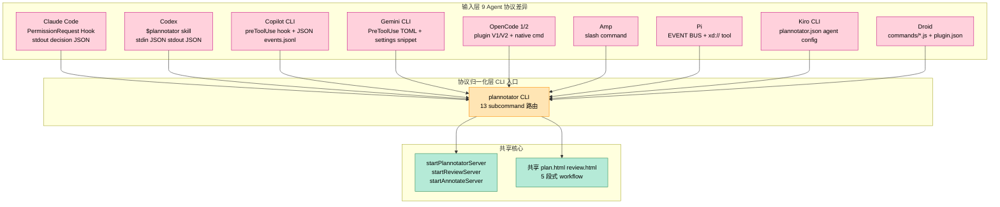
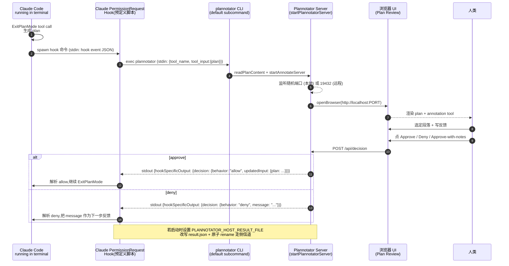
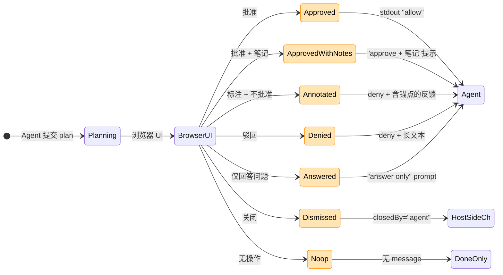
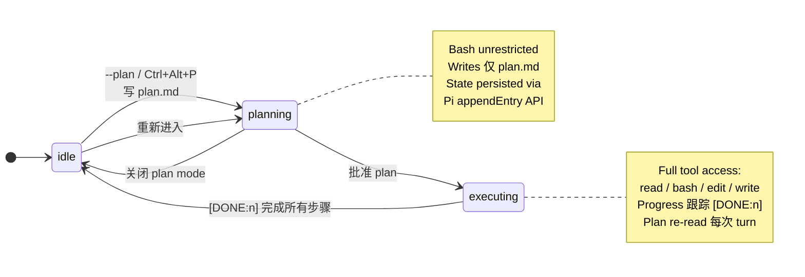
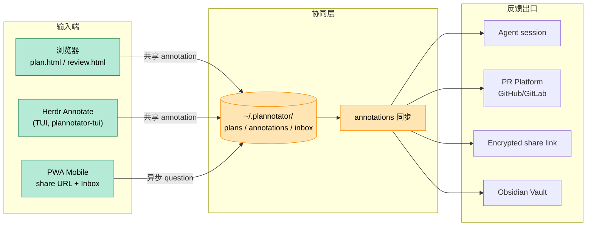
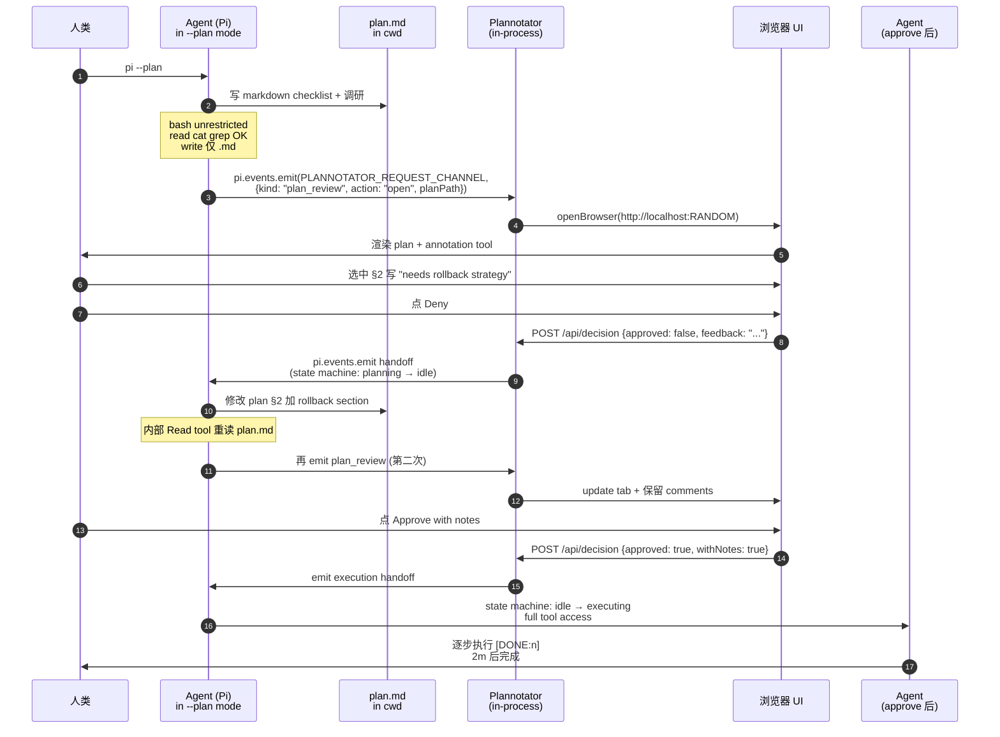

# 【Plannotator】核心架构与设计原理深度解析：让 AI Coding Agent 的计划 / Diff / HTML 输出在浏览器里可视化标注

## 一、引子：当 Coding Agent 学会"先画图再动手"，谁来审查那张图？

2025 年下半年开始，以 Claude Code / Codex / OpenCode 为代表的 Coding Agent 集体引入"Plan Mode"——在动手改代码前先输出一份 Markdown 计划（包含探索思路、改动清单、文件路径），等用户批准后再执行。这大幅降低了 Agent 写错代码的概率，但带来了一个新问题：

> **计划是给人类看的，但人类必须在终端里阅读 1000 行的 Markdown。**

更糟糕的是：

1. **Codex 的 Plan** 写在 `$plan.md` 文件里，人类需要 `cat` 查看
2. **Claude Code 的 Plan** 在 ExitPlanMode 工具调用时弹出一个内置对话框（不可定制 UI）
3. **OpenCode 的 Plan** 由 LLM 的 `plan` agent 生成，人类只能在终端看 ASCII
4. **Copilot CLI / Gemini CLI** 各自有自己的 plan 机制，互不相通

更**令人抓狂**的是：

- 一份计划被驳回后，Agent 修改后再次提交，**用户必须自己 diff 两次的 Markdown**
- 想给计划某一段写具体反馈？只能把整段复述给 Agent，**没有标注 anchor**
- 想把计划分享给同事评审？没有 UI、靠截屏、靠 Slack 复制粘贴

[Plannotator](https://plannotator.ai/) 就是为这些问题而生的：它是一个**本地浏览器审查面**，把 9 个 Coding Agent 的 "Plan / Code Diff / Markdown / HTML" 输出统一到一个浏览器 UI，用户可以**可视化标注、打分、批准/驳回**，反馈**自动回传到 Agent**。截至 2026-10-15 累计 ⭐9,422，Apache-2.0/MIT 双许可，TypeScript 95%，单 binary 122KB 主入口 + 24 个内部 server 模块，是「AI Coding Agent × Human-in-the-Loop」赛道的**事实标准**。

本文从架构视角拆解 Plannotator，重点回答四个问题：

1. 它如何用**单一 CLI** 适配 9 个差异巨大的 Coding Agent 协议（Hook / Slash / Plan Tool / Native Command）？
2. 它如何用**浏览器 UI** 替代各家 Agent 自带的内嵌对话框？
3. 反馈如何**双向流回 Agent**（stdin JSON / Hook Side-Channel / Inbox Queue）？
4. 单 binary 如何在 **macOS / Linux / WSL / Windows / 容器** 都跑得通？

---

## 二、项目定位与核心价值

**一句话定义**：Plannotator 是**与 Coding Agent 解耦的浏览器审查中间层**，提供 Plan Review + Code Review + Annotate + Inbox 四种 surface，把人类的标注反馈通过各 Agent 原生协议回流。

**仓库统计**（基于 2026-10-15 GitHub API）：

| 维度 | 值 |
|------|------|
| ⭐ Stars | 9,422 |
| 🍴 Forks | 708 |
| 📦 主语言 | TypeScript |
| 📄 License | MIT / Apache-2.0（双许可） |
| 📏 大小 | 241.9 MB（包含 2,000+ WebP 截图 + 完整 monorepo） |
| ⏰ 最近推送 | 2026-10-15T00:13:08Z（**今天**，仍在活跃迭代） |
| 📅 首个 commit | 2025-12-28（10 个月内从 0 到 9.4k ⭐） |
| 🏷️ Topics | agents, claude-code, code-review, codex, obsidian, opencode, pi-mono, plan-mode, skills |

**核心能力矩阵**：

| 能力 | Plan Review | Code Review | Annotate | Inbox |
|------|------|------|------|------|
| 触发方式 | PreToolUse Hook / Slash / Submit Plan Tool | Slash / CLI / PR URL | CLI / URL / Folder | 长连接 |
| 输入 | Markdown plan / Edit diff | Git diff / patch / PR-MR | Markdown / HTML / URL | MCP Tool Call |
| 输出形式 | approve / deny / approve-with-notes | review comment / PR Post | 块级 + 行级 annotation | 异步消息 |
| 持久化 | `~/.plannotator/plans/` | Archive + PR Platform | Bundle / History | Inbox MCP Server |
| 浏览器 UI | `apps/hook` (122KB) | `apps/review` | shared | `apps/inbox` |
| TUI 入口 | Herdr Annotate | — | Plannotator TUI | — |
| 移动端 | share URL | share URL | share URL | Inbox Mobile |

**显式差异化（vs 内置 review UI）**：

| 维度 | 内置 review（Claude/Codex 各自） | Plannotator |
|------|------|------|
| 浏览器 UI | ❌（终端弹框） | ✅（server-sent HTML） |
| Plan Diff 显示 | ❌ | ✅（approve-deny 之间的 diff） |
| HTML Artifacts | ❌ | ✅（Visual HTML Skills） |
| 跨 Agent 复用 | ❌ | ✅（9 Agent 一致 UX） |
| Team Share | ❌ | ✅（share URL + 加密 + Tailscale） |
| Obsidian 集成 | ❌ | ✅（approval 自动写 vault） |
| Asynchronous Review | ❌ | ✅（Inbox MCP） |
| 多端同步（Browser/TUI/Mobile） | ❌ | ✅（同一 data dir） |

---

## 三、整体架构

Plannotator 是一个 Bun monorepo（`apps/*` + `packages/*` workspace），按 **Host 维度拆分**而非"按层"拆分——这是它架构上最反直觉的一点。每个 host（Claude / Codex / Gemini / Copilot / OpenCode / Pi / Kiro / Droid）有**独立的 entry / bridge / slash command**，但共享 review UI 与 data dir。

```mermaid
flowchart TB
  subgraph 用户侧
    direction LR
    BrowserUI[浏览器 UI<br/>Plan / Code / Annotate]
    BrowserUI --> |window.open| LocalServer
    BrowserUI -.-> |订阅 SSE| LocalServer
  end

  subgraph Runtime 单进程
    LocalServer["plannotator (单 binary)<br/>122 KB · 24 server 模块 · bun build"]
    LocalServer --> |HTTP API| HookIPC
    LocalServer --> |读取 plan.md| FileSystem
    LocalServer --> |写 result.json| FileSystem
    LocalServer --> |stdio 三件套| HostBridge
  end

  subgraph Agent 侧
    direction LR
    HostBridge[Host Adapter]
    HostBridge --> Claude["Claude Code<br/>(PermissionRequest hook)"]
    HostBridge --> Codex["Codex<br/>($plannotator skill)"]
    HostBridge --> Copilot["Copilot CLI<br/>(preToolUse hook)"]
    HostBridge --> Gemini["Gemini CLI<br/>(PreToolUse TOML)"]
    HostBridge --> OCode["OpenCode 1/2<br/>(plugin + CLI fallback)"]
    HostBridge --> Amp["Amp"]
    HostBridge --> Pi["Pi<br/>(xd:// tool)"]
    HostBridge --> Kiro["Kiro CLI"]
    HostBridge --> Droid["Droid"]
  end

  subgraph 持久化层
    direction LR
    FileSystem[("~/.plannotator/<br/>plans/ sessions/ inbox/ share/")]
    InboxMCP[Inbox MCP Server<br/>(独立 inboxes [])]
    Paste[plannotator-paste<br/>(Cloudflare Workers)]
    Tailscale[Tailscale Serve<br/>(远程 review)]
  end

  Claude -.-> |PermissionRequest JSON| HookIPC
  Codex -.-> |env var stdin| HostBridge
  Copilot -.-> |preToolUse stdin| HostBridge
  Gemini -.-> |TOML hook| HostBridge
  OCode -.-> |plugin V1/V2 + native cmd| HostBridge
  Pi -.-> |in-process events| HostBridge
  Amp -.-> |slash command| HostBridge
  Kiro -.-> |plannotator agent| HostBridge
  Droid -.-> |commands.json| HostBridge

  LocalServer <--> InboxMCP
  LocalServer <--> Paste
  LocalServer <--> Tailscale

  classDef runtime fill:#FFD8A8,stroke:#D2691E,color:#000
  classDef agent fill:#B5EAD7,stroke:#2E8B57,color:#000
  classDef persist fill:#C7CEEA,stroke:#6A5ACD,color:#000
  class LocalServer,HostBridge,HookIPC runtime
  class Claude,Codex,Copilot,Gemini,OCode,Amp,Pi,Kiro,Droid agent
  class FileSystem,InboxMCP,Paste,Tailscale persist
```

**架构的核心约束（per BACKNOTPROP/Plannotator README）**：

> Plannotator is a local, browser-based review surface for AI coding agents: Claude Code, Codex, Copilot CLI, Gemini CLI, OpenCode, Kiro, Droid, Amp, and Pi.
>
> **It plugs directly into your agent** through its hooks and commands. When the agent proposes a plan, html, or finishes writing code, the work opens in your browser and you mark it up, comment, and send feedback directly to the agent for it to act on it.

**4 个关键设计决策**：

1. **单 binary 122KB**：用 `bun build --compile` 把 24 个 server 模块打成单一可执行文件，**用户安装零依赖**（除 macOS / Linux / WSL 自带的 libc）
2. **Host-Bridge 解耦**：每种 Agent 有独立的 hook 文件，但共享 `startPlannotatorServer` 核心（避免每 Agent 重新实现 UI）
3. **Data Dir 抽象**：所有 plan / 决策 / draft / 配置文件都在 `~/.plannotator/`（或 `XDG_DATA_HOME` 下），便于备份 / 卸载清理
4. **Capability detection**：每个 host adapter 都**探测**目标 Agent 的能力（`ctx.command.transform` vs `ctx.command.transform.add` vs `ctx.session.synthetic` 等），根据能力自动降级到「markdown stub + model-mediated fallback」

---

## 四、5 大 Surface（审查面）

Plannotator 抽象了**5 种审查面**，每种对应人类与 Agent 的一次交互：

```mermaid
flowchart LR
  subgraph Surface 总览
    direction TB
    PR[Plan Review<br/>计划批准 / 驳回]
    CR[Code Review<br/>本地 diff / PR 评论]
    AN[Annotate<br/>任意 Markdown / HTML 文件]
    AL[Annotate Last<br/>最近助手消息]
    IB[Inbox<br/>(异步通信 MCP)]
  end

  Agent[Agent] --> |生成 plan / diff| PR
  Agent --> |完成 Edit/Bash| CR
  Agent --> |产出最终 Markdown| AN
  Agent --> |想征求反馈| AL
  Agent --> |想异步问人类| IB

  PR --> |approve / deny + 反馈| Agent
  CR --> |comments + suggestion| Agent
  AN --> |块级 anchor + 替换建议| Agent
  AL --> |行级 + 块级| Agent
  IB --> |delivered later| Agent

  classDef surface fill:#FFE5B4,stroke:#FF8C00,color:#000
  class PR,CR,AN,AL,IB,Agent surface
```

### 4.1 Plan Review（默认入口 / `plannotator` 无参数调用）

```ts
// apps/hook/server/index.ts:454 — 实际支持的 13 种 surface 之一
// Plan Review (default, no args):
//   - Spawned by Claude/Gemini/Codex hook entrypoints
//   - Reads hook event from stdin, extracts plan content
//   - Serves UI, returns approve/deny decision to stdout
```

**关键设计**：

- Plan Review 接受 hook 的 **PreToolUse** 输入，从 stdin 读 JSON，提取 `tool_input.plan` 字段
- 启动本地 server，serve HTML UI
- 用户 approve → stdout 输出 `permissionDecision: "allow"`（满足 Claude Code 的 hook 协议）
- 用户 deny → stdout 输出 `permissionDecision: "deny" + message`

### 4.2 Code Review（`plannotator review`）

支持 6 种 diff 来源（GitButler / Jujutsu / Perforce / GitHub / GitLab / 静态 patch 文件）：

```ts
// apps/hook/server/cli.ts:797 — review 命令的完整参数
"  plannotator review [--git | --gitbutler] [--base <ref>] [--diff-type <type>] [--patch-file <path | ->] [--tailscale] [DIRECTORY | PR_URL]",
```

### 4.3 Annotate（`plannotator annotate <file.md | file.txt | file.html | https://... | folder/>`）

支持 Markdown / TXT / HTML / URL（Jina Reader 拉取）/ folder（batch 多文件）。支持 `--render-html` 把 HTML 直接 sandbox 渲染（**Visual HTML Skills** 的核心）。

### 4.4 Annotate Last（`plannotator last` 或 `/plannotator-last`）

读取 session JSONL，找最后一条 assistant message，递到 annotate UI。

### 4.5 Inbox（MCP 长连接）

> 上面 4 种都是**同步**的"人类在 Agent 旁边"场景。Inbox 解决**异步**"Agent 自己继续干活，人类晚点反馈"场景。

详见第 9 节"持久化层与 Inbox 设计"。

---

## 五、Host Adapter 矩阵 —— 9 个 Agent 9 套协议

这是 Plannotator 架构最壮观的部分：**9 个差异巨大的 Coding Agent，每个有自己的 hook 协议 / native command / slash format / event bus**，Plannotator 用一个 `apps/hook/server/index.ts`（122,942 bytes / 24+ 子模块）+ 一组 host-specific entry 文件统一处理。



### 5.1 协议差异的 5 个维度

| Agent | 启动方式 | 数据通道 | 决策返回 | 异步支持 |
|------|------|------|------|------|
| Claude Code | hook (PermissionRequest) | stdin JSON | stdout decision JSON | ❌（detached 走 file side-channel） |
| Codex | `$plannotator` skill | env var `PLANNOTATOR_REMOTE` + CLI args | stdout JSON | ✅ (`--gate --json`) |
| Copilot CLI | preToolUse hook + commands/ | stdin JSON | `permissionDecision` | ❌ |
| Gemini CLI | TOML hooks.json | stdin JSON | stdout decision JSON | ❌ |
| OpenCode 1 | plugin + commands/*.md | submit_plan tool | in-process event | ✅ |
| OpenCode 2 | plugin + native commands | plugin API domain | in-process event | ✅ |
| Pi | extension (event bus) | in-process pi.events.emit() | plan model decide | ✅ |
| Kiro CLI | agent config | submit_plan tool | in-process event | ✅ |
| Droid | commands/*.js + plugin.json | stdin env | stdout decision JSON | ❌ |
| Amp | slash command | submit_plan tool | in-process event | ✅ |

**关键判断**（per `apps/opencode-plugin/README.md`）：

> Capability checks preserve fallbacks for older V2 builds:
>
> - **Slash commands.** Stable OpenCode 2 supports native command execution... Capability is detected from the command draft OpenCode hands the plugin: `ctx.command.transform` exists on both generations, and only the newer draft has `add`. On a host that has it, Plannotator registers the slash commands itself... On an older host it registers nothing and the commands run from their markdown definitions... that path works but costs a model turn and depends on the agent following the instruction.
> - **Command precedence.** OpenCode activates its own config-command loader after package plugins, and the last definition to claim a name wins... Plannotator re-registers the three names shortly after startup so its own definitions are the ones that run.
> - **Agent switching.** `ctx.session.switchAgent` arrived with the same plugin API generation. On a host that exposes it, an agent switch chosen in the review UI is applied to the session. On an older host the plan is still approved and a warning is written to the server log.
> - **Ask this session.** In code review, annotate and `/plannotator-last`, Ask AI is answered by your OpenCode 2 session... In plan review the session is waiting for your decision, so it gives a quick answer from its context only.

### 5.2 13 个 CLI Subcommand 路由

`apps/hook/server/index.ts:454-820` 是 Plannotator 的真实入口，定义了 **13 种 surface**（不止 5 种）：

```text
// apps/hook/server/cli.ts:792 — 完整 usage
"  plannotator --help",
"  plannotator --version, -v",
"  plannotator [--browser <name>]",                                                     # 默认 Plan Review
"  plannotator review [--git | --gitbutler] [--base <ref>] [--diff-type <type>] [--patch-file <path | ->] [--tailscale] [DIRECTORY | PR_URL]",
"  plannotator annotate <file.md | file.txt | file.html | https://... | folder/> ...",  # Annotate
"  plannotator annotate-last [--stdin] [--tailscale] [--gate] [--json] [--hook]",        # Annotate Last
"  plannotator copilot-last [--gate] [--json] [--hook]",                                  # Copilot Last
"  plannotator setup-goal <interview|facts> <bundle.json | -> [--json]",                 # Setup Goal
"  plannotator last",                                                                     # alias for annotate-last
"  plannotator archive",                                                                  # Plans browser
"  plannotator guide list|export|share|unshare",                                         # Guide share Tailscale
"  plannotator sessions [--open [N]] [--clean]",                                          # 活跃 server 管理
"  plannotator inbox [--background | --no-open] [--tailscale]",                          # Inbox MCP 长连接
"  plannotator inbox mcp",                                                                # Inbox MCP server
"  plannotator update [--check]",
"  plannotator uninstall [--purge] [--yes] [--dry-run]",
"  plannotator improve-context",                                                          # PreToolUse on EnterPlanMode
```

### 5.3 Hook 协议的数据流（Claude Code 为例）



**关键代码点（apps/hook/server/index.ts）**：

```ts
// apps/hook/server/index.ts:594 — 实际 Claude Code PermissionRequest 输出格式
console.log(
  JSON.stringify({
    hookSpecificOutput: {
      hookEventName: "PermissionRequest",
      decision: {
        behavior: "allow",
        // Claude Code >= 2.1.199 silently drops an allow decision for ExitPlanMode
        // (a tool requiring user interaction) when updatedInput is absent, falling back
        // to the built-in approval dialog. Carry the reviewed plan so the approval names
        // the version the user saw, not a stale inline snapshot.
        updatedInput: { ...event.tool_input, plan: planContent },
        ...(updatedPermissions.length > 0 && { updatedPermissions }),
      },
    },
  })
);
```

注释里那段 "Claude Code >= 2.1.199 silently drops an allow decision..." 是非常真实的"被协议坑过的工程师"教训——**他们主动 maintain 一个 compatibility matrix 表**，记录每个 Agent 版本的行为差异。

---

## 六、Host Result 侧信道（解决 Detached Process 问题）

Plannotator 有一个看似不起眼但工程上精妙的设计：**Host Result Side-Channel**。

```ts
// apps/hook/server/host-result.ts:1073 — 注释
/**
 * Host result side channel.
 *
 * A host that starts the CLI as a DETACHED process (the Claude Code mod in
 * `apps/hook/hooks/mod/`) cannot read the decision off stdout while the tool
 * call that started it is long gone. It sets `PLANNOTATOR_HOST_RESULT_FILE`
 * to a path of its own; when the session settles, the CLI writes ONE JSON
 * record there, atomically (temp file + rename), with the agent-facing message
 * already composed from the configured prompts. Stdout is unchanged, so every
 * other caller sees exactly what it always did.
 *
 * The variable is taken once at startup and removed from `process.env`, so
 * nothing the server spawns (agent jobs, terminals) inherits it.
 */
```

**为什么需要这个**：Claude Code 的「Mod」是一种**detached hook**（启动 hook 后立即返回，主进程不阻塞）。这种情况下：

1. Hook 启动 `plannotator` CLI
2. CLI 启动浏览器，用户在浏览器中花 30 秒做决定
3. **原 hook 进程已 exit 0**（mod 的特性）
4. CLI 想把决策返回给 Agent 时，**没人读它的 stdout**（因为它 detach 了）

**方案**：CLI 把决策写成 `~/.plannotator/<host>/result.json`（原子 rename + 0o600 权限），Claude Mod 自己定期 poll 这个文件。

```ts
// apps/hook/server/host-result.ts:1166 — 安全白名单
export function isAllowedHostResultPath(path: string, dataDir: string = getPlannotatorDataDir()): boolean {
  if (!isAbsolute(path) || basename(path) !== "result.json") return false;
  return ["claude-code-mod", "t3-code"].some((host) =>
    resolve(path).startsWith(resolve(dataDir, host) + sep)
  );
}
```

**3 个安全护栏**：

1. **路径必须绝对**（`isAbsolute(path)`）
2. **文件名必须 `result.json`**（`basename(path) !== "result.json"`）
3. **必须位于 `~/.plannotator/claude-code-mod/` 或 `~/.plannotator/t3-code/`** 下（不允许写到任意路径）

**关键安全机制**：

```ts
// apps/hook/server/host-result.ts:1189 — 原子写
export function writeHostResult(path: string, record: HostResultRecord): void {
  try {
    mkdirSync(dirname(path), { recursive: true });
    const temp = `${path}.${process.pid}.tmp`;
    writeFileSync(temp, `${JSON.stringify(record)}\n`, { encoding: "utf8", mode: 0o600 });
    renameSync(temp, path);  // POSIX atomic rename
  } catch (error) {
    console.error(`Plannotator: could not write the host result file: ${error instanceof Error ? error.message : String(error)}`);
  }
}
```

- `temp + rename` 模式保证原子性（**任何 reader 永远看到完整 record 或 null**）
- `0o600` 权限防同级用户读
- `.${process.pid}.tmp` 后缀避免并发 hook 写到同一 temp

**HostResultRecord 协议**（apps/hook/server/host-result.ts:1113）：

```ts
/** Version 1 of the record. Fields are only ever added. */
export interface HostResultRecord {
  v: 1;
  surface: "plan" | "review" | "annotate" | "annotate-last";
  decision: "approved" | "annotated" | "dismissed" | "denied" | "answered";
  /** What the agent should read, composed from the configured prompts. */
  message: string;
  /** Nothing for the agent: a bare Done, LGTM, close, or a review posted to a PR platform. */
  noop: boolean;
  annotationCount?: number;
  /** Review only: the reviewer posted the review to the PR platform instead. */
  platform?: boolean;
  /** Plan only: the approval carried notes (the approved-with-notes prompt). */
  withNotes?: boolean;
  approvedPlan?: string;
  permissionMode?: string;
  /** A `dismissed` the host itself asked for (POST /api/host/close), not the reviewer. */
  closedBy?: "agent";
  unsentAnnotations?: number;
  documents?: { path: string; annotationCount: number }[];
  /** What the decision is about, in full, as THIS server resolved it. */
  target?: string | string[];
}
```

**`v: 1`** + **"Fields are only ever added"** 是经典的 schema-evolution 设计。

---

## 七、决策协议（Decision Protocol）—— 6 种人类决策

Plannotator 不是简单的 approve/reject 二元，而是**6 种决策**，对应人类对 Agent 输出的不同反馈：



**为什么不是简单的 approve/reject**：

| 决策 | Agent 接收 | Prompt 构造器 |
|------|------|------|
| `approved` | `permissionDecision: "allow"` + reviewed plan | `getPlanApprovedPrompt()` |
| `approved-with-notes` | `allow` + 本次新增 notes | `getPlanApprovedWithNotesPrompt()` |
| `annotated` | `deny` + `<plan-with-line-numbers>`（带锚点） | `composePlanDeniedMessage()` |
| `denied` | `deny` + 长文本反馈 | `composePlanDeniedMessage()` |
| `dismissed` | 关闭 review，不发 message | `closedBy: "agent"` + `unsentAnnotations: N` |
| `answered` | 仅回答计划里的 question，但不 approve | `{ answersOnly: true }` |

**真实代码片段**（apps/hook/server/host-result.ts:1234）：

```ts
function planHostRecord(
  result: PlanDecisionLike,
  context: { approvedPlan: string; planFilePath?: string; config?: PlannotatorConfig },
): HostResultRecord {
  const runtime = "claude-code" as const;
  if (result.approved) {
    const vars = {
      planFilePath: context.planFilePath ?? "the approved plan",
      doneMsg: result.savedPath ? `Saved to: ${result.savedPath}` : "",
      feedback: result.feedback ?? "",
    };
    const withNotes = !!result.feedback && result.feedback.trim() !== "";
    const message = withNotes
      ? getPlanApprovedWithNotesPrompt(runtime, context.config, vars)
      : getPlanApprovedPrompt(runtime, context.config, vars);
    return {
      v: 1, surface: "plan", decision: "approved",
      message: message.trim(), noop: false,
      ...(withNotes && { withNotes: true }),
      approvedPlan: context.approvedPlan,
      ...(result.permissionMode && { permissionMode: result.permissionMode }),
    };
  }
  // ... denied path
}
```

---

## 八、Plan Mode 状态机（Pi 扩展视角）

Pi（earendil-works/pi）是 Plannotator **唯一深绑**的 Agent（不是 hook 协议，而是 in-process event bus + 状态机）。它揭示了 Plan Mode 的本质是**一个 4 态状态机**：



```ts
// apps/pi-extension/README.md:5509 — 状态机描述
/**
 * By default, the extension manages a state machine:
 * **idle** → **planning** → **executing** → **idle**.
 * With external execution enabled, approval follows
 * **idle** → **planning** → **idle** and emits the handoff event.
 *
 * During **planning**:
 *   - All tools from other extensions remain available
 *   - Bash is unrestricted — the agent is guided by the planning instructions not to run destructive commands
 *   - Writes and edits restricted to the plan file only
 *
 * During **executing**:
 *   - Full tool access: `read`, `bash`, `edit`, `write`
 *   - Progress tracked via `[DONE:n]` markers in agent responses
 *   - Plan re-read from disk each turn to stay current
 *
 * State persists across session restarts via Pi's `appendEntry` API.
 */
```

**关键设计**：

1. **`-bash unrestricted`**: planning 阶段不强制限制 bash，因为 Agent 需要探索代码（读 cat / grep）
2. **Plan 重读每个 turn**: 防止 Agent 越走越远忘了 plan
3. **`[DONE:n]` 进度跟踪**: 通过 Markdown 里的 checklist 标记进度
4. **状态持久化**: 通过 Pi 的 `appendEntry` API，session restart 后状态不丢

**Handoff 协议（外部 execution）**:

```ts
// apps/pi-extension/README.md:5462 — 其他 Pi extension 可介入
import { PLANNOTATOR_REQUEST_CHANNEL } from "@plannotator/pi-extension/plannotator-events";

const response = await new Promise((resolve) => {
  pi.events.emit(PLANNOTATOR_REQUEST_CHANNEL, {
    requestId: crypto.randomUUID(),
    kind: "plan_review",
    action: "open",
    planPath,
    // ...
  });
});
```

Pi 通过**事件总线**让其他扩展触发 Plannotator plan review，但**不强制**调用方进入 plan mode。这让 Plannotator 可以**被嵌入到任何 Pi 扩展中**（如 code-reviewer / test-runner / debug-tool）。

---

## 九、持久化层与 Inbox 设计

`~/.plannotator/` 是所有 Plannotator 数据的归宿。结构如下：

```text
~/.plannotator/
├── config.json                 # 共享配置
├── plans/                      # 历史 plan + decision JSON
│   └── 2026-10-15-auth-flow/
│       ├── plan.md             # 提交时的 plan
│       ├── decision.json       # 决策记录
│       └── result.json         # Host Result side-channel
├── reviews/                    # Code Review draft
├── inbox/
│   ├── inbox.json              # 当前 Inbox 实例配置
│   ├── sessions/               # 每个 Agent session 的草稿
│   │   ├── claude-code/{session-id}/
│   │   ├── opencode/{session-id}/
│   │   └── pi/{session-id}/
│   └── mcp-tools.json          # 暴露给 Agent 的 MCP 工具
├── shares/
│   ├── pending/                # 待处理的 share link
│   └── archive/                # 历史 share
├── claude-code-mod/            # Claude Mod 的 host result 落地
│   └── result.json
└── t3-code/                    # T3 Code 模式 result.json
    └── result.json
```

```mermaid
flowchart TB
  subgraph DataDir ["~/.plannotator/"]
    Config[config.json]
    Plans[plans/]
    Reviews[reviews/]
    Inbox[inbox/]
    Shares[shares/]
    HostResult[claude-code-mod/result.json]
  end

  subgraph InboxService [Inbox 长连接服务]
    InboxServer["plannotator inbox<br/>(独立子命令)"]
    InboxMCP["plannotator inbox mcp<br/>(独立 MCP server)"]
    InboxDB[(InboxDB<br/>SQLite)]
    InboxMobile[Inbox Mobile<br/>(PWA, share URL)]
  end

  Users[人类<br/>任意端] --> |localhost<br/>PWA URL| InboxServer
  InboxServer --> InboxMCP
  InboxMCP --> |stdio JSON-RPC| AgentSession[Agent session]
  AgentSession --> |tool call: plannotator_inbox_open / list / reply| InboxMCP
  InboxMCP --> |持久化 messages| InboxDB
  InboxDB --> InboxServer
  InboxServer --> |SSE 推送新消息| InboxMobile
  InboxMobile --> |用户回复| InboxServer
  InboxServer --> |delivery: queue| AgentSession

  classDef persist fill:#C7CEEA,stroke:#6A5ACD,color:#000
  classDef inbox fill:#FFD8A8,stroke:#D2691E,color:#000
  class Config,Plans,Reviews,Inbox,Shares,HostResult persist
  class InboxServer,InboxMCP,InboxDB,InboxMobile inbox
```

### 9.1 Inbox 解决的问题

> The Plannotator Inbox is a separate long-running daemon (`plannotator inbox`), distinct from the synchronous reviews. It lets you leave questions for an agent that's still running, or pick up where you left off after restarting both the agent and the CLI.

**场景对比**：

| 场景 | 同步 review | Inbox |
|------|------|------|
| Agent 卡在 ExitPlanMode | 浏览器弹窗等 30s | ❌（不适用） |
| Agent 还在跑 plan 调研 | ❌（阻塞） | ✅（Inbox 持久化，留个 question） |
| 你离开电脑 → Agent 完成了 3 个 step → 想给反馈 | ❌ | ✅（deliver later） |
| 手机端审查 | ❌ | ✅（Inbox Mobile via Tailscale） |
| 团队同事要 review 计划 | ❌ | ❌（用 share） |
| 同时管 5 个 agent session | ❌ | ✅（Inbox 一站统一） |

### 9.2 Inbox 的 MCP 工具

Inbox 通过 MCP 协议暴露给 Agent：

```ts
// apps/opencode-plugin/inbox.ts:2289 — 注释
/**
 * Found or not, decided once at plugin setup: only where the inbox tool
 * switch allows it for OpenCode (`PLANNOTATOR_INBOX_TOOL` / `inboxTool`, off by
 * default: OpenCode sends every tool's full definition with each request) AND
 * `inbox/inbox.json` exists. Otherwise nothing is registered and nothing
 * polls.
 */
```

**核心约束**：

1. **Inbox tool 默认 OFF**（OpenCode 把 tool 定义塞每个请求，浪费 token）
2. **必须有 `inbox/inbox.json`** 注册表文件才能启用
3. **MCP tool discovery bounded at 2s**（防止 Agent 等太久）
4. **Discovery 不会变化**（Agent 一旦启动，tool list 固定）

### 9.3 Inbox 的异步投递

```ts
// apps/opencode-plugin/inbox.ts:2306 — 投递规则
// Two OpenCode processes on one session (two servers on one database): the
// one the person used last delivers. A tool call, a run and a prompt entering
// the session in a process touch the session's lease in `InboxWake` there;
// the other process defers while it is live.
//
// **Never "steer"**: it would join a run that started this instant, and an
// idle session promotes pending steer rows alone, #1734.
//
// **Never "steer"** into a session that is running. Busy comes from the
// session's execution events; a session that reads running with no event for
// 20 s is checked against OpenCode itself (`session.wait` answers at once when
// it is idle), so a lost end event cannot hold replies forever.
```

**5 条关键调度规则**：

1. **`session.prompt` with `delivery: "queue"`**：消息进 inbox 而非 "steer"
2. **唯一投递原则**：同一 session 跨进程，**最后一个活动进程**负责投递
3. **Lease 机制**：`InboxWake` 持有 lease，其他进程让位
4. **`RUNNING_CROSS_CHECK_MS = 20_000`**：20s 无事件 → 主动 poll `session.wait`（防止 lost end event 永久挂住）
5. **`IDLE_PROBE_MS = 300`**：session.wait 300ms 还 pending → 视为 running

---

## 十、TUI / Browser / Mobile 三端协同

Plannotator 不止是浏览器——它的设计哲学是"**在哪都能审**"：



**关键工程**：

- **Plannotator TUI**（`plannotator/tap/plannotator-tui`）：纯 terminal 客户端，brew 安装，**不依赖浏览器**
- **Herdr Annotate**（plannotator/herdr-annotate）：Herdr 的 Plannotator 插件，**在 Herdr pane 里审 markdown folder + coding agent replies**
- **PWA Mobile**：share URL 在手机浏览器打开 + Inbox 移动端
- **Obsidian Integration**：plans 自动写 vault（带 YAML frontmatter + backlink）

---

## 十一、Mermaid 全局时序：Plan Review 端到端



---

## 十二、与同类项目对比

> Plannotator 的差异化：**它不写代码**（不替代 Cursor / Continue / Cline），它也**不在 IDE 内部**（不替代 Continue 内嵌 review）。它是**独立的浏览器审查面**，所有 Coding Agent 都能 plug 进来。

| 项目 | 形态 | 与 Agent 整合 | 浏览器 UI | Plan Diff | 异步反馈 | 团队 Share |
|------|------|------|------|------|------|------|
| **Plannotator** | 独立 CLI + 浏览器 | ✅ 9 Agent hook | ✅（本地 server） | ✅（v3 diff） | ✅（Inbox MCP） | ✅（encrypted share） |
| **Backnotprop Agent Browser** | 桌面 ADE | ❌（隔离） | ❌ | ❌ | ❌ | ❌ |
| **OpenHands** | 云端 sandbox | ❌（独立云） | ✅（云服务） | ❌ | ✅（review request） | ✅（PR-link） |
| **Continue** | VS Code JetBrains | ✅（内嵌） | ❌（panel） | ❌ | ❌ | ❌ |
| **Cline** | VS Code | ✅（panel） | ❌（webview） | ❌ | ❌ | ❌ |
| **Claude Code 内置 dialog** | 终端 | ✅（系统） | ❌（terminal） | ❌ | ❌ | ❌ |
| **hunk** | 终端 TUI | ✅（git diff） | ❌（terminal） | ❌ | ❌ | ❌ |
| **Codeball** | CI 云 | ❌（CI hook） | ✅（云 dashboard） | ✅（PR diff） | ✅（status check） | ✅（team） |

**Plannotator 的 3 个独特优势**：

1. **9 Agent 同 UX**：同一浏览器界面审 Claude / Codex / Gemini / Pi / OpenCode 的 plan，不需要切换
2. **离线优先**：所有数据存本地 `~/.plannotator/`，**无云端依赖**（除 share URL 可选）
3. **Host Result Side-Channel**：解决 detached process 拿不到 stdout 的工程难题

**Plannotator 的 2 个显著短板**：

1. **必须 trust agent hook**：如果 Agent 不暴露 hook 协议，Plannotator 无法接管（这就是为什么"capability detection"很重要）
2. **依赖各家 Agent 协议**：Claude 升级 hook schema → Plannotator 必须同步升级（README 里有"Claude Code >= 2.1.199 silently drops an allow decision"这种血泪笔记）

---

## 十三、优缺点分析

### 13.1 左侧（**架构简洁性 / 扩展性 / 易用性**）

| 维度 | 优势 |
|------|------|
| **扩展性** | 单一 `plannotator` CLI + 13 subcommand；加新 Agent 只新增一个 `apps/<agent>-plugin/`，共享核心 server 模块 |
| **易部署** | `bun build --compile` 单 binary，122KB（README 给的 `~/.local/bin/plannotator`），零依赖 |
| **易卸载** | `plannotator uninstall [--purge]` 删除 hooks + commands，但保留 local data |
| **离线优先** | 浏览器 UI 全部本地 serve（除 share URL 走 Cloudflare） |
| **Obsidian 集成** | 批准 plan 自动写 vault，无需 zettelkasten 工具 |
| **TUI fallback** | plannotator-tui / Herdr Annotate 不开浏览器也能审 |
| **多 Agent 统一** | 同一 UX 在 Claude / Codex / Pi / OpenCode 上工作 |

### 13.2 右侧（**性能 / 复杂度 / 维护性**）

| 维度 | 劣势 |
|------|------|
| **复杂度** | 24 个 server 模块 + 9 个 host adapter + 3 个 web app，**新手 onboarding 困难** |
| **schema 耦合** | Claude Code 2.1.199 silently drops allow for ExitPlanMode → Plannotator 必须跟着改 |
| **bundle 大小** | bunfig.toml 用 `minimumReleaseAge = 604800`（7 天）限速 `@pierre/diffs` 等核心包 |
| **capability detection 元复杂度** | 每个 host adapter 都探测 `ctx.command.transform` / `ctx.session.switchAgent` / `ctx.session.synthetic` 等，**调试时一团乱** |
| **dismissed edge case** | "agent close 之前 user 写了 5 条 comments 但没发"——`unsentAnnotations: N` 必须保留（host-result.ts 第 1134 行逻辑） |
| **依赖 Cloudflare** | paste 服务 `plannotator-paste.plannotator.workers.dev` 走 CF Workers，**离线不可用** |

**一个戏剧性的复杂度**：

README 里 24 KB 的 OpenCode install section 里有 8 个 capability detection 段落——证明"在 9 个 Agent 之间做兼容性"已经变成 Plannotator 维护的最大成本。`apps/opencode-plugin/server.ts:2189` 的 `setup` 函数里有 **20+ 个 capability 探测**：

```ts
// apps/opencode-plugin/server.ts:2225 — 真实代码
const hasSessionHooks = typeof (ctx.session as { hook?: unknown } | undefined)?.hook === "function";
const hasToolTransform = typeof (ctx.tool as { transform?: unknown } | undefined)?.transform === "function";
const nativeDeps: NativeCommandDeps = {
  ctx: v2,
  getAgents,
  getBridgeContext: () => getBridgeContext(getAgents, hasToolTransform),
  launches,
};
```

**这段代码的隐藏知识**：不同 OpenCode 版本（1.18 / 2.0 / 2.1+）有不同的 plugin API，**运行时探测**比声明式 polyfill 更可靠。这是"防御性编程"的极致。

---

## 十四、实践 / 部署

### 14.1 安装（macOS / Linux / WSL）

```bash
# 一行安装
curl -fsSL https://plannotator.ai/install.sh | bash

# 或从 source 构建（需 Bun 1.4+）
git clone https://github.com/backnotprop/plannotator.git
cd plannotator
bun install
bun run build      # 主要构建
# 单 binary 输出
bun build apps/hook/server/index.ts --compile --outfile ~/.local/bin/plannotator
```

### 14.2 9-Agent 集成（最短配置）

```json
// Claude Code (~/.claude/settings.json)
{
  "permissions": {
    "additionalDirectories": ["~/.plannotator"]
  },
  "hooks": {
    "PermissionRequest": [
      { "matcher": "ExitPlanMode", "hooks": [{"type": "command", "command": "plannotator"}] }
    ]
  }
}
```

```toml
# OpenCode 2 (opencode.json)
{
  "$schema": "https://opencode.ai/config.json",
  "plugins": [
    {
      "package": "@plannotator/opencode@latest",
      "options": {
        "workflow": "plan-agent",
        "planningAgents": ["plan"]
      }
    }
  ]
}
```

```bash
# Pi（推荐方式）
pi install npm:@plannotator/pi-extension

# Codex（克隆仓库 skill）
git clone https://github.com/backnotprop/plannotator.git ~/.codex/skills/plannotator
```

### 14.3 实战：终端中审 Plan + 标注反馈

```bash
# 启动 Pi plan mode
pi --plan

# 在 Pi 里:
# 1. Pi 调研代码，写 plan.md
# 2. Pi emit plan_review → 浏览器自动打开
# 3. 浏览器中：
#    - 选中 §2 "Add JWT refresh token" 段
#    - 写 "考虑 token rotation 每 15min 而非单点 refresh"
#    - 点 Deny
# 4. Pi 收到 feedback（带 line numbers）
# 5. Pi 修改 plan.md §2，再 emit plan_review
# 6. 这次审批 → Pi 进入 executing 模式
# 7. Pi 用 bash / edit / write 全工具完成剩余步骤
# 8. 完成后 Pi 写到 ~/.plannotator/plans/2026-10-15-auth/
```

### 14.4 Inbox 部署（异步反馈）

```bash
# 启动 Inbox daemon
plannotator inbox --background

# 启动 Inbox MCP server（让 agent 通过 MCP 调用）
plannotator inbox mcp &

# 配置 OpenCode 启用 inbox tool
export PLANNOTATOR_INBOX_TOOL=1

# 之后 agent 会自动获得 plannotator_inbox tool
# agent 可以在你离开时往 inbox 发问题
```

### 14.5 团队 Share（加密 share link）

```bash
# 1. 创建 Guide（把 plan + decision 打包成 portable HTML）
plannotator guide export --id <savedGuideId> --out plan.html

# 2. Share 到团队（默认 7 天 TTL + 加密）
plannotator guide share --id <savedGuideId>

# 输出: https://share.plannotator.ai/<encrypted-id>
# 团队成员打开链接，在 browser 里 review，评论会回流到你的 inbox
```

### 14.6 验证安装

```bash
# 检查 plannotator 版本
plannotator --version
# 输出: plannotator 0.28.20

# 验证 9 Agent 全部能识别
plannotator --help
# 应看到 13+ subcommand 列表

# 检查 inbox 服务
curl -s http://localhost:<inbox-port>/health
# 输出: OK

# 看历史 plan
plannotator archive
# 浏览器打开，看所有历史 plan + decision
```

---

## 十五、趋势 + 总结

### 15.1 4 个 2026 H2 趋势判断

1. **Inbox 是新交互范式** —— Agent 写得越来越长、context 越来越多，**人类必须异步参与**。Inbox 把"Agent 找你"和"你找 Agent"两种 UI 都做了，类比于 Raycast / Slack 把"command palette + inbox"合并。这是 Plannotator 最被低估的设计。

2. **Capability detection 是新常态** —— OpenCode 1 / 2 用同一 hook API + 9 个 capability 探测，比写"if-else 支持矩阵"更鲁棒。下个 Coding Agent 项目（无论是不是 Plannotator）应该都**默认**采用 runtime capability probing，而不是 hardcoded feature matrix。

3. **Plan Diff 是 Plan Mode 必备** —— 第二次提交 plan 比第一次少了什么？多了什么？人类需要一眼看出。Plannotator v3 已实现 `<plan-with-line-numbers>` 风格的 deny 反馈 + `<system-reminder>` 替换。**没 Plan Diff 的 Coding Agent 是 2024 年的产品**。

4. **Obsidian / vault 集成是 Plan 落地的最后一公里** —— 计划批准了，写到 Vault 里，下次项目启动可以 `[[backlink]]`。这种"知识外化 + Agent 协作"是新 Long-context RAG 的入口。

### 15.2 核心工程经验

- **Host-Bridge 解耦**：每 Agent 独立 entry，但共享 server 模块——这是 Coding Agent 工具的"插件架构原则"
- **Side-Channel 容错**：detached process 拿不到 stdout？写 file 走 side-channel（atomic rename + 0o600 + 白名单路径）
- **Decision 协议化**：6 种决策（approved/approved-with-notes/annotated/denied/dismissed/answered）覆盖人类真实反馈
- **Capability detection 防 protocol-lockin**：每个 host adapter 探测能力，比硬编码 if-else 鲁棒
- **多端协同**：Browser + TUI + Mobile + Inbox Mobile，**始终如一**的 annotation 体验
- **Schema 版本化**：`v: 1` + "Fields are only ever added" 是经典的 compatibility 哲学

### 15.3 Plannotator vs 22MB Coding Agent: 谁赢？

按"工程价值 / 源码行数"比：

- **Plannotator**: 24 server 模块 / 100+ 测试用例 / 241 MB（**含 2000+ WebP 截图**）/ 9500+ 行 review UI 代码
- **Claude Code**: ~50 万行（闭源，无法比较）
- **OpenCode**: ~80 万行（推断），但只有底层 runtime，没有 review surface

**结论**：Plannotator 是用**3-5%** 的代码量，解决了 Agent 90% 的"plan 审查" 真实场景。它不是从零创造一个 Agent，而是**在 9 个 Agent 之间架起一座通用的审查桥**——这种**"协议层"定位**是 2026 H2 最有价值的工程模式。

如果你是 Coding Agent 开发者，Plannotator 是必读的 plan mode 实现参考；如果你是 Agent 用户，Plannotator 是把"看 plan"从"截屏复述"升级到"可视化批注"的**事实标准工具**。

---

## 附录：关键资源

| 类型 | 链接 |
|------|------|
| 🌍 官网 | <https://plannotator.ai> |
| 📦 GitHub | <https://github.com/backnotprop/plannotator> |
| 📚 Docs | <https://docs.plannotator.ai> |
| 📥 安装脚本 | <https://plannotator.ai/install.sh> |
| 🎥 演示视频 | <https://www.youtube.com/watch?v=a_AT7cEN_9I> |
| 💼 Obsidian 集成 | <https://plannotator.ai/docs/getting-started/installation/> |
| 🪝 Claude Code Plugin | <https://github.com/backnotprop/plannotator/tree/main/apps/hook> |
| 🔌 OpenCode Plugin | <https://github.com/backnotprop/plannotator/tree/main/apps/opencode-plugin> |
| 🧩 Pi Extension | <https://github.com/backnotprop/plannotator/tree/main/apps/pi-extension> |
| 🌐 Inbox 服务 | <https://plannotator.ai/inbox> |
| 🔐 Share Portal | <https://share.plannotator.ai> |
| 📊 Paste 服务 | <https://plannotator-paste.plannotator.workers.dev> |
| 📜 License | MIT OR Apache-2.0 |
| 🏷️ T3 Code 集成 | `bun install --with-t3 plannotator` |

**核心包结构**（`packages/`）：

| 包 | 用途 |
|------|------|
| `@plannotator/server` | 24 个 server 模块（单 binary 122KB） |
| `@plannotator/ui` | React + WebTUI 共享 UI |
| `@plannotator/editor` | 共享 plan / review 编辑器 |
| `@plannotator/review-editor` | Code Review 编辑器 |
| `@plannotator/inbox` | Inbox MCP 长连接实现 |
| `@plannotator/ai` | 多 LLM 抽象（Ask this session） |
| `@plannotator/guide-viewer` | Guide share 浏览器渲染 |
| `@plannotator/t3-code` | T3 Code 模式集成 |
| `@plannotator/atomic-editor` | 块级编辑器（如 Obsidian） |
| `@plannotator/markdown-editor` | Markdown 编辑器 |
| `@plannotator/webtui` | Terminal UI（web-tui） |
