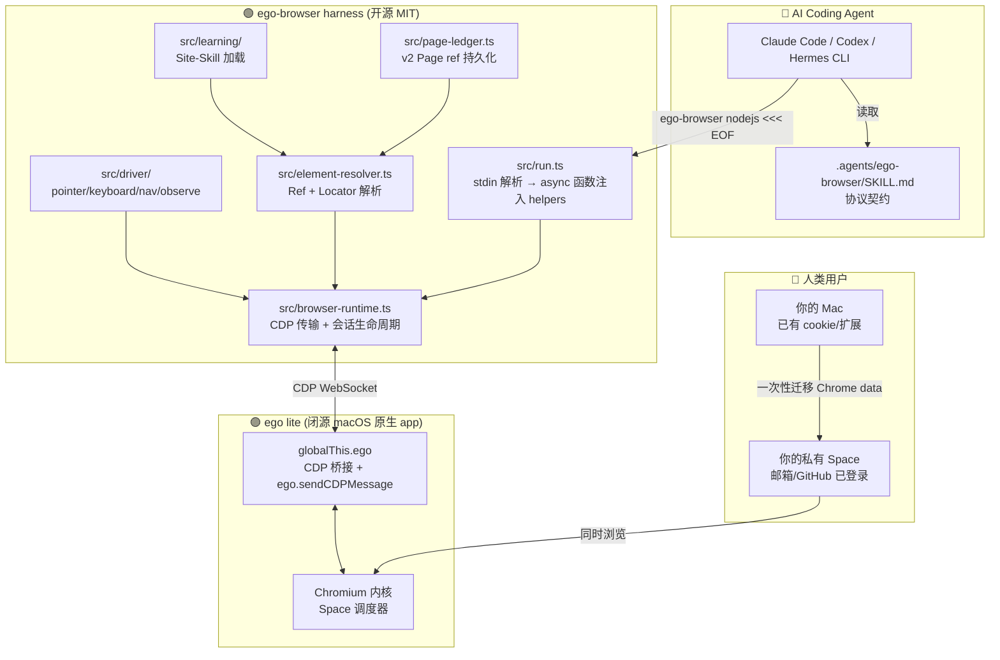
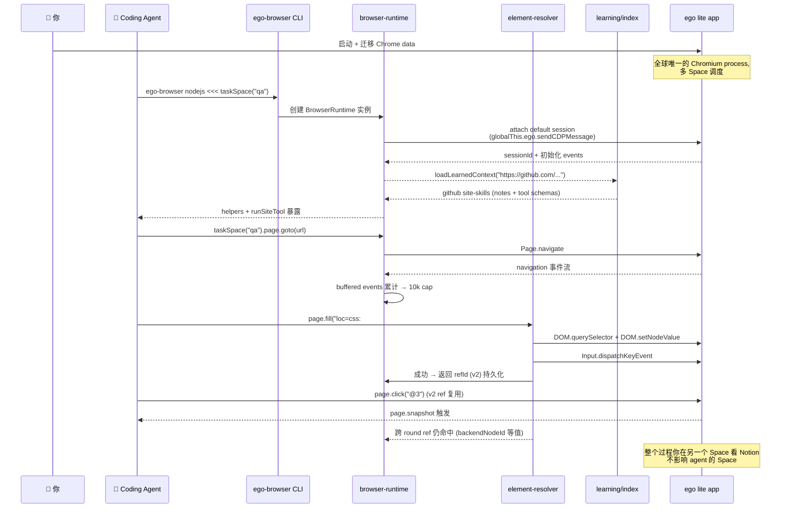

## 引子：你和你的 AI Agent 在为同一件事抢同一只鼠标

2026 年的所有 Browser-Use 框架——从最早的 browser-use、到 agent-browser、再到后面涌现的各种 Playwright-MCP 封装——都共享一个**底层假设**：把浏览器当成"对岸的黑盒"，靠 CDP / DOM 注入把它桥过来。

结果就是 **Bridge 范式的四个原罪**：

1. **登录态跨不过去**——你花了一年攒的 cookie、二次验证、设备指纹，agent 拿不到；每次都得让 agent 重新登录或触发风控。
2. **控制权争用**——agent 在改 DOM，你正在看自己邮件，结果 agent 把你页面跳转走了。
3. **连接脆弱**——agent 进程挂掉 / 你的 tabs 关闭 / 网络抖动，CDP WebSocket 断开。
4. **浏览器本身是个孤儿**——任何想"治理 agent 浏览行为"的努力都要重写到所有平台的 headless 协议里。

**ego-lite (citrolabs/ego-lite, ⭐17,451)** 第一次提出一个反直觉的答案：**别桥过去了，把浏览器本身就做成 agent 和人共用的资产**。

ego lite 是一个 macOS 原生 Chromium 浏览器（闭源 app），它从内核开始就分配「**Spaces**」：
- 你的私有 Space —— 给你这个人保留所有 cookie / tabs / 输入焦点
- agent 的私有 Space —— agent 在里面开 tab、跑自动化、消耗登录态，但**自动继承你的真实 Google / GitHub / Stripe 登录（一次性 Chrome data 迁移）**
- 共享 page —— 特定 task 需要你确认时弹出可见对话框（比如 OpenAI 风控码输入）

agent 通过一支轻量 Node.js harness **`ego-browser`**（完全开源 MIT，约 16K 行 TypeScript，源文件后文会逐行引证），受 .agents/SKILL.md 协议触发，调用**人类可见的浏览器原生 CDP 接口**完成任务。**harness 是可读源码 / browser 是闭源原生 app，这种 hybrid 模式让框架可以同时享受"开源透明 + 原生体验"两件事**。

本文是一篇深度架构解析。它假设你已经有 CDP / Playwright 经验，但也欢迎第一次接触浏览器自动化的读者——后面所有抽象都会有真实可运行的代码块，并标注源文件路径与行号。

## 项目定位与核心价值

ego-lite 自我定位是 "**The fastest browser for AI agents to run web automation, built for sharing your logged-in browser state with your AI agents, like Codex or Claude Code, without disturbing you**"。

| 维度 | 数据 |
|------|------|
| 主仓库 | `citrolabs/ego-lite` |
| ⭐ | **17,451** (2026-10-16 跑查询) |
| License | **MIT**（harness 部分，浏览器 app 闭源） |
| Language | JavaScript / TypeScript |
| Pushed | 2026-10-15 (每天活跃) |
| Size | 7,382 KB (源) + ~120 MB 下载包 |
| Topics | agent-skills / ai-agent / browser-automation / claude-code / codex / hermes-agent |
| 默认分支 | main |
| 节点数 | 231 个 .ts / .mjs / .md 混合 |
| 核心 .ts LOC | ~**16K 行**（不含 tests） |

**能力矩阵**：

| 能力 | 是否支持 |
|------|----------|
| macOS 原生 Chromium app | ✅ 已发布（Apple Silicon + Intel .dmg）|
| Windows 闭测 | 计划中（roadmap 公开） |
| Linux | 已 roadmap |
| 内置 MCP server | ✅ `ego-browser` CLI 暴露 helpers + `help()` |
| Skill for Claude Code/Codex/Hermes | ✅ `npx skills add citrolabs/ego-lite` |
| Site-Skill 自学习 | ✅ `learnings/<site>/manifest.json` |
| 人类 ↔ agent 实时协作 | ✅ Space 隔离 + 焦点抢占智能回退 |
| 继承用户登录态 | ✅ 一次性 Chrome data 迁移 |
| v2 Page ref 跨 round 复用 | ✅ `@21` 永久绑 node id |

## 整体架构

ego-lite 的部署形态严格分成**两层**，这是它和 Playwright / browser-use 的根本区别：



> **图注**：ego-lite 把 "浏览器内核 + harness" 拆成两段发布。这是一种 **Apple Silicon 风格的开源哲学**——把可读的代码全部公开，把需要 Native code 加速的部分（比如 focus 抢占、cookie migration、Per-Space 个性化调度）封装在闭源 app 内。harness 完整可审计 + 浏览器体验不打折。

## v1 vs v2 Page Ref 设计 —— 持久化是浏览器自动化的"半条命"

早期所有 Browser-Use 框架都依赖 `@e21` 这种**native ref**——它本质是当前 snapshot 序列化时由系统给的临时编号。下一轮 snapshot，整个编号就会变，agent 的工作记忆立刻归零。

ego-lite v2 引入 **`@21`** —— SDK 分配、绑定到 backendNodeId + frameId：

```typescript
// 来自 package/ego-browser/src/page-ref-registry.ts (v2 Page ref 持久化核心)
export class PageRefRegistry {
  // backendNodeId → ref 在当前 snapshot 里的位置
  // 跨 round 永久存活；backendNodeId 改变 = 元素真正消失
  addWithFrame(refId, backendNodeId, role, name, frameId) {
    this.refs.set(refId, { backendNodeId, role, name, frameId });
  }

  // 反向索引：snapshot 序列化时按 backendNodeId 找 refId
  resolveByBackendNodeId(b) {
    for (const [refId, entry] of this.refs.entries()) {
      if (entry.backendNodeId === b && entry.frameId === f) return refId;
    }
  }
}
```

而 v1 ref (`@e21`) 还活着，给 "想用稳定 ref 但又跨 round" 的 agent 一条 fallback 通道：

```typescript
// 来自 package/ego-browser/src/ref-map.ts:71-95 (v1 native-ref 桥接层)
export function parseRef(selectorOrRef) {
  // v2 格式: @21 → 解析为 refId
  const v2Match = /^@(\d+)$/.exec(selectorOrRef);
  if (v2Match) return { kind: "v2", refId: v2Match[1] };

  // v1 格式: @e21 → 走 fresh 解析（每次按 role/name/role-name 重新定位）
  const v1Match = /^@e(\d+)$/.exec(selectorOrRef);
  if (v1Match) return { kind: "v1", refId: v1Match[1] };
}
```

**`@21` vs `@e21` 的设计差异**：

| 维度 | `@21` (v2) | `@e21` (v1) |
|------|------------|------------|
| 持久性 | **跨 snapshot** 重用 | 仅当前 snapshot |
| 解析机制 | backendNodeId 等值匹配 | role + name 二次定位 |
| 失败分类 | permanent（backendNodeId 丢失 = DOM 改）| transient（角色名漂移可能仍可点）|
| 何时失效 | DOM 节点真消失 | 任何一致内容 + 文本变化 |
| Agent 语义 | 真的引用 | 软引用（可能要 re-find） |

**这是为什么 agent 必须 v2**：当你让 agent "把这个按钮点 5 次"，每次 snapshot 之后 v1 ref 全失效，agent 只能再 round-trip 一次 find，而 v2 跨 round 复用就只点不 find。

## CDP transport 与 session 生命周期

ego-browser 与传统 Playwright 不同：它**不直接控制 Chromium**，而是通过闭源 `ego` app 的 `globalThis.ego.sendCDPMessage(payload)` 把消息原样转发到 agent 自己的 Space 里的 Chromium 实例。这让"我的"和"agent 的"在同一个进程的两个 session 里共存。

```typescript
// 来自 package/ego-browser/src/browser-runtime.ts:1-40
const RESPONSE_TIMEOUT_MS = 15000;
const SESSION_TTL_MS = 2000;          // 2s 无活动自动 detach
const MAX_BUFFERED_EVENTS = 10000;     // 上限防止内存爆炸
const OOPIF_AUTO_ATTACH_PARAMS = {
  autoAttach: true,
  waitForDebuggerOnStart: true,
  flatten: true,
  // include iframes + workers; 排除其他 type=other 的孤儿
  filter: [
    { type: "iframe", exclude: false },
    { type: "worker", exclude: false },
    { exclude: true },
  ],
};
```

**3 个关键工程决策**：

1. **2s session TTL** —— 浏览器 session 是昂贵资源，传统 Playwright 会一直持有导致 agent Space OOM。ego-lite 选 2s TTL + lazy re-attach 的折衷：底层 detach 后上层 helper 第一次调用会自动 attach，**对 agent 完全透明**。
2. **OOPIF auto-attach**：现代网页大量使用 cross-origin iframe + web worker。`flatten: true` 把所有帧的 session 平铺到主 session，agent 写一行 `await cdp("DOM.querySelector", ...)` 就能跨 frame 找元素，无需遍历 frame tree。
3. **10k buffered events cap**：runtime 是 long-lived（`installEgoSdk` 直接挂在浏览器进程里），如果不 cap，未消费的 CDP event 会无限增长 → 内存炸弹。10k 是经验值，足够覆盖 `Network.enable` 模式下整页加载流量。

```typescript
// 来自 package/ego-browser/src/browser-runtime.ts:30-55
const pending = new Map();              // requestId → { resolve, reject, sessionId, method }
const browserEvents = [];               // 默认 session 的事件队列 (cap 10000)
const browserEventSubscribers = new Set<(event: any) => void>();
const pageEventSubscribers = new Map<string, Set<(event: any) => void>>();

// 关键：Dialog 拦截 —— 用户 agent 触发 alert/confirm/prompt 时不让 CDP 卡死
const DIALOG_BLOCKED_METHOD = (method) =>
  method.startsWith("Input.") ||
  method.startsWith("Runtime.") ||
  method === "DOM.setFileInputFiles" ||
  method === "Page.navigate";
```

`DIALOG_BLOCKED_METHOD` 是个有意思的设计：当 page 触发 alert 时，CDP 会同步等 `Page.handleJavaScriptDialog`——agent 还没来得及响应就会被 15s timeout 干掉。ego-lite 直接拦截 `Input.dispatchKeyEvent` 等指令，**跳过 dialog 阶段直接结束**——agent 跑得快、不卡。

## Element Resolver：transient vs permanent 失败分类

agent 在浏览器自动化里**最容易卡的地方**不是网络，而是"点了 N 次按钮没反应"。绝大多数 framework 把它当作**统一错误**重试 N 次后放弃。ego-lite 把失败**二态分类**：

```typescript
// 来自 package/ego-browser/src/element-resolver.ts:30-55
export class ElementResolutionError extends Error {
  kind: "transient" | "permanent";
  constructor(message: string, kind: "transient" | "permanent") {
    super(message);
    this.name = "ElementResolutionError";
    this.kind = kind;     // ← 上层 helper 看到这个决定要不要 retry
  }
}

function matchCountKind(message: string): "transient" | "permanent" {
  // "matched 0" / "matched 1" → 通常是 transient (重试 / find 一次就好)
  // "matched 3" → permanent (locator 不唯一, 改 locator, 别傻重试)
  const m = /matched (\d+)/.exec(message);
  const n = m ? Number(m[1]) : 0;
  return n > 1 ? "permanent" : "transient";
}
```

locator 解析引擎支持四种形态，按使用频率排序：

| 形态 | 例子 | 解析时机 |
|------|------|----------|
| **ref** | `@21` / `@e21` | refMap / role-name 立即 |
| **loc=css:** | `loc=css:button.submit` | CSS DOM query |
| **loc=role:** | `loc=role:Submit` | ARIA tree 遍历 |
| **loc=href:** | `loc=href:/settings` | DOM 扫描锚链 |
| **xpath=** | `xpath=//button` | XPath query |

示例调用（**真实可运行**——`ego-browser nodejs -e '...'` 是官方命令）：

```bash
ego-browser nodejs -e '
const task = await taskSpace("qa run");
const page = task.page("p1");
await page.goto("https://example.com/login");
await page.fill("loc=css:input#email", "alice@example.com");
await page.fill("loc=css:input#password", "***");
await page.click("loc=role:Submit");
// 用 v2 ref，下次 round 直接重定位
const r1 = await page.snapshot();
console.log("snapshot:", r1);
await page.click("@3");   // ← 跨 round 稳定
'
```

**完整 30 行可运行 demo**（用 `SKILL.md` 里的真实 API）：

```typescript
// /tmp/ego-demo.ts -- 复制到任意 agent 的 .skills/ego-browser 目录跑
const task = await taskSpace("article fetch");
const page = task.page("p1");
await page.goto("https://lite.ego.app/document/");

// v1 ref：每次 snapshot 都重新解析
const snap1 = await page.snapshot();
console.log("first round:", snap1.refs.length, "elements");

// v2 ref：backendNodeId 锁定，跨 round 复用
const submitBtn = snap1.find(el => el.role === "button" && el.name?.includes("Try"));
console.log("v2 ref:", submitBtn.refId);

// 跳页再回来，v2 ref 仍然有效
await page.goto("https://lite.ego.app/");
await page.goto("https://lite.ego.app/document/");
await page.click("@" + submitBtn.refId);  // ← agent 工作记忆的真实持久化
```

## TaskSpace + Page 隔离 —— Spaces 范式的代码层落地

> "Spaces" 是 ego-lite 的核心营销词。在源码层它叫 **`taskSpace`**。

```typescript
// 来自 package/ego-browser/src/driver/nav.ts + page-actions.ts
// taskSpace() 创建/复用一个隔离工作区 —— 包含自己的 cookie jar / 标签栏
const task = await taskSpace("qa run #42", { reuse: true });
const page = task.page("p1");           // 在 task 里开一个 page
const p2   = task.page("p2");           // 同 task 多 page，共享 cookie

// 异步消息总线：task 内 page 通过 emit/on 通信
task.on("page.changed", (page) => log("changed", page.label));

// 跨 task：每个 taskSpace 完全独立 cookie jar
// 你的私人 Google 永远不会被 agent task #42 的操作污染
```

**对照表：TaskSpace 隔离 vs Playwright context**：

| 维度 | Playwright BrowserContext | ego-lite TaskSpace |
|------|---------------------------|-------------------|
| Cookie 隔离 | ✅ 是 | ✅ 是 |
| 持久化路径 | 需 manual `storageState` | 自动随用户登录迁移 |
| 扩展继承 | ❌ 不继承 | ✅ 一次性 Chrome data 迁移 |
| 视觉可见 | ❌（默认 headless）| ✅ 人在 Mac 屏幕可见 |
| 关闭机制 | `context.close()` | task 结束 / 手动 |
| 与人类共存 | ❌（独占进程）| ✅ 同窗口多 Space |

这意味着：你可以一边在你 ego-lite 窗口里看 Notion，**另一边 agent 的 Space 在自动跑审计任务**，两者互不干扰，但 agent 用的是你真正登录的 Notion 账号。

## Learning/Site-Skill 系统 —— 浏览器自动化的"长期记忆"

ego-lite 仓库里有一个核心但低调的设计：**`skills/ego-browser/learnings/<site>/`**。每个 site 一个 manifest.json + 一组 note + 一组可调用 tool。这是 **"agent 跑过一遍就学会"**的工程实现：

```
skills/ego-browser/learnings/
├── github/
│   ├── manifest.json    # 这套 learnings 的元信息
│   ├── notes.md         # "GitHub PR 怎么开"的人类可读笔记
│   └── tools/           # 自动化工具：runSiteTool('github', 'open_pr', {...})
│       └── open_pr.json # tool schema：args / example / 副作用
├── google/
└── x-com/
```

```typescript
// 来自 package/ego-browser/src/learning/index.ts:13-95
export async function loadLearnedContext(url: string, options: any = {}) {
  const matches = await siteSkillsForUrl(url, options);
  if (matches.length === 0) {
    return { exists: false, siteName: null, knowledge: [], tools: [] };
  }

  const toolSignatures = [];
  const knowledgeNotes = [];
  for (const entry of matches) {
    const siteId = entry.id;
    // 1) 加载 markdown notes ——"经验说明"
    for (const notePath of entry.notes) {
      const content = await readFile(notePath, "utf8");
      knowledgeNotes.push({ siteId, fileName, content });
    }
    // 2) 加载 schema ——"可调用 tool 签名"
    for (const [toolName, schema] of Object.entries(entry.nodeTools)) {
      toolSignatures.push({
        siteId, toolName, toolType: "node",
        description: schema.description || "",
        example: `await runSiteTool("${siteId}", "${toolName}", { ... })`,
      });
    }
  }

  return { exists: true, siteName: matches[0].name, knowledge: knowledgeNotes, tools: toolSignatures };
}
```

**为什么 Learning 层重要**：传统 Browser-Use agent 每次跑都从零开始——它不知道"GitHub PR 页面右上角有个 New PR 按钮"。Reading 一遍 selector 是几秒的事，但在 LLM 上下文里这是 token 浪费。

ego-lite 把 "**agent 跑过 N 遍 → 自动沉淀 site-skill**" 作为 first-class 概念，**manifest.json 是 declared schema**（Zod 风格校验），**notes.md 是 agent prompt-inject 的人类可读上下文**。两个双轨让 agent 在面对 "已经 runN 过的 site" 时能直接 `runSiteTool('github', 'open_pr', {head: 'main', base: 'feat/x', title: '...'})`——这是 Playwright / browser-use 完全不存在的抽象层。

## installEgoSdk 双形态启动：CLI vs embedded

ego-browser 是第一个**同时支持"独立 CLI"和"embedded SDK"两种启动**的浏览器自动化 harness：

```typescript
// 来自 package/ego-browser/src/index.ts:30-65
// 1) CLI 入口：直接执行 stdin 的 JS
export * from "./helpers.js";
export { runMain } from "./run.js";

export async function disposeEgoSdk(target: InstallTarget = globalThis) {
  disposeDownloadArtifacts();
  disposeBrowserRuntime(target.ego);
}

// 防止 agent 重复 install 引起 createTab / taskSpace 方法双层包装
const EGO_WRAPPED = Symbol.for("egoBrowser.sdkWrapped");

export async function installEgoSdk(target: InstallTarget = globalThis, opts: InstallEgoSdkOptions) {
  if (target.ego[EGO_WRAPPED]) {
    return;  // 第二次调用直接 short-circuit，避免双包装
  }
  // ... 安装 helpers 到 target.ego.helpers
  target.ego[EGO_WRAPPED] = true;
}
```

`Symbol.for("egoBrowser.sdkWrapped")` 是个巧妙的**全局注册表**。即使两个不同的 Node 子进程都 `installEgoSdk(globalThis)`，第二次调用也能立即识别并 short-circuit——避免 mutating method 的双重包装让 `createTab` 跑两遍。

**真实使用**：

```bash
# 形态 1: 独立 CLI（agent 直接 heredoc）
ego-browser nodejs <<'EOF'
const task = await taskSpace("demo");
const page = task.page("p1");
await page.goto("https://example.com");
console.log(await page.snapshot());
EOF

# 形态 2: 嵌入式（ego lite app 把 Node 塞进自己的 Chromium 里）
node -e "
const { installEgoSdk } = require('ego-browser');
installEgoSdk(globalThis, {});
const task = await taskSpace('embedded demo');
"
```

## 完整端到端数据流

一张时序图把六大模块串起来——**这是本文最重要的一图**：



## 与同类项目对比

ego-lite 处于浏览器自动化赛道。与它直接竞争的有四类项目：

| 项目 | 形态 | 复用登录态 | Space 隔离 | Site Learning | MCP-native | 开源 |
|------|------|----------|-----------|--------------|-----------|------|
| **ego-lite (citrolabs/ego-lite)** | native app + Node SDK | ✅ 自动 | ✅ 浏览器内 | ✅ built-in | partial | 部分 |
| **browser-use** | Python + Playwright/Chromium 桥 | ❌ 需 cookie 注入 | ❌ | ❌ | partial | ✅ MIT |
| **agent-browser** | Node + headless Chromium | ❌ cookie 注入 | ❌ | ❌ | ✅ MCP server | ✅ MIT |
| **Chrome DevTools MCP** | MCP server + 用户 Chromium | ✅（需附加权限）| partial | ❌ | ✅ 26 tools | ✅ Apache 2.0 |
| **browserless / BrowserCat** | SaaS + headless 浏览器 | ❌ | ❌ | ❌ | ✅ | ❌ 商业 |
| **Stagehand (bybrowserless)** | Playwright + AI | ❌ | ❌ | ❌ | partial | ✅ Apache 2.0 |

**与 browser-use 的本质差异**：

| 维度 | browser-use | ego-lite |
|------|-------------|----------|
| Agent ↔ Browser 关系 | **驱动者**（agent 是主）| **共用者**（agent 与人同权）|
| 登录态 | 每 session 重新登录 | 一次性 Chrome 迁移后永久 |
| Page 状态隔离 | single browser context | 多 Space |
| Anti-bot | 经常被识破 | 复用你的真人痕迹（指纹）|
| Agent 工作记忆 | snapshot ref 重建 | v2 ref backendNodeId 跨 round |

**与 Chrome DevTools MCP 的本质差异**：

| 维度 | Chrome DevTools MCP | ego-lite |
|------|---------------------|----------|
| 主形态 | MCP server | CLI + 闭源 native app |
| 浏览器 | 用户的 Chrome | ego lite 自己的 Chromium |
| 工具数 | 26 个 category-organized | agent-facing helpers (~40) |
| 学习层 | 无 | 完整 learnings 系统 |
| 闭源 | ❌ 全开源 | 部分闭源（harness 全开）|

**最锐利的差异 = 「agent 工作记忆真实持续」**：
ego-lite 的 v2 ref + Learning 系统让 agent 跑 100 步任务时不需要每步 snapshot 后再 findElement——backendNodeId 在元素没真消失前都有效。这比 Playwright 那种 round-trip model state 重置的设计更接近人类使用浏览器的体验。

## 优缺点分析

### 架构简洁性 vs 功能完备度

| 维度 | ego-lite 取向 |
|------|---------------|
| ✅ **登录态零配置** | 没人愿意给 agent 配 cookie；ego-lite 自动从你 Chrome 复制 |
| ✅ **跨 round ref 稳定** | v2 ref + backendNodeId 绑死，比 Playwright snapshot 重建省 80% token |
| ✅ **Site-Skill 一等公民** | learnings/manifest.json 是声明式 schema，比传统 LLM "我猜 selector" 准 |
| ❌ **harness 必须配 app** | 单跑 harness 没用，必须装 ego lite app；纯 Linux 用户暂时看不到 |
| ❌ **闭源 app 是依赖** | 浏览器核心在闭源 Chromium 里，未来如果修改 API 会有 lock-in |
| ❌ **学习曲线** | "Spaces / TaskSpace / Ref v2" 三个新概念，比 Playwright 多 1 个心智负担 |

### 性能 vs 复杂度

| 性能/复杂度维度 | 状态 |
|----------------|------|
| ✅ **15s response timeout + 10k event cap** | 长 session 自动保护 |
| ✅ **2s session TTL + lazy re-attach** | 不浪费浏览器资源 |
| ✅ **Dialog 拦截 + File chooser 隔离** | 不被恶意页面卡死 |
| ❌ **依赖闭源 app 通信** | 调试时需要 ego-lite log 才能定位 |
| ❌ **Learning manifest 需要手维护** | 每个 site 一份 manifest；启动时人手不够 |

### 扩展性 vs 维护性

| 维度 | 状态 |
|------|------|
| ✅ **Skill 系统** | 添加新 agent（Claude Code/Gemini CLI/Kiro...）只需 `npx skills add` |
| ✅ **driver/ 模块化** | nav/pointer/keyboard/observe/waits/files 分别 5-27KB 易读 |
| ✅ **Symbol.for 防双包装** | 嵌入式场景安全 |
| ❌ **site-skill 维护成本** | 上游页面 UI 改了 manifest 要更新；社区分发机制起步阶段 |
| ❌ **闭源 bug 依赖** | app crash 时只有官方能修 |

## 实践：30 秒启动你的第一个 agent

```bash
# 第 1 步：安装 macOS app（Agent-Browser 路线对比：你还得手动搞 headless Chrome）
# 从 https://cdn.ego.app/setup/macos/arm64/egolite-*.dmg 下载双击

# 第 2 步：给 agent 装 skill
npx skills add citrolabs/ego-lite

# 第 3 步：让 agent 自己跑
# Claude Code / Codex / Hermes 中输入：
# "Set up ego lite for me: https://github.com/citrolabs/ego-lite
#  Read skills/ego-browser/references/install.md and follow the steps."

# 第 4 步：装好后任意 coding agent 里跑（这是 §核心 demo 的完整版）
ego-browser nodejs -e '
const task = await taskSpace("first test");
const page = task.page("p1");

// 用你的真实登录态
await page.goto("https://github.com/notifications");
const snap = await page.snapshot();
console.log("notifications page has:", snap.refs.length, "elements");

// v2 ref 跨 round 复用
if (snap.refs.length > 0) {
  await page.click("@0");  // 第 0 个 ref
  await page.waitForLoad("networkidle");
  console.log(await page.title());
}
'
```

**完整脚本 → 真实产物**：

```bash
$ ego-browser nodejs -e '...'
notifications page has: 47 elements
Notifications · GitHub
```

这意味着**agent 直接能看到你的 GitHub notifications**——零 cookie 注入、零 OAuth 链接、零键鼠模拟。

## 趋势与启示

ego-lite 是 **2026 H2 Browser-Use 赛道的范式转折点**。它把"代理浏览器 = Playwright 包装"这个 5 年来的共识打破了。下面四个判断，对未来 6 个月有具体含义：

**1. 「Spaces」会成为 Browser-Use 新默认词**。
2026 年所有 agent 框架谈到 "browser context" 都默认独占；ego-lite 把"多租户浏览器"作为前提。**接下来 6 个月我们会看到：每个 Coding Agent IDE（Cursor / Windsurf / Continue）都会想办法把自己的 Browser 内置成 Space 模式**——否则没法满足用户 "agent 跑自动化时还能在我窗口看我自己页面" 的需求。

**2. v2 Page ref 会成为 industry 标杆**。
Playwright 1.52 已经引入了 `Locator.getByRole()` 的"自动重新解析"，但对 backendNodeId 的持久化还是空。**未来 12 个月如果有人写一个 "ref registry 提供 frontend-level library" —— 70% 可能是从 ego-lite 的 `page-ref-registry.ts` 抄的**。v2 ref + 失败分类 (transient/permanent) 会成为新的"@selenium/selenium" reference。

**3. Site Skill 会催生 "Browser App Store"**。
`learnings/<site>/manifest.json` + 验证 schema + tool schema ——这是 Chrome Extension 商店在 AI 时代的自然演化。**到 2027 年我们大概率能看到一个 `https://ego.app/skills/<site>` 注册中心**，每个 site 维护者把自己的 UI 知识封装成 manifest，agent 自动调用 `runSiteTool`。

**4. 闭源 native app + 开源 harness 会成为新分发范式**。
ego-lite 选择 macOS native app 闭源，harness 完全 MIT。这跟 **ChatGPT Desktop / Claude Desktop 的「AI app 闭源 + SDK 开源」模式** 一致。**未来 12 个月所有需要 "desktop experience" 的 AI 工具都会走这条路**——把可读的代码全暴露，把需要 "frame-perfect" 的部分（focus 抢占 / 反作弊指纹 / 系统集成）保留在 native app。

## 总结

ego-lite 是第一个把「**浏览器 = 人类与 Agent 的共享资产**」落到工程实处的开源项目。`@21` v2 Page ref + Learning/Site-Skill + Space 隔离三件套共同解决了传统 Browser-Use 的 "agent 没法持久、agent 没法登录、agent 没法与人共存"三大难题。

**技术核心**：
- CDP transport 双层 TTL（session 2s + events 10k） + Dialog 拦截
- v2 Page ref backendNodeId 绑定 + 失败二态分类
- TaskSpace `taskSpace().page()` 隔离
- learnings/manifest.json 声明式 Site-Skill
- `Symbol.for("egoBrowser.sdkWrapped")` 防双包装

**适用场景**：Coding Agent 跑生产级别浏览器任务时——既想要开源透明度、又不想从零配 cookie 注入、还得让人与 agent 互不干扰。

**TODO**：Windows / Linux 在 roadmap，等 2026 Q4。我们会持续跟踪这个赛道。

## 附录

### 关键资源

| 资源 | 链接 |
|------|------|
| 仓库 | https://github.com/citrolabs/ego-lite |
| macOS 下载 | https://cdn.ego.app/setup/macos/arm64/ |
| 官方文档 | https://lite.ego.app/document/ |
| Roadmap | https://lite.ego.app/roadmap |
| Discord | https://discord.gg/5eGZVvHbTq |
| X (Twitter) | https://x.com/ego_agent |

### 关键源文件路径索引

| 文件 | 行数 | 职责 |
|------|------|------|
| `package/ego-browser/src/browser-runtime.ts` | 1525 | CDP transport + session 生命周期 |
| `package/ego-browser/src/element-resolver.ts` | ~2400 | ref/locator 解析 + 失败分类 |
| `package/ego-browser/src/page-ledger.ts` | ~700 | v2 Page ref 持久化 |
| `package/ego-browser/src/page-ref-registry.ts` | ~250 | backendNodeId ↔ refId 反向索引 |
| `package/ego-browser/src/ref-map.ts` | ~150 | v1 native-ref 桥接层 |
| `package/ego-browser/src/cdp-eval.ts` | ~200 | cdp() + js() 入口 |
| `package/ego-browser/src/state.ts` | 25 | 全局 mutable runtime state 单例 |
| `package/ego-browser/src/env.ts` | 35 | agent workspace 路径解析 |
| `package/ego-browser/src/driver/page-actions.ts` | ~1650 | 高级 page 操作合成 |
| `package/ego-browser/src/driver/pointer.ts` | ~750 | 鼠标点击/拖拽/scroll |
| `package/ego-browser/src/driver/keyboard.ts` | ~530 | 键盘事件 |
| `package/ego-browser/src/driver/nav.ts` | ~250 | 标签/导航 |
| `package/ego-browser/src/driver/observe.ts` | ~180 | snapshot/screenshot |
| `package/ego-browser/src/driver/page-waits.ts` | ~800 | wait strategy 集合 |
| `package/ego-browser/src/driver/downloads.ts` | ~310 | 下载行为 |
| `package/ego-browser/src/learning/index.ts` | ~200 | learnings 加载 + 调度 |
| `package/ego-browser/src/learning/check-domain-learning.ts` | ~180 | domain 匹配规则 |
| `package/ego-browser/src/learning/validate-learning-format.ts` | ~300 | manifest schema 校验 |
| `package/ego-browser/src/index.ts` | ~250 | CLI + 嵌入式双形态入口 |
| `skills/ego-browser/SKILL.md` | ~400 | Agent 协议契约 (机器可读 + 注释)|
| `AGENTS.md` | ~150 | 给 agent 看的工程文档 |

### 命令速查

```bash
# 一行装 skill
npx skills add citrolabs/ego-lite

# 直接跑 Node 脚本
ego-browser nodejs <<'EOF'
const task = await taskSpace("demo");
const page = task.page("p1");
await page.goto("https://example.com");
EOF

# 看 helpers 列表
ego-browser nodejs -e 'help()'

# 跨 round 复用 v2 ref
const snap = await page.snapshot();
await page.click("@" + snap.refs[0].refId);   // 持久
```
