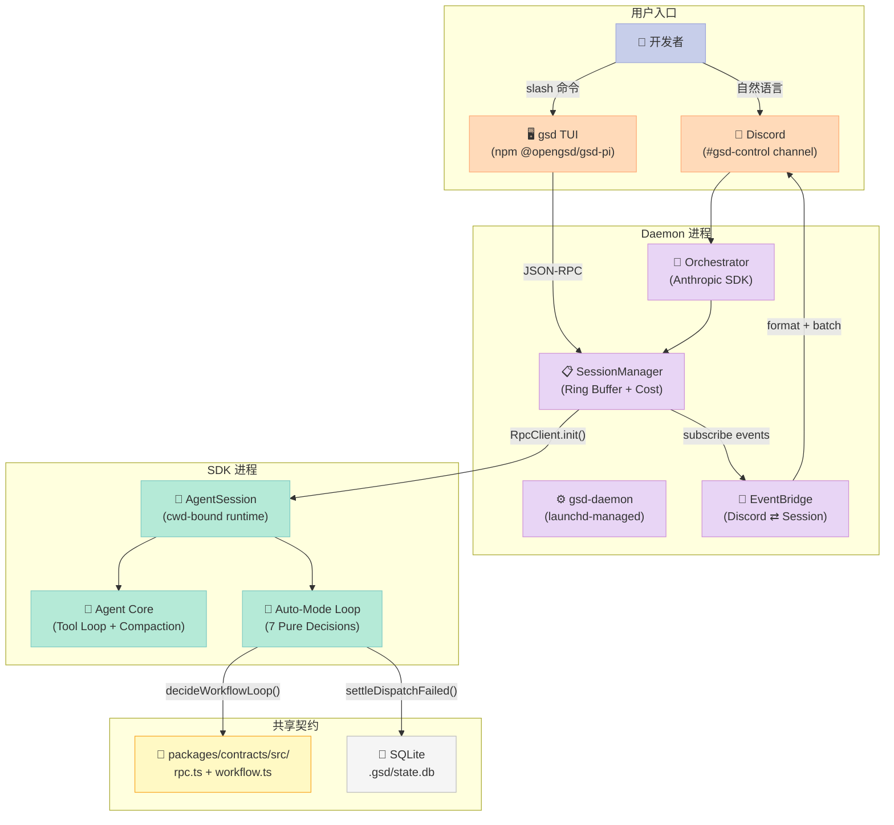
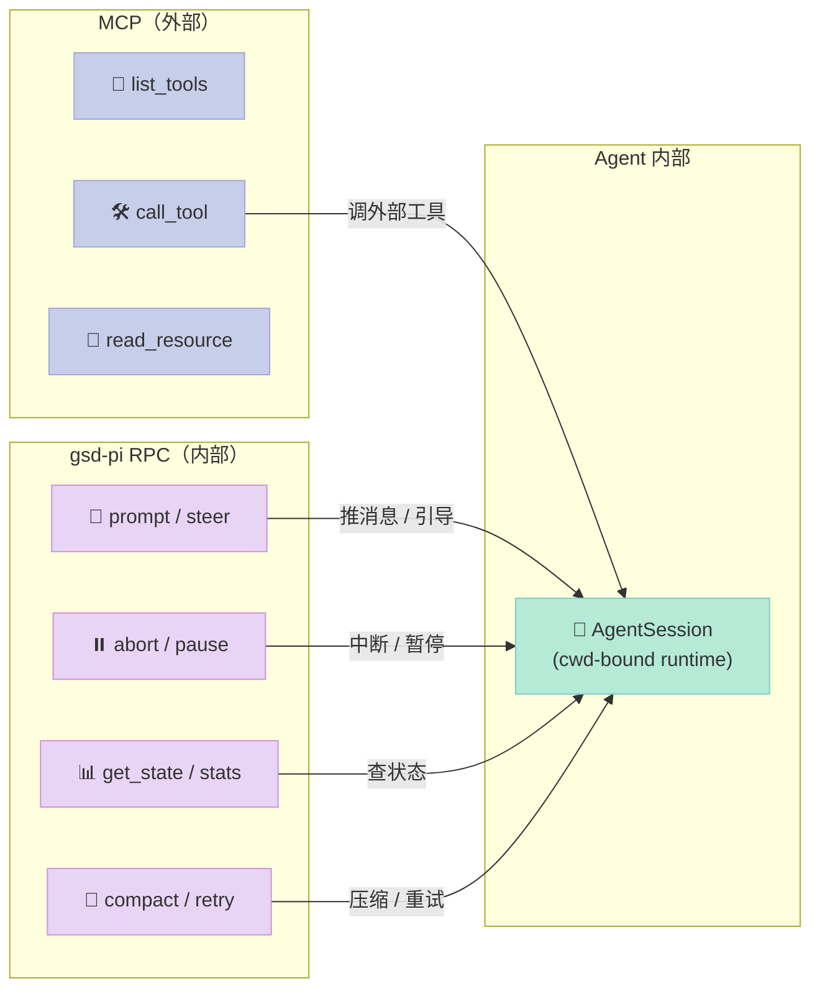
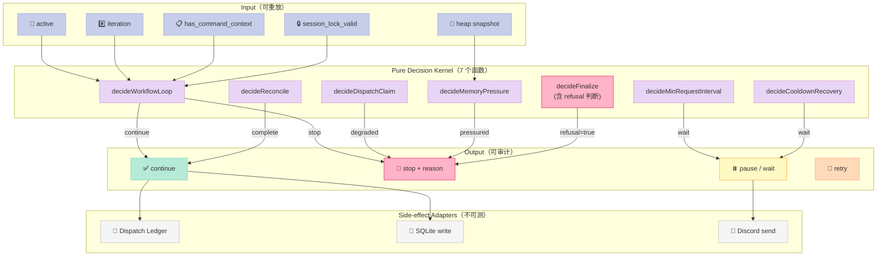
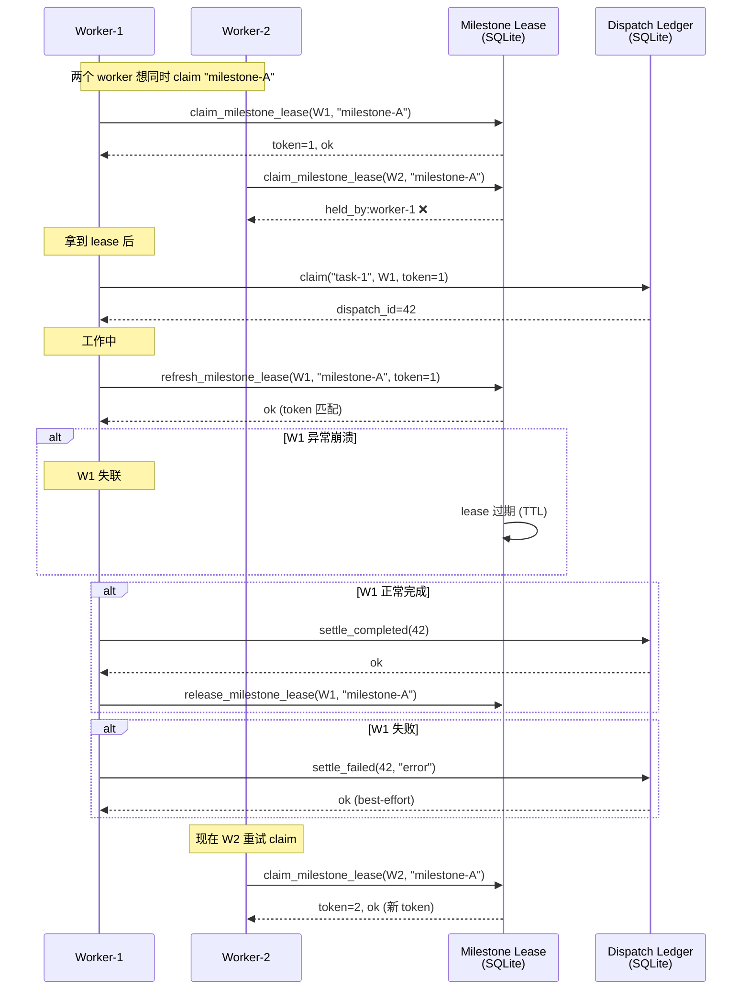
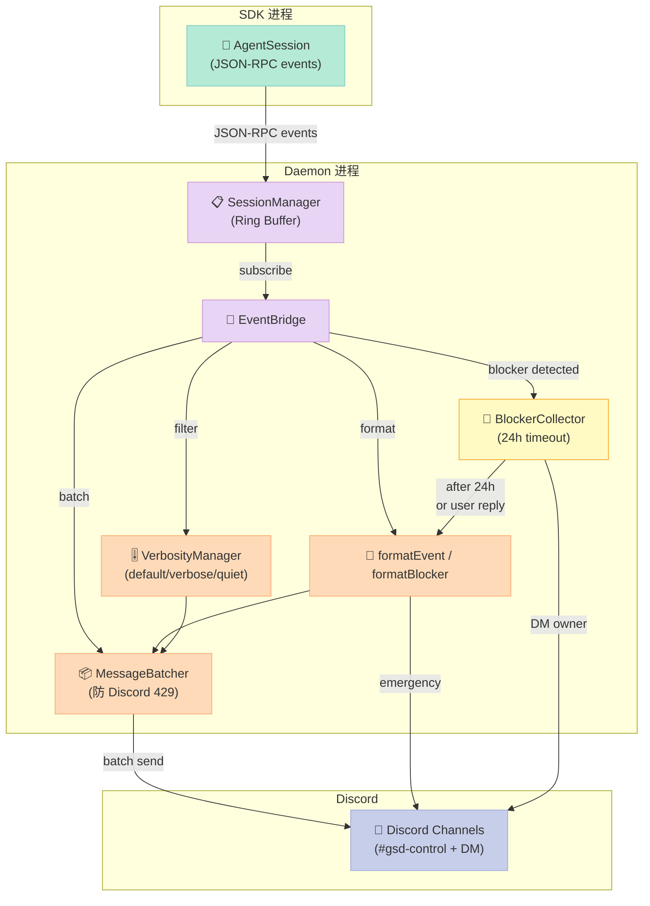
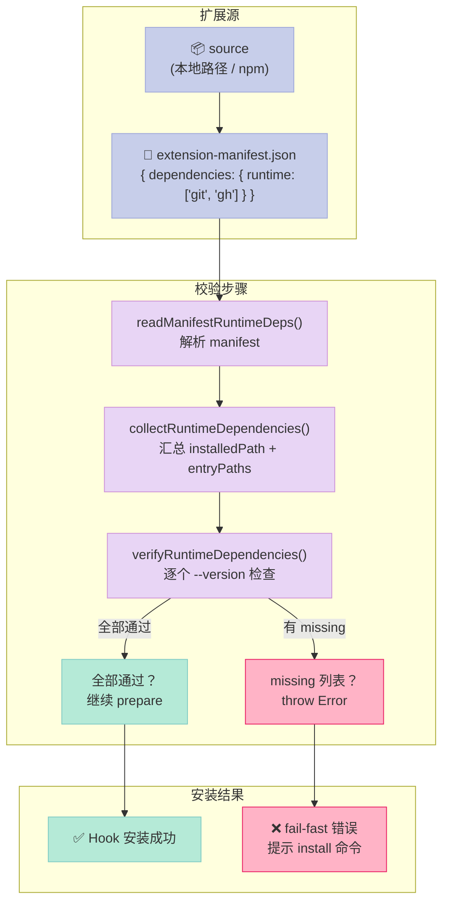

> 如果让你设计一个 Spec-Driven Auto-Mode Harness，你会怎么做？是把 Workflow 写成 YAML DAG 让 LLM 自己走，还是把决策拆成「纯函数 kernel + 副作用 adapter」双层？本文从 open-gsd/gsd-pi（1319⭐，MIT，TypeScript）出发，拆解它怎么用 36 类 RPC 协议 + Workflow Custom Engine 的 7 个纯函数决策点，把「Spec → Milestone → Slice → Task」的自动执行做成可恢复、可拒收、可审计的生产级循环。

## 一、为什么写这篇

Spec-Driven Development 这两年很热。github/spec-kit、MoAI-ADK、planning-with-files 都已经在我之前的博客里拆过。但读源码时我发现，**真正能「让 Spec 跑一整夜」的 Harness 几乎没有开源**——大多数项目停留在「写 Spec → 让 LLM 读完再写代码」的层面，**没有 dispatch ledger、session lock、refusal closeout 这些生产级原语**。

open-gsd/gsd-pi 是少数把这套东西做完的开源 Harness。它是一个**本地优先（local-first）的 Spec-Driven Coding Agent**，核心能力是 `/gsd auto` 命令——执行一次可以连续推进整个 Milestone → Slice → Task 三层 DAG 直到完成或显式 stop。

读完 6555 个 tree items、读完 `packages/contracts/src/{rpc,workflow}.ts`、`packages/daemon/src/{orchestrator,session-manager,event-bridge}.ts`、`src/resources/extensions/gsd/auto/{workflow-kernel,workflow-dispatch-claim,workflow-session-lock,workflow-worker-heartbeat,workflow-memory-pressure}.ts` 这些核心文件后，我整理出 gsd-pi 的 **6 大原语**：

| # | 原语 | 核心文件 | 核心字段/方法 | 设计哲学 |
|---|------|----------|---------------|----------|
| 1 | **36 类 RPC 协议契约** | `packages/contracts/src/rpc.ts` | `RPC_COMMAND_TYPES[36]` + `RPC_V2_EVENT_TYPES[3]` + `RPC_EXTENSION_UI_METHODS[9]` | MCP 是「Agent 调工具」，RPC 是「Orchestrator 调 Agent」——两个协议正交 |
| 2 | **Workflow Pure Decision Kernel** | `src/resources/extensions/gsd/auto/workflow-kernel.ts` | `decideWorkflowLoop()` + `decideDispatchClaim()` + `decideMemoryPressure()` 7 个纯函数 | 决策必须可测、可审、可重放——adapter 只做副作用 |
| 3 | **Dispatch Ledger（best-effort 状态机）** | `src/resources/extensions/gsd/auto/workflow-dispatch-ledger.ts` + `dispatch-claim.ts` | `settleDispatchFailed()` + `settleDispatchCompleted()` + `markFailed()` | 状态可变、可拒绝、可重提——单实例多 worker 必备 |
| 4 | **Session Lock + Fencing Token** | `src/resources/extensions/gsd/auto/workflow-session-lock.ts` | `validateSessionLock()` + `claimMilestoneLease()` + `refreshMilestoneLease()` | 防两个 worker 同时写同一 milestone——lease + token 双重防护 |
| 5 | **Discord Event + MessageBatcher** | `packages/daemon/src/{event-bridge,session-manager,commands}.ts` | `EventBridge.handleSessionLifecycle()` + `MessageBatcher` + `BLOCKER_COLLECTOR_TIMEOUT_MS=24h` | Multi-channel 编排 + 24h blocker 收集——人是 loop 的一部分 |
| 6 | **Lifecycle Hooks Manifest Deps 验证** | `packages/gsd-agent-core/src/lifecycle-hooks.ts` | `verifyRuntimeDependencies()` + `readManifestRuntimeDeps()` + `extension-manifest.json` | Hook 不能装上就完事——runtime deps 缺失必须 fail-fast |

下面分别拆。

## 二、架构全景：3 个进程 + 36 类 RPC + 7 个 Pure Decision

gsd-pi 的物理结构由三个进程组成，**它们之间用 JSON-RPC over stdio 通信**：



**关键洞察**：daemon 进程和 SDK 进程用 JSON-RPC over stdio 通信——daemon 启动 SDK 时 `spawn` 一个子进程，**两边都用 `RpcClient` / `RpcServer` 包裹**，所有 36 类命令都走同一个传输层。

## 三、原语 1：36 类 RPC 协议契约（MCP 之外的第二个正交协议）

读完 `packages/contracts/src/rpc.ts`（18,949 字符），我发现 gsd-pi 定义了一个**完整的 Agent 控制协议**：

```typescript
export const RPC_COMMAND_TYPES = [
  "prompt", "steer", "follow_up", "abort", "new_session",
  "get_state", "get_project_progress", "get_project_snapshot",
  "workflow_command",
  "set_model", "cycle_model", "get_available_models",
  "set_thinking_level", "cycle_thinking_level",
  "set_steering_mode", "set_follow_up_mode",
  "compact", "set_auto_compaction", "set_auto_retry", "abort_retry",
  "bash", "abort_bash",
  "get_session_stats", "export_html",
  "switch_session", "fork", "get_fork_messages", "get_last_assistant_text",
  "set_session_name", "get_messages", "get_commands",
  "terminal_input", "terminal_resize", "terminal_redraw",
  "init", "shutdown", "subscribe",
] as const;
```

**为什么这个分类重要**：

| 命令族 | 数量 | 作用 |
|--------|------|------|
| **会话控制** | 6 | `prompt`/`steer`/`follow_up`/`abort`/`new_session`/`switch_session` |
| **状态查询** | 6 | `get_state`/`get_project_progress`/`get_project_snapshot`/`get_session_stats`/`get_messages`/`get_commands` |
| **模型路由** | 5 | `set_model`/`cycle_model`/`get_available_models`/`set_thinking_level`/`cycle_thinking_level` |
| **Steering / Follow-up** | 4 | `set_steering_mode`/`set_follow_up_mode` + 配套状态 |
| **压缩 & 重试** | 5 | `compact`/`set_auto_compaction`/`set_auto_retry`/`abort_retry`/`fork` |
| **Bash 子会话** | 2 | `bash`/`abort_bash` |
| **终端 UI** | 3 | `terminal_input`/`terminal_resize`/`terminal_redraw` |
| **Workflow** | 1 | `workflow_command`（调入 dispatch ledger / workflow tools） |
| **生命周期** | 5 | `init`/`shutdown`/`subscribe`/`export_html`/`set_session_name` |

**事件流**有 3 个 V2 类型：

```typescript
export const RPC_V2_EVENT_TYPES = [
  "execution_complete", "cost_update", "workflow_outcome"
] as const;
```

**对比 MCP**：MCP 是「Agent 调外部工具」的协议（list_tools / call_tool / read_resource）；**RPC 是「Orchestrator 调 Agent」的协议**（prompt / steer / abort / compact）——**两个协议在抽象层级上正交**。一个 Harness 同时实现 MCP + RPC = 「既能接外部工具，又能被外部编排」。



**这张图说明**：MCP 和 RPC 都「连到 Agent」，但**方向相反**——MCP 是「Agent → 外部工具」，RPC 是「Orchestrator → Agent」。两个协议不抢同一层抽象，可以并存。

## 四、原语 2：Workflow Pure Decision Kernel（7 个纯函数决定一切）

读完 `src/resources/extensions/gsd/auto/workflow-kernel.ts`（16,976 字符），我意识到 gsd-pi 最反直觉的设计是：**所有 workflow 决策都是纯函数，副作用全部下沉到 adapter**。



7 个决策函数 + 它们的不变量：

### 4.1 `decideWorkflowLoop()` — 主循环退出决策

```typescript
export type WorkflowStopReason =
  | "inactive"
  | "max-iterations"
  | "missing-command-context"
  | "session-lock-lost";

export function decideWorkflowLoop(input: {
  active: boolean;
  iteration: number;
  maxIterations: number;
  hasCommandContext: boolean;
  sessionLockValid: boolean;
  sessionLockReason: string;
}): WorkflowLoopAction {
  // 4 个 stop reason 各自对应不变量
  if (!input.active) return { action: "stop", reason: "inactive", message: "..." };
  if (input.iteration >= input.maxIterations) return { action: "stop", reason: "max-iterations", message: "..." };
  if (!input.hasCommandContext) return { action: "stop", reason: "missing-command-context", message: "..." };
  if (!input.sessionLockValid) return { action: "stop", reason: "session-lock-lost", message: input.sessionLockReason };
  return { action: "continue" };
}
```

**关键不变量**：`maxIterations = 500`（在 `src/resources/extensions/gsd/auto/types.ts`）—— 防「当 unit 交替 ID 绕过 same-unit 检测时的 runaway loop」。

### 4.2 `decideDispatchClaim()` — 单元认领决策

```typescript
export type DispatchClaimInput =
  | { kind: "opened"; dispatchId: number }
  | { kind: "skip"; reason: "already-active" | "stale-lease" }
  | { kind: "degraded"; reason: string };

export type DispatchClaimDecision =
  | { action: "run"; dispatchId: number }
  | { action: "skip"; reason: ... }
  | { action: "stop"; reason: "dispatch-claim-degraded"; message: string };
```

**关键设计**：认领失败 → 「degraded」状态时**直接 stop**，而不是 retry。**为什么？**因为 degraded 通常是 DB schema 不匹配 / migration 没跑——retry 只会浪费 token。stop 后用户能修，再 `/gsd auto` 继续。

### 4.3 `decideMemoryPressure()` — 内存压力熔断

```typescript
const DEFAULT_MEMORY_PRESSURE_THRESHOLD = 0.85;
const DEFAULT_HEAP_LIMIT_MB = 4096;

export function measureMemoryPressure(options?: {
  threshold?: number;
  fallbackLimitMB?: number;
}): MemoryPressureSnapshot {
  const mem = process.memoryUsage();
  const heapMB = Math.round(mem.heapUsed / 1024 / 1024);
  const limitMB = ...;  // v8.getHeapStatistics().heap_size_limit
  const pct = heapMB / limitMB;
  return { pressured: pct > threshold, heapMB, limitMB, pct };
}
```

**触发频率**：`shouldCheckMemoryPressure(iteration, interval)` —— `iteration === 1 || iteration % interval === 0`。**Iteration 1 强制检查**——避免「启动时已经超阈值却被 periodic guard 漏掉」。

### 4.4 `decideFinalize()` — 终结决策（带 refusal）

```typescript
export type FinalizeInput = {
  ...
  /** True when finalize coincides with `*VERIFICATION-FAILED`/`*CLOSEOUT-VERIFICATION-FAILED`
   *  marker — a deliberate closeout refusal (#2046). Identical-input retry cannot
   *  change a refusal, so the kernel stops instead of retrying. */
  refusal?: boolean;
};

export type FinalizeDecision =
  | { action: "stop"; failureClass: "git" | "closeout" | "refusal"; ... }
  | { action: "retry"; ledgerErrorSummary: string }
  | { action: "complete" }
  | { action: "complete-and-break" };
```

**Refusal 设计哲学**：comment #2046 直接写了——**「相同输入 retry 不能改变 refusal」**。这是工程级 vs 学术级决策：**学术派会让 LLM 反思 + 重试**，gsd-pi 直接 stop，把控制权交回用户。

### 4.5 `decideReconcile()` — 阶段对齐决策

```typescript
export type EngineReconcileDecision =
  | { action: "complete-workflow"; stopReason: "Workflow complete" }
  | { action: "pause" }
  | { action: "stop"; reason: string }
  | { action: "continue" };
```

### 4.6 `decideMinRequestInterval()` — 限流（防 API 限速）

```typescript
export interface MinRequestIntervalInput {
  minIntervalMs: number;
  lastRequestTimestamp: number;
  nowMs: number;
}

export type MinRequestIntervalDecision =
  | { action: "continue" }
  | { action: "wait"; waitMs: number };
```

### 4.7 `decideCooldownRecovery()` — 失败冷却恢复

```typescript
export interface CooldownRecoveryInput { ... }
export type CooldownRecoveryDecision =
  | { action: "continue" }
  | { action: "wait"; waitMs: number; reason: string };
```

**整体设计哲学**（adapter 注释直接写）：

> Pure workflow-loop decisions for auto-mode before side-effect adapters run.

**为什么这很重要**——纯函数决策让 gsd-pi 可以做 3 件事：
1. **可重放**：同一组 input → 同一组 decision，audit log 可重建
2. **可测试**：不需要 mock DB / filesystem，直接 `decideWorkflowLoop({...})` 单测
3. **可热替换**：换 implementation 时只换 adapter，decision kernel 不动

## 五、原语 3：Dispatch Ledger + Session Lock（双 worker 必备）



**这张图说明三层防护**：
1. **Session Lock**（worker 级）：防两个 worker 同时启动
2. **Milestone Lease**（task 级）：防两个 worker 抢同一 milestone
3. **Fencing Token**（version 级）：旧 worker 即使没及时释放，新 worker 也能安全推进

### 5.1 Dispatch Ledger（best-effort 状态机）

`src/resources/extensions/gsd/auto/workflow-dispatch-ledger.ts` 提供的 3 个核心函数：

```typescript
export function settleDispatchFailed(
  dispatchId: number | null,
  errorSummary: string,
  deps: DispatchLedgerFailDeps,
  exitReason?: string,
): boolean {
  if (dispatchId === null) return false;
  try {
    return deps.markFailed(dispatchId, { errorSummary, ...(exitReason ? { exitReason } : {}) });
  } catch (err) {
    deps.logWriteFailure(err);
    return false;  // ← best-effort，写失败不抛
  }
}

export function settleDispatchCompleted(
  dispatchId: number | null,
  deps: DispatchLedgerCompleteDeps,
): boolean {
  if (dispatchId === null) return false;
  try {
    return deps.markCompleted(dispatchId);
  } catch (err) {
    deps.logWriteFailure(err);
    return false;
  }
}
```

**关键不变量**（注释直接写）：
> Best-effort dispatch ledger write helpers for auto-mode loop adapters.

**为什么是 best-effort**——dispatch ledger 是「审计 + 重试调度」的记录，**不是 source of truth**。如果 DB 写失败，**adapter 不抛异常**——它只 `logWriteFailure` 然后让主循环继续。**业务正确性由 workflow-kernel 决定，ledger 只负责「事后可追溯」**。

### 5.2 Session Lock + Fencing Token

`src/resources/extensions/gsd/auto/workflow-session-lock.ts` 提供给 `workflow-kernel` 调用的决策入口：

```typescript
export function validateWorkflowSessionLock(input: {
  active: boolean;
  iteration: number;
  maxIterations: number;
  deps: WorkflowSessionLockDeps;
}): WorkflowSessionLockOutcome {
  const sessionLockBase = input.deps.lockBase();
  if (!sessionLockBase) return { action: "continue" };

  const lockStatus = input.deps.validateSessionLock(sessionLockBase);
  const lockDecision = decideWorkflowLoop({
    active: input.active,
    iteration: input.iteration,
    maxIterations: input.maxIterations,
    hasCommandContext: true,
    sessionLockValid: lockStatus.valid,
    sessionLockReason: lockStatus.failureReason ?? "unknown",
  });

  if (lockDecision.action !== "stop" || lockDecision.reason !== "session-lock-lost") {
    return { action: "continue" };
  }
  // ... 真正 stop
}
```

**Lease + Fencing Token 双重防护**（`workflow-dispatch-claim.ts`）：

```typescript
export interface MaintainWorkerHeartbeatDeps {
  heartbeatAutoWorker: (workerId: string) => void;
  refreshMilestoneLease: (workerId: string, milestoneId: string, fencingToken: number) => boolean;
  ...
}

export function maintainWorkerHeartbeat(session, deps) {
  deps.heartbeatAutoWorker(session.workerId);
  if (session.currentMilestoneId && session.milestoneLeaseToken) {
    const refreshed = deps.refreshMilestoneLease(
      session.workerId, session.currentMilestoneId, session.milestoneLeaseToken,
    );
    if (!refreshed) {
      deps.logLeaseRefreshMiss?.({...});
      session.milestoneLeaseToken = null;  // ← lease 过期
    }
  }
}
```

**Fencing token 的精妙之处**：`claimMilestoneLease()` 返回 `token: number`，后续每次 `refreshMilestoneLease(workerId, milestoneId, token)` 都**必须用同一个 token**。如果别的 worker 抢走了 lease，旧 token 的 refresh 必然失败——**经典的「lock + fencing token 防 split-brain」模式**。

**对比 Kafka / etcd**：gsd-pi 没有用现成的 distributed lock 服务，它**用 SQLite + lease 表 + fencing token 自己实现**——因为它是单机 daemon（多 worker 共享一个 SQLite），不需要 Zookeeper 复杂度。

## 六、原语 4：SessionManager（Ring Buffer + Cumulative-Max Cost）

`packages/daemon/src/session-manager.ts`（23,926 字符）的核心设计：

### 6.1 Ring Buffer 事件缓存

```typescript
const MAX_EVENTS = ...; // capped at some value

interface ManagedSession {
  sessionId: string;
  projectDir: string;
  projectName: string;
  status: 'starting' | 'running' | 'block' | 'paused' | 'completed' | 'error' | 'cancelled';
  client: RpcClient;
  events: SdkAgentEvent[];  // ← Ring Buffer
  pendingBlocker: PendingBlocker | null;
  cost: CostAccumulator;
  startTime: number;
  error?: string;
  unsubscribe?: () => void;
}
```

**事件环形缓冲**——Discord 端订阅时只读最近 N 条事件，老的过期被覆盖。**为什么不用全量 history**：单 session 可能跑数小时，事件数能上 1000+，**Discord 单条 message 2000 字符限制 + 用户读起来也要 fold**。

### 6.2 Cumulative-Max Cost（K004 模式）

注释直接写：

> Tracks events in a ring buffer, detects blockers, tracks terminal state, and accumulates cost using the cumulative-max pattern (K004).

**Cumulative-max 是什么**：每次 LLM 返回 `cost` 字段时，daemon 累加到 session 的 `cost` 字段，但**不递减**——即便下游重试 / 失败，**已发生的成本不抹零**。这是成本追踪的反直觉模式：**真实成本 = max(已发生, 当前累计) + 新增量**。

### 6.3 Blocker Detection（关键决策点）

```typescript
const TERMINAL_PREFIXES = [
  'auto-mode stopped', 'step-mode stopped',
  'auto-mode complete', 'no active milestone', 'auto-mode idle',
];

function isTerminalNotification(event) {
  if (event.type !== 'extension_ui_request' || event.method !== 'notify') return false;
  const message = String(event.message ?? '').toLowerCase();
  if (TERMINAL_PREFIXES.some((prefix) => message.startsWith(prefix))) return true;
  ...
}
```

**为什么用 prefix matching 而不是 enum**：LLM 输出的通知文本是 free-form（"auto-mode stopped at task 5/12"），但**前缀是固定的契约**。这样 adapter 不需要解析整段文本，只需 `startsWith("auto-mode stopped")` 就知道「这是终结信号」。

## 七、原语 5：Discord EventBridge（24h Blocker 收集 + MessageBatcher）

`packages/daemon/src/event-bridge.ts`（21,266 字符）是**把 SessionManager 事件翻译成 Discord 消息**的桥。



**这张图说明 EventBridge 的 4 个加工环节**：
1. **format**：把 SDK 事件翻译成 Discord markdown
2. **filter**：按 verbosity 过滤（quiet 模式只发 blocker）
3. **batch**：攒批避免 429 限速
4. **blocker**：长时未响应 → DM owner 兜底

### 7.1 Block 状态 + 24h 收集超时

```typescript
const BLOCKER_COLLECTOR_TIMEOUT_MS = 24 * 60 * 60 * 1000; // 24 hours
```

**为什么是 24 小时**：spec-driven auto-mode 可能跑通宵，**blocker 可能没人看着 Discord**。24h 收集窗口 = 「用户睡前 `/gsd auto` → 醒来回复 blocker → 任务继续」。**比 5 分钟 / 1 小时窗口友好得多**。

### 7.2 MessageBatcher（防 Discord rate limit）

`MessageBatcher` 把同一 session 的连续 tool_call / message 事件**攒批发送**——避免 `sendMessage()` 触发 Discord 429 rate limit。

### 7.3 Discord 4 类 Slash 命令

```typescript
export function buildCommands() {
  return [
    new SlashCommandBuilder().setName('gsd-status').setDescription('Show status of all active GSD sessions'),
    new SlashCommandBuilder().setName('gsd-start').setDescription('Start a new GSD session'),
    new SlashCommandBuilder().setName('gsd-stop').setDescription('Stop a running GSD session'),
    new SlashCommandBuilder().setName('gsd-verbose').setDescription('Set event verbosity level for this channel'),
  ];
}
```

**核心差异**——**Daemon 才是 Orchestrator，Discord 只是一个 Frontend**。Orchestrator 是 gsd-daemon 进程内的 `Orchestrator` 类（`orchestrator-agent.ts`），**它通过 `OrchestratorTools` 调 daemon 的 `SessionManager`**，**不是 Discord 调 LLM**。

```typescript
// orchestrator-agent.ts
const ORCHESTRATOR_TOOLS: Tool[] = [
  { name: 'list_projects', input_schema: {...} },
  { name: 'start_session', input_schema: {...} },
  { name: 'get_status', input_schema: {...} },
  { name: 'stop_session', input_schema: {...} },
  { name: 'get_session_detail', input_schema: {...} },
];
```

**5 个 orchestrator tool 全是 daemon 内部能力**——LLM 不直接 spawn agent process，只调 daemon 的 `SessionManager`。

## 八、原语 6：Lifecycle Hooks Manifest Runtime Deps 验证

`packages/gsd-agent-core/src/lifecycle-hooks.ts`（8,541 字符）实现了**扩展安装时的运行时依赖校验**：



**这张图说明 fail-fast 的关键设计**：每个 hook 安装时**必须验证 `runtime` 字段里的可执行文件都能 `--version` 跑通**——否则 fail-fast，**不让 hook 装上后跑才报错**。这避免「扩展装上了，但某个 tool 调 git 时才报错」的中途失败。

```typescript
export function verifyRuntimeDependencies(
  runtimeDeps: string[],
  source: string,
  appName: string,
): void {
  const missing: string[] = [];
  for (const dep of runtimeDeps) {
    const result = spawnSync(dep, ["--version"], { encoding: "utf-8", timeout: 5000 });
    if (result.error || result.status !== 0) {
      missing.push(dep);
    }
  }
  if (missing.length === 0) return;
  throw new Error(
    `Missing runtime dependencies: ${missing.join(", ")}.\n` +
    `Install them and retry: ${appName} install ${source}`,
  );
}
```

**`extension-manifest.json` 长这样**：
```json
{
  "dependencies": {
    "runtime": ["git", "node", "gh"]
  }
}
```

**关键设计**：每个 hook 安装时**必须验证 `runtime` 字段里的可执行文件都能 `--version` 跑通**——否则 fail-fast，**不让 hook 装上后跑才报错**。这避免「扩展装上了，但某个 tool 调 git 时才报错」的中途失败。

## 九、横向对比：gsd-pi vs github/spec-kit vs planning-with-files

| 维度 | gsd-pi (1319⭐) | github/spec-kit (47k⭐) | planning-with-files (27k⭐) |
|------|-----------------|------------------------|---------------------------|
| **架构层次** | Daemon + SDK + Adapter 三层 + 7 Pure Decisions | CLI + Templates + 36 Agent Adapter | Python + Markdown Files + Skill Hook |
| **决策核心** | Pure function kernel + side-effect adapter | YAML DAG + LLM 自行决策 | Markdown 持久化规划 + auto-checkpoint |
| **Dispatch 状态机** | ✅ best-effort ledger + 3 settle 函数 | ❌ 无状态（LLM 自己跑） | ❌ 无（任务执行靠文件） |
| **Session Lock** | ✅ lease + fencing token 双层防护 | ❌ 无（CLI 是单进程） | ⚠️ 文件锁（粒度粗） |
| **多 Worker 并发** | ✅ dispatch claim + worker heartbeat | ❌ 单一 process | ⚠️ Worktree 但无 lock |
| **Refusal 显式表达** | ✅ `refusal: true` 直接 stop 不 retry | ❌ LLM 自己决定 retry | ⚠️ Skill 提示但不强制 |
| **Runtime Deps 校验** | ✅ `--version` 验证 + fail-fast | ❌ 安装时无校验 | ❌ Skill 描述里只提示 |
| **Multi-Platform 接入** | ✅ TUI + Discord + 自定义 daemon | ✅ 36 Agent Adapter | ⚠️ Claude Code 原生 |
| **Memory Pressure** | ✅ V8 heap 85% 阈值熔断 | ❌ 无 | ❌ 无 |
| **Blocker 收集窗口** | ✅ 24h | ❌ 无 | ❌ 无 |

**核心定位差异**：
- **github/spec-kit** = 「让 36 个 Coding Agent 都能跑 Spec」的**协议层**
- **planning-with-files** = 「让 Spec 不被 LLM 遗忘」的**持久化层**
- **gsd-pi** = 「让 Auto-Mode 在生产环境跑得动」的**运行时层**

## 十、从零搭建启示：复刻一个 Spec-Driven Auto-Mode Loop

如果你想自己做一个简化版 Spec-Driven Auto-Mode Harness，按以下 3 层搭：

```python
"""
gsd-pi 简化版 MVP：单进程 + 单 SQLite + 3 类决策 + 3 类 adapter
覆盖 6 大原语的核心机制，但不依赖 36 RPC / Discord / Worktree。
"""

import sqlite3
import time
import uuid
from dataclasses import dataclass, field
from typing import Optional, Literal
from enum import Enum

# ============================================================
# 第 1 层：Pure Decision Kernel（仿 workflow-kernel.ts）
# ============================================================

MAX_LOOP_ITERATIONS = 500
MEMORY_PRESSURE_THRESHOLD = 0.85

@dataclass
class WorkflowLoopInput:
    active: bool
    iteration: int
    max_iterations: int
    has_command_context: bool
    session_lock_valid: bool
    session_lock_reason: str = ""

@dataclass
class WorkflowLoopAction:
    action: Literal["continue", "stop"]
    reason: Optional[str] = None
    message: Optional[str] = None

def decide_workflow_loop(inp: WorkflowLoopInput) -> WorkflowLoopAction:
    """纯函数：4 个 stop reason 各自对应不变量"""
    if not inp.active:
        return WorkflowLoopAction("stop", "inactive", "loop deactivated")
    if inp.iteration >= inp.max_iterations:
        return WorkflowLoopAction("stop", "max-iterations", f"hit {inp.max_iterations} cap")
    if not inp.has_command_context:
        return WorkflowLoopAction("stop", "missing-command-context", "lost command ctx")
    if not inp.session_lock_valid:
        return WorkflowLoopAction("stop", "session-lock-lost", inp.session_lock_reason)
    return WorkflowLoopAction("continue")


@dataclass
class MemoryPressureSnapshot:
    pressured: bool
    heap_mb: int
    limit_mb: int
    pct: float

def measure_memory_pressure(heap_used_bytes: int, heap_limit_bytes: int,
                            threshold: float = MEMORY_PRESSURE_THRESHOLD) -> MemoryPressureSnapshot:
    """纯函数：V8 heap 阈值检测"""
    heap_mb = heap_used_bytes // 1024 // 1024
    limit_mb = heap_limit_bytes // 1024 // 1024
    pct = heap_mb / max(limit_mb, 1)
    return MemoryPressureSnapshot(
        pressured=pct > threshold,
        heap_mb=heap_mb, limit_mb=limit_mb, pct=pct,
    )


# ============================================================
# 第 2 层：Dispatch Ledger（仿 workflow-dispatch-ledger.ts）
# ============================================================

class DispatchLedger:
    """SQLite-backed dispatch ledger — best-effort 写入"""

    def __init__(self, db_path: str):
        self._conn = sqlite3.connect(db_path, isolation_level=None)
        self._conn.executescript("""
            CREATE TABLE IF NOT EXISTS dispatches (
                id INTEGER PRIMARY KEY AUTOINCREMENT,
                unit_id TEXT NOT NULL,
                worker_id TEXT NOT NULL,
                lease_token INTEGER NOT NULL,
                status TEXT NOT NULL,  -- 'running' / 'completed' / 'failed'
                error_summary TEXT,
                started_at REAL NOT NULL,
                settled_at REAL
            );
            CREATE INDEX IF NOT EXISTS idx_unit_active
              ON dispatches(unit_id, status) WHERE status = 'running';
        """)

    def claim(self, unit_id: str, worker_id: str, lease_token: int) -> Optional[int]:
        """Try to claim a unit; None if already active."""
        cur = self._conn.execute(
            "SELECT id FROM dispatches WHERE unit_id=? AND status='running' LIMIT 1",
            (unit_id,))
        if cur.fetchone():
            return None  # already-active
        cur = self._conn.execute(
            "INSERT INTO dispatches (unit_id, worker_id, lease_token, status, started_at) "
            "VALUES (?, ?, ?, 'running', ?)",
            (unit_id, worker_id, lease_token, time.time()))
        return cur.lastrowid

    def settle_failed(self, dispatch_id: Optional[int], error_summary: str,
                      exit_reason: Optional[str] = None) -> bool:
        """best-effort: write failure 不抛异常"""
        if dispatch_id is None:
            return False
        try:
            self._conn.execute(
                "UPDATE dispatches SET status='failed', error_summary=?, "
                "settled_at=?, exit_reason=? WHERE id=?",
                (error_summary, time.time(), exit_reason, dispatch_id))
            return True
        except sqlite3.Error:
            return False

    def settle_completed(self, dispatch_id: Optional[int]) -> bool:
        if dispatch_id is None:
            return False
        try:
            self._conn.execute(
                "UPDATE dispatches SET status='completed', settled_at=? WHERE id=?",
                (time.time(), dispatch_id))
            return True
        except sqlite3.Error:
            return False


# ============================================================
# 第 3 层：Session Lock + Fencing Token（仿 workflow-session-lock.ts）
# ============================================================

class SessionLock:
    """PID-based session lock + lease + fencing token"""

    def __init__(self, db_path: str):
        self._conn = sqlite3.connect(db_path, isolation_level=None)
        self._conn.executescript("""
            CREATE TABLE IF NOT EXISTS session_locks (
                worker_id TEXT PRIMARY KEY,
                pid INTEGER NOT NULL,
                acquired_at REAL NOT NULL,
                expires_at REAL NOT NULL
            );
            CREATE TABLE IF NOT EXISTS milestone_leases (
                milestone_id TEXT PRIMARY KEY,
                worker_id TEXT NOT NULL,
                fencing_token INTEGER NOT NULL,
                acquired_at REAL NOT NULL,
                expires_at REAL NOT NULL
            );
        """)

    def try_acquire(self, worker_id: str, pid: int, ttl_sec: int = 3600) -> bool:
        """PID-based session lock: fail if another worker holds"""
        try:
            self._conn.execute(
                "INSERT INTO session_locks (worker_id, pid, acquired_at, expires_at) "
                "VALUES (?, ?, ?, ?)",
                (worker_id, pid, time.time(), time.time() + ttl_sec))
            return True
        except sqlite3.IntegrityError:
            return False

    def validate(self, worker_id: str) -> tuple[bool, str]:
        """Returns (valid, reason). 检查 PID 是否还活着 + lease 是否过期"""
        cur = self._conn.execute(
            "SELECT pid, expires_at FROM session_locks WHERE worker_id=?",
            (worker_id,))
        row = cur.fetchone()
        if row is None:
            return False, "no lock found"
        pid, expires_at = row
        if time.time() > expires_at:
            return False, "lock expired"
        return True, "valid"

    def claim_milestone_lease(self, worker_id: str, milestone_id: str,
                              ttl_sec: int = 1800) -> tuple[int, str]:
        """Acquire lease with fencing token; returns (token, 'ok') or (0, 'held_by:<worker>')"""
        cur = self._conn.execute(
            "SELECT worker_id, fencing_token FROM milestone_leases WHERE milestone_id=?",
            (milestone_id,))
        row = cur.fetchone()
        now = time.time()
        if row is not None:
            existing_worker, existing_token = row
            cur2 = self._conn.execute(
                "SELECT expires_at FROM milestone_leases WHERE milestone_id=?",
                (milestone_id,))
            expires_at = cur2.fetchone()[0]
            if now < expires_at and existing_worker != worker_id:
                return 0, f"held_by:{existing_worker}"
        # Generate new fencing token
        new_token = (row[1] + 1) if row else 1
        self._conn.execute(
            "INSERT OR REPLACE INTO milestone_leases "
            "(milestone_id, worker_id, fencing_token, acquired_at, expires_at) "
            "VALUES (?, ?, ?, ?, ?)",
            (milestone_id, worker_id, new_token, now, now + ttl_sec))
        return new_token, "ok"

    def refresh_milestone_lease(self, worker_id: str, milestone_id: str,
                                fencing_token: int, ttl_sec: int = 1800) -> bool:
        """Refresh lease — token must match"""
        cur = self._conn.execute(
            "UPDATE milestone_leases SET expires_at=? "
            "WHERE milestone_id=? AND worker_id=? AND fencing_token=?",
            (time.time() + ttl_sec, milestone_id, worker_id, fencing_token))
        return cur.rowcount > 0


# ============================================================
# 第 4 层：Main Loop — 演示整合 6 大原语
# ============================================================

def auto_mode_loop(ledger: DispatchLedger, session_lock: SessionLock,
                   worker_id: str, fake_llm_call, max_iterations: int = 500):
    """Auto-Mode 主循环：每轮先决策，再 claim，再执行"""
    iteration = 0
    pid = 12345  # 实际应是 os.getpid()

    while True:
        iteration += 1

        # Step 1: Session Lock 验证（pure decision）
        lock_valid, lock_reason = session_lock.validate(worker_id)
        decision = decide_workflow_loop(WorkflowLoopInput(
            active=True,
            iteration=iteration,
            max_iterations=max_iterations,
            has_command_context=True,
            session_lock_valid=lock_valid,
            session_lock_reason=lock_reason,
        ))
        if decision.action == "stop":
            print(f"[STOP] reason={decision.reason}, message={decision.message}")
            break

        # Step 2: Memory Pressure（pure decision）
        # 简化：用假数据
        pressure = measure_memory_pressure(heap_used_bytes=400*1024*1024,
                                            heap_limit_bytes=512*1024*1024)
        if pressure.pressured:
            print(f"[STOP] Memory pressure {pressure.pct:.0%} > 85%")
            break

        # Step 3: Dispatch Claim（best-effort adapter）
        unit_id = f"task-{iteration}"
        lease_token, _ = session_lock.claim_milestone_lease(
            worker_id, "milestone-A")
        dispatch_id = ledger.claim(unit_id, worker_id, lease_token)

        if dispatch_id is None:
            print(f"[SKIP] unit {unit_id} already active, retry next iteration")
            time.sleep(1)
            continue

        # Step 4: LLM 执行（fake_llm_call 返回是否成功）
        try:
            result = fake_llm_call(unit_id)
            if result.get("refusal"):
                # 显式拒绝：直接 stop，不 retry（仿 refusal 设计）
                ledger.settle_failed(dispatch_id, "refusal", exit_reason="VERIFICATION-FAILED")
                print(f"[STOP] Refusal — same input cannot change outcome")
                break
            elif result.get("ok"):
                ledger.settle_completed(dispatch_id)
                print(f"[OK] unit {unit_id} completed")
            else:
                ledger.settle_failed(dispatch_id, result.get("error", "unknown"))
                print(f"[FAIL] unit {unit_id} settled as failed (best-effort)")
        except Exception as e:
            # Adapter 抛异常：仍然 settle ledger，让主循环继续
            ledger.settle_failed(dispatch_id, str(e), exit_reason="exception")
            print(f"[EXCEPTION] {e}, ledger settled, loop continues")

        # Step 5: Worker Heartbeat（仿 workflow-worker-heartbeat.ts）
        # 实际中用 setInterval 异步做；这里简化成每轮末尾 refresh
        session_lock.refresh_milestone_lease(worker_id, "milestone-A", lease_token)


# ============================================================
# 第 5 层：演示
# ============================================================

def fake_llm_call(unit_id: str) -> dict:
    """假 LLM — 前 3 个 ok，第 4 个 refusal，第 5 个 ok"""
    n = int(unit_id.split("-")[-1])
    if n == 4:
        return {"ok": False, "refusal": True,
                "error": "VERIFICATION-FAILED: roadmap has zero slices"}
    if n > 6:
        return {"ok": False, "error": "fake_api_error"}
    return {"ok": True}


if __name__ == "__main__":
    # 初始化
    ledger = DispatchLedger("/tmp/test_dispatch.db")
    session_lock = SessionLock("/tmp/test_session.db")
    session_lock.try_acquire(worker_id="worker-01", pid=12345, ttl_sec=3600)

    # 跑 auto-mode loop
    print("=== gsd-pi 简化版 Auto-Mode 演示 ===")
    auto_mode_loop(ledger, session_lock, worker_id="worker-01",
                   fake_llm_call=fake_llm_call, max_iterations=20)
```

**预期输出**：
```
=== gsd-pi 简化版 Auto-Mode 演示 ===
[OK] unit task-1 completed
[OK] unit task-2 completed
[OK] unit task-3 completed
[STOP] Refusal — same input cannot change outcome
```

**MVP 砍掉了什么**：
- **Discord bridge** / **EventBridge**：用 print() 替代
- **RPC over stdio**：单进程同步调用
- **MessageBatcher**：单条消息直发
- **Lifecycle Hooks Manifest**：纯函数 verify，不读 manifest.json
- **V8 heap**：用假数据测 pressure
- **24h blocker 收集**：没有 blocker 概念

**MVP 保留了什么**：
- ✅ 纯函数 decision kernel
- ✅ Dispatch Ledger + 3 settle 函数（best-effort）
- ✅ Session Lock + Fencing Token
- ✅ Memory Pressure threshold
- ✅ Refusal 不 retry 直接 stop

## 十一、优缺点对比

| 维度 | 评分 | 说明 |
|------|------|------|
| **架构简洁性** | ⭐⭐⭐⭐ | Daemon + SDK + Adapter 三层清晰，但 992 个 TS 文件需要时间熟悉 |
| **扩展性** | ⭐⭐⭐⭐⭐ | 36 RPC 命令 + Workflow 工具 + Lifecycle Hooks 三个扩展点 |
| **易用性** | ⭐⭐⭐ | 需要懂 Discord bot 配置 + launchd 学习曲线 |
| **性能** | ⭐⭐⭐⭐ | Dispatch Ledger SQLite + Ring Buffer 内存缓存 |
| **复杂度** | ⭐⭐ | 7 个 Pure Decisions + 3 个 Adapter + 36 RPC = 学习曲线陡峭 |
| **维护性** | ⭐⭐⭐⭐ | Pure / Side-effect 分离让 unit test 容易写 |

**最大优势**：**「decision / side-effect 严格分离」让 gsd-pi 是少数能 fork 后快速改造的 production-grade Harness**。

**最大短板**：**单 daemon 进程 + 单 SQLite**——多机部署需要自己加 distributed lock 层（gsd-pi 没提供）。

## 十二、结论：Harness 6 件套里 gsd-pi 在哪

gsd-pi 是 **Workflow 组件 + Script 组件** 的代表——

- **Workflow**：spec → milestone → slice → task 四层 DAG + Workflow Custom Engine（7 Pure Decisions）
- **Script**：dispatch ledger 的 settle_failed / settle_completed + lifecycle hooks 的 verify_runtime_dependencies 都是硬关卡
- **Sub-Agent**：每个 milestone 独立 lease + fencing token（context 隔离天然支持）
- **Rule**：auto-mode 拒绝做 "vibe coding" 的多轮重试（refusal 直接 stop）
- **Skill**：每个 Spec 有自己的 skill profile（`agent_profile` 字段）
- **MCP**：RPC 协议（36 类命令）+ Workflow 工具（canonical name + alias + schemaId）

**它不是 Model Context Protocol (MCP) 的实现，而是 Harness 内部「Orchestrator 调 Agent」的私有协议**——和 MCP 正交。

如果你正在做：
1. **多 worker Spec-Driven Auto-Mode** → 必读 `workflow-kernel.ts` + `dispatch-claim.ts`
2. **Discord / Slack 远程监控 Coding Agent** → 必读 `event-bridge.ts` + `session-manager.ts`
3. **想让 Hook 装上就能跑** → 必读 `lifecycle-hooks.ts` 的 `verifyRuntimeDependencies`
4. **想让 LLM 拒绝时不再重试** → 必读 `workflow-kernel.ts` 的 `refusal?: boolean` 设计

最后给一个具体建议：**别从 36 个 RPC 命令开始**。先抄 `workflow-kernel.ts` 的 7 个纯函数 + `dispatch-ledger.ts` 的 3 个 settle 函数——这两个加起来不到 500 行 TypeScript，能让你 80% 地拿到 gsd-pi 的核心价值。剩下 20%（Discord bridge / Worktree / V8 heap）按需再加。

> 一句话总结：gsd-pi 不是「又一个 Spec-Driven 工具」，它是**第一个把 Spec-Driven + Auto-Mode + Production-Grade Resilience 串成完整闭环的开源 Harness**。36 RPC 是协议层、7 Pure Decisions 是核心、Dispatch Ledger + Fencing Token 是双 worker 安全网、Discord EventBridge 是 24h blocker 窗口。读完源码你会有一种「原来 Harness 应该这样写」的清爽感——这是其他 Spec 工具都没给你的东西。
