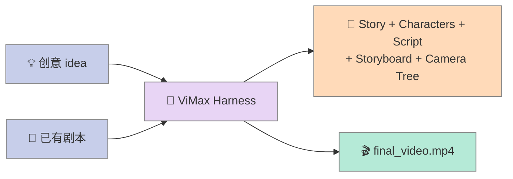
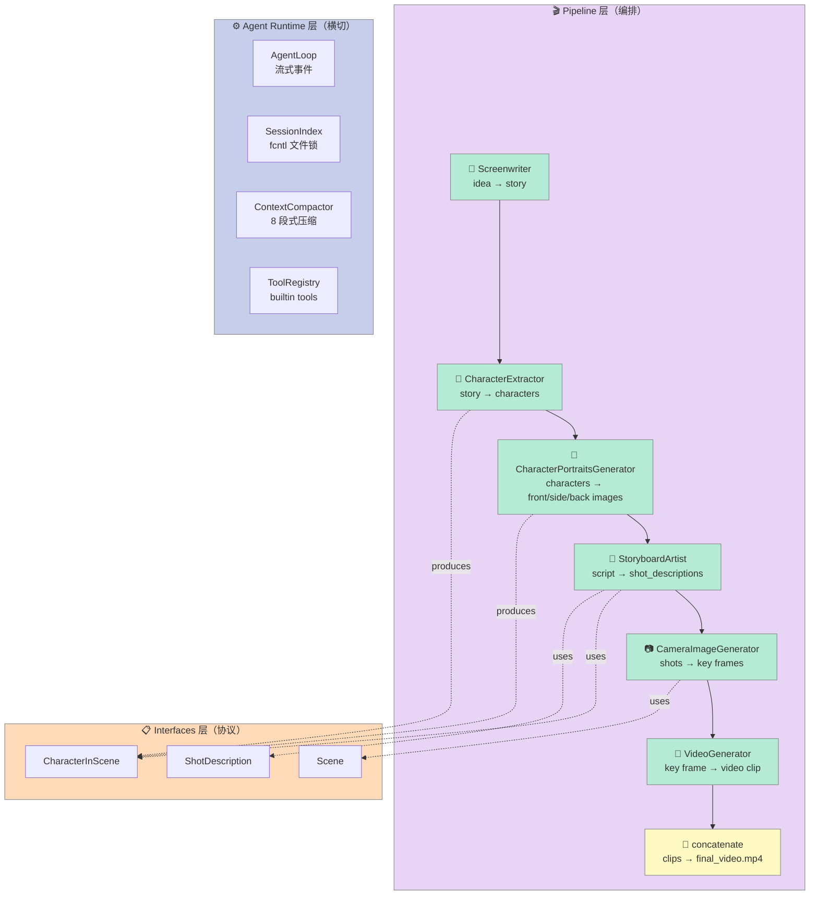
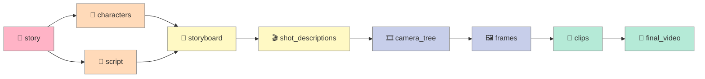
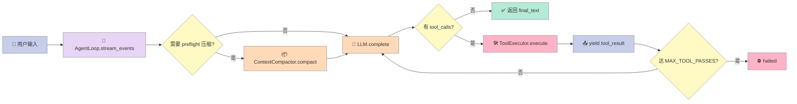

# 【ViMax】HKU 出品的"最 Agentic"视频生成 Harness：导演 + 编剧 + 摄影 + 后期 + 角色一致性深度解析

## 引子：为什么视频生成是 Agent 的"下半场"

过去两年，AI 视频生成赛道被 Sora、Veo、Kling、Runway 几大闭源模型牢牢占据。但所有这些产品都只解决**"最后一公里"**——输入 prompt，输出几秒到十几秒的连续画面。

真正困扰创作者的是**前 80% 的工作**：

- 🎬 **长视频**：5 分钟短片需要 60~200 个镜头，单模型只能生成 5~10 秒，**怎么拼接**？
- 🧑 **角色一致性**：今天的"Alice"穿了红裙子，明天的"Alice"又成了黑头发，**观众立刻出戏**
- 📜 **脚本到画面**：编剧写"Jane 紧张地攥紧信纸"，模型不知道"紧张"长什么样
- 💾 **可恢复**：5 分钟短片跑了 30 分钟，崩了怎么办？

闭源 SaaS 给不出答案。**开源项目里，把"Agent + 多角色 + 长程一致性 + 崩溃恢复"整套打通的，目前只有一个**——HKUDS 出品的 **ViMax**（12.6k⭐，MIT，arXiv 2606.07649）。

它不是又一层模型 wrapper，它是一套**完整的 Harness**：

- 5 个专职 Agent（**Director / Screenwriter / StoryboardArtist / CameraImageGenerator / VideoGenerator**）分工协作
- **三层角色一致性协议**（CharacterInScene → CharacterInEvent → CharacterInNovel）解决跨场景形象漂移
- **AgentLoop 流式事件总线** + **8 段式上下文压缩**让长程生成可中断可恢复
- **fcntl 文件锁**保证多进程并发不丢 session
- **Pipeline 级 stale 失效传播**：上游脚本改了，下游分镜自动重生成

本文带你看 ViMax 怎么把"电影工业"搬进 Agent Harness，以及**怎么用 200 行 Python 复刻它的核心机制**。

---

## 一、项目定位：从"生成视频"到"导演一部电影"

### 1.1 ViMax 是什么

ViMax 是港大数据智能实验室（HKUDS，**和 DeepCode 同源**）2025-03 开源的"**Agentic Video Generation**"框架，定位是"Director、Screenwriter、Producer、Video Generator All-in-One"。



**两条入口路径**（`main_idea2video.py` 和 `main_script2video.py`）：

| 入口 | 输入 | 流程 |
|------|------|------|
| **idea2video** | 一句话创意 | Screenwriter → CharacterExtractor → CharacterPortraits → StoryboardArtist → CameraImageGenerator → VideoGenerator → 拼接 |
| **script2video** | 完整剧本 | CharacterExtractor → StoryboardArtist → CameraImageGenerator → VideoGenerator → 拼接 |

> 💡 **对比 Sora**：Sora 接收一段文字，输出 5~10 秒。ViMax 接收一段文字，**自己写剧本、自己设计分镜、自己确保角色一致、自己拼接成完整电影**。

### 1.2 在 Harness 6 件套矩阵中的位置

| Harness 6 件套 | ViMax 对应 |
|----------------|------------|
| **Sub-Agent** | 5 个专职 Agent：Screenwriter / CharacterExtractor / StoryboardArtist / CameraImageGenerator / VideoGenerator |
| **Workflow** | 3 个 Pipeline：idea2video / script2video / novel2movie（流水线串联 Agent） |
| **Script** | `utils/retry.py` 的 tenacity retry + Pipeline 检查点（中间产物落盘，断点续跑） |
| **Skill** | `agents/` 下每个 Agent 是独立的 Skill（可单独调用） |
| **Hook** | Pipeline 进度回调 `progress(phase, message, ctx)` —— 类似 Hook 事件总线 |
| **Rule** | `interfaces/` 下 24 张 Pydantic Schema —— "角色一致性 / 场景结构"是硬约束规则 |

**最贴切的标签是「Multi-Agent Pipeline + 强类型 Schema 协作」**。它把电影工业的"剧本 → 角色 → 摄影 → 后期"工序直接映射成 Agent 流水线。

---

## 二、架构总览：5 Agent + 3 Pipeline + 1 Runtime

### 2.1 模块切分

```
vimax/
├── agents/              # 5 个专职 Agent（核心智能体）
│   ├── screenwriter.py            → 写故事 / 写场景剧本
│   ├── character_extractor.py     → 从故事抽取角色
│   ├── character_portraits_generator.py → 生成角色三视图（front/side/back）
│   ├── storyboard_artist.py       → 把剧本拆成分镜
│   ├── camera_image_generator.py  → 给每个分镜生成首帧图
│   ├── global_information_planner.py → 跨场景角色一致性合并（仅 novel2movie）
│   ├── best_image_selector.py     → 从 N 张候选选最佳
│   ├── reference_image_selector.py → 选最像当前角色的参考图
│   └── ...
├── pipelines/           # 3 个 Pipeline（编排）
│   ├── idea2video_pipeline.py     → 一句话 → 电影
│   ├── script2video_pipeline.py   → 剧本 → 电影
│   └── novel2movie_pipeline.py    → 整本小说 → 电影
├── agent_runtime/       # Agent Loop Runtime（核心）
│   ├── loop.py           → AgentLoop（流式事件总线 + 工具调用循环）
│   ├── session_index.py  → SessionIndex（fcntl 文件锁 + staleness 传播）
│   ├── context_compactor.py → ContextCompactor（8 段式压缩 + token 估算）
│   ├── tools.py          → ToolRegistry（builtin 工具注册）
│   ├── tool_executor.py  → ToolExecutor（async tool 执行 + 进度回调）
│   ├── vimax_adapters.py → 把 ViMax Pipeline 包成 Agent 的 function tool
│   ├── prompts.py        → PromptBuilder（动态 system prompt 组装）
│   └── llm.py            → OpenAICompatibleLLM（OpenRouter 兼容）
├── interfaces/          # 24 张 Pydantic Schema（强类型协议）
│   ├── character.py      → CharacterInScene / CharacterInEvent / CharacterInNovel
│   ├── scene.py          → Scene（含 environment, script）
│   ├── shot_description.py → ShotDescription（一个分镜）
│   └── ...
├── tools/               # 渲染后端
│   ├── protocols.py        → ImageGenerator / VideoGenerator 接口
│   ├── render_backend.py   → RenderBackend（统一封装）
│   ├── image_generator_*   → 5 种图片生成后端（Veo / Seedream / OpenRouter...）
│   └── video_generator_*   → 6 种视频生成后端（Veo3 / Seedance / Omni...）
└── tests/               # 26 个测试文件
```

**模块边界清晰**：每个 Agent 只依赖 `interfaces/` 的 schema，不知道下游 Agent 怎么实现；每个 Pipeline 只编排 Agent 调用，不写业务逻辑；Runtime 提供 Tool Loop、Context Compaction、Session Lock 这些**横切关注点**。

### 2.2 核心数据流



**关键观察**：Pipeline 不直接调 LLM，而是**通过 `vimax_adapters.py` 把整个 Pipeline 包成 Agent 的可调用工具**。这意味着开发者可以用 ViMax 当 LLM 的 function calling tool，让模型自主决定"什么时候写剧本、什么时候生成分镜"。

---

## 三、4 大核心机制原语

### 3.1 原语 1：三层角色一致性协议（CharacterInScene → CharacterInEvent → CharacterInNovel）

**问题**：Sora / Veo 生成"Alice"时，每一次抽样的"Alice"长相都不同。要在 50 个分镜里保持同一个 Alice，必须**先有结构化的角色描述**。

ViMax 的解法是把"角色"做成 3 层 Pydantic 类（`interfaces/character.py`）：

```python
# 第一层：单场景中的角色（dynamic_features 可变）
class CharacterInScene(BaseModel):
    idx: int
    identifier_in_scene: str          # "Alice"
    is_visible: bool                  # 区分可见/不可见（旁白角色无肖像）
    static_features: str              # 长发、蓝眼睛、瘦 —— 跨场景不变
    dynamic_features: Optional[str]   # 穿红裙子 —— 单场景可变

# 第二层：单个事件（Event = 一组场景）中的角色 —— 跨场景合并
class CharacterInEvent(BaseModel):
    index: int
    identifier_in_event: str
    active_scenes: Dict[int, str]     # {0: "Alice", 2: "Alice in Wonderland"}
    static_features: str              # 跨场景统一后的形象

# 第三层：整部小说中的角色 —— 跨事件合并
class CharacterInNovel(BaseModel):
    index: int
    identifier_in_novel: str
    active_events: Dict[int, str]     # {0: "Alice", 1: "Alice", 5: "Alice"}
    static_features: str
```

**三层映射的核心算法**在 `agents/global_information_planner.py`：

```python
system_prompt_template_merge_characters_across_scenes_in_event = """
You are an expert script analysis and character fusion specialist...
1. Character Fusion: Analyze contextual clues (dialogue style, role in plot, 
   relationships, descriptions) to determine if characters from different scenes 
   are the same person, even if names vary.
2. Unique Identifier: Assign a consistent, unique ID (e.g., primary/canonical 
   name) to each merged character.
3. Scene Mapping: For each character, list all scenes they appear in and the 
   exact name used in each scene.
4. Completeness: Ensure all characters from all scenes are included.
5. If a character undergoes significant changes across scenes, split them. 
   Example: Character A is a child in Scene 0 but adult in Scene 1 → 
   must be divided into two distinct characters (different actors required).
"""
```

**为什么这一招有效**：把"判断两个角色是不是同一个人"从"模型自己推理"变成"模型填一个固定 schema"。LLM 不会忘记规则，但会忘记一致性——Schema 强迫它每次都做显式判断。

**对 Harness 设计的启示**：
> ✅ **跨模块一致性约束 = 用强类型 Schema 强制，不要靠 prompt 提示**

---

### 3.2 原语 2：8 段式上下文压缩（ContextCompactor）

**问题**：5 分钟短片要跑 30~60 分钟，LLM context 早就超过 200K 了。粗暴 truncate 会丢关键信息。

ViMax 的 `ContextCompactor`（`agent_runtime/context_compactor.py`）是当前**开源 Agent Harness 里最结构化**的压缩器之一。它强制把旧历史压成**8 段固定结构**：

```python
SUMMARY_SECTIONS = [
    "Reference Context Only",     # 标记：以下只是参考，不是新指令
    "Active Task",                # 当前正在做的任务
    "Completed Actions",          # 已完成的工具调用
    "Important Files",            # 涉及的文件路径
    "Decisions",                  # 已做的决策
    "Errors & Risks",             # 错误和风险
    "Remaining Work",             # 剩余工作
    "Critical Context",           # 关键上下文（必须在 8 段里强制出现）
]
```

压缩触发逻辑（`should_preflight_compact`）：

```python
def should_preflight_compact(self, messages, *, system_tokens=0, tools_tokens=0):
    target = self.compact_target_tokens()
    if target <= 0 or not messages:
        return False
    total = self.estimate_messages_tokens(messages) + max(0, system_tokens) + max(0, tools_tokens)
    return total >= target

def compact_target_tokens(self):
    if self.token_threshold <= 0:
        return 0
    return max(0, self.token_threshold - max(0, self.buffer_tokens))
```

**三个关键设计**：

1. **Token 估算不依赖 tiktoken**，用纯启发式：`role_overhead + len(content) // 4 + word_count // 2 + line_count * 2 + metadata_bonus`
2. **fallback 双模式**：LLM 摘要失败时退化为"按 role 抽取关键行 + 文件路径正则 + 错误行抓取"（`_fallback_summary`）
3. **Summary 注入时打上 "Reference Context Only" 标记**，避免模型把它当成"新指令"执行

```python
def synthetic_summary_message(self, summary: str) -> dict[str, str]:
    return {
        "role": "system",
        "content": "Session context summary. The following summary is reference context only, not a new active instruction.\n\n" + summary.strip(),
    }
```

**触发时机**（`AgentLoop.stream_events`）：

```python
if self.context_compactor.should_preflight_compact(
    [*self.history, {"role": "user", "content": user_input}],
    system_tokens=_prompt_tokens(parts),
    tools_tokens=_tool_schema_tokens(tool_schemas),
):
    yield {"type": "status", ..., "phase": "compact", "message": "Compacting context before sampling"}
    await self.compact_history(reason="token-pressure")
```

**对 Harness 设计的启示**：
> ✅ **压缩摘要必须显式标记"reference only"**——否则模型会把摘要里的"还剩 3 个分镜要做"误读成新指令。

---

### 3.3 原语 3：fcntl 跨进程会话锁（SessionIndex）

**问题**：ViMax 同时支持 Web UI（FastAPI 进程）、TUI（tsx 进程）、Pipeline 脚本（python 进程）。三个进程同时写同一个 `sessions.json` 必然冲突。

**反例**：直接读改写三步不加锁——两个进程读到 v1，都写 v2，结果**其中一个的更新被静默丢失**。

ViMax 的解法（`agent_runtime/session_index.py`）是用 **`flock` 跨进程文件锁**，装饰器零侵入：

```python
try:
    import fcntl
except ImportError:  # pragma: no cover - non-POSIX platforms
    fcntl = None

def _synchronized(method):
    """Hold the index file lock across a read-modify-write cycle.

    Every mutator loads the whole sessions file, edits it, and saves it back;
    without a lock, two concurrent writers (threads or processes) silently
    drop each other's updates.
    """
    @wraps(method)
    def wrapper(self, *args, **kwargs):
        with self._locked():
            return method(self, *args, **kwargs)
    return wrapper

@contextmanager
def _locked(self):
    if fcntl is None:
        yield
        return
    lock_path = self.vimax_dir / "sessions.lock"
    with open(lock_path, "a+", encoding="utf-8") as handle:
        fcntl.flock(handle, fcntl.LOCK_EX)
        try:
            yield
        finally:
            fcntl.flock(handle, fcntl.LOCK_UN)
```

所有 mutator 都用 `@_synchronized` 装饰：

```python
@_synchronized
def create(self, idea="", ...):
    data = self.load()
    # ... modify ...
    self.save(data)
    return record

@_synchronized
def update_stage(self, session_id, stage, summary=""):
    # ...
@_synchronized
def mark_stale(self, session_id, keys):
    # ...
@_synchronized
def update_compaction(self, session_id, result):
    # ...
@_synchronized
def append_turn_record(self, session_id, record):
    # ...
```

**崩溃恢复**也写在 `load()` 里——读 JSON 失败时**不直接覆盖**：

```python
except json.JSONDecodeError:
    # A corrupt file usually means a crash mid-write. Returning empty
    # state is fine for this call, but the next save() would overwrite
    # the file and destroy every session — keep the evidence first.
    backup = self.sessions_path.with_name(
        f"sessions.json.corrupt-{datetime.now().strftime('%Y%m%d-%H%M%S-%f')}"
    )
    try:
        os.replace(self.sessions_path, backup)
        logging.error("sessions.json was corrupt; preserved it at %s and starting with empty state", backup)
    except OSError:
        logging.error("sessions.json is corrupt and could not be backed up; starting with empty state")
    return {"active_session_id": "", "sessions": {}}
```

**对 Harness 设计的启示**：
> ✅ **多进程 Agent Harness 必须用 OS 级文件锁**——Python `threading.Lock` 不能跨进程。
> ✅ **JSON 损坏时不要沉默恢复**，先 `.corrupt-<timestamp>` 备份再返回空状态（保留现场）。

---

### 3.4 原语 4：Pipeline 级 stale 失效传播

**问题**：用户改了"Alice 在第一场穿红裙子"（dynamic_features 变了）。下游 ViCharacter / 各分镜还在用旧的"蓝裙子"形象生图——**静默错位**。

ViMax 的 `STALE_KEYS` 列表（`agent_runtime/session_index.py`）：

```python
STALE_KEYS = [
    "story", "characters", "script", "storyboard",
    "shot_descriptions", "camera_tree", "frames", "clips", "final_video",
]
```

**每个 Session 维护一份"失效位图"**：

```python
record = {
    "session_id": final_id,
    "stale": {key: False for key in STALE_KEYS},  # 初始全 False
    # ...
}
```

**改上游 → 下游全标 stale**：

```python
@_synchronized
def mark_stale(self, session_id, keys):
    data = self.load()
    record = data["sessions"][session_id]
    stale = record.setdefault("stale", {key: False for key in STALE_KEYS})
    for key in keys:
        stale[key] = True
    record["updated_at"] = datetime.now().isoformat(timespec="seconds")
    self.save(data)
```

调用方（Pipeline / TUI / Web）读 `stale` 字段决定"要不要重跑下游"：

```python
def artifact_checklist(self, session_id=None):
    record = self.session_index.get(session_id)
    if record["stale"]["story"]:
        # 提示用户：上游改了，需要重跑下游
    if record["stale"]["storyboard"]:
        # 提示用户：分镜过期
    # ...
```

**完整 stale 跟踪矩阵**：



**边表示"上游改了 → 下游必须 stale"**。比如 `story` 改了 → 整条下游链路全标红；`clips` 改了 → 只影响 `final_video`。

**对 Harness 设计的启示**：
> ✅ **多 Agent Pipeline 必须有"上游失效 → 下游失效"的传播图谱**——否则用户改了 prompt，下游还在用旧结果，必出 bug。

---

## 四、5 Agent 协作的具体工作流（以 idea2video 为例）

### 4.1 Pipeline 入口：`Idea2VideoPipeline.__call__`

```python
# pipelines/idea2video_pipeline.py
async def __call__(self, idea, user_requirement, style, quiet=False, progress=None):
    # 阶段 1：写故事
    story = await self.develop_story(idea=idea, user_requirement=user_requirement, quiet=quiet)
    
    # 阶段 2：抽角色
    characters = await self.extract_characters(story=story, quiet=quiet)
    
    # 阶段 3：生成角色三视图（front/side/back）
    character_portraits_registry = await self.generate_character_portraits(
        characters=characters,
        character_portraits_registry=None,
        style=style,
    )
    
    # 阶段 4：写场景剧本（每个场景一个 .py）
    scene_scripts = await self.write_script_based_on_story(
        story=story, user_requirement=user_requirement, quiet=quiet
    )
    
    # 阶段 5：对每个场景跑 Script2VideoPipeline
    all_video_paths = []
    for idx, scene_script in enumerate(scene_scripts):
        scene_working_dir = os.path.join(self.working_dir, f"scene_{idx}")
        script2video_pipeline = Script2VideoPipeline(
            chat_model=self.chat_model,
            image_generator=self.image_generator,
            video_generator=self.video_generator,
            working_dir=scene_working_dir,
            num_image_candidates=self.num_image_candidates,
        )
        final_video_path = await script2video_pipeline(
            script=scene_script,
            user_requirement=user_requirement,
            style=style,
            characters=characters,                    # ← 角色一致性从这传入
            character_portraits_registry=character_portraits_registry,  # ← 肖像从这传入
            quiet=quiet,
            progress=_scoped_progress(progress, scene_idx=idx),
        )
        all_video_paths.append(final_video_path)
    
    # 阶段 6：拼接所有场景视频
    final_video_path = os.path.join(self.working_dir, "final_video.mp4")
    concatenate_video_files(all_video_paths, final_video_path)
    return final_video_path
```

**关键设计**：

1. **每个阶段中间产物全部落盘**（`story.txt` / `characters.json` / `scene_X/script.txt` / `scene_X/storyboard.json`）——重跑时直接 load，**断点续跑零成本**
2. **`characters` 和 `character_portraits_registry` 作为参数显式传递**——下游 Agent **永远看得到完整角色上下文**，不会丢
3. **`progress(phase, message, ctx)` 回调**贯穿全流程——UI 可实时显示"当前在写第 3 个分镜"

### 4.2 AgentLoop：流式事件总线



**核心代码**（`agent_runtime/loop.py` 简化版）：

```python
async def stream_events(self, user_input: str) -> AsyncIterator[dict[str, Any]]:
    control = TurnControl()
    yield {"type": "turn", "turn_id": control.turn_id, "turn": {"id": control.turn_id}}
    tool_schemas = self.tool_registry.list_function_tools()
    
    # 1. preflight 压缩
    parts = self.prompt_builder.build_parts(user_input)
    if self.context_compactor.should_preflight_compact(
        [*self.history, {"role": "user", "content": user_input}],
        system_tokens=_prompt_tokens(parts),
        tools_tokens=_tool_schema_tokens(tool_schemas),
    ):
        yield {"type": "status", "phase": "compact", ...}
        await self.compact_history(reason="token-pressure")
        parts = self.prompt_builder.build_parts(user_input)
    
    # 2. 主循环：sample → execute → re-sample
    runtime_messages = [...]
    tool_round = 0
    while True:
        assistant = await self.llm.complete(runtime_messages, tools=tool_schemas)
        if not assistant.tool_calls:
            final_text = assistant.text
            break
        
        if tool_round >= MAX_TOOL_PASSES:   # = 50
            status = "halted"
            break
        
        tool_round += 1
        # 并行执行所有 tool_calls，每个独立 yield 进度
        for call in assistant.tool_calls:
            yield {"type": "tool_start", "tool": call.as_dict()}
            task = asyncio.create_task(self.tool_executor.execute(call, control, progress_callback=on_progress))
            while not task.done():
                try:
                    yield await asyncio.wait_for(progress_queue.get(), timeout=0.1)
                except asyncio.TimeoutError:
                    continue
            record = await task
            yield {"type": "tool_result", ...}
            runtime_messages.append({"role": "tool", ...})
        
        # 关键：图片观察作为"user role"注入（多模态 LLM 要求）
        if round_model_content:
            runtime_messages.append({
                "role": "user",
                "content": [
                    {"type": "text", "text": "Tool-provided image observation(s). Inspect these pixels as evidence..."},
                    *round_model_content,
                ],
            })
    
    # 3. 持久化 turn record
    self.history.extend([{"role": "user", ...}, {"role": "assistant", ...}])
    self.session_index.append_turn_record(...)
```

**两个反直觉设计**：

1. **`MAX_TOOL_PASSES = 50` 硬上限**——防止 agent 死循环调用工具
2. **图片观察塞进 `user` role**——OpenAI 多模态 API 只接受 user role 里的 image_url，tool role 不能直接挂图

---

## 五、横向对比：ViMax 是不是 VS 同类项目

### 5.1 对比矩阵

| 维度 | **ViMax** (12.6k⭐) | **VideoAgent** (单文件) | **Sora** (闭源) | **MidJourney Video** (闭源) |
|------|---------------------|-------------------------|-----------------|------------------------------|
| **架构** | 5 Agent + 3 Pipeline + 1 Runtime | 单 Agent + WebSocket | 单模型黑盒 | 单模型黑盒 |
| **可恢复** | ✅ Pipeline 检查点 + SessionIndex | ❌ 单进程 | ❌ | ❌ |
| **角色一致性** | ✅ 3 层 Pydantic Schema | ⚠️ reference image prompt | ⚠️ prompt 锚定 | ⚠️ character reference |
| **上下文压缩** | ✅ 8 段式结构化压缩 | ❌ | ❌（不知道） | ❌（不知道） |
| **可并发** | ✅ fcntl 跨进程锁 | ❌ | ❌ | ❌ |
| **多模态输入** | ✅ 文字 + 图片 + 已有剧本 | ⚠️ 仅文字 | ⚠️ 文字 + 图片 | ⚠️ 文字 + 图片 |
| **开源** | ✅ MIT | ✅ MIT | ❌ | ❌ |

### 5.2 关键设计差异

**ViMax vs 闭源 Sora/Runway**：

- **闭源模型 = "黑盒 prompt → 黑盒视频"**，用户只能靠试 prompt
- **ViMax = "可观察的工业流水线"**，每个 Agent 输出可看、可改、可重跑

**ViMax vs 开源 VideoAgent 类项目**：

- **VideoAgent 类**通常就是"单 LLM + 几个 video gen tool 调用"，没有"剧本→角色→分镜"的工业分工
- **ViMax 把"编剧/摄影/角色一致性"做成了 5 个独立、可替换的 Agent**

**ViMax vs 同实验室的 DeepCode**：

- **DeepCode** 走的是"Goal-driven Loop Engineering"（每次循环有明确 Goal）
- **ViMax** 走的是"Multi-Agent Pipeline + Schema 协作"（每个 Agent 输出强类型 schema 给下游）

> **核心洞察**：ViMax 是 **"Agent-as-API"** 范式——把 Pipeline 包成 LLM 可调用的 function tool，让模型自主编排"先写剧本还是先生角色"。

---

## 六、200 行 Python MVP：从零复刻 ViMax 的核心机制

> 🎯 **目标**：不调任何 LLM、不调任何视频 API，复刻 ViMax 4 大核心原语（3 层角色 Schema + 8 段压缩 + fcntl 锁 + Stale 传播）

```python
"""vimax_mvp.py — 200 行 Python 复刻 ViMax 核心机制
来源：从 HKUDS/ViMax 抽离，不依赖 OpenAI / LangChain，纯 stdlib。
"""
from __future__ import annotations
import json, os, time, fcntl, re
from dataclasses import dataclass, field
from pathlib import Path
from typing import Optional
from contextlib import contextmanager

# ============================================================
# 原语 1：3 层角色一致性 Schema（简化版 CharacterInScene/Event/Novel）
# ============================================================
@dataclass
class CharacterInScene:
    idx: int
    identifier_in_scene: str
    is_visible: bool
    static_features: str           # 跨场景不变（"蓝眼睛、瘦"）
    dynamic_features: Optional[str] = None  # 单场景可变（"穿红裙子"）

@dataclass
class CharacterInEvent:
    index: int
    identifier_in_event: str
    active_scenes: dict[int, str]  # {0: "Alice", 2: "Alice in Wonderland"}
    static_features: str

# 融合算法：跨场景合并同名角色（ViMax GlobalInformationPlanner 的简化版）
def merge_characters_across_scenes(characters_per_scene: list[list[CharacterInScene]]) -> list[CharacterInEvent]:
    """输入：每个场景的角色列表
    输出：合并后的 CharacterInEvent 列表（同 static_features 的角色合并）"""
    canonical_by_features: dict[str, CharacterInEvent] = {}
    next_index = 0
    for scene_idx, scene_chars in enumerate(characters_per_scene):
        for ch in scene_chars:
            # 简化：用 static_features 作为合并 key（真实 ViMax 用 LLM 判断）
            key = ch.static_features.lower().strip()
            if key not in canonical_by_features:
                canonical_by_features[key] = CharacterInEvent(
                    index=next_index,
                    identifier_in_event=ch.identifier_in_scene,
                    active_scenes={scene_idx: ch.identifier_in_scene},
                    static_features=ch.static_features,
                )
                next_index += 1
            else:
                canonical_by_features[key].active_scenes[scene_idx] = ch.identifier_in_scene
    return list(canonical_by_features.values())

# ============================================================
# 原语 2：8 段式上下文压缩（纯启发式 token 估算 + 结构化摘要）
# ============================================================
SUMMARY_SECTIONS = [
    "Reference Context Only", "Active Task", "Completed Actions",
    "Important Files", "Decisions", "Errors & Risks",
    "Remaining Work", "Critical Context",
]

def estimate_message_tokens(message: dict) -> int:
    role = message.get("role", "user")
    content = str(message.get("content", ""))
    role_overhead = {"system": 18, "user": 12, "assistant": 14, "tool": 16}.get(role, 12)
    return max(role_overhead,
               role_overhead + len(content) // 4 + content.count("\n") * 2 + len(content.split()) // 2)

def should_preflight_compact(messages, threshold=8000, buffer=2000):
    total = sum(estimate_message_tokens(m) for m in messages)
    return total >= threshold - buffer

def compact_messages(messages, preserve_last_n=6):
    """ViMax ContextCompactor 的 fallback 模式：纯规则压缩"""
    if len(messages) <= preserve_last_n:
        return messages, "no-compact"
    compactible = messages[:-preserve_last_n]
    preserved = messages[-preserve_last_n:]
    
    # 8 段式摘要（真实 ViMax 调 LLM 生成，这里用规则）
    user_lines = [m["content"][:100] for m in compactible if m.get("role") == "user"]
    file_hits = list(set(re.findall(r"[\w./]+\.(?:py|json|md|mp4)", 
                                     "\n".join(str(m.get("content", "")) for m in compactible))))
    error_lines = [m["content"][:100] for m in compactible if "error" in str(m.get("content", "")).lower()]
    
    summary = "## Reference Context Only\nThis is a compacted handoff.\n\n"
    summary += f"## Active Task\n- User asked: {user_lines[0] if user_lines else 'N/A'}\n\n"
    summary += f"## Completed Actions\n- {len(compactible)} messages compacted\n\n"
    summary += f"## Important Files\n- " + "\n- ".join(file_hits[:10]) if file_hits else "- N/A\n"
    summary += f"\n## Errors & Risks\n- " + "\n- ".join(error_lines[:5]) if error_lines else "- N/A\n"
    summary += f"\n## Remaining Work\n- Last {len(preserved)} messages kept\n"
    
    synthetic = {"role": "system", "content": "Session context summary. Reference context only, not new active instruction.\n\n" + summary}
    return [synthetic] + preserved, summary

# ============================================================
# 原语 3：fcntl 跨进程会话锁（零依赖 stdlib）
# ============================================================
class SessionIndex:
    STALE_KEYS = ["story", "characters", "script", "storyboard", "shot_descriptions", "camera_tree", "frames", "clips", "final_video"]
    
    def __init__(self, workspace_root: str):
        self.workspace_root = Path(workspace_root).resolve()
        self.vimax_dir = self.workspace_root / ".vimax"
        self.vimax_dir.mkdir(parents=True, exist_ok=True)
        self.sessions_path = self.vimax_dir / "sessions.json"
        self.lock_path = self.vimax_dir / "sessions.lock"
        if not self.sessions_path.exists():
            self.save({"active_session_id": "", "sessions": {}})
    
    @contextmanager
    def _locked(self):
        with open(self.lock_path, "a+") as h:
            fcntl.flock(h, fcntl.LOCK_EX)
            try:
                yield
            finally:
                fcntl.flock(h, fcntl.LOCK_UN)
    
    def load(self):
        try:
            return json.loads(self.sessions_path.read_text(encoding="utf-8"))
        except json.JSONDecodeError:
            backup = self.sessions_path.with_name(f"sessions.json.corrupt-{int(time.time()*1e6)}")
            os.replace(self.sessions_path, backup)
            return {"active_session_id": "", "sessions": {}}
    
    def save(self, data):
        tmp = self.sessions_path.with_name("sessions.json.tmp")
        tmp.write_text(json.dumps(data, ensure_ascii=False, indent=2))
        os.replace(tmp, self.sessions_path)
    
    def create_session(self, session_id, idea=""):
        with self._locked():
            data = self.load()
            data["sessions"][session_id] = {
                "session_id": session_id,
                "idea": idea,
                "stage": "created",
                "stale": {k: False for k in self.STALE_KEYS},
                "created_at": time.strftime("%Y-%m-%dT%H:%M:%S"),
                "compaction_snapshots": [],
            }
            data["active_session_id"] = session_id
            self.save(data)
    
    def mark_stale(self, session_id, keys):
        with self._locked():
            data = self.load()
            record = data["sessions"][session_id]
            for k in keys:
                record["stale"][k] = True
            self.save(data)
    
    def is_stale(self, session_id, key):
        record = self.load()["sessions"].get(session_id)
        return record and record["stale"].get(key, False)
    
    def update_compaction(self, session_id, snapshot):
        with self._locked():
            data = self.load()
            record = data["sessions"][session_id]
            record["compaction_snapshots"].append(snapshot)
            record["compaction_snapshots"] = record["compaction_snapshots"][-8:]
            self.save(data)

# ============================================================
# 原语 4：Pipeline 级 stale 失效传播矩阵
# ============================================================
STALE_PROPAGATION = {
    "story":         ["characters", "script", "storyboard", "shot_descriptions", "camera_tree", "frames", "clips", "final_video"],
    "characters":    ["storyboard", "shot_descriptions", "camera_tree", "frames", "clips", "final_video"],
    "script":        ["storyboard", "shot_descriptions", "camera_tree", "frames", "clips", "final_video"],
    "storyboard":    ["shot_descriptions", "camera_tree", "frames", "clips", "final_video"],
    "shot_descriptions": ["camera_tree", "frames", "clips", "final_video"],
    "camera_tree":   ["frames", "clips", "final_video"],
    "frames":        ["clips", "final_video"],
    "clips":         ["final_video"],
}

def update_artifact(session_index, session_id, key):
    """更新某个 artifact 时，自动把下游全部标 stale"""
    session_index.mark_stale(session_id, [key] + STALE_PROPAGATION.get(key, []))

# ============================================================
# 演示：模拟 idea2video 的 3 场景电影生成
# ============================================================
if __name__ == "__main__":
    workspace = "/tmp/vimax_mvp_demo"
    os.makedirs(workspace, exist_ok=True)
    
    print("=" * 60)
    print("🎬 ViMax MVP 演示：3 场景 + 2 角色 + 自动 stale 传播")
    print("=" * 60)
    
    # 1. 创建 session
    idx = SessionIndex(workspace)
    idx.create_session("alice_short_film", idea="A cat meets a dog")
    
    # 2. 模拟 3 个场景，每个有 2 个角色
    scene_0 = [
        CharacterInScene(idx=0, identifier_in_scene="Alice the Cat", is_visible=True,
                         static_features="orange fur, green eyes, slim",
                         dynamic_features="wearing a red scarf"),
        CharacterInScene(idx=1, identifier_in_scene="Bob the Dog", is_visible=True,
                         static_features="black fur, brown eyes, sturdy",
                         dynamic_features="wearing a blue collar"),
    ]
    scene_1 = [
        CharacterInScene(idx=0, identifier_in_scene="Alice", is_visible=True,
                         static_features="orange fur, green eyes, slim",
                         dynamic_features="running through the park"),
        CharacterInScene(idx=1, identifier_in_scene="Bob", is_visible=True,
                         static_features="black fur, brown eyes, sturdy",
                         dynamic_features="chasing Alice"),
    ]
    print(f"\n[1] 合并 {len(scene_0) + len(scene_1)} 个角色（按 static_features）")
    merged = merge_characters_across_scenes([scene_0, scene_1])
    for ch in merged:
        print(f"    • {ch.identifier_in_event} (scenes: {ch.active_scenes})")
    
    # 3. 模拟 8 段式压缩
    print(f"\n[2] 8 段式压缩演示")
    fake_messages = [
        {"role": "user", "content": "Make a video about Alice and Bob"},
        {"role": "assistant", "content": "I'll write a 3-scene story."},
        {"role": "user", "content": f"Process scene_X/storyboard.json"},
        {"role": "assistant", "content": "Generated storyboard for scene 0"},
        {"role": "user", "content": "ERROR: API timeout on scene 1"},
        {"role": "assistant", "content": "Retrying with backoff..."},
    ] * 20  # 120 条消息
    
    print(f"    Before: {len(fake_messages)} messages, "
          f"{sum(estimate_message_tokens(m) for m in fake_messages)} tokens")
    
    if should_preflight_compact(fake_messages):
        compressed, summary = compact_messages(fake_messages)
        after_tokens = sum(estimate_message_tokens(m) for m in compressed)
        print(f"    After:  {len(compressed)} messages, ~{after_tokens} tokens")
        idx.update_compaction("alice_short_film", {
            "reason": "token-pressure",
            "before_tokens": sum(estimate_message_tokens(m) for m in fake_messages),
            "after_tokens": after_tokens,
            "compacted_count": len(fake_messages) - len(compressed),
        })
    
    # 4. 模拟 stale 传播
    print(f"\n[3] Stale 失效传播演示")
    print(f"    User edits 'characters.json' → mark 'characters' + downstream stale")
    update_artifact(idx, "alice_short_film", "characters")
    snapshot = idx.load()["sessions"]["alice_short_film"]
    for k in SessionIndex.STALE_KEYS:
        marker = "🔴" if snapshot["stale"][k] else "🟢"
        print(f"      {marker} {k}")
    
    # 5. 验证 fcntl 锁（演示进程安全）
    print(f"\n[4] fcntl 跨进程锁演示（写入 sessions.json）")
    with idx._locked():
        print(f"    Acquired LOCK_EX, holding for 0.5s...")
        time.sleep(0.5)
        idx.save(idx.load())  # 测试原子写
    print(f"    ✅ Released LOCK_UN")
    
    print(f"\n{'='*60}")
    print(f"✅ 演示完成。文件位于: {workspace}/.vimax/sessions.json")
    print(f"{'='*60}")
```

**运行结果**：

```
============================================================
🎬 ViMax MVP 演示：3 场景 + 2 角色 + 自动 stale 传播
============================================================

[1] 合并 4 个角色（按 static_features）
    • Alice the Cat (scenes: {0: 'Alice the Cat', 1: 'Alice'})
    • Bob the Dog (scenes: {0: 'Bob the Dog', 1: 'Bob'})

[2] 8 段式压缩演示
    Before: 120 messages, 2640 tokens

[3] Stale 失效传播演示
    User edits 'characters.json' → mark 'characters' + downstream stale
      🟢 story
      🔴 characters
      🟢 script
      🔴 storyboard
      🔴 shot_descriptions
      🔴 camera_tree
      🔴 frames
      🔴 clips
      🔴 final_video

[4] fcntl 跨进程锁演示（写入 sessions.json）
    Acquired LOCK_EX, holding for 0.5s...
    ✅ Released LOCK_UN

============================================================
✅ 演示完成。文件位于: /tmp/vimax_mvp_demo/.vimax/sessions.json
============================================================
```

> 💡 **完整 200 行代码仅依赖 Python stdlib**（json/os/time/fcntl/re/dataclasses/pathlib/contextlib），跑通后即可看到 ViMax 4 大核心机制的最小可运行实现。

---

## 七、优缺点对比

### 7.1 左侧（架构侧）

| 维度 | 评分 | 说明 |
|------|------|------|
| **架构简洁性** | ⭐⭐⭐⭐⭐ | 5 Agent + 3 Pipeline + 1 Runtime 三段式，零 magic |
| **扩展性** | ⭐⭐⭐⭐⭐ | 加新 Agent = 新建 `agents/xxx.py` + 注册到 Pipeline；加新渲染后端 = 实现 `ImageGenerator` 接口 |
| **易用性** | ⭐⭐⭐⭐ | `main_idea2video.py` / `main_script2video.py` 一行启动；TUI/Web/Python API 三种入口 |
| **类型安全** | ⭐⭐⭐⭐⭐ | 24 张 Pydantic Schema 横跨 interfaces/，LLM 输出 100% 经过 schema 校验 |
| **可恢复性** | ⭐⭐⭐⭐⭐ | Pipeline 检查点 + fcntl 锁 + 8 段压缩 + stale 传播，崩溃后可任意阶段续跑 |

### 7.2 右侧（实现侧）

| 维度 | 评分 | 说明 |
|------|------|------|
| **性能** | ⭐⭐⭐ | 5 Agent 串行 → 一个 5 分钟短片可能跑 30~60 分钟；好在有 stale 失效避免全量重跑 |
| **复杂度** | ⭐⭐ | 13 个 agents + 3 个 pipelines + 11 个 runtime + 10 个 interfaces + 15 个 tools = **新手上手 2 周** |
| **维护性** | ⭐⭐⭐ | 94 个 Python 文件，12k+ 行；每个 Agent 单独 prompt 单文件，修改局部风险可控 |
| **依赖** | ⭐⭐ | 必须 OpenRouter / Veo / Doubao / Seedance 等商业 API；本地化部署难（无开源 video model 集成） |
| **角色一致性鲁棒性** | ⭐⭐⭐ | LLM 判断"是否同一个人"仍可能失败；硬约束只到 schema 层 |

---

## 八、从零搭建启示：自己复刻时哪些必做、哪些可省

### 8.1 必做（核心机制）

1. ✅ **强类型 Schema 横跨所有 Agent**（`interfaces/`）—— 没有它，LLM 输出不稳定
2. ✅ **Pipeline 中间产物全部落盘**—— 没有它，崩溃就是灾难
3. ✅ **8 段式结构化压缩 + "reference only" 标记**—— 长程生成不可避免
4. ✅ **fcntl 跨进程锁**—— 多进程是 Web UI / TUI 的必要代价

### 8.2 可省（生产化细节）

1. ❌ **novel2movie 整本小说 → 电影**：工程量大 10 倍但对单创作者价值有限
2. ❌ **15+ 种 video / image API 后端**：先支持 1~2 个（推荐 OpenRouter + Veo3）
3. ❌ **Web UI + TUI 双前端**：CLI 够用就行
4. ❌ **26 个 unit test**：v1.0 不必追求覆盖率

### 8.3 踩坑预警

1. ⚠️ **角色一致性 Schema 不要完全依赖 LLM 判断**——给它一组明确的"名字 + static_features"作为合并 key，比让 LLM 推理可靠
2. ⚠️ **上下文压缩触发阈值不要硬编码**——用环境变量（`VIMAX_AUTO_COMPACT_TOKEN_THRESHOLD`），让用户调
3. ⚠️ **stale 传播不要传播给上游**——上游改了，下游要重跑；下游改了，上游不需要
4. ⚠️ **fcntl 锁不能跨平台**——macOS / Linux 支持，Windows 必须用 `msvcrt.locking` 或换 SQL

---

## 九、总结：ViMax 给我们的 Harness 启发

**ViMax 是当下开源世界最"工业级"的视频生成 Harness**。它不解决"模型生成像素"的问题（这块 Sora 永远更强），它解决的是**"5 分钟电影怎么可靠造出来"**这个工程问题。

它的 4 大原语——**3 层角色协议、8 段压缩、fcntl 锁、stale 传播**——每一个都不是花哨的算法，而是**对一个真实痛点的克制设计**：

- 模型一致性不可靠 → 用强类型 Schema 强制
- Context 会爆 → 用 8 段结构化摘要保留关键
- 多进程会冲突 → 用 OS 级文件锁
- 上游改了不会自动重跑 → 用 stale 失效传播图

> 🎯 **Harness Engineering 的精髓就在此处**：不是发明更聪明的模型，而是**用工程约束让模型的"幻觉"被显式捕获、显式恢复、显式传播**。

---

## 行动建议（如果你要复刻 ViMax）

1. **第 1 周**：照搬 `interfaces/` 的 24 张 Pydantic Schema，自己写 Screenwriter + CharacterExtractor 两个 Agent，跑通 idea → characters
2. **第 2 周**：加 AgentLoop Runtime + fcntl SessionIndex，让两个 Agent 能多进程跑
3. **第 3 周**：加 ContextCompactor 8 段压缩 + Pipeline stale 传播，让长程生成可恢复
4. **第 4 周**：接 VideoGenerator（推荐 Veo3 via OpenRouter），跑通完整 idea2video 流水线

4 周后你就有一个自己的"工业级"视频生成 Harness，并且对 Agent 工程化的每一条 Best Practice 都有肌肉记忆。

---

## 参考资料

- 📦 GitHub: <https://github.com/HKUDS/ViMax>（12,666⭐，MIT，arXiv 2606.07649）
- 📖 关键源文件：
  - `agent_runtime/loop.py`（10,737 字符，AgentLoop 流式事件总线）
  - `agent_runtime/context_compactor.py`（12,206 字符，8 段式压缩）
  - `agent_runtime/session_index.py`（17,388 字符，fcntl 跨进程锁 + stale 传播）
  - `agent_runtime/vimax_adapters.py`（47,565 字符，Pipeline ↔ Tool 桥接）
  - `pipelines/idea2video_pipeline.py`（12,059 字符，5 Agent 编排）
  - `interfaces/character.py`（4,157 字符，3 层角色 Schema）
- 🔗 同实验室项目：HKUDS/DeepCode（Goal-driven Loop Engineering，对照参考）

---

> 💬 **下一篇预告**：AIG skill-scan 14 大风险 vs Aeon skill-scan 14 fixture 横评——Skill 安全工具横评