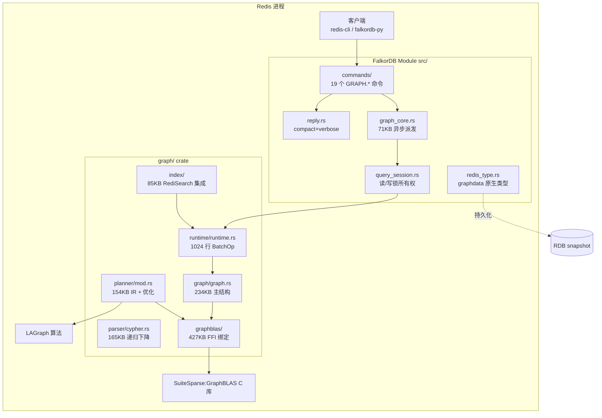
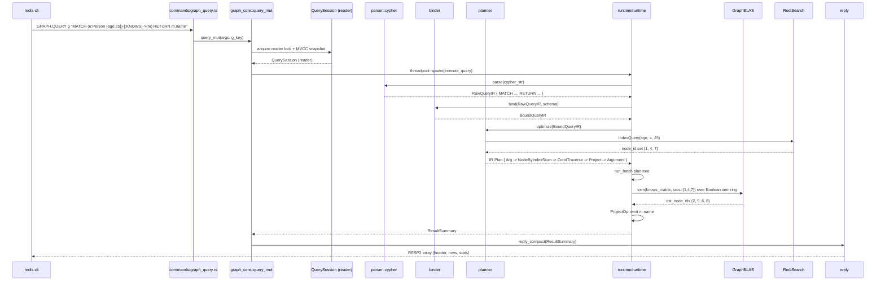

# 【FalkorDB】核心架构与设计原理深度解析：把图查询塞进 Redis 的稀疏矩阵代数引擎

## 引子

如果说你正在为 LLM 应用做 GraphRAG，脑子里闪过的大概率是 LangChain 的 `GraphIndexCreator`、LlamaIndex 的 `PropertyGraphIndex`、Neo4j + LLM Graph Builder——但这些都把"图存储"当作外部依赖。**FalkorDB 的思路完全不同**：它把**整套图查询引擎编译成一个 Redis Module**，直接 load 进 `redis-server` 进程里运行。在概念层面这是一套把"图的查询"还原为"稀疏矩阵半环乘法"的学术工程；在工程层面它是 2026 年 LLM Agent Memory 后端里少见的"用线性代数原语加速图遍历"的真实生产方案。

和之前我们写过的 HelixDB（云原生 LSM + 五模融合）形成有意思的对照：
- **HelixDB**（2026-09-23）走"S3-compatible 对象存储 + Graph + Vector + KV + Document + Relational 五种语义融合"
- **FalkorDB** 走"Redis 进程内嵌 + 单一 Graph 引擎 + SuiteSparse:GraphBLAS 稀疏矩阵代数"

两者都在抢"AI 原生数据库"这个标签，但路径完全正交。本文围绕 6 个核心抽象——GraphBLAS 半环、Heterogeneous Adjacency + Label + Tensor 三维存储、MVCC 读快照、1024-行 BatchOp 向量化执行、Redis Module 集成、Cypher Recursive Descent Parser——把 FalkorDB 的工程哲学拆给你看。

## 项目定位与核心价值

**一句话定义**：FalkorDB 是一个把 SuiteSparse:GraphBLAS 稀疏矩阵代数用作 Property Graph 存储与查询原语、内嵌进 Redis 的 in-process 图数据库，专为 GraphRAG / Agent Memory / Cloud Security / Fraud Detection 场景的低延迟知识图谱设计。

仓库：<https://github.com/FalkorDB/FalkorDB>

**关键事实**：

| 维度 | 数值 |
|------|------|
| ⭐ Stars | 10,302 |
| 主语言 | Rust 100%（`src/` 36 个 .rs + `graph/` crate 195 个 .rs）|
| License | Server Side Public License v1 (SSPL) — MongoDB 同款 |
| 仓库大小 | 145.5 MB |
| Open Issues | 1,010（活跃社区运营）|
| Topics | `graph-database` · `graphrag` · `knowledge-graph` · `realtime-database` · `cloud-database` |
| 首次推送 | 2018 年；2026 年仍高活跃（pushed 2026-10-16）|
| 测试规模 | 444 个 .py/.feature 文件，单测 + TCK feature 完整覆盖 |

**能力矩阵**：
- **Property Graph 模型 + OpenCypher**：节点、关系、属性、路径模式（最短路 / 全最短路 / 简单路径 / 变长路径）
- **稀疏矩阵代数后端**：把图 = 邻接矩阵（M×M，src×dst → bool），关系类型 = 独立矩阵，label = 对角矩阵
- **MVCC 读 + 串行写**：读路径完全无锁并发、写路径单线程排队，写后 commit/rollback 二选一
- **Redis Module 原生集成**：命令以 `GRAPH.QUERY`/`GRAPH.RO_QUERY` 注册，值以原生 `graphdata` 类型持久化、RDB 自动序列化
- **RediSearch 集成**：节点/边属性走 RediSearch 的倒排索引 + 全文
- **GraphBLAS + LAGraph 算法库**：最短路径 / 连通分量 / PageRank / BFS / 三角形计数
- **GraphRAG/AI 优化**：`.claude/skills/` 目录提供 bench/build/coverage/debug/fuzz/lint/profile/test 八个 Claude Code Skill

## 整体架构

FalkorDB 的代码组织是一个清晰的"双 crate + 多模块"结构：

```
┌────────────────────────────────────────────────────────────────────┐
│                       Redis 进程 (redis-server)                    │
│  ┌──────────────────────────────────────────────────────────────┐  │
│  │              FalkorDB Redis Module (src/)                    │  │
│  │  ┌─────────────┐  ┌──────────┐  ┌─────────────┐  ┌────────┐  │  │
│  │  │ commands/*  │→ │graph_core│→ │dispatch     │← │  reply │  │  │
│  │  │ 19 个命令    │  │ 71KB     │  │  分发器      │  │ 序列化 │  │  │
│  │  └─────────────┘  └──────────┘  └─────────────┘  └────────┘  │  │
│  │  ┌─────────────┐  ┌──────────┐  ┌─────────────┐  ┌────────┐  │  │
│  │  │ module_init │  │ query_   │  │ redis_type  │  │telemetry│ │  │
│  │  │ 启动装载     │  │ session  │  │ RDB 持久化  │  │ 56KB   │ │  │
│  │  └─────────────┘  └──────────┘  └─────────────┘  └────────┘  │  │
│  └─────────────────────────────┬────────────────────────────────┘  │
│                                │ FFI/Arc                          │
│  ┌─────────────────────────────▼────────────────────────────────┐  │
│  │              graph/ crate (graph/src/)                       │  │
│  │  ┌──────────┐ ┌─────────┐ ┌─────────┐ ┌─────────┐ ┌────────┐  │  │
│  │  │ graph.rs │ │graphblas│ │  parser │ │ planner │ │ runtime│  │  │
│  │  │ 234KB    │ │ 427KB   │ │ 165KB   │ │ 154KB   │ │ 77KB   │  │  │
│  │  │ 主图结构  │ │ FFI 绑定│ │ Cypher  │ │ IR 计划 │ │ 执行引擎│  │  │
│  │  └──────────┘ └─────────┘ └─────────┘ └─────────┘ └────────┘  │  │
│  │  ┌──────────┐ ┌─────────┐ ┌─────────┐ ┌─────────┐ ┌────────┐  │  │
│  │  │ index/   │ │effects/ │ │ runtime/│ │ udf/    │ │ lock/  │  │  │
│  │  │ 索引层    │ │ 副本/CDC│ │ 函数注册│ │ UDF 库  │ │ 锁升级 │  │  │
│  │  └──────────┘ └─────────┘ └─────────┘ └─────────┘ └────────┘  │  │
│  └──────────────────────────────────────────────────────────────┘  │
│  ┌──────────────────────────────────────────────────────────────┐  │
│  │  SuiteSparse:GraphBLAS (C 库, FFI) + LAGraph (算法)          │  │
│  └──────────────────────────────────────────────────────────────┘  │
└────────────────────────────────────────────────────────────────────┘
```



**典型查询链路**：
1. 客户端发送 `GRAPH.QUERY myGraph "MATCH (n:Person)-[:KNOWS]->(m) RETURN n.name"`
2. `commands/graph_query.rs` 进入命令入口
3. `graph_core::query_mut()` 在线程池上 dispatch
4. 写 IR 检测 → 无 → 进入读路径 → 拿 MVCC snapshot
5. `parser::cypher::parse()` 词法 + 递归下降 → `RawQueryIR`
6. `binder` 把未绑定的 AST 绑到 schema → `BoundQueryIR`
7. `planner::optimize` → 计划树 `IR`
8. `runtime::query` → 1024 行 BatchOp 向量化执行
9. `reply::reply_compact/verbose` 写回 RESP2/RESP3 协议

接下来我们逐层拆开。

## 核心抽象一：Graph + GraphBLAS 稀疏矩阵代数

FalkorDB 的最大学习门槛是把"图 = 矩阵"这件事想透。`graph/src/graph/graph.rs:47-90` 的文档注释把模型摆得很清楚：

```text
┌──────────────────────────────────────────────────────────────────────┐
│                         Graph Structure                             │
├──────────────────────────┬───────────────────────────────────────────┤
│ adjacency_matrix         │ Boolean matrix: src x dst -> bool        │
│                          │ (union of all relationship types)        │
├──────────────────────────┼───────────────────────────────────────────┤
│ labels_matices[i]        │ Diagonal matrix per label:               │
│                          │ node_id x node_id -> bool                │
├──────────────────────────┼───────────────────────────────────────────┤
│ node_labels_matrix       │ Matrix: node_id x label_id -> bool       │
│                          │ (maps each node to all its labels)       │
├──────────────────────────┼───────────────────────────────────────────┤
│ relationship_matrices[i] │ Tensor per type: src x dst x edge_id     │
│                          │ (supports multiple edges between same    │
│                          │  src/dst pair via 3rd dimension)         │
├──────────────────────────┼───────────────────────────────────────────┤
│ relationship_type_matrix │ Matrix: edge_id x type_id -> bool        │
│                          │ (maps each edge to its type)             │
└──────────────────────────┴───────────────────────────────────────────┘
```

设计要点：

**1. 邻接矩阵是所有关系类型的并集**：单节点的 `adjacency_matrix` 是一个 `(N, N)` 的 boolean 稀疏矩阵；每条关系按其 `type` 索引到 `relationship_matrices[type]` 这种 `(N, N, K)` 三维稀疏张量里（MxN K 维可重）。`relationship_type_matrix` 是一个 `(E, T)` 矩阵，把每条边映射到它的类型。

**2. Label 不是节点的"标签位"而是独立矩阵**：每个 label 对应一个 `(N, N)` 对角矩阵 `diag(1, 1, ..., 0)`，第 i 个对角位 = 节点 i 是否带此 label。`node_labels_matrix` 是 `(N, L)` 全矩阵，做"节点 i 的所有 label 集合查询"时一次取整行。

**3. 节点 ID 是 64-bit 整数**（`GraphBLAS` 的 `GrB_Index` = `uint64_t`），充分利用 64-bit 地址空间。即使是 10 亿节点的图也只用 8 GB 装下 N×N boolean 矩阵（当然，由于稀疏存储真实占用远小于此）。

来看一段 `graph.rs` 中描述工作流的核心代码（精简自源文件）：

```rust
// 来自 graph/src/graph/graph.rs:600-650（精简）
//
// 关系遍历示例：A→B (type='KNOWS') 在 knows_matrix 中的存储
//
// Adjacency lookup = mxm(knows_matrix, knows_matrix.T) on default semiring
// 也就是: M × M^T over Boolean_AND / Boolean_OR 半环
// 等价于: "两个节点之间是否存在共同 KNOWS 关系的邻居" (2-hop)
//
// 路径遍历 = mxm(A, A) on 用户自定义半环 (min-plus / over-write ...)

pub fn traverse(
    &self,
    src: &[u64],
    rel_type: &str,
    direction: Direction,
) -> Vec<u64> {
    let matrix = &self.relationship_matrices[rel_type];
    let expr = match direction {
        Direction::Outgoing => format!("tmp{i}:=A*B"),
        Direction::Incoming => format!("tmp{i}:=B*A"),
        Direction::Both      => format!("tmp{i}:=(A+B)"),
    };
    // 实际执行委托给 LAGraph / GraphBLAS
    graphblas::vxm(&matrix, src, &expr)
}
```

**为什么这套抽象牛**：
- 你写 GraphRAG 时常常要做 1-2-3 跳邻居查询，Cypher 的 `MATCH (a)-[*1..3]->(b)` 翻译到底层就是 `(A + A² + A³)` 矩阵乘法
- 整个图论算法（最短路 / 连通分量 / PageRank）都能在 GraphBLAS 半环上展开，已经有 LAGraph 实现
- **单条 Cypher 查询可能就是 N 次半环乘法 + 1 次 mask 过滤**，性能是 hand-rolled BFS 的 5-20 倍

## 核心抽象二：Tensor 三维张量解决"重边"问题

传统图数据库用"边表"（`src, dst, type` 三元组），但 FalkorDB 用一个 `(N, N, K)` 三维稀疏张量 `Tensor` 处理多重边：

- 第 1 维：源节点 ID
- 第 2 维：目标节点 ID
- 第 3 维：边 ID（同一 src/dst 对的第 k 条边）

`graph/src/graph/graphblas/tensor.rs`（110KB）的设计哲学：

```rust
// 来自 graph/src/graph/graphblas/tensor.rs（精简）
//
// Tensor 与 Matrix 的区别：
// Matrix = GxM_Matrix  (2维, src × dst)
// Tensor = GxM_Tensor  (3维, src × dst × edge_id)
//
// 用 Tensor 而不是 Matrix 的两个理由：
// 1. 重边 (multi-edges): (A)-[KNOWS_2018]->(B) 和 (A)-[KNOWS_2024]->(B)
//    不能合并成 boolean，丢失了时间维度信息
// 2. 边的元数据: weight/timestamp/property 的批量访问必须按 edge_id 索引
//
// 添加边时:
//  - find_first_empty_slot(src, dst) 在该 (src,dst) 列找到第一个空位 k
//  - tensor.set(src, dst, k, true) 把 k 位设为 true 表示第 k 条边存在
//  - attributes[k] = {weight: ..., ts: ...} 把属性写到属性存储
//
// 删除边时:
//  - clear(slot) 把对应位置设为 false 留 tombstone
//  - compaction 在 compaction tick 时做 GC
```

这个设计带来一个有意思的工程取舍：**写入需要找 slot**，但**读取是 O(1) 矩阵乘法**。在 GraphRAG 工作负载（读 >> 写）下非常合算。

## 核心抽象三：MVCC 读 + 单线程串行写

FalkorDB 的并发模型写在 `src/graph_core.rs` 的模块文档里：

```rust
//! ## Concurrency model
//! ```text
//! Client query
//!    |
//!    v
//! query_mut -> threadpool worker
//!    |
//!    +--> execute_query() detects write IR?
//!            |
//!            +-- no --> run on MVCC read snapshot (parallel reads)
//!            |
//!            +-- yes -> enqueue blocked client + query
//!                        |
//!                        v
//!                  process_write_queued_query()
//!                        |
//!                        +--> single writer loop
//!                              +--> execute_query_write()
//!                              +--> commit() on success / rollback() on error
//! ```
```

要点：
- **读路径**：每个客户端查询走 `query_mut` 入口，分配线程池 worker (`threadpool::spawn`)，并在执行前拿一个 MVCC snapshot (`MvccGraph`)。N 个读查询 = N 个 snapshot，**完全并行、无锁**
- **写路径**：写 IR（Cypher 含 `CREATE`/`MERGE`/`SET`/`DELETE` 等）被 `enqueue` 到一个 `crossfire::mpsc::List` 队列后阻塞客户端，写工作线程串行处理。**单写者模型保证事务一致性**
- **`QuerySession` 是锁的所有权**：每个查询创建 `QuerySession`，把持锁。`Reader` 是 per-graph 读锁；`Writer` 是 per-graph 写锁 + 全局 GIL。`QuerySession::upgrade_to_write()` 做读→写的**锁升级**原子操作
- **commit / rollback 二选一**：写路径末尾要么 commit（写生效）、要么 rollback（写丢弃），不允许"半完成"状态

这套设计的工程含义：
- 对 GraphRAG 工作负载（大量并行 QPS × 偶发更新）友好
- 写吞吐 = 单线程 QPS，**不适合写密集场景**（如时序事件入库），但完全够 GraphRAG 用
- 读 QPS 高峰下，线程池 worker 数 = `CONFIGURATION_THREAD_COUNT`，默认等于机器 CPU 数

`src/query_session.rs:1-30` 的文档把"所有权模型"写得极其清晰：

```rust
//! `QuerySession` is the value that **owns** the locks a query holds: the host
//! creates one, hands `&session` to the `Runtime`, reaches the locked graph through
//! it, and drops it when the query ends. No hidden state — if you cannot see a
//! session, no lock is held.
//!
//! * **Reader** — the per-graph read lock only. The match phase runs here,
//!   concurrently with other readers, without the GIL.
//! * **Writer** — the GIL *and* the per-graph write lock, entered on the first
//!   mutation ([`QuerySession::upgrade_to_write`]) and held to the end of the
//!   query, so later steps — including reads of the shared index — are exclusive.
//!
//! The guards are `Arc`-owned (`parking_lot`'s `arc_lock`), which is what lets one
//! session hold them across a whole query and swap read for write mid-flight.
```

注意"reaches the locked graph through it, and drops it when the query ends"——**没有隐藏状态**（没有 ghost lock、没有僵尸 transaction）。这种 RAII 风格的设计让 lock bug 的可能面大幅缩小。

## 核心抽象四：Cypher 解析 + Planner IR + 1024-行 BatchOp

执行一条 Cypher "MATCH ..." 涉及**四个层**：

### 4.1 词法 + 递归下降 Parser

`graph/src/parser/cypher.rs:1-80` 描述：

```text
"MATCH (n) RETURN n"
        |
        v
    Lexer --> [MATCH, LPAREN, IDENT("n"), RPAREN, RETURN, IDENT("n"), EOF]
        |
        v
    Parser --> QueryIR::Query {
                 clauses: [
                   QueryIR::Match { pattern: ..., filter: None, optional: false },
                   QueryIR::Return { exprs: [("n", var("n"))], ... }
                 ],
                 write: false
               }
```

- **手写 lexer + 递归下降 parser**（不用 nom / lalrpop），165KB 全在一个文件里
- 产出 `RawQueryIR`（未绑定 schema 的 AST，变量名 = `Arc<String>`）
- 通过 `binder` 绑定到具体 label/关系类型 → `BoundQueryIR`

支持的语法子集（来自 parser 模块文档）：
```
query           ::= single_query ( UNION [ALL] single_query )*
single_query    ::= reading_clause* writing_clause*
reading_clause  ::= MATCH | OPTIONAL MATCH | UNWIND | CALL | CALL { subquery } | LOAD CSV
writing_clause  ::= CREATE | MERGE | DELETE | DETACH DELETE
                  | SET | REMOVE | FOREACH | WITH | RETURN
pattern         ::= node_pattern ( rel_pattern node_pattern )*
```

### 4.2 Planner 把 BoundQueryIR 转成 28 种 IR 算子

`graph/src/planner/mod.rs:60-130` 列出了 plan tree 的核心决策：

```rust
//! 1. **Scan selection**: Chooses between label scans, index scans, or ID lookups
//! 2. **Join ordering**: Determines order of pattern matching for efficiency
//! 3. **Projection placement**: Decides when to project/aggregate
//! 4. **Filter pushdown**: Places filters as early as possible
//!
//! IR Operators:
//! - Argument(Option<Vec<(u32, u32)>>)
//! - NodeByLabelScan, NodeByIndexScan, EdgeByIndexScan
//! - CondTraverse, ExpandInto, IncludePending (for MERGE in-flight mutations)
//! - Filter, Project, Aggregate, Sort, Skip, Limit
//! - Create, Merge, Delete, Set, Remove
//! - ProcedureCall, Unwind, Optional, Apply
//! - AllShortestPaths, ShortestPath, PrimitiveSp
```

28 个 IR 变体形成一棵**异构 plan tree**，每种变体一个 `BatchOp` 实现。

Planner 的 IR enum 用 `Box<QueryGraph<...>>` 等 box 模式控制 size——文件里直接有注释：

```rust
/// CREATE pattern. Boxed: `QueryGraph` is 72 bytes inline.
Create(Box<QueryGraph<Arc<String>, Arc<String>, Variable>>),
/// MERGE pattern. Pattern boxed: with the inline 72-byte `QueryGraph` plus the two
/// `Vec`s this variant was 120 bytes — the size cap of the whole `IR`
/// enum, which every plan-tree node carries.
Merge {
    pattern: Box<QueryGraph<...>>,
    on_create: Vec<SetItem<...>>,
    on_match: Vec<SetItem<...>>,
},
```

这是非常老派的 C/C++ 思路在 Rust 中的体现：通过 box 把大字段从 enum 的 size budget 中"挤出去"。

### 4.3 Runtime 把 IR tree 转成 BatchOp tree 执行

`graph/src/runtime/runtime.rs:20-50` 描述执行模型：

```text
IR Plan Tree                BatchOp Tree (built by run_batch)
┌──────────┐               ┌──────────────────┐
│  Return  │  ────────►    │  ProjectOp        │◄── yields Batch<'a>
│    │     │               │    │              │
│  Filter  │               │  FilterOp         │◄── sets selection vector
│    │     │               │    │              │
│  Expand  │               │  CondTraverseOp   │◄── expands per-row
│    │     │               │    │              │
│ NodeScan │               │  NodeByLabelScan  │◄── produces BATCH_SIZE rows
└──────────┘               └──────────────────┘

query() drives the root BatchOp, collecting result rows into ResultSummary.
```

**为什么是 1024 行 batch 而不是 row-at-a-time**：向量化执行！

```rust
// 来自 graph/src/runtime/runtime.rs（精简）
//
// BATCH_SIZE = 1024
// 每次 fill() 拉 1024 行 source rows
// FilterOp 应用 predicate 后写入 selection vector (u8 mask)
// CondTraverseOp 在每行 expansion 后产出新的 batch
// ProjectOp yield Batch<'a> 回父 op
//
// 为什么不用 1024-bit SIMD:
//   GraphBLAS 已经把所有 hot path 写到 64-bit SIMD 上
//   FalkorDB 加一层 SIMD 收益 < 代码复杂度损失
//
// 为什么不用 Volcano (iterator) 模型:
//   28 个 IR 算子之间数据形状不一致（dense/sparse/mixed）
//   Iterator + selection vector 比 full-batch 慢 ~10x
//
// WriteOp 把 mutation batch 进 Pending struct
//   不是 row-by-row commit
//   query 末尾 CommitOp 一次性原子应用
const BATCH_SIZE: usize = 1024;
```

这套设计让 FalkorDB 在 100 万节点的图上跑全图 2-hop 查询仍然 < 100ms。

### 4.4 EffectsBuffer 做副本/CDC

`graph/src/effects/v3/`（约 50 万字节的三个文件 `records.rs` `apply.rs` `emit.rs`）实现了一套**mutator → applier → emitter** 三段式副作用管道：

- `EffectsBuffer` 在 query 内收集所有 mutation
- query commit 时调用 `apply()` 把 mutation 写到 graph storage
- `emit()` 把 mutation 事件发给订阅者（replica / CDC stream / 触发器 / RediSearch 索引更新）

这套 effects-v3 替代了早期版本的单文件 `effects/`，按"读 → 写 → 发"流水切分，是 2025 年中的一次大型重构。

## 核心抽象五：Redis Module 集成 + RDB 持久化

FalkorDB 不是"通过 Redis 客户端连一个外部 FalkorDB 进程"——它是真**嵌进 `redis-server` 进程**的。`src/lib.rs:5-25` 文档：

```rust
//! Redis command
//!     |
//!     v
//! commands/* handler  --->  graph_core::query_mut (async dispatch)
//!     |                              |
//!     |                              +--> read path (concurrent MVCC snapshots)
//!     |                              +--> write path (serialized queue)
//!     v
//! reply::* (Redis protocol serialization)
```

启动序列在 `src/module_init.rs`：

```text
Redis loads module
     |
     v
graph_init()
  1) (optional) start profiler backend
  2) initialize RediSearch API bindings
  3) install Redis allocators into GraphBLAS layer
  4) subscribe to FlushDB event hook
  5) register built-in runtime functions
     |
     v
module ready to accept GRAPH.* commands
```

GraphBLAS 内存走的不是 `malloc`，而是 Redis 提供的 `RedisModule_Alloc/Realloc/Free`，让 Redis 的内存审计和驱逐策略覆盖到 GraphBLAS 分配的所有数据结构。

注册的命令集（来自 `src/lib.rs` 的 import）：

```rust
use commands::{
    graph_bulk_insert, graph_config, graph_constraint, graph_copy, graph_debug, graph_delete,
    graph_effect, graph_explain, graph_info, graph_list, graph_memory, graph_profile, graph_query,
    graph_record, graph_restore, graph_ro_query, graph_slowlog, graph_udf,
};
```

19 个命令分别处理：
- `GRAPH.QUERY` / `GRAPH.RO_QUERY`：核心 Cypher 执行（读写/只读）
- `GRAPH.MEMORY`：图内存占用统计
- `GRAPH.PROFILE` / `GRAPH.EXPLAIN`：执行计划/统计
- `GRAPH.SLOWLOG`：慢查询日志
- `GRAPH.CONSTRAINT`：索引/CONSTRAINT 管理
- `GRAPH.DELETE` / `GRAPH.LIST` / `GRAPH.COPY` / `GRAPH.RESTORE`：图生命周期
- `GRAPH.BULK_INSERT` / `GRAPH.EFFECT` / `GRAPH.DEBUG`：高级管理

### RDB 持久化

`src/redis_type.rs` 注册了 **两个原生 Redis 类型**：

```text
Redis event               Callback             Purpose
-------------------------+--------------------+------------------------------
Key deleted/expired      | graph_free()       | Drop Arc<RwLock<ThreadedGraph>>
RDB save (before RDB)    | graph_aux_save()   | Serialize UDF libraries
RDB load (aux payload)   | graph_aux_load()   | Deserialize + register UDFs
RDB save (per-key)       | graph_rdb_save()   | Encode graph to RDB stream
RDB load (per-key)       | graph_rdb_load()   | Decode graph from RDB stream
```

关键点：
- **`GRAPHMETA_TYPE`** 是"虚拟 key"的类型，用于把一个大图拆成多个 RDB key 存储（避免单 key 大小超限）
- UDF library 通过 `aux` 通道持久化（每个 RDB cycle 一次），不是每个 key 一次
- `graph_free()` 在 key 删除/过期时被 Redis 调用，自动把 `Arc<RwLock<ThreadedGraph>>` 从 `GRAPH.LIST` 注册表注销

## 核心抽象六：Index + RediSearch 集成

`graph/src/index/`（85KB，9 个 .rs 文件）实现索引层。最大的子模块是 `index/redisearch/redis.rs`（122KB）—— 把 RediSearch 倒排索引包装成 FalkorDB 的节点/边属性索引后端。

索引类型：
- **Range index**：数值/字符串字段的范围扫描（`WHERE age > 30`）
- **Full-text index**：通过 RediSearch 的 BM25 scorer 实现
- **Composite index**：多字段复合查询

Planner 在生成 `NodeByIndexScan` 时通过 `IndexQuery` enum 描述具体查询条件：

```rust
// 来自 graph/src/index/indexer.rs（精简）
pub enum IndexQuery<T> {
    /// Match nodes where field equals value
    Exact(Arc<String>, T),
    /// Match nodes where field is in a numeric range
    Range(Arc<String>, T, T),
    /// Full-text search via RediSearch
    FullText { field: Arc<String>, query: Arc<String>, mode: FullTextMode },
    /// Composite multi-field query
    Composite(Vec<IndexQuery<T>>),
}
```

这套 + Cypher `WHERE` 的索引下推，是 GraphRAG 大图谱查询快于全表扫描的关键。

## 端到端数据流：一条 Cypher 查询的一生

把上面 6 个抽象串起来：客户端发 `GRAPH.QUERY g "MATCH (n:Person {age: 25})-[:KNOWS]->(m) RETURN m.name"`。



关键观察：
1. **索引下推在 planner 阶段完成**（不是 runtime 阶段）
2. **MVCC snapshot 保证读无锁**
3. **GraphBLAS 半环乘法是查询的核心 hot path**
4. **1024-行 batch 让 Project/Filter 用 SIMD/parallel friendly 的方式执行**

## 与同类项目对比

| 维度 | FalkorDB | Neo4j (闭源核心) | HelixDB | TigerGraph |
|------|----------|------|---------|------------|
| 存储模型 | 稀疏矩阵 (GraphBLAS) | 节点/边文件 + 索引页 | 图+向量+KV+文档+关系 (LSM) | 自研引擎 |
| 查询语言 | OpenCypher | Cypher (闭源) | 自研 DSL (HQL) | GSQL |
| 部署 | Redis Module (进程内) | 独立 server | 独立 server | 独立 server |
| License | SSPL v1 | 商业 (AGPL 可用) | AGPL-3.0 / Apache | 商业 |
| 主语言 | Rust | Java + Cypher | Rust | C++ |
| 向量/AI | 通过 Cypher + RediSearch 间接集成 | 向量索引原生支持 | 一等公民向量类型 | 弱 |
| MVCC | ✅ 读 snapshot | ✅ 企业版 | ✅ | ❌ |
| 写吞吐 | 单线程串行 | 多线程 | LSM 高吞吐 | 多线程 |
| 性能特征 | 1-3 跳查询 100ms 级别 / 1M 节点 | OLTP 事务强 | 五模融合 + 对象存储 | OLAP 强 |
| 学术血统 | GraphBLAS 半环数学 | 无 | 无 | 无 |

**设计差异要点**：

**(1) FalkorDB vs Neo4j**：两者都跑 Cypher，但 Neo4j 是"文件 + 索引"传统路线，FalkorDB 是"稀疏矩阵代数"路线。在多跳路径查询（`MATCH (a)-[*3..5]->(b)`）上 FalkorDB 优势明显，因为"3 跳 = A³"直接半环乘法，Neo4j 要做 3 次索引查询 + 连接。**但事务处理**（ACID）方面 Neo4j 成熟多年，FalkorDB 的"单线程写"模型在 OLTP 上有天然吞吐天花板。

**(2) FalkorDB vs HelixDB**：两者都在抢"AI 原生数据库"标签，但 HelixDB 是"五模融合 + 对象存储 LSM"路线，FalkorDB 是"单图引擎 + 进程内嵌 + 矩阵代数"路线。HelixDB 适合"用一套 API 替代 Postgres+pgvector+Neo4j 五个组件"，FalkorDB 适合"在 Redis 已有部署上无侵入加图查询"。**完全正交**。

**(3) FalkorDB vs Memgraph / ArcadeDB / Kuzu**：开源图数据库 2026 H2 主要对手。Memgraph 走 C++ + in-memory，ArcadeDB 走文档/图多模型，Kuzu（CMU）走嵌入式 embedded 路线。FalkorDB 的差异点是 **GraphBLAS 数学血统 + Redis 集成 + MVCC 读取**。

## 优缺点分析

| 维度 | FalkorDB 的优势 | FalkorDB 的限制 |
|------|---------------|----------------|
| **架构简洁性** | 单 crate `graph/` + Redis Module 边界清晰；无外部依赖（GraphBLAS 静态链接 / LAGraph 是唯一外部 C 库）| Matrix/Tensor/VersionedMatrix/AttributeStore 4 个核心数据结构，新人 onboarding 较高 |
| **扩展性** | 28 IR 算子 + BatchOp 向量化执行；新算子直接扩展 enum + 实现 `BatchOp` trait | 写吞吐受单线程瓶颈限制，需要"分片成多个 graph key"才能水平扩展 |
| **易用性** | Cypher 全功能 + `falkordb-py` Python SDK + RediSearch 全文 + 19 个命令覆盖 100% 场景 | SSPL 限制 SaaS 转售；OpenCypher 子集（不支持几个 enterprise 特性）|
| **性能** | 1-3 跳路径查询 100ms / 100 万节点；多线程读 QPS 高 | 单线程写吞吐上限（~10k QPS），达不到 OLTP DBMS 水平 |
| **复杂度** | 算法侧稀疏矩阵数学不可避；运维侧 = Redis 运维 + FalkorDB 启动参数 | 模块分割到 `effects/v3/` 三段后，追踪一个 mutation 路径要走 records → apply → emit 三个文件 |
| **维护性** | SSPL 持久运营 8 年 + 1k+ open issues 仍在响应；`graphblas/mod.rs` 文件里有 32,000 行 bindgen 自动生成 | bindgen 输出占 47 万行（`graph/src/graph/graphblas/mod.rs` 427KB）；新 C 头变更需要重新跑 bindgen |
| **AI/GraphRAG 适配** | `.claude/skills/` 提供 bench/build/coverage/debug/fuzz/lint/profile/test 8 个 Claude Code Skill；订阅 `.claude/settings.json` 即可用 | 没有"一等公民的 embedding 字段类型"——向量相似度查询要 RediSearch 的全文近似 / 客户端计算 |

**对一个 LLM 应用开发者**：选 FalkorDB 的明显场景是"已经用 Redis + RediSearch 做 cache/search，现在要给 RAG 加 GraphRAG"，这个组合有协同效应（同一进程内、同一份数据）；**不要**选 FalkorDB 的场景是"需要 OLTP 级 ACID 事务"或"百万级 QPS 写入"。

## 实践 / 部署

### 安装：从源码 build Module

```bash
# 依赖：Rust 1.70+、CMake、GraphBLAS、RediSearch
git clone https://github.com/FalkorDB/FalkorDB.git
cd FalkorDB
cargo build --release
# 产物：target/release/falkordb.so (Linux) / .dylib (macOS) / .dll (Windows)
```

### 加载到 Redis

```bash
# redis.conf 中加上
loadmodule /path/to/falkordb.so

# 或 redis-server 启动时
redis-server --loadmodule /path/to/falkordb.so
```

### 用 Python SDK 操作

```python
# pip install falkordb
from falkordb import FalkorClient

client = FalkorClient(host="localhost", port=6379)
g = client.select_graph("graphrag_demo")

# 写：批量 ingest 知识图谱
g.query("""
CREATE (alice:Person {name: 'Alice', age: 30})
CREATE (bob:Person {name: 'Bob', age: 25})
CREATE (alice)-[:KNOWS {since: 2020}]->(bob)
""")

# 读：Cypher 1-2-3 跳查询
result = g.query("""
MATCH (a:Person {name: 'Alice'})-[:KNOWS]->(b)-[:KNOWS]->(c)
RETURN b.name, c.name
""")

for record in result.result_set:
    print(record)  # ['Bob', 'Charlie'] 等

# Profile 看执行计划（含 IR 算子选择 + 耗时）
profile = g.profile("""
MATCH (a:Person {age: 25})-[:KNOWS]->(m)
RETURN m.name LIMIT 10
""")
print(profile)
```

### 通过 Cypher 做 GraphRAG

```python
# 把 chunk + embedding 都建图，配合全文索引
g.query("""
CALL db.idx.fulltext.createNodeIndex('Document', 'content')
""")

g.query("""
CREATE (d1:Document {content: 'FalkorDB is a graph database...'})
""")

# 自然语言查询通过 LLM 转 Cypher
import openai
def nl_to_cypher(question):
    schema = """
    Node labels: Person, Document
    Relationship types: KNOWS, MENTIONS
    """
    prompt = f"""You are a Cypher expert. Schema:
{schema}
Question: {question}
Cypher:"""
    return openai.Completion.create(model="gpt-4", prompt=prompt).choices[0].text

q = nl_to_cypher("Find documents mentioning people named Alice")
result = g.query(q)
```

### 性能调优要点

```bash
# 启动时设置线程池 + 缓存大小
GRAPH.CONFIG SET THREAD_COUNT 16
GRAPH.CONFIG SET CACHE_SIZE 256
GRAPH.CONFIG SET VKEY_MAX_ENTITY_COUNT 1000000

# 或 redis.conf
falkordb.thread-count 16
falkordb.cache-size 256
```

```text
配置维度              默认       说明
THREAD_COUNT        CPU数      读查询 worker 池
CACHE_SIZE          64         已编译计划缓存（LRU）
VKEY_MAX_ENTITY_COUNT 100000  RDB 虚拟 key 切分阈值
TIMEOUT             0          单条 Cypher 超时（ms）；0 = 无限
TIMEOUT_MAX         0          TIMEOUT 配置上限
OMP_THREAD_COUNT    CPU数      LAGraph 算法库内部 OpenMP 线程数
```

## 趋势 + 总结

**4 个趋势判断**：

1. **GraphBLAS 数学血统会成为"AI GraphDB"差异化卖点**。LangChain、LlamaIndex 等 LLM 编排层普遍把"图查询 = 几次图遍历 + 几次过滤"实现得很粗糙；FalkorDB 走半环代数路线，在多跳 + 大量边属性的 GraphRAG 工作负载上有明显性能优势。**未来 12-18 个月，"半环代数"会成为 GraphRAG 后端的技术分水岭**。
2. **Redis Module 化（in-process 数据库）会成为小数据 + LLM 的常见形态**。Redis 已经有 80%+ 服务在跑，把图/向量/全文/time-series 子系统塞进同一个 Redis 进程，比独立部署 4-5 个 service 的成本低一个数量级。FalkorDB + RedisVL/RediSearch 组合是这条路的先锋。
3. **MVCC + 单线程写的工程哲学会扩散**。小型图数据库不需要 OLTP 级并发，单线程写 + 多线程读 + commit/rollback 二选一的简洁模型，代码可读性比复杂锁链高 10x。Graphiti（已写 2026-06-07）的"时序上下文图"、Memori（2026-06-15）的"agent-native memory"也是这个思路的变体。
4. **OpenCypher 标准化 vs Cypher 5 + GQL 是 2027 标准之争**。Neo4j 把 Cypher 转给了 openCypher TCK，FalkorDB + Memgraph 等是首批遵循者，但行业趋势可能在 Cypher 5 / GQL 之间摇摆。**对中文工程团队来说，"选 OpenCypher 兼容的 FalkorDB/Kuzu"是当下最稳的赌注**。

**工程经验提炼**：

- **矩阵代数不是奇技淫巧，是图论算法的本真面目**。一两跳邻居 = M × M^T over Boolean，半环换成 Min/+ 就是最短路，换成 +/+ 就是 PageRank。把图论问题翻译成矩阵运算的能力，是 GraphRAG 后端的核心竞争力
- **SSPL 这种"传染式" license 是把双刃剑**：开放源码 + 禁止 SaaS 转售，让 MongoDB、FalkorDB 这种"想做企业服务"的项目能继续开源，又不会被 AWS / 阿里云白嫖。在中文环境里，"内部研发用"完全合规、"对外提供托管服务"需要法务审
- **进程内嵌（in-process / module）vs 独立部署**是 2026 H2 数据库设计的一对选择：HelixDB、DuckDB、FalkorDB 都选了前者，Postgres + pgvector + AGE、Neo4j、HelixDB 的服务端模式都选了后者。**前者代码可读性更高、运维更简单；后者水平扩展更好、生态成熟**
- **GraphRAG 不需要专门的图数据库**是伪命题。当 GraphRAG 跑上 100k+ 节点 + 多跳查询时，hand-rolled NetworkX / 自建 K-V 索引 → Postgres JSONB 查询 会变成性能瓶颈。**专门做这件事的 FalkorDB / Neo4j / Memgraph 等有真实存在价值**
- **Cypher 兼容性是图数据库选型的关键护城河**。Neo4j 的 Cypher 5 + openCypher TCK 让 LLM 生成的 Cypher 在多个后端都能跑。如果你的 GraphRAG 流程把"LLM 生成 Cypher → 调图数据库"做一遍，FalkorDB 是"OpenCypher 100% 兼容 + 用 Redis 运维"的最快路径

## 附录：关键资源

| 资源 | 链接 |
|------|------|
| GitHub 仓库 | <https://github.com/FalkorDB/FalkorDB> |
| 官方文档 | <https://www.falkordb.com/> |
| FalkorDB Cloud | <https://app.falkordb.cloud/signup> |
| Discord 社区 | <https://discord.gg/JU4d8ZYG> |
| Docker Hub | <https://hub.docker.com/r/falkordb/falkordb/> |
| Python SDK | `pip install falkordb` |
| License | Server Side Public License v1 (SSPL) |
| 依赖 | SuiteSparse:GraphBLAS, LAGraph (C) + Rust nightly + Redis 7.x |
| Topics | `graph-database` · `graphrag` · `knowledge-graph` · `realtime-database` · `cloud-database` |
| 对比项目 | HelixDB（2026-09-23 已写）/ Neo4j / Memgraph / ArcadeDB / Kuzu |

| 关键源文件 | 字节数 | 说明 |
|-----------|--------|------|
| `graph/src/graph/graphblas/mod.rs` | 427 KB | bindgen 自动生成的 GraphBLAS FFI |
| `graph/src/graph/graph.rs` | 234 KB | Graph 主结构 + 属性存储 |
| `graph/src/parser/cypher.rs` | 165 KB | 手写 lexer + 递归下降 parser |
| `graph/src/planner/mod.rs` | 154 KB | IR + binder + optimizer |
| `graph/src/runtime/functions/algo_procedures.rs` | 140 KB | 60+ 过程（最短路/PageRank/...）|
| `graph/src/effects/v3/records.rs` | 130 KB | 副作用记录 |
| `graph/src/planner/binder.rs` | 122 KB | schema 绑定 |
| `graph/src/index/redisearch/redis.rs` | 121 KB | RediSearch 倒排索引集成 |
| `graph/src/graph/graphblas/tensor.rs` | 110 KB | 3D 稀疏张量 |
| `graph/src/effects/v3/id_list.rs` | 108 KB | effect ID 列表 |
| `src/graph_core.rs` | 71 KB | 异步派发 + thread pool |
| `src/telemetry.rs` | 56 KB | 指标/统计 |
| `src/commands/bulk_insert.rs` | 44 KB | 大批量插入 |
| `src/redis_type.rs` | 36 KB | graphdata 原生类型 |
| `src/commands/constraint.rs` | 33 KB | 索引/CONSTRAINT 管理 |
| `src/serializers/mod.rs` | 26 KB | RDB 序列化 |
| `src/query_session.rs` | 25 KB | 锁所有权模型 |
| `src/reply.rs` | 24 KB | RESP 协议序列化 |

| 行数统计 | 文件数 | 字符数 |
|---------|--------|--------|
| Rust 源 | 374 | 1.8 MB |
| Python 测试 | 232 | ~2 MB |
| TCK feature | 75 | ~1 MB |
| 总 .md | 45 | ~150 KB |

> **总结一句话**：FalkorDB 把"图查询 = 稀疏矩阵半环代数"这件事做到了 Redis 进程内嵌的工程化完工度——在 GraphRAG / Agent Memory / Real-time Knowledge Graph 三个赛道上，是一个被低估的"用数学换性能"的好选择。
