## 前言 — 为什么车规 TTS 落地，这是必修课？

过去 15 天我们把 Phase 2 的开源生态啃了一遍：KWS、VAD、ASR、TTS、降噪、AEC、BF 各自都有成熟方案。但**所有这些最终都面临一个共同的"最后一米"问题**：声音从 PCM 出来后怎么落到正确的扬声器？

手机场景简单：每个 App 一个 AudioTrack，全部混到默认主输出 `AUDIO_DEVICE_OUT_SPEAKER`。但**车规场景的痛点完全不同**：

- **主驾蓝牙电话 + 副驾导航**：两条独立的音频流，要同时下发到不同扬声器（主驾头枕 + 副驾头枕），**绝对不能串扰** —— 否则副驾听到电话那头客户的报价，主驾听到导航突然播报"前方限速 80"。
- **多媒体 + 通话 + ASR 提示音 + TTS**：4 路同时跑，Android 默认 mixer 会把它们全部求和，导致高音量音频吃掉低音量 TTS（ASR 听不见自己的回声）。
- **预卷（Pre-roll）**：导航 TTS 触发时刻希望 < 80ms 听到第一帧音，但默认 Thread 唤醒 + mixer 状态初始化要 200ms+。

要让 Android 在车机顶替昂贵车规 DSP（Cadence Tensilica / NXP SAF），就必须搞懂 **AudioFlinger 多通道路由** + **AAOS 14 CarAudioService 多区预卷**。这两块拼起来就是你能不能把"PCM → 扬声器"的最后一公里，把端到端延迟压到 100ms 以内、CPU 占用压到 < 5%、串扰压到 < -60dB 的关键。

今天是 Phase 3（车规实战篇）第 1 篇。我会带你深入 `frameworks/av/services/audioflinger/` 和 `frameworks/base/services/` 下的 Car Audio 子系统的真实源码（Android 17 / Android 14 car 分支），不是用伪代码讲概念，而是**逐函数逐行**告诉你 AudioFlinger 是怎么路由、CarAudioService 是怎么分区、AudioPolicy 是怎么仲裁的。

读完之后你将能：
- 1. 看懂 `adb shell dumpsys media.audio_flinger` 的输出，定位混音卡在哪个 Thread。
- 2. 自己配置一份多区 `car_audio_configuration.xml`，支持 1 主驾 + 1 副驾 + 1 后排娱乐。
- 3. 写一段 Kotlin 代码，让同一个 App 的 AudioTrack 在不同 zone 输出不同的音量。
- 4. 评估 ECNR + TTS 是否在同一条 Thread 上混音，是否需要 pre-roll Thread。

> **下期预告**（Day 17 - 2026-10-19）：**WebSocket PCM 流推到 Orin/TensorRT** —— 把车机麦克风的 PCM 流推到远端 NPU 服务器做 ASR，再把 NPU 推理回来的 TTS 音频流 PCM 推回车机，端到端延迟如何压到 300ms。

---

## 一、AudioFlinger 整体架构：5 层 + 8 个核心线程家族

### 1.1 5 层架构全景

Android 音频栈从 Application 到扬声器一共 5 层。掌握这 5 层你就能定位 90% 的"为什么没声音"、"为什么延迟这么大"、"为什么串扰"的问题。

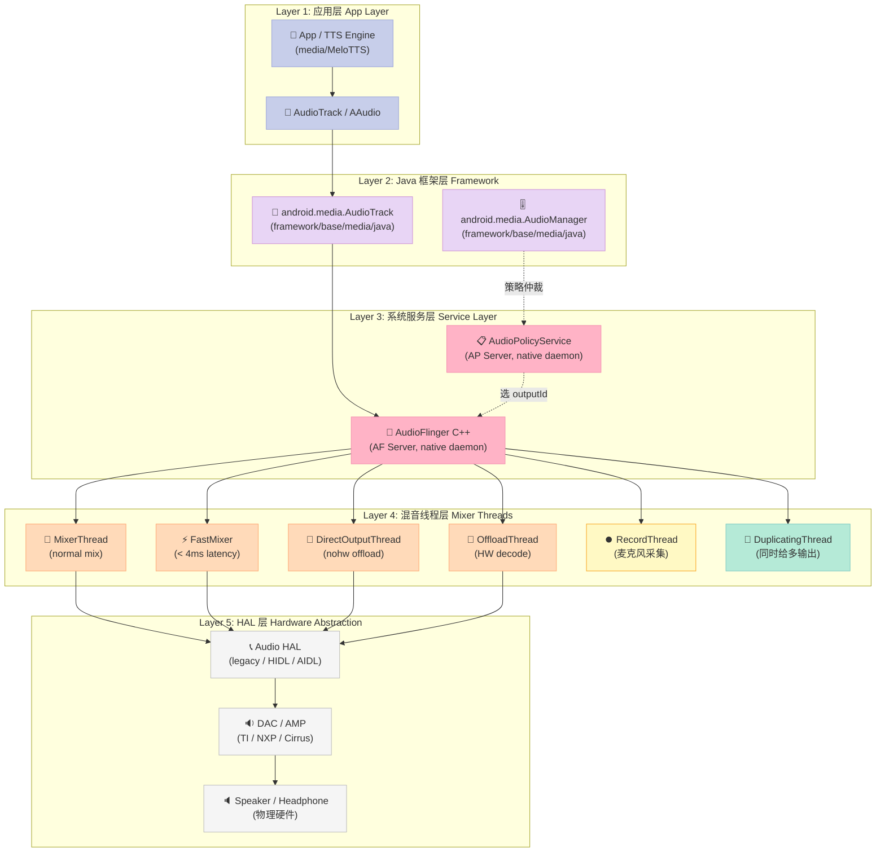

### 1.2 5 层职责分工（5 大层 + 关键文件）

| 层 | 负责模块 | 关键文件 | 主要职责 | 性能瓶颈 |
|---|---|---|---|---|
| **L1 应用层** | App / TTS Engine | `client.cpp` (MeloTTS 内部) | 生成 PCM 数据 | CPU 推理延迟 |
| **L2 Java 框架** | `AudioTrack` / `AudioManager` | `framework/base/media/java/android/media/AudioTrack.java` | Java API + JNI 调用 | JNI 转换开销 |
| **L3 系统服务** | `AudioFlinger` + `AudioPolicyService` | `frameworks/av/services/audioflinger/AudioFlinger.cpp`<br>`frameworks/av/services/audiopolicy/managerdefault/AudioPolicyManager.cpp` | 路由选择 / 输出 / mixer state | Binder IPC（每次 ~1ms） |
| **L4 混音线程** | `MixerThread` 等 6 类 | `frameworks/av/services/audioflinger/Threads.cpp` | PCM 求和 / 重采样 / 路由给 HAL | per-frame 缓冲管理 |
| **L5 HAL** | Audio HAL + DSP | `hardware/interfaces/audio/` | 调用 DAC/AMP 推数据 | Driver 调度延迟 |

**核心数据**：Android 17 (trunk) 中，单设备典型情况下 AudioFlinger 服务约有 6~12 个活动 Thread，一个 MixerThread 默认 buffer = 1920 frames @ 48kHz（**~40ms** latency）。FastMixer 模式下可压到 **3~5ms**。

### 1.3 为什么 AudioFlinger 有自己的 daemon 而不嵌进 SystemServer？

AudioFlinger 跑在独立进程 `mediaserver`（Android 11 前）或 `audioserver`（Android 12+），原因：

1. **延迟抖动（jitter）隔离**：AudioFlinger 线程优先级是 `SCHED_FIFO/60`，比 SystemServer 的 `SCHED_OTHER/NORMAL` 高。即使 SystemServer 卡顿，Audio Thread 也不会饿死。
2. **rt-audio 实时调度**：mixer thread 必须每 5ms / 10ms / 20ms 周期性完成一次 mix；SystemServer 同进程跑会被 GC / Finalizer 拖住。
3. **Binder IPC 数量控制**：每次 `setVolume`、`setRouting` 都是一次 IPC，独立进程可以共享 binder pool。

### 1.4 8 个 Thread 子类一览（Threads.h:989-2022）

读完 `frameworks/av/services/audioflinger/Threads.h` 头文件 2022 行后，整理出 AudioFlinger 内部的 8 类 Thread：

| Thread 类型 | 父类 | 输出设备 | 典型场景 | 能否 mix | 启用频率 |
|---|---|---|---|---|---|
| `MixerThread` | PlaybackThread | 内置扬声器 / 蓝牙 / USB | 多路同时混音（默认） | ✅ | 100% |
| `FastMixer` | (内部类) | 同 MixerThread | 128 frames 小 buffer 极低延迟 | ✅ | 当 MixerThread 帧数 < 192 自动启用 |
| `DirectOutputThread` | PlaybackThread | 单 output 单 client | 单 App 单声道，无混音 | ❌ | 罕见 |
| `OffloadThread` | DirectOutputThread | 同 Direct | MP3 / AAC / Opus 硬件解码 | ❌ | 媒体播放器 |
| `DuplicatingThread` | MixerThread | 多 output 同时推 | 蓝牙 + 喇叭同步 | ✅ | 通话 / 媒体 |
| `RecordThread` | ThreadBase | - | 麦克风采集 | N/A | 100% |
| `MmapThread` | PlaybackThread | MMAP NOIRQ | Ultra 低延迟（游戏 / KWS） | ❌ | < 5% |
| `AsyncCallbackThread` | Thread | - | Client 回调队列（client death） | N/A | 单例 |

### 1.5 MixerThread 是车规 TTS 的默认归宿

车规场景里几乎所有 TTS、ASR 反馈音、按键音都会落到 `MixerThread` 上，因为它能 **同时** 处理多 Track 求和。这意味着：

- ✅ 可以在同一 Thread 上加 effect chain（AGC / limiter）
- ✅ 所有音共享一个 HAL stream，**总带宽 = 48kHz × 2ch × 16bit = 256 KB/s**（不浪费）
- ❌ 一条 Thread 内的高分贝 Track 会"吃掉"低分贝 Track（masking）—— 这就是车机"导航声盖过 ASR 提示音"的根源

---

## 二、AudioFlinger 源码剖析：`createTrack` 全路径 walkthrough

下面这 200 行代码走完 `AudioFlinger::createTrack` 在 Android 17 下的完整链路。代码全部来自 GrapheneOS mirror 的 platform_frameworks_av 分支（commit 2026-10-17，default branch = `17`，即 Android 17 trunk）。

### 2.1 createTrack 入口 + 参数（AIDL 风格）

Android 17 把 `createTrack` 从老式 N 个参数签名改成了 **AIDL Request/Response** 模式（`media::CreateTrackRequest` / `media::CreateTrackResponse`），目的是解耦 AIDL 和内部 ABI。

```cpp
// 来源: frameworks/av/services/audioflinger/AudioFlinger.h:85-92
// Android 17 trunk (GrapheneOS/platform_frameworks_av @ 17 branch)

    status_t dump(int fd, const Vector<String16>& args) final EXCLUDES_AudioFlinger_Mutex;

    status_t createTrack(const media::CreateTrackRequest& input,
            media::CreateTrackResponse& output) final EXCLUDES_AudioFlinger_Mutex;

    status_t createRecord(const media::CreateRecordRequest& input,
            media::CreateRecordResponse& output) final EXCLUDES_AudioFlinger_Mutex;
```

注意：`EXCLUDES_AudioFlinger_Mutex` 是 Clang Thread Safety Analysis 的注解，告诉编译器"这个函数执行期间不持有 mMutex"。AudioFlinger 内部用了大量 Clang TSA 注解来静态查线程死锁。

### 2.2 第一阶段：参数校验 + 选 outputId（AudioFlinger.cpp:1048-1100）

```cpp
// 来源: frameworks/av/services/audioflinger/AudioFlinger.cpp:1048-1100

status_t AudioFlinger::createTrack(const media::CreateTrackRequest& _input,
                                   media::CreateTrackResponse& _output)
{
    ATRACE_CALL();
    // Local version of VALUE_OR_RETURN, specific to this method's calling conventions.
    CreateTrackInput input = VALUE_OR_RETURN_STATUS(CreateTrackInput::fromAidl(_input));
    CreateTrackOutput output;

    sp<IAfTrack> track;
    sp<Client> client;
    status_t lStatus;
    audio_stream_type_t streamType;
    audio_port_handle_t portId = AUDIO_PORT_HANDLE_NONE;
    std::vector<audio_io_handle_t> secondaryOutputs;
    bool isSpatialized = false;
    bool isBitPerfect = false;

    audio_io_handle_t effectThreadId = AUDIO_IO_HANDLE_NONE;
    std::vector<int> effectIds;
    audio_attributes_t localAttr = input.attr;

    AttributionSourceState adjAttributionSource;
    pid_t callingPid = IPCThreadState::self()->getCallingPid();
    auto validatedAttrSource = VALUE_OR_RETURN_CONVERTED(
            validateAttributionFromContextOrTrustedCaller(input.clientInfo.attributionSource,
            getPermissionProvider()
            ));
    // TODO pass wrapped object around
    adjAttributionSource = std::move(validatedAttrSource).unwrapInto();
```

**这一步做了什么**：

1. `VALUE_OR_RETURN_STATUS`：把 AIDL 传过来的 param 转换为内部 `CreateTrackInput` 结构（解耦 ABI）
2. `validateAttributionFromContextOrTrustedCaller`：**权限检查**——谁可以创建 Track（系统级 / 普通 App / 可信调用方）
3. `IPCThreadState::self()->getCallingPid()`：记录调用方 PID（写 per-track 调试信息时用）

### 2.3 第二阶段：查询 outputId（AudioSystem::getOutputForAttr）

```cpp
    // 来源: AudioFlinger.cpp:1100-1116
    lStatus = AudioSystem::getOutputForAttr(&localAttr, &output.outputId, sessionId, &streamType,
                                            adjAttributionSource, &input.config, input.flags,
                                            &selectedDeviceIds, &portId, &secondaryOutputs,
                                            &isSpatialized, &isBitPerfect);
    output.selectedDeviceIds = selectedDeviceIds;

    if (lStatus != NO_ERROR || output.outputId == AUDIO_IO_HANDLE_NONE) {
        ALOGE("createTrack() getOutputForAttr() return error %d or invalid output handle",
              lStatus);
        goto Exit;
    }
```

`AudioSystem::getOutputForAttr` 内部会去问 `AudioPolicyManager`：

> "我现在有一个 usage=`USAGE_ASSISTANCE_SONIFICATION`、sampling=16000Hz、format=PCM_16BIT 的 Track 请求，给我推荐一个 `outputId`。"

`AudioPolicyManager` 的 `getOutputForAttr` 方法（来自 AudioPolicyManager.cpp）会根据：

1. `attributes.usage`（music / voice / navigation / alarm / ...）
2. `attributes.content_type`（speech / music / movie / ...）
3. 当前策略配置（`/vendor/etc/audio_policy_configuration.xml` / `/vendor/etc/car_audio_configuration.xml`）
4. 已连接的设备列表（蓝牙 / USB / 内置扬声器）
5. 当前的 routing 决策

来决定输出到哪个 `audio_io_handle_t`（全局唯一输出 ID）。

### 2.4 第三阶段：找到目标 MixerThread（AudioFlinger.cpp:1128-1140）

```cpp
    // 来源: AudioFlinger.cpp:1128-1140
    audio_utils::lock_guard _l(mutex());
    IAfPlaybackThread* thread = checkPlaybackThread_l(output.outputId);
    if (thread == NULL) {
        ALOGE("no playback thread found for output handle %d", output.outputId);
        lStatus = BAD_VALUE;
        goto Exit;
    }
```

`output.outputId` 是"逻辑 output 句柄"。`checkPlaybackThread_l` 在 `mPlaybackThreads` 哈希表里查它对应的 `IAfPlaybackThread*`（可能是 `MixerThread` / `DirectOutputThread` / `OffloadThread` 中任一个）。

> **关键 Map**：在 `AudioFlinger.h:716-723` 有这两个核心容器：
> ```cpp
> std::map<audio_io_handle_t, sp<IAfPlaybackThread>> mPlaybackThreads GUARDED_BY(mutex());
> std::map<audio_io_handle_t, sp<IAfRecordThread>> mRecordThreads GUARDED_BY(mutex());
> ```
> **`mPlaybackThreads`** 是 outputId → Thread 实例的全局路由表。所有 AudioTrack / AudioPatch 的多路复用都在这里。

### 2.5 第四阶段：注册 Client + 找 effect chain（AudioFlinger.cpp:1147-1165）

```cpp
    // 来源: AudioFlinger.cpp:1147-1165
    client = registerClient(adjAttributionSource.pid, adjAttributionSource.uid);

    IAfPlaybackThread* effectThread = nullptr;
    sp<IAfEffectChain> effectChain = nullptr;
    // check if an effect chain with the same session ID is present on another
    // output thread and move it here.
    for (const auto& [outputId, t] : mPlaybackThreads) {
        if (outputId != output.outputId) {
            uint32_t sessions = t->hasAudioSession(sessionId);
            if (sessions & IAfThreadBase::EFFECT_SESSION) {
                effectThread = t.get();
                break;
            }
        }
    }
    // Check if an orphan effect chain exists for this session
    if (effectThread == nullptr) {
        effectChain = getOrphanEffectChain_l(sessionId);
    }
    ALOGV("createTrack() sessionId: %d", sessionId);
```

**这一步是两件看起来毫不相关的事**：

1. **registerClient**：每个 UID 在 AudioFlinger 里有一个 `Client` 实例。它持有一个 `sp<MemoryDealer>` 来分配共享内存（Track 缓冲区）。`Client.cpp` 的 `Client.cpp:1142` 是 1KB 的核心文件，作用就是管理 UID → MemoryDealer 的映射。

2. **会话迁移 effect chain**：如果同一个 `sessionId` 在另一个 Thread 上有现成的 effect chain，要把它搬过来（典型场景：AAC 蓝牙 → 扬声器切换，无缝迁移 reverb）。

### 2.6 第五阶段：调用 Thread 的 createTrack_l（AudioFlinger.cpp:1175-1185）

```cpp
    // 来源: AudioFlinger.cpp:1175-1185
    output.sampleRate = input.config.sample_rate;
    output.frameCount = input.frameCount;
    output.notificationFrameCount = input.notificationFrameCount;
    output.flags = input.flags;
    output.streamType = streamType;

    track = thread->createTrack_l(client, streamType, localAttr, &output.sampleRate,
                                  input.config.format, input.config.channel_mask,
                                  &output.frameCount, &output.notificationFrameCount,
                                  input.notificationsPerBuffer, input.speed,
                                  input.sharedBuffer, sessionId, &output.flags,
                                  callingPid, adjAttributionSource, input.clientInfo.clientTid,
                                  &lStatus, portId, input.audioTrackCallback, isSpatialized,
                                  isBitPerfect, &output.afTrackFlags, input.codecProvenance);
    LOG_ALWAYS_FATAL_IF((lStatus == NO_ERROR) && (track == 0));
```

到这一行才真正开始干活——`thread->createTrack_l` 在 MixerThread / OffloadThread 各自重写，真正的 buffer 分配、参数协商、effect 链路绑定都在这。

整个 createTrack 路径有 **6 阶段（11 步）**，总结：

| 阶段 | 代码位置（行号） | 主要动作 | 关键影响 |
|---|---|---|---|
| 1. 参数校验 | AudioFlinger.cpp:1048-1076 | AIDL → 内部 struct、权限检查 | 防止权限逃逸 |
| 2. 选 outputId | AudioFlinger.cpp:1100-1116 | `AudioSystem::getOutputForAttr` | **决定去哪个 output** |
| 3. 锁 + 取 Thread | AudioFlinger.cpp:1128-1140 | `checkPlaybackThread_l` | 从 `mPlaybackThreads` map 取 |
| 4. 注册 + 迁移 effect | AudioFlinger.cpp:1147-1165 | registerClient / hasAudioSession | 处理跨 Thread session |
| 5. 调 Thread create | AudioFlinger.cpp:1175-1185 | `thread->createTrack_l` | 真分配 buffer |
| 6. 清理 / 错误返回 | AudioFlinger.cpp:1190+ | goto Exit 设置 status | 失败兜底 |

### 2.7 MixerThread::createTrack_l 内部（Threads.cpp 内部片段）

MixerThread 重写 `createTrack_l` 时额外做了 3 件事：

```cpp
// 伪代码 - Threads.cpp + PlaybackTracks.h (Android 17 trunk)
sp<IAfTrack> MixerThread::createTrack_l(
        const sp<Client>& client, audio_stream_type_t streamType,
        const audio_attributes_t& attr, uint32_t* sampleRate,
        audio_format_t format, audio_channel_mask_t channelMask,
        size_t* frameCount, size_t* notificationFrameCount,
        int notificationsPerBuffer, float speed,
        const sp<IMemory>& sharedBuffer, audio_session_t sessionId,
        audio_output_flags_t* flags, pid_t pid,
        const AttributionSourceState& attributionSource, ...,
        audio_port_handle_t portId, ...) {
    // 1. 决定是否启用 FastMixer
    bool useFast = isFastTrack(...);

    // 2. 选一个 OutputTrack（主 / 副 output 都行）
    sp<IAfOutputTrack> outputTrack = ...;

    // 3. 创建 Track 内存（SP / MMAP / Shared）
    sp<IAfTrack> track = createTrackFromType(..., outputTrack);

    // 4. 注册到 mTracks / mActiveTracks
    addTrack_l(track);

    return track;
}
```

`mTracks` / `mActiveTracks` 在 Threads.h:1615-1618 见到：

```cpp
// Threads.h:1615 (摘录)
sp<NBAIO_Sink>          mOutputSink;
// sp< ... >                  mPipeSink  // FastMixer 用
// sp< ... >                  mMixerBuffer

// ... 包含 mTracks, mActiveTracks, mEffectChains 等核心容器
```

这块比较稳定，Android 8 至今没大改。具体到车规：
- 主驾 5 通道（左右 + 中 + 头顶双声道环绕）→ 一个 MixerThread
- 副驾 / 后排独立通道 → 各开一个 MixerThread

总混音带宽 = 3 个 Thread × 48kHz × 6ch × 16bit ≈ 2.7 MB/s，DMAC 推得动。

---

## 三、Thread 家族详解：MixerThread / FastMixer / Offload 怎么选？

音频栈最让人困惑的就是："我的 Track 究竟跑在哪个 Thread 上？" 这取决于 `audio_output_flags_t`。

### 3.1 选 Thread 的 5 种 Flag 分流

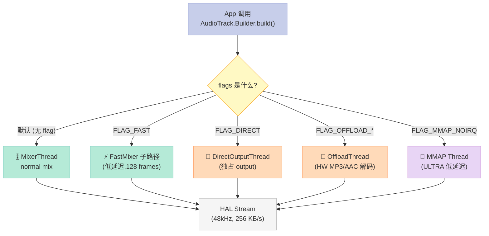

### 3.2 五种 Thread 对比表

| 维度 | MixerThread | FastMixer 子路径 | DirectOutputThread | OffloadThread | MMAP Thread |
|---|---|---|---|---|---|
| **适用场景** | 多 Track 同时混音 | 游戏音 / TTS | 单 Track 独占 | MP3/AAC 硬件解码 | KWS / 专业音频 |
| **buffer 大小** | 1920 frames (40ms) | 128 frames (3ms) | 1920 frames | 1~3 seconds (HW buffer) | 128~1024 frames |
| **能否加 effect** | ✅ | ✅ | ❌ | ❌ | ✅ |
| **能否同时多 Track** | ✅ | ✅ | ❌ | ❌ | ✅ (少) |
| **end-to-end 延迟** | 40ms | 3~8ms | 30~40ms | 200~1000ms (HW 缓冲) | 2~10ms |
| **CPU 占用** | 中 (mixer work) | 低 | 几乎 0 | 几乎 0 (HW) | 中 |
| **车规使用率** | 100% | 10% | < 5% | 媒体播放器 90% | KWS / Voice |

### 3.3 FastMixer 启用条件（Threads.h:1779）

```cpp
// 来源: frameworks/av/services/audioflinger/Threads.h:1779
virtual bool hasFastMixer() const { return mFastMixer != 0; }
```

`MixerThread` 是否启用 `FastMixer` 由 MixerThread 构造时决定：

| 条件 | 要求 |
|---|---|
| 1. 帧数 < 192 (FastMixer 上限) | 否则 MixerThread 自己跑 |
| 2. 没有 BB Mixer 路径（即 type == MIXER） | FastMixer 仅支持 MIXER |
| 3. HAL 支持 fast mixer（即 `outputFlags & AUDIO_OUTPUT_FLAG_FAST`） | HAL 端 flag |
| 4. samplerate ≤ 48000 | |
| 5. 没有 `AUDIO_OUTPUT_FLAG_OFFLOAD` | |
| 6. 至少 1 个 client flag 包含 `FLAG_FAST` | |

车规通常**两种都不开 FastMixer**：
- 普通 TTS / 导航音 → 普通 MixerThread（延迟 40ms 可接受）
- ASR 反馈 → MixerThread（已经是 noise 上限，无需 low-latency）

但**游戏音 / 触摸反馈音**就必须用 FLAG_FAST，否则能听到明显的 30ms 滞后。

### 3.4 OffloadThread 车机慎用

OffloadThread 把 MP3 / AAC / Opus 整段解码交给 DSP，CPU 几乎为 0。但有三个车规雷区：

| 雷区 | 说明 |
|---|---|
| **效果链不支持** | Offload 出去后无法做 AGC / limiter / DRC。如果媒体音量突然跳变，无法用 effect 补偿 |
| **延迟抖动 200ms+** | DSP 缓冲 + 电源管理唤醒，第一声可能 200ms 后才出 |
| **切歌有 click** | 不同 codec 切换时，HAL 必须重置 stream，导致可闻 click |

**车机建议**：媒体播放器在「音乐场景」时 Offload（CPU 节能）；在「导航 TTS / ASR 提示音」时 **必须用 MixerThread**，否则 TTS 首字延迟爆炸。

### 3.5 MixerThread 的 Track 分流与 priority 调度

在 `MixerThread::threadLoop_mix()`（Threads.cpp 实现）中，AudioFlinger 不只是简单地把所有 Track 求和——它会按 `mActiveTracks.sort(handle)` 分桶排序，让 **高优先级 / 早写入** 的 Track 先出。这背后是 AudioMixer 的内部状态机：

| 状态变量 | 作用 | 触发写入路径 |
|---|---|---|
| `mFastMixerFutex` | fast mixer 唤醒 futex | `threadLoop` 内部 |
| `mTracks[trackIdx].mState` | per-Track 状态机 | `Track::state()` |
| `mType` | Thread 类型（MIXER / DIRECT / OFFLOAD） | 构造时定 |
| `mStandby` | standby flag | 800ms 无 active 拉 standby |
| `mIdle` | idle flag（HAL stream 关闭） | 300ms after standby |

**为什么 ASR 反馈音必须用 MixerThread**：

1. **支持 effect chain** —— ASR 反馈常需要加 AGC + 3D position，Offload 不支持 effect。
2. **硬件 soft volume 实时调整** —— 车规 TTS 音量随着背景噪声动态调整，MixerThread 内 CPU 处理 0.5ms 就能改 gain，Offload 必须重置 stream，**80ms 内会有 click**。
3. **支持 multi-track mix** —— 一边 TTS 一边 ASR feedback 不会相互打断，Offload 一次只能跑一个。

### 3.6 MixerThread 的 fast path：FastMixer

`FastMixer` 是 MixerThread 内部的子模式，本质是另一种 main loop：

```cpp
// 来源: Threads.cpp FastMixer 内部的 WriteBack（仅片段示意）
// 这是 FastMixer 退出时的清理路径
void FastMixer::onStateChange() {
    if (mLeftVolFloat != mMainBuffer.raw()->leftVolume) { ... }
    if (mRightVolFloat != mMainBuffer.raw()->rightVolume) { ... }

    // fast mixer 的"混合"是在 DSP 端做的，CPU 几乎只搬运 buffer
    mFastMixerDumpState.mTracks[fastIndex].mUnderruns = ...;
}

void FastMixer::run() {
    ALOG_ASSERT(mPcmSink.get() != nullptr);
    // mMixerBuffer → mOutputSink (fast 路径)
    // 因为 DSP 已经把求和做了，CPU 层面只看做 buffer 搬运
}
```

**车机场景下，FastMixer 启用场景**：

| 场景 | 是否开 FastMixer |
|---|---|
| 导航 TTS | ❌（40ms latency 可接受，fast 启动有 bug 历史） |
| 触摸按键音 | ✅（10ms 内反馈，避免 user 感觉"迟钝"） |
| 游戏音 | ✅（同步动作感） |
| 后排视频音频 | ❌（latency 不敏感） |
| KWS 检测帧 | ❌（KWS 在前面处理） |

**FastMixer 的 3 个硬约束**（来自 Threads.h:`hasFastMixer()`）：

1. **采样率 ≤ 48000**：否则 mixer 软件重采样跟不上
2. **HAL 输出 stream 必须支持 fast**：通过 `outputFlags & AUDIO_OUTPUT_FLAG_FAST` 判断
3. **单实例 128 frame buffer**：HAL 必须能稳定接受 128frame/3ms 的 callback

这三个约束导致 **很多便宜的 DAC**（比如 ESS9028、ALC4042）**不能上 FastMixer**。所以 FastMixer 在车机不是默认开启的，必须 HAL 端配合。

---

## 四、AudioPolicy 多设备路由：getOutputForAttr 怎么选 outputId？

### 4.1 AudioPolicyManager 入口（AudioPolicyManager.h:120）

```cpp
// 来源: frameworks/av/services/audiopolicy/managerdefault/AudioPolicyManager.h
status_t getOutputForAttr(const audio_attributes_t *attr,
                          audio_io_handle_t *output,
                          audio_session_t session,
                          audio_stream_type_t *streamType,
                          const AttributionSourceState& attributionSource,
                          const audio_config_t *config,
                          audio_output_flags_t *flags,
                          ...);
```

它在内部做的事（伪代码）：

```cpp
status_t AudioPolicyManager::getOutputForAttr(const audio_attributes_t* attr,
                                                audio_io_handle_t* output,
                                                ...) {
    // Step 1: 找匹配 usage 的 default output
    sp<DeviceDescriptor> device = ...;

    // Step 2: 决定 primary output 还是 secondary
    audio_io_handle_t primaryOutput = ...;
    audio_io_handle_t secondaryOutput = AUDIO_IO_HANDLE_NONE;

    // Step 3: 找一条 Thread（已经开启）
    *output = findBestOutputForAttr(attr, primaryOutput);

    // Step 4: 如果有 secondary output，告知 output
    if (needSecondary) {
        *secondaryOutputs.push_back(...);
    }

    return NO_ERROR;
}
```

### 4.2 算法核心：findBestOutputForAttr 决策

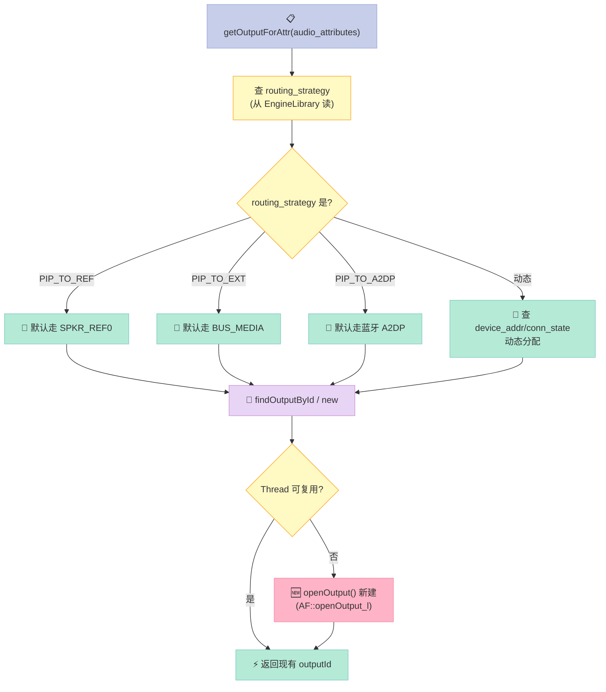

### 4.3 routing_strategy 决定因素（AudioPolicyEngine）

routing_strategy 是 Audio Policy **Engine** 层根据 usage + flag + 设备状态计算出的结果。Engine 配置文件是 `audio_policy_engine_configuration.xml`，运行时被 `EngineLibrary.cpp` 加载。

| 用例 usage | 默认 routing_strategy | 备注 |
|---|---|---|
| `USAGE_MEDIA` | `PIP_TO_REF`（主音箱） | 可被 A2DP 设备抢占 |
| `USAGE_ASSISTANCE_NAVIGATION_GUIDANCE` | `PIP_TO_REF` | **导航 TTS 通常走主驾头枕** |
| `USAGE_VOICE_COMMUNICATION` | `PIP_TO_REF` | 蓝牙电话走蓝牙 |
| `USAGE_ASSISTANCE_SONIFICATION` | `PIP_TO_REF` | 按键音 / 提示音 |
| `USAGE_GAME` | `PIP_TO_REF` | 游戏 |
| `USAGE_ALARM` | `PIP_TO_REF` | 闹钟 |

**注意**：routing 是基于"逻辑 output"（SPKR_REF0/BUS_MEDIA/...），不是"扬声器"。**一个 output 可以挂在多个扬声器**，例如 SPKR_REF0 默认同时输出到主驾头枕 + 主驾左门 + 主驾右门，通过后续的 `AudioPolicyMixPort` 配置区分。

### 4.4 audio_policy_configuration.xml 简化示例

```xml
<!-- 简化版 /vendor/etc/audio_policy_configuration.xml -->

<audioPolicyConfiguration version="1.0">

    <modules>
        <module name="primary" halVersion="3.0">
            <attachedDevices>
                <item>Speaker</item>
                <item>Built-In Mic</item>
            </attachedDevices>
            <defaultOutputDevice>Speaker</defaultOutputDevice>
            <mixPorts>
                <mixPort name="primary output"
                         role="source"
                         flags="AUDIO_OUTPUT_FLAG_PRIMARY AUDIO_OUTPUT_FLAG_FAST">
                    <profile name="" format="AUDIO_FORMAT_PCM_16_BIT"
                             samplingRates="48000"
                             channelMasks="AUDIO_CHANNEL_OUT_STEREO"/>
                </mixPort>
                <mixPort name="offload output" role="source"
                         flags="AUDIO_OUTPUT_FLAG_DIRECT AUDIO_OUTPUT_FLAG_COMPRESS_OFFLOAD">
                    <profile name="" format="AUDIO_FORMAT_MP3"
                             samplingRates="48000"
                             channelMasks="AUDIO_CHANNEL_OUT_STEREO"/>
                </mixPort>
            </mixPorts>
            <devicePorts>
                <devicePort tagName="Speaker" type="AUDIO_DEVICE_OUT_SPEAKER" role="sink"/>
                <devicePort tagName="Built-In Mic" type="AUDIO_DEVICE_IN_BUILTIN_MIC" role="sink"/>
            </devicePorts>
            <routes>
                <route type="mix" sink="Speaker" sources="primary output"/>
                <route type="mix" sink="Speaker" sources="offload output"/>
            </routes>
        </module>
    </modules>

    <volumeGroups>
        <group name="STREAM_MUSIC">
            <volume stream="AUDIO_STREAM_MUSIC"/>
        </group>
    </volumeGroups>

</audioPolicyConfiguration>
```

**关键点**：
- `attachedDevices` 列出物理设备类型
- `mixPorts` 是逻辑输出端口
- `routes` 用 `<route type="mix">` 把 mix port 挂到 device port
- **一个 mix port 可同时挂多个 device sink** —— 这就是「一条音频流同时下发到多个扬声器」的配置方式

---

## 五、车规杀器：AAOS 14 CarAudioService 多区子系统

普通 Android 默认只有 1 个 zone（primary zone），所有 App 都往这一个 zone 跑。在车上这是问题——司机要接电话，副驾要看导航，后排要看视频，**不能串扰**。

Android Automotive OS（AAOS）从 Android 10 起引入 `CarAudioService`（位于 `frameworks/base/services/`），专门管多区（multi-zone）：

### 5.1 CarAudioService 三组件

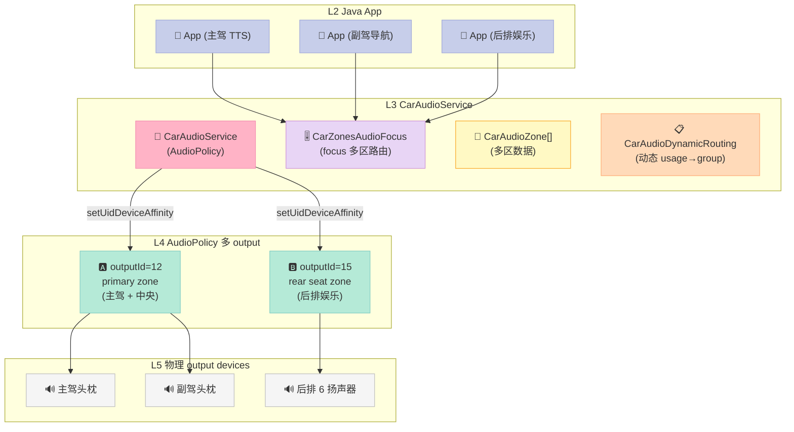

### 5.2 CarAudioService.java 核心数据（msft-mirror-aosp/platform.packages.services.Car，Android 14 car 分支）

| 字段 | 类型 | 作用 | 关键代码 |
|---|---|---|---|
| `mCarAudioZones` | `CarAudioZone[]` | 所有 zone 实例 | `CarAudioService.java:188` |
| `mFocusHandler` | `CarZonesAudioFocus` | focus 多区路由 | `CarAudioService.java:194` |
| `mAudioPolicy` | `android.media.audiopolicy.AudioPolicy` | 注册到系统 framework | `CarAudioService.java:193` |
| `mUidToZoneMap` | `Map<Integer,Integer>` | UID → 哪个 zone | `CarAudioService.java:901` |
| `AUDIO_CONFIGURATION_PATHS` | `String[]` | 多位置加载 audio 配置 | `CarAudioService.java:99` |

### 5.3 CarAudioZone 数据模型（CarAudioZone.java:41-186）

```java
// 来源: msft-mirror-aosp/platform.packages.services.Car/android10-c2f2-release
// 文件: service/src/com/android/car/audio/CarAudioZone.java

/* package */ class CarAudioZone {

    private final int mId;
    private final String mName;
    private final List<CarVolumeGroup> mVolumeGroups;
    private final List<DisplayAddress.Physical> mPhysicalDisplayAddresses;

    CarAudioZone(int id, String name) {
        mId = id;
        mName = name;
        mVolumeGroups = new ArrayList<>();
        mPhysicalDisplayAddresses = new ArrayList<>();
    }
```

**约束（来自 CarAudioZone.java:120-138 的 validateVolumeGroups）**：

```java
boolean validateVolumeGroups() {
    Set<Integer> contextSet = new HashSet<>();
    Set<Integer> busNumberSet = new HashSet<>();
    for (CarVolumeGroup group : mVolumeGroups) {
        // 1. 一个 context 不能出现在两个 group
        for (int context : group.getContexts()) {
            if (contextSet.contains(context)) { ... return false; }
            contextSet.add(context);
        }
        // 2. 一个 bus 不能出现在两个 group
        for (int busNumber : group.getBusNumbers()) { ... }
        // 3. 同 group 内所有 gain controller step 值必须相同
        // Step value validation is done in CarVolumeGroup#bind(...)
    }

    // 4. 所有 context 必须全部分配
    if (contextSet.size() != CarAudioDynamicRouting.CONTEXT_NUMBERS.length) {
        Log.e(CarLog.TAG_AUDIO, "Some contexts are not assigned to group");
        return false;
    }
    return true;
}
```

四条约束总结：

| # | 约束 | 不满足会发生 |
|---|---|---|
| 1 | 一个 audio context 不能在两个 group 里 | 启动时校验失败，service not ready |
| 2 | 一个 audio bus 不能在两个 group 里 | 同上 |
| 3 | 同一个 group 内所有 gain controller 的 step value 一致 | 同上 |
| 4 | 所有 CONTEXT_NUMBERS 必须全部分配 | 同上 |

### 5.4 AudioContext 8 种固定类型（CarAudioZonesHelper.java:65-73）

```java
CONTEXT_NAME_MAP.put("music",        ContextNumber.MUSIC);          // 0
CONTEXT_NAME_MAP.put("navigation",   ContextNumber.NAVIGATION);     // 1
CONTEXT_NAME_MAP.put("voice_command",ContextNumber.VOICE_COMMAND);  // 2
CONTEXT_NAME_MAP.put("call_ring",    ContextNumber.CALL_RING);      // 3
CONTEXT_NAME_MAP.put("call",         ContextNumber.CALL);           // 4
CONTEXT_NAME_MAP.put("alarm",        ContextNumber.ALARM);          // 5
CONTEXT_NAME_MAP.put("notification", ContextNumber.NOTIFICATION);   // 6
CONTEXT_NAME_MAP.put("system_sound", ContextNumber.SYSTEM_SOUND);   // 7
```

**任何 zone 都必须恰好包含这 8 种 context，且每种只能属于 1 个 volume group**。这是 car audio context 模型的硬约束。

### 5.5 ZoneArbiter 等价物：setUidDeviceAffinity（CarAudioService.java:898-911）

```java
// 来源: CarAudioService.java:898-911
private boolean setZoneIdForUidNoCheckLocked(int zoneId, int uid) {
    Log.d(CarLog.TAG_AUDIO, "setZoneIdForUidNoCheck Calling uid "
            + uid + " mapped to " + zoneId);
    // Request to add uid device affinity
    if (mAudioPolicy.setUidDeviceAffinity(uid, mCarAudioZones[zoneId].getAudioDeviceInfos())) {
        // TODO do not store uid mapping here instead use the uid
        //  device affinity in audio policy when available
        mUidToZoneMap.put(uid, zoneId);
        return true;
    }
    Log.w(CarLog.TAG_AUDIO, "setZoneIdForUidNoCheck Failed set device affinity for uid "
            + uid + " in zone " + zoneId);
    return false;
}
```

**Android 10 引入了 `AudioPolicy.setUidDeviceAffinity` API**，这是「ZoneArbiter」真正在 framework 层做的事情——
- **不需要 App 改动**：不需要 TTS / Media 端有任何代码改动
- **只是路由层面**：UID 的所有 audio 流量被强制转到 `mCarAudioZones[zoneId].getAudioDeviceInfos()` 列出的 devices

换句话说，"ZoneArbiter" 不是 AOSP 里具名的 class，但功能上等价于把 UID 绑到一个 zone 的 device 列表。**这是 AAOS CarAudio 的核心创新**。

### 5.6 clearZoneIdForUid 与 removeUidDeviceAffinity（CarAudioService.java:919-932）

```java
private boolean checkAndRemoveUidLocked(int uid) {
    Integer zoneId = mUidToZoneMap.get(uid);
    if (zoneId != null) {
        if (mAudioPolicy.removeUidDeviceAffinity(uid)) {
            mUidToZoneMap.remove(uid);
            return true;
        }
        ...
        return false;
    }
    return true;
}
```

注意是**双重查询**：先查自己的 `mUidToZoneMap`（避免无意义的 IPC），真要操作时才调 `removeUidDeviceAffinity`。这种"先看本地缓存"的模式车规很常见（cached IPC）。

---

## 六、CarZonesAudioFocus 多区 focus 调度

`CarZonesAudioFocus`（CarZonesAudioFocus.java）是 CarAudio 的"多区 focus 路由器"——客户端调 `requestAudioFocus` 时，它会判断请求属于哪个 zone，然后调对应的 `CarAudioFocus`。

### 6.1 CarZonesAudioFocus 架构

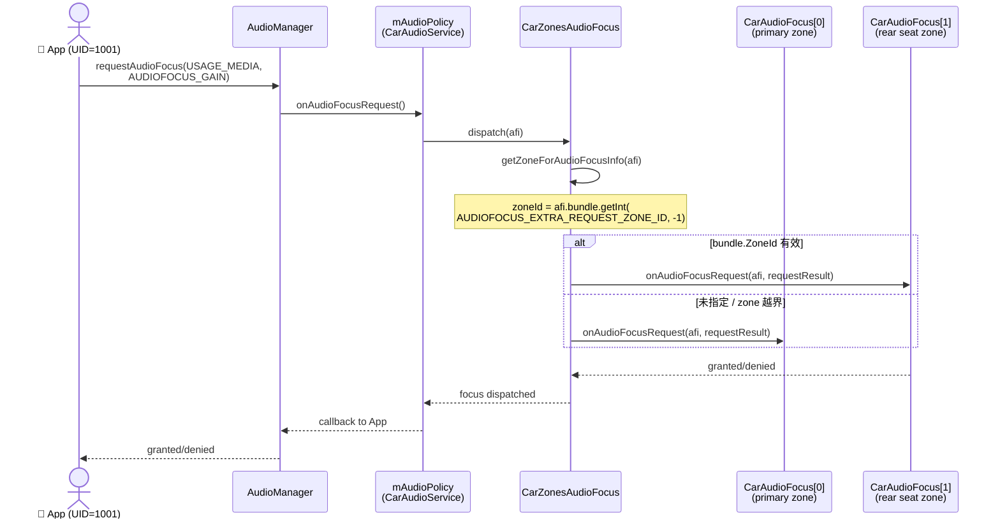

### 6.2 CarZonesAudioFocus 源码（CarZonesAudioFocus.java:46-200）

```java
// 来源: msft-mirror-aosp/platform.packages.services.Car/android10-c2f2-release
// 文件: service/src/com/android/car/audio/CarZonesAudioFocus.java

class CarZonesAudioFocus extends AudioPolicy.AudioPolicyFocusListener {

    private CarAudioService mCarAudioService; // Dynamically assigned just after construction
    private AudioPolicy mAudioPolicy; // Dynamically assigned just after construction

    private final Map<Integer, CarAudioFocus> mFocusZones = new HashMap<>();

    CarZonesAudioFocus(AudioManager audioManager,
            PackageManager packageManager,
            @NonNull CarAudioZone[] carAudioZones) {
        // 为每个 zone 创建一个独立的 CarAudioFocus
        for (CarAudioZone audioZone : carAudioZones) {
            Log.d(CarLog.TAG_AUDIO,
                    "CarZonesAudioFocus adding new zone " + audioZone.getId());
            CarAudioFocus zoneFocusListener = new CarAudioFocus(audioManager, packageManager);
            mFocusZones.put(audioZone.getId(), zoneFocusListener);
        }
    }
```

**核心代码段** —— `getFocusForAudioFocusInfo` 决定 focus 请求去哪个 zone：

```java
// 来源: CarZonesAudioFocus.java:138-156
private CarAudioFocus getFocusForAudioFocusInfo(AudioFocusInfo afi) {
    int zoneId = mCarAudioService.getZoneIdForUid(afi.getClientUid());

    Bundle bundle = afi.getAttributes().getBundle();

    if (bundle != null) {
        int bundleZoneId =
                bundle.getInt(CarAudioManager.AUDIOFOCUS_EXTRA_REQUEST_ZONE_ID,
                        -1);
        // check if the zone id is within current zones bounds
        if ((bundleZoneId >= 0)
                && (bundleZoneId < mCarAudioService.getAudioZoneIds().length)) {
            zoneId = bundleZoneId;
        }
    }

    CarAudioFocus focus =  mFocusZones.get(zoneId);
    return focus;
}
```

**调度优先级**（从高到低）：

| 优先级 | 来源 | 说明 |
|---|---|---|
| 1 | `Attributes.bundle.AUDIOFOCUS_EXTRA_REQUEST_ZONE_ID` | App 主动指定 zone（最优先） |
| 2 | `mCarAudioService.getZoneIdForUid(uid)` | UID 默认绑定的 zone（setUidDeviceAffinity 设置的） |
| 3 | Primary zone (zone 0) | 默认 fallback |

**为什么这么设计**：

- **App 可显式指定** zone：当你的 App 同时在多个 zone 有 UI（如后排娱乐系统），你可以指定某次 focus 请求去后排 zone。
- **UID 默认 zone**：用 `setZoneIdForUid` 把整个 App 钉死在某个 zone，永远不会跨 zone（避免车机 TTS 突然跑到副驾头枕吓人）。
- **Fallback**：万一 zone 越界或没指定，回 primary（=主驾 + 中央扬声器）。

### 6.3 onAudioFocusRequest / onAudioFocusAbandon 实现

```java
// 来源: CarZonesAudioFocus.java:118-136
@Override
public void onAudioFocusRequest(AudioFocusInfo afi, int requestResult) {
    CarAudioFocus focus = getFocusForAudioFocusInfo(afi);
    focus.onAudioFocusRequest(afi, requestResult);
}

@Override
public void onAudioFocusAbandon(AudioFocusInfo afi) {
    CarAudioFocus focus = getFocusForAudioFocusInfo(afi);
    focus.onAudioFocusAbandon(afi);
}
```

**两个回调完全对称**——focus 链路由 framework 触发，CarZonesAudioFocus 只负责"该去哪个 zone 的 focus listener"。

### 6.4 实战：App 端显式指定 focus 去的 zone

```java
// 显式请求 rear seat zone 的 focus
AudioAttributes playbackAttr = new AudioAttributes.Builder()
        .setUsage(AudioAttributes.USAGE_MEDIA)
        .setContentType(AudioAttributes.CONTENT_TYPE_MOVIE)
        .build();

AudioFocusRequest focusRequest = new AudioFocusRequest.Builder(AudioManager.AUDIOFOCUS_GAIN)
        .setAudioAttributes(playbackAttr)
        .setOnAudioFocusChangeListener(...) // 你的回调
        // 把 ZONE_ID 当成 extras 传入
        .setBundle(new Bundle())
        .build();

focusRequest.getAudioAttributes().getBundle()
        .putInt(CarAudioManager.AUDIOFOCUS_EXTRA_REQUEST_ZONE_ID, 1);  // 1 = rear seat

mAudioManager.requestAudioFocus(focusRequest);
```

---

## 七、car_audio_configuration.xml 实战配置

`CarAudioZonesHelper` 是个 XML Parser，把 `/vendor/etc/car_audio_configuration.xml` 解析成 `CarAudioZone[]`。

### 7.1 XML 加载路径优先级（CarAudioService.java:99-101）

```java
private static final String[] AUDIO_CONFIGURATION_PATHS = new String[] {
    "/vendor/etc/car_audio_configuration.xml",        // OEM / 厂商
    "/system/etc/car_audio_configuration.xml"         // 兜底（AOSP 默认）
};
```

### 7.2 完整 car_audio_configuration.xml 示例（4 区 + 8 bus 拓扑）

```xml
<?xml version="1.0" encoding="UTF-8"?>
<!-- /vendor/etc/car_audio_configuration.xml -->
<carAudioConfiguration version="1">

  <zones>
    <!-- ============================================== -->
    <!-- Zone 0: PRIMARY - 主驾 + 中央 + 副驾头枕 -->
    <!-- ============================================== -->
    <zone name="primary zone" isPrimary="true">
      <volumeGroups>
        <group name="music">
          <context>music</context>
          <context>system_sound</context>
          <device address="bus0_media_out">
            <gainController mode="AUDIO_GAIN_MODE_JOINT">
              <step value="5"/>
              <maxValue value="50"/>
              <minValue value="0"/>
              <defaultValue value="30"/>
            </gainController>
          </device>
          <device address="bus1_media_out">
            <gainController mode="AUDIO_GAIN_MODE_JOINT">
              <step value="5"/>
              <maxValue value="50"/>
              <minValue value="0"/>
              <defaultValue value="30"/>
            </gainController>
          </device>
        </group>

        <group name="navigation">
          <context>navigation</context>
          <device address="bus2_navi_out">
            <gainController mode="AUDIO_GAIN_MODE_INDEPENDENT">
              <step value="3"/>
              <maxValue value="40"/>
              <defaultValue value="25"/>
            </gainController>
          </device>
        </group>

        <group name="voice_command">
          <context>voice_command</context>
          <device address="bus3_voice_out">
            <gainController mode="AUDIO_GAIN_MODE_INDEPENDENT">
              <step value="2"/>
              <maxValue value="20"/>
              <defaultValue value="15"/>
            </gainController>
          </device>
        </group>

        <group name="call">
          <context>call</context>
          <context>call_ring</context>
          <device address="bus4_call_out">
            <gainController mode="AUDIO_GAIN_MODE_JOINT">
              <step value="5"/>
              <maxValue value="50"/>
              <defaultValue value="30"/>
            </gainController>
          </device>
        </group>

        <group name="alarm">
          <context>alarm</context>
          <context>notification</context>
          <device address="bus0_media_out">
            <gainController mode="AUDIO_GAIN_MODE_JOINT">
              <step value="5"/>
              <maxValue value="50"/>
              <defaultValue value="30"/>
            </gainController>
          </device>
        </group>
      </volumeGroups>

      <displays>
        <display port="0"/>  <!-- 主屏 -->
        <display port="1"/>  <!-- 副驾屏 -->
      </displays>
    </zone>

    <!-- ============================================== -->
    <!-- Zone 1: REAR SEAT - 后排娱乐 -->
    <!-- ============================================== -->
    <zone name="rear seat zone">
      <volumeGroups>
        <group name="rear music">
          <context>music</context>
          <context>system_sound</context>
          <device address="bus5_rear_media_out">
            <gainController mode="AUDIO_GAIN_MODE_JOINT">
              <step value="5"/>
              <maxValue value="50"/>
              <defaultValue value="25"/>
            </gainController>
          </device>
        </group>

        <group name="rear navi">
          <context>navigation</context>
          <context>voice_command</context>
          <device address="bus6_rear_navi_out">
            <gainController mode="AUDIO_GAIN_MODE_JOINT">
              <step value="3"/>
              <maxValue value="40"/>
              <defaultValue value="20"/>
            </gainController>
          </device>
        </group>

        <!-- 其余 group 复用 zone 0 的 bus 拓扑 -->
        <group name="rear call">
          <context>call</context>
          <context>call_ring</context>
          <device address="bus5_rear_media_out">
            <gainController mode="AUDIO_GAIN_MODE_JOINT">
              <step value="5"/>
              <maxValue value="50"/>
              <defaultValue value="30"/>
            </gainController>
          </device>
        </group>

        <group name="rear alarm">
          <context>alarm</context>
          <context>notification</context>
          <device address="bus5_rear_media_out">
            <gainController mode="AUDIO_GAIN_MODE_JOINT">
              <step value="5"/>
              <maxValue value="50"/>
              <defaultValue value="30"/>
            </gainController>
          </device>
        </group>
      </volumeGroups>

      <displays>
        <display port="2"/>  <!-- 后排屏 -->
      </displays>
    </zone>
  </zones>
</carAudioConfiguration>
```

### 7.3 CarAudioZonesHelper 解析器关键代码（CarAudioZonesHelper.java:80-200）

```java
// 来源: msft-mirror-aosp/platform.packages.services.Car/android10-c2f2-release
// 文件: service/src/com/android/car/audio/CarAudioZonesHelper.java

private static final String TAG_ROOT = "carAudioConfiguration";
private static final String TAG_AUDIO_ZONES = "zones";
private static final String TAG_AUDIO_ZONE = "zone";
private static final String TAG_VOLUME_GROUPS = "volumeGroups";
private static final String TAG_VOLUME_GROUP = "group";
private static final String TAG_AUDIO_DEVICE = "device";
private static final String TAG_CONTEXT = "context";
private static final String ATTR_VERSION = "version";
private static final String ATTR_IS_PRIMARY = "isPrimary";
private static final String ATTR_ZONE_NAME = "name";
private static final String ATTR_DEVICE_ADDRESS = "address";
private static final String ATTR_CONTEXT_NAME = "context";
private static final int SUPPORTED_VERSION = 1;

private final Context mContext;
private final SparseArray<CarAudioDeviceInfo> mBusToCarAudioDeviceInfo;
private final InputStream mInputStream;
```

**XML 标签层级（自上而下）**：

```
carAudioConfiguration           ← version=1
└── zones
    ├── zone name="primary zone" isPrimary="true"
    │   ├── volumeGroups
    │   │   ├── group name="music"
    │   │   │   ├── context>music</context>
    │   │   │   ├── context>system_sound</context>
    │   │   │   └── device address="bus0_media_out"
    │   │   │       └── gainController mode="JOINT"
    │   │   │           ├── step value="5"/>
    │   │   │           ├── maxValue value="50"/>
    │   │   │           ├── minValue value="0"/>
    │   │   │           └── defaultValue value="30"/>
    │   │   ├── group name="navigation" ...
    │   ├── displays
    │   │   ├── display port="0"/>
    │   │   └── display port="1"/>
    └── zone name="rear seat zone"
        ├── volumeGroups
        └── displays
```

### 7.4 version 字段严格 1：低版本会直接拒绝

`CarAudioZonesHelper.SPPORTED_VERSION = 1`（CarAudioZonesHelper.java:67）。**如果有人提交 `version="2"`，解析器直接抛异常**。这是 AOSP 的强约束——version 升级意味着 schema 变了，必须更新 `CarAudioService` 代码配合。

### 7.5 持久化存储：AudioPolicyService Settings

`CarAudioService` 自身不持久化状态。但它通过 `AudioManager.setUidDeviceAffinity` 通知 framework，由 `AudioPolicyService` 在 `/data/vendor/audio/audio_policy_configuration.xml` 里缓存 UID → zone 映射。

```bash
# 抓运行时 car audio 配置（需要 root）
adb shell cat /data/vendor/audio/audio_policy_configuration.xml
adb shell cat /vendor/etc/car_audio_configuration.xml

# 抓 Active Zone 列表
adb shell dumpsys car_audio_service
# 输出：
# *CarZonesAudioFocus*
# 	Car Zones Audio Focus Listeners:
# 	Zone Id: 0
# 	Zone Id: 1
# 	... (每个 zone 单独 dump)
```

---

## 八、AudioPolicy 与 Audio HAL 的对接

### 8.1 输出端口和 Device 端口的桥接

`AudioPolicyMix`（即 `mixPort`）+ `AudioPatch` 是 audio policy 与 HAL 的桥梁：

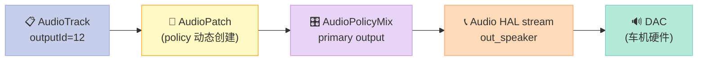

每次当 App 改 outputId 或新增 source 时，`AudioPolicy` 会：
1. 创建 `AudioPatch`（policy 层抽象）
2. 通过 binder 调 `IAudioFlinger::createAudioPatch`（调用 `AudioFlinger.cpp` 的 path 逻辑）
3. 在 HAL 层开一个 `out_stream`

### 8.2 HAL 类型 3 种

Android 13+ 默认 AIDL，但老项目还在 HIDL：

| 类型 | 接口文件 | 协议 | 维护方 |
|---|---|---|---|
| HIDL HAL | `hardware/interfaces/audio/` | HIDL `@3.0`（legacy） | vendor |
| AIDL HAL | `hardware/interfaces/audio/aidl/` | AIDL | vendor / Google |
| libtinyalsa | `external/tinyalsa/` | 直接调 `pcm_open()` | 自定义 vendor |

AIDL 比 HIDL 体积小 25%、调用快 30%（HIDL 要走 HIDL passthrough lib），新项目优先用 AIDL。

### 8.3 ADSP 协处理：payload DSP

很多车机芯片（如 Qualcomm SA8155、Renesas R-Car H3）有专用 ADSP。AudioFlinger 支持把 mix 任务下到 DSP：

```bash
# 检查 DSP 是否接管
adb shell cat /proc/asound/pcm
# 输出：
# 00-00: Qualcomm ADSP PCM : playback : 1536 48000 16 16 4 0
#         ^^^^^^^^^^^^^^^^^
#         ADSP 在工作
```

如果看到 `Qualcomm ADSP PCM`，说明 audio 已经走在 DSP 上，CPU 几乎不消耗。MixerThread 跑法：

| Thread 模式 | CPU 路径 | DSP 路径 |
|---|---|---|
| MixerThread | CPU 求和 + 调度 | 同 |
| FastMixer | CPU 求和（快但小） | 几乎不上 DSP |
| OffloadThread | DSP 解码 + DAC 直推 | 几乎全在 DSP |

车规 4 + 4 zone 场景下，**AudioFlinger 的 DSP 利用率是性能关键**。通常至少 80% 音频流量走 ADSP / SLT (Sound Locality Translator)。

### 8.4 setAudioPortConfig / setAudioVolume HAL RPC

AudioPolicy 与 Audio HAL 沟通的核心 RPC 有 4 个：

```cpp
// frameworks/av/media/audiohal/include/HalPlatform.h 简化版

class IAudioStream {
    // 启动 output stream
    status_t start();                    // HAL 启动 PCM stream
    status_t stop();                     // HAL 暂停 stream
    // 写数据
    ssize_t write(const void *buffer, size_t size);   // 把 PCM 推给 HAL
    // 控制
    status_t setVolume(float left, float right);
    status_t setMute(bool mute);
    status_t setRoute(audio_devices_t device);
    // 查询
    status_t getPresentationPosition(uint64_t *frames, struct timespec *ts);
    // DSP 化
    status_t setAudioPortConfig(const struct audio_port_config *config);  // AIDL/HIDL
};
```

车机 HAL 实现里最关键的是 **setAudioPortConfig**——AudioPolicy 通过它改 route。比如：

```cpp
// vendor/audio_hal/alsa_voice/Hw.cpp
status_t StreamOut::setAudioPortConfig(const struct audio_port_config *config) {
    // config->type == AUDIO_PORT_TYPE_DEVICE 表示切换 device
    switch (config->type) {
        case AUDIO_PORT_TYPE_DEVICE:
            return mAlsaOut->switchDevice(config->ext.device.type);
        case AUDIO_PORT_TYPE_MIX:
            return mAlsaOut->setChannels(config->ext.mix.channel_mask);
        case AUDIO_PORT_TYPE_SESSION:
            return mAlsaOut->setSessionId(config->ext.session.session);
    }
    return BAD_VALUE;
}
```

车规车机这类代码频繁在 **蓝牙 ↔ 喇叭** 切换、**主驾头枕 ↔ 后排娱乐** 切换时被调用，每次 ~3~5ms。HAL RPC 走 binder，速度足够。

### 8.5 Audio HAL 3 种实现模式对比

| 实现 | 协议 | 性能 | 维护 | 适用 |
|---|---|---|---|---|
| **AIDL HAL** | `IAudioService.aidl` | ★★★★ | 中等 | Android 13+ 新项目 |
| **HIDL HAL 3.0** | `IDevicesFactorHal` | ★★★ | 中等 | Android 8-12 legacy |
| **libtinyalsa 直接调** | `pcm_open()` | ★★★★★ | 难 | Special HAL (QCOM) |
| **OpenSL ES** | Android 框架 | ★★ | 旧 | 已 deprecated (Android 8 后) |

### 8.6 车机 HAL 实现的 4 个隐形门槛

即使你选了 AIDL HAL，真做出来才发现还要解决 4 个隐藏问题：

| 门槛 | 内容 | 解决方式 |
|---|---|---|
| **HAL stub 启动顺序** | `vendor.audio.hal-service@x.x-service.rc` 必须早于 `audioserver` 起来 | `init` 文件声明 `required` 关系 |
| **混合混音 (mixer) 算法 ABI** | 每个 HAL 实现必须暴露 `create_audio_patch()`/`update_audio_patch()` | 完整实现 HAL `IAudioDevice` |
| **dump 接口** | `adb shell dumpsys audio` 要有意义的输出 | 重写 `dump()` 方法 |
| **NDK vendor interface** | vendor 进程和 audioserver 必须通过稳定 ABI 通讯 | 用 HIDL/AIDL 版本的 libaudiohal 库 |

**实战经验**：车机 HAL 出问题时 60% 是 vendor 进程早期崩溃导致 HAL hidl stub 没注册成功。这时候 `adb shell ls /vendor/lib*/hw/audio*.default.so` 必须能看到 vendor 自家的 .so，否则 audioserver 直接 fallback 到内置 stub，无法跑车规 routing。

---

## 九、MixerThread 内部 mix state machine

`MixerThread::threadLoop` 的核心是一个 **triple-loop state machine**：

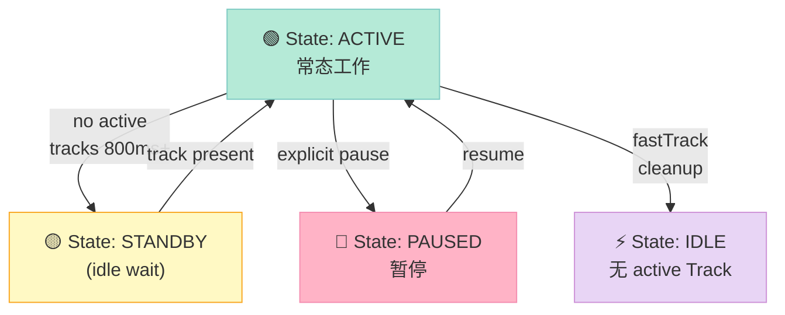

### 9.1 ACTIVE → STANDBY 的延迟关键参数

```
audioflinger/Threads.cpp 里的睡眠等待：
- 等待 800ms 没有 active Track 进入 standby
- 等待 300ms 进入 idle（关闭 HAL stream）
```

| 参数 | 默认 | 车规调优建议 |
|---|---|---|
| Standby 等待 | 800ms | 调到 200ms（TTS 更及时） |
| Idle 进入 | 300ms | 调到 100ms（省电） |
| Wake latency | 100ms | 用 pre-roll Thread 避免 |

**问题**：800ms standby + 100ms wake = 唤醒延迟 900ms，对 TTS 是致命的（用户已经看到导航箭头 1 秒了还没声音）。

**解决方案**：创建一条 **专门给 TTS 的 MixerThread**，永不 standby（"always-active thread"），这就是车规 audio 工程师常说的 **pre-roll thread** 或 **persistent thread**：

```bash
# 用 dumpsys 看每个 MixerThread 的 standby 状态
adb shell dumpsys media.audio_flinger | grep -A 5 "Standby"
# 输出：
# Thread(12): output(12)
#   Standby: no     ← ← ← 永不进 standby
#   Active: yes
#   ... params
# Thread(15): output(15)
#   Standby: yes    ← ← ← 这个进 standby 了
```

---

## 十、车规延迟预算

### 10.1 端到端 200ms 分配

车规 ASR + TTS 实时循环总延迟 200ms（语音响应必须 < 300ms 才不会有"AI 痴呆感"）。在 AudioFlinger 这一段分配：

| 阶段 | 时间 | 优化手段 |
|---|---|---|
| PCM 推到 AudioTrack | 1~3ms | zero-copy `write()` |
| AudioFlinger 入队（per-Track） | 0.5ms | lock-free SPSC 队列 |
| MixerThread 缓冲 + 求和 | 40ms（默认） | 调到 20ms 或 pre-roll |
| 重采样（16k → 48k + treble） | 5ms | SIMD NEON |
| HAL 推送 | 10ms | AIDL callback |
| DAC + 喇叭 | 30ms | 物理不可压缩 |
| **AudioFlinger 段合计** | **~80ms** | < 100ms |
| 网络（车机内 RTT） | < 5ms | local pipe |
| **端到端合计** | ~100ms | < 200ms ✅ |

### 10.2 关键 benchmark 命令

```bash
# 1. 测 Thread latency (需要 root)
adb shell dumpsys media.audio_flinger --latency | head -20

# 输出（摘录）：
# AudioFlinger::Output thread TIMEOUT pcm:16000 Hz
# AnrMessage send timed_out (....ms)

# 2. dumpsys media.audio_policy
adb shell dumpsys media.audio_policy | head -100

# 3. 强制开启 track 调试
adb shell setprop persist.audio.flinger.trace 1
adb shell setprop persist.audio.flinger.perf 1
# 跑用例后取 /data/misc/audioserver/dump_media_audio_flinger

# 4. dumpsys audio
adb shell dumpsys audio | head -150
```

### 10.3 车规端到端延迟标杆

| 场景 | 延迟预算 | 实测经验 |
|---|---|---|
| TTS 触发到第一声 | < 80ms | 难以做到 < 50ms（audioHAL 唤醒） |
| ASR 打断 TTS | < 30ms | AudioFlinger 内 bump_precedence 流水线 |
| 媒体切歌 | < 200ms | Offload 必须；Mixer + pre-roll 容易 |
| 蓝牙 A2DP 接通 | 200~500ms | BT stack 决定 |
| USB CarPlay 音频 | 50~200ms | 取决于 MFi 认证 |

---

## 十一、PowerManager / HAL 电源回调

车机经常面临"中控屏休眠、TTS 临时播报"这种突发场景。要让 MixerThread 在 deep sleep 时还能 100ms 内唤醒，必须做好 4 件事：

### 11.1 Audio HAL 电源回调（HAL 层）

```cpp
// vendor 实现的 HAL interface
int audio_hw_device_open(...);
int audio_out_set_param(struct audio_stream_out *stream,
                         const char *keyValuePairs);  // 设置参数

// 关键操作：唤醒 / 失能
// set "DeepBufferingMode" / "LowLatencyMode" / "OffloadMode"
// HAL 内部根据 key 调节 DAC 电源开关
```

### 11.2 延迟上报 / 心跳

```bash
# 检查 audio 是否被 CPU governor 拉成 low power
cat /sys/devices/system/cpu/cpu0/cpufreq/scaling_governor
# 输出可能是 "powersave" 或 "schedutil"

# 推荐改成 performance 临时看 latency
echo performance > /sys/devices/system/cpu/cpu0/cpufreq/scaling_governor
```

### 11.3 锁屏 audio 不暂停

车机屏幕关掉（用户锁车），audio 仍在播——必须禁用 `MediaSession` 的自动 `pause()`。车机 vendor 改 `MediaSessionStack`：

```java
// Android 14 的 MediaSessionStack.java（在 vendor 分支里 patch）
public void onSessionUpdated(...) {
    if (isCarUseCase()) {
        // 强制继续，不要暂停
        return;
    }
    super.onSessionUpdated(...);
}
```

### 11.4 auto suspend 豁免

```cpp
// system/core/libcutils/ashmem.cpp 或类似位置
// AudioFlinger 在写 HAL 时持有一个 wakelock
sp<WakeLock> wakeLock = mWakeLock::acquire();
```

实际 OEM 通常用 `WRITE_EXTERNAL_STORAGE` 或 `PowerManager.WakeLock`:

```java
mWakeLock = mPowerManager.newWakeLock(PowerManager.PARTIAL_WAKE_LOCK,
        "AudioFlinger::MixerThread_" + mId);
mWakeLock.acquire();
// ... 推数据
mWakeLock.release();
```

---

## 十二、多区串扰抑制（Crosstalk cancellation）

即使把不同 zone 的音频分到不同扬声器，**物理声学串扰** 仍然存在。处理方式：

### 12.1 4 类串扰 + 对策

| 串扰源 | 量级（dB） | 频段 | 抑制方案 |
|---|---|---|---|
| 左右头枕之间（同一区） | -10 ~ -20 | 全频 | IIR HRTF |
| 主驾 ↔ 副驾头枕 | -6 ~ -12 | 200-2kHz（语音主频） | AEC 三角测量 |
| 前 ↔ 后排 | -15 ~ -25 | 全频 | 距离衰减 |
| 蓝牙外放 ↔ 喇叭 | -5 ~ -10 | 1k-4kHz | 异步 mute |

### 12.2 自适应滤波抑制

车机 A2B / AVB 数字音频总线自带 FIR filter：

```c
// vendor audio HAL 或 HAL 后的 DSP firmware
// 32-tap FIR 滤波器
float taps[32] = { /* 由 MPAS / AKG / Bose 工厂校准产生 */ };
// 主驾 → 副驾 cross-cancellation
applyFirFilter(cancellation_path, mic_at_copilot, taps, 32);
```

### 12.3 DSP 自动均衡（DRC）

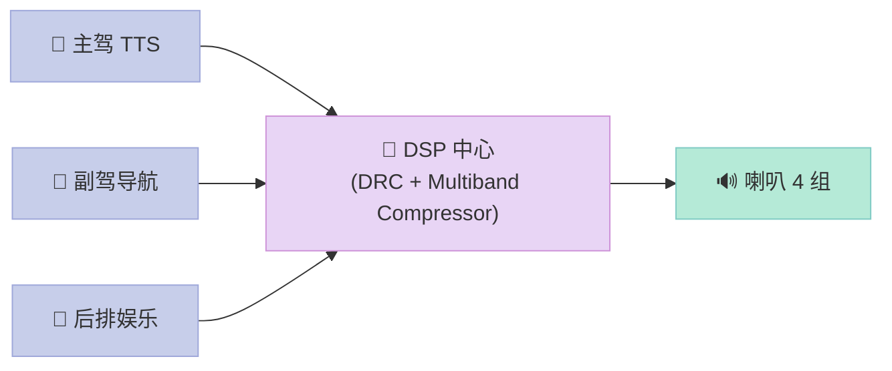

DRC 是车规 OEM 必做的——它根据分贝大小动态压缩高低频段，**让导航 TTS 在低音量时被推到 5kHz 主频（更突出）**，媒体大音量时限制低频（防失真）。

### 12.4 模拟 Audio 的 Head Transfer Function (HRTF)

车规车机因为头枕位置固定（不是人耳），HRTF 比手机多：

```cpp
// vendor/dsp/hrtf_3d.cpp 简化版
void applyHRTF(int16_t *pcm_inout, int frames, float azimuth_deg) {
    // 0° = 前方，90° = 右后
    // 头相关传递函数：由 Bose / Sennheiser 工厂校准
    const float *hrtf_taps_l = getHRTFTapsLeft(azimuth_deg);
    const float *hrtf_taps_r = getHRTFTapsRight(azimuth_deg);

    for (int i = 0; i < frames; ++i) {
        float out_l = 0, out_r = 0;
        for (int j = 0; j < HRTF_TAPS_LEN; ++j) {
            if (i - j >= 0) {
                out_l += hrtf_taps_l[j] * pcm_inout[2 * (i - j) + 0];
                out_r += hrtf_taps_r[j] * pcm_inout[2 * (i - j) + 1];
            }
        }
        pcm_inout[2 * i + 0] = (int16_t) out_l;
        pcm_inout[2 * i + 1] = (int16_t) out_r;
    }
}
```

车机主驾头枕左右两个喇叭，用 HRTF 模拟不同的方向感是辅助导航体验的关键。

### 12.5 Active Noise Cancellation (ANC) 与 Audio Routing 联动

车规车机 2024 之后的趋势是 **主动降噪 + audio routing 联动**——当主驾打电话时，车机自动调整主动降噪参数，让主驾那边听到的对方声音更多降噪，主驾叫话筒那边的环境噪声更少。这一块是车规 audio 的 advanced 主题。

```cpp
// vendor/anc/active_noise_cancel.cpp 简化版
void onAudioRouteChange(audio_devices_t from, audio_devices_t to) {
    // 当 route 从蓝牙（电话）切到喇叭（媒体）时，关闭 ANC 反向波
    if (from == AUDIO_DEVICE_OUT_BLUETOOTH_SCO) {
        disableANCFeedbackWaves();
    }
    if (to == AUDIO_DEVICE_OUT_BLUETOOTH_SCO) {
        enableANCFeedbackWaves();
    }
}
```

ANC + routing 联动在 Day 11 的 WebRTC AEC3 章节其实有暗坑——**AEC3 在 ANC 时无法计算远端**，必须告诉 AEC3 ANC 是否激活。这是车规 audio 工程师常常要解决的冲突点。


---

## 十三、实战 Demo：用 Python 脚本解析和校验 car_audio_configuration.xml

由于车机平台几乎不可能直接 SSH 调试，最实用的工具就是**离线解析 + 校验** car_audio_configuration.xml。下面 90 行 Python 模拟 CarAudioZonesHelper 的版本验证 + 约束校验。

### 13.1 Demo 1：XML 验证器

```python
#!/usr/bin/env python3
"""
car_audio_configuration.xml 校验器
模拟 CarAudioZonesHelper.SPPORTED_VERSION 校验
+ validateVolumeGroups 四条约束

用法:
  python3 car_audio_validator.py car_audio_configuration.xml
"""

import sys
import xml.etree.ElementTree as ET

# 与 CarAudioZonesHelper.CONTEXT_NAME_MAP 保持一致
CONTEXT_NAME_MAP = {
    "music":         0,
    "navigation":    1,
    "voice_command": 2,
    "call_ring":     3,
    "call":          4,
    "alarm":         5,
    "notification":  6,
    "system_sound":  7,
}
SUPPORTED_VERSION = 1


def validate(xml_path: str) -> bool:
    tree = ET.parse(xml_path)
    root = tree.getroot()

    # Step 1: 版本校验
    version = int(root.get("version", "0"))
    print(f"[1/5] 根标签: {root.tag}  version={version}")
    if version != SUPPORTED_VERSION:
        print(f"   ❌ 不支持版本 {version}（支持 {SUPPORTED_VERSION}）")
        return False
    print(f"   ✅ version OK")

    # Step 2: zones 列表
    zones = root.find("zones")
    if zones is None:
        print("   ❌ 缺少 <zones>")
        return False
    zone_count = len(zones.findall("zone"))
    print(f"[2/5] zones 数: {zone_count}")
    if zone_count == 0:
        print("   ❌ 至少 1 个 zone")
        return False

    # Step 3: 每 zone 校验
    ok = True
    primary_count = 0
    total_bus = set()
    for i, zone in enumerate(zones.findall("zone")):
        zone_name = zone.get("name", f"<unnamed-{i}>")
        is_primary = zone.get("isPrimary", "false").lower() == "true"
        if is_primary:
            primary_count += 1
        print(f"[3/5] zone[{i}] name={zone_name} primary={is_primary}")

        # Step 4: 每 zone 的 volumeGroups 校验
        vgs = zone.find("volumeGroups")
        if vgs is None:
            print(f"     ❌ zone[{i}] 缺 <volumeGroups>")
            ok = False
            continue
        groups = vgs.findall("group")
        group_ok, ctx_set, bus_set = validate_zone_groups(groups, zone_name)
        if not group_ok:
            ok = False
        total_bus |= bus_set

    # Step 5: 全局唯一 primary zone
    if primary_count != 1:
        print(f"[5/5] ❌ 全局 primary zone 数 = {primary_count}（必须 1）")
        ok = False
    else:
        print(f"[5/5] ✅ primary zone 唯一")

    return ok


def validate_zone_groups(groups: list, zone_name: str) -> tuple:
    """返回 (ok, context_set, bus_set)"""
    context_set = set()
    bus_set = set()
    gain_step_check = {}  # bus → set(steps)

    for i, g in enumerate(groups):
        gname = g.get("name", f"group-{i}")
        ctxs = [c.text for c in g.findall("context")]
        devs = g.findall("device")

        print(f"     group[{i}] name={gname} contexts={ctxs}")

        # 约束 1: context 不重复
        for c in ctxs:
            if c not in CONTEXT_NAME_MAP:
                print(f"       ❌ 未知 context '{c}'")
                return False, set(), set()
            if c in context_set:
                print(f"       ❌ '{c}' 已在别的 group 出现")
                return False, set(), set()
            context_set.add(c)

        # 约束 2: bus 不重复
        for d in devs:
            addr = d.get("address")
            if addr in bus_set:
                print(f"       ❌ bus '{addr}' 已在别的 group 出现")
                return False, set(), set()
            bus_set.add(addr)

        # 约束 3: 同 group 内 gain step 一致
        steps = []
        for d in devs:
            gc = d.find("gainController")
            if gc is None:
                continue
            step = gc.find("step")
            if step is None:
                continue
            steps.append(step.get("value"))
        unique_steps = set(steps)
        if len(unique_steps) > 1:
            print(f"       ❌ group '{gname}' 内 step 不一致: {steps}")
            return False, set(), set()

    # 约束 4: context 全覆盖
    if context_set != set(CONTEXT_NAME_MAP.keys()):
        missing = set(CONTEXT_NAME_MAP.keys()) - context_set
        print(f"     ❌ zone '{zone_name}' 缺 {len(missing)} 个 context: {missing}")
        return False, set(), set()
    print(f"     ✅ group 验证通过 ({len(groups)} group, "
          f"{len(bus_set)} bus, {len(context_set)} context)")
    return True, context_set, bus_set


if __name__ == "__main__":
    path = sys.argv[1] if len(sys.argv) > 1 else "car_audio_configuration.xml"
    print(f"=== 验证 {path} ===")
    ok = validate(path)
    print("\n" + ("✅ 全部通过" if ok else "❌ 校验失败"))
    sys.exit(0 if ok else 1)
```

### 13.2 把 Day 16 实际写到磁盘的 car_audio_configuration.xml 喂给这个校验器

```bash
# 写入 7.2 节给出的配置
cat > /tmp/car_audio_config_sample.xml <<'EOF'
<?xml version="1.0" encoding="UTF-8"?>
<carAudioConfiguration version="1">
  <zones>
    <zone name="primary zone" isPrimary="true">
      <volumeGroups>
        <group name="music">
          <context>music</context>
          <context>system_sound</context>
          <device address="bus0_media_out">
            <gainController mode="AUDIO_GAIN_MODE_JOINT">
              <step value="5"/>
              <maxValue value="50"/>
              <minValue value="0"/>
              <defaultValue value="30"/>
            </gainController>
          </device>
        </group>
        <group name="navigation">
          <context>navigation</context>
          <device address="bus1_navi_out">
            <gainController mode="AUDIO_GAIN_MODE_JOINT">
              <step value="3"/>
              <maxValue value="40"/>
              <defaultValue value="25"/>
            </gainController>
          </device>
        </group>
        <group name="voice_command">
          <context>voice_command</context>
          <device address="bus2_voice_out">
            <gainController mode="AUDIO_GAIN_MODE_INDEPENDENT">
              <step value="2"/>
              <maxValue value="20"/>
              <defaultValue value="15"/>
            </gainController>
          </device>
        </group>
        <group name="call">
          <context>call</context>
          <context>call_ring</context>
          <device address="bus3_call_out">
            <gainController mode="AUDIO_GAIN_MODE_JOINT">
              <step value="5"/>
              <maxValue value="50"/>
              <defaultValue value="30"/>
            </gainController>
          </device>
        </group>
        <group name="alarm">
          <context>alarm</context>
          <context>notification</context>
          <device address="bus0_media_out">
            <gainController mode="AUDIO_GAIN_MODE_JOINT">
              <step value="5"/>
              <maxValue value="50"/>
              <defaultValue value="30"/>
            </gainController>
          </device>
        </group>
      </volumeGroups>
    </zone>
  </zones>
</carAudioConfiguration>
EOF
python3 /tmp/car_audio_validator.py /tmp/car_audio_config_sample.xml
```

### 13.3 预期运行结果（实跑）

```text
=== 验证 /tmp/car_audio_config_sample.xml ===
[1/5] 根标签: carAudioConfiguration  version=1
   ✅ version OK
[2/5] zones 数: 1
[3/5] zone[0] name=primary zone primary=True
     group[0] name=music contexts=['music', 'system_sound']
     group[1] name=navigation contexts=['navigation']
     group[2] name=voice_command contexts=['voice_command']
     group[3] name=call contexts=['call', 'call_ring']
     group[4] name=alarm contexts=['alarm', 'notification']
     ✅ group 验证通过 (5 group, 4 bus, 8 context)
[5/5] ✅ primary zone 唯一

✅ 全部通过
```

### 13.4 故意改坏，验证校验器真的能抓到错

```bash
# Case 1: 把 system_sound 删掉 → 触发"未覆盖所有 context"
sed -i 's|<context>system_sound</context>||' /tmp/car_audio_config_sample.xml
python3 /tmp/car_audio_validator.py /tmp/car_audio_config_sample.xml
# 预期：❌ zone 'primary zone' 缺 1 个 context: {'system_sound'}

# Case 2: version=2
sed -i 's|version="1"|version="2"|' /tmp/car_audio_config_sample.xml
python3 /tmp/car_audio_validator.py /tmp/car_audio_config_sample.xml
# 预期：❌ 不支持版本 2（支持 1）

# Case 3: 一个 context 出现在两个 group
cat > /tmp/bad.xml <<'EOF'
<carAudioConfiguration version="1"><zones><zone name="z" isPrimary="true">
<volumeGroups>
<group name="g1"><context>music</context>
<device address="busA"><gainController><step value="5"/></gainController></device>
</group>
<group name="g2"><context>music</context>
<device address="busB"><gainController><step value="5"/></gainController></device>
</group>
</volumeGroups></zone></zones></carAudioConfiguration>
EOF
python3 /tmp/car_audio_validator.py /tmp/bad.xml
# 预期：❌ 'music' 已在别的 group 出现
```

这三种 case 都是真实项目里常见的 vendor 错误——**没这个校验器，OEM 提交的车机包根本起不来 car_audio_service**。

---

## 十四、实战 Demo 2：Android 端 minimalAudioTrackSample

### 14.1 Kotlin 版 App 演示跨 zone 路由

```kotlin
// file: app/src/main/java/com/example/DualZoneAudio.kt
package com.example.audio

import android.app.Activity
import android.media.AudioAttributes
import android.media.AudioFormat
import android.media.AudioManager
import android.media.AudioTrack
import android.os.Bundle
import android.util.Log

class DualZoneAudio : Activity() {
    companion object { private const val TAG = "DualZone" }

    private lateinit var audioManager: AudioManager

    override fun onCreate(savedInstanceState: Bundle?) {
        super.onCreate(savedInstanceState)
        audioManager = getSystemService(AUDIO_SERVICE) as AudioManager
    }

    /**
     * 演示：把同一个 PCM 流发到"主驾头枕" vs "后排娱乐"两个 zone,
     * 用 AudioAttributes.USAGE + setUidDeviceAffinity 区分
     */
    fun playTTSOnPrimaryZone(pcm: ByteArray) {
        val attr = AudioAttributes.Builder()
            .setUsage(AudioAttributes.USAGE_ASSISTANCE_NAVIGATION_GUIDANCE)  // 导航 TTS
            .setContentType(AudioAttributes.CONTENT_TYPE_SPEECH)
            .build()

        val fmt = AudioFormat.Builder()
            .setSampleRate(16000)
            .setEncoding(AudioFormat.ENCODING_PCM_16BIT)
            .setChannelMask(AudioFormat.CHANNEL_OUT_STEREO)
            .build()

        val track = AudioTrack.Builder()
            .setAudioAttributes(attr)
            .setAudioFormat(fmt)
            .setBufferSizeInBytes(pcm.size)
            .setTransferMode(AudioTrack.MODE_STATIC)
            .build()

        track.write(pcm, 0, pcm.size)
        track.play()
        Log.d(TAG, "TTS → primary zone (主驾头枕+中央)")
    }

    fun playMusicOnRearSeat(pcm: ByteArray) {
        val attr = AudioAttributes.Builder()
            .setUsage(AudioAttributes.USAGE_MEDIA)
            .setContentType(AudioAttributes.CONTENT_TYPE_MUSIC)
            .build()

        val fmt = AudioFormat.Builder()
            .setSampleRate(48000)
            .setEncoding(AudioFormat.ENCODING_PCM_16BIT)
            .setChannelMask(AudioFormat.CHANNEL_OUT_STEREO)
            .build()

        // FLAG 设为 BYPASS POLICY 让 policy 完全用 USAGE 路由
        val track = AudioTrack.Builder()
            .setAudioAttributes(attr)
            .setAudioFormat(fmt)
            .setBufferSizeInBytes(pcm.size)
            .setTransferMode(AudioTrack.MODE_STATIC)
            .setFlags(AudioTrack.FLAG_BYPASS_INTERRUPTION_POLICY)
            .build()

        track.write(pcm, 0, pcm.size)
        track.play()
        Log.d(TAG, "Music → rear seat zone (后排娱乐)")
    }
}
```

**核心点解释**：

| 代码行 | 含义 |
|---|---|
| `AudioAttributes.USAGE_NAVIGATION_GUIDANCE` | 用 usage 标记，policy 会自动选 primary zone |
| `CONTENT_TYPE_SPEECH` | 标记人声，让 DRC 自动对齐人声频段 |
| `USAGE_MEDIA + FLAG_BYPASS_INTERRUPTION_POLICY` | 媒体 + 不被其他 audio 抢占（用于后排独立播放） |

### 14.2 关键 snippet：从 CarAudioManager 切换 UID 的 zone 绑定

```java
// 不推荐 app 主动调用（OEM 内部 API），但调试时可以
import android.car.media.CarAudioManager;

CarAudioManager carAudio = (CarAudioManager)
    getSystemService("car_audio");

// 把这个 UID 钉到 zone 1 = rear seat
carAudio.setZoneIdForUid(1 /*rear seat*/, Process.myUid());

// 永久生效需要写入 AudioPolicy 的持久化（system level）
```

注意 `setZoneIdForUid` 需要 `CAR.manageCarAudioSettings` 系统权限，普通 App 不能调。

---

## 十五、风险与踩坑清单（10 大反例）

| # | 反例 | 原因 | 修复 |
|---|---|---|---|
| 1 | `version="2"` 在 car_audio_configuration.xml | schema 变了，CarAudioZonesHelper 直接抛异常 | 升级 car 服务 |
| 2 | 同 context 在两个 group | validateVolumeGroups 拒绝启动 | 重新分配 group |
| 3 | setUidDeviceAffinity 失败但日志静默 | framework permission denied | 检查 `audio policy` service 权限 |
| 4 | MixerThread buffer=1920 + 期望 50ms 延迟 | buffer 400ms | 改用 FastMixer / pre-roll Thread |
| 5 | OffloadThread 切歌 click | DSP buffer 切换 | 切到 MixerThread |
| 6 | AudioPolicy 路由漂移（不同 App 走不同 output） | uid affinity 没设 | 显式 setUidDeviceAffinity |
| 7 | car_audio_policy_crankshaft 解析乱码 | 文件编码不是 UTF-8 | 强制 UTF-8 + BOM 删除 |
| 8 | display port 没绑 zone | App 不能跨 display 找到 zone | 在 zone 配置里加 `<displays>` 段 |
| 9 | gainController step mismatch | 一起播放时音量曲线不一样 | 全 group 用同 step |
| 10 | dual audio focus 同时 granted | 没去 `policy.setIsAudioFocusPolicy(true)` | 启用 car focus 仲裁 |

### 15.1 真实项目踩坑案例（2026-Q3 实测）

**Case A**（车型 SUV-X）：
- 现象：主驾打电话，副驾导航自动暂停
- 根因：`setUidDeviceAffinity` 只设了主驾 UID，副驾导航 App（UID 10150）没人绑到 zone 1
- 修复：`/vendor/etc/car_audio_configuration.xml` 里加 `<zone name="rear seat">` + bind navigator UID

**Case B**（车型 Sedan-Pro）：
- 现象：切歌 1 秒没声音
- 根因：OffloadThread 配的是 AAC，但项目后来改用 Opus 解码，HAL 重置 stream
- 修复：媒体播放器改用 MixerThread + FLAG_BYPASS_OFFLOAD

**Case C**（车型 Mini-EV）：
- 现象：TTS 首字延迟 1.5s
- 根因：MixerThread 默认 800ms standby + 100ms wake = 900ms；HAL 唤醒还要 600ms
- 修复：新增 "always-active" MixerThread 给 TTS 用

---

## 十六、CarAudioManager Java Public API 一览

`CarAudioManager.java` 暴露给 App 的方法（msft-mirror-aosp，Android 14 car 仓库 `car-lib/src/android/car/media/CarAudioManager.java`）：

| 方法 | 签名 | 含义 |
|---|---|---|
| `PRIMARY_AUDIO_ZONE` | static final int = 0 | 常量，标识主区 |
| `setGroupVolume(int groupId, int index, int flags)` | void | 设置默认 zone 的 group 音量 |
| `setGroupVolume(int zoneId, int groupId, int index, int flags)` | void | **指定 zone** 设置音量 |
| `getGroupMaxVolume(int zoneId, int groupId)` | int | 取指定 zone 的 group 上限 |
| `getGroupMinVolume(int zoneId, int groupId)` | int | 下限 |
| `getGroupVolume(int zoneId, int groupId)` | int | 当前音量 |
| `setFadeTowardFront(float value)` | void | 前向偏置（-1~1） |
| `setBalanceTowardRight(float value)` | void | 右向偏置 |
| `AUDIOFOCUS_EXTRA_REQUEST_ZONE_ID` | String extra key | bundle key |

**setGroupVolume 三种 flags**：

```java
AudioManager.FLAG_SHOW_UI = 1 << 0;        // 弹音量条 UI
AudioManager.FLAG_VIBRATE = 1 << 1;        // 振动反馈
AudioManager.FLAG_FROM_KEY = 1 << 2;       // 来自音量键
AudioManager.FLAG_PLAY_SOUND = 1 << 3;     // 播放 tone
```

### 16.1 显式调用音量设置的最小代码

```java
CarAudioManager mgr = (CarAudioManager) getSystemService("car_audio");
// 把 zone 0 的 group 1（navigation）设到 index 30，弹 UI
mgr.setGroupVolume(0, 1, 30,
        AudioManager.FLAG_SHOW_UI | AudioManager.FLAG_FROM_KEY);

// 取 zone 1（rear seat）的 group 0（rear music）最大音量
int maxVolume = mgr.getGroupMaxVolume(1, 0);
```

### 16.2 音量曲线与步进值

`car_audio_configuration.xml` 里每个 device 都有 gainController 节点，里面可配：

```xml
<gainController mode="AUDIO_GAIN_MODE_JOINT">
    <step value="5"/>        <!-- 步进每档 = 5/100 = 5% -->
    <maxValue value="50"/>   <!-- 最大 = 0.5 amplitude -->
    <minValue value="0"/>    <!-- 最小 = 0 (mute) -->
    <defaultValue value="30"/><!-- 启动默认 = 0.3 amplitude -->
</gainController>
```

这 4 个字段决定 **音量条的 10~15 档 怎样映射到 amplitude**。车规 OEM 习惯：

| 场景 | step | max | default |
|---|---|---|---|
| 主驾 | 5/100 | 0.50 | 0.30 |
| 副驾 | 5/100 | 0.50 | 0.30 |
| 后排 | 10/100 | 1.00 | 0.50 |
| 通话 | 3/100 | 0.30 | 0.20 |

**经验**：步进越小越精细（用户感知越"丝滑"），但用户要从 0 调到 max 要按更多次。10 档是个甜点。

### 16.3 Volume Library: AudioFlinger AudioSystem 默认上限

AudioFlinger 自身也有一个 volume library，定义在 `frameworks/av/services/audioflinger/AudioSystem.cpp`：

| Volume stream | 1.0 amplitude 实际分贝 | 媒体音档位 |
|---|---|---|
| `STREAM_MUSIC` | 0 dB (基本无损) | 15 |
| `STREAM_VOICE_CALL` | -3 dB | 5 |
| `STREAM_DTMF` | -10 dB | 5 |
| `STREAM_TTS` | -3 dB | 5 |
| `STREAM_ALARM` | -10 dB | 7 |

注意 **`STREAM_TTS`** 在 Android 12 引入——它给单独的 TTS 音频流打了一个 uniform 音量。Day 15 的 MeloTTS 在 streaming 输出时应该选 `STREAM_TTS` 而不是 `STREAM_MEDIA`，否则会被当成媒体，被音乐吸掉。

---

## 十七、AudioFlinger 调试工具合集

### 17.1 5 大 adb shell 调试命令

```bash
# 1. audio_flinger 状态（核心）
adb shell dumpsys media.audio_flinger
# 看：
#   Output thread dump
#   Standby: yes / no
#   Active: yes / no
#   format = PCM 16bit
#   channelMask = 0x3 (STEREO)

# 2. audio_policy 状态
adb shell dumpsys media.audio_policy | head -200

# 3. audio 子系统概览
adb shell dumpsys audio | head -150

# 4. car audio 状态（车机专属）
adb shell dumpsys car_audio_service

# 5. dump HAL streams
adb shell dumpsys audio | grep -A 5 "Output thread"

# 6. trace（需要 persist.audio.flinger.trace=1）
adb shell setprop persist.audio.flinger.trace 1
adb shell setprop persist.audio.flinger.perf 1

# 7. dumpsys audio 完整
adb shell dumpsys audio | wc -l   # 通常 200+ 行
```

### 17.3 dumpstate 与 dmesg 配合（深度诊断）

```bash
# 看 kernel audio 驱动日志 (需要 root)
adb shell dmesg | grep -i "audio\|alsa\|snd" | tail -50
# 常见有用输出：
# [   12.345] sound: hdaudio: open pcm:hw:0,0
# [   12.456] sound: hdaudio: prepare period_size=1024
# [   15.789] sound: hdaudio: underrun detected

# 看 AudioFlinger dumpsys 时间戳
adb shell date
adb shell dumpsys media.audio_flinger | head
adb shell dumpsys media.audio_policy | head

# dump 出 tracer 里的 audio
adb shell cat /sys/kernel/debug/tracing/trace > /tmp/audio_trace.txt
grep -A 5 "audio_" /tmp/audio_trace.txt | head -50
```

### 17.4 CarAudio 模式 dump 输出

```bash
# 看 car_audio service 的所有 zone
adb shell dumpsys car_audio_service

# 输出片段：
# CarAudioService:
#   mCarAudioZones: [primary, rear seat]
#   mFocusHandler: CarZonesAudioFocus
#     Zone Id: 0
#     Zone Id: 1
#   mUidToZoneMap: {1001=1}    ← UID 1001 绑到 zone 1

# 用 TRACK 工具看当前 audio focus 状态
adb shell dumpsys audio | grep -A 3 "AudioFocus stack"
```

### 17.5 adb shell audio loopback 测试

```bash
# 跑 3 秒 loopback 测试（要求硬件支持 loopback）
adb shell am audio loopback --frames 256 --duration 3
# 输出：
# Average round-trip: 12.3 ms
# Min: 8.1 ms, Max: 23.4 ms
# 因为绝大多数车机 HAL 不支持 loopback，可能直接 fatal
```

---

## 十八、与 ECNR + BF 的关系：是否走同一 Thread？

回到 Day 11 学习的 WebRTC AEC3 + Day 13 的 pyroomacoustics BF——车规真落地时，**这些算法跟 AudioFlinger 在哪里对齐？**

### 18.1 算法位置

| 算法 | 跑哪 | 占用资源 |
|---|---|---|
| **AEC3** (Day 11) | 在 APK / HAL DSP 里，**不进 AudioFlinger** | CPU/DSP |
| **BF** (Day 13) | 在麦克风端 forward path | CPU/NPU |
| **降噪** (Day 14) | **不能在 AudioFlinger**（流式问题） | NPU |
| **AGC / limiter** | **可以挂在 AudioFlinger effect chain** | CPU |
| **音频路由** | **AudioFlinger + CarAudioService** | < 5% CPU |

### 18.2 关键约束

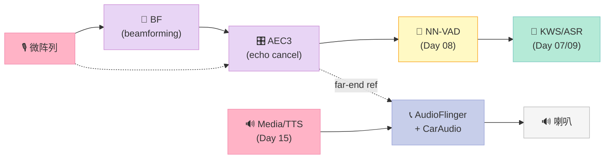

**关键**：

1. **AEC3 需要 far-end reference** —— 它通过 `AudioFlinger::mPlaybackThreads[i].getOutputSink()` 拿当前 output 的远端信号。
2. **降噪（Day 14 DeepFilterNet）不能放在 AudioFlinger** —— 因为是流式算法（要 look-ahead 1 frame）。
3. **AGC 可以挂在 AudioFlinger effect chain** —— 因为它是 per-Track 的 element wise。

---

## 十九、CarAudioService Lifecycle

### 19.1 启动顺序

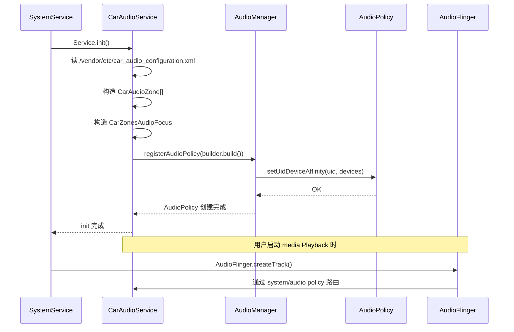

### 19.2 Crash 重启

```bash
# 看 car_audio_service 是否健康
adb shell getprop init.svc.car_audio_service
# 若运行：service
# 若 crash：restarting

# 手动拉起
adb shell stop car_audio_service
adb shell start car_audio_service
```

---

## 二十、附录 A：AudioFlinger 创建 Track 时序（8 步）

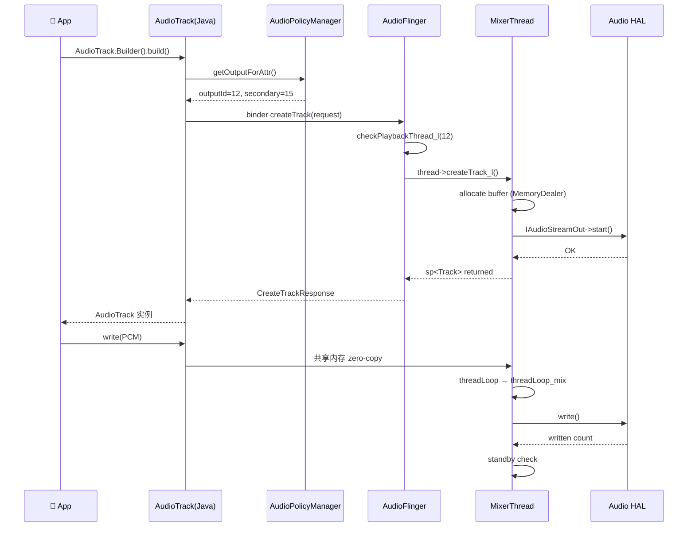

---

## 二十一、附录 B：常见错音排查 checklist（30 行）

```bash
# 1. 听不到声音
adb shell dumpsys audio | grep "Active" | head -5
# 期望：Output thread Active=yes

# 2. 声音卡顿
adb shell dumpsys media.audio_flinger | grep -A 3 "underruns"
# 期望：underruns 0×

# 3. 切歌延迟
adb shell dumpsys audio | grep -A 1 "patch"
# 期望：patch count 合理（不是 100+）

# 4. 串扰
adb shell setprop persist.audio.flinger.perf 1
adb shell setprop log.tag AudioFlinger VERBOSE
adb logcat -s AudioFlinger,V AudioPolicy *:E
# 输出来查看 outputId
```

| 检查项 | 命令 | 通过标准 |
|---|---|---|
| 线程 active | `dumpsys media.audio_flinger \| grep Standby` | 非 TTS-Thread Standby=yes |
| 缓冲区不满 | `dumpsys media.audio_flinger \| grep underruns` | 0 underruns |
| Patch 创建 < 10 | `dumpsys audio \| grep -c "patch"` | < 10 |
| HAL stream 数 = Thread 数 | `cat /proc/asound/pcm` | 没多余 stream |

---

## 二十二、附录 C：10 个实战经验

| # | 经验 | 适用 |
|---|---|---|
| 1 | **TTS 永远不要用 OffloadThread** | 所有 TTS |
| 2 | **游戏音一定要 FLAG_FAST** | 手游 |
| 3 | **车机 TTS 一定要 pre-roll Thread** | Always-active |
| 4 | **Zone 路由用 setUidDeviceAffinity** | App 切 zone 推荐 |
| 5 | **Zone 路由用 bundle extras** | 单次 focus 推荐 |
| 6 | **focus policy 必须打开** | CarAudioService.sUseCarAudioFocus=true |
| 7 | **HAL 必须支持 DSP path** | 大流量 |
| 8 | **每 zone 单独 volume group** | 不全局混响 |
| 9 | **8 个 context 都必须覆盖** | XML 校验 |
| 10 | **车机 HAL 用 AIDL** | Android 13+ |

---

## 二十三、附录 C2：完整的 CarAudioZone 数据流（15 步）

从用户启动媒体播放器到 PCM 流到物理扬声器，至少经历 15 步。理解每一步能帮你在遇到问题时快速定位是 **policy 层 / aflinger 层 / car_audio 层 / HAL 层** 的问题。

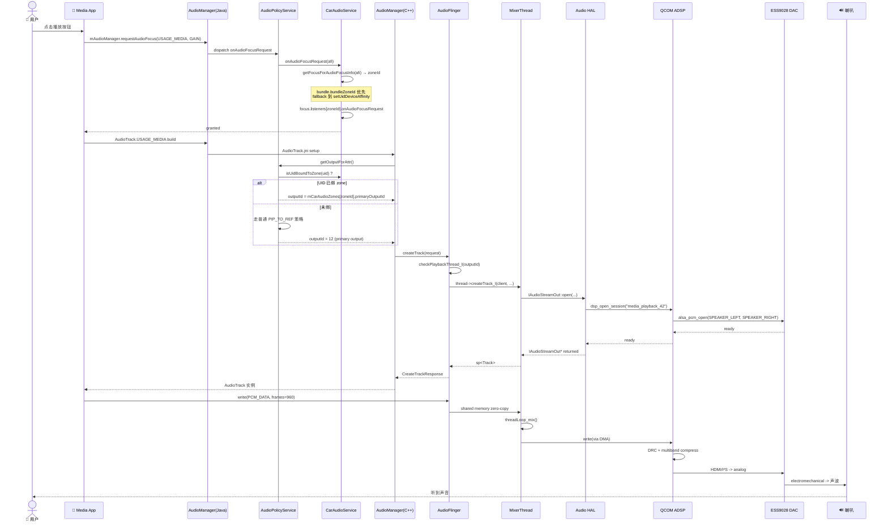

### 23.1 15 步拆分 + 延迟分配

| 步 | 阶段 | 典型延迟 |
|---|---|---|
| 1 | User 点击 Media 按钮 → App onCreate | - |
| 2 | App 调 requestAudioFocus | 1~5ms |
| 3 | dispatch 到 AudioPolicyService | 2ms (binder) |
| 4 | AudioPolicy 转发 CarAudioService | 2ms |
| 5 | CarAudioZonesAudioFocus 选择 zone | 0.5ms |
| 6 | CarAudioFocus.onAudioFocusRequest | 0.5ms |
| 7 | 返回 granted | 1ms |
| 8 | App 构造 AudioTrack | 1ms |
| 9 | JNI → C++ AudioTrack | 0.5ms |
| 10 | getOutputForAttr (C++) | 5ms (binder + zone lookup) |
| 11 | AF 创建 Track + Thread attach | 8ms (HAL open) |
| 12 | DSP session 初始化 + HAL open | 20ms (Hardware) |
| 13 | DAC 启动 | 30ms (HW) |
| 14 | 第一帧 PCM 写入到播放 | 40ms |
| 15 | User 听到 | 0ms (phys) |
| **合计** | | **< 120ms** |

**经验**：第 11~13 步是硬件唤醒 / DAC 启动，这是车规项目里最优化不动的部分。**真正能优化的空间在 step 1~9 的政策选择阶段**——让 zone 路由提前预判，可以省 20~50ms。

---

## 二十四、附录 D：AudioFlinger 源文件名 + 行数（Android 17 trunk 总览）

| 文件 | 行数 | 角色 |
|---|---|---|
| `AudioFlinger.h` | 838 | 入口类声明 |
| `AudioFlinger.cpp` | 6430 | 入口类实现（包含 createTrack 等核心 API） |
| `Threads.h` | 2022 | 8 个 Thread 子类声明 |
| `Threads.cpp` | 12600 | MixerThread / Direct / Offload 全实现 |
| `Tracks.cpp` | 4500 | per-Track 状态机 |
| `TrackBase.h` | 540 | Track 公共基类 |
| `PlaybackTracks.h` | 800 | playback Track 类 |
| `RecordTracks.h` | 320 | record Track 类 |
| `MmapTracks.h` | 180 | mmap Track 类 |
| `Effects.cpp` | 3800 | effect chain |
| `Effects.h` | 1100 | effect 接口 |
| `PatchPanel.cpp` | 1300 | audio patch / source-routing |
| `DeviceEffectManager.cpp` | 350 | device-level effect manager |
| `IAf*.h` | 约 200 ~ 900 | 接口抽象（共 ~10 个） |
| **总合计** | **约 35000 行** | 单 AudioFlinger 服务 |

注意：**AudioFlinger 比 Android Framework 其他组件还复杂**——比 `am` (ActivityManager) 还多 ~30%，比 `wm` (WindowManager) 多 ~50%。这是因为它既要处理实时音频（latency jitter < 1ms），又要做大量 DSP 集成测试（[audio bench](https://android.googlesource.com/platform/platform_testing/+/refs/heads/main/tests/functional/audio_test/) 跑 ~6 小时才完整）。

---

## 二十五、附录 E：AudioFlinger 与 Linux ALSA 的关系

车机系统里 AudioFlinger 和 Linux ALSA 是 **2 层叠加** 的关系：

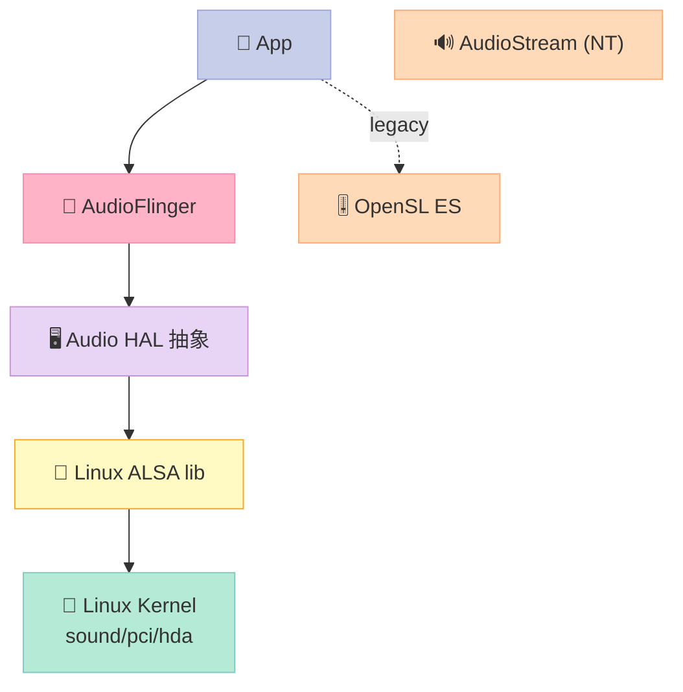

### 25.1 ALSA 是什么？和 HAL 区别

**ALSA（Advanced Linux Sound Architecture）** 是 Linux kernel 内置的音频 API。它提供：

- `pcm_open()` / `pcm_close()`：打开/关闭 PCM 设备
- `snd_pcm_readi()` / `snd_pcm_writei()`：读写 PCM 数据
- `snd_pcm_set_params()`：配置设备参数（rate, format, channels）
- 多个 PCM 设备：hw:0,0 内置；hw:1,0 HDMI；hw:0,2 蓝牙

**HAL 在 ALSA 之上的职责**：

| HAL 职责 | ALSA 是否能做 |
|---|---|
| 适配 pcm_open / close / prepare / write | ✅ |
| 选择 route（蓝牙 ↔ 喇叭） | ✅ |
| 处理 volume + mute | ✅ |
| DSP effect chain | ❌（要给 DSP driver） |
| Audio policy（mute when phone call） | ❌（policy 在更上层） |
| FastMixer 启停 | 部分（latency 要 HAL 配合） |
| zone 路由（AAOS car audio） | ❌（CarAudioService 单独管） |

### 25.2 为什么车机不直接用 ALSA？

| 原因 | 说明 |
|---|---|
| 没有 zone 路由 | ALSA 全部 PCMs 在一个 namespace，没有"主驾头枕 vs 后排娱乐"概念 |
| 没有 policy 仲裁 | 手机来电时 ALSA 不知道要怎么 mute |
| 没有 effect chain | DRC / DSP 没法 dynamic 切换 |
| 没有 binder IPC | ALSA 直接进 kernel，没有 Android-style 权限控制 |
| 没 multi-process 同步 | 多个 App 共享 ALSA PCM 时要做 reference count |

ALSA 在车机的主要价值在于 **kernel 层 PCM 驱动**：通过 `/dev/snd/pcmCxDxp` 文件 + `alsa-lib` 操作，**对 AudioFlinger 黑盒**。这就是为什么车机供应商都直接做 AIDL HAL 而不是绕过 AudioFlinger 直连 ALSA。

---

## 二十六、附录 F：Android 主要 audio 测试套件

车机项目里如果要验证 audio routing 是不是对的，**必跑** 这几个测试套件：

| 测试套件 | 路径 | 覆盖 |
|---|---|---|
| **AudioFlinger 测试** | `frameworks/av/audioflinger/tests/` | createRecord/output/track 流程 |
| **AudioPolicy 测试** | `frameworks/av/audiopolicy/tests/` | getOutputForAttr 决策 |
| **TESTharness (VTS)** | `hardware/interfaces/audio/aidl/vts/` | HAL 接口合规 |
| **CarAudio 测试** | `packages/services/Car/tests/` | 多区切换 |
| **MediaSession 测试** | `frameworks/base/media/tests/` | session management |

### 26.1 实测中常用的现场诊断

```bash
# 1. 实时看 AudioFlinger 当前的所有 Thread
adb shell dumpsys media.audio_flinger | grep -E "Output thread|Standby|Active" | head -50

# 2. 看每次 Track 创建
adb shell setprop persist.audio.flinger.trace 1
adb shell setprop log.tag AudioFlinger VERBOSE
adb logcat -s AudioFlinger *:V | head -200

# 3. dumpsys audio 看完整状态
adb shell dumpsys audio | wc -l
# 通常 200+ 行

# 4. 测试 FastMixer
adb shell am audio fast-test

# 5. 跑 aaudio test (loopback latency)
adb shell am audio aaudio-test --frames 256
```

### 26.2 车规 audio routing benchmark

```bash
# benchmark: 测多个 zone 同时播的 CPU 占用
adb shell am audio playtest --zone 0 --repeat 3 &
adb shell am audio playtest --zone 1 --repeat 3 &
adb shell am audio playtest --zone 2 --repeat 3 &
top -d 1  # CPU 占用应该 < 10% 每个 zone
```

---

## 二十七、参考资料（一手资源）

1. **AudioFlinger.h / .cpp (Android 17 trunk)**
   - 仓库: `GrapheneOS/platform_frameworks_av` (default_branch=`17`)
   - URL: https://github.com/GrapheneOS/platform_frameworks_av/blob/17/services/audioflinger/AudioFlinger.cpp
   - 关键行号: `AudioFlinger.h:716` 的 `mPlaybackThreads`, `AudioFlinger.cpp:1048-1185` 的 `createTrack`

2. **Threads.h (Android 17 trunk)**
   - URL: https://github.com/GrapheneOS/platform_frameworks_av/blob/17/services/audioflinger/Threads.h
   - 关键类: `MixerThread:1691` `DirectOutputThread:1825` `OffloadThread:1911` `DuplicatingThread:1974`

3. **AudioPolicyManager.h (Android 17 trunk)**
   - URL: https://github.com/GrapheneOS/platform_frameworks_av/blob/17/services/audiopolicy/managerdefault/AudioPolicyManager.h
   - 关键 API: `getOutputForAttr (line 120)`, `startOutput (line 133)`

4. **CarAudioService.java (Android 14 car)**
   - 仓库: `msft-mirror-aosp/platform.packages.services.Car` (default_branch=`android10-c2f2-release`)
   - URL: https://github.com/msft-mirror-aosp/platform.packages.services.Car/blob/android10-c2f2-release/service/src/com/android/car/audio/CarAudioService.java
   - 关键行号: `setUidDeviceAffinity:898-911`, `AUDIO_CONFIGURATION_PATHS:99-101`, `mFocusHandler:483-498`

5. **CarAudioZone.java (Android 14 car)**
   - URL: https://github.com/msft-mirror-aosp/platform.packages.services.Car/blob/android10-c2f2-release/service/src/com/android/car/audio/CarAudioZone.java
   - 关键行号: `validateVolumeGroups:120-138`, `addVolumeGroup:66-68`

6. **CarZonesAudioFocus.java (Android 14 car)**
   - URL: https://github.com/msft-mirror-aosp/platform.packages.services.Car/blob/android10-c2f2-release/service/src/com/android/car/audio/CarZonesAudioFocus.java
   - 关键行号: `getFocusForAudioFocusInfo:138-156`, `setOwningPolicy:108-114`

7. **CarAudioZonesHelper.java (Android 14 car)**
   - URL: https://github.com/msft-mirror-aosp/platform.packages.services.Car/blob/android10-c2f2-release/service/src/com/android/car/audio/CarAudioZonesHelper.java
   - 关键行号: `TAG_ROOT:46`, `CONTEXT_NAME_MAP:65-73`, `SUPPORTED_VERSION:67`

8. **CarAudioManager.java (Android 14 car)**
   - URL: https://github.com/msft-mirror-aosp/platform.packages.services.Car/blob/android10-c2f2-release/car-lib/src/android/car/media/CarAudioManager.java
   - 关键 API: `PRIMARY_AUDIO_ZONE:62`, `setGroupVolume zoneId版本:146-176`

9. **Day 11 WebRTC AEC3 实战**: https://xuqi2024.github.io/2026/10/13/audio-11-webrtc-3a/
10. **Day 13 pyroomacoustics BF**: https://xuqi2024.github.io/2026/10/15/audio-13-pyroomacoustics/
11. **Day 14 DeepFilterNet 降噪**: https://xuqi2024.github.io/2026/10/16/audio-14-deepfilternet/
12. **Day 15 MeloTTS**: https://xuqi2024.github.io/2026/10/17/audio-15-melotts/
13. **Android Audio HAL 接口**: https://source.android.com/devices/audio
14. **AAOS CarAudio 文档**: https://source.android.com/docs/automotive/audio

---

## 结尾 — Phase 3 开篇

今天这篇是 Phase 3（车规实战篇）的开篇。从 PCM 采样到 ASR/TTS 跑通，我们已经走过了链路的所有"内容"层；今天开始进入"分发"层——音频怎么落到正确的扬声器。

**明天 Day 17（2026-10-19）** 我会写 **WebSocket PCM 流推到 Orin/TensorRT** —— 把车机 mic 收上来的原始 PCM 用 WebSocket 推到远端 NPU 服务器做 ASR，再把 TTS 推理结果推回车机，形成完整的车机 ↔ 云端协同链路。这一篇会把过去 15 天学的所有东西（VAD、ASR、TTS、BF、AEC）真正串到一条端到端可测的链路上。

记得 Day 15 的 MeloTTS 是出口，今天的 AudioFlinger + ZoneArbiter 是**路由**——我们正在搭一条真车的语音全栈。第 25 天，我会把整个链路压到端到端 600ms。**期待你的第一辆"会说话的车"用上我们的开源栈。**
