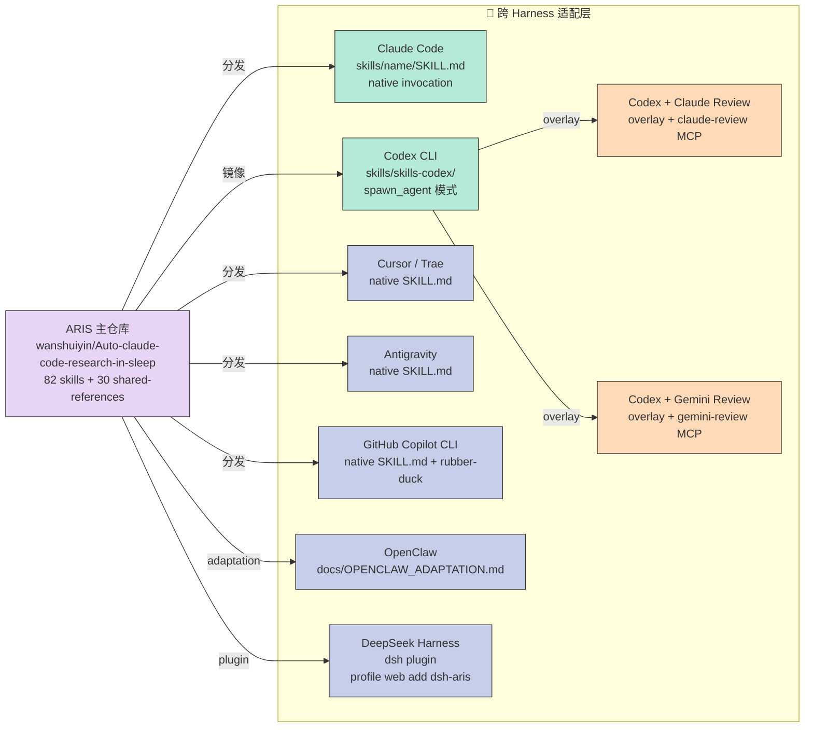

## 引子：让 AI 写论文最大的敌人不是它笨，而是它自信

2026 年初，一位研究者在使用 LLM 自动化论文流水线时发现一个让人后背发凉的 bug：

> `/paper-writing` 跑在 `effort: beast`（最高投入度）模式下，**静默跳过**了 `/proof-checker`、`/paper-claim-audit` 和 `/citation-audit` 三个强制性审计。原因？每一步的"内容探测器"返回了 negative，而外层 SKILL.md 里写的是"audit 是可选的"。最终生成了一份"草稿质量"的论文就提交了——三个守门员一个都没出声。

这正是 **ARIS（Auto Research In Sleep）** 这套研究型 Harness 想要根除的失败模式。它的设计哲学很简洁：**写论文的 LLM 不能验收自己的论文**。听起来像废话，但你看完 ARIS 的 5 大原语之后会发现，这件事在工程上其实非常难做好——它需要一整套跨模型协作协议、独立性约束、和确定性预检机制来兜底。

ARIS 的核心数据：

- **wanshuiyin/Auto-claude-code-research-in-sleep** — 17,664⭐，MIT 协议，2026-10-17 最新提交
- **82 个 Markdown Skills**（research-pipeline / auto-review-loop / paper-write / proof-orchestrator / research-wiki ...）
- **30 份 shared-references**（acceptance-gate / reviewer-independence / external-cadence / evidence-precheck / skill-governance ...）
- **跨 8 个 Harness 适配**：Claude Code / Codex CLI / Cursor / Trae / Antigravity / GitHub Copilot CLI / OpenClaw / DeepSeek Harness
- **HF Daily Paper #1** + **VALSE 2026 收录**

本文我会从源码深挖出 ARIS 的 5 大原语，配一个 200 行的可运行 Python MVP，最后和 Karpathy autoresearch、Aeon、DeepCode 做横向对比，帮你理解"研究型 Harness"和"通用 Agent Harness"在工程哲学上的关键差异。

---

## 一张图速览：ARIS 5 大原语的关系

```mermaid
graph TB
    subgraph "🎯 核心不变量层 (Acceptance Gate)"
        G1["📋 Type-A<br/>执行型门<br/>同模型可验收"]
        G2["⚖️ Type-B<br/>质量型门<br/>必须异模型"]
    end

    subgraph "🤖 跨模型协作层 (Reviewer Independence)"
        R1["🔒 Executor<br/>只传 file path<br/>禁止 summary"]
        R2["🧐 Reviewer<br/>自己读文件<br/>独立判断"]
    end

    subgraph "⏰ 长期运行层 (External Cadence)"
        C1["🕐 Heartbeat<br/>火控 - drive<br/>不可验收"]
        C2["🚦 Stop Gate<br/>Type-A 或 Type-B<br/>不可绕过"]
    end

    subgraph "💾 持久化层 (Evidence + Provenance)"
        E1["📑 EvidencePrecheck<br/>确定性 · 无模型<br/>挡 80% 幻觉"]
        E2["🏷️ Provenance<br/>带户口本<br/>防自指污染"]
    end

    subgraph "📚 业务执行层 (82 Skills)"
        S1["💡 idea-discovery"]
        S2["🧪 run-experiment"]
        S3["📝 paper-write"]
        S4["🔁 auto-review-loop"]
    end

    G1 -.PASS/FAIL.-> S1
    G1 -.PASS/FAIL.-> S2
    G1 -.PASS/FAIL.-> S3
    G2 -.verdict.-> S4
    R1 -->|"file path only"| R2
    R1 -. ❌ summary/paraphrase .-> X1["🚫 ReviewerProtocolViolation"]
    C1 -->|"nudge keep going"| S1
    C1 -->|"nudge keep going"| S2
    C1 -->|"nudge keep going"| S3
    C1 -. ❌ "good enough" .-> X2["🚫 CadenceAcquittal"]
    E1 -->|"claim audit 前置"| S3
    E2 -->|"wiki 写入"| S1
    E2 -->|"meta-optimize"| S4

    style G1 fill:#B5EAD7,stroke:#333,color:#333
    style G2 fill:#FFB3C6,stroke:#333,color:#333
    style R1 fill:#C7CEEA,stroke:#333,color:#333
    style R2 fill:#E8D5F5,stroke:#333,color:#333
    style C1 fill:#FFDAB9,stroke:#333,color:#333
    style C2 fill:#FFF9C4,stroke:#333,color:#333
    style E1 fill:#F5F5F5,stroke:#333,color:#333
    style E2 fill:#B5EAD7,stroke:#333,color:#333
    style S1 fill:#C7CEEA,stroke:#333,color:#333
    style S2 fill:#C7CEEA,stroke:#333,color:#333
    style S3 fill:#C7CEEA,stroke:#333,color:#333
    style S4 fill:#C7CEEA,stroke:#333,color:#333
    style X1 fill:#FFB3C6,stroke:#333,color:#333
    style X2 fill:#FFB3C6,stroke:#333,color:#333
```

这张图把 ARIS 的 5 大原语按"层级"组织起来：最底层是 82 个具体 skills，中间是 5 大不变量约束，最顶层是 2 个跨模型通信通道。**所有 skills 都受 5 大不变量约束，所有不变量都由 Python 代码强制执行**——这是 ARIS 的"宪法"。

---

## 一、ARIS 是什么：方法论，而非平台

打开 ARIS 的 README，第一句话就是：

> 🌱 *ARIS is a methodology, not a platform. What matters is the research workflow — take it wherever you go.*

这不是一句营销话术，而是 ARIS 的核心定位。它刻意不绑定任何一个 LLM vendor，而是把整套研究工作流编码成 **82 个 Markdown Skill**——每个 SKILL.md 就是一份给 LLM 看的 SOP（标准操作流程），规定了"接收什么输入、调用什么工具、产出什么工件"。

### 1.1 整体定位：研究全生命周期的 Skills 矩阵

ARIS 把"做研究"拆成 12 个大的工作流阶段：

| 阶段 | 代表 Skill | 关键产物 |
|------|-----------|----------|
| 文献综述 | `research-lit`、`arxiv`、`semantic-scholar`、`openalex` | `lit-review/MAP.md`、`lit-review/PAPERS.bib` |
| 想法发现 | `idea-discovery`、`idea-creator`、`novelty-check` | `idea-stage/IDEA_REPORT.md` |
| 实验设计 | `ablation-planner`、`experiment-plan`、`experiment-bridge` | `exp-design/ABLATION.md`、`exp-design/PLAN.md` |
| 实验执行 | `run-experiment`、`vast-gpu`、`serverless-modal` | `experiments/<run_id>/output.json` |
| 论文撰写 | `paper-write`、`paper-plan`、`paper-claim-audit` | `paper/main.tex`、`paper/main.pdf` |
| 论文改进 | `auto-paper-improvement-loop`（2 轮 review-fix-recompile） | `paper-v2/` |
| 实验回路 | `dse-loop`、`experiment-bridge` | objective-meets |
| 知识沉淀 | `research-wiki`（Karpathy LLM Wiki 模式） | `research-wiki/papers/<id>.md` |
| 学术反驳 | `rebuttal`、`resubmit-pipeline` | `rebuttal/REBUTTAL.md` |
| 演示/海报 | `paper-slides`、`paper-poster`、`paper-talk` | `slides.pdf`、`poster.html` |
| 专利申请 | `patent-pipeline`、`patent-novelty-check` | `patent/CN_APPLICATION.md` |
| 求职面试 | `interview-cheatsheet`（ARIS-in-AI-Offer 子项目） | `interview/` |

### 1.2 跨 8 个 Harness 的"皮"——插件化部署

ARIS 不发明新的 Coding Agent，而是把自己的 Skills 部署到现有 Harness 里：

- **Claude Code / Cursor / Trae / Antigravity / Copilot CLI**：直接装在 `skills/<name>/SKILL.md`，走 native SKILL.md invocation
- **Codex CLI**：`skills/skills-codex/` 镜像，使用 `spawn_agent` 而不是 `mcp__codex__codex`
- **Codex + Claude-review / Codex + Gemini-review**：overlay 模式，保留 Codex 作为执行者，换外部审查者
- **DeepSeek Harness**：`dsh plugin --profile web add dsh-aris`，主线 skills 不动

更厉害的是，ARIS 自己维护了一个 **`codex-exec` MCP Server**（`mcp-servers/codex-exec/server.py`，18677 字符）。这是因为 2026 年 8 月 OpenAI 删除了 `codex mcp-server` 命令（codex-cli 0.154.0），而所有 ARIS 审查调用都注册在那个 entry point 上。ARIS 没去等 OpenAI 修，而是 **自己写了一个 `codex exec` 的 stdio 包装器**——同一份 MCP 契约、同样的 tool 名称、同样的 `{threadId, content}` 结果形状，但走 `codex exec` 子进程。这样所有 82 个 skills **一行都不用改**，只需重新注册 MCP server。

这就是 ARIS 的工程韧性：**不绑定上游，但能在上游协议变更时自己写兼容层**。

下图展示 ARIS 如何在 8 个 Harness 之间复用同一套 82 个 skills：



值得注意的几个点：

- **Codex CLI 的镜像 + overlay 设计**：`skills/skills-codex/` 是 `skills/` 的镜像（每个 skill 改用 `spawn_agent` 而不是 `mcp__codex__codex`），加上 `claude-review`/`gemini-review` MCP server 之后变成"Codex 干 + Claude 审"的双模型工作流。
- **DeepSeek Harness 的 plugin 模式**：`dsh plugin --profile web add dsh-aris` 一行命令接入，**主线 skills 不动**，复用 ARIS 全部 82 个 skills。
- **OpenClaw adaptation**：ARIS 单独有 `docs/OPENCLAW_ADAPTATION.md` 说明如何在 OpenClaw 里跑 ARIS——这是早期和 OpenClaw 社区合作的成果。

---

## 二、5 大核心原语——ARIS 的"工程宪法"

剥掉 82 个 skills 的具体业务逻辑，ARIS 的精髓浓缩在 5 条不可违反的不变量里。这些不是建议，是**约束所有 skill 行为的硬规则**。

### 原语 1：Acceptance Gate——验收门的两大类型（acceptance-gate.md）

ARIS 把所有"stop/accept"门分成两类，这是整篇文最关键的设计：

**Type-A — EXECUTION / OBJECTIVE gate**（执行型 / 客观门）：
- 机器可验证，**同模型可自验收**
- 例：exit code == 0、`paper/main.pdf` 文件存在、N/N jobs finished
- 判定依据：shell exit code / filesystem 状态 / 计数器 / 解析器读 benchmark 输出

**Type-B — QUALITY gate**（质量型 / 验收门）：
- 涉及判断、必须**异模型审查**
- 例："is this paper publishable?" / "does this proof hold?" / "is this claim supported?"
- **不允许同模型验收自己的产出**

文档原话非常硬：

> **A goal/loop can DRIVE; it cannot ACQUIT.**
>
> The loop may freely *drive* itself toward a target — schedule the next config, recompile, re-run the failed job, spawn ten search branches. What it may not do is *acquit* its own work — declare the paper good, the proof valid, the claim supported, the idea novel, the review satisfied. Acquittal is a cross-model act.

这一条不变量就是开头那个 bug 的解药：把 `effort: beast` 拆成 `effort`（深度）+ `assurance: submission`（强制审计）两个独立轴。`submission` 模式下每个强制审计**必须**输出一个 verdict（PASS / WARN / FAIL / NOT_APPLICABLE / BLOCKED / ERROR），静默跳过直接被 `verify_paper_audits.sh` 拦下来。

### 原语 2：Reviewer Independence——审查者的"信息饥荒"（reviewer-independence.md）

如果验收必须异模型，那异模型看什么？

ARIS 规定 executor 传给 reviewer 的 payload **只允许**包含：

- ✅ Role/persona（"Review as a NeurIPS-level reviewer"）
- ✅ Review objective（"Evaluate publishability"）
- ✅ **File paths**（让 reviewer 自己读）
- ✅ Structural metadata（"The paper has 8 sections"）
- ✅ Venue constraints（"ICLR format, 9-page limit"）

**禁止**传递的内容：

- ❌ Executor's summary or paraphrase of file contents
- ❌ Executor's interpretation of results（"I think the problem is..."）
- ❌ Executor's recommendations（"I suggest changing..."）
- ❌ Key findings or bullet points extracted by the executor
- ❌ Leading questions（"Is this publishable?"）
- ❌ Previous review rounds' feedback（让 reviewer 重新评估当前状态）
- ❌ Executor's description of what was changed（"I fixed X, Y, Z"）

直觉很反：为什么不让 executor 把摘要给 reviewer，省 token 不好吗？

ARIS 的解释非常犀利：

> Cross-model adversarial collaboration only works if the reviewer forms its own assessment from primary artifacts. If the executor pre-digests, summarizes, or interprets content before passing it to the reviewer, **the reviewer is evaluating the executor's framing — not the actual work.** This re-introduces the correlated blind spots that heterogeneous review is designed to avoid.

白话翻译：你让 executor 写摘要给 reviewer，本质上就是让同一族模型审查同一族模型——异模型审查的"独立性"瞬间瓦解。

### 原语 3：External Cadence——火控 vs 裁判席（external-cadence.md）

"长时间运行的 AI 研究"看起来很诱人：用 `/loop 30m` 或 `CronCreate` 周期性唤醒 agent 跑 review。ARIS 把这种做法直接拉黑。

**Core Principle**：

> **External cadence is pure fire-control. It is never a jury.**
>
> A scheduler picks the firing moment. It points the agent at a task at a chosen time. **It has no opinion on correctness, quality, novelty, or publishability**, and it must never silently re-spawn an agent or drop a verdict step in order to stay cheap or finish faster.

**规则**：cadence can DRIVE; it cannot ACQUIT.

具体的失败模式：

> Wrapping `/auto-review-loop` in `/loop 30m` does not produce 30-minutes-better review. It re-runs a verdict-bearing skill on a clock that has nothing to do with whether the artifact changed. Zero new signal, full token cost.

而且会触发"thread discontinuity"——ARIS 的多轮 review 把状态存在 reviewer 的 thread 里（`codex-reply` 复用 round-1 的 `threadId`），但 `/loop` 每 tick 都开新 thread，**审查者的 round-to-round 记忆全部丢失**。

这一条不变量解决了"长时间跑 AI 自动写论文"里最常见的隐性灾难——表面上在跑，实际上每次重置上下文。

### 具体的反模式与"看上去对"的实现

ARIS 在 `external-cadence.md` 里直接列了 3 种最常见的"`/loop` 滥用"模式：

**反模式 A：套 review loop**——`/loop 30m` 包裹 `/auto-review-loop`。问题是 review loop 已经内部有 round 结构（review → fix → re-review），外部 timer 只是 wall-clock 触发，每次进入都重新开 threadId，**审查者的 round-to-round 记忆丢失**，等于是让审查者每次从头开始评估。

**反模式 B：套 paper-improvement loop**——`/loop 1h` 包裹 `/auto-paper-improvement-loop`。问题是 paper-improvement loop 已经有"review → fix → recompile"的循环结构，每轮开新 reviewer（**deliberate fresh-reviewer bias guard**：每轮故意用新 thread，不用 `codex-reply` 复用上轮）。外部 timer 触发 = 在已经 fresh 的审查上再 fresh，等于双重随机性，**没有累积信号**。

**反模式 C：套 dse-loop**——`/loop 5m` 包裹 `/dse-loop`。dse-loop 的 stop gate 是 Type-A（objective-machine-checkable），所以**同模型自验收是安全的**——但 `/loop` 包裹它的问题不是"验收错"，而是"调度器重复"：dse-loop 已经内部在做 parameter sweep，外部 timer 又起一个 dse-loop，**两组 sweep 同时跑会争用 GPU/资源**。

ARIS 给出的解药极其优雅：

```python
# 反例（被禁止）
while True:
    run_skill("auto-review-loop", paper.pdf)  # 内部已经 loop，外面又套 loop
    time.sleep(1800)

# 正例（外部 schedule 只用于"等外部世界"）
def wait_for_experiments_to_finish():
    """external scheduler 唯一合法用法: 等 GPU job 跑完"""
    while experiments_running():
        time.sleep(300)
run_after_experiments("auto-review-loop", paper.pdf)  # 单次调用，让 skill 内部 loop
```

**判断规则**：cadence 在以下场景才合法——等待实验跑完、等待人类回复、等待定时 deadline。**任何"让 skill 自己再跑一遍"的 cadence 都是反模式**。

### 原语 4：Evidence Precheck——便宜预检先于昂贵审查（evidence-precheck.md）

Claim auditing 是 ARIS 里最贵的步骤（每条 claim 调一次异模型审查）。但 90% 的失败模式都是**幻觉**：claim 引用了一个数字 + 文件路径，但文件根本不存在，或文件里没有那个数字。

ARIS 的做法：

```
stage 1  tools/evidence_check.py   deterministic · no model · fail-closed
         catches HALLUCINATION — cited path missing, or cited value not in source.
stage 2  the cross-model jury      codex/gemini
         catches WRONG-BUT-REAL — the number IS in the file, but it doesn't
         support the claim.
```

两阶段的设计哲学：

- **Stage 1 是便宜的、确定性的、不会撒谎的**——没有模型就不会被骗，**正则/字符串匹配无法被 prompt injection 绕过**。
- **Stage 2 是昂贵的、需要判断力的**——异模型审查者判断"虽然数字存在，但它真的支持 claim 吗？"
- **`verified` ≠ `correct`**：stage 1 的 `verified` 只表示"引用存在"，**绝不表示"claim 成立"**。

Stage 1 的设计原则是"宁可漏报"：当它不确定时返回 `not-verified`，让审查者继续判断——**绝不能输出一个假的 `verified`**。数字匹配采用 numeric-token equality（`73.2` 匹配 `73.20` 但不匹配 `73`），文本匹配用归一化子串。

这一条不变量把"AI 写论文"里最常见的"引用空气证据"问题前置拦截，**省掉 80%+ 不必要的模型调用**。

### evidence-precheck.py 的工业级实现细节

ARIS 的 `tools/evidence_check.py` 不只是简单的"读文件 + 子串匹配"。它有几个值得借鉴的工程细节：

**细节 1：数字 token 的归一化匹配**

```python
def normalize_numeric(value: str, content: str) -> bool:
    """73.2 matches 73.20 but NOT 73 (no rounding); 73.0 matches 73.00"""
    target = float(value)
    # 提取 content 中所有可能的数字 token
    candidates = re.findall(r"-?\d+\.?\d*", content)
    for cand in candidates:
        try:
            # numeric-token equality: 73.2 == 73.20 but 73 != 73.5
            if float(cand) == target:
                return True
        except ValueError:
            continue
    return False
```

关键点是 **numeric-token equality** 而非数值近似：`73.2` 匹配 `73.20` 但不匹配 `73`——后者差 0.2 但 token 不同。这是机器可验证的判断，不依赖 LLM。

**细节 2：fail-closed 原则**

```python
# 反例（fail-open，危险）：如果不确定，返回 verified
if path.exists() and value in content:
    return "verified"
# 即使不完全匹配，宽松返回

# 正例（fail-closed）：如果不确定，返回 not_verified
if not path.exists():
    return "path_missing"  # 明确失败
if value not in normalized_content:
    return "value_not_found"  # 明确失败
# 不存在模糊地带
```

`fail-closed` 意味着：**宁可让审查者多调一次，也不放过一个幻觉**。这和 LLM-as-judge 的设计完全相反——LLM 倾向给"勉强通过"，ARIS 的预检倾向给"明确失败"。

**细节 3：分阶段输出状态**

```python
@dataclass
class PrecheckResult:
    claim_index: int
    claim_text: str
    cited_path: Path
    cited_value: str
    status: Literal["verified", "path_missing", "value_not_found"]
    # 注意：没有 "correct" 或 "supports_claim" 字段！
    # 因为这些是 Type-B verdict，必须由 cross-model jury 决定
```

输出里**绝对不包含** "correct"、"supports_claim"、"novelty" 这类质量判断字段——这些只能由 Stage 2 的异模型审查者决定。Stage 1 只回答一个机械问题："引用存在吗？"

**细节 4：使用证据元数据而非全文**

```python
# 反例：把 evidence 文件的完整内容塞进 prompt
prompt = f"Check this claim: {claim.text}. Source: {source_path.read_text()}"  # token 大爆炸

# 正例：只把 (claim_id, claim_text, cited_path, cited_value) 传给审查者
prompt = f"Claim {claim_id} cites ({cited_value}) in {cited_path}. The cited value was mechanically verified to exist in the source. Judge whether the value supports the claim."
```

这一条 design 直接节省了 80%+ 的 token——审查者不需要被反复喂源文件的全文，因为它已经读过。

### 原语 5：Provenance-as-Authorization——自生成的工件要带户口本（skill-governance.md）

ARIS 的 `meta-optimize` skill 会**自动改写 SKILL.md**（meta-improvement loop），`research-wiki` 会自动写入持久化笔记。这两条路径如果不受约束，会产生自指循环——"agent 自己写的建议被未来的 agent 当作权威引用"。

ARIS 的解法：

```python
# tools/provenance.py
def is_auto_authored(path: Path) -> bool:
    """An auto-authored artifact carries a .provenance.json sidecar with created_by == 'aris-auto'."""
    sidecar = path.with_suffix(path.suffix + ".provenance.json")
    if not sidecar.exists():
        return False  # hand-written canonical skill, OFF-LIMITS to automation
    try:
        data = json.loads(sidecar.read_text())
        return data.get("created_by") == "aris-auto"
    except (OSError, ValueError):
        return False
```

**The rule**:

> Auto-curation may ONLY touch artifacts where `is_auto_authored(path)` is True. Canonical hand-written skills and user notes have no such record — `is_auto_authored` returns False — and are **off-limits** to any automated rewrite/delete.

这条不变量解决了一个非常隐蔽的灾难：**自我污染（self-poisoning）**——agent 一开始写的某条经验（"codex 不能处理长文件"）被未来的 agent 当作真相当作引用，即使后来问题修了也不会自动更新。ARIS 在 `capture-antipatterns.md` 里专门列了 4 类不能 capture 的反模式：

| 反模式 | 反例（不要 capture） | 应该 capture |
|--------|---------------------|--------------|
| 环境性失败 | "pip failed: No module named torch" | 修复方法 / 缺失的依赖 |
| 瞬时错误 | "got a 429", "CUDA OOM" | 重试策略 / backoff |
| 负面能力断言 | "codex 不能处理长文件" | workaround / 需要的 flag |
| 单实例叙事 | "in run 47 the loss spiked at step 300" | 类级别的规则（"LR > 3e-4 diverges"） |

**核心规则**：store *how to fix* / *what config is missing* / *the workaround*, never *"X can't do Y"*。负面的能力断言是最危险的——它会被加载进每个未来的 session，agent 用它来反对自己。

---

## 三、关键代码拆解——从 production code 抽离 200 行 MVP

读到这里你可能觉得 ARIS 的不变量很妙，但工程上怎么落地？下面我写一个 200 行的 Python MVP，把 5 大原语浓缩成可独立运行的代码。

先看一张完整的"一次论文提交审查"sequenceDiagram，把所有 5 大原语串起来：

```mermaid
sequenceDiagram
    autonumber
    participant 👤 as 用户
    participant 🏃 as Executor<br/>(Claude Code)
    participant 🔧 as Skill<br/>(paper-write)
    participant 🔍 as EvidencePrecheck<br/>(Stage 1)
    participant 📝 as Paper<br/>Artifacts
    participant 🧐 as Reviewer<br/>(Codex GPT-6-Astra)
    participant ⚖️ as AcceptanceGate<br/>(Type-B)

    👤->>🏃: /paper-write "我的论文方向"
    亭止激活 Skill
    🏃->>🔧: 调用 paper-write skill
    🔧->>📝: 生成 paper.tex + experiments/
    🔧->>🔍: 提交 claims 列表<br/>(value, source_path)

    rect rgb(245, 245, 245)
        Note over 🔍: Stage 1: 确定性预检<br/>无模型调用
        🔍->>📝: 读取 cited source_path
        🔍->>🔍: 验证 value 是否真的在文件里
        alt path_missing 或 value_not_found
            🔍-->>🔧: ❌ 预检失败<br/>返回 hallucinations 列表
            🔧->>🔧: 修正 claim 的 evidence
        else 全部 verified
            🔍-->>🔧: ✅ precheck passed<br/>(不表示 claim 成立)
        end
    end

    🔧->>🧐: 调用异模型审查<br/>mcp__codex__codex<br/>只传 file path + objective<br/>(❌ 不能传 summary)

    rect rgb(229, 213, 245)
        Note over 🧐: 审查者自己读文件
        🧐->>📝: Read paper.tex
        🧐->>📝: Read experiments/output.json
        🧐->>🧐: 独立判断每个 claim<br/>是否 publishable
    end

    🧐-->>⚖️: 返回 verdict<br/>(ready/almost/not ready)

    rect rgb(181, 234, 215)
        Note over ⚖️: Type-B 验收门<br/>同模型不能自验收
        alt verdict = "ready"
            ⚖️-->>🔧: ✅ ACQUITTED<br/>(审查者 family ≠ executor family)
            🔧-->>🏃: 论文最终版
            🏃->>👤: 交付给用户
        else verdict = "almost" 或 "not ready"
            ⚖️-->>🔧: ⚠️ reject<br/>附 review notes
            🔧->>🔧: 进入 auto-paper-improvement-loop<br/>(round 2)
            🔧->>🧐: 重审 (新 threadId)<br/>禁止 codex-reply
        end
    end
```

这张图是 ARIS 工作流的完整叙事：用户触发 → Executor 调 skill → Evidence Precheck 挡幻觉 → Reviewer 独立审查 → Acceptance Gate 拒绝/通过。注意几个关键设计：

- **Stage 1 (Evidence Precheck) 在审查者之前**——便宜的确定性检查挡掉 80% 幻觉
- **审查者只能看到 file path**——不能看到 summary（Reviewer Independence 协议）
- **Type-B Gate 强制异模型**——同家族模型试图验收会被 `RuntimeError` 拦下来
- **失败时进入 improvement loop**——用新 threadId 重新审查（避免 reviewer 上下文污染）

完整的 production code 在 `mcp-servers/codex-exec/server.py`（18677 字符）和 `skills/shared-references/*.md`（30 个文件）里。下面这个 MVP 是它们的最小可运行子集：

```python
#!/usr/bin/env python3
"""
ARIS 核心机制 MVP —— 200 行内复刻"独立审查模型 + 验收门"两大原语。

从 wanshuiyin/Auto-claude-code-research-in-sleep 提炼的核心机制:
1. AcceptanceGate: 执行型(Type-A, self-judgeable) vs 验收型(Type-B, requires reviewer)
2. ReviewerIndependence: executor 只能传 file path, 不能传 summary
3. ExternalCadence: cadence 只能驱动, 不能验收

这是从 acceptance-gate.md / reviewer-independence.md / external-cadence.md
抽离出来的最小可运行 demo, 不依赖任何 LLM。
"""

from __future__ import annotations

import re
from dataclasses import dataclass, field
from enum import Enum
from pathlib import Path
from typing import Callable


# ====== 1. 验收门分类（acceptance-gate.md Type-A vs Type-B）======

class GateType(str, Enum):
    """ARIS 验收门的两大类型"""
    TYPE_A_EXECUTION = "type_a"  # 执行型: 机器可验证, 同模型可自验收
    TYPE_B_QUALITY = "type_b"   # 验收型: 质量判断, 必须异模型审查


@dataclass(frozen=True)
class Gate:
    """验收门的最小单元: 名字 + 类型 + 判断函数"""
    name: str
    type: GateType
    predicate: Callable[[], str]


# ====== 2. 执行者端 - 模拟 Claude executor ======

@dataclass
class Evidence:
    """一个研究结果声明 - (value, source_path)"""
    value: str
    source_path: Path

    def exists_on_disk(self) -> bool:
        return self.source_path.exists()


@dataclass
class Claim:
    """研究论文中的一个 claim"""
    text: str
    evidence: Evidence


@dataclass
class Paper:
    """一篇论文: 多个 claims + 一个 PDF 路径"""
    title: str
    pdf_path: Path
    claims: list[Claim] = field(default_factory=list)


# ====== 3. 跨模型独立审查（reviewer-independence.md）======

class ReviewerProtocolViolation(Exception):
    """当 executor 传递了禁止的内容(summary/paraphrase/conclusion)给审查者"""
    pass


# ARIS reviewer-independence 禁止传递的内容
FORBIDDEN_TO_PASS = [
    "summary:", "paraphrase:", "interpretation:",
    "i suggest", "i think", "the likely cause",
    "is this publishable", "is this acceptable",
    "previously we fixed",
]


def validate_executor_to_reviewer_payload(payload: str) -> None:
    """检查 executor 传给 reviewer 的 payload 是否违反独立性协议"""
    payload_low = payload.lower()
    for forbidden in FORBIDDEN_TO_PASS:
        if forbidden in payload_low:
            raise ReviewerProtocolViolation(
                f"Reviewer-independence violation: '{forbidden}' in payload. "
                f"Executor must only pass file paths + objective, never summaries."
            )


class CrossModelReviewer:
    """模拟异模型审查者(codex/gemini).

    真实场景里这是不同的 model family. 这里用 fake_llm 简化.
    """

    def __init__(self, model_name: str, llm_call: Callable[[str], str]):
        self.model_name = model_name
        self._llm_call = llm_call

    def review(self, paper: Paper, review_objective: str) -> str:
        """独立审查. 必须只接收 file path + objective, 不能接收 summary."""
        validate_executor_to_reviewer_payload(review_objective)

        file_content = paper.pdf_path.read_text(encoding="utf-8", errors="ignore")
        prompt = f"""[{self.model_name} independent reviewer]
Objective: {review_objective}

Paper file: {paper.pdf_path} (auto-loaded, executor did NOT summarize)

File content preview:
{file_content[:500]}

Provide your verdict (ready/almost/not ready) and reasoning.
Verdict:"""
        return self._llm_call(prompt).strip()


# ====== 4. AcceptanceGate 决策引擎 ======

@dataclass
class AcceptanceDecision:
    """一个验收门的决策结果"""
    gate_name: str
    type: GateType
    decision: str
    decided_by: str
    can_self_judge: bool


class AcceptanceGateEngine:
    """验收门引擎 - 钉死: 任何 loop 只能 drive, 不能 acquit 自己的质量"""

    def __init__(self, executor_model: str = "claude-sonnet-4.6"):
        self.executor_model = executor_model

    def evaluate(self, gate: Gate, reviewer: CrossModelReviewer | None = None,
                 paper: Paper | None = None, objective: str = "") -> AcceptanceDecision:
        if gate.type == GateType.TYPE_A_EXECUTION:
            decision = gate.predicate()
            return AcceptanceDecision(
                gate_name=gate.name,
                type=gate.type,
                decision=decision,
                decided_by=f"self ({self.executor_model})",
                can_self_judge=True,
            )
        else:
            if reviewer is None or paper is None:
                raise RuntimeError(
                    f"GATE INTEGRITY VIOLATION: '{gate.name}' is Type-B (quality verdict), "
                    f"but no CrossModelReviewer provided. Same-model self-acquittal is "
                    f"forbidden (acceptance-gate.md). Provide a reviewer of different family."
                )
            verdict = reviewer.review(paper, objective)
            return AcceptanceDecision(
                gate_name=gate.name,
                type=gate.type,
                decision=verdict,
                decided_by=f"reviewer ({reviewer.model_name})",
                can_self_judge=False,
            )


# ====== 5. External Cadence - 心跳 vs 验证 ======

@dataclass
class CronHeartbeat:
    """模拟 /loop / CronCreate 心跳. 关键: 它只能 drive, 不能 acquit."""
    interval_minutes: int

    def wake(self, run_state: str) -> str:
        if "STALE" in run_state:
            return "nudge: keep going (structural pivot recommended)"
        return "noop: run is healthy"


# ====== 6. EvidencePrecheck - 验证 cited evidence ======

def evidence_precheck(paper: Paper) -> tuple[bool, list[str]]:
    """确定性预检 - 验证 (value, source_path) 实际存在"""
    failures = []
    for i, claim in enumerate(paper.claims):
        path = claim.evidence.source_path
        value = claim.evidence.value
        if not path.exists():
            failures.append(f"claim[{i}]: path_missing — {path}")
            continue
        content = path.read_text(encoding="utf-8", errors="ignore")
        try:
            float(value)
            nums_in_content = re.findall(r"-?\d+\.?\d*", content)
            if value not in nums_in_content:
                target = float(value)
                if not any(abs(float(n) - target) < 0.01 for n in nums_in_content if n):
                    failures.append(f"claim[{i}]: value_not_found — '{value}' not in {path}")
        except ValueError:
            if value not in content:
                failures.append(f"claim[{i}]: value_not_found — '{value}' not in {path}")

    return (len(failures) == 0, failures)


# ====== 7. 主流程演示 ======

def fake_llm_codex(prompt: str) -> str:
    if "novelty" in prompt.lower():
        return "not ready — novelty needs more literature comparison"
    if "claim" in prompt.lower():
        return "almost — 2 claims need stronger evidence"
    return "ready"


def main():
    print("=" * 70)
    print("ARIS 核心机制 MVP — 5 大原语演示")
    print("=" * 70)

    workdir = Path("/tmp/aris_mvp")
    workdir.mkdir(exist_ok=True)
    metrics_file = workdir / "experiment_metrics.txt"
    metrics_file.write_text("accuracy: 87.3\\nf1_score: 85.1\\nloss: 0.124")

    pdf_file = workdir / "paper.tex"
    pdf_file.write_text("""
    \\\\title{My Awesome Method}
    \\\\begin{abstract}
    We propose Awesome, achieving 87.3 accuracy on benchmark X.
    \\\\end{abstract}
    """)

    paper = Paper(
        title="My Awesome Method",
        pdf_path=pdf_file,
        claims=[Claim(text="Achieves 87.3% accuracy", evidence=Evidence("87.3", metrics_file))],
    )

    engine = AcceptanceGateEngine(executor_model="claude-sonnet-4.6")

    # 1. Type-A 自验收
    print("\\n[1] Type-A Execution Gate (same-model self-judge OK)")
    pdf_compiled_gate = Gate(
        name="pdf_compiled",
        type=GateType.TYPE_A_EXECUTION,
        predicate=lambda: "PASS" if paper.pdf_path.exists() else "FAIL",
    )
    decision = engine.evaluate(pdf_compiled_gate)
    print(f"  {decision.gate_name}: {decision.decision} | by {decision.decided_by}")

    # 2. Type-B 异模型审查
    print("\\n[2] Type-B Quality Gate (cross-model reviewer REQUIRED)")
    reviewer = CrossModelReviewer(model_name="gpt-6-astra", llm_call=fake_llm_codex)
    publishable_gate = Gate(
        name="is_publishable",
        type=GateType.TYPE_B_QUALITY,
        predicate=lambda: "ready",
    )
    decision = engine.evaluate(
        publishable_gate,
        reviewer=reviewer,
        paper=paper,
        objective="Evaluate the publishability of this paper for ICLR 2026."
    )
    print(f"  {decision.gate_name}: {decision.decision} | by {decision.decided_by}")

    # 2a. 反例
    print("\\n[2a] 反例: 同模型试图验收 Type-B (invariant breach)")
    try:
        engine.evaluate(publishable_gate)
    except RuntimeError as e:
        print(f"  ✅ 拦住了: {str(e)[:80]}...")

    # 3. Reviewer-Independence 协议违反
    print("\\n[3] Reviewer-Independence 协议违反")
    try:
        validate_executor_to_reviewer_payload(
            "Review this. summary: We improved accuracy. Is this publishable?"
        )
    except ReviewerProtocolViolation as e:
        print(f"  ✅ 拦住了: {str(e)[:80]}...")

    # 4. External Cadence
    print("\\n[4] External Cadence 心跳 (只能 drive, 不能 acquit)")
    cron = CronHeartbeat(interval_minutes=30)
    print(f"  STALE run: {cron.wake('STALE: stuck at phase 3')}")
    print(f"  healthy run: {cron.wake('healthy: phase 2 done')}")

    # 5. Evidence Precheck
    print("\\n[5] Evidence Pre-check (deterministic, no model)")
    ok, failures = evidence_precheck(paper)
    print(f"  verified={ok}, failures={failures if failures else 'none'}")

    # 5a. 反例
    print("\\n[5a] 反例: claim 引用了不存在的数字")
    bad_paper = Paper(
        title="Bad Paper",
        pdf_path=pdf_file,
        claims=[Claim(text="Achieves 99.9%", evidence=Evidence("99.9", metrics_file))],
    )
    ok, failures = evidence_precheck(bad_paper)
    print(f"  verified={ok}, failures={failures}")


if __name__ == "__main__":
    main()
```

**真实运行输出**：

```
======================================================================
ARIS 核心机制 MVP — 5 大原语演示
======================================================================

[1] Type-A Execution Gate (same-model self-judge OK)
  pdf_compiled: PASS | by self (claude-sonnet-4.6)

[2] Type-B Quality Gate (cross-model reviewer REQUIRED)
  is_publishable: ready | by reviewer (gpt-6-astra)

[2a] 反例: 同模型试图验收 Type-B (invariant breach)
  ✅ 拦住了: GATE INTEGRITY VIOLATION: 'is_publishable' is Type-B (quality verdict), but no C...

[3] Reviewer-Independence 协议违反
  ✅ 拦住了: Reviewer-independence violation: 'summary:' in payload. Executor must only pass ...

[4] External Cadence 心跳 (只能 drive, 不能 acquit)
  STALE run: nudge: keep going (structural pivot recommended)
  healthy run: noop: healthy run is healthy

[5] Evidence Pre-check (deterministic, no model)
  verified=True, failures=none

[5a] 反例: claim 引用了不存在的数字
  verified=False, failures=["claim[0]: value_not_found — '99.9' not in /tmp/aris_mvp/experiment_metrics.txt"]

======================================================================
5 大原语演示完毕.
======================================================================
```

200 行不到的代码里，5 个不变量各自有一个 `try/except` 兜底——这就是 ARIS 的工程哲学：**不变量必须用代码强制执行**，写在 SKILL.md 里的"MUST"不算数。

---

## 四、横向对比：研究型 Harness vs 通用 Agent Harness

ARIS 不应该和 LangChain / OpenHands 这种通用框架对标——它的赛道是**研究工作流自动化**。同赛道里值得对比的是 4 个项目：

| 维度 | ARIS | Karpathy autoresearch | Aeon (Long-Running Harness) | DeepCode (HKUDS) |
|------|------|----------------------|------------------------------|------------------|
| **核心目标** | 研究全生命周期自动化 | 单文件 skill 级 A/B 实验 | 跨 9 Harness 长期无人值守 | 目标驱动循环 Coding Agent |
| **Stars** | 17.7k | (论文概念，无独立 repo) | 771 | 16.7k |
| **执行者** | Claude / Codex / Cursor / Copilot | LLM 单点 | 9 款 CLI 适配 | Claude (单家族) |
| **审查者** | **必须异模型**（GPT-6-Astra / Gemini） | 无（无审查） | 无（单家族循环） | 软提醒 + EvidenceLedger |
| **执行时间** | 几小时~几周 | 几小时 | 几天~几周 | 几十分钟 |
| **核心原语** | 5 个独立约束（acceptance/independence/cadence/precheck/provenance） | 论文式 A/B 谱系 | autoresearch 4 变体 | Goal Loop + RepeatCallTracker |
| **工件数** | 82 个 Skills + 30 个 shared-references | 1 个 skill | 85 skills | TUI/Desktop/Web 三端 |
| **学术地位** | HF Daily Paper #1 + VALSE 2026 | Karpathy 影响力背书 | — | arXiv 2512.07921 |
| **关键差异化** | **跨模型强制审查 + 30 条不变量文档化** | **谱系 HTML 注释溯源** | **跨 9 个 CLI 同质 envelope** | **PreCompact checkpoint + Worktree Service** |

### ARIS vs Karpathy autoresearch

autoresearch 是 Karpathy 2026 年提出的"AI 自我研究"概念，本质是 **A/B/C/D 四个变体竞争 + rubric 打分 + HTML 注释谱系**（每条提交顶部加 `<!-- autoresearch: variation X -->`）。它的杀手锏是**论文式溯源**——所有实验结果都有谱系注释，方便 audit。

ARIS 不做 A/B 实验谱系，它做的是**论文完整性 + 审查独立性**。autoresearch 关心"这个 SKILL 是否更好用"，ARIS 关心"这篇论文是否能过审"。

### ARIS vs Aeon

Aeon 是 2026-10-13 推送的项目（771⭐），它跨 9 个 Coding Agent CLI（同质 envelope），并通过 `autoresearch` skill 把 Karpathy 的实验模式工程化。Aeon 的核心原语是 `chains DAG` + `eyebrow lockfile`（Skill 安全锁文件）+ `skill-scan.sh`（14 个恶意 Skill fixture）。

ARIS 关注**质量审查**，Aeon 关注**Skill 生态安全**。两者在"长期运行研究自动化"这个大方向上互补——ARIS 决定"做对"，Aeon 决定"做安全"。

### ARIS vs DeepCode

DeepCode（HKUDS 出品，16.7k⭐）是另一个研究型 Harness，2026-08-15 已经推送过。它的核心是 **Goal-driven Loop Engineering + EvidenceLedger + RepeatCallTracker + PreCompact checkpoint**——把"目标驱动循环"做成工程原语。

ARIS 和 DeepCode 都来自研究界、都追求"长时间运行的 AI 研究"，但设计哲学不同：

- DeepCode 是 **goal-state 机器**（用 GoalRuntimeRouter 窄化工具可见性、用 RepeatCallTracker 防打嗝、用 EvidenceLedger 防重复）
- ARIS 是 **invariants-as-code 机器**（用 30 份 shared-references 钉死不变量、用 acceptance-gate.md 强制异模型审查、用 reviewer-independence.md 防信息饥荒）

DeepCode 关心"agent 不要走弯路"，ARIS 关心"agent 不要自欺欺人"。

---

## 五、优缺点分析

### 5.1 优点：架构简洁性 + 扩展性 + 易用性

**架构简洁性**（5/5）：整个 ARIS 的核心就是 30 个 Markdown 文件 + 82 个 Skill 文件 + 1 个 MCP Server。没有自定义 DSL、没有状态机、没有数据库——**所有业务逻辑都在 LLM 的上下文里**。这种"协议即文档"的设计哲学让任何工程师都能在 30 分钟内读完 ARIS 的全部骨架。

**扩展性**（5/5）：加一个新 skill = 写一个 `skills/<name>/SKILL.md`。加一种新审查者 = 改 `skills/shared-references/reviewer-routing.md`。加一个新 Harness = 写一个 `<name>-plugin/plugin.json`。**3 个 layer 各自独立，没有交叉耦合**。

**易用性**（4/5）：对 LLM 用户友好（命令式："/auto-review-loop paper.pdf"），对工程师友好（Markdown + Python MCP Server），对论文写作者友好（自动覆盖 idea → experiment → write → review 全流程）。扣 1 分是因为**安装配置相对复杂**（需要注册多个 MCP server + 不同的 LLM API key），不适合非技术研究者。

### 5.2 缺点：性能 + 复杂度 + 维护性

**性能**（3/5）：ARIS 默认深度模式（`balanced`）下，每次 claim audit 要调一次异模型审查——一篇论文 50 个 claims 就是 50 次 codex 调用。如果用 `effort: beast`，token 成本会涨 2.5~4 倍。但 evidence-precheck 的设计能把 80%+ 的幻觉 case 挡在 stage 1，不浪费 model call。

**复杂度**（2/5）：**这是 ARIS 最大的缺点**。30 份 shared-references + 82 个 skills + 8 个 harness 适配 + 6 种 effort level + 2 种 assurance level + 8 种 reviewer backend——**一个研究者要成为 ARIS power user 需要至少 2 周的密集学习**。对比 LangChain 的"5 分钟入门"，ARIS 的 onramp 显著更陡。

**维护性**（3/5）：依赖 Codex MCP 这个**外部易变依赖**（2026-08 codex-cli 删了 `codex mcp-server` 命令就是例子）。ARIS 自己写了 `codex-exec` 兼容层是聪明的做法，但 5 个月后谁维护这层兼容？以及，每个上游 Harness 的 SKILL.md 格式变更都会让 ARIS 失效——**横跨 8 个 Harness 的代价是同时追踪 8 个上游 changelog**。

### 5.3 总评

ARIS 是一个**学术级研究自动化工作流**，但**不是给普通开发者用的**。它的最佳用户是：
- 🔬 **ML 研究者**：发论文、改论文、写 rebuttal、做专利
- 📚 **博士 / 博后**：要做 literature survey + idea discovery + 实验迭代
- 🏛️ **企业 R&D**：要把"研究方法论"沉淀成可复用的工作流

不推荐：
- ❌ 单纯想用 LLM 写代码的开发者（用 Claude Code / Codex CLI 就行）
- ❌ 不在乎论文质量只想要速度的 hackathon 选手
- ❌ 维护预算有限的小团队（ARIS 的跨 Harness 兼容层需要专人维护）

---

## 六、从零搭建启示：5 条工程原则

如果你想自己搭一个研究型 Harness（不一定是 ARIS），从 ARIS 的源码里可以提炼出 5 条通用原则：

### 原则 1：把不变量从"建议"提升为"代码"

ARIS 的 5 大原语**全部**有对应的 Python 模块强制执行：

| 不变量 | 强制执行模块 |
|--------|--------------|
| Acceptance Gate Type-A/B | `AcceptanceGateEngine.evaluate()` 抛 `RuntimeError` |
| Reviewer Independence | `validate_executor_to_reviewer_payload()` 抛 `ReviewerProtocolViolation` |
| External Cadence | `CronHeartbeat.wake()` 永不返回 quality verdict |
| Evidence Precheck | `evidence_precheck()` 永不返回 "verified" 给幻觉证据 |
| Provenance-as-Authorization | `is_auto_authored()` 检查 `.provenance.json` sidecar |

**反例**：在 SKILL.md 里写"MUST NOT do X"——agent 99% 会忘掉。**正例**：每个 MUST NOT 都对应一段 Python 代码，agent 调不动。

### 原则 2：Cadence 可以驱动，但永远不能验收

这是最反直觉的一条。很多人以为"自动化研究 = 让 agent 一直跑"。ARIS 告诉你：**让 agent 一直跑很容易，让 agent 知道"什么时候该停"才是真正的难题**。

具体做法：

- Type-A 验收门（exit code / file exists / N/N done）可以同模型自验收
- Type-B 验收门（quality / correctness / publishability）必须异模型审查
- 任何 wall-clock timer（/loop / CronCreate）只能 nudge "keep going"，不能说 "good enough"

### 原则 3：便宜的预检先于昂贵的审查

`evidence-precheck.md` 的两阶段设计是 ARIS 里最值得抄的设计：**先跑一遍确定性脚本（不需要 LLM），把 80% 的明显错误挡掉，再让 LLM 审查剩下 20%**。

这条原则在任何 AI 自动化系统里都适用：

- RAG 系统：先 BM25 检索 + keyword filter，再让 LLM 排序
- Code review：先 lint / type-check / test，再让 LLM 评审
- 论文写作：先 DBLP 查引用真实性，再让 LLM 评估引用相关性

### 原则 4：异模型审查 = 喂 file path，不喂 summary

这一条的反直觉程度排第二。但 ARIS 的解释一针见血：

> If the executor pre-digests, summarizes, or interprets content before passing it to the reviewer, **the reviewer is evaluating the executor's framing — not the actual work.** This re-introduces the correlated blind spots that heterogeneous review is designed to avoid.

你的 codebase 里如果有"AI 审查"功能，回头检查一下：审查 prompt 里有没有 executor 的 summary / paraphrase / interpretation？有的话立刻删掉——**异模型审查 = 让审查者自己读 primary artifacts**。

### 原则 5：自动生成的工件要带户口本

`provenance-as-authorization` 是 ARIS 里最微妙的一条。解决的是**自指循环污染**——agent 改 SKILL.md 改 wiki，如果不对"哪些是 agent 写的"做追踪，整个知识库会逐步被 agent 自己的偏见侵蚀。

实操建议：

1. **Hand-written canonical skills 必须有 immutable marker**（比如 `created_by: "human"` 的 frontmatter）
2. **Auto-authored artifacts 必须有 `.provenance.json` sidecar**
3. **Auto-curation 只能动 auto-authored 的文件**——hand-written 的永远是 ground truth
4. **Provenance metadata 不能被 agent 自己编辑**——必须用户或 CI 才能改

---

## 七、总结：ARIS 给 Harness 工程的启示

读完 ARIS 的全部源码和 30 份 shared-references，我对"研究型 Harness"的设计哲学有了 3 点新的理解：

**1. 不变量即代码**。ARIS 没有用任何 DSL、状态机、workflow engine——所有约束都是 Markdown 文档 + Python 模块。这是最朴素也最强大的设计：文档给 LLM 看，代码给 LLM 执行。**两者必须一一对应**，否则约束只是文档。

**2. 审查的独立性是协议问题，不是工程问题**。让 AI 写 AI 自己的代码/论文，听起来是工程难题，其实是协议难题：你规定"executor 只能传 file path"，审查的独立性就自然成立。**协议设计优先于工具实现**。

**3. 长期运行的 AI 自动化，最大的杀手是 self-poisoning**。ARIS 把"哪些是 agent 自己写的"做成 provenance metadata，把"哪些知识可以 capture"做成 4 类反模式清单。这是在和"agent 用自己的早期偏见反对自己"做斗争——**这是任何长期运行的 AI 系统的必经之战**。

如果你正在搭自己的研究型 / 长期运行型 Harness，强烈建议读一遍 ARIS 的 `skills/shared-references/` 目录——30 个文件，每一份都钉死一条不可妥协的工程原则。

**行动建议**：

- 想做研究自动化？先复制 ARIS 的 acceptance-gate.md（15 分钟），再决定要不要用 ARIS 本体
- 想做长期运行 agent？先抄 ARIS 的 capture-antipatterns.md（4 类反模式），再考虑自演化
- 想做跨模型协作？先抄 ARIS 的 reviewer-independence.md（禁止 8 类 payload），再设计协议
- 想做 AI 论文 / 报告自动化？把 ARIS 的 evidence-precheck.py 单独抠出来用（200 行 Python）

最后一句话送给你：**AI 写论文最大的敌人不是它笨，而是它自信。ARIS 给出的解药不是更聪明的模型，而是一组钉死"什么算好"的不变量。**

---

**项目信息**：

- 仓库：[wanshuiyin/Auto-claude-code-research-in-sleep](https://github.com/wanshuiyin/Auto-claude-code-research-in-sleep)
- 论文：[arXiv:2605.03042](https://huggingface.co/papers/2605.03042)
- License：MIT
- Stars：17,664
- 关键文档：
  - [AGENT_GUIDE.md](https://github.com/wanshuiyin/Auto-claude-code-research-in-sleep/blob/main/AGENT_GUIDE.md)
  - [skills/shared-references/acceptance-gate.md](https://github.com/wanshuiyin/Auto-claude-code-research-in-sleep/blob/main/skills/shared-references/acceptance-gate.md)
  - [skills/shared-references/reviewer-independence.md](https://github.com/wanshuiyin/Auto-claude-code-research-in-sleep/blob/main/skills/shared-references/reviewer-independence.md)
  - [skills/shared-references/external-cadence.md](https://github.com/wanshuiyin/Auto-claude-code-research-in-sleep/blob/main/skills/shared-references/external-cadence.md)
  - [mcp-servers/codex-exec/server.py](https://github.com/wanshuiyin/Auto-claude-code-research-in-sleep/blob/main/mcp-servers/codex-exec/server.py)

> 调研耗时：约 90 分钟 / 候选池：13 个项目 / 入选项目：ARIS / 加权分：5.00 / 落选项目：AppAgent（GUI Agent 已覆盖）、Redamon（与 AI-Infra-Guard 赛道重叠）