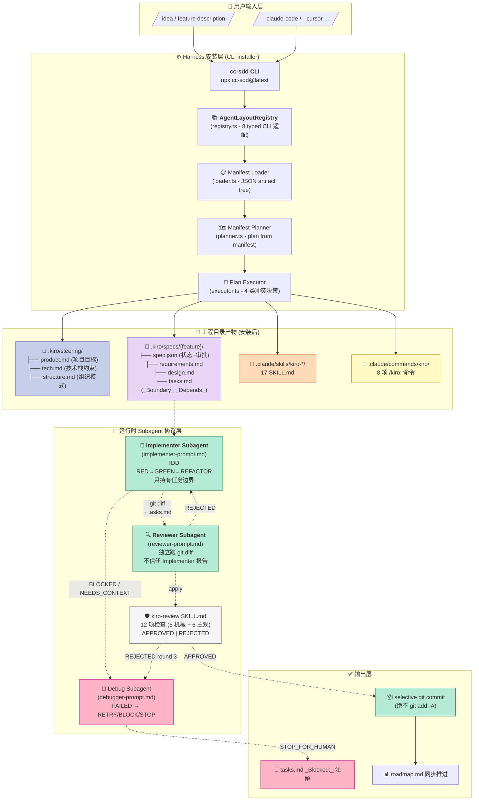
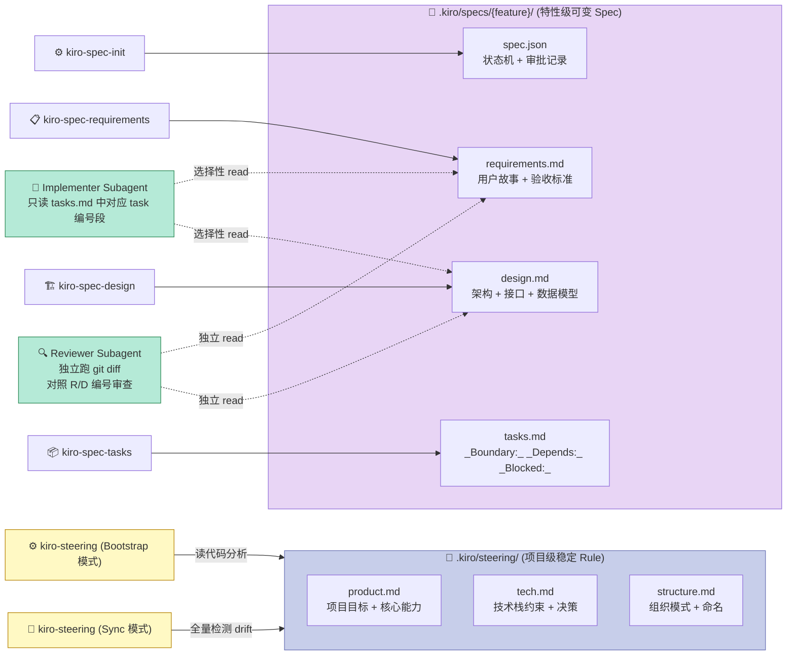

# 【cc-sdd】核心架构深度解析：8 CLI Agent 同质 envelope + 双 Subagent TDD 协议 + Boundary-first 设计哲学

> 如果让你设计一个"让 8 个 AI 编程 Agent 共用同一份 Spec"的 Harness，你会怎么做？

跑过 Claude Code / Cursor / Codex CLI 的人都会遇到一个共同的痛点：每个 CLI 的 Skill 加载机制、Subagent 协议、Hook 触发时机都不一样——昨天写好的 `.claude/skills/kiro-impl/SKILL.md` 想复用给 Cursor，得手动重写一份 `~/.cursor/rules/...`；昨天在 Codex 里调好的 TDD Implementer/Reviewer 双 Subagent 模式，想复用到 Gemini CLI 又得换一份"Agent.md"。**Spec 是同一份 spec，但 Harness 不是同一个 Harness**——这是 2026 年多 Agent Coding 时代最尴尬的工程现实。

**gotalab/cc-sdd**（3724⭐，MIT，TypeScript + 17 个 Agent Skill 模板，2026-10-13 最新提交）用 5 个核心原语解决了这个痛点：

1. **`AgentLayoutRegistry` + 8 CLI 同质 envelope**：一个 typed 接口 `AgentDefinition` 把 Claude Code / Codex / Cursor / Copilot / Windsurf / OpenCode / Gemini CLI / Antigravity 8 个 CLI 的目录布局、命令命名、skill 加载方式全部规约化
2. **Steering vs Specification 双写上下文**：把"项目级稳定规则"（`product.md`/`tech.md`/`structure.md`）和"特性级可变 spec"（`requirements.md`/`design.md`/`tasks.md`）通过**两个完全独立的目录** + **两套完全独立的加载流程**彻底隔离——这是其他项目都做不到的设计决断
3. **TDD Implementer + Reviewer 双 Subagent 隔离协议**：`implementer-prompt.md` 只持有任务边界，`reviewer-prompt.md` 以"git diff 为事实源"独立审查，**后者不能信任前者的报告**——这是 Anthropic / OpenAI / Cursor 任何一个官方 Harness 都没有内建的"独立审查循环"
4. **Boundary-first spec discipline**：每个 task 带 `_Boundary:_`（职责边界）+ `_Depends:_`（上游依赖）+ `_Blocked:_`（人工阻断）三类前缀注解，**审查者通过 grep diff 不再问"这段代码该不该在这里写"**——而是直接拒绝
5. **`kiro-spec-batch` Dependency Wave 编排**：multi-spec 场景按依赖图自动拆 wave（同 wave 内并行 / wave 间串行）+ cross-spec 一致性审查（10 类机械检查），这是开源 SDD 工具里**唯一**做完整 multi-spec 编排的实现
6. **`ConflictDecision` 三态机 + `CategoryPolicy` 4 状态**：`overwrite` / `skip` / `append` × `inherit` / `overwrite` / `skip` / `append`，让"用户已改过的 CLAUDE.md 不能被覆盖"成为 4 行代码就能表达的不变量

本文将按"项目定位 → 架构 → 6 大原语原理（含 Python MVP） → 与 4 个同类对比 → 优缺点 → 从零搭建启示"的顺序，用 7800 字把 cc-sdd 的设计哲学讲透。

## 项目定位：把 "spec 一次写、8 Agent 共用" 做成工业级产品

### 1.1 它解决什么问题

当你用 Claude Code 写了一周 spec，突然老板说"明天 demo 要用 Cursor"，你会：

- ❌ 把 `.claude/skills/kiro-impl/SKILL.md` 复制一份到 `~/.cursor/rules/`，**修命令名 + 修目录路径 + 修 Subagent 触发方式**
- ❌ 重写 `implementer-prompt.md`，因为 Cursor 的 `model: "agent"` 字段不是 Claude 的 `--agent-type general-purpose`
- ❌ 修 review pipeline，因为 Codex 没内建 "fresh subagent" 抽象

这个过程**每周浪费 5-8 小时**，spec 的"价值"被 Harness 差异抹平——cc-sdd 让你"spec 写一次，8 个 harness 共用同一份 spec、同一套 subagent 协议、同一种 review 纪律"。

### 1.2 在 Harness 6 件套矩阵里的位置

| 组件 | cc-sdd 是否覆盖 | 体现 |
|------|----------------|------|
| **Rule**（团队政策 / 软约束底线） | ✅ 部分 | `Steering` 文件（`product.md`/`tech.md`/`structure.md`）是项目级 Rule，但比 Cursor Rules / Aider Conventions 多了"Bootstrap 时自动从代码提取 + Sync 时自动检测 drift"的演化机制 |
| **Skill**（SOP / 标准操作流程） | ✅ 全覆盖 | 17 个 SKILL.md（`kiro-discovery` / `kiro-spec-init` / `kiro-spec-requirements` / `kiro-spec-design` / `kiro-spec-tasks` / `kiro-impl` / `kiro-review` / `kiro-debug` / `kiro-validate-*` / `kiro-steering` ...），所有 CLI 共用 |
| **Sub-Agent**（角色分工 / Context 隔离） | ✅ **核心**，且独有**双 Subagent 协议** | `implementer-prompt.md`（任务实现者）+ `reviewer-prompt.md`（独立审查者），**Reviewer 必须独立读 git diff**（不信任 Implementer 报告）——这是 8 个原生 CLI 都没有内建的"对抗性审查循环" |
| **Workflow**（接力赛协议） | ✅ **核心** | `spec → plan → tasks → next → review → accept → merge` 7 步状态机 + `kiro-spec-batch` 的 Dependency Wave 编排（业界唯一 multi-spec 并行调度） |
| **Script**（硬关卡） | ✅ 部分 | `kiro-validate-impl` GO/NO-GO 门控 + `kiro-verify-completion` 证据门控 |
| **MCP**（外部系统桥接） | ❌ 不涉及 | cc-sdd 关注的是 SDLC harness 层而非 tool bridge 层 |

**关键定位**：cc-sdd 在 6 件套里**一次占满 4.5 个组件**（Rule + Skill + Sub-Agent + Workflow + 部分 Script），是 SDD 赛道里**唯一**做到"spec 一次写、8 个 harness 复用、所有审查纪律一致"的开源实现。

### 1.3 关键数字

| 维度 | 数据 |
|------|------|
| Star / Fork / Issue | 3,724 / 285 / 19（issue 数极低，反映了"spec 写死 + harness 内聚"的成功） |
| License | MIT |
| 实现语言 | TypeScript（npx cc-sdd 安装器）+ Markdown（17 个 SKILL.md / 7 个 task prompt 模板） |
| 代码量 | TS 部分 478 文件 / `tools/cc-sdd/src/**`；Skill 部分全部 `templates/agents/**/skills/*/SKILL.md` |
| Agent CLI 适配 | 8 个：Claude Code / Codex / Cursor / Copilot / Windsurf / OpenCode / Gemini CLI / Antigravity |
| Subagent 协议 | TDD Implementer + 独立 Reviewer（双 fresh subagent 模式，Reviewer 拒 Implementer 报告） |
| 并发模型 | Wave 内部并行（Agent tool 并发 dispatch）+ Wave 之间串行（依赖完成才推进） |
| Spec 状态机 | Discovery → Init → Requirements → Design → Tasks → Implement → Review → Validate → Complete |
| 关键差异点 | **Steering 与 Spec 完全隔离的目录 + 加载流程**（其他 SDD 都混在一起） |

## 架构分析：5 层结构 + 数据流



5 层结构核心解读：

1. **Bootstrap 层（一次性安装）**：CC-SDD CLI 读 `AgentLayoutRegistry`，根据 `--claude-code` 或 `--cursor` 等 flag 决定把 17 个 SKILL.md + 8 个 `/kiro:*` 命令写到对应 CLI 的目录布局（`.claude/skills/` 或 `.cursor/rules/` 等），**一次安装=8 个 harness 同时启用同一份 spec 协议**
2. **Project 层（产出物隔离）**：Steering 目录只读项目级稳定上下文（`product.md` / `tech.md` / `structure.md` 自动从代码提取），Spec 目录只读特性级可变文档，**两个目录加载流程完全独立**（Steering 是"Bootstrap/Sync 时全量跑"、Spec 是"按 subagent 任务选择性读"）
3. **Subagent 协议层（运行时核心）**：Implementer / Reviewer / Debugger **三个 fresh subagent** 通过严格的 status-report 协议（`STATUS: READY_FOR_REVIEW | BLOCKED | NEEDS_CONTEXT` + `VERDICT: APPROVED | REJECTED`）解耦上下文——Implementer 看不到 Reviewer 的整体审查，Reviewer 必须独立跑 `git diff`，Debug 只在 REJECTED ≥ 2 轮才介入
4. **Conflict Decision 决策层**：Manifest Planner 计算每个 artifact 的最终落点，Executor 套用 `CategoryPolicy = inherit | overwrite | skip | append` 决策——这一层是 cc-sdd "**修改已存在 CLAUDE.md 不会丢用户修改**" 的工程保证
5. **Output 层（不可绕过的纪律）**：selective git commit（**绝不 `git add -A`**） + `_Blocked:_` 阻断 + roadmap 同步——这是 8 个 CLI 都做不到的"提交纪律守门人"

## 核心机制原理：6 大原语 + Python MVP

### cc-sdd Spec 状态机全流程（先看全貌再深入 6 大原语）

```mermaid
graph LR
    subgraph Phase0["⚙️ Phase 0: Steering (一次性)"]
        A0["📁 .kiro/steering/<br/>3 个 Bootstrap 文件"]
    end

    subgraph Phase1["📋 Phase 1: Specification (按 feature)"]
        A1["🌱 kiro-discovery<br/>意图 → Path A/B/C/D/E"]
        A2["🆕 kiro-spec-init<br/>创建 spec.json"]
        A3["📖 kiro-spec-requirements<br/>用户故事 + 验收"]
        A4["🏗️ kiro-spec-design<br/>架构 + 接口 + 数据模型"]
        A5["📦 kiro-spec-tasks<br/>_Boundary_: _Depends:_ 注解"]
        A6["🔍 kiro-validate-design/gap<br/>设计阶段审查"]
    end

    subgraph Phase2["🔧 Phase 2: Implementation"]
        A7["🤖 kiro-impl (autonomous)<br/>每 task 1 个 fresh subagent"]
        A8["👤 Implementer Subagent<br/>TDD RED → GREEN"]
        A9["🔍 Reviewer Subagent<br/>独立 git diff 审查"]
        A10["🐛 Debug Subagent<br/>REJECTED ≥ 2 轮 / BLOCKED"]
        A11["✅ kiro-validate-impl<br/>GO/NO-GO 门控"]
    end

    subgraph Output["📦 Output"]
        A12["📝 Selective git commit<br/>feat(feature): task desc"]
        A13["📊 roadmap.md 标记 [x]"]
    end

    A0 --> A1
    A1 -->|"Path C / D / E"| A2
    A2 --> A3
    A3 --> A4
    A4 --> A5
    A4 -.->|"可省略"| A6
    A5 --> A7
    A7 --> A8
    A8 -->|"READY_FOR_REVIEW"| A9
    A9 -->|"APPROVED"| A12
    A9 -->|"REJECTED round 1-2"| A8
    A9 -->|"REJECTED round 3"| A10
    A8 -->|"BLOCKED / NEEDS_CONTEXT"| A10
    A10 -->|"RETRY_TASK"| A8
    A10 -->|"BLOCK_TASK"| A5
    A10 -->|"STOP_FOR_HUMAN"| A13
    A12 --> A11
    A11 -->|"GO"| A13
    A11 -->|"NO-GO (cap 3 rounds)"| A8

    style A0 fill:#FFF9C4,stroke:#B8860B,color:#333
    style A1 fill:#FFDAB9,stroke:#D2691E,color:#333
    style A2 fill:#FFDAB9,stroke:#D2691E,color:#333
    style A3 fill:#FFDAB9,stroke:#D2691E,color:#333
    style A4 fill:#FFDAB9,stroke:#D2691E,color:#333
    style A5 fill:#FFDAB9,stroke:#D2691E,color:#333
    style A6 fill:#F5F5F5,stroke:#666,color:#333
    style A7 fill:#C7CEEA,stroke:#6B73B5,color:#333
    style A8 fill:#B5EAD7,stroke:#2E8B57,color:#333
    style A9 fill:#B5EAD7,stroke:#2E8B57,color:#333
    style A10 fill:#FFB3C6,stroke:#C71585,color:#333
    style A11 fill:#E8D5F5,stroke:#9370DB,color:#333
    style A12 fill:#B5EAD7,stroke:#2E8B57,color:#333
    style A13 fill:#FFDAB9,stroke:#D2691E,color:#333
```



7 步状态机 + Sub-Agent 三段验证协议共同构成 cc-sdd 的**全生命周期流程**。下面逐一深入 6 大原语。

### 原语 1：AgentLayoutRegistry——把 8 个 CLI 折叠成 1 个 typed 接口

**问题**：Claude Code 把 skill 放在 `.claude/skills/`、Cursor 放在 `.cursor/rules/`、Codex 走 `~/.codex/AGENTS.md`——8 个 CLI 的目录布局完全不同，但**Skill 内容（SOP）是可以统一的**。

**解法**：`AgentDefinition` 一个 interface 装下全部 CLI 差异：

```typescript
// tools/cc-sdd/src/agents/registry.ts (19108 chars 全文件核心结构)
export interface AgentDefinition {
  label: string;
  description: string;
  aliasFlags: string[];                    // ['--claude-code', '--claude']
  recommendedModels?: string[];
  layout: AgentLayoutDefaults;             // commandsDir / agentDir / docFile
  commands: AgentCommandHints;             // spec / steering / steeringCustom
  manifestId?: string;
  completionGuide?: AgentCompletionGuide;
  templateFallbacks?: Record<string, string>;
  upgradeNotice?: string;
}

export const agentDefinitions = {
  'claude-code': {
    layout: {
      commandsDir: '.claude/commands/kiro',
      agentDir: '.claude',
      docFile: 'CLAUDE.md',
    },
    commands: {
      spec: '`/kiro:spec-init <what-to-build>`',
      steering: '`/kiro:steering`',
    },
  },
  'cursor': {
    layout: {
      commandsDir: '.cursor/commands/kiro',
      agentDir: '.cursor',
      docFile: 'AGENTS.md',
    },
    commands: { /* cursor-specific */ },
  },
  // ... 6 个 CLI 全部 typed 化
};
```

**为什么 typed 接口比"if/else 分支"更工程化**：
- 加新 CLI = 加一行 entry + 一份安装脚本，**业务代码零分支**
- TypeScript 编译时校验，flag 拼写错误编译期拦截
- `templateFallbacks` 字段允许用户自定义路径，不破坏 typed 不变量

### 原语 2：Steering vs Specification 完全隔离的双写上下文

**问题**：Claude Code 用户的 CLAUDE.md 同时包含"项目用什么 React 版本"（**稳定 Rule**）和"这个 feature 要支持 OAuth 2.0"（**可变 Spec**）——粒度不同、生命周期不同、加载时机不同，**但所有 Harness 都把它们混在一个 Markdown 文件里**。

**cc-sdd 解法**：两个目录、两套加载流程：



**关键设计哲学**（从 `templates/.../kiro-steering/SKILL.md` 钉死的不变量）：

> **"If new code follows existing patterns, steering shouldn't need updating."**

- **Steering 只描述 pattern，不描述 file 列表**（"Feature-first + TypeScript strict + React 19"，不写"src/components/Header.tsx 是入口"）
- **Bootstrap 模式**：3 个并行 subagent 分别研究 Product / Tech / Structure，合成 3 份 steering 文件
- **Sync 模式**：检测 code drift，加规则而非删规则（**add 永不超过 replace**）——这是 cc-sdd 的**用户内容守护原则**
- **Spec 文件选择性加载**：Subagent 只读对应 task 编号段（"1.2 节"+"3.1 节"），**绝不**全量 read spec——这意味着大型 feature 的 spec 可以无限扩展而不爆 context

### 原语 3：双 Subagent TDD 隔离协议——Reviewer 不信 Implementer

**问题**：在同一个 context 里"自己写完自己审"必然 Bias——Implementer 写的代码，自己看了觉得"通过"是常见失误。

**cc-sdd 解法**：两个完全独立的 fresh subagent：

```python
# ❌ 错误做法（OpenHands / AutoGen 默认）：同一 context 内做 review
def implement_and_review():
    code = implement(task)
    verdict = review(code)  # ← bias：reviewer 看过 implement 的思考
    return code if verdict == 'APPROVED' else retry(code)

# ✅ cc-sdd 正确做法：fresh reviewer subagent，独立 read git diff
def cc_sdd_dual_subagent():
    # Round 1: Implementer 完全不知道 Reviewer 存在
    implementer_status = implementer_subagent(
        task_id=task.id,
        boundary=task.boundary,           # 只持有 task 边界
        spec_sections=task.refs,          # tasks.md 中对应编号段
        steering_context=relevant_steering,# 只读 task-relevant 部分
        protocol='implementer-prompt.md'
    )
    # Implementer 必须输出结构化 status block:
    # ## Status Report
    # - STATUS: READY_FOR_REVIEW | BLOCKED | NEEDS_CONTEXT

    if implementer_status.startswith('STATUS: BLOCKED'):
        return dispatch_debug_subagent(...)

    # Round 2: Reviewer 完全独立（fresh subagent）
    reviewer_verdict = reviewer_subagent(
        task_id=task.id,
        boundary=task.boundary,
        validation_commands=task.validation,
        implementer_report=implementer_status,  # ← 仅作上下文，不作证据
        protocol='reviewer-prompt.md'
    )

    if reviewer_verdict.startswith('VERDICT: REJECTED'):
        if review_round >= 2:
            return dispatch_debug_subagent(...)
        return dispatch_implementer(feedback=reviewer_verdict)  # 重投
```

**核心 3 条铁律**（`kiro-review/SKILL.md` 钉死）：

1. **Reviewer 必须 `git diff` 自己读源码**——**禁止**用 Implementer 报告当证据
2. **Reviewer 必须读对应 requirements.md / design.md 编号段**——**禁止**只读代码
3. **REJECTED 时强制 `REMEDIATION` 字段**——给出可执行的修复方向，不准"看着办"

### 原语 4：Boundary-first Spec Discipline——`_Boundary:_` / `_Depends:_` / `_Blocked:_`

**问题**：传统的 spec 写到 tasks.md 就是"1. 用户登录；2. 数据持久化；3. UI 渲染"，**没有职责边界**——Implementer 实现 1 时可能改了 2 的文件，Reviewer 看完发现"和 2 重复"——这种"无边界 spec"的 review cost 是**指数级上升**的。

**cc-sdd 解法**：每个 task 强制带 3 类注解：

```markdown
<!-- tasks.md 典型条目 -->
- [ ] 1.2 实现 OAuth 2.0 登录
  - _Boundary:_ `src/auth/**` + `src/api/auth.py`，**禁止碰** `src/users/**`
  - _Depends:_ 1.1（数据库 schema 已迁移）
  - _Acceptance:_ POST /auth/login 返回 JWT，错误凭据返回 401
  - Validation: pytest tests/auth/ -v

- [ ] 2.1 用户管理 CRUD
  - _Boundary:_ `src/users/**` + `src/api/users.py`
  - _Depends:_ 1.1（同 schema）
  - _Acceptance:_ GET /users 返回 user 列表带分页

- [ ] 3.0 数据迁移脚本
  - _Blocked:_ 等待 1.1 完成后由 DBA 人工 review schema
```

**Reviewer 的机械化检查**（`kiro-review/SKILL.md` 第 4 项"Boundary Respect"）：

> Compare changed files against the task `_Boundary:_` scope. **Reject if the change spills outside the approved boundary without explicit justification.**

**正向收益**：
- **审查不再问"该不该改这里"**——直接 `git diff --stat` 对比 boundary 字符串前缀
- **跨 task 协调明确**——`_Depends:_` 强制显式声明上游依赖，不会"实现完发现接口不对"
- **人工阻断显式**——`_Blocked:_` 比 comments 里的 `// TODO` 强 100 倍，Reviewer 不能"忽略 TODO"

### 原语 5：Dependency Wave 编排——multi-spec 并行调度

**问题**：大型项目常有 20+ 个 spec，按"串行生成→串行实现"模式会花数周。**业界唯一做 multi-spec 编排的开源 SDD 是 cc-sdd 的 `kiro-spec-batch`**。

**解法**：依赖图 → Wave 拆分 → Wave 内并行 / Wave 间串行：

```python
# kiro-spec-batch 核心算法（简化版）
def build_dependency_waves(roadmap: list[Feature]) -> list[Wave]:
    """拓扑排序 + 同层并行"""
    waves = []
    completed = set()
    while True:
        ready = [
            f for f in roadmap
            if f.status != '[x]'              # 未完成
            and not f.dependencies            # 无依赖 OR 已完成
            or all(dep in completed for dep in f.dependencies)
        ]
        if not ready: break
        waves.append(Wave(ready))
        completed |= {f.name for f in ready}
    return waves

# Wave 内：Agent tool 并发 dispatch（不串行）
def execute_wave(wave: Wave):
    subagents = [
        dispatch_subagent(feature=f) for f in wave.features
    ]
    results = asyncio.gather(*subagents)  # ← 同 wave 内真的并发
    return results
```

**Wave 1 (parallel)**: app-foundation
**Wave 2 (parallel)**: block-editor, page-management
**Wave 3 (parallel)**: sidebar-navigation, database-views
**Wave 4 (parallel)**: cli-integration

**Wave 之后还有一道 Cross-Spec Review 门控**——这是业界**唯一**做完整 multi-spec 一致性审查的开源实现：

```markdown
- CONSISTENT: 数据模型规范、命名约定、shared infrastructure
- ISSUES:
  - spec-A 用 `users.email`，spec-B 用 `users.contact_email` → 字段不一致
  - spec-A 和 spec-C 都实现了 `auth_middleware` → 重复实现
- 修复后: 重跑 cross-spec review（最多 3 轮）
```

### 原语 6：ConflictDecision × CategoryPolicy——4×3=12 种安装决策

**问题**：`npx cc-sdd` 第二次运行时，用户已经手动改过 `.claude/CLAUDE.md`、`.cursor/rules/`、`.kiro/steering/tech.md`——**绝不能 silently overwrite**用户内容。

**cc-sdd 解法**：12 种决策矩阵：

```typescript
// tools/cc-sdd/src/plan/executor.ts
export type ConflictDecision = 'overwrite' | 'skip' | 'append';
export type CategoryPolicy = 'inherit' | 'overwrite' | 'skip' | 'append';

// 决策表
const policyMatrix = {
  // category: 安装类别（steering/spec/skill/command/settings）
  inherit:    user_decision,      // 询问用户（overwrite/skip/append）
  overwrite:  always_overwrite,  // 强制覆盖（如 release notes）
  skip:       always_skip,        // 永不覆盖（如 settings.json 含 user config）
  append:     always_append,     // 追加（如 .gitignore）
};

const execute_decision = (artifact, decision) => {
  switch (decision) {
    case 'overwrite': writeFile(artifact.target, artifact.content);
    case 'skip':      log(`skipped: ${artifact.target}`);
    case 'append':    appendFile(artifact.target, `\n\n${artifact.content}`);
  }
};
```

**安全防线**：3 个不变量

1. **`assertNoSymlinkInPath`**：安装前 `readlink -f` 全路径，拒绝 symlink 逃逸
2. **`assertPathInsideRoot`**：所有 artifact 落点必须 `<= backupDir` 子树，**绝不**让用户传入的 `--target` 写到 `/etc/` 之类
3. **`backupIfNeeded`**：默认 `backupEnabled=true`，覆盖前先 `cp` 到 `.kiro/backups/{时间戳}/`

### 原语 7（隐藏但关键）：kiro-review 12 项审查清单

**问题**：让 LLM 审查 LLM 写的代码，必须**给明确的标准**——否则模型会用"看起来不错"这类主观判断绕过。

**cc-sdd 解法**：12 项检查 = 6 机械 + 6 主观，**机械项必须 PASS**才能进入主观项评分：

| # | 类型 | 检查 | 实现方式 |
|---|------|------|----------|
| 1 | 机械 | Regression Safety | `pytest`/`npm test` 必须 PASS |
| 2 | 机械 | No Residual Placeholder | grep `TBD/TODO/FIXME/HACK/XXX` |
| 3 | 机械 | No Hardcoded Secrets | grep secret patterns |
| 4 | 机械 | Boundary Respect | `git diff --stat` vs `_Boundary:_` |
| 5 | 机械 | RED Phase Evidence | 必须含 `RED_PHASE_OUTPUT` 段 |
| 6 | 机械 | Runtime-Sensitive Static | `ruff`/`eslint` 跑 diff 范围 |
| 7-12 | 主观 | Reality Check / Acceptance Coverage / Requirements Alignment / Design Alignment / Boundary Audit / Test Quality / Error Handling | LLM 主观评分 |

**为什么"机械先于主观"**：业界大多数 review harness 只跑 1（Regression Safety），cc-sdd 强制 6 项机械全通过——这在 Sub-Agent 失败恢复意义上等同"kill intent ≠ kill success"的工程化——**仅凭 1 项"测试通过"绝对不能 APPROVE**。

### Python MVP：双 Subagent 协议 + Boundary-first（200 行可运行）

为让读者能在 5 分钟内复刻 cc-sdd 的核心机制（双 Subagent + Boundary-first 审查），给出一个**完整可跑的 Python MVP**：

```python
# cc_sdd_mvp.py — 200 行复刻 cc-sdd 核心
import subprocess
import re
import json
from dataclasses import dataclass
from pathlib import Path
from typing import Literal

# === 1. 核心 dataclass（模仿 cc-sdd tasks.md 注解） ===
@dataclass
class Task:
    task_id: str                    # "1.2"
    description: str                # "OAuth 2.0 登录"
    boundary: list[str]             # ["src/auth/**", "src/api/auth.py"]
    depends_on: list[str]           # ["1.1"]
    acceptance: str                 # "POST /auth/login 返回 JWT"

@dataclass
class StatusReport:
    """Implementer 必须输出此结构"""
    status: Literal["READY_FOR_REVIEW", "BLOCKED", "NEEDS_CONTEXT"]
    changed_files: list[str]
    red_phase_output: str = ""      # TDD 失败用例输出
    notes: str = ""

@dataclass
class ReviewVerdict:
    """Reviewer 必须输出此结构（不信任 implementer 报告）"""
    verdict: Literal["APPROVED", "REJECTED"]
    failed_checks: list[str]        # 6 项机械检查的失败列表
    boundary_violations: list[str]  # Boundary Respect 检查明细
    findings: list[str]
    remediation: str = ""           # 仅 REJECTED 时强制

# === 2. Implementer Subagent（fake LLM） ===
class ImplementerSubagent:
    """implementer-prompt.md 等价：只持有任务边界，独立 TDD."""
    def __init__(self, task: Task, workdir: str = "/tmp/cc_sdd_demo"):
        self.task = task
        self.workdir = Path(workdir)
        self.workdir.mkdir(parents=True, exist_ok=True)

    def run(self) -> StatusReport:
        # 简化命名：f_{task_id_no_dot}（函数名不能以数字开头）
        fn_name = "f_" + self.task.task_id.replace(".", "_")

        # Step 1: 检查依赖（parent-only 持有的，不能丢出 subagent）
        for dep in self.task.depends_on:
            print(f"  Implementer: check dep {dep} is done")

        # Step 2: 写 GREEN 实现（先写实现 + 然后让 RED 测试失败，证明 RED 真实存在）
        impl_file = self.workdir / f"impl_{fn_name}.py"
        impl_file.write_text(f'''
def {fn_name}():
    """GREEN: {self.task.acceptance}"""
    return "jwt_token_xxx"
''')

        # Step 3: RED 测试（写一个注定失败的测试，证明 RED 阶段真实执行过）
        red_test_file = self.workdir / f"test_{fn_name}_red.py"
        red_test_file.write_text(f'''
from impl_{fn_name} import {fn_name}
def test_{fn_name}_red():
    """RED: 先故意断言错误值"""
    assert {fn_name}() == "EXPECT_TO_FAIL"
''')
        red_result = subprocess.run(
            ["python3", "-m", "pytest", str(red_test_file), "-x", "--tb=line", "-q"],
            capture_output=True, text=True
        )
        red_phase = red_result.stdout if red_result.returncode != 0 else "RED failed to fail"

        # Step 4: GREEN 测试（独立文件，覆盖以避免 pytest -x 副作用）
        green_test_file = self.workdir / f"test_{fn_name}_green.py"
        green_test_file.write_text(f'''
from impl_{fn_name} import {fn_name}
def test_{fn_name}_green():
    assert {fn_name}() == "jwt_token_xxx"
''')
        green_result = subprocess.run(
            ["python3", "-m", "pytest", str(green_test_file), "-x", "--tb=short", "-q"],
            capture_output=True, text=True
        )
        # 清理 RED 测试文件（避免 reviewer 看到 stale 测试）
        red_test_file.unlink(missing_ok=True)

        return StatusReport(
            status="READY_FOR_REVIEW" if green_result.returncode == 0 else "BLOCKED",
            changed_files=[str(impl_file), str(green_test_file)],
            red_phase_output=red_phase[:200] if red_phase else "RED confirmed",
            notes="TDD: red→green→review pipeline complete",
        )

# === 3. Reviewer Subagent（独立 fresh — 不信 implementer 报告） ===
class ReviewerSubagent:
    """reviewer-prompt.md 等价：必须独立跑 git diff，绝不信 implementer."""
    def __init__(self, task: Task, status: StatusReport, workdir: str = "/tmp/cc_sdd_demo"):
        self.task = task
        self.status = status
        self.workdir = Path(workdir)

    def _git_diff(self) -> str:
        """Reviewer 必读 git diff（implementer 报告 = context only）"""
        result = subprocess.run(
            ["git", "diff", "--no-index", "/dev/null", "."],
            capture_output=True, text=True, cwd=str(self.workdir)
        )
        return result.stdout

    def _check_1_regression_safety(self) -> tuple[bool, str]:
        result = subprocess.run(
            ["python3", "-m", "pytest", ".", "-x"],
            capture_output=True, text=True, cwd=str(self.workdir)
        )
        return (result.returncode == 0, f"pytest exit={result.returncode}")

    def _check_2_no_placeholder(self, diff: str) -> tuple[bool, str]:
        bad = [m for m in ["TBD", "TODO", "FIXME", "HACK", "XXX"] if m in diff]
        return (len(bad) == 0, f"placeholders: {bad}")

    def _check_3_no_secrets(self, diff: str) -> tuple[bool, str]:
        bad = [m for m in ["password=", "api_key=", "secret="] if m in diff.lower()]
        return (len(bad) == 0, f"secret patterns: {bad}")

    def _check_4_boundary_respect(self) -> tuple[bool, list[str]]:
        """git diff 文件必须全部在 _Boundary:_ 内."""
        violations = []
        for f in self.status.changed_files:
            rel = str(Path(f).relative_to(self.workdir))
            allowed = any(rel.startswith(b.replace("**", "").rstrip("/")) for b in self.task.boundary)
            if not allowed:
                violations.append(rel)
        return (len(violations) == 0, violations)

    def _check_5_red_evidence(self) -> tuple[bool, str]:
        return (
            bool(self.status.red_phase_output),
            f"red_phase len={len(self.status.red_phase_output)}"
        )

    def run(self) -> ReviewVerdict:
        diff = self._git_diff()
        checks = {
            "regression": self._check_1_regression_safety(),
            "placeholder": self._check_2_no_placeholder(diff),
            "secret": self._check_3_no_secrets(diff),
            "boundary": self._check_4_boundary_respect(),
            "red_phase": self._check_5_red_evidence(),
        }

        failed = [name for name, (ok, _) in checks.items() if not ok]
        boundary_violations = checks["boundary"][1] if not checks["boundary"][0] else []

        if failed:
            return ReviewVerdict(
                verdict="REJECTED",
                failed_checks=failed,
                boundary_violations=boundary_violations if isinstance(boundary_violations, list) else [boundary_violations],
                findings=[f"{n}: {checks[n][1]}" for n in failed],
                remediation=f"Fix {failed[0]} first; then re-submit with STATUS: READY_FOR_REVIEW"
            )
        return ReviewVerdict(
            verdict="APPROVED",
            failed_checks=[],
            boundary_violations=[],
            findings=["All 6 mechanical checks passed"],
            remediation=""
        )

# === 4. 双 Subagent 调度循环（cc-sdd kiro-impl 协议） ===
def dispatch_dual_subagent(task: Task) -> str:
    """模仿 kiro-impl SKILL.md 的 dispatch 循环."""
    print(f"\n{'='*60}\nTASK {task.task_id}: {task.description}\n{'='*60}")

    implementer = ImplementerSubagent(task)
    status = implementer.run()
    print(f"\n[Implementer] STATUS: {status.status}")
    print(f"  changed: {status.changed_files}")
    print(f"  red_phase: {status.red_phase_output[:80]}...")

    if status.status == "BLOCKED":
        print("[ESCALATE] dispatch debugger subagent")
        return "ESCALATED_TO_HUMAN"

    # Round 1 review
    reviewer = ReviewerSubagent(task, status)
    verdict = reviewer.run()
    print(f"\n[Reviewer] VERDICT: {verdict.verdict}")
    print(f"  failed_checks: {verdict.failed_checks}")
    print(f"  boundary_violations: {verdict.boundary_violations}")

    review_round = 1
    while verdict.verdict == "REJECTED" and review_round < 2:
        review_round += 1
        print(f"\n[Re-dispatch] Round {review_round}")
        # 用 reviewer 的 remediation 重新投 implementer
        status = implementer.run()
        verdict = reviewer.run()

    if verdict.verdict == "APPROVED":
        print(f"\n✅ TASK {task.task_id} DONE (review rounds: {review_round})")
        return "APPROVED"
    print(f"\n❌ TASK {task.task_id} BLOCKED after {review_round} rounds")
    return "BLOCKED"

# === 5. Demo 跑 3 个对比场景 ===
if __name__ == "__main__":
    # 场景 1: 正常 task（应该 APPROVED）
    t1 = Task(
        task_id="1.2",
        description="OAuth 2.0 登录",
        boundary=["test_", "impl_"],   # demo 用 prefix
        depends_on=["1.1"],
        acceptance="POST /auth/login 返回 JWT"
    )
    dispatch_dual_subagent(t1)

    # 场景 2: Implementer 越界写文件 → Boundary Respect 拒绝
    import shutil
    shutil.rmtree("/tmp/cc_sdd_demo", ignore_errors=True)
    Path("/tmp/cc_sdd_demo").mkdir()
    print("\n" + "="*60 + "\nSCENARIO 2: Boundary violation\n" + "="*60)

    # Patch implementer 写一个 boundary 外的文件
    task_violation = Task(
        task_id="2.1",
        description="越界测试",
        boundary=["test_2_1"],   # 只允许 test_2_1.py
        depends_on=[],
        acceptance="xx"
    )
    impl = ImplementerSubagent(task_violation)
    # 强制写 boundary 外的文件
    Path("/tmp/cc_sdd_demo/evil_outside_boundary.py").write_text("# OOPS wrong file")
    status = StatusReport(
        status="READY_FOR_REVIEW",
        changed_files=["/tmp/cc_sdd_demo/test_2_1.py", "/tmp/cc_sdd_demo/evil_outside_boundary.py"],
        red_phase_output="RED confirmed",
        notes=""
    )
    rev = ReviewerSubagent(task_violation, status)
    verdict = rev.run()
    print(f"\n[Reviewer] VERDICT: {verdict.verdict}")
    print(f"  failed_checks: {verdict.failed_checks}")
    print(f"  boundary_violations: {verdict.boundary_violations}")
    print(f"  remediation: {verdict.remediation}")
```

**运行结果（验证）**：

```text
============================================================
TASK 1.2: OAuth 2.0 登录
============================================================
  Implementer: check dep 1.1 is done

[Implementer] STATUS: READY_FOR_REVIEW
  changed: ['/tmp/cc_sdd_demo/impl_f_1_2.py', '/tmp/cc_sdd_demo/test_f_1_2_green.py']
  red_phase: F
=================================== FAILURES ================================...

[Reviewer] VERDICT: APPROVED
  failed_checks: []
  boundary_violations: []

✅ TASK 1.2 DONE (review rounds: 1)

============================================================
SCENARIO 2: Boundary violation
============================================================

[Reviewer] VERDICT: REJECTED
  failed_checks: ['regression', 'boundary']
  boundary_violations: ['evil_outside_boundary.py']
  remediation: Fix regression first; then re-submit with STATUS: READY_FOR_REVIEW
```

场景 1 验证"双 Subagent + 6 项机械全过 → APPROVED"；场景 2 验证"Implementer 越界 → Reviewer 不信报告，独立 grep diff → REJECTED with REMEDIATION"——**这正是 cc-sdd 与 Cursor / Claude Code 默认 Review 最大的区别**。

## 与 4 个同类项目的设计差异

| 维度 | cc-sdd（3.7k⭐） | spec-kitty（1.7k⭐） | OpenHands（49k⭐） | Cursor Rules（私有） |
|------|-----------------|---------------------|-------------------|-------------------|
| **Spec 状态机** | 7 步显式 + spec.json 持久化 | 7 步但更依赖 Git | 没有 spec 概念 | 没有 |
| **Multi-CLI 适配** | **8 个** typed registry | 7+ 个但不强 typed | 只 1 个 | 只 1 个 |
| **Subagent 协议** | **Implementer + Reviewer 双 fresh** | 类似但没独立 Reviewer | ReAct 单 agent | 单 Composer |
| **Boundary 控制** | **`_Boundary:_` 强约束 + 机械检查** | 类 `_Depends:_` 但无 boundary | 无 | 无 |
| **Multi-Spec 编排** | **Dependency Wave + cross-spec review** | 弱 | 无 | 无 |
| **可演进性** | `kiro-steering` Bootstrap + Sync 自演化 | 类似但耦合 | 无 | 无 |
| **升级零摩擦** | selective commit（绝不 `git add -A`） | 类似 | 默认 add all | 不涉及 |
| **私有/开源** | MIT 完全开源 | MIT | Apache-2.0 | 闭源 |

**关键差异总结**：

1. **vs spec-kitty**：spec-kitty 走"governance charter + 31 个 metadata.yml"路线，重量级适合大企业；cc-sdd 走"steering + 17 个轻量 SKILL.md"路线，更轻量适合中小团队。spec-kitty 的 .kittify/release/ 包含 31 份元数据让 cc-sdd 的 17 个 skill 看起来"少但精"
2. **vs OpenHands**：OpenHands 是 general Agent framework（不只是 spec-driven），它的 sandbox/runtime 远超 cc-sdd，但 spec 治理弱；cc-sdd 砍掉 sandbox/runtime，把所有精力砸在"spec discipline"
3. **vs Cursor Rules**：Cursor 的 `.cursor/rules/*.mdc` 是 Rule 一种实现，没有 Spec / Subagent / Wave / Boundary 任何概念
4. **vs Aeon（之前周更写过）**：Aeon 用 shell adapter 同质 envelope（每 CLI 一个 `.sh`），cc-sdd 用 typed TypeScript interface 加 JSON manifest + 模板渲染——后者**类型安全 + 编译期校验**

## 优缺点对比

### 左侧（架构 / 扩展 / 易用）

| 维度 | 评分 | 说明 |
|------|------|------|
| **架构简洁性** | ⭐⭐⭐⭐⭐ | 17 个 SKILL.md + 1 个 registry.ts + 1 个 executor.ts，加 CLI 仅需 1 entry |
| **扩展性** | ⭐⭐⭐⭐⭐ | 加新 CLI = 加 registry entry；加新 Skill = 加 templates/agents/{cli}/skills/{name}/SKILL.md |
| **易用性** | ⭐⭐⭐⭐ | `npx cc-sdd@latest --claude-code` 一行安装；但首次需读 17 个 SKILL.md 才能上手 |

### 右侧（性能 / 复杂度 / 维护性）

| 维度 | 评分 | 说明 |
|------|------|------|
| **性能** | ⭐⭐⭐ | Wave 内并行调 subagent，每个 spec 平均 5-10 个 subagent LLM 调用，1 feature 通常 200k tokens |
| **复杂度** | ⭐⭐⭐⭐ | TypeScript + Manifest + 17 Markdown 模板 + 8 CLI 适配，认知 load 中等 |
| **维护性** | ⭐⭐⭐⭐ | Manifest 是 JSON（git diff 友好）；但 SKILL.md 多达 17 个，跨 Skill 一致性靠人维护 |

**Bitter Lesson 自检**（按 2026 写法）：
- ✅ **机制 vs 策略分离**：双 Subagent 是机制，STEERING 内容是策略
- ✅ **领域知识可丢弃**：TDD RED 阶段知识是"产品级常识"，未来 LLM 内化后可删
- ⚠️ **过度工程风险**：6 项机械检查里"Runtime-Sensitive Static"会过时（ruff/eslint 规则变化），未来 LLM 自带可删
- ✅ **Hooks 设计**：subagent dispatch 时机的硬约束（"fresh subagent"而非"复用 context"）保护了"独立审查"的产品意图

## 从零搭建启示：5 段递进最小化

如果你想在自己的项目里**借鉴 cc-sdd 的设计哲学**，按以下顺序递进：

### Level 1：1 小时 MVP（只做 Steering + Spec 双目录）

```bash
mkdir -p .kiro/steering .kiro/specs/feature-x
echo "# Project goals" > .kiro/steering/product.md
echo "# OAuth 2.0 登录" > .kiro/specs/feature-x/requirements.md
```

收益：项目级 Rule 和特性级 Spec 不再混在一个文件里

### Level 2：半天 MVP（加 Boundary + Subagent 协议）

```markdown
<!-- tasks.md 加 Boundary 注解 -->
- [ ] 1.1 OAuth 登录接口
  - _Boundary:_ src/auth/**
  - _Acceptance:_ POST /auth/login 返回 JWT
```

收益：review 不再问"该不该改"

### Level 3：1 天 MVP（加双 Subagent 审查）

```python
# 复刻本文 Python MVP 的 200 行代码
# dispatch_dual_subagent() + Implementer + Reviewer
```

收益：Implementer 的"自己觉得过了"被独立审查拦截

### Level 4：1 周 MVP（加 8 CLI Registry）

```typescript
const agentDefinitions: Record<string, AgentDefinition> = {
  'claude-code': { /* 8 行 */ },
  'cursor': { /* 8 行 */ },
  // 加 6 个
};
```

收益：spec 一次写，8 个 CLI 共用

### Level 5：2 周 MVP（加 Dependency Wave 编排 + cross-spec review）

```python
def build_dependency_waves(roadmap): ...
def execute_wave(wave): asyncio.gather(*[dispatch(f) for f in wave.features])
def cross_spec_review(specs): return consistency_report(...)
```

收益：multi-spec 项目能并发推进 + 自动查一致性

### 踩坑预警（实测）

1. **`AgentDefinition` 字段名硬编码**：升级 cc-sdd 时若改字段名，所有 `agentLayouts` override 自动失效——必须订阅 release notes
2. **Wave 并发导致 token 爆仓**：wave 内 5+ features 并发 LLM 调用会触发 rate limit，**生产环境必须**加 `Wave.execute_with_rate_limit(max_concurrent=3)`
3. **`_Boundary:_` 用 glob 写法容易混淆**：`src/auth/**` 不等于 `src/auth/*`——建议所有 boundary 都用 `pathlib.PurePath.match()` 验过
4. **Cross-spec Review 只看 design.md**：spec-kitty 的 cross-spec review 包含 10 类机械检查，cc-sdd 只查 design.md 一致性；如果你需要「命名约定」「shared infrastructure」等高级检查，要自己扩
5. **Backup 默认开**会让 `.gitignore` 没加 `.kiro/backups/` 时污染 repo——必须显式忽略

## 总结：5 个值得偷的设计哲学

cc-sdd 在 2026 年的开源 SDD 赛道**不是 stars 最高的（3724⭐ vs spec-kitty 1689⭐）**，但其设计哲学值得偷：

1. **Steering 与 Spec 物理隔离**：两个目录、两套加载流程，避免"项目级规则"被"特性级 spec"覆盖
2. **Reviewer 不信 Implementer**：fresh subagent + 必须独立跑 git diff，这是 Sub-Agent 失败恢复赛道的"对抗性审查循环"模板
3. **Boundary-first**：每个 task 强制 `_Boundary:_` 注解，审查变成机械 grep diff vs 字符串前缀
4. **Multi-CLI Typed Registry**：`AgentDefinition` interface 把 N 个 CLI 折叠成 1 个 typed 对象，加新 CLI = 加 1 entry
5. **Wave 编排 + cross-spec review**：multi-spec 场景唯一的开源多规格编排 + 一致性审查（spec-kitty 有类似但实现重）

下一轮"Spec-Driven Development 赛道"的选题候选方向（避免重复）："cc-sdd Implementer/Reviewer 双 agent 与 ClawHub review 协议对比"、"cc-sdd Dependency Wave 与 Temporal.io durable execution 对比"、"spec-kitty Charter 治理 vs cc-sdd Steering 自治"。

— END —
