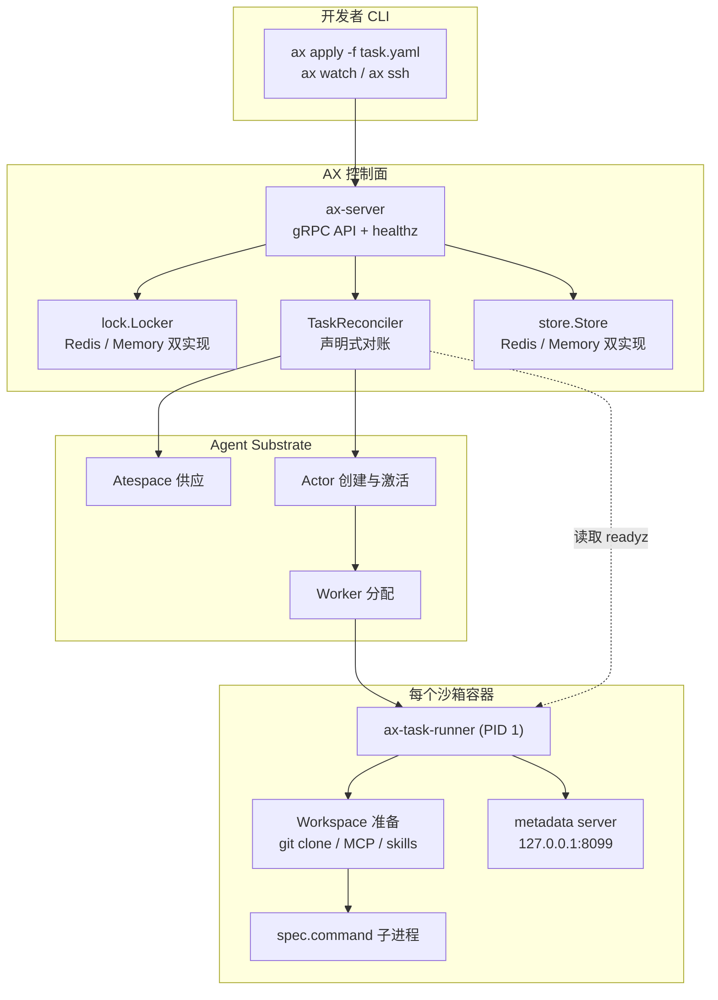
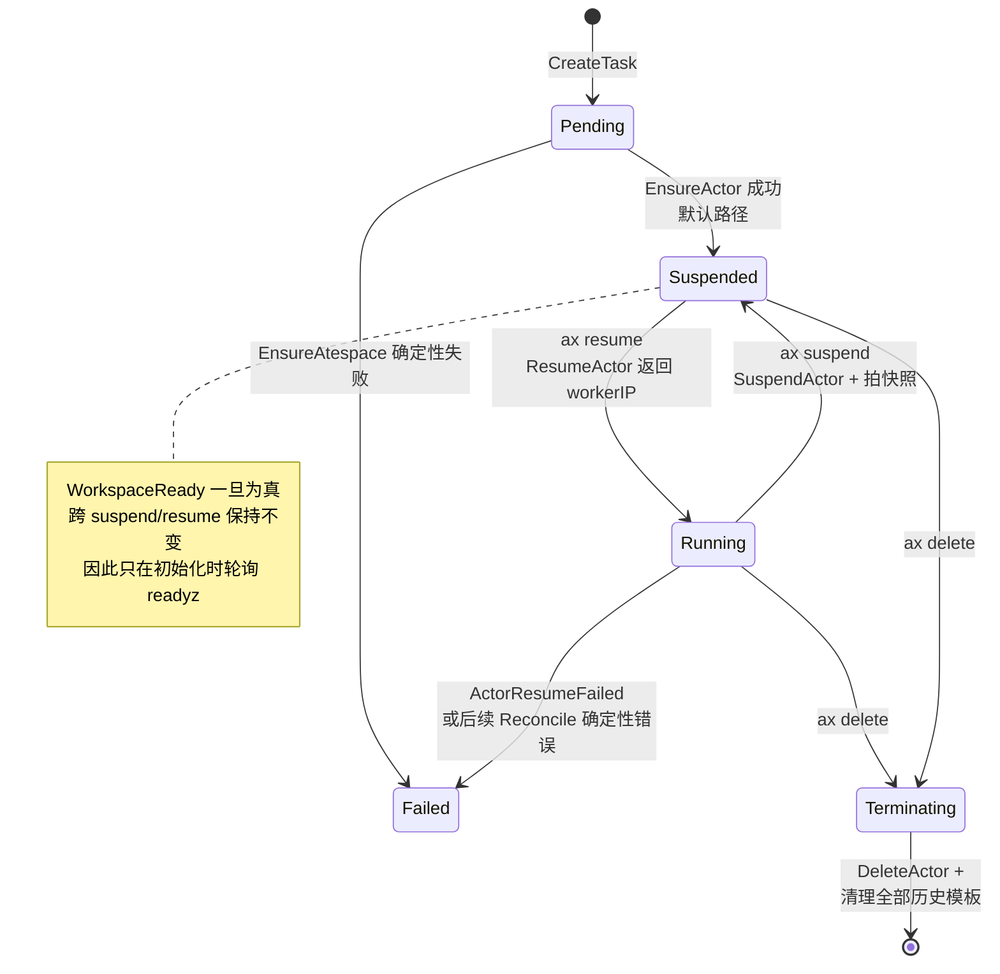
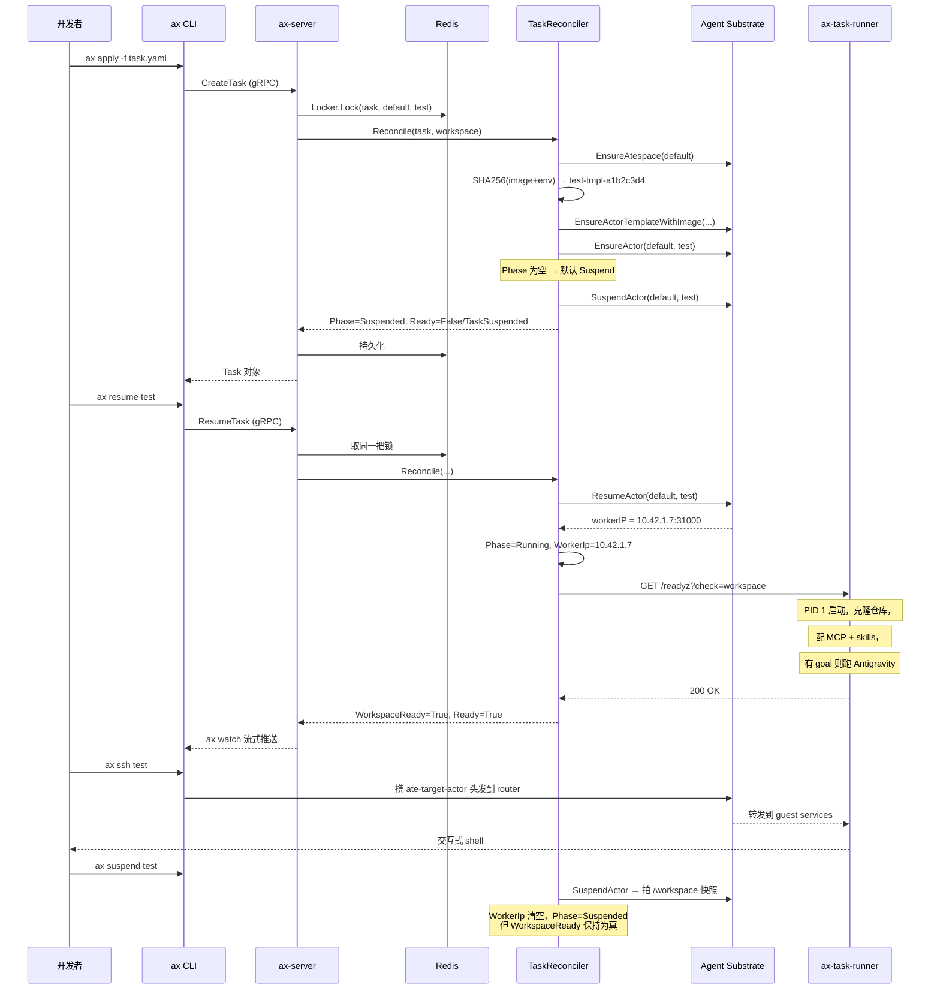

## 引子：Agent 不该是一种新的工作负载，它该复用旧的

写 Agent 基础设施的这两年，几乎每个团队都在重新发明同一套东西：一个进程，跑一个循环，调 LLM，碰到工具就执行，崩了就重来。跑得多了以后会撞上一堵墙——**Agent 是一种新东西吗？**

翻一翻已经成熟的分布式基础设施，答案很扎心：**Agent 需要的性质，Kubernetes 十年前就全有了。**

| Agent 的诉求 | Kubernetes 的现成答案 |
|---|---|
| 每个 Agent 跑在强隔离的环境里 | Pod + namespace + cgroup |
| 任务状态要能查、能存、能续 | etcd + CRD status |
| 死了要重启，重启后接着干 | restartPolicy + checkpoint |
| 大量任务要排队、要伸缩 | HPA + scheduler + queue |
| 要能 SSH 进去看看它在干嘛 | `kubectl exec` |
| 凭证不能进镜像 | Secret |
| 声明式配置，改了自动生效 | `kubectl apply` |

如果 Agent 真的只是一种「跑得久、会调 API、状态复杂」的负载，那用 Kubernetes 调度它是最自然的选择——**不是造一个新的编排器，而是复用已经被工业界验证了十年的那一个。**

2026 年 3 月 30 日，Google 开源了 **AX（Agent Executor）**，一个用 Go 写的、Apache-2.0 许可的声明式 Agent 编排运行时。README 里第一句话就是：

> If you have used Kubernetes, `ax` will feel similar.

本文拆开 AX，看它到底做了什么，以及为什么这条路值得认真考虑。

---

## 一、项目定位与核心价值

### 1.1 一句话定义

**AX 是一个高吞吐、声明式的 Agent 编排器，把 Agent 任务建模成 Kubernetes 风格的资源对象，在集群上调度数十亿个自治 Agent 工作负载。**

它的定位不是「Agent 框架」，而是**Agent 的 Kubernetes**。它不关心你的 Agent 怎么思考（那是 LLM 的事），只关心 Agent 作为「工作负载」时的生命周期问题：怎么声明、怎么调度、怎么隔离、怎么断点续跑、怎么观察。

### 1.2 仓库统计

| 维度 | 值 |
|---|---|
| 仓库 | [google/ax](https://github.com/google/ax) |
| Stars | ⭐ 14,024 |
| Forks | 731 |
| 主语言 | Go |
| License | Apache-2.0 |
| 创建时间 | 2026-03-30（约 7 个月） |
| 最近推送 | 2026-10-21（活跃） |
| 源码规模 | 41 个 Go 文件 + 115 个 tree 节点（代码极精炼） |

7 个月从 0 做到 14k 星，且还在每天提交（`runner: ignore unknown fields in specs`、`test: add Kind-based E2E test suite`），说明这不是一个放在那里不管的 demo。仓库里有一句非常重要的警告：

> AX and several of its features are in heavy development. We are actively refining our core concepts, protocols, and specifications, and will likely introduce major breaking changes prior to a stable release.

**API 版本是 `v1alpha1`——这是研究型项目，不是可直接上生产的组件。** 后面分析时会反复回到这一点。

### 1.3 三个原语

AX 只暴露三个一等公民资源，全部用 `ax.io/v1alpha1` 的 YAML 清单表达：

| 你想要 | AX 给你 |
|---|---|
| 在带 CPU/内存限制的隔离沙箱里跑不可信 Agent 代码 | **`Task`** |
| 把 Git 仓库、MCP server、技能包预置好，让每个 Agent 开箱即用 | **`Workspace`** |
| 配置平台自己用的 LLM，凭证走 Kubernetes Secret | **`Model`** |

加上两个 CLI 操作：**`ax suspend` / `ax resume`**（挂起空闲 Agent 并从原处续跑）和 **`ax ssh`**（钻进运行中的 Agent 看它在干什么）。

---

## 二、整体架构

### 2.1 三个二进制

| 二进制 | 角色 |
|---|---|
| `ax` | 开发者 CLI。apply 清单、查看/监听资源、隧道连到集群。 |
| `ax-server` | 直连执行模式的 gRPC API（端口 8080）。校验清单、管理分布式锁、直接与 Agent Substrate 对账、把状态持久化到 Redis。 |
| `ax-task-runner` | **每个任务容器内的 PID 1**。准备工作区、提供 metadata 服务、运行 Agent 命令。 |

`ax-task-runner` 是一层薄包装，核心在 `runner` 包——**自定义镜像可以直接内嵌这个包**，不必强行使用官方二进制。

### 2.2 顶层架构

AX 最反直觉、也最关键的一个设计决策：**它没有用 Kubernetes 存状态。**

DESIGN.md 里写得很直接：

> Storing millions of short-lived tasks as Kubernetes CRDs pushes etcd past its comfort zone (single-digit GB storage limits, write-rate bottlenecks, control plane degradation). AX stores its state in Redis and reconciles directly with Agent Substrate under fine-grained distributed locks.

翻译一下：如果你要跑「数十亿个短命 Agent 任务」，把每个任务都做成一个 CRD 塞进 etcd，etcd 会直接崩——它只有个位数 GB 的存储上限，而且写速率会成为控制面瓶颈。

所以 AX 的做法是：**保留 Kubernetes 的声明式心智模型，但把状态换成 Redis，把调度换成直连 gRPC 对账。**



三个设计要点值得单独拎出来：

**（1）状态存储与锁是一等公民。** AX 把 `store.Store` 和 `lock.Locker` 都定义成接口，且都提供 Redis 与内存双实现。Redis 版本不是「可选的分布式部署模式」，而是**默认的、能跑生产规模的那个**。

**（2）对账（Reconcile）而不是事件流。** 这是 Kubernetes 模式最核心的继承：不管客户端做了什么，控制面每轮都把「期望状态」和「实际状态」对一次，差距补上。AX 的 `TaskReconciler.Reconcile()` 就是这个函数。

**（3）Actor 名字恒等于 Task 名字。** 源码里的注释说得很直白：

```go
// 2. The actor is always named after the task, so the two can be used
// interchangeably (for example in the router's ate-target-actor header).
// Whatever a client put in status.actor is overwritten.
actorName := task.Metadata.Name
task.Status.Actor = actorName
```

这个看似任意的选择带来一个巨大的简化：**网络路由只需要一个 `ate-target-actor: <atespace>/<task>` 头就能定位到任何任务**，不需要额外的名字映射表。

---

## 三、核心引擎一：Task 对账循环

### 3.1 Reconcile 的九个步骤

`internal/controller/reconciler.go` 里的 `Reconcile()` 是整个控制面的心脏。它把一个 Task 清单变成一个跑起来的沙箱 Actor，步骤严格有序：

```go
// 来自 internal/controller/reconciler.go:Reconcile

// 1. 确保 Atespace 存在（Substrate 侧的命名空间概念）
if err := r.client.EnsureAtespace(ctx, atespace); err != nil {
    if substrate.IsTransientError(err) {
        r.setNotReady(task, "SubstrateUnavailable", err.Error(), now)
        task.Status.Phase = "Pending"      // 瞬时错误 → 留在 Pending，等下一轮
        return task, fmt.Errorf("ensuring atespace: %w", err)
    }
    r.setCondition(task, "Ready", "False", "AtespaceCreationFailed", err.Error(), now)
    task.Status.Phase = "Failed"           // 确定性错误 → 直接 Failed
    return task, fmt.Errorf("ensuring atespace: %w", err)
}

// 2. Actor 名字 = Task 名字（覆盖客户端塞进 status.actor 的任何值）
actorName := task.Metadata.Name
task.Status.Actor = actorName

// 3. 准备环境变量：spec.env + K8s Secret 里的 GEMINI_API_KEY + 注入的 YAML
launchTask := proto.Clone(task).(*v1alpha1.Task)
launchTask.Status = nil                    // ← 只有启动配置进模板，status 不进
if taskYAML, err := yaml.Marshal(launchTask); err == nil {
    extraEnv["AX_TASK_YAML"] = string(taskYAML)
}
if ws != nil {
    if wsYAML, err := yaml.Marshal(ws); err == nil {
        extraEnv["AX_WORKSPACE_YAML"] = string(wsYAML)
    }
}
```

第 3 步那个 `launchTask.Status = nil` 有一行注释解释：

> Only launch configuration belongs in the template; status changes must not create new golden snapshots.

**这是 AX 里我最喜欢的一个设计决定**。ActorTemplate 会产生「golden snapshot」（Substrate 用来做 suspend/resume 恢复的磁盘快照）。如果把 status 塞进去，那么任务每更新一次状态（心跳、进度、工作 IP 变化）都会导致内容摘要变化，进而触发一次全量快照重建——**一个纯粹的状态上报动作，会引发昂贵的存储操作**。把 status 剥离在模板之外，是把「声明」和「观测」在数据层面物理隔离开。

### 3.2 内容寻址的模板命名

AX 需要为每个「自定义镜像 + 自定义环境变量」组合生成一个专属的 ActorTemplate。命名方式是一个漂亮的内容摘要：

```go
// 来自 internal/controller/reconciler.go:taskTemplateName

const templateDigestBytes = 4   // 4 字节 = 8 个十六进制字符

func taskTemplateName(taskName, image string, env map[string]string) string {
    h := sha256.New()
    h.Write([]byte(image))
    keys := make([]string, 0, len(env))
    for k := range env {
        keys = append(keys, k)
    }
    sort.Strings(keys)                       // ← 排序保证确定性
    for _, k := range keys {
        h.Write([]byte(k + "=" + env[k] + ";"))
    }
    return fmt.Sprintf("%s-tmpl-%x", taskName, h.Sum(nil)[:templateDigestBytes])
}
```

三个细节都值得学：

**（a）`sort.Strings(keys)` 是必需的。** Go 的 `map` 遍历顺序是随机的，如果不排序，同样的 env 会产生不同的摘要名，导致每次对账都创建一个新模板——**模板泄漏**。这是一个只有真正跑过生产才会踩到的坑。

**（b）摘要截断到 4 字节。** 完整 SHA-256 是 32 字节，模板名会变得很长。4 字节 = 32 bit 空间，碰撞概率在单集群规模下完全够用，同时名字短到人能读。

**（c）配套的删除模式。** 因为名字里含摘要，删除时不能靠精确匹配，得靠正则：

```go
// 来自 internal/controller/reconciler.go:taskTemplatePattern
func taskTemplatePattern(taskName string) *regexp.Regexp {
    return regexp.MustCompile(fmt.Sprintf(
        "^%s-tmpl-[0-9a-f]{%d}$",
        regexp.QuoteMeta(taskName),
        2*templateDigestBytes))
}
```

`regexp.QuoteMeta` 同样重要——任务名里如果有 `.` 或 `-`，不转义会匹配到别的任务。这条正则扫出该任务在**所有历史版本**下产生过的每一个模板，然后一起清掉。

### 3.3 错误分类：瞬时 vs 确定性

整个 Reconcile 里，每一步错误都被分成两类：

- **瞬时错误**（`substrate.IsTransientError`）→ `Ready=False, reason=SubstrateUnavailable`，`Phase=Pending`，**下一轮对账重试**
- **确定性错误** → `Ready=False, reason=XxxFailed`，`Phase=Failed`，**不再自动重试**

这个区分直接决定控制面的可用性。如果所有错误都当失败处理，Substrate 网络抖一下就会导致一批任务永久 Failed；如果所有错误都重试，一个拼错的镜像名会让控制面陷入无限重试风暴。

源码里还有一段注释解释为什么模板创建失败**不能**退化到默认模板：

> Falling back to the default template would run a different image than the user asked for, without the limits it asked for, or fail later with a misleading "actor template not found". Surface the real error on the task and stop here.

**「静默降级比报错更危险」** ——这是运维系统的第一性原则。悄悄跑一个用户没要求的镜像，比明确报错糟糕得多。

---

## 四、核心引擎二：Task 生命周期状态机

### 4.1 状态与条件分离

AX 沿用 Kubernetes 的标准模式：**`status.phase` 是一句话概括，`status.conditions` 承载细节。**

Phase 取值：`Running` / `Suspended` / `Failed` / `Terminating` / `Pending`。

两个关键 Condition（来自 `docs/concepts.md`）：

| Condition | 为真的条件 |
|---|---|
| `WorkspaceReady` | 工作区准备完成。此后**永久保持为真**，跨 suspend/resume 周期不变。 |
| `Ready` | 任务在运行**且** `WorkspaceReady` 为真。**这是你应该等的那个。** |

两个值得注意的状态转移：

- **Suspend**：置 `Ready=False, reason=TaskSuspended`
- **Resume**：置回 `Ready=True`

### 4.2 默认挂起的反直觉设计

```go
// 来自 internal/controller/reconciler.go:Reconcile，步骤 4

// Tasks are suspended by default upon creation until explicitly resumed to "Running".
if task.Status.Phase == "Suspended" || task.Status.Phase == "" {
    if err := r.client.SuspendActor(ctx, atespace, actorName); err != nil {
        return task, fmt.Errorf("suspending actor: %w", err)
    }
    task.Status.WorkerIp = ""
    task.Status.Phase = "Suspended"
    r.setCondition(task, condReady, "False", "TaskSuspended", "Task is suspended", now)
    return task, nil
}
```

**新建的 Task 默认是挂起状态**，必须显式 `ax resume` 才会跑起来。

这看起来很别扭，但它是一个刻意的成本控制设计：`Task` 的创建是廉价的（一条 Redis 记录），而 `Resume` 会真正触发 Substrate 的 Worker 分配和容器启动（要钱、要资源）。如果你 `kubectl apply` 一份含 1000 个 Task 的清单，默认全跑意味着立刻启动 1000 个 LLM 会话；默认挂起则让你有机会先 `ax watch` 检查清单是否正确，再决定启动哪些。

**把「声明」和「执行」解耦**，这正是 Kubernetes `kubectl create` 与实际 Pod 调度之间的语义。

### 4.3 Suspend/Resume 的成本模型

`ax suspend` 的底层是 Substrate 的 **actor snapshot**：把沙箱的文件系统状态拍成一个 checkpoint，然后可以销毁容器。`ax resume` 时把快照恢复到一个新容器里。

`docs/runner.md` 里点明了这件事的含义：

> The `/workspace` volume is what survives suspend and resume. Agent Substrate snapshots it when a task is suspended and restores it into a fresh container when the task is resumed, so the runner will see the same files but a new process tree.

**同样的文件，全新的进程树。** 这是一个重要约束：任何假设进程状态在恢复后还成立的 Agent 逻辑（比如内存里的索引、单例连接池、进程内缓存）都会出错。

### 4.4 状态机全图



最后那条 note 是个实际的性能优化。源码里说：

> Workspace setup happens once per task. After it has completed, WorkspaceReady stays True across suspend/resume cycles, so only poll while it is still initializing.

**如果不利用这个不变量，AX 每次对账都会去 HTTP 轮询所有运行中任务的 `/readyz`——在数十亿任务的规模下，这个网络开销是致命的。**

---

## 五、核心引擎三：Workspace —— 环境准备即代码

### 5.1 痛点

`docs/concepts.md` 把 Workspace 要解决的问题说得非常具体：

> Getting an agent to the point where it can start working is tedious. Before the first useful action it needs its data sources in place, such as repositories cloned at the right revision or buckets mounted, the tools it is allowed to call, and the skills it should bring along. Every task that needs the same environment repeats that setup, and every agent framework reinverts it.

拆开就是四个必做的准备动作：

1. **Git 仓库克隆到指定 revision**
2. **MCP server 与 registry 配置就位**
3. **技能包（Skills）挂载**
4. **Agent 自己能调用的工具白名单**

然后是那句诛心的话：**"每个 Agent 框架都在重新发明这套东西。"**

确实如此。你在 Claude Code 里手工 `git clone`、写 `.mcp.json`、拷 skills 目录；换到 Cursor 又要重来一遍；容器化之后 Dockerfile 里再写一遍。Workspace 把这套东西**声明一次、绑定多次**。

### 5.2 Workspace 清单

```yaml
# 来自 docs/manifests.md
apiVersion: ax.io/v1alpha1
kind: Workspace
metadata:
  name: default-workspace
spec:
  git:
    - repo: https://github.com/golang/go.git
      branch: "my-fix"
  mcp:
    servers:
      - name: filesystem
        command: npx
        args: ["-y", "@modelcontextprotocol/server-filesystem", "/data"]
  skills:
    sources:
      - repo: https://github.com/my-org/agent-skills
        path: skills/
  files:
    - source: s3://my-bucket/dataset.parquet
      target: data/dataset.parquet
```

### 5.3 Goal 驱动的引导式环境准备

这是 AX 里最激进、也最有意思的设计。

Task 在绑定 Workspace 时可以带一个 `goal`：

```yaml
# 来自 docs/manifests.md
spec:
  workspace:
    name: default-workspace
    path: "/workspace"
    goal: "Install dependencies and run the test suite"
```

`docs/manifests.md` 里的注释只有一句：

> Antigravity prepares the workspace to this goal on first run

**这是把环境准备本身交给 Agent 做。** `internal/workspace/setup.go` 里能看到具体实现：

```go
// 来自 internal/workspace/setup.go:40-60

bootstrapScriptPath  = "/usr/local/bin/antigravity_bootstrap.py"
bootstrapAPIKeyEnv   = "GEMINI_API_KEY"
bootstrapTimeoutEnv  = "AX_BOOTSTRAP_TIMEOUT"
bootstrapDataDir     = "antigravity"
defaultBootstrapTimeout = 10 * time.Minute
```

`docs/sandbox.md` 里的启动序列描述了完整流程：

> On the first run, prepares each workspace at its own path, in binding order: clones Git repos, sets up the skills path, and, if the binding has a goal, hands that goal to an Antigravity agent to finish environment setup. The agent needs `GEMINI_API_KEY` in the container and gets 10 minutes by default; set `AX_BOOTSTRAP_TIMEOUT` to a Go duration to change that.

所以完整链路是：

```mermaid
flowchart LR
    A["ax apply task.yaml"] --> B["Reconciler 校验资源"]
    B --> C["EnsureActorTemplate<br/>SHA256 摘要命名"]
    C --> D["EnsureActor<br/>名字 = Task 名"]
    D --> E["Suspend 默认<br/>等显式 resume"]
    E --> F["ResumeActor<br/>分配 Worker"]
    F --> G["ax-task-runner 启动 PID 1"]
    G --> H["读 AX_TASK_YAML<br/>AX_WORKSPACE_YAML"]
    H --> I["git clone 到 workspace 路径"]
    I --> J["配置 MCP + skills"]
    J --> K{"spec.workspace.goal<br/>存在?"}
    K -->|是| L["Antigravity Agent<br/>10 分钟预算<br/>GEMINI_API_KEY"]
    K -->|否| M["跳过"]
    L --> N["readyz 返回 200"]
    M --> N
    N --> O["启动 spec.command 子进程"]
    O --> P["注入 AX_METADATA_URL"]
```



**这个设计的哲学转变值得单独说。**

传统做法是「声明式环境」：你在清单里写清楚需要 Node 18、Python 3.11、Postgres client，然后祈祷镜像里有。缺什么就得到一个莫名其妙的运行时错误。

AX 的做法是「意图式环境」：你只说你想达成什么（"装依赖并跑测试"），一个 Agent 在沙箱里自己探索、自己装、自己试，直到满足目标。

**类比**：Dockerfile 是「描述步骤」，Workspace goal 是「描述验收标准」。前者是命令式，后者是声明式——而且是**可搜索验证的声明式**，因为 Agent 会实际执行来确认。

风险也很明确：一个 10 分钟的 Agent 运行来做环境准备，成本和不确定性都比 `apt-get install` 高一个数量级。AX 把它做成**可选的**（`goal` 不填就走纯声明式路径），这是合理的分层设计。

### 5.4 Metadata Server：Agent 的自我 introspection

AX 给每个沙箱内挂了一个只监听 loopback 的 HTTP 服务（默认 `127.0.0.1:8099`）：

| Endpoint | Method | 返回 |
|---|---|---|
| `/metadata/v1alpha1/ax/task` | GET | `application/yaml`，Task 启动配置（不含 status） |
| `/metadata/v1alpha1/ax/workspace` | GET | `application/yaml`，绑定的 Workspace；未绑定时 `404` |

用法：

```bash
# 在任务容器内部
curl -s "$AX_METADATA_URL/metadata/v1alpha1/ax/task"
```

文档里说得很漂亮：**"Your agent can introspect its own configuration without any SDK."**

这是个很小但很到位的细节。传统的做法是控制面通过模板变量注入配置，但那样 Agent 代码就得依赖特定的环境变量命名约定。这里 Agent 只要读一个标准 HTTP 端点，任何语言、任何框架都能用，`curl` 都行。

---

## 六、Runner 契约：Agent 框架与运行时的解耦点

### 6.1 控制面不改你的 entrypoint

这是 AX 最激进的一个决定。`docs/runner.md`：

> The control plane does not run `spec.command` as the container entrypoint. It always starts the container with a fixed command and lets the runner take it from there.

| AX 设置什么 | 值 |
|---|---|
| 容器镜像 | `spec.image`，或默认 `ax-task-runner` 镜像 |
| **容器命令** | **`/usr/local/bin/ax-task-runner`，永远固定** |
| `AX_TASK_YAML` | Task 启动配置 YAML（不含 status） |
| `AX_WORKSPACE_YAML` | 绑定的 Workspace 资源 YAML；未绑定时不设置 |
| `spec.env` 条目 | 逐条设置到容器环境 |
| `GEMINI_API_KEY` | atespace 配置了 Gemini 凭证时设置 |
| Volume | `/workspace` 上挂一个持久目录 |
| 就绪探针 | 端口 80 的 `GET /readyz` |

而你的 `spec.command` 只能通过 `AX_TASK_YAML` 传到 runner，由 **runner 负责解析并启动它**。

文档紧接着列出两条后果：

> Two consequences follow from that table. Your image must contain an executable at `/usr/local/bin/ax-task-runner`, even if it is a symlink or a shell wrapper around something else. And `spec.command` reaches the runner only through `AX_TASK_YAML`; the runner is responsible for parsing it and starting it.

**为什么这么设计？**

如果控制面直接执行 `spec.command`，那么沙箱内就没有任何常驻进程来做三件事：服务 `/healthz` 和 `/readyz`、提供 metadata、接住 suspend/resume 信号。

`docs/sandbox.md` 说得很清楚：

> The runner stays up as PID 1 whether or not the command is still running, so the metadata server keeps answering and `ax ssh` still works after the command has exited. Its exit code is logged.

**这直接决定了「Agent 命令跑完之后还能进去看现场」这个能力。** 命令退出 → runner 还在 → `/readyz` 还在应答 → `ax ssh` 还能进去翻日志。对于调试长任务，这是一个非常实用的性质。

### 6.2 停机时的进程组清理

```go
// docs/sandbox.md 描述的行为
// When the sandbox is stopped or suspended, the runner sends the command's
// process group SIGTERM, waits ten seconds, and then kills whatever is left.
```

注意是 **process group** 而不是单个进程。Agent 经常会 fork 出子进程（后台工具、编译进程、shell session），只 kill 父进程会留下一堆孤儿继续占资源。**10 秒宽限期** 给 Agent 自己做清理的机会，之后才 SIGKILL。

### 6.3 端口 80 的三个端点

| Endpoint | Method | 返回 | 用途 |
|---|---|---|---|
| `/healthz` | GET | `text/plain` | 存活。永远 `200 OK`。 |
| `/readyz` | GET | `text/plain` | 就绪。工作区初始化中 `503`，完成后 `200`。 |
| （debug 模式）| — | gRPC | Agent Substrate guest services |

端口 80 同时说 HTTP/1.1 和 **h2c**（HTTP/2 _cleartext）——因为 guest services 走 gRPC，需要 HTTP/2。

`spec.debug: true` 会打开 guest services，文档也诚实地说明了代价：

> They are off by default because they allow arbitrary process execution and file access inside the sandbox.

**默认关闭是一个正确的默认值。** guest services 相当于给了沙箱一个远程 shell——生产环境开这个，等于把 RCE 变成一个 HTTP 请求。

---

## 七、网络层：一个 Header 定位任意任务

`docs/networking.md` 的设计非常克制：

> Tasks do not get a Kubernetes Service or Ingress of their own. Every request to a task goes through Agent Substrate's **atenet router**... The router reads a single header, `ate-target-actor`, resolves the actor to the worker it is running on, **resumes it first if it was suspended**, and proxies the request there.

Header 值格式：`<atespace>/<task>`。因为 actor 恒等于 task 名（前面 §2.2 讲过），所以 `default/task123` 直接命中。

集群内调用：

```bash
curl -H "ate-target-actor: default/task123" \
  http://atenet-router.ate-system.svc.cluster.local/readyz
```

本地调试：

```bash
kubectl -n ate-system port-forward svc/atenet-router 8001:80
curl -H "ate-target-actor: default/task123" http://localhost:8001/readyz
```

gRPC 场景：

```go
ctx = metadata.AppendToOutgoingContext(ctx, "ate-target-actor", "default/task123")
resp, err := client.SomeMethod(ctx, req)
```

**「路由前先自动 resume」是一个容易被忽略但极其有用的细节。** 你 curl 一个挂起的任务，路由器会先把它唤醒再转发。这意味着「调试一个挂起的 Agent」不需要先手动 resume——你直接请求就行。

对比 Kubernetes：Pod 要 Service，Service 要 selector，Ingress 还要额外控制器和 DNS。这里**零资源对象、零配置、一个 header**。对于「成千上万个短命 Agent」，少创建几万个 Service/Ingress 对象，是数量级的运维负担差异。

---

## 八、分布式锁：控制面的正确性基础

`internal/lock/lock.go` 定义了一个极简接口：

```go
// 来自 internal/lock/lock.go:36-46

// Locker provides exclusive locking per resource kind, atespace, and name.
type Locker interface {
    // Lock acquires an exclusive lock for the specified resource.
    // It blocks until the lock is acquired or ctx is cancelled.
    // The returned function releases the lock.
    Lock(ctx context.Context, kind, atespace, name string) (unlock func(), err error)
}

// Key formats the standard lock key.
func Key(kind, atespace, name string) string {
    if atespace == "" {
        atespace = "default"
    }
    return fmt.Sprintf("lock:%s:%s:%s", kind, atespace, name)
}
```

**锁的粒度是 `(kind, atespace, name)` 三元组。** 同一个 atespace 里不同 Task 可以并行对账，同一个 Task 的并发请求会串行化。这是正确的粒度——粒度太粗吞吐上不去，太细则同一资源的并发操作会互相踩踏。

内存实现用引用计数：

```go
// 来自 internal/lock/lock.go:50-56

type MemoryLocker struct {
    mu    sync.Mutex
    locks map[string]*entry
}

type entry struct {
    mu  sync.Mutex
    ref int      // ← 引用计数：等锁者数量
}
```

`ref` 字段是必须的：如果没有它，一个持有者释放锁时如果发现 map 里没人等，就会删除条目——此时一个刚到来、正准备等待的 goroutine 会创建新条目，而原持有者还在退出临界区，**两个 goroutine 同时认为自己持有锁**。引用计数是修复这个经典竞态的标准手段。

Redis 实现用 `go-redis/v9`。这个双实现（Memory / Redis）的意义在于：**单机开发和单元测试不需要起 Redis**，而生产环境用 Redis 获得跨副本互斥。接口契约完全一致。

---

## 九、清单校验：protojson 作为唯一真相

`pkg/apis/v1alpha1/types.go` 里有一段设计说明值得完整引用：

```go
// 来自 pkg/apis/v1alpha1/types.go:40-58

// The API kinds are protobuf messages, so protojson is the single source of
// truth for their wire names (lowerCamelCase), timestamp format (RFC 3339), and
// which fields are omitted when unset. YAML is bridged through it: manifests are
// decoded generically, converted to JSON, and then decoded strictly by protojson,
// so unknown or misspelled fields are rejected. Output is protojson rendered as
// a yaml.Node so field order follows the proto definition instead of being
// sorted.
var (
    protoMarshal   = protojson.MarshalOptions{}
    protoUnmarshal = protojson.UnmarshalOptions{} // unknown fields are errors
    // protoUnmarshalLenient is for specs the control plane hands to a runner,
    // which may come from a newer control plane than the runner image.
    protoUnmarshalLenient = protojson.UnmarshalOptions{DiscardUnknown: true}
)
```

**严格模式与宽松模式并存**，而且理由写得很清楚：

- **控制面 → 客户端**：`protoUnmarshal` **严格**，拼错字段名直接报错。写错 `apiVerison` 应该立刻失败，而不是被静默忽略然后用默认值跑出一个诡异任务。
- **控制面 → runner**：`protoUnmarshalLenient` **宽松**（`DiscardUnknown: true`）。因为 runner 镜像可能比控制面旧，新版控制面下发的字段老 runner 不认识——**这时候必须忽略未知字段，否则一次控制面升级会让所有旧 runner 全部失败**。

这个「同一个 schema，两种解析严格度，按数据流向选择」的思路，是任何需要滚动升级的分布式系统都会遇到的经典问题，AX 给出了一个干净的答案。

此外 AX 还保留了对少量历史清单形态的兼容——在严格解码前用 `normalizer` 就地重写：

```go
// A few legacy manifest shapes are still accepted. They are rewritten on the
// generic document before strict decoding by the per-kind normalizers below.
type normalizer func(doc map[string]any)
```

**在"严格校验"和"向后兼容"这对矛盾之间，答案是"先宽松解析 → 重写 → 严格解码"**，而不是给每个字段加一堆 `if deprecated`。

---

## 十、端到端数据流

把所有部件串起来的完整时序：



---

## 十一、与同类项目对比

AX 经常被误认为「又一个 Agent 框架」，但它和 LangGraph / OpenAI Agents SDK 根本不在同一层。横向对比：

| 维度 | **google/ax** | LangGraph | OpenAI Agents SDK | Kubernetes |
|---|---|---|---|---|
| 抽象层 | **工作负载调度** | 图编排 | Agent 通信模式 | 容器编排 |
| 核心对象 | Task / Workspace / Model | State / Node / Edge | Agent / Handoff / Guardrail | Pod / Deployment / Service |
| 控制流 | **由 Agent 自己决定，平台只调度** | 图结构预先定义 | 代码定义 | 声明式 + 控制器对账 |
| 状态存储 | Redis | 应用自选（checkpointer） | 应用自选 | etcd |
| 隔离 | **沙箱 Actor + CPU/内存限额** | 无（进程内） | 无（进程内） | namespace + cgroup |
| 断点续跑 | **快照 suspend/resume** | checkpointer | 无内建 | Pod 重启 |
| 状态发现 | `ax watch` / `/readyz` | LangSmith | tracing | `kubectl get` |
| 调度目标 | **数十亿任务 / 集群** | 单进程应用 | 单进程应用 | 集群 |
| 语言 | Go | Python | Python | Go |
| 心智负担 | 需要懂 K8s 概念 | 中等 | 低 | 高 |

### 11.1 AX vs LangGraph：正交，不是替代

- **LangGraph 解决「Agent 怎么思考」**——状态怎么流转、节点怎么连、循环怎么终止。
- **AX 解决「Agent 怎么活着」**——跑在哪、隔离到什么程度、崩了怎么恢复、花了多少钱。

一个典型的分层架构是：**LangGraph 定义的图跑在一个 AX Task 里**。LangGraph 管流程，AX 管这个流程跑在哪个沙箱、用哪个镜像、能扩到多少并发。两者完全不冲突。

### 11.2 AX vs Kubernetes：AX 砍掉了什么

AX 保留了 K8s 的心智模型，但砍掉了三样最重的东西：

| Kubernetes 的负担 | AX 的做法 |
|---|---|
| CRD 存在 etcd，存储上限个位数 GB | 状态存 Redis，为「数十亿短命任务」设计 |
| 每个 Pod 需要 Service / Ingress 才能被访问 | 一个 `ate-target-actor` header 搞定 |
| 控制面组件（scheduler / controller-manager / etcd）本身就要运维 | 只有 `ax-server` + Redis + Substrate |

**代价是：AX 不再是 Kubernetes 的一部分。** 你不能直接用 `kubectl get task` 看到 AX 的资源，不能用 K8s 的 RBAC/network policy/HPA。这些能力要么 AX 后面自己实现（`docs/roadmap.md` 大概在规划），要么就放弃。

这是一个清晰的取舍：**如果你的 Agent 任务是几十个，用 Kubernetes 就够了；如果是几百万个，etcd 就是瓶颈，必须换成 Redis。** AX 明确选择了后者。

### 11.3 AX vs 自建 Agent 调度器

大多数团队现在的做法是：写个脚本调 OpenAI API，用 `asyncio.Semaphore` 控制并发，跑完就完事。

这种做法在 Agent 数量 < 100 时完全够用。但一旦需要：

- 任务中断后从原处恢复 → 需要快照机制
- 某个 Agent 跑飞了烧掉大量 token → 需要 CPU/内存限额和超时
- 需要知道每个任务跑到哪了 → 需要状态存储和查询接口
- 需要 1000 个 Agent 并发 → 需要队列、Worker 分配、限流

AX 就是把这四件事产品化了。**它不是「更好的 Agent 框架」，而是「把运维 Agent 的脏活标准化」。**

---

## 十二、优缺点分析

### 12.1 优势侧：架构简洁性 / 扩展性 / 易用性

| 优势 | 说明 |
|---|---|
| **声明式心智模型极低认知门槛** | 任何用过 K8s 的人十分钟上手。README 那句 "you will feel similar" 不是营销，是事实。 |
| **只有三个原语** | Task / Workspace / Model。没有隐藏的概念、没有第 47 种 CRD 资源。 |
| **41 个 Go 文件** | 整个控制面加 runner 一万行左右。可以在一个下午读完。 |
| **接口化的存储与锁** | `store.Store` / `lock.Locker` 双实现，测试用内存、生产用 Redis，同一套契约。 |
| **内容寻址消除状态歧义** | 模板名 = SHA256(镜像+环境)，同样的输入永远得到同样的名字，重启后幂等。 |
| **status 与 spec 物理隔离** | `launchTask.Status = nil` 一行，避免状态抖动引发快照风暴。 |
| **默认安全** | guest services 默认关闭、`spec.debug` 默认 false。 |
| **严格/宽松双解析** | 前向兼容控制面升级，同时对用户输入保持严格校验。 |

### 12.2 劣势侧：性能 / 复杂度 / 维护性

| 劣势 | 说明 |
|---|---|
| **v1alpha1 + 明确的破坏性变更承诺** | README 白纸黑字说 stable release 前会有重大 breaking change。生产慎用。 |
| **强依赖 Agent Substrate** | Substrate 不在同一个仓库，也不是 Google 公开托管的成熟组件。AX 的价值高度绑定在 Substrate 的成熟度上。 |
| **需要 K8s 集群** | 想用 AX，先得有一套 K8s + Substrate。对单机开发者是巨大门槛。 |
| **镜像必须 digest 固定** | `spec.image: my-agent:v1` 会被拒绝，必须 `@sha256:...`。安全上正确，但开发迭代时每次改镜像都要重新解析 digest。 |
| **入口点被接管** | 容器 entrypoint 永远是 `/usr/local/bin/ax-task-runner`，你的镜像必须包含它。已有 Dockerfile 需要改造。 |
| **Go 生态门槛** | 团队如果只有 Python 人才，二次开发成本高。 |
| **Workspace goal 的不确定性** | 把环境准备交给 Agent，引入了一个 10 分钟、结果不可预测的执行阶段。可靠性远低于声明式安装。 |
| **可观测性方案未内建** | 没有内置 trace / metrics 面板。`ax watch` 能看状态，但要看 Agent 内部行为还得自己接。 |
| **生态几乎为零** | GitHub 上基于 AX 构建的工具、模板、社区实践基本没有。 |

### 12.3 一句话总结

**AX 用「概念数量换规模上限」——只有三个原语，但能撑到数十亿任务。如果你只需要跑几十个 Agent，这是严重过度设计；如果你要跑几百万个，这可能是目前唯一一条不 reinvent Kubernetes 的路。**

---

## 十三、实践：把一个 Agent 跑起来

### 13.1 环境准备

```bash
# 前置条件：K8s 集群 + Agent Substrate 已在集群内运行
git clone https://github.com/google/ax.git
cd ax
make build          # 产出 ax / ax-server / ax-task-runner
```

部署控制面（DESIGN.md 提到的两个组件）：

```bash
kubectl apply -f deploy/ax-server.yaml
kubectl apply -f deploy/redis.yaml
```

### 13.2 一个完整的例子

```yaml
# task.yaml
apiVersion: ax.io/v1alpha1
kind: Workspace
metadata:
  name: golang
spec:
  git:
    - repo: https://github.com/golang/go.git
      branch: "my-fix"
---
apiVersion: ax.io/v1alpha1
kind: Task
metadata:
  name: test
spec:
  workspace:
    name: golang
    goal: "Ensure that Go tool chain is available and is built from source"
  debug: true   # 开启后 ax ssh 才能用
```

三步跑起来：

```bash
ax apply -f task.yaml
ax watch task test
ax ssh test -- ls -al /workspace
```

### 13.3 镜像必须 digest 固定

```bash
# 把 tag 解析成 digest
docker buildx imagetools inspect ghcr.io/my-org/my-agent-image:v1
# 或
crane digest ghcr.io/my-org/my-agent-image:v1
```

然后写进清单：

```yaml
spec:
  image: "ghcr.io/my-org/my-agent-image@sha256:3a0dea6ad8b55278685db58aca6e37dc4ba04056831d45bef3aaeafdca43cac6"
```

`docs/manifests.md` 解释了为什么：

> A tag-only reference such as `my-agent:v1` is rejected when the task's ActorTemplate is created, because a tag can move and would silently invalidate the actor's snapshots.

**tag 会漂移，会让已有快照失效**——这和 K8s 里 `imagePullPolicy: IfNotPresent` 遇到的问题同源，但在有快照的场景下后果严重得多。

### 13.4 Agent 里的自我 introspection

不需要任何 SDK：

```python
# Agent 进程内
import os, urllib.request

meta_url = os.environ["AX_METADATA_URL"]   # 默认 127.0.0.1:8099

# 我是什么任务？
task_yaml = urllib.request.urlopen(
    f"{meta_url}/metadata/v1alpha1/ax/task"
).read().decode()

# 我的工作区配置是什么？
try:
    ws_yaml = urllib.request.urlopen(
        f"{meta_url}/metadata/v1alpha1/ax/workspace"
    ).read().decode()
except Exception:
    ws_yaml = None   # 404 表示没有绑定 workspace

print(task_yaml)
```

### 13.5 自定义 Runner：只满足契约即可

`docs/runner.md` 明确说，你**不需要**用官方 runner：

> You do not have to use it. Any binary that honors the contract below can be packaged into a container image and named in `spec.image`, and the control plane will treat it exactly like the default.

最小契约只有两条：

1. `/usr/local/bin/ax-task-runner` 存在且可执行（可以是 shell wrapper 或 symlink）
2. 在 80 端口提供 `/healthz`（返回 200）和 `/readyz`（初始化中 503，就绪后 200）

一个「能跑的最小 runner」大致是这样：

```python
#!/usr/bin/env python3
# 最小 ax-task-runner 实现：满足 docs/runner.md 的契约
import http.server, json, os, subprocess, sys, threading

ready = False

class Handler(http.server.BaseHTTPRequestHandler):
    def do_GET(self):
        if self.path.startswith('/healthz'):
            self.send_response(200); self.end_headers()
            self.wfile.write(b'OK')
        elif self.path.startswith('/readyz'):
            self.send_response(200 if ready else 503); self.end_headers()
            self.wfile.write(b'ready' if ready else b'initializing')
        else:
            self.send_response(404); self.end_headers()
    def log_message(self, *a): pass

srv = http.server.ThreadingHTTPServer(('0.0.0.0', 80), Handler)
threading.Thread(target=srv.serve_forever, daemon=True).start()

# 从控制面注入的 YAML 里读出 spec.command 并启动它
# （生产实现应使用 yaml + protojson 严格解析，这里为可读性简化）
cmd = json.loads(os.environ.get('AX_TASK_YAML', '{}')) \
        .get('spec', {}).get('command', ['/bin/sh'])
print(f'launching: {cmd}', flush=True)
proc = subprocess.Popen(cmd, cwd=os.environ.get('AX_WORKSPACE_PATH', '/workspace'))

ready = True   # 真实实现：完成 git clone / MCP 配置 / skills 挂载后才置位
rc = proc.wait()
print(f'command exited with {rc}', flush=True)
# 关键：不要退出，PID 1 必须常驻以维持 /healthz 与 ax ssh
while True:
    import time; time.sleep(3600)
```

注意最后那个 `while True` 循环——它对应 `docs/sandbox.md` 的要求：

> The runner stays up as PID 1 whether or not the command is still running, so the metadata server keeps answering and `ax ssh` still works after the command has exited.

---

## 十四、趋势判断

### 14.1 「Agent 编排器」这个品类正在被重新定义

过去两年，市面上的 Agent 编排工具几乎都在同一个维度竞争：怎么让多个 Agent 对话、怎么拆任务、怎么循环。LangGraph、CrewAI、AutoGen 都在这个维度。

**AX 跳出了这个维度。** 它不说「你的 Agent 应该这样思考」，它说「你的 Agent 应该这样被调度」。前者是框架的自我，后者是基础设施的自我。

这个转向背后是一个很清醒的判断：**Agent 的思考逻辑会越来越被模型本身吸收**（长上下文、工具调用、规划能力都在模型侧改进），而**调度、隔离、成本控制、状态管理这些问题是模型进步解决不了的**。AX 把赌注押在后者上。

### 14.2 「Agent 沙箱」正从安全功能变成成本功能

早期讲 Agent 沙箱，理由是「不可信代码要隔离」。但 AX 的设计里，sandbox 更多承担的是**成本与资源边界**的角色：CPU/内存限额、suspend 时不烧钱。

这个转变很关键。当 Agent 从「偶尔被调用的工具」变成「持续运行、自主循环的同事」时，**一个跑飞的 Agent 一晚上能烧掉几千美金的 API 费用**。suspend/resume 让「闲置的 Agent 不花钱」成为可能——这在 LLM 推理成本持续波动的当下，是非常实际的经济学。

### 14.3 Workspace goal 是「意图即环境」，可能是更大的趋势

AX 允许用户不写 Dockerfile，只写一句 `goal: "装依赖并跑测试"`，让 Agent 自己去完成环境准备。

这是一个方向性判断：**当 Agent 足够强，让它自己准备环境比预先写死环境更划算**。这和「让 Agent 自己写测试比手写测试更划算」是同一条曲线的不同位置。

代价是确定性和成本。目前 AX 把它做成可选、给 10 分钟预算，是个合理的中间态。但随着本地模型和工具调用能力提升，这个默认值的方向可能是**逐渐往前移**。

### 14.4 Google 选择开源 AX 意味着什么

Google 有最强的 Agent 技术（TFDL、JAX、ADK），也有最强的基础设施（Kubernetes、GKE）。AX 看起来像是内部 agentic 平台的**基础设施层被单独抽出来开源**。

对这个生态的含义是：**Google 正在把 Agent 基础设施的标准化入口抢在自己手里**。就像当年把 Kubernetes 开源一样——一旦「Agent 的 K8s」这个心智建立起来，后面所有的编排工具都要在这个范式里竞争，而不是反过来。

对使用者的启示是：**如果你判断自己的 Agent 规模会超过几百个，或者需要跨团队、跨环境地调度 Agent，现在就值得研究这个范式**。不是因为今天就要迁移，而是因为生态会围绕它生长出来。

### 14.5 给不同规模团队的行动建议

| 你的规模 | 建议 |
|---|---|
| **< 10 个 Agent** | 别用 AX。写个 `asyncio` 脚本 + 一个 Redis 队列就够了，上 K8s 是自找麻烦。 |
| **10 ~ 100 个** | 可以评估 K8s + 简单的 Job/CronJob 编排。用 AX 的话主要收益是 `ax ssh` 调试体验和 suspend/resume 省钱。 |
| **100 ~ 10,000 个** | **AX 的目标区间。** 认真读 `docs/concepts.md` 和 `docs/runner.md`，先做 POC 验证 Substrate 能否满足你的隔离要求。 |
| **> 10,000 个** | 直接读源码（只有 41 个 Go 文件，一周能读完）。同时评估 fork 的成本——`v1alpha1` 意味着你要自己维护 breaking change。 |
| **只是想学习** | 这是目前最值得读的 Agent 基础设施代码。概念少、代码精炼、设计意图全在注释里。 |

---

## 附录：关键资源

| 资源 | 地址 |
|---|---|
| GitHub 仓库 | https://github.com/google/ax |
| License | Apache-2.0 |
| 主语言 | Go（41 个 .go 文件） |
| API 版本 | `ax.io/v1alpha1` |
| 核心概念文档 | `docs/concepts.md` |
| Runner 契约 | `docs/runner.md` |
| 沙箱内部行为 | `docs/sandbox.md` |
| 网络路由 | `docs/networking.md` |
| 架构决策 | `DESIGN.md` |
| 路线图 | `docs/roadmap.md` |
| 依赖底座 | https://github.com/agent-substrate/substrate |
| 三个原语 | `Task`（隔离执行）/ `Workspace`（环境预置）/ `Model`（平台 LLM 配置） |
| 关键常量 | `templateDigestBytes=4` / `defaultBootstrapTimeout=10m` / `secretLookupTimeout=2s` / `workspaceReadyPollInterval=500ms` |

**一句话总结**：`google/ax` 用 41 个 Go 文件、三个 YAML 原语，证明了「Agent 编排」这个问题的答案，可能不在 LLM 层，而在调度层。**如果 Agent 是一种新工作负载，那它最该复用的，是十年前就已经被工业界验证过的那个调度器。**