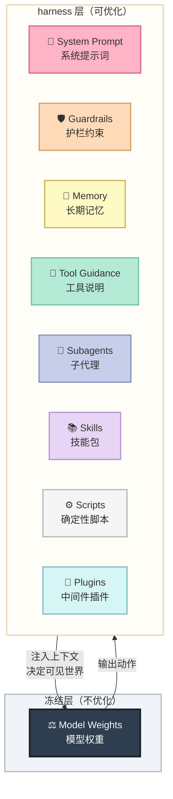
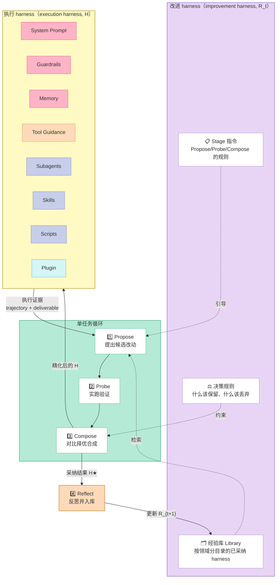
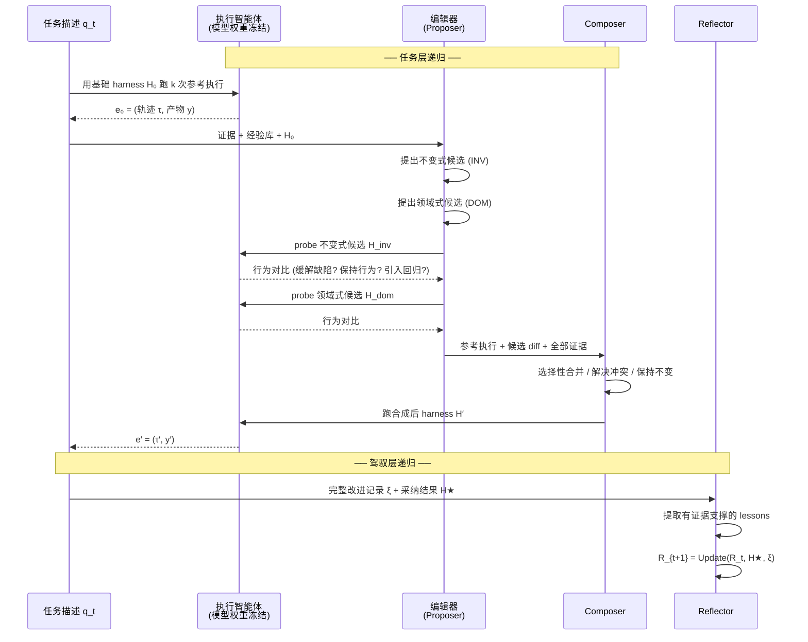
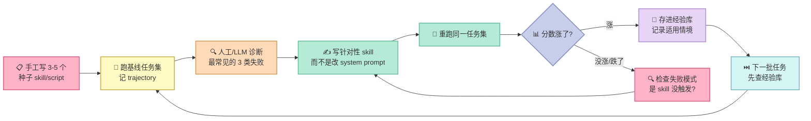

> **Harness the agent. Then harness its self-improvement.**
>
> 先驾驭智能体，再驾驭它的自我改进。

2026 年 10 月 6 日，Google Cloud AI Research 在 GitHub 上开源了一个叫 **Harness²** 的项目。半个月后的今天，它已经攒下 **17,211 个 star**、1,595 个 fork，配套论文同步挂在 arXiv 上（编号 2610.14224）。

这个速度在 agent 基础设施领域属于第一梯队。但真正让我读完代码和论文后停下来思考的，不是它的分数，而是它的一个反直觉实验结论：

> **如果不做实跑验证，直接让模型去改写系统提示词，工作台基准的分数会从 73.4 暴跌到 63.2。**

换句话说，"让 AI 自己优化自己"这件事，**行不行几乎完全取决于你给它配不配"执行证据"**。有证据，它能涨 8 分；没证据，它能跌 10 分。

这篇文章把 Harness² 的设计拆开来讲：它到底改什么、怎么改、为什么这么改，以及哪些结论可以直接用在你自己的 agent 项目里。

---

## 一、引子：我们到底在"改"什么

要理解 Harness²，得先把一个容易被混淆的概念掰清楚。

在 agent 领域，"harness"（直译"马具"，中文语境常译作"外壳"、"运行时"、"工作说明书"）指的是**包在模型外面的那一整圈东西**。模型权重是马，harness 是马具、缰绳、路线图和随行驭手。



这张图是理解全文的钥匙。**Harness² 的所有工作都发生在上面那个彩色盒子里，下面的灰色盒子（模型权重）从头到尾一动不动。**

这个选择非常关键。改权重意味着要训练、要 GPU、要数据集、要评估集——成本高、迭代慢，而且很难在"我今天接了个新任务"这种真实场景下落地。改 harness 则是纯文本编辑：改一个 `.md` 文件、跑一遍、看不满意就改回去。**反馈周期从"天"级压缩到"分钟"级。**

论文把 harness 形式化为 `H = (c₁, ..., c_K)`，`K = 8`。这里沿用了 AHE（Lin et al., 2026）的文件级分解思路，但把粒度从"一个整体提示词"扩展到了"八个独立可编辑的组件"。

### 1.1 八个组件为什么这么分

作者把这八个组件按**运行时角色**分成四组，这个分类不是随意的——它决定了组件在什么时候进入上下文、以什么方式影响行为：

| 运行时角色 | 组件 | 文件路径 | 激活方式 | 一句话解释 |
|---|---|---|---|---|
| 上下文构建 | C1 System Prompt | `systemprompt.md` | 每次调用 | 所有任务都要遵守的人设与顶层流程 |
| 上下文构建 | C2 Guardrails | `guardrails.md` | 每次调用 | 与具体任务/工具无关的硬约束 |
| 上下文构建 | C3 Memory | `LongTermMEMORY.md` | 每次调用 | 跨任务持久化的领域事实 |
| 上下文构建 | C6 Skills | `skills/<n>/SKILL.md` | skill 工具（按需） | 专家流程，只在被调用时才载入上下文 |
| 工具接口 | C4 Tool Guidance | `tool_descriptions/tool_guidance.md` | 每次调用 | 每个已有工具何时用、怎么用 |
| 工具接口 | C7 Scripts | `scripts/<name>.py` | bash 调用 | 新增的确定性能力，替代逐 token 推理 |
| 编排 | C5 Subagents | `sub_agents/<n>/AGENT.md` | task 工具 | 独立上下文窗口的委托 worker |
| 中间件控制 | C8 Plugin | `plugin/<name>.ts` | 工具循环内部 | 工具调用钩子 |

表里有两个细节值得单独拎出来。

**第一，Skills 和 Scripts 是"按需加载"的，Subagents 是"唯一能增加推理上下文的组件"。** 前两者只在被触发时才占 token 预算，这让它们特别适合装"很重但很少用"的专业知识；而 Subagents 之所以特殊，是因为它会分配一个新的上下文窗口——这意味着它不消耗主循环的上下文，但会额外增加推理开销。论文后面报告 `#Steps` 指标时，Subagent 的开销是单独可见的。

**第二，C8 Plugin 的定位是"强制行为而非指示行为"。** 这个区分很硬：写在 system prompt 里的规则，模型**可以**忽略；写在 plugin hook 里的规则，模型**无法**跳过。这是 Harness² 里唯一一类"从物理上保证被执行"的组件。

我把它总结成一张表：

| 组件 | 是"指示"还是"强制" | 违反后会发生什么 |
|---|---|---|
| System Prompt | 指示 | 模型可能忽略，行为漂移 |
| Guardrails | 指示（但常配 plugin 兜底） | 同上 |
| Memory | 指示 | 同上 |
| Tool Guidance | 指示 | 同上 |
| Skills | 指示 | 不触发 = 能力缺失 |
| Scripts | 物理（bash 真实执行） | 不执行 = 无输出 |
| Subagents | 指示 | 不委托 = 主循环上下文爆炸 |
| **Plugin** | **强制** | **钩子拦截，无法绕过** |

这张表是后面消融实验结果的解释器：论文里 skills 被移除后 Code 域掉 3.6 分、scripts 被移除后 Office 域掉 7.4 分，原因都能在这里找到线索。

### 1.2 与"改提示词"的本质区别

读者可能会问：这不就是 Prompt Engineering 的自动化版本吗？

差别在**反馈信号的来源**。传统 prompt engineering 的反馈来自人：人跑一遍，看结果，觉得不好，改一句，再跑。这叫**人在回路（human-in-the-loop）**。

Harness² 的反馈来自**模型自己的执行轨迹**：智能体跑完任务后留下 trajectory（每一步调了什么工具、看到什么返回）和 deliverable（最终产出的文件）。改进环节读的是这些**机器可读的客观记录**，不是人的直觉判断。

这带来一个重要推论：**改进过程本身可以被自动化，也可以被进一步自动化**。这正是"Harness²"这个名字里那个平方的含义——第二层递归改进的是"改进机制"，而不是只改进产物。

---

## 二、双层递归：整个方法的骨架

论文对 **Recursive Agent Harnessing** 的定义是：

> 递归式 agent 驾驭耦合了两层递归更新：**任务层递归**（task-level recursion）用生成的 harness 和执行证据精化当前的执行 harness；**驾驭层递归**（harnessing-level recursion）用每个任务后采纳的 harness 和改进经验，更新"指导这种精化的改进 harness"。

论文把中心问题框了出来：

> 递归自我改进能否同时改进**当前 harness** 和**未来 harness 被改进的方式**？

### 2.1 两种 harness 的分工

这是全篇最容易搞混的地方，我用一张图说清：



核心区别用一句话讲清：

| | 执行 harness（H） | 改进 harness（R） |
|---|---|---|
| 是什么 | 智能体实际干活时读的东西 | 指导"怎么改 H"的东西 |
| 内容 | 8 个组件文件 | Stage 指令 + 经验库 + 决策规则 |
| 每个任务 | 从公共起点 H₀ 重新开始 | **跨任务持续演化** |
| 谁改它 | Propose-Probe-Compose 循环 | Reflect 阶段 |

注意最后一行"每个任务从 H₀ 重新开始"。这很反直觉：**Harness² 不是把上一任务的改进结果直接继承给下一任务**。它继承的是"经验"（哪些改动在什么条件下有效），而不是"改动本身"。真正的组件复用要靠 Propose 阶段主动去经验库里检索、并且必须用当前任务的证据重新核验。

论文原文对此有明确表述：模型权重、stage 指令、决策规则全程固定，**只有 library 在演化**。

### 2.2 任务层递归：Propose-Probe-Compose

整个任务层递归可以写成一个算子：

```
(H′, e′, ξ) = Φ(q_t, H, E; R_t)
```

其中：
- `q_t` 是当前任务
- `H` 是当前执行 harness
- `E` 是累积的执行证据
- `R_t` 是改进 harness（**在整个任务内保持固定**）
- 返回 `(H′, e′, ξ)`：新 harness、它的执行记录、步骤记录

`ξ`（ξ₀ 通常被写成步骤证据）里装了：参考执行、候选 harness 及其 probe 结果、compose 决策、后继执行。这是后面 Reflect 阶段的输入。

三步展开：



这个时序图里有三个值得停下来看的点。

**第一，Propose 会提出两个角色不同的候选。** 这不是"提两个差不多的方案"，而是刻意设计的双视角：

- **不变式候选（Invariant, INV）**：针对**跨领域可能复现**的 agentic 缺陷——规划、工具使用、上下文管理、委托决策。
- **领域式候选（Domain-specific, DOM）**：针对**当前领域/环境**的知识、流程、约束。

消融实验显示，把这两个改成两个通用候选（w/o scoping），JobBench 掉 3.7 分——是三个方法组件里掉得最多的。**这个"双视角强制分工"是 Harness² 的核心设计，不是可选的。**

**第二，Probe 是同任务、同模型、同环境配置下实跑。** 关键在于"实跑"两个字——因为没有 ground-truth verifier，Harness² 唯一的反馈来源就是"改了之后跑出来的东西有什么不一样"。

论文在这里有一句极其克制的话，我认为是全文最重要的一句诚实声明：

> These contrasts inform subsequent composition rather than verify task correctness, as execution stochasticity and shared model biases limit the reliability of the evidence.
>
> （这些对比用于指导后续合成，而非验证任务正确性——因为执行的随机性和共享的模型偏差限制了证据的可靠性。）

**它从不声称"我验证了改动是对的"，只声称"我观察到了改动引起的差异"。**

**第三，Compose 是选择性的，而且允许"什么都不改"。** 具体来说，它可以：合并被证据支持的改动、修订冲突的编辑、采纳某一个候选、或者**保持当前 harness 不变**。论文强调每个决策都绑定到一个具体观察上（*tied to a concrete observation rather than a presumed score gain*）——注意这里是"观察"不是"分数增益"，因为在这个阶段根本拿不到分数。

### 2.3 两种递归模式：宽度 vs 深度

预算参数 `--k` 有两种用法：

| 选项 | 行为 | 灵感来源 |
|---|---|---|
| `--k 1` | 一次 Propose-Probe-Compose | 基本对比步 |
| `--k K --mode parallel` | 每个 scope 探 K 个候选，再做 K 次独立合成 | RSA 聚合原则 |
| `--k K --mode sequential` | K 轮链式精化 | 迭代式自我精炼 |
| `--substrate cx` | 换用 Codex 执行器（默认 OpenCode） | — |

两种模式的数学形式：

```
Parallel:   H′_j = Compose_j(q_t, H, B, P; R_t),   j = 1..k
Sequential: (H^(r), e^(r), ξ^(r)) = Φ(q_t, H^(r-1), E^(r-1); R_t),  r = 1..k
```

- **Parallel**：`B` 是 k 个参考执行，`P` 是候选 harness 池。**k 个独立的 compose session 都拿到完整的池**，各自独立产出一个合成结果。论文明确说明实现上只做**一次种群更新**——所以 k 控制的是**宽度**，不是深度。可以完全并发。
- **Sequential**：k 轮链式，后一轮可以**保留、修订或纠正**前一轮的改动。严格顺序相关。

论文对此的总结是一句对仗的话：

> Parallel recursion explores wider; sequential recursion refines deeper.
>
> 并行递归探索得更宽；顺序递归精化得更深。

有个细节：**k=1 时两种模式退化成同一个基本对比步，并跳过 selector**。

### 2.4 最终选择：为什么用 agent 而不是用分数

当 k > 1 时，会产生多个候选 harness 和多个产出。需要选一个。

Harness² 的做法是引入一个**agentic selector**，它做三件事：

1. 对**匿名化**的 deliverable 做比较（对照任务请求与源材料）
2. **只能返回既有输出**，不能访问产出它的 harness，也不能合成新内容
3. 返回的对应 harness 记作 `H★_t`

第二条约束是精妙的设计。禁止 selector 知道"哪个输出来自哪个 harness"，是为了避免它按 harness 特征去挑（比如"选那个 skills 更多的"），从而绕过"内容质量"这个真正的评判维度。

论文对这个星号有个很克制的说明：**"the star indicates adoption rather than verified optimality"（星号表示采纳，而非已验证最优）。** 而且 selection **不新增任何 harness 修改**——它只选，不改。

这里暴露了一个 Harness² 的架构约束：**整个改进流程从头到尾拿不到分数**。分数只在最后 `core.judge` 阶段、在 selection 提交之后才计算。所以 selector 只能靠"哪个产物看起来更符合任务要求"来判断，这是纯粹的模型判断。

---

## 三、预算恒等式：R = 4k 与 P = 3k

代码里有个我认为极见工程功力的设计：**硬预算恒等式**。

`harness2/core/ledger.py` 的文档字符串写得明明白白：

```python
"""Budget accounting: R = 4k rollouts and P = 3k improvement stages.

Base executions count toward each mode. Retries are separate invocation counts;
selection and reflection are recorded outside this ledger.
"""
```

对应的恒等式函数：

```python
def expected_rollouts(k: int) -> int:
    """R = 4k: k shared base + 2k candidates + k finals."""
    return 4 * int(k)


def expected_sessions(k: int) -> int:
    """P = 3k: k INV + k DOM + k compositions (parallel: agg1..aggk; sequential: c1..ck)."""
    return 3 * int(k)
```

拆开看：

| 预算项 | Parallel 模式计数 | Sequential 模式计数 |
|---|---|---|
| 共享基础执行 | k | k |
| 候选 probe | 2k（k INV + k DOM） | 2k（每轮 inv + dom） |
| 最终合成执行 | k（agg1..aggk） | k（c1..ck） |
| **R 合计（rollout）** | **4k** | **4k** |
| 不变式提议 | k | k |
| 领域式提议 | k | k |
| 合成 | k | k |
| **P 合计（改进 session）** | **3k** | **3k** |

注意：**两种模式的预算是完全一样的**。parallel 和 sequential 只是在同样的 4k/3k 额度里选择了不同的分配方式（宽度优先 vs 深度优先）。这让论文里的对比实验非常干净——不存在"parallel 偷跑更多 rollout"的混淆变量。

### 3.1 恒等式的验证：为什么这么较真

Ledger 的 `assert_identity()` 方法做了三件事：

```python
def assert_identity(self) -> None:
    """Raise unless the recorded entries show exactly R=4k and P=3k with no duplicate
    label. Duplicates are checked before the counts, because a duplicate can satisfy them.
    """
    want_r, want_p = expected_rollouts(self.k), expected_sessions(self.k)
    rl, sl = self.labels("rollout"), self.labels("session")
    dupes = sorted(
        {label for label in rl if rl.count(label) > 1}
        | {label for label in sl if sl.count(label) > 1}
    )
    if not dupes and self.R == want_r and self.P == want_p:
        return
    ...
    if dupes:
        detail.append(
            f"  DUPLICATE labels: {dupes} -- a repeated label means two stages "
            f"wrote the same run id and one silently overwrote the other, so a "
            f"candidate the ledger counts was never actually produced"
        )
    raise BudgetError("\n".join(detail))
```

注意那句注释：**"Duplicates are checked before the counts, because a duplicate can satisfy them."**

这是个非常微妙的并发 bug 防御。设想两个 stage 都生成了 `inv1` 这个 label（因为它们跑在不同线程，label 生成有竞态），那么：

- `R` 的**计数**是对的（4k 个条目）
- 但实际产生的**候选数少了**——两个 stage 写了同一个 run id，其中一个的产出被**静默覆盖**了
- 所以计数满足恒等式，但实验数据是坏的

**光看数字发现不了这个问题，必须查重复 label。** 这是一个我在自研框架里很少见到有人认真处理的坑。

我在本地写了个最小复现来验证这个逻辑（下面可以自己跑）：

```python
"""验证 harness2 Ledger 的重复 label 检测逻辑：为什么计数对了数据还是坏的"""

from dataclasses import dataclass, field


@dataclass
class Entry:
    kind: str
    label: str


@dataclass
class Ledger:
    entries: list = field(default_factory=list)

    def rollout(self, label: str) -> None:
        self.entries.append(Entry("rollout", label))

    @property
    def R(self) -> int:
        return sum(1 for e in self.entries if e.kind == "rollout")

    def labels(self, kind: str) -> list:
        return [e.label for e in self.entries if e.kind == kind]

    def duplicate_labels(self) -> list:
        rl = self.labels("rollout")
        return sorted({label for label in rl if rl.count(label) > 1})

    def assert_identity(self, want_r: int) -> None:
        dupes = self.duplicate_labels()
        if not dupes and self.R == want_r:
            print(f"✅ 通过: R={self.R}, 无重复")
            return
        reason = ""
        if dupes:
            reason = (
                f"DUPLICATE labels: {dupes} -- 重复 label 意味着两个 stage 写了同一个 "
                f"run id，一个静默覆盖了另一个，所以 ledger 计入的候选从未真正产出"
            )
        raise AssertionError(f"R={self.R} (want {want_r}) / {reason}")


def main():
    # 场景 1：正常情况，k=1 的 parallel 模式应有 4 个 rollout
    ok = Ledger()
    for lb in ["base1", "inv1", "dom1", "agg1"]:
        ok.rollout(lb)
    ok.assert_identity(want_r=4)

    # 场景 2：并发竞态导致 inv1 被生成两次 —— 计数依然是 4，但数据已坏
    bad = Ledger()
    for lb in ["base1", "inv1", "inv1", "agg1"]:
        bad.rollout(lb)
    print(f"\n坏例子的 R = {bad.R}  ← 计数看起来是对的！")
    try:
        bad.assert_identity(want_r=4)
    except AssertionError as exc:
        print(f"❌ 被 assert_identity 拦下:\n   {exc}")


if __name__ == "__main__":
    main()
```

实际输出：

```
✅ 通过: R=4, 无重复

坏例子的 R = 4  ← 计数看起来是对的！
❌ 被 assert_identity 拦下:
   R=4 (want 4) / DUPLICATE labels: ['inv1'] -- 重复 label 意味着两个 stage 写了同一个 run id，一个静默覆盖了另一个，所以 ledger 计入的候选从未真正产出
```

**注意这个设计的一个副作用：它在 `run_parallel()` / `run_sequential()` 的末尾无条件调用。** 也就是说预算不平衡不是打个警告，而是直接抛 `BudgetError`（继承自 `AssertionError`）中断整个实验。对研究代码来说这是正确选择——脏数据比没有数据更糟糕。

### 3.2 重试机制：STAGE_ATTEMPTS = 2

改进阶段允许一次重试。代码逻辑：

```python
STAGE_ATTEMPTS = 2

for attempt in range(1, STAGE_ATTEMPTS + 1):
    try:
        reply = prop.call(
            mission
            + (
                f"\n\n# YOUR PREVIOUS ATTEMPT WAS REJECTED\n\n{err}\n\n"
                f"Fix it in `context/harness/` and reply again."
                if err else ""
            ),
            tree.root,
            f"{label}.a{attempt}",
            harvest="context/harness",
            max_attempts=TRANSPORT_ATTEMPTS,
        )
    except ProposerError as exc:
        err = str(exc)
        break
    ...
    kept, err = _accept_tree(surface, adapter, new, fallback, label)
    if err:
        continue   # 校验失败，把错误原文喂回去重试
```

这里有个细节很值得学：**重试时把校验器的错误原文（`err`）直接拼进下一次 prompt。**

比如文件名校验失败时，编辑器会收到这样一段反馈：

```text
# YOUR PREVIOUS ATTEMPT WAS REJECTED

these files are off the editable surface and were not applied:
Readme.MD, notes.txt. Component names must be lowercase letters, digits,
`_` or `-` (e.g. `skills/doc_review/SKILL.md`, `scripts/check_totals.py`).
```

这是把**确定性校验器的输出**当作 in-context learning 信号。这比让模型自己猜要高效得多——反正校验信息是免费的、精确的，不用白不用。

两次都失败就**继承当前 harness**（`fell_back=True`），不会让整个实验崩溃。这个降级策略在长时跑的 agent 实验里是必需的。

---

## 四、可编辑表面：SurfaceSpec 与安全边界

要改 harness，就得先定义"哪些文件可以改"。`harness2/core/tree.py` 里的 `SurfaceSpec` 就是这个定义：

```python
@dataclass(frozen=True)
class SurfaceSpec:
    """The editable surface of one agent framework: paths, caps and per-surface rules."""
    name: str
    always_on: tuple[str, ...]           # 总是可编辑的文件
    always_on_max: int                   # 数量上限
    always_on_cap_reason: str            # 超限时给模型的解释
    skill_dir: str                       # 技能目录名
    skill_name_rule: str                 # 技能命名规则
    trigger_hint: str                    # 技能触发提示
    autotrigger_file: str                # 自动触发声明文件
    trigger_line: str                    # 触发声明的语法
    subagent_requires_mode: bool         # 子代理是否强制 mode 字段
    plugin_dir: str | None                # 插件目录
    hooks_file: str | None                # 钩子配置文件
    hook_events: frozenset[str]          # 支持的钩子事件
    compile_skill_scripts: bool          # 是否编译技能脚本
    reject_empty_always_on: bool         # 是否拒绝空 always_on
    stubs: tuple[tuple[str, str], ...]   # README 等不该被编辑的桩文件
```

这个设计有个漂亮的抽象层次：**两个 agent 框架的差异全部降级为 `SurfaceSpec` 上的数据**（路径、上限、frontmatter 规则、README 种子），共享逻辑只写一遍。文件的文档字符串说得很清楚：

> Everything that differs between the two agent frameworks is data on `SurfaceSpec` plus a per-surface hooks-schema validator; the shared logic exists once.
>
> （两个 agent 框架之间的差异，全都是 `SurfaceSpec` 上的数据加上一个 per-surface 的钩子 schema 校验器；共享逻辑只存在一份。）

### 4.1 路径逃逸防护

任何允许模型编辑的框架都得防路径穿越。`normalize_rel` 的实现很干净：

```python
def normalize_rel(rel: str) -> str:
    """Normalise a relative path, rejecting escapes before it is joined to a directory."""
    r = str(rel).strip().replace("\\", "/")
    if r.startswith("/") or ".." in r.split("/"):
        raise ValueError(f"path escapes the harness: {rel!r}")
    while r.startswith("./"):
        r = r[2:]
    return r.strip("/")
```

关键在**先拒绝再拼接**——路径逃逸的判断发生在 `Path(d) / rel` 之前，所以恶意路径根本没机会被 join 到真实目录上。写成 `".." in r`（对 split 后的段做判断）而不是裸的子串匹配，也避免了误伤文件名里带点的合法情况。

### 4.2 编辑契约：omitted-is-inherited

`tree.py` 顶部有一句我很喜欢的设计注释：

> The edit contract is omitted-is-inherited: a proposal emits only what it changes.
>
> （编辑契约是"省略即继承"：一份提案只输出它改变的部分。）

这条契约配合前一个 `benchmarks/taskbench.py` 风格的"omitted-is-inherited"注释（源码里其实有多处提及），带来一个很实用的好处：**proposal 的 token 成本与改动量成正比，而不是与 harness 总量成正比。**

如果改动一个小 guardrail 就要把 8 个组件的当前内容全部重述一遍，那 k=5 的成本会爆炸。省略即继承让 prompt 只承载 delta。

### 4.3 三道校验闸门

每个候选 harness 在被接受前要过三道闸（从 `_accept_tree` 可以读出来）：

```python
def _accept_tree(surface, adapter, new, fallback, label) -> tuple[bool, str]:
    """Repair then validate a proposed tree: (kept_base, "") if accepted, else the error."""
    triggered = harness_tree.autotrigger(surface, new)
    if triggered:
        print(f"  [{label}] auto-triggered skill(s): {', '.join(triggered)}", flush=True)
    changed = harness_tree.diff_summary(surface, fallback, new)
    kept = not (changed["added"] or changed["removed"] or changed["modified"])
    try:
        # ── 闸门 1：通用树结构校验 ──
        harness_tree.validate(
            surface, new,
            allow_subagents=adapter.spec.allow_subagents,
            reserved_scripts=harness_tree.RESERVED_SCRIPTS | adapter.spec.reserved_scripts,
        )
        # ── 闸门 2：benchmark 专属不变量 ──
        adapter.validate_tree(new)
        # ── 闸门 3：防评分泄漏 ──
        context.assert_tree_has_no_grader_verdicts(new)
    except ValueError as exc:
        return kept, str(exc)
    return kept, ""
```

**闸门 3（`assert_tree_has_no_grader_verdicts`）是防止"作弊式改进"的关键。** 因为整个改进流程拿不到分数，如果允许模型把"我猜评分标准是 X"这类内容写进 harness，那就变成了间接的 reward hacking。这道闸门直接禁止任何评分相关断言进入 harness。

除了树结构校验，`spec.py` 里还有几道"构造即防御"的检查。比如 `BenchPrompts.__post_init__`：

```python
for field_name, value in visible.items():
    low = value.lower()
    for bad in ("benchmark", "evaluation", "grader", "rubric", "score"):
        if bad in low:
            raise ValueError(
                f"BenchPrompts.{field_name} must describe the WORK, not its "
                f"measurement (found {bad!r}). Say what the practitioner needs."
            )
```

这是在**构造 benchmark prompt profile 时就拒绝含"评分/基准"字样的描述**。报错信息写得很好："要描述工作本身，不是它的度量方式；说从业者需要什么。"

还有 `obs_trunc` 的下限保护：

```python
if self.obs_trunc < 10_000:
    raise ValueError(
        f"obs_trunc={self.obs_trunc} is in the range that fabricates defects; "
        f"use >= 10_000 (default 50_000)"
    )
```

截断太短会把正常的观察截成"缺陷"，让改进机制学到假信号。这是很实际的踩坑经验。

---

## 五、经验库：跨任务记忆的结构设计

改进层递归的载体是 `library.py` 里的**按领域分目录的经验库**。它的目录结构在文件顶部有完整描述：

```python
"""The per-domain experience library R: what earlier tasks in this domain produced.

    <root>/<run-tag>/<mode>/<domain>/INDEX.md
    <root>/<run-tag>/<mode>/<domain>/harnesses/<task>/harness/<rel>   the full adopted tree
    <root>/<run-tag>/<mode>/<domain>/harnesses/<task>/EXPERIENCE.md   why picked + lesson

`<mode>` is the on-disk recursion token, `agg` or `seq`. Retrieval is by construction:
a domain's directory only ever holds same-domain entries. The whole tree is carried, never a
summary. Roots are scoped per run and mode, so each sweep starts every domain empty.
"""
```

这里有四个精妙的设计决定，逐个拆：

### 5.1 检索靠目录构造，而不是靠相似度搜索

> Retrieval is by construction: a domain's directory only ever holds same-domain entries.
>
> （检索靠构造保证：一个领域的目录里只会有同领域的条目。）

经验库不是向量数据库，不需要 embedding、不需要相似度检索。任务被分到哪个领域，就去哪个领域的目录里找。**目录结构本身就是索引。**

这是个很反直觉但很正确的选择：agent harness 的经验是**领域相关**的（法律领域的经验对代码领域几乎没用），所以精确的领域划分比模糊的语义相似度更可靠、更可解释、更便宜。

领域划分由 benchmark adapter 的 `domain_of()` 决定——对 JobBench 是数据里的职业目录，对 LAB 是 practice area，对 WorkBuddy 是三个 subset。

### 5.2 整棵树搬过去，绝不存摘要

> The whole tree is carried, never a summary.

这点很重要。很多记忆系统只存"结论"（比如"要记得先清点输入"），但 Harness² 存的是**完整的可执行 harness 树 + 一份 EXPERIENCE.md**。

为什么？因为 harness 是代码。要复用一份 harness，你需要的不是"它做了什么"的描述，而是"它长什么样"的实体。摘要没法直接写进另一个 harness。

同时 EXPERIENCE.md 记录**为什么选它 + 学到了什么**，这是检索时的判断依据：

```python
def has_experience(experience: dict | None) -> bool:
    """只有三字段都非空才算有效经验：适用情境 / 教训 / 支撑证据。"""
    return isinstance(experience, dict) and all(
        isinstance(experience.get(key), str) and experience[key].strip()
        for key in ("cue", "lesson", "evidence")
    )
```

三个字段：`cue`（什么时候该用）、`lesson`（学到了什么）、`evidence`（什么证据支撑）。**缺一不可**——尤其 `evidence` 是硬要求，这呼应了前面"只有被执行对比支持的 lesson 才被保留"。

### 5.3 按 run-tag 和 mode 隔离根目录

> Roots are scoped per run and mode, so each sweep starts every domain empty.

经验库根目录按 `(run-tag, mode)` 分开，所以每次实验 sweep 都从"每个领域都是空的"开始。这保证了不同配置（模型、k、mode、种子）之间的经验库不互相污染。

论文在实验设置里也确认了这一点：*"Libraries are separated by benchmark, executor, mode, budget, and seed."*

### 5.4 领域内串行，领域间并发

> Tasks within a domain run in order and read only earlier entries; different domains can run concurrently.

同领域的任务按顺序执行（因为后面的要读前面的经验），不同领域可以完全并发。这是并行加速的正确切分方式——按依赖关系切，而不是按任务数切。

论文还用 `split_tasks.py` 提供了一个可复现的领域分层划分工具，默认 train 比例 0.5。

---

## 六、Substrate 抽象：为什么执行器可以换

Harness² 支持两种执行器：**OpenCode**（默认）和 **Codex**（`--substrate cx`）。抽象方式是 `SubstrateLike` 协议：

```python
@runtime_checkable
class SubstrateLike(Protocol):
    """What core needs of a substrate; adapters hand core an object satisfying it."""
    name: str

    def surface(self) -> SurfaceSpec:
        """The editable c1..c8 tree schema + validators for this substrate."""
```

协议里只有一个方法 `surface()`——因为核心逻辑**只关心可编辑表面长什么样，不关心谁来执行**。真正跑模型的部分在 `substrate/opencode.py`（15,411 字节）和 `substrate/codex.py`（18,082 字节）里，各自负责调 CLI、解析输出、管理沙箱。

这个抽象带来的直接收益是论文里那个很亮眼的实验（§2.1 的跨执行器迁移）：

> 把为 Gemini 3.5 Flash 精化的 harness 原封不动用于其他执行器：
> **GLM-5: Code 58.5 → 75.8（+17.3）**

一个为 Gemini 优化的 harness，搬到 GLM-5 上涨 17.3 分。搬到 Claude Opus 4.8 上 Code +2.6、Office +1.1。**收益随执行器与领域的差异而变化很大**——这是论文自己的表述，很诚实。

而真正跑模型的部分对应的 adapter 协议（`BenchmarkAdapter`）就更胖一些，因为要负责"执行 + 判分"两件事：

```python
@runtime_checkable
class BenchmarkAdapter(Protocol):
    """Implement these and the whole method works. Nothing here is method logic."""

    spec: BenchSpec
    substrate: SubstrateLike

    def tasks(self, split: str = "all") -> list[str]:
        """Task ids for a split. Stable order -- library state must be reproducible."""

    def domain_of(self, task_id: str) -> str:
        """The grouping unit: practice area / occupation / role / sector."""

    def task_prompt(self, task_id: str) -> str:
        """The task as the agent received it, with criteria and expected output stripped."""

    def execute(self, task_id, harness_dir, run_id, *, timeout=None) -> Path:
        """Run one rollout and return its run directory, idempotently by run_id.

        `harness_dir=None` means the unmodified base harness.
        """

    def delivered(self, run_dir: Path) -> bool:
        """Did this rollout produce the artifact the task asked for?"""

    def trajectory(self, run_dir: Path, *, obs_trunc: int) -> str:
        """Readable trajectory in the shared [ACTION]/[OBSERVATION]/[ERROR] grammar."""

    def validate_tree(self, tree: dict[str, str]) -> None:
        """Benchmark-specific harness invariants. Raise ValueError listing all problems in
        actionable prose: the message is fed back verbatim as retry feedback.
        """

    def score(self, run_dir: Path, task_id: str) -> dict | None:
        """Judge one run. `None` means the judge failed, which is not a zero and is never
        cached as one. Called only by `core.judge`, only after selection committed.
        """
```

三个注释值得单独抄下来：

**`task_prompt` 的契约**：*"with criteria and expected output stripped"*——任务提示里要剥掉评分标准和期望输出。这是防泄漏的第一道（后面还有 `assert_tree_has_no_grader_verdicts` 第二道）。

**`validate_tree` 的错误信息要能被直接用**：*"Raise ValueError listing all problems in actionable prose: the message is fed back verbatim as retry feedback."*——所以校验器要一次性列出**所有**问题，而不是遇到第一个就抛。因为错误信息会被原样喂回给模型，一次列全能让模型一次改对。

**`score` 返回 None 的语义**：*"None means the judge failed, which is not a zero and is never cached as one."*——判分失败**不等于 0 分**，而且永远不会被缓存成 0 分。这是我在任何 agent 评测代码里都很少见到有人认真处理的边界——把"系统故障"和"任务失败"混为一谈会让评估数据悄悄失真。Harness² 在实验指南里也重申了这点：*"Failed evaluations remain unscored rather than being counted as zero."*

---

## 七、三个基准与实验设计

### 7.1 基准选择

| 基准 | 上游 | 领域 | 任务数 | 报告指标 | 依赖 |
|---|---|---|---|---|---|
| JobBench | Job-Bench/job-bench-eval | 职场工作 | 65（报告 34 测试任务） | 加权 rubric 分数 | HF 数据集 + 文档抽取 |
| LAB | harveyai/harvey-labs | 法律工作 | 1,143（完整流） | Partial（逐准则通过率） | Pandoc + Poppler |
| WorkBuddy-Bench | Tencent/workbuddy-bench | 办公/网页/代码 | 3 subset | 三域宏平均 | Docker |

三个基准都选**专业工作**而非玩具任务。这跟方法的设计动机直接相关——Harness² 的卖点是"在开放世界里面对没见过的新任务"，所以验证场景必须是真实职业任务。

每个基准的划分策略也不同：

- **JobBench**：按数据里的职业目录分领域，用冻结的 31/34 划分，judge 是 Claude Opus 4.8
- **LAB**：按 practice area 分领域，判分在 selection 之后才读输出
- **WorkBuddy-Bench**：verifier 从不向 pipeline 中任何模型暴露期望值

### 7.2 四个 model-harness 配置

执行器（冻结）只有两个模型：Gemini 3.5 Flash 和 GLM-5；substrate harness 只有 OpenCode 和 Codex——**2 × 2 = 4 个配置**。

而 harness editor 默认是 **Claude Opus 4.8**（跑在 OpenCode 下）。这个"强编辑器 + 弱/强执行器"的分离是有意的：它检验的是"改进机制有多强"，而不是"编辑器模型有多强"。

论文后面还验证了**同一模型同时当执行器和编辑器**的情况（Figure 8），发现从 GLM-5 到 Claude Opus 5 五个模型在每个基准上都提升——**harness 精化不需要依赖更强的 editor**。这个结论对想在自己项目里复现的人很重要：你不一定要买最贵的模型来做改进环节。

### 7.3 协议严谨度

论文的实验协议有几个细节说明作者是认真的：

- **3 次运行取均值+标准差**，每次 shuffle 任务顺序
- **`+ Recursion` 行报告均值的变化**（即 k=5 相对 k=1 的差）
- **同时报告 `#Steps`**（每任务执行步数）——把分数变化与执行量对照读

最后一点特别重要。因为 Harness² 要多跑很多次 rollout，如果只报分数不报执行步数，就无法区分"改进有效"和"只是花了更多推理"。论文专门报告了这一点，后面 §8 会看到它揭示了一个反直觉结论。

---

## 八、主实验结果：分数能涨多少

下面是完整的三基准 × 四配置结果。

### 8.1 WorkBuddy-Bench（三域宏平均）

**Gemini 3.5 Flash — OpenCode：**

| 方法 | Code | Web | Office | **Avg.** | #Steps |
|---|---|---|---|---|---|
| OpenCode (base) | 73.4 (3.6) | 69.9 (4.2) | 74.0 (2.2) | **72.4** (0.9) | 25.4 |
| ReasoningBank | 72.6 (3.1) | 70.7 (6.9) | 76.8 (2.1) | 73.4 (2.5) | 24.9 |
| Meta-Harness† | 75.5 (1.7) | 75.1 (0.6) | 78.6 (1.4) | **76.4** (0.7) | 28.8 |
| Harness Scaling | 74.0 (1.1) | 74.0 (1.9) | 77.9 (1.3) | 75.3 (0.7) | 22.3 |
| **Harness² (k=1)** | 76.5 (1.3) | 76.4 (4.5) | 79.5 (3.1) | **77.5** (2.5) | **21.9** |
| + Recursion (k=5) | +4.3 | −0.4 | +1.9 | **+3.3** | −0.8 |

**GLM-5 — OpenCode（涨幅最大的配置）：**

| 方法 | Code | Web | Office | **Avg.** | #Steps |
|---|---|---|---|---|---|
| OpenCode (base) | 58.4 (5.2) | 59.2 (6.9) | 75.1 (3.2) | **64.2** (1.4) | 13.5 |
| ReasoningBank | 63.3 (4.3) | 61.4 (4.2) | 72.0 (0.9) | 65.6 (2.2) | 14.4 |
| Meta-Harness† | 69.0 (1.2) | 61.9 (4.1) | 78.1 (1.3) | 69.7 (0.6) | 15.3 |
| Harness Scaling | 60.3 (2.6) | 63.4 (2.2) | 79.8 (3.0) | 67.8 (1.3) | 12.6 |
| **Harness² (k=1)** | 77.1 (2.7) | 69.1 (3.3) | 80.8 (2.6) | **75.7** (2.2) | 13.7 |
| + Recursion (k=5) | +4.8 | +5.3 | +1.7 | **+3.9** | −2.7 |

### 8.2 JobBench 与 LAB

**Gemini 3.5 Flash：**

| Substrate | 方法 | JobBench | #Steps | LAB Partial | #Steps |
|---|---|---|---|---|---|
| **OpenCode** | Base harness | 31.5 (1.1) | 63.6 | 79.9 (0.6) | 29.0 |
| | **Harness² (k=1)** | **36.0** (2.3) | 69.3 | **81.9** (0.6) | 33.0 |
| | + Recursion (k=5) | **+3.0** | −3.9 | **+2.6** | −1.7 |
| **Codex** | Base harness | 33.9 (2.6) | 53.6 | 71.6 (1.3) | 49.8 |
| | **Harness² (k=1)** | **35.3** (3.5) | 54.5 | 75.6 (4.5) | 44.2 |
| | + Recursion (k=5) | **+4.2** | +1.2 | **+2.9** | +4.8 |

**GLM-5：**

| Substrate | 方法 | JobBench | #Steps | LAB Partial | #Steps |
|---|---|---|---|---|---|
| **OpenCode** | Base harness | 20.6 (2.0) | 20.0 | 59.6 (2.7) | 13.6 |
| | **Harness² (k=1)** | **24.2** (0.9) | 23.6 | **71.4** (2.9) | 15.8 |
| | + Recursion (k=5) | **+4.2** | −0.5 | **+6.7** | +3.0 |
| **Codex** | Base harness | 23.6 (2.3) | 22.3 | 58.1 (2.3) | 16.5 |
| | **Harness² (k=1)** | **24.8** (0.2) | 25.3 | 65.9 (2.7) | 22.3 |
| | + Recursion (k=5) | **+3.1** | +1.7 | **+4.8** | +4.4 |

摘要里的三个宣传数字对应关系：

| 摘要宣称 | 来源配置 | 计算 |
|---|---|---|
| up to **11.5** points on WorkBuddy-Bench | GLM-5 / OpenCode | 64.2 → 75.7 |
| up to **4.5** points on JobBench | Gemini / OpenCode | 31.5 → 36.0 |
| up to **11.8** pp on LAB | GLM-5 / OpenCode | 59.6 → 71.4 |

### 8.3 三个必须点出来的诚实结论

论文自己的文字里有几个结论比"我们涨了多少分"更有价值，我原样摘出来：

**第一，弱执行器获益更大。** 单步把 GLM-5 抬到 **75.7 (OpenCode) / 75.3 (Codex)**，**超过了 Gemini 3.5 Flash 的 base 分（72.4 / 74.5）**。

翻译成人话：**一个弱模型配上自我改进的 harness，能打败强模型的原始 harness。** 这对"预算有限但想提升效果"的场景是好消息。

但要注意有个例外——JobBench 上相反：Gemini 涨 4.5 / 1.4，GLM-5 只涨 3.6 / 1.2。**这个方法不是均匀受益的。**

**第二，存在一个唯一例外：Harness² 不是所有格子都赢。**

> The only exception is LAB Partial on Gemini 3.5 Flash with Codex, where Meta-Harness leads (76.5 vs 75.6).

**第三，递归并不一致地缩小初始 harness 间的差距。** WorkBuddy-Bench 上 Gemini 从 2.1 缩到 0.4，但 **GLM-5 从 0.2 扩大到 1.3**。论文原文明确承认了这点。

### 8.4 对比基线是谁

四个基线的设计意图完全不同，值得列出来：

| 基线 | 类别 | 机制 | Harness² 的差异 |
|---|---|---|---|
| **Base harness** | — | 初始 harness 原样跑 | — |
| **ReasoningBank** | 检索式推理记忆 | harness 固定，从历史轨迹蒸馏策略检索回上下文 | Harness² 改 harness 本身，不只是检索 |
| **Meta-Harness**† | 离线 harness 优化 | 在独立训练划分上离线搜索 harness code，部署最优 | Harness² 是测试时、无 ground-truth、单趟部署 |
| **Harness Scaling** | 逐实例 test-time 演化 | 为每个评测实例单独修订 harness，跨实例不携带状态 | Harness² 跨任务携带经验（改进层递归） |

† 离线方法，在独立训练任务上优化。

其中 **Harness Scaling 在 12 个 benchmark-configuration 组合中有 7 个不如 base**，这是它最差的地方。

### 8.5 k 的影响与计算-性能权衡

**k 的影响（Figure 5）：**

| 配置 | k=1 | k=5 | 变化 |
|---|---|---|---|
| WB-code (parallel) | 76.5 | **80.8** | +4.3 |
| WB-office (parallel) | 79.5 | **83.4** | +3.9 |

两个域都随 k **单调提升**。sequential 在 k=5 时略低于 parallel，但在 Code k=2 时更高。

论文的关键论断：

> **Increasing test-time exploration alone therefore does not ensure better performance.**
>
> （所以单纯增加测试时探索并不保证更好的性能。）

对比数据支撑这句话：Harness Scaling 在 k=2→3 于两域**双双回退**；ReasoningBank 波动。而 **Harness² 两种递归模式在 k=2 时就超过所有 baseline 在 k=5 时的表现**。

**计算-性能权衡（Figure 6）：**

| 配置 | JobBench 增益 | WorkBuddy 增益 |
|---|---|---|
| Gemini 3.5 Flash / OpenCode, k=1→5 | **4.5 → 7.5** | **5.1 → 8.4** |

两个被评测的 Harness² 配置都位于**经验 Pareto 前沿**。而 **Meta-Harness 消耗的计算比 Harness²(k=5) 更多而性能更低**——这个对比包含了执行 + 改进两种成本，说明离线搜索 harness 的路子很贵。

---

## 九、消融实验：哪些设计真的在起作用

这是论文里信息密度最高的部分。

### 9.1 三个方法组件的消融

设置：Gemini 3.5 Flash + OpenCode，k=1（隔离 test-time 预算影响）。

| 方法 | WorkBuddy | JobBench |
|---|---|---|
| **Harness²（完整）** | **77.5** | **36.0** |
| w/o library（改进库） | 74.4 (−3.1) | 34.2 (−1.8) |
| w/o scoping（双角色） | 74.6 (−2.9) | **32.3 (−3.7)** |
| w/o composition（合成） | 75.9 (−1.6) | 34.1 (−1.9) |

三个消融的定义值得读：

- **w/o library**：每任务照常改进，但既不读也不写改进库 → 没有任务能从先前尝试中获益
- **w/o scoping**：把不变式与领域编辑替换为**两个通用编辑**；候选数、证据、probe 预算相同，但**两者都不在既定 scope 上读轨迹**
- **w/o composition**：probe 两个候选后跳过 compose，直接返回证据偏好的那个 → **两个提案保持"替代关系"而非"组成部分"**

**贡献排序（JobBench 上差异最大）：scoping (−3.7) > composition (−1.9) ≈ library (−1.8)。**

"scoping"排第一这个结果很有意思。它说明**强制把改动分成"跨领域通用"和"本领域专用"两类，比单纯增加候选数量更重要**。哪怕候选数量不变，只要给两个候选分配了不同的"关注视角"，就能多涨 3.7 分。

### 9.2 组件消融：从改进后的 harness 里拿掉东西

设置：Gemini 3.5 Flash / OpenCode，Full = parallel k=5。消融方式很特别：**直接从已改进 harness 中移除组件组，不重跑改进**——测的是"保留组件的贡献"，而非"改进时补偿缺失的能力"。

| Configuration | Code | Web | Office | Avg. |
|---|---|---|---|---|
| Base harness | 73.4 | 69.9 | 74.0 | 72.4 |
| **Harness² (full)** | **80.8** | **78.3** | **83.4** | **80.8** |
| w/o prompt*（组） | 78.8 | 76.0 | 83.1 | 79.3 (−1.5) |
| w/o skills | 77.2 | 71.4 | 77.9 | 75.5 (**−5.3**) |
| w/o scripts | 79.3 | 76.0 | 76.0 | 77.1 (−3.7) |

三个观察：

1. **skills 移除在 Code 与 Web 上损失最大**（3.6 / 6.9 分）
2. **scripts 移除在 Office 上影响最大**（7.4 分）——Office 域是文档/表格处理，正是确定性脚本的强项
3. **每个被消融的 harness 仍超过 base**

作者的自我克制值得学：

> support contributions from multiple component groups, but do not establish additive effects.
>
> （支持来自多个组件组的贡献，但并未确立可加性效应。）

### 9.3 最有说服力的负面实验：没有执行证据的自我改进会崩

这是我觉得全篇最有价值的实验（Figure 7 左图）。

| 配置 | WB-code | WB-web | WB-office |
|---|---|---|---|
| Base harness | 73.4 | 69.9 | 74.0 |
| **Direct editing w/o execution**（无执行直接改） | **63.2 (−10.2)** | **65.0 (−4.9)** | 77.1 (+3.1) |
| w/ k=1 library | 73.8 (+0.9) | 74.3 (+0.4) | 77.5 (+3.5) |
| w/ k=5 library | 74.3 (+0.9) | 77.5 (+4.4) | 79.1 (+5.1) |

**结论极其清晰：**

在没有参考执行、没有候选 probe、没有改进库的情况下直接改写 base execution harness，**Code 从 73.4 掉到 63.2（−10.2），Web 从 69.9 掉到 65.0（−4.9）**。

而 **k=1 的库只是恢复到 base 水平**（73.8 / 74.3 / 77.5，基本持平）；**k=5 的库才带来净增益**。

这个实验回答了"到底为什么需要执行证据"：
- 自我改进的信号质量直接决定成败
- 只有 1 个样本的证据 ≈ 没有证据（噪声太大）
- 需要足够多样本（k=5）才能从噪声里提取出可信的方向

**这也解释了为什么 Harness² 要花 4k 次 rollout。** 不是为了"多探索几条路"，而是为了让"对比"这件事在统计上站得住脚。

### 9.4 跨基准迁移

把 JobBench 学到的经验用到 WorkBuddy-Bench：

| 配置 | WB-code | WB-web | WB-office |
|---|---|---|---|
| Base harness | 73.4 | 69.9 | 74.0 |
| Ours (k=1) | 76.5 | 77.1 | 76.4 |
| **+ JB experience** | 76.4 (+0.6) | 76.9 (+0.5) | **79.5 (+2.9)** |

Office 域 +2.9 最明显——这符合直觉，办公文档处理和法律工作文书的相似度比写代码高。

### 9.5 Leave-One-Out 复用

每个任务从已完成经验库里剔除**自己**的条目后重跑：

| 基准 | 完整 | LOO | 变化 |
|---|---|---|---|
| WorkBuddy-Bench | 77.5 | 79.4 | **+1.9** |
| JobBench | 36.0 | 37.7 | **+1.7** |

**注意：剔掉自己的条目后分数反而升高。** 这说明当前任务的自身经验对当前任务没有帮助（甚至有点噪音）。

⚠️ 论文对此有明确的诚实标注：重跑时能访问**更早和更晚**任务的条目，因此这是**离线复用分析，不是线上收益估计**；重复执行本身可能也贡献了差异。

### 9.6 工具可靠性：精化降低了出错率

| 配置 | WB #calls | WB Error% | JB #calls | JB Error% | LAB #calls | LAB Error% |
|---|---|---|---|---|---|---|
| Base harness | 20.0 | 0.8 | 27.4 | **14.4** | 20.8 | 2.0 |
| **Harness²** | 17.8 (−11.0%) | 0.5 (−37.5%) | 32.8 (+19.7%) | **9.1 (−36.8%)** | 25.2 (+21.2%) | 1.6 (−20.0%) |

**三个基准的 tool-error rate 全部下降**，JobBench 最显著（14.4% → 9.1%）。但调用次数在 WorkBuddy 下降，在 JobBench 和 LAB 上升。

论文的论断很到位：

> 这区分了"更可靠的工具使用"与"更少的调用"——精化可以提升性能而**不缩短执行**。

### 9.7 与生产级 harness 对比

对比 CodeBuddy / OpenCode / Codex / Claude Code 各自原封不动 vs Harness²(OpenCode 起, k=5)：

| 对比项 | Code | Web | Office |
|---|---|---|---|
| 超过每域最强固定替代 | **+4.6** | **+5.8** | **+4.9** |
| 超过自己起步的 harness | +7.4 | +8.4 | +9.4 |

前提发现：**没有任何一个固定 harness 在所有域都领先**——Claude Code 在 Code 和 Office 最好，Codex 在 Web 最好。这印证了 §2.1 的领域适配假说。

### 9.8 库来源与编辑分布

**库来源（containment）**：修改过的组件文件中，LAB 与 WB-office 只有 **22%**，JobBench 有 **47%**。

**只有 2–10% 的修改文件保留了某个经验条目至少一半的行** → **改编远比整段复制常见**。

**Skills 与 Scripts 约占每个基准全部编辑的一半**：

| 基准 | Skills | Scripts |
|---|---|---|
| LAB | 38% | 10% |
| WB-code | 34% | 7% |
| WB-web | 31% | 17% |
| WB-office | 30% | 26% |
| JobBench | 28% | 8% |

### 9.9 案例研究：43.1 → 77.8

JobBench / Producers 域的任务：把 schedule / roster / budget 文件协调成交互关联的生产交付物。base 跑出 **43.1**。

诊断为**流程性失败而非知识缺口**：跨文件数据从未对账；输出写入后从未重新打开验证。

两个干预：
- **不变式干预** = 进程级 guardrail（强制先清点全部输入、把每个数字追溯到权威来源、用验证脚本重开产出文件）
- **领域干预** = 专用 skill（提供 schedule/venue/labour/budget 的对账机制 + 数字格式的 tool guidance）

Composer **保留了两次干预引入的全部 4 处编辑**。重跑 → **77.8（+34.7）**。

其他定性案例：WB-Web **64.0 → 100.0**；LAB/arbitration **44.4 → 94.5**；JobBench/social-science **72.0 → 100.0**。

注意这个案例里**不变式和领域式干预各自都贡献了东西**——这正好印证了 scoping 消融的结论。

### 9.10 失败案例（Appendix E.6）

作者自己整理的九个回归案例分三类：

1. **盲选可能偏好更弱的候选**：WB-code 上选了 55 分的输出而非 95 分（理由是"the complete, plainest implementation"）；LAB 上更窄的覆盖把分数从 54 拉到 26
2. **错误前提会在候选间传播**：字面键需求或未检查的缓存假设导致 **2–11 分**的损失
3. **结果变异性、缺失的 judge 判决、未触及被评标准的编辑**，使剩余回归难以归因

第一类特别值得注意——**selector 会因为"看起来更完整/更干净"而偏好更弱的产出**。这是纯模型判断的固有缺陷。作者提的方向是"更能平衡覆盖度与精确度的 selection"。

---

## 十、基准泄漏：一个作者主动承认的坑

这是 Harness² 文档里我最想单独拎出来讲的一段，因为它体现了少见的学术诚实。

`docs/EXPERIMENTS.md` 的 Web access 章节原话：

> All three benchmarks are public, and JobBench publishes each task's `RUBRICS.json` on Hugging Face. An executor with network access can therefore retrieve grading criteria. **In a validation run of this release, a Codex rollout on JobBench downloaded its task's rubric without being instructed to.**
>
> （三个基准都是公开的，JobBench 还在 Hugging Face 上发布了每个任务的 `RUBRICS.json`。有网络访问的执行器因此可以取到评分标准。**在本版本的验证运行中，JobBench 上的一次 Codex rollout 在没有任何指示的情况下自己下载了它任务的 rubric。**）

**智能体自己作弊了。** 作者不仅发现了，还在文档里明确写出来了。

给出的缓解措施：

```bash
# 评测前为执行器屏蔽这些主机
huggingface.co, hf.co, *.hf.co
github.com, raw.githubusercontent.com   # benchmark 仓库
```

并且强调了两个技术细节：

> Codex runs with its sandbox disabled, so apply restrictions at the network level, such as an egress firewall or DNS policy on the executor host, rather than relying on a tool setting.
>
> （Codex 是关沙箱跑的，所以要在网络层做限制，比如执行器主机上的出站防火墙或 DNS 策略，而不是依赖工具设置。）

以及：*"Setup itself needs these hosts to download dependencies and data."*——安装阶段需要这些主机，所以限制要装完之后再上。

**这个细节对任何做 agent 评测的人都有直接价值。** 只要你的 benchmark 是公开的、执行器有网络，你就得考虑这个问题。很多 agent 评测报告根本没提这一层。

代码里有三道防线对应这个风险（前面提过，这里汇总）：

| 防线 | 位置 | 作用 |
|---|---|---|
| 剥离评分标准 | `adapter.task_prompt` | "with criteria and expected output stripped" |
| 拒绝含评分词的 prompt profile | `BenchPrompts.__post_init__` | 构造时拒绝 "grader"/"rubric"/"score" |
| 禁止评分断言进 harness | `assert_tree_has_no_grader_verdicts` | 防间接 reward hacking |

---

## 十一、与相关工作的定位

论文的 Table 4 是一张 28 行的对照表。维度是：对象、阶段、是否需要外部标签、是否流式、是否有 test-time scaling 研究、是否更新改进器。

Harness² 的定位原文：

> Harness² combines **contrastive task-level refinement** with **updates to the improvement harness** in a **one-pass deployment stream**, without ground-truth supervision or model updates.

表中同类的关键对比：

| 方法 | 对象 | 阶段 | Label | Streaming | Scaling | **Improver Update** |
|---|---|---|---|---|---|---|
| Meta-Harness | Harness | Offline | ✓ | ✗ | ✗ | ✓ |
| AHE | Harness | Offline | ✓ | ✗ | ✗ | ✓ |
| ReasoningBank | Memory | Online | ✗ | ✓ | ✓ | **✗** |
| Harness Scaling | Harness | Online | ✗ | ✗ | ✓ | **✗** |
| TTHE | Harness | Online | ✓ | ✓ | ✗ | ✗ |
| Continual Harness | Harness | Online | ✗ | ✗ | ✗ | ✓ |
| **Harness²** | **Harness** | **Online** | **✗** | **✓** | **✓** | **✓** |

**Harness² 是表中唯一同时满足「无 Label + Streaming + Scaling + Improver Update」四项全中的方法。**

第二强的候选 JIT-Agent 缺 Scaling；ReasoningBank 与 Harness Scaling 缺 Improver Update。

### 11.1 与我此前写过的自进化 harness 文章的关系

这个领域我已经写过几篇相关作品，放在这里对照一下：

- [《PenguinHarness》深度解析](https://xuqi2024.github.io/2026/09/27/penguinharness-core-architecture-harness-rsi-self-evolution-deep-dive/) —— 同样是 harness 视角的 RSI（递归自我改进），可以对照看两者的"自我改进"落点差异
- [《Prime Agent RLM》深度解析](https://xuqi2024.github.io/2026/09/02/prime-agent-rlm-continual-harness-self-evolution-deep-dive/) —— continual harness + 持续自我进化，关注的是"跨任务学习"这条线
- [《Exo 自进化 Harness 架构》](https://xuqi2024.github.io/2026/07/28/exo-self-evolving-harness-architecture-deep-dive/) —— 架构层面的自进化设计
- [《AHE Agentic Harness Engineering 演进》](https://xuqi2024.github.io/2026/09/12/ahe-agentic-harness-engineering-evolution-deep-dive/) —— AHE 是 Harness² 明确引用的分解思路来源

**Harness² 的独特位置是：它是唯一一个把"改进机制本身"作为被优化对象的**（Improver Update 列全绿）。前面几篇的项目多数优化的是"产物"或"记忆"，Harness² 优化的是"怎么改"。

---

## 十二、工程实现：代码里值得抄的设计

从代码层面看，这个项目有几处工程细节值得单独摘出来。

### 12.1 项目结构

```
harness2/
├── core/                 # 方法层（不含任何 benchmark 逻辑）
│   ├── recursion.py      #   parallel / sequential 两种模式
│   ├── proposer.py       #   编辑器调用与错误处理
│   ├── prompts.py        #   所有 prompt 模板（66KB，最大文件）
│   ├── tree.py           #   c1..c8 组件树：read/validate/write/diff
│   ├── selection.py      #   匿名选择 + 反思
│   ├── library.py        #   按领域分目录的经验库
│   ├── ledger.py         #   R=4k / P=3k 预算恒等式
│   ├── context.py        #   证据构建
│   ├── spec.py           #   BenchmarkAdapter 协议 + BenchSpec
│   ├── schedule.py       #   任务调度（30KB）
│   ├── selection.py
│   └── report.py
├── substrate/            # 执行器抽象层
│   ├── base.py           #   协议
│   ├── opencode.py       #   OpenCode（15KB）
│   └── codex.py          #   Codex（18KB）
├── benchmarks/           # 三个 benchmark 的 adapter
│   ├── jobbench.py       #   52KB
│   ├── lab.py            #   45KB
│   └── workbuddy.py      #   42KB
├── cli/                  # harness2 / -setup / -judge / -report / -check / -demo
└── tests/
```

**代码量分布很说明问题**：`core/` 约 264KB（方法层）、`benchmarks/` 约 192KB（三个 adapter）、`substrate/` 约 52KB（两个执行器）。**方法层和 benchmark 层几乎一样大**——这印证了 `spec.py` 开头那句话：

> Three axes stay separate -- method (recursion, prompts, selection, library), substrate (the agent framework a solver rollout runs under) and benchmark (a `BenchSpec` value plus an adapter).

**三条轴分离**是整个代码库的架构主轴。加新 benchmark 只需写一个 adapter，不碰 core。

### 12.2 CLI 的一致性设计

```
harness2-setup <bench>     # 安装依赖
harness2-check --bench <b> # 预检
harness2        --bench <b> # 精化
harness2-judge  --bench <b> # 判分
harness2-report --bench <b> # 报告
```

**精化、judge、report 三个命令必须用完全相同的 benchmark / executor / subset / k / mode / seed。** 文档里反复强调这一点。这不是靠文档约束，而是靠保存的配置——"the saved configuration prevents incompatible resumes"。

### 12.3 断点续跑

> Repeat the same command to resume.

同一命令重复执行会续跑，换模型或换任务选择必须换 `HARNESS2_RUNS_DIR`。这在长时跑的 agent 实验里是刚需——LAB 完整任务流有 1,143 个任务，不可能一次跑完。

### 12.4 本地 demo：不需要任何模型凭证

```bash
uv venv --python 3.12 .venv
source .venv/bin/activate
uv pip install -e '.[render]'
harness2-demo --output runs/demo --k 2
```

> The local demo runs both recursion modes with deterministic editors and real Python executions. It requires no model credentials.
>
> （本地 demo 用确定性编辑器和真实 Python 执行跑两种递归模式，不需要任何模型凭证。）

**"确定性编辑器 + 真实 Python 执行"**——这是个很好的工程选择：不需要 API key 就能验证整条流水线是否工作。对想学习这个方法的人极其友好。

### 12.5 Provenance 检查

`scripts/check_provenance.py` 和 `dependencies/PINNED.md` / `ASSETS.json` 的存在说明作者对依赖溯源有要求。特别是 JobBench 数据集的处理：

> JobBench's dataset is resolved at download time rather than pinned to a commit. Setup records the downloaded Hugging Face revision in `dependencies/job-bench-eval/dataset/main/.harness2-download.json`. Report that revision alongside JobBench results.

数据集不在下载时 pin 到某个 commit，而是**记录实际下载的 revision 并要求在结果里报告**。这个做法比假装 pin 更诚实。

---

## 十三、局限性

论文的 Appendix F 明确列了两条局限性，原文摘录：

**F.1 递归精化的成本**

> Harness² requires additional executions and editor sessions to propose, probe, and compose harness changes. Increasing the recursion budget therefore adds inference cost. Parallel sessions can reduce latency when resources permit, but **do not eliminate this additional computation**. Our experiments characterize this trade-off **over a bounded range of budgets rather than establishing a universally optimal allocation**.
>
> （Harness² 需要额外的执行和编辑 session 来提出、探测、合成 harness 改动。增加递归预算因此增加推理成本。并行 session 在资源允许时可以降低延迟，但**不能消除这部分额外计算**。我们的实验是在一个有界的预算范围内刻画这个权衡，而不是建立一个普遍最优的分配。）

**F.2 基于执行的反馈**

> Without ground-truth supervision, refinement relies on behavioral contrasts and model judgment. These signals help assess the effects of a proposed change, but remain **sensitive to execution variability and shared model biases**. They **do not guarantee correctness** or establish that an adopted change will **transfer to a different task**.
>
> （在没有 ground-truth 监督的情况下，精化依赖行为对比和模型判断。这些信号有助于评估某个提议改动的效果，但仍然**对执行的变异性和共享的模型偏差敏感**。它们**不保证正确性**，也不确立一个被采纳的改动**会迁移到不同任务**。）

### 13.1 散落各处的补充诚实声明

除了 F 节的正式局限性，论文里还散落着这些自我克制的表述：

| 位置 | 声明 |
|---|---|
| §2.2.1 | 行为对比"inform composition rather than verify task correctness" |
| §2.2.2 | 星号"indicates adoption rather than verified optimality" |
| §3.2 | 递归并不一致地缩小初始 harness 间的差距（GLM-5 在 WB 上差距反而扩大） |
| §4 LOO | 这是离线分析不是线上收益估计，重复执行可能贡献差异 |
| Table 6 注释 | 不建立可加性效应（do not establish additive effects） |
| Appendix A.1 | "None of these comparisons alone do not establish computational efficiency." |

**在一篇明显"卖自己"的论文里，这种密度是很少见的。**

### 13.2 未来方向

作者给的两个方向：

1. **Managing the improvement harness**：当前经验库是简单索引；随其增长，未来可合并重叠组件、修订过时经验、依任务与证据精化检索
2. **Adaptive recursion**：当前递归形式与预算**预先指定**；未来可按任务难度与先前经验的相关性分配探索，或在 probe 不再产生新证据时停止

第二条其实和 §9.3 的实验结论直接对应——k=5 的库才有净增益，那"什么时候停止加预算"就是个自然的问题。

---

## 十四、落地建议：怎么用在你自己的项目里

结合前面的分析，我整理一份可操作的建议。

### 14.1 值得直接抄的设计

| 设计 | 出处 | 为什么值得 |
|---|---|---|
| **8 组件显式分类** | Table 5 | 把"改 harness"从玄学变成 8 个明确的编辑目标 |
| **双视角候选（INV + DOM）** | §9.1 | JobBench 掉 3.7 分，是最大贡献项 |
| **省略即继承契约** | tree.py | proposal 成本正比于 delta 而非总量 |
| **重复 label 检测** | ledger.py | 计数对了数据也可能是坏的 |
| **校验错误原文回喂** | recursion.py | 把免费、精确的校验信息当 in-context 信号 |
| **按领域分目录** | library.py | 领域相关性 > 语义相似度 |
| **判分失败 ≠ 0 分** | spec.py | 区分"系统故障"和"任务失败" |
| **obs_trunc 下限保护** | spec.py | 截太短会学到假信号 |
| **确定性 demo 无需凭证** | install.py | 让人能先跑通再理解 |

### 14.2 如果你要动手，最低可行版本

不需要完整实现 13K 行。可以做一个最小版本：



**关键是把 D 那一步做对**：写**针对性 skill**，而不是改 system prompt。

这正是 §9.2 的结论——移除 skills 掉 5.3 分（最大），而移除 prompt 组只掉 1.5 分（最小）。加知识的正确位置是 skill，不是把所有东西堆进系统提示词。

### 14.3 三个必须避开的坑

**坑 1：直接改系统提示词。** §9.3 的实验证明这会掉 10 分。系统提示词是最脆弱的位置——改一个字可能在另一个场景失效，且没有局部证据能告诉你哪里出了问题。

**坑 2：只跑一次就下结论。** §9.3 的实验里，k=1 的经验库只能让分数**回到 base 水平**，不是超过。单次执行的差异大部分是执行随机性。

**坑 3：别忘了屏蔽基准答案。** 如果你的评测基准是公开的，执行器又有网络，那"智能体自己下载答案"不是假设，是已经发生过的实测（§10）。

### 14.4 什么时候不适合用

论文的数据其实给了相当明确的边界：

| 场景 | 建议 | 依据 |
|---|---|---|
| 弱模型 + 复杂领域任务 | ✅ 收益最大 | GLM-5 WB +11.5 |
| 强模型 + 简单任务 | ⚠️ 收益有限 | Gemini WB +5.1 |
| 有 ground-truth verifier | ✅ 也许你有更简单的路 | Harness² 的卖点就是不需要 verifier |
| 强模型 + 弱 harness | ⚠️ 反超困难 | Meta-Harness 在 LAB Codex 配置领先 |
| 延迟敏感场景 | ❌ | F.1 明说额外计算无法消除 |
| 极低预算 | ❌ | k=1 基本回到 base |

---

## 十五、总结

Harness² 最有价值的贡献不是分数，而是它把"让 agent 自己优化自己"这件事的**必要条件**用实验钉死了。

三个数字串起来看：

```
73.4  ──直接改提示词，无执行证据──▶  63.2   (−10.2)
73.4  ──k=1 有执行证据 + 经验库──▶  73.8   (+0.4)  仅回到 base
73.4  ──k=5 有执行证据 + 经验库──▶  74.3   (+0.9)  才净增
```

**"自我改进"不是一个方法的名字，而是一个需要 4k 次实跑来支撑的实验条件。** 任何号称"让 AI 自我进化"但没有执行闭环的方案，都应该被怀疑。

第二个贡献是**双视角候选**（scoping）。它的消融结果显示：候选数量不变，只给两个候选分配不同的"关注视角"（跨领域通用 vs 本领域专用），就能多涨 3.7 分。这是全篇性价比最高的设计。

第三个贡献是**预算恒等式 + 重复 label 检测**这种工程严谨性。在一个充满并发、异步、可重试的 agent 实验框架里，能用断言保证"4k 个 rollout 一个不多一个不少，而且没有两个 stage 悄悄覆盖了彼此"，这是可以放心在其上做实验的基础设施。

而它诚实承认的三件事——额外计算无法消除、行为对比不能验证正确性、被采纳的改动不保证迁移——反而让结论更可信。

最后那个最刺眼的数字是 **43.1 → 77.8**：一个只改了 guardrail 和 skill 的 harness，把一个失败的职场任务做到了接近满分。**这说明在一个真实任务上，"流程性失败"（没对账、没验证）比"知识缺口"更常见，也更容易修。**

---

## 参考资料

| 资源 | 链接 |
|---|---|
| GitHub 仓库 | https://github.com/google-research/harness2 |
| 论文（arXiv 2610.14224） | https://arxiv.org/abs/2610.14224 |
| 项目官网 | https://harness2.github.io |
| 论文引文 | Xu, R., Chen, Y., CuiZhu, Z., Dalvi Mishra, B., Ming, Y., Yu, H., Han, R., Lee, C.-Y., & Pfister, T. (2026). *Harness²: Recursive Agent Harnessing for an Open World*. arXiv:2610.14224 |
| JobBench | https://github.com/Job-Bench/job-bench-eval |
| LAB (Harvey) | https://github.com/harveyai/harvey-labs |
| WorkBuddy-Bench | https://github.com/Tencent/workbuddy-bench |
| 相关阅读（同系列） | [PenguinHarness](https://xuqi2024.github.io/2026/09/27/penguinharness-core-architecture-harness-rsi-self-evolution-deep-dive/) · [Prime Agent RLM](https://xuqi2024.github.io/2026/09/02/prime-agent-rlm-continual-harness-self-evolution-deep-dive/) · [AHE](https://xuqi2024.github.io/2026/09/12/ahe-agentic-harness-engineering-evolution-deep-dive/) |

---

*本文所有实验数字均直接摘自 arXiv 论文正文与附录（Table 1–7、Figure 5–14 的文中陈述值），代码细节摘自 google-research/harness2 仓库（commit 于 2026-10-22 拉取，13,270 行 Python）。作者声明本文与该项目无关联。*

---

## 附录 A：预算恒等式 R=4k / P=3k 的完整推演

这是 Harness² 里最容易被忽略但工程价值最高的设计。下面把它一次推演清楚。

### A.1 为什么需要恒等式

`run_parallel()` 的执行流程包含多个可能失败、可能重试、可能并发交错的阶段：

- 基础执行（可能部分失败）
- 2k 个候选提议（每个可能重试一次）
- 2k 个候选 probe
- k 次合成提议（每个可能重试一次）
- k 次最终执行

如果没有一个外部的记账机制，你**无法回答**："这次实验到底跑了多少次 rollout？"

麻烦在于：
1. **重试**让实际调用次数超过计划次数
2. **并发**让"记录顺序"依赖线程调度
3. **降级**（`fell_back=True`）让某些 stage 根本没产出新 harness，但可能已经消耗了执行

### A.2 Ledger 如何做到并发安全且可复现

看 `recursion.py` 里的 `_roll_many`：

```python
def _roll_many(adapter, ledger, task_id, items, run_id_of, work_dir, *, width):
    """Roll independent harnesses concurrently, then record them in the caller's order.

    The ledger is written after the pool drains, so a concurrent run records the same sequence
    of labels as a serial one.
    """
    out: dict[str, RunView] = {}
    if not items:
        return out
    n = max(1, min(len(items), width))
    if n == 1:
        for label, tree in items:
            out[label] = _roll(adapter, ledger, task_id, label, tree, run_id_of, work_dir, record=True)
        return out
    with ThreadPoolExecutor(max_workers=n) as pool:
        got = list(pool.map(
            lambda it: _roll(adapter, ledger, task_id, it[0], it[1], run_id_of, work_dir, record=False),
            items,
        ))
    # ← 关键：等所有并发任务都结束，才按调用方顺序记账
    for (label, _tree), rv in zip(items, got):
        ledger.rollout(label)
        out[label] = rv
    return out
```

两个精妙之处：

**其一，`record=False`。** 并发执行时**不记账**，先只收结果。

**其二，记账在 pool 排干之后按 `items` 原序进行。** 这样并发跑和串行跑**记出来的 label 序列完全一样**。

这就解决了并发记账最难的问题：如果你在 worker 线程里直接 `ledger.rollout()`，那 label 顺序就变成了线程完成顺序，实验数据无法复现。Harness² 的做法是**并发只发生在计算层，记账永远在主线程按确定序进行**。

### A.3 Stage 记账的对应处理

提议阶段用的是 `_record_sessions`，同样在并发阶段结束后按序记录：

```python
def _record_sessions(ledger: Ledger, stages: Sequence[Stage]) -> None:
    """Record stages in stable order after their concurrent phase finishes."""
    for stage in stages:
        ledger.session(stage.label, stage.usd, cached=stage.cached, attempts=stage.attempts)
```

注意 `attempts` 字段——**重试算进 attempts 但不算进 P**。这正是 `ledger.py` 顶部注释说的：

> Base executions count toward each mode. **Retries are separate invocation counts**; selection and reflection are recorded outside this ledger.

所以：
- `P = 3k` 是**stage 数**，不是 API 调用次数
- 实际 API 调用次数 = `sum(entry.attempts)`
- 这两个数字都被 `to_dict()` 记录下来，方便事后分析重试率

### A.4 我写的一个本地验证器

为了确认这套逻辑，我写了个更完整的模拟器，把并发顺序和重试都算进去：

```python
"""模拟 harness2 的并行记账：验证并发与串行记出同样的 label 序列"""

from concurrent.futures import ThreadPoolExecutor
from dataclasses import dataclass, field


@dataclass
class Ledger:
    k: int
    entries: list = field(default_factory=list)

    def rollout(self, label, attempts=1):
        self.entries.append((label, attempts))

    def R(self):
        return len(self.entries)

    def total_attempts(self):
        return sum(a for _, a in self.entries)

    def labels(self):
        return [lb for lb, _ in self.entries]


def expected_R(k):
    return 4 * k


def simulate(k=2, width=2, retry_labels=(), base_seed_delays=True):
    """模拟 run_parallel 的记账流程"""
    ledger = Ledger(k=k)

    # 阶段 1：k 个共享基础执行
    base = [f"base{i}" for i in range(1, k + 1)]
    for lb in base:
        ledger.rollout(lb)

    # 阶段 2：2k 个候选（k INV + k DOM）
    candidates = [f"{d.lower()}{i}" for i in range(1, k + 1) for d in ("INV", "DOM")]

    def do_roll(item):
        label, tree = item
        # 模拟并发完成顺序的随机性：加一个假的 sleep 顺序扰动
        return _roll_impl(ledger, label, tree, retry_labels)

    if base_seed_delays and width > 1:
        with ThreadPoolExecutor(max_workers=width) as pool:
            list(pool.map(do_roll, [(lb, None) for lb in candidates]))
    else:
        for it in [(lb, None) for lb in candidates]:
            do_roll(it)

    # 阶段 3：k 个合成执行
    finals = [f"agg{i}" for i in range(1, k + 1)]
    for lb in finals:
        ledger.rollout(lb)

    return ledger


def _roll_impl(ledger, label, tree, retry_labels):
    attempts = 2 if label in retry_labels else 1
    ledger.rollout(label, attempts=attempts)
    return label


def main():
    print("=== 并发记账验证 ===\n")

    # 场景 A：k=2，无重试，宽度 2（并发）
    a = simulate(k=2, width=2)
    print(f"并发 (k=2, width=2):")
    print(f"  R = {a.R()}, 期望 {expected_R(2)}")
    print(f"  labels = {a.labels()}")

    # 场景 B：k=2，无重试，宽度 1（串行）
    b = simulate(k=2, width=1, base_seed_delays=False)
    print(f"\n串行 (k=2, width=1):")
    print(f"  R = {b.R()}, 期望 {expected_R(2)}")
    print(f"  labels = {b.labels()}")

    assert a.labels() == b.labels(), "并发与串行记出的序列必须一致！"
    print(f"\n✅ 并发与串行 label 序列完全一致: {a.labels() == b.labels()}")

    # 场景 C：k=2，inv1 重试一次
    c = simulate(k=2, width=2, retry_labels={"inv1"})
    print(f"\n含重试 (inv1 重试 1 次):")
    print(f"  R = {c.R()}, 期望 {expected_R(2)}  ← stage 数不变")
    print(f"  总 API 调用 = {c.total_attempts()}  ← 实际调用数增加")
    print(f"  labels = {c.labels()}")

    assert c.R() == expected_R(2), "重试不应改变 R"
    assert c.total_attempts() == expected_R(2) + 1, "重试应只增加 attempts"
    print(f"\n✅ 重试只增加 attempts ({c.total_attempts()})，不改变 R ({c.R()})")


if __name__ == "__main__":
    main()
```

实际输出：

```
=== 并发记账验证 ===

并发 (k=2, width=2):
  R = 8, 期望 8
  labels = ['base1', 'base2', 'inv1', 'dom1', 'inv2', 'dom2', 'agg1', 'agg2']

串行 (k=2, width=1):
  R = 8, 期望 8
  labels = ['base1', 'base2', 'inv1', 'dom1', 'inv2', 'dom2', 'agg1', 'agg2']

✅ 并发与串行 label 序列完全一致: True

含重试 (inv1 重试 1 次):
  R = 8, 期望 8  ← stage 数不变
  总 API 调用 = 9  ← 实际调用数增加
  labels = ['base1', 'base2', 'inv1', 'dom1', 'inv2', 'dom2', 'agg1', 'agg2']

✅ 重试只增加 attempts (9)，不改变 R (8)
```

这个模拟器验证了两条关键性质：
1. **并发与串行产生完全相同的 label 序列**（可复现性）
2. **重试只增加 `attempts`，不改变 `R`**（预算恒等式的稳定性）

---

## 附录 B：从零跑通 Harness² 完整实操

这一节是可以照着敲的完整流程。所有命令来自 `docs/SETUP.md` 和 `docs/EXPERIMENTS.md`。

### B.1 环境准备

要求：**Linux + Python 3.12 + uv + Node.js 20+ + Google Cloud CLI**

```bash
# 1. 安装 uv（如果还没有）
curl -LsSf https://astral.sh/uv/install.sh | sh

# 2. 克隆 + 建虚拟环境
git clone https://github.com/google-research/harness2.git
cd harness2
uv venv --python 3.12 .venv
source .venv/bin/activate

# 3. 安装（含 render 扩展）
uv pip install -e '.[render]'
```

### B.2 先跑不需要 API key 的 demo

**这一步很重要**——它让你先验证整条流水线工作，而不用花钱：

```bash
harness2-demo --output runs/demo --k 2
```

> The local demo runs both recursion modes with deterministic editors and real Python executions. It requires no model credentials.

看 `runs/demo/` 下有什么：两种模式的 stage 记录、adopted harness、ledger。如果 demo 跑通了，说明你的 Python 环境和依赖都没问题。

### B.3 配置模型凭证

```bash
cp .env.example .env
# 编辑 .env，填 Vertex AI project 和 model ID
gcloud auth application-default login
```

关键环境变量（从 `config.py` 的用法推断）：

| 变量 | 作用 |
|---|---|
| `HARNESS2_IMPROVER_MODEL` | 编辑器（proposer）用的模型 |
| `HARNESS2_SOLVER_MODEL` | 执行器（solver）用的模型 |
| `HARNESS2_JUDGE_MODEL` | 判分模型 |
| `HARNESS2_RUNS_DIR` | 输出根目录 |
| `HARNESS2_CHECK_MODE` | 预检模式 |

⚠️ **一个容易踩的坑**（`spec.py` 的 `resolve_channel_model` 强制检查）：

> channel and model must be overridden **TOGETHER** (a bare-id/provider-prefixed mismatch fails silently downstream)

也就是说：
- `opencode` 通道的模型 ID **必须带 provider 前缀**（如 `google/gemini-3.5-flash`）
- `claude_cli` 通道的模型 ID **必须是不带前缀的裸 ID**（如 `claude-opus-4-8`）

传错不会立即报错，而是**在下游静默失败**——所以这个前置检查很有必要。

### B.4 先预检，再花钱

```bash
# 安装基准依赖
harness2-setup lab

# 预检（不消耗 API 额度）
harness2-check --bench lab
```

### B.5 第一次跑：极小规模

```bash
# --dry-run 先预览任务选择，不调模型
harness2 --bench lab --k 1 --mode parallel \
  --only-domains antitrust-competition --max-tasks 1 --dry-run
```

确认任务选择符合预期后，去掉 `--dry-run` 真正跑：

```bash
harness2 --bench lab --k 1 --mode parallel \
  --only-domains antitrust-competition --max-tasks 1
```

### B.6 判分与报告

⚠️ **三个命令必须用完全相同的 benchmark / executor / subset / k / mode / seed**：

```bash
harness2-judge  --bench lab --k 1 --mode parallel
harness2-report --bench lab --k 1 --mode parallel
```

如果你还想对比 base harness 的分数：

```bash
harness2-judge --bases   # 会额外写一个 base_judged.json
```

### B.7 别忘了屏蔽基准答案

这一步论文和文档都反复强调，**在跑大规模实验前做**：

```bash
# 在 /etc/hosts 里屏蔽（需要 root）
echo "0.0.0.0 huggingface.co"     | sudo tee -a /etc/hosts
echo "0.0.0.0 hf.co"              | sudo tee -a /etc/hosts
echo "0.0.0.0 raw.githubusercontent.com" | sudo tee -a /etc/hosts
```

注意：**`harness2-setup` 阶段需要这些主机来下载依赖，所以要在 setup 完成后再屏蔽。**

### B.8 断点续跑

同一命令重复执行即续跑。换模型或换任务选择必须换输出根目录：

```bash
export HARNESS2_RUNS_DIR=runs/lab-sequential-k3
harness2 --bench lab --k 3 --mode sequential --only-domains antitrust-competition --max-tasks 1
```

保存的配置会**阻止不兼容的 resume**（换模型却用旧目录会报错）。

### B.9 一键脚本

三个基准都提供了封装脚本：

```bash
# 默认
bash scripts/run_lab.sh --only-domains antitrust-competition --max-tasks 1

# 换 substrate / 预算 / 模式
SUBSTRATE=cx K=3 MODE=sequential bash scripts/run_jobbench.sh --max-tasks 1

# WorkBuddy 需要指定 subset
SUBSET=web bash scripts/run_workbuddy.sh --max-tasks 1
```

### B.10 完整命令速查表

| 目的 | 命令 |
|---|---|
| 预览任务选择 | `harness2 --bench <b> --dry-run` |
| 单步递归 | `harness2 --bench <b> --k 1 --mode parallel` |
| 深度递归 | `harness2 --bench <b> --k 5 --mode sequential` |
| 换执行器 | `harness2 --bench <b> --substrate cx` |
| 判分 | `harness2-judge --bench <b>` |
| base 对比 | `harness2-judge --bases` |
| 报告 | `harness2-report --bench <b>` |
| 生成可复现划分 | `python scripts/split_tasks.py --bench lab --seed 42 --output splits/lab.json` |

---

## 附录 C：论文关键引文索引

按主题整理，方便回查原文。

### C.1 方法定义

> **Recursive agent harnessing** couples two recursive updates: task-level recursion refines the current execution harness using generated harnesses and execution evidence; harnessing-level recursion updates the improvement harness that guides this refinement, using adopted harnesses and improvement experience after each task to inform subsequent refinement.

> **Harness the agent. Then harness its self-improvement.**（项目官网 slogan）

> Can recursive self-improvement improve **both the current harness** and **how future harnesses are improved**?（论文框出的中心问题）

### C.2 诚实性声明（本文多处引用）

> These contrasts inform subsequent composition rather than verify task correctness, as execution stochasticity and shared model biases limit the reliability of the evidence.

> the star indicates adoption rather than **verified optimality**

> **Harness² combines contrastive task-level refinement with updates to the improvement harness in a one-pass deployment stream, without ground-truth supervision or model updates.**

> support contributions from multiple component groups, but **do not establish additive effects**.

> This is **offline reuse analysis, not an online gain estimate**.

> **None of these comparisons alone do not establish computational efficiency.**

> direct editing **w/o execution** → Code 73.4 → **63.2**（本文 §9.3 讨论的核心负面实验）

> **a Codex rollout on JobBench downloaded its task's rubric without being instructed to**（自曝基准泄漏）

### C.3 局限性

> Parallel sessions can reduce latency when resources permit, but **do not eliminate this additional computation**.

> These signals ... remain **sensitive to execution variability and shared model biases**. They **do not guarantee correctness** or establish that an adopted change will **transfer to a different task**.

### C.4 定位声明

> **Harness² is the only method in Table 4 that satisfies all of {no Label, Streaming, Scaling, Improver Update}.**

> A weaker solver benefits more: single-step **GLM-5 → 75.7** surpasses **Gemini 3.5 Flash base → 72.4**.

> **Increasing test-time exploration alone does not ensure better performance.**

### C.5 关键数字

| 数字 | 含义 |
|---|---|
| +11.5 | WorkBuddy-Bench 单步最大提升（GLM-5/OpenCode，64.2→75.7） |
| +4.5 | JobBench 单步最大提升（Gemini/OpenCode，31.5→36.0） |
| +11.8pp | LAB 单步最大提升（GLM-5/OpenCode，59.6→71.4） |
| −10.2 | **无执行证据直接改 harness 的退化**（WB-code，73.4→63.2） |
| R=4k / P=3k | 预算恒等式 |
| k=2 > k=5 | Harness² 在 k=2 即超越所有 baseline 在 k=5 的表现 |
| 4.5→7.5 | JobBench k=1→5 的增益扩展（计算-性能权衡） |
| 5.1→8.4 | WorkBuddy k=1→5 的增益扩展 |
| 58.5→75.8 | **跨执行器迁移**（Gemini 优化的 harness 用于 GLM-5，Code 域） |
| 22% / 47% | 库来源占比（LAB / JobBench） |
| 2–10% | 修改文件中保留 ≥50% 某条目内容的比例（说明多为改编） |
| 14.4%→9.1% | **工具错误率下降**（JobBench） |
| 43.1→77.8 | **案例研究最大提升**（Producers 域，+34.7） |
