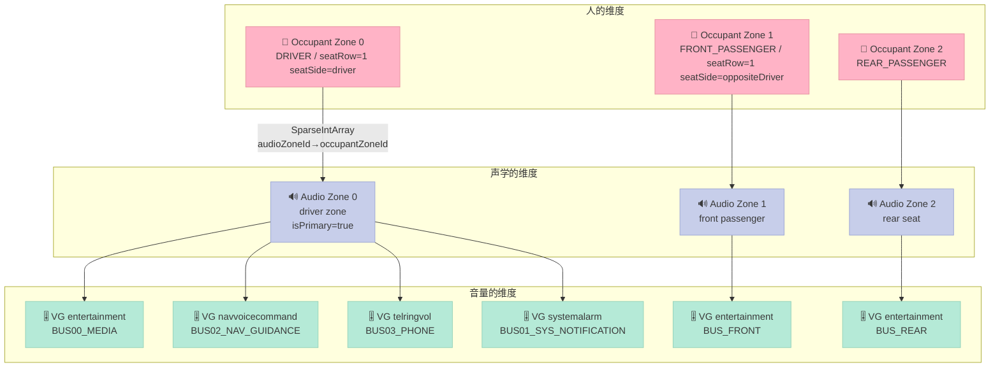
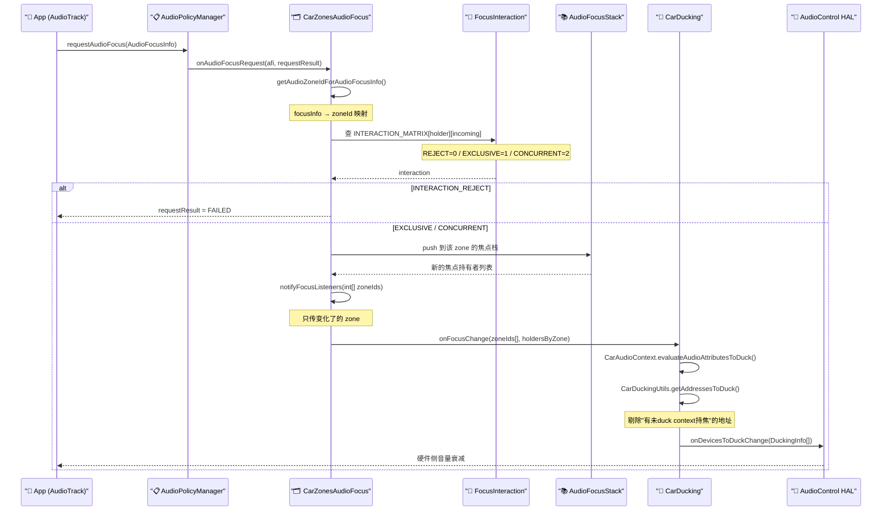
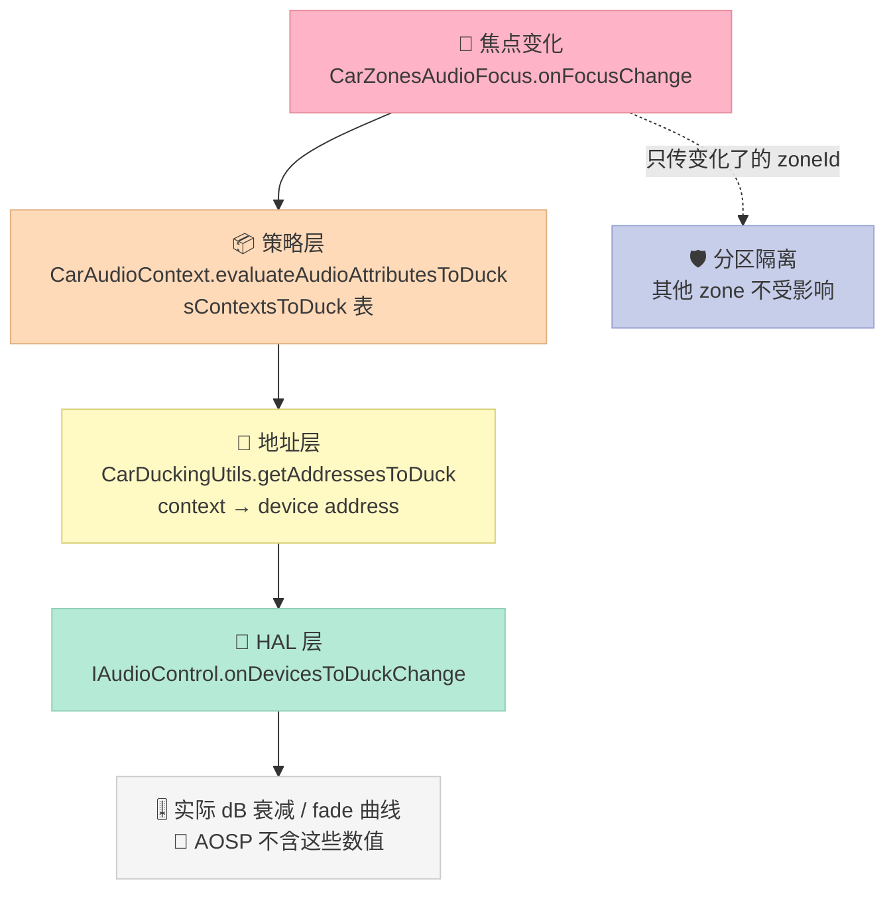
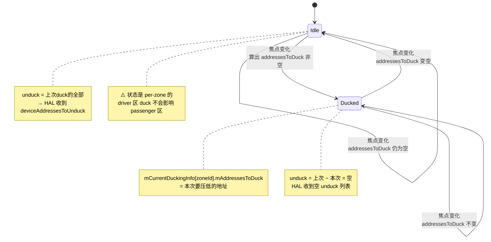
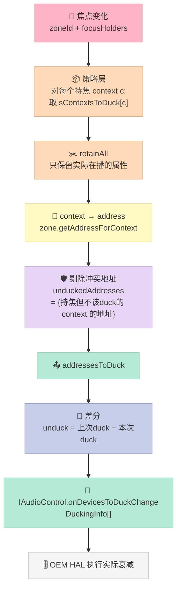
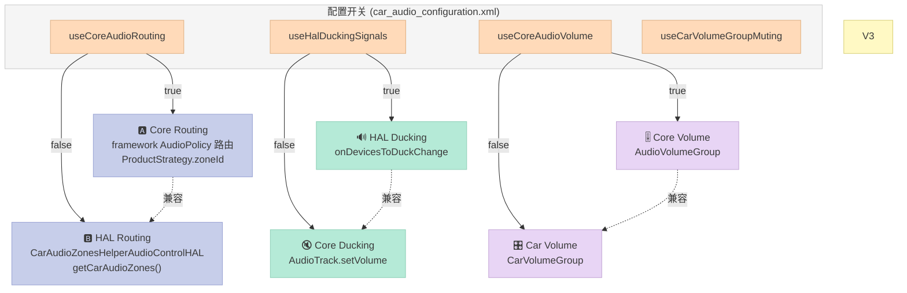

# AAOS 多区音频抢占与串扰抑制：把 13×13 焦点矩阵和 sContextsToDuck 表拆到能跑

> 系列第 20 篇 · 车规实战篇
>
> 源码快照：`platform/packages/services/Car` @ `6420d77b1b5b8b47a38c24571757fb40f708fe9e`（main, 2025-03-18）
> `platform/hardware/interfaces` @ main（`automotive/audiocontrol` AIDL v1–v4）
> `platform/frameworks/av` @ main / `GrapheneOS/platform_frameworks_av` 分支 `17` @ `7a46fb37`（2026-09-09）

## 开篇：一次实测引出的三个"不存在"

先说结论，因为这三个否定结论比任何正面机制都更值得记住。

写这一篇的起因是一个很具体的困惑。车机语音团队在做"主驾导航播报时，后排座椅娱乐要临时压低"这个需求时，同事翻 AOSP 找不到 `CarAudioZoneArbiter`，也找不到任何叫 `pre-roll` / `preroll` 的抢占预卷机制。我们把 CarService 的 audio 目录整个翻了一遍，又把 `frameworks/av` 里的 `media/` 和 `services/` 扫了一遍，得到三个让人意外的答案：

1. **AOSP 里没有 `CarAudioZoneArbiter`，也没有 `CarAudioArbitratorManager`。** 这两个名字在 `packages/services/Car` 的 80 个 audio 文件里查无实据。真正负责分区焦点仲裁的是 `CarZonesAudioFocus`（分区焦点总入口）+ `FocusInteraction`（zone 内交互矩阵）+ `CarAudioFocus`（单 zone 焦点栈）这套三件套。

2. **AOSP 里没有"分区抢占预卷"。** 全仓库 `grep -rn "PreRoll\|preroll\|PRE_ROLL"` 命中的全部是 Opus/AAC **解码器** 的 pre-roll 样本（消除解码器 warm-up 首帧失真）和 Ogg/MP4 的 pre-skip 标签处理——跟"焦点抢占时预卷缓冲"完全是两回事。Android 17 的 `AudioTrack::start()` 已经是无参签名，连 `AudioSystem::DEEP_BUFFER` 那套延迟启动的老形式都不存在了。

3. **AOSP 里没有 crosstalk / leakage / isolation 的音频策略代码。** 搜遍 `CarService/audio/`、`frameworks/av/services/audiopolicy/`、`hardware/interfaces/automotive/audiocontrol/`，一个都没有。

那多区音频到底靠什么工作？答案是：**AOSP 提供的是"路由域"隔离，不是"声学隔离"**。它保证"你的流被送到正确的总线地址"，至于这条总线上的声音会不会物理地串到隔壁座位，那是车厂 DSP、功放和布线的事，软件层管不了。

这一点必须先摆在前面，否则整篇文章会误导人以为读完就能做出多区串扰抑制的方案。

那 AOSP 到底做了什么、做得怎么样？这才是这篇要拆的东西。

## 一、问题定义：三个被混为一谈的"分区"

车机多区音频这个词在需求文档里通常指一件事，但落到代码里它是**三件独立的事**，基数关系是 `1 : N : M` 而不是 `1 : 1 : 1`。

| 概念 | 中文 | 定义位置 | 基数 | 回答什么问题 |
| --- | --- | --- | --- | --- |
| **Audio Zone** | 音频区 / 声学分区 | `car_audio_configuration.xml` 的 `<zone>` + AudioControl HAL `AudioZone` | 1 个 zone 含 N 个 volume group | "这条流走哪条总线" |
| **Occupant Zone** | 乘员区 / 座位分区 | `config_occupant_zones` 资源数组 + `CarOccupantZoneManager` | M 个 occupant zone 可映射到 1 个 audio zone | "这条流属于哪个人" |
| **Volume Group** | 音量组 | `AudioZoneConfig.volumeGroups` | N 个 group 属于 1 个 zone | "这条流归哪套音量控制" |

AOSP 的样例配置 `multi_zone_car_audio_configuration.xml`（AudioControl HAL AIDL v4 转换器测试用）直接印证了这个结构：

| zone | audioZoneId | occupantZoneId | isPrimary | volume groups 数 | 输出设备 address |
| --- | --- | --- | --- | --- | --- |
| driver zone | 0 | 0 | true | 4 | `BUS00_MEDIA` / `BUS02_NAV_GUIDANCE` / `BUS03_PHONE` / `BUS01_SYS_NOTIFICATION` |
| front passenger zone | 1 | 1 | — | 1 | `BUS_FRONT` |
| rear seat zone | 2 | 2 | — | 1 | `BUS_REAR` |

注意 driver zone 有 4 个 volume group（`entertainment` / `navvoicecommand` / `telringvol` / `systemalarm`），而 front passenger zone 只有 1 个 `entertainment`——但这一个 group 内部挂了 7 个 context（music / voice_command / call / call_ring / alarm / system_sound / notification）。

还有一点容易看漏：**三个 zone 的 group 都叫 `entertainment`**。这说明 volume group 名字的作用域是 **zone 内**，不是全局。这在实现上意味着"压低主驾音乐"不能简单地按 group name 去操作，必须先定位到 zone 再定位到 group。

### 1.1 三层概念的关系图



### 1.2 occupant zone 的映射是 N:1，不是 1:1

这是一个很容易踩的坑。AOSP 的映射表定义在 `CarOccupantZoneService.java`：

```java
// CarOccupantZoneService.java L161
private final SparseIntArray mAudioZoneIdToOccupantZoneIdMapping;
```

`SparseIntArray` 的 key 是 `audioZoneId`，value 是 `occupantZoneId`。写入时的校验逻辑（`CarOccupantZoneService.java` L749–L758）只检查 **value 是否存在于 `mOccupantsConfig`**：

```java
// CarOccupantZoneService.java L749-758 (validateOccupantZoneIdsLocked)
private void validateOccupantZoneIdsLocked(SparseIntArray mapping) {
    for (int i = 0; i < mapping.size(); i++) {
        int occupantZoneId = mapping.valueAt(i);
        if (!mOccupantsConfig.containsKey(occupantZoneId)) {
            throw new IllegalArgumentException(
                    "occupantZoneId " + occupantZoneId + " does not exist.");
        }
    }
}
```

也就是说：**同一个 `occupantZoneId` 可以被多个 `audioZoneId` 复用**。AOSP 甚至专门有一个负例测试文件来固化这个行为——`car_audio_configuration_duplicate_occupant_zone_id.xml`，里面 primary zone（audioZoneId=0）和 secondary zone（audioZoneId=1）都写 `occupantZoneId="1"`。

反查方向的语义因此是"返回第一个匹配"：

```java
// CarOccupantZoneService.java L569-593 (getAudioZoneIdForOccupant)
// 线性遍历 mapping，返回第一个 value == occupantZoneId 的 key
```

底层 binder 接口的注释把这条规则写得很清楚：

```
// car-lib/src/android/car/ICarOccupantZone.aidl
// Users may be associated with more than one zone id.
// In that case, the first associated zone (preferred zone) is returned.
int getAudioZoneIdForOccupant(in int occupantZoneId);
```

| 维度 | Audio Zone | Occupant Zone |
| --- | --- | --- |
| id 类型 | int（`audioZoneId`） | int（`occupantZoneId`） |
| 唯一性 | **必须唯一**（有 `duplicate_audio_zone_id` 负例） | **允许重复**（有 `duplicate_occupant_zone_id` 负例） |
| 数量下限 | ≥1（`missing_zones` 负例） | ≥0（为 0 时自动补一个 driver zone） |
| 变更通知 | `ZONE_CONFIG_CHANGE_FLAG_AUDIO = 0x4` | `ZONE_CONFIG_CHANGE_FLAG_DISPLAY = 0x1` / `_USER = 0x2` |

 occupant zone 的配置来源是资源数组，不是 HAL。`CarOccupantZoneService.java` L1138 的 `parseOccupantZoneConfigsLocked()` 解析 `R.array.config_occupant_zones`：

```xml
<!-- CarOccupantZoneService.java L1141-1143 源码注释给出的示例格式 -->
<item>occupantZoneId=0,occupantType=DRIVER,seatRow=1,seatSide=driver</item>
<item>occupantZoneId=1,occupantType=FRONT_PASSENGER,seatRow=1,seatSide=oppositeDriver</item>
```

`seatSide=driver` 会自动按左舵/右舵解析成 `VehicleAreaSeat.SIDE_LEFT` / `SIDE_RIGHT`（L1146–L1150），`seatSide=oppositeDriver` 取 `-driverSeatSide`（L1193–L1194），最终 `seat = VehicleAreaSeat.fromRowAndSide(seatRow, seatSide)`（L1229）。

顺带纠正一个常见的错误认知：AOSP 里**没有** `android.hardware.automotive.occupant` 这个 HAL，也没有 `IVehicleOccupantZone` / `IOccupantZone` 这两个符号。乘员感知走的是 `android.car.occupantawareness`（`OccupantAwarenessManager` / `DriverMonitoringDetection` / `GazeDetection`），而"乘员分区"走的是纯软件的 `android.car.CarOccupantZoneManager`。这两件事经常被混为一谈，但它们解决的是不同问题。

## 二、AOSP 多区音频的四个真实机制

把"分区"这个大词拆开，AOSP 里真正落地的只有下面四个机制。它们分属不同层次，互不重叠。

| # | 机制 | 层次 | 核心类 | 解决的问题 |
| --- | --- | --- | --- | --- |
| 1 | **分区焦点分发** | 焦点层 | `CarZonesAudioFocus` | 每个 zone 一份独立的焦点栈，互不干扰 |
| 2 | **zone 内焦点交互矩阵** | 焦点层 | `FocusInteraction` | 新来的焦点请求该不该给、夺不夺旧焦点 |
| 3 | **Duck 策略 + 地址差分** | 策略层 | `CarAudioContext` / `CarDuckingUtils` | 该压低哪些设备地址、该恢复哪些 |
| 4 | **Fade 配置** | 过渡层 | `CarAudioFadeConfigurationHelper` | 切换时淡入淡出多少毫秒 |

注意这四个机制里，**没有一个是"预卷"，也没有一个是"串扰抑制"**。

### 2.1 分区焦点分发：每区一份焦点栈

`CarZonesAudioFocus` 是整个分区焦点体系的入口，它继承自 `AudioPolicy.AudioPolicyFocusListener`：

```java
// CarZonesAudioFocus.java L61-73
final class CarZonesAudioFocus extends AudioPolicy.AudioPolicyFocusListener {
    private static final String TAG = CarLog.tagFor(CarZonesAudioFocus.class);

    private final CarFocusCallback mCarFocusCallback;
    private final Object mLock = new Object();

    private CarAudioService mCarAudioService; // Dynamically assigned just after construction

    private AudioPolicy mAudioPolicy; // Dynamically assigned just after construction

    private final SparseArray<CarAudioFocus> mFocusZones;
```

`mFocusZones` 就是分区隔离的核心数据结构——一个 `SparseArray<CarAudioFocus>`，key 是 zoneId，每个 zone 一个独立的 `CarAudioFocus` 焦点栈。

关键方法是 `getCarAudioFocusForZoneId(int zoneId)`（L273）：

```java
// CarZonesAudioFocus.java L273
private CarAudioFocus getCarAudioFocusForZoneId(int zoneId) {
    return mFocusZones.get(zoneId);
}
```

而 `getAudioZoneIdForAudioFocusInfo`（L277）负责把一个焦点请求映射到它该去的 zone。

分区隔离的第一道防线就在这里：**一个 zone 的焦点变化不会触碰另一个 zone 的焦点栈**。

第二道防线在 `notifyFocusListeners`（L301）——它只把**发生焦点变化的 zone** 传下去，而不是广播全 zone：

```java
// CarZonesAudioFocus.java L434
public interface CarFocusCallback {
    @Override
    void onFocusChange(int[] audioZoneIds,
            SparseArray<List<AudioFocusInfo>> focusHoldersByZoneId);
}
```

这个 `int[] audioZoneIds` 参数是整条 ducking 链路的入口签名，后面 `CarDucking.onFocusChange` 的循环完全依赖它——**HAL 只会收到真正变了焦点的 zone 的 duck 指令**，其他区完全不受影响。

### 2.2 zone 内焦点交互矩阵：13×13 的三值决策

`FocusInteraction` 用一张 13×13 的矩阵回答"新焦点请求来了怎么办"。

```java
// FocusInteraction.java L68-73
@VisibleForTesting
static final int INTERACTION_REJECT = 0;    // Focus not granted
@VisibleForTesting
static final int INTERACTION_EXCLUSIVE = 1; // Focus granted, others loose focus
@VisibleForTesting
static final int INTERACTION_CONCURRENT = 2; // Focus granted, others keep focus
```

只有三个值。这一点必须强调，因为很多人以为焦点矩阵里会有"DUCK"这一档：

> **AOSP 的焦点交互矩阵里没有 "duck" 档位。** ducking 完全是另一条独立的路径——由 `CarAudioContext.sContextsToDuck` 这张表 + Audio HAL 实现，跟焦点矩阵正交。

矩阵的规模来自 13 个 CarAudioContext（`CarAudioContext.java` L61–L114）：

```java
// CarAudioContext.java L61-114 (节选)
private static final int INVALID = 0;
static final int MUSIC = 1;              // Music playback
static final int NAVIGATION = 2;         // Navigation directions
static final int VOICE_COMMAND = 3;      // Voice command session
static final int CALL_RING = 4;          // Voice call ringing
static final int CALL = 5;               // Voice call
static final int ALARM = 6;              // Alarm sound from Android
static final int NOTIFICATION = 7;       // Notifications
static final int SYSTEM_SOUND = 8;       // System sounds
static final int EMERGENCY = 9;          // Emergency related sounds such as collision warnings
static final int SAFETY = 10;            // Safety sounds such as obstacle detection when backing up
static final int VEHICLE_STATUS = 11;    // check engine light or seat belt chimes
static final int ANNOUNCEMENT = 12;      // Announcement such as traffic announcements
```

矩阵结构是二维 `SparseArray<SparseArray<Integer>>`，行 = 当前焦点持有者，列 = 新请求：

```java
// FocusInteraction.java L78-82
// Each Row represents CarAudioContext of current focus holder
// Each Column represents CarAudioContext of incoming request (labels along the right)
// Cell value is one of INTERACTION_REJECT, INTERACTION_EXCLUSIVE,
// or INTERACTION_CONCURRENT

private static final SparseArray<SparseArray<Integer>> INTERACTION_MATRIX =
        new SparseArray<>(/* initialCapacity= */ 13);
```

矩阵的一部分原文（行=MUSIC）：

```java
// FocusInteraction.java L101-118
// Focus holder: MUSIC
INTERACTION_MATRIX.append(MUSIC, new SparseArray() {
    {
        append(/* INVALID= */ 0, INTERACTION_REJECT); // INVALID
        append(MUSIC, INTERACTION_EXCLUSIVE); // MUSIC
        append(NAVIGATION, INTERACTION_CONCURRENT); // NAVIGATION
        append(VOICE_COMMAND, INTERACTION_EXCLUSIVE); // VOICE_COMMAND
        append(CALL_RING, INTERACTION_EXCLUSIVE); // CALL_RING
        append(CALL, INTERACTION_EXCLUSIVE); // CALL
        append(ALARM, INTERACTION_EXCLUSIVE); // ALARM
        append(NOTIFICATION, INTERACTION_CONCURRENT); // NOTIFICATION
        append(SYSTEM_SOUND, INTERACTION_CONCURRENT); // SYSTEM_SOUND,
        append(EMERGENCY, INTERACTION_EXCLUSIVE); // EMERGENCY
        append(SAFETY, INTERACTION_CONCURRENT); // SAFETY
        append(VEHICLE_STATUS, INTERACTION_CONCURRENT); // VEHICLE_STATUS
        append(ANNOUNCEMENT, INTERACTION_EXCLUSIVE); // ANNOUNCEMENT
    }
});
```

我们把这张矩阵完整地解析出来统计了一遍：

| 决策 | 格子数 | 占比 | 语义 |
| --- | --- | --- | --- |
| `INTERACTION_REJECT` | 27 | 16.0% | 焦点不授予，请求方拿不到 |
| `INTERACTION_EXCLUSIVE` | 70 | 41.4% | 授予焦点，原持有者**失去**焦点 |
| `INTERACTION_CONCURRENT` | 72 | 42.6% | 授予焦点，原持有者**保留**焦点 |
| 合计 | 169 | 100% | 13 × 13 |

有 72 个格子是 CONCURRENT，说明 AOSP 对"叠音共存"的态度相当宽松——导航提示音和音乐可以同时响（MUSIC→NAVIGATION 就是 CONCURRENT），这也是为什么 duck 机制必须存在：**焦点共存不等于音量共存**。

### 2.3 焦点交互的完整调用链



这里有个容易被忽略的关键点：`notifyFocusListeners` 传的 `int[] zoneIds` 里，**只有真正发生焦点变化的 zone**。这意味着 driver 区打电话时，passenger 区的 duck 状态完全不受影响——HAL 收到的 `DuckingInfo[]` 数组里压根不会出现 passenger zone 的条目。

### 2.4 Duck 策略表：sContextsToDuck 才是"谁该被压低"的真正答案

前面说过，焦点矩阵里没有 duck 档位。真正决定"谁该被压低"的是 `CarAudioContext` 里这张表：

```java
// CarAudioContext.java L274-281
@VisibleForTesting
static final SparseArray<List<Integer>> sContextsToDuck =
        new SparseArray<>(/* initialCapacity= */ 13);

static {
    // INVALID ducks nothing
    sContextsToDuck.append(INVALID, Collections.emptyList());
    // MUSIC ducks nothing
    sContextsToDuck.append(MUSIC, Collections.emptyList());
```

完整内容（`CarAudioContext.java` L280–L338）：

```java
// CarAudioContext.java L280-338
    sContextsToDuck.append(INVALID, Collections.emptyList());
    sContextsToDuck.append(MUSIC, Collections.emptyList());
    sContextsToDuck.append(NAVIGATION, List.of(
            MUSIC, CALL_RING, CALL, ALARM, NOTIFICATION,
            SYSTEM_SOUND, VEHICLE_STATUS, ANNOUNCEMENT));
    sContextsToDuck.append(VOICE_COMMAND, List.of(
            CALL_RING));
    sContextsToDuck.append(CALL_RING, Collections.emptyList());
    sContextsToDuck.append(CALL, List.of(
            CALL_RING, ALARM, NOTIFICATION, VEHICLE_STATUS));
    sContextsToDuck.append(ALARM, List.of(
            MUSIC));
    sContextsToDuck.append(NOTIFICATION, List.of(
            MUSIC, ALARM, ANNOUNCEMENT));
    sContextsToDuck.append(SYSTEM_SOUND, List.of(
            MUSIC, ALARM, ANNOUNCEMENT));
    sContextsToDuck.append(EMERGENCY, List.of(
            CALL));
    sContextsToDuck.append(SAFETY, List.of(
            MUSIC, NAVIGATION, VOICE_COMMAND, CALL_RING, CALL, ALARM,
            NOTIFICATION, SYSTEM_SOUND, VEHICLE_STATUS, ANNOUNCEMENT));
    sContextsToDuck.append(VEHICLE_STATUS, List.of(
            MUSIC, CALL_RING, ANNOUNCEMENT));
    // ANNOUNCEMENT ducks nothing
    sContextsToDuck.append(ANNOUNCEMENT, Collections.emptyList());
}
```

统计一下：

| 持焦 context | 要 duck 的 context 数 | 具体列表 |
| --- | --- | --- |
| SAFETY | **10** | MUSIC, NAVIGATION, VOICE_COMMAND, CALL_RING, CALL, ALARM, NOTIFICATION, SYSTEM_SOUND, VEHICLE_STATUS, ANNOUNCEMENT |
| NAVIGATION | **8** | MUSIC, CALL_RING, CALL, ALARM, NOTIFICATION, SYSTEM_SOUND, VEHICLE_STATUS, ANNOUNCEMENT |
| CALL | 4 | CALL_RING, ALARM, NOTIFICATION, VEHICLE_STATUS |
| NOTIFICATION | 3 | MUSIC, ALARM, ANNOUNCEMENT |
| SYSTEM_SOUND | 3 | MUSIC, ALARM, ANNOUNCEMENT |
| VEHICLE_STATUS | 3 | MUSIC, CALL_RING, ANNOUNCEMENT |
| VOICE_COMMAND | 1 | CALL_RING |
| ALARM | 1 | MUSIC |
| EMERGENCY | 1 | CALL |
| INVALID / MUSIC / CALL_RING / ANNOUNCEMENT | 0 | — |

13 个里有 9 个非空。`SAFETY`（倒车雷达、盲区提醒）最狠——它要压低除自己以外的一切。

这个表有个反直觉的地方：`EMERGENCY` 只 duck `CALL`，而不是 duck 一切。原因是 EMERGENCY 的焦点交互矩阵那一行几乎全是 EXCLUSIVE——紧急警报本来就要独占，靠抢焦点就够了，不需要额外 duck。

### 2.5 三层分工：Java 算地址，HAL 做衰减

这是整篇文章最需要记住的架构事实。



**Java 层只输出"哪些设备地址要 duck"，不碰音量数值。** 衰减多少 dB、淡入淡出多久，完全由 OEM 的 Audio HAL 决定。

`CarDucking.onFocusChange` 的实现就一行关键调用：

```java
// CarDucking.java L72-86
@Override
public void onFocusChange(int[] audioZoneIds,
        SparseArray<List<AudioFocusInfo>> focusHoldersByZoneId) {
    synchronized (mLock) {
        List<CarDuckingInfo> newDuckingInfos = new ArrayList<>(audioZoneIds.length);
        for (int i = 0; i < audioZoneIds.length; i++) {
            int zoneId = audioZoneIds[i];
            List<AudioFocusInfo> focusHolders = focusHoldersByZoneId.get(zoneId);
            CarDuckingInfo newDuckingInfo = updateDuckingForZoneIdLocked(zoneId, focusHolders);
            newDuckingInfos.add(newDuckingInfo);
        }
        mAudioControlWrapper.onDevicesToDuckChange(newDuckingInfos);
    }
}
```

注意这里 **没有** `AudioTrack.setVolume()`，**没有** `setDucking()`。这是很多人对 AOSP 音频栈的误解——以为 duck 是在 framework 里调音量实现的。

数据载体 `CarDuckingInfo` 也很直白：

```java
// CarDuckingInfo.java L39-55
public final class CarDuckingInfo {
    public final int mZoneId;
    public final List<String> mAddressesToDuck;
    public final List<String> mAddressesToUnduck;
    public final List<PlaybackTrackMetadata> mPlaybackMetaDataHoldingFocus;
```

对应到 HAL 的 AIDL 定义（`DuckingInfo.aidl`），字段名几乎一一对应：

```aidl
// hardware/interfaces/automotive/audiocontrol/aidl/.../DuckingInfo.aidl
@VintfStability
parcelable DuckingInfo {
    /** ID of the associated audio zone */
    int zoneId;

    /**
     * List of addresses for audio output devices that should be ducked.
     * <p>The provided address strings are defined in audio_policy_configuration.xml.
     */
    String[] deviceAddressesToDuck;

    /**
     * List of addresses for audio output devices that were previously be ducked and should now be
     * unducked.
     */
    String[] deviceAddressesToUnduck;

    /**
     * List of usages currently holding focus for this audio zone.
     * <p>This field was deprecated in version 2.
     * Use playbackMetaDataHoldingFocus instead.
     */
    String[] usagesHoldingFocus;

    /** List of output stream metadata associated with the current focus holder for this audio zone */
    @nullable PlaybackTrackMetadata[] playbackMetaDataHoldingFocus;
}
```

AIDL 契约里还写明了一条重要语义——**HAL 拿到的是"地址"而不是"流"**：

```
// IAudioControl.aidl
/**
 * Notifies HAL of changes in output devices that the HAL should apply ducking to.
 *
 * This will be called in response to changes in audio focus, and will include a
 * {@link DuckingInfo} object per audio zone that experienced a change in audo focus.
 */
oneway void onDevicesToDuckChange(in DuckingInfo[] duckingInfos);
```

`oneway` 意味着这是异步单向调用，framework 不等 HAL 返回。

### 2.6 OEM 扩展点：车厂可以接管三条路径

AOSP 在 `packages/services/Car/car-lib/src/android/car/oem/` 提供了完整的 OEM 钩子：

| 扩展 AIDL | 接管什么 |
| --- | --- |
| `IOemCarAudioFocusService.aidl` | **焦点评估**——完全接管焦点矩阵判定 |
| `IOemCarAudioVolumeService.aidl` | **音量变更**——接管音量策略 |
| `IOemCarAudioDuckingService.aidl` | **Duck 判定**——接管"该压低哪些" |

`CarDucking` 里对 duck 判定的分叉写得很清楚：

```java
// CarDucking.java L139-149
private List<AudioAttributes> evaluateAttributesToDuck(OemCarAudioVolumeRequest requestInfo)  {
    return isOemDuckingServiceAvailable() ? evaluateAttributesToDuckExternally(requestInfo) :
            evaluateAttributesToDuckInternally(requestInfo);
}

private List<AudioAttributes> evaluateAttributesToDuckExternally(
        OemCarAudioVolumeRequest requestInfo) {
    return CarLocalServices.getService(CarOemProxyService.class).getCarOemAudioDuckingService()
            .evaluateAttributesToDuck(requestInfo);
}

private List<AudioAttributes> evaluateAttributesToDuckInternally(
        OemCarAudioVolumeRequest requestInfo) {
    return CarAudioContext.evaluateAudioAttributesToDuck(
            requestInfo.getActivePlaybackAttributes());
}
```

这就是"厂商自研 ZoneArbiter"最现实的落点——**不用改 AOSP，接 OEM 扩展就行**。

## 三、串扰抑制：地址级保护的真实算法

现在进入本篇的核心算法。前面铺垫了那么多，真正要解决的是一个问题：

> 当同一个 zone 里，两个不同的 context 挂在**同一条总线地址**上时，其中一个要 duck 另一个，怎么办？

### 3.1 问题建模

用 AOSP 样例 `multi_zone_car_audio_configuration.xml` 的 driver zone 拓扑：

```xml
<!-- driver zone, audioZoneId="0" occupantZoneId="0" -->
<zone name="driver zone" audioZoneId="0" occupantZoneId="0" isPrimary="true">
    <zoneConfigs>
        <zoneConfig name="default" isDefault="true">
            <volumeGroups>
                <group name="entertainment" activationConfig="onBoot">
                    <device address="BUS00_MEDIA" type="OUT_DEVICE_TYPE_BUS">
                        <context value="MUSIC"/>
                    </device>
                </group>
                <group name="navvoicecommand" activationConfig="onBoot">
                    <device address="BUS02_NAV_GUIDANCE" type="OUT_DEVICE_TYPE_BUS">
                        <context value="NAVIGATION"/>
                        <context value="VOICE_COMMAND"/>
                    </device>
                </group>
                <group name="telringvol" activationConfig="onBoot">
                    <device address="BUS03_PHONE" type="OUT_DEVICE_TYPE_BUS">
                        <context value="CALL"/>
                        <context value="CALL_RING"/>
                    </device>
                </group>
                <group name="systemalarm" activationConfig="onBoot">
                    <device address="BUS01_SYS_NOTIFICATION" type="OUT_DEVICE_TYPE_BUS">
                        <context value="ALARM"/>
                        <context value="NOTIFICATION"/>
                        <context value="SYSTEM_SOUND"/>
                        <context value="EMERGENCY"/>
                        <context value="SAFETY"/>
                        <context value="VEHICLE_STATUS"/>
                        <context value="ANNOUNCEMENT"/>
                    </device>
                </group>
            </volumeGroups>
        </zoneConfig>
    </zoneConfigs>
</zone>
```

于是 driver zone 里：

| 总线地址 | 挂载的 context |
| --- | --- |
| `BUS00_MEDIA` | MUSIC |
| `BUS02_NAV_GUIDANCE` | NAVIGATION, VOICE_COMMAND |
| `BUS03_PHONE` | CALL, CALL_RING |
| `BUS01_SYS_NOTIFICATION` | ALARM, NOTIFICATION, SYSTEM_SOUND, EMERGENCY, SAFETY, VEHICLE_STATUS, ANNOUNCEMENT |

关键冲突：`BUS01_SYS_NOTIFICATION` 这一条总线上挂了 7 个 context。它们互相之间**在硬件上是同一条线**。

现在看 `NOTIFICATION` 持焦时会发生什么。`sContextsToDuck[NOTIFICATION] = [MUSIC, ALARM, ANNOUNCEMENT]`——它要压低音乐、闹钟、公告。

但 **ALARM 和 ANNOUNCEMENT 就在 NOTIFICATION 自己那条总线上**！如果直接执行"把被 duck 的 context 对应的地址都 duck 掉"，会把 `BUS01_SYS_NOTIFICATION` 整体压低——连正在播的通知音自己也一起压了，而且 SAFETY 之类的告警声也会被误伤。

**这就是 AOSP 真正意义上的"串扰抑制"**：在地址粒度上防止"压低 A 却连带压低 B"。

### 3.2 算法：unduckedContexts 剔除

答案就在 `CarDuckingUtils.getAddressesToDuck` 里：

```java
// CarDuckingUtils.java L59-73
private static List<String> getAddressesToDuck(List<AudioAttributes> audioAttributesToDuck,
        List<AudioAttributes> activeAudioAttributes, CarAudioZone zone) {
    Set<Integer> uniqueContexts = zone.getCarAudioContext()
            .getUniqueContextsForAudioAttributes(activeAudioAttributes);
    Set<Integer> contextsToDuck = zone.getCarAudioContext()
            .getUniqueContextsForAudioAttributes(audioAttributesToDuck);
    Set<String> addressesToDuck = getAddressesForContexts(contextsToDuck, zone);

    Set<Integer> unduckedContexts = getUnduckedContexts(uniqueContexts, contextsToDuck);
    Set<String> unduckedAddresses = getAddressesForContexts(unduckedContexts, zone);

    // We should not duck any device that's associated with an unducked context holding focus.
    addressesToDuck.removeAll(unduckedAddresses);
    return new ArrayList<>(addressesToDuck);
}
```

拆成四步：

1. `uniqueContexts` = 当前**实际持焦**的所有 context
2. `contextsToDuck` = 策略层算出要 duck 的 context
3. `addressesToDuck` = 把 `contextsToDuck` 映射成设备地址
4. `unduckedContexts = uniqueContexts - contextsToDuck` = **持焦但不该被 duck 的 context**
5. `addressesToDuck.removeAll(unduckedAddresses)` = **凡是有"不该被 duck 的持焦 context"挂在上面的地址，整体从 duck 列表里剔除**

第 5 步的注释说得很直白：

> "We should not duck any device that's associated with an unducked context holding focus."

辅助函数：

```java
// CarDuckingUtils.java L81-92
private static Set<Integer> getUnduckedContexts(Set<Integer> contexts,
        Set<Integer> duckedContexts) {
    Set<Integer> unduckedContexts = new ArraySet<>(contexts);
    unduckedContexts.removeAll(duckedContexts);
    return unduckedContexts;
}

private static Set<String> getAddressesForContexts(Set<Integer> contexts, CarAudioZone zone) {
    Set<String> addresses = new ArraySet<>();
    for (Integer context : contexts) {
        addresses.add(zone.getAddressForContext(context));
    }
    return addresses;
}
```

而 `zone.getAddressForContext(context)` 把 context 映射到地址，遍历该 zone 的所有 volume group：

```java
// CarAudioZone.java L289-302
public String getAddressForContext(int audioContext) {
    mCarAudioContext.preconditionCheckAudioContext(audioContext);
    String deviceAddress = null;
    for (CarVolumeGroup volumeGroup : getCurrentVolumeGroups()) {
        deviceAddress = volumeGroup.getAddressForContext(audioContext);
        if (deviceAddress != null) {
            return deviceAddress;
        }
    }
    // This should not happen unless something went wrong.
    // Device address are unique per zone and all contexts are assigned in a zone.
    throw new IllegalStateException("Could not find output device in zone " + mId
            + " for audio context " + audioContext);
}
```

### 3.3 unduck 差分：状态机在 CarDucking 里

Duck 状态不是"当前帧算一次"，而是**和上一帧做差分**。`getAddressesToUnduck` 就是差分：

```java
// CarDuckingUtils.java L75-79
private static List<String> getAddressesToUnduck(List<String> addressesToDuck,
        List<String> oldAddressesToDuck) {
    List<String> addressesToUnduck = new ArrayList<>(oldAddressesToDuck);
    addressesToUnduck.removeAll(addressesToDuck);
    return addressesToUnduck;
}
```

即 `unduck = 上次duck的 − 这次duck的`。

完整状态机：



`CarDucking` 用 `mCurrentDuckingInfo` 保存每个 zone 的上一次状态：

```java
// CarDucking.java L47-51
@GuardedBy("mLock")
private final SparseArray<CarDuckingInfo> mCurrentDuckingInfo = new SparseArray<>();
```

这就是为什么 `onFocusChange` 的入参叫 `zoneIds[]` 而不是单个 zoneId——**每次焦点变化可能同时影响多个 zone，每个 zone 各自做差分**。

### 3.4 策略层还有一个关键动作：retainAll

`evaluateAudioAttributesToDuck` 的最后一步藏着一个很容易忽略的细节：

```java
// CarAudioContext.java L447-476
static List<AudioAttributes> evaluateAudioAttributesToDuck(
        List<AudioAttributes> activePlaybackAttributes) {
    ArraySet<AudioAttributesWrapper> attributesToDuck = new ArraySet<>();
    List<AudioAttributesWrapper> wrappers = new ArrayList<>(activePlaybackAttributes.size());
    for (int index = 0; index < activePlaybackAttributes.size(); index++) {
        AudioAttributesWrapper wrapper =
                new AudioAttributesWrapper(activePlaybackAttributes.get(index));
        wrappers.add(wrapper);
        int context = AUDIO_ATTRIBUTE_TO_CONTEXT.getOrDefault(wrapper, INVALID);
        if (isInvalidContextId(context)) {
            continue;
        }
        List<Integer> contextsToDuck = sContextsToDuck.get(context);
        for (int contextIndex = 0; contextIndex < contextsToDuck.size(); contextIndex++) {
            AudioAttributes[] duckedAttributes =
                    CONTEXT_TO_ATTRIBUTES.get(contextsToDuck.get(contextIndex));
            for (int i = 0; i < duckedAttributes.length; i++) {
                attributesToDuck.add(new AudioAttributesWrapper(duckedAttributes[i]));
            }
        }
    }
    attributesToDuck.retainAll(wrappers);   // ←←← 关键
    ...
}
```

`attributesToDuck.retainAll(wrappers)` 的意思是：**只保留当前实际在播的属性**。

这解释了一个初看很反直觉的现象——`sContextsToDuck[SAFETY]` 有 10 项，但当 SAFETY 单独持焦时，实际被 duck 的 context 是 **0 个**。因为 SAFETY 要压低的那 10 个 context（音乐、导航、电话……）当时都没在播，retainAll 全部剔掉了。

> **结论：AOSP 的 duck 是"按需压低"，不是"预先压低"。** 只有真正正在发声、且策略上该被压低的内容才会被 duck。这对省电和音质都有意义——不影响静音的流。

### 3.5 算法全流程图



## 四、可运行的 Python 复刻：把算法跑出真实数据

光读源码不够。我们把 AOSP 的三层算法完整复刻成 Python，用 AOSP 样例拓扑跑一遍，看看真实输出长什么样。

### 4.1 完整代码

```python
#!/usr/bin/env python3
# -*- coding: utf-8 -*-
"""
AOSP AAOS 多区 Ducking 算法复刻 (Day 20)

数据来源:
  packages/services/Car @ 6420d77b (main, 2025-03-18)
  - service/src/com/android/car/audio/CarAudioContext.java   (sContextsToDuck, evaluateAudioAttributesToDuck)
  - service/src/com/android/car/audio/FocusInteraction.java  (INTERACTION_MATRIX 13x13)
  - service/src/com/android/car/audio/CarDuckingUtils.java   (getAddressesToDuck / getAddressesToUnduck)
  - service/src/com/android/car/audio/CarDucking.java        (onFocusChange -> onDevicesToDuckChange)
"""
import json
from collections import OrderedDict

# ---------------------------------------------------------------- 常量
INTERACTION_REJECT = 0
INTERACTION_EXCLUSIVE = 1
INTERACTION_CONCURRENT = 2

# CarAudioContext.java L61-L114
CTX = OrderedDict([
    (0, "INVALID"), (1, "MUSIC"), (2, "NAVIGATION"), (3, "VOICE_COMMAND"),
    (4, "CALL_RING"), (5, "CALL"), (6, "ALARM"), (7, "NOTIFICATION"),
    (8, "SYSTEM_SOUND"), (9, "EMERGENCY"), (10, "SAFETY"),
    (11, "VEHICLE_STATUS"), (12, "ANNOUNCEMENT"),
])
NAME2ID = {v: k for k, v in CTX.items()}

# CarAudioContext.java L275-L338  sContextsToDuck
CONTEXTS_TO_DUCK = {
    "INVALID": [],
    "MUSIC": [],
    "NAVIGATION": ["MUSIC", "CALL_RING", "CALL", "ALARM", "NOTIFICATION",
                   "SYSTEM_SOUND", "VEHICLE_STATUS", "ANNOUNCEMENT"],
    "VOICE_COMMAND": ["CALL_RING"],
    "CALL_RING": [],
    "CALL": ["CALL_RING", "ALARM", "NOTIFICATION", "VEHICLE_STATUS"],
    "ALARM": ["MUSIC"],
    "NOTIFICATION": ["MUSIC", "ALARM", "ANNOUNCEMENT"],
    "SYSTEM_SOUND": ["MUSIC", "ALARM", "ANNOUNCEMENT"],
    "EMERGENCY": ["CALL"],
    "SAFETY": ["MUSIC", "NAVIGATION", "VOICE_COMMAND", "CALL_RING", "CALL",
               "ALARM", "NOTIFICATION", "SYSTEM_SOUND", "VEHICLE_STATUS",
               "ANNOUNCEMENT"],
    "VEHICLE_STATUS": ["MUSIC", "CALL_RING", "ANNOUNCEMENT"],
    "ANNOUNCEMENT": [],
}

# FocusInteraction.java INTERACTION_MATRIX: 行=当前持有者, 列=新请求
INTERACTION_MATRIX = {
    "INVALID": {
        "INVALID": 0, "MUSIC": 0, "NAVIGATION": 0, "VOICE_COMMAND": 0,
        "CALL_RING": 0, "CALL": 0, "ALARM": 0, "NOTIFICATION": 0,
        "SYSTEM_SOUND": 0, "EMERGENCY": 1, "SAFETY": 1, "VEHICLE_STATUS": 0,
        "ANNOUNCEMENT": 0,
    },
    "MUSIC": {
        "INVALID": 0, "MUSIC": 1, "NAVIGATION": 2, "VOICE_COMMAND": 1,
        "CALL_RING": 1, "CALL": 1, "ALARM": 1, "NOTIFICATION": 2,
        "SYSTEM_SOUND": 2, "EMERGENCY": 1, "SAFETY": 2, "VEHICLE_STATUS": 2,
        "ANNOUNCEMENT": 1,
    },
    "NAVIGATION": {
        "INVALID": 0, "MUSIC": 2, "NAVIGATION": 2, "VOICE_COMMAND": 1,
        "CALL_RING": 2, "CALL": 1, "ALARM": 2, "NOTIFICATION": 2,
        "SYSTEM_SOUND": 2, "EMERGENCY": 1, "SAFETY": 2, "VEHICLE_STATUS": 2,
        "ANNOUNCEMENT": 2,
    },
    "VOICE_COMMAND": {
        "INVALID": 0, "MUSIC": 1, "NAVIGATION": 1, "VOICE_COMMAND": 1,
        "CALL_RING": 1, "CALL": 1, "ALARM": 1, "NOTIFICATION": 1,
        "SYSTEM_SOUND": 1, "EMERGENCY": 1, "SAFETY": 1, "VEHICLE_STATUS": 1,
        "ANNOUNCEMENT": 1,
    },
    "CALL_RING": {
        "INVALID": 0, "MUSIC": 1, "NAVIGATION": 2, "VOICE_COMMAND": 1,
        "CALL_RING": 1, "CALL": 1, "ALARM": 1, "NOTIFICATION": 1,
        "SYSTEM_SOUND": 1, "EMERGENCY": 1, "SAFETY": 1, "VEHICLE_STATUS": 1,
        "ANNOUNCEMENT": 1,
    },
    "CALL": {
        "INVALID": 0, "MUSIC": 0, "NAVIGATION": 2, "VOICE_COMMAND": 0,
        "CALL_RING": 2, "CALL": 2, "ALARM": 2, "NOTIFICATION": 2,
        "SYSTEM_SOUND": 0, "EMERGENCY": 2, "SAFETY": 2, "VEHICLE_STATUS": 2,
        "ANNOUNCEMENT": 0,
    },
    "ALARM": {
        "INVALID": 0, "MUSIC": 1, "NAVIGATION": 2, "VOICE_COMMAND": 1,
        "CALL_RING": 1, "CALL": 1, "ALARM": 1, "NOTIFICATION": 2,
        "SYSTEM_SOUND": 2, "EMERGENCY": 1, "SAFETY": 2, "VEHICLE_STATUS": 2,
        "ANNOUNCEMENT": 1,
    },
    "NOTIFICATION": {
        "INVALID": 0, "MUSIC": 2, "NAVIGATION": 2, "VOICE_COMMAND": 1,
        "CALL_RING": 1, "CALL": 1, "ALARM": 2, "NOTIFICATION": 2,
        "SYSTEM_SOUND": 2, "EMERGENCY": 1, "SAFETY": 2, "VEHICLE_STATUS": 2,
        "ANNOUNCEMENT": 2,
    },
    "SYSTEM_SOUND": {
        "INVALID": 0, "MUSIC": 2, "NAVIGATION": 2, "VOICE_COMMAND": 1,
        "CALL_RING": 1, "CALL": 1, "ALARM": 2, "NOTIFICATION": 2,
        "SYSTEM_SOUND": 2, "EMERGENCY": 1, "SAFETY": 2, "VEHICLE_STATUS": 2,
        "ANNOUNCEMENT": 2,
    },
    "EMERGENCY": {
        "INVALID": 0, "MUSIC": 1, "NAVIGATION": 1, "VOICE_COMMAND": 1,
        "CALL_RING": 1, "CALL": 1, "ALARM": 1, "NOTIFICATION": 1,
        "SYSTEM_SOUND": 1, "EMERGENCY": 1, "SAFETY": 1, "VEHICLE_STATUS": 1,
        "ANNOUNCEMENT": 1,
    },
    "SAFETY": {
        "INVALID": 0, "MUSIC": 2, "NAVIGATION": 2, "VOICE_COMMAND": 2,
        "CALL_RING": 2, "CALL": 2, "ALARM": 2, "NOTIFICATION": 2,
        "SYSTEM_SOUND": 2, "EMERGENCY": 2, "SAFETY": 2, "VEHICLE_STATUS": 2,
        "ANNOUNCEMENT": 2,
    },
    "VEHICLE_STATUS": {
        "INVALID": 0, "MUSIC": 2, "NAVIGATION": 2, "VOICE_COMMAND": 1,
        "CALL_RING": 1, "CALL": 1, "ALARM": 2, "NOTIFICATION": 2,
        "SYSTEM_SOUND": 2, "EMERGENCY": 1, "SAFETY": 2, "VEHICLE_STATUS": 2,
        "ANNOUNCEMENT": 2,
    },
    "ANNOUNCEMENT": {
        "INVALID": 0, "MUSIC": 2, "NAVIGATION": 2, "VOICE_COMMAND": 1,
        "CALL_RING": 1, "CALL": 1, "ALARM": 2, "NOTIFICATION": 2,
        "SYSTEM_SOUND": 2, "EMERGENCY": 1, "SAFETY": 2, "VEHICLE_STATUS": 2,
        "ANNOUNCEMENT": 2,
    },
}

# multi_zone_car_audio_configuration.xml (AudioControl HAL AIDL v4, converter/test/)
# zone -> context -> device address
ZONE_TOPOLOGY = {
    0: {  # driver zone, audioZoneId=0, occupantZoneId=0
        "MUSIC": "BUS00_MEDIA",
        "NAVIGATION": "BUS02_NAV_GUIDANCE",
        "VOICE_COMMAND": "BUS02_NAV_GUIDANCE",
        "CALL": "BUS03_PHONE",
        "CALL_RING": "BUS03_PHONE",
        "ALARM": "BUS01_SYS_NOTIFICATION",
        "NOTIFICATION": "BUS01_SYS_NOTIFICATION",
        "SYSTEM_SOUND": "BUS01_SYS_NOTIFICATION",
        "EMERGENCY": "BUS01_SYS_NOTIFICATION",
        "SAFETY": "BUS01_SYS_NOTIFICATION",
        "VEHICLE_STATUS": "BUS01_SYS_NOTIFICATION",
        "ANNOUNCEMENT": "BUS01_SYS_NOTIFICATION",
    },
    1: {  # front passenger zone, audioZoneId=1
        "MUSIC": "BUS_FRONT",
        "VOICE_COMMAND": "BUS_FRONT",
        "CALL": "BUS_FRONT",
        "CALL_RING": "BUS_FRONT",
        "ALARM": "BUS_FRONT",
        "SYSTEM_SOUND": "BUS_FRONT",
        "NOTIFICATION": "BUS_FRONT",
    },
    2: {  # rear seat zone, audioZoneId=2
        "MUSIC": "BUS_REAR",
    },
}


def interaction(holder_ctx, incoming_ctx):
    """FocusInteraction.java: holder 行 / incoming 列"""
    return INTERACTION_MATRIX[holder_ctx][incoming_ctx]


def evaluate_attributes_to_duck(active_contexts):
    """CarAudioContext.evaluateAudioAttributesToDuck (L447-476)

    真实实现是 attributes -> context -> sContextsToDuck -> attributes 三跳,
    末尾 retainAll(正在播放的 attributes)。这里用 context 等价实现。
    """
    to_duck = set()
    for ctx in active_contexts:
        for d in CONTEXTS_TO_DUCK.get(ctx, []):
            to_duck.add(d)
    # retainAll: 只 duck 实际在播的 context
    return to_duck & set(active_contexts)


def get_addresses_to_duck(attributes_to_duck, active_attributes, zone_topology):
    """CarDuckingUtils.getAddressesToDuck (L59-73)"""
    contexts_to_duck = set(attributes_to_duck)
    unique_contexts = set(active_attributes)

    addrs_to_duck = set()
    for c in contexts_to_duck:
        if c in zone_topology:
            addrs_to_duck.add(zone_topology[c])

    # unduckedContexts = uniqueContexts - contextsToDuck
    unducked_contexts = unique_contexts - contexts_to_duck
    unducked_addrs = set()
    for c in unducked_contexts:
        if c in zone_topology:
            unducked_addrs.add(zone_topology[c])

    # "We should not duck any device that's associated with an unducked context holding focus."
    addrs_to_duck -= unducked_addrs
    return sorted(addrs_to_duck)


def get_addresses_to_unduck(addrs_to_duck, old_addrs_to_duck):
    """CarDuckingUtils.getAddressesToUnduck (L75-79)"""
    return sorted(set(old_addrs_to_duck) - set(addrs_to_duck))


class CarDuckingSim:
    """复刻 CarDucking.java: onFocusChange -> CarDuckingInfo -> onDevicesToDuckChange"""

    def __init__(self, zones):
        self.zones = zones
        self.current = {z: {"duck": [], "unduck": []} for z in zones}
        self.hal_calls = []

    def on_focus_change(self, zone_id, focus_holders):
        """focus_holders: list of context name (持焦者, 顺序=栈顶优先)"""
        zone = self.zones[zone_id]
        active = set(focus_holders)

        # 1) 策略层: 算出要 duck 的 context
        attrs_to_duck = evaluate_attributes_to_duck(focus_holders)
        # 2) 地址层: context -> device address, 剔除冲突地址
        addrs_to_duck = get_addresses_to_duck(attrs_to_duck, active, zone)
        # 3) 差分: 上次 duck 但这次不 duck 的 -> unduck
        addrs_to_und = get_addresses_to_unduck(addrs_to_duck,
                                               self.current[zone_id]["duck"])

        self.current[zone_id] = {"duck": addrs_to_duck, "unduck": addrs_to_und}
        # 4) 推给 HAL
        self.hal_calls.append({
            "zoneId": zone_id,
            "deviceAddressesToDuck": addrs_to_duck,
            "deviceAddressesToUnduck": addrs_to_und,
            "usagesHoldingFocus": list(focus_holders),
        })
        return self.current[zone_id]


def main():
    print("=" * 78)
    print("AOSP AAOS 多区 Ducking 算法复刻 —  Zone 0=driver / 1=front passenger / 2=rear")
    print("=" * 78)

    sim = CarDuckingSim(ZONE_TOPOLOGY)

    # ---------- 场景 1: driver zone 播音乐 ----------
    print("\n[场景1] driver zone 播放 MUSIC")
    r = sim.on_focus_change(0, ["MUSIC"])
    print(f"  duck   = {r['duck']}")
    print(f"  unduck = {r['unduck']}")

    # ---------- 场景 2: 导航提示音来了 (CONCURRENT, 不夺焦点) ----------
    print("\n[场景2] driver zone 叠加 NAVIGATION 提示音")
    inter = interaction("MUSIC", "NAVIGATION")
    print(f"  焦点交互 = {['REJECT','EXCLUSIVE','CONCURRENT'][inter]}")
    r = sim.on_focus_change(0, ["MUSIC", "NAVIGATION"])
    print(f"  duck   = {r['duck']}")
    print(f"  unduck = {r['unduck']}")

    # ---------- 场景 3: 电话来了 (EXCLUSIVE) ----------
    print("\n[场景3] driver zone 来电话 CALL (抢占)")
    inter = interaction("MUSIC", "CALL")
    print(f"  焦点交互 = {['REJECT','EXCLUSIVE','CONCURRENT'][inter]}")
    r = sim.on_focus_change(0, ["CALL"])
    print(f"  duck   = {r['duck']}")
    print(f"  unduck = {r['unduck']}")

    # ---------- 场景 4: 倒车雷达 (SAFETY) ----------
    print("\n[场景4] driver zone 触发 SAFETY (倒车雷达/盲区)")
    inter = interaction("MUSIC", "SAFETY")
    print(f"  焦点交互 = {['REJECT','EXCLUSIVE','CONCURRENT'][inter]}")
    r = sim.on_focus_change(0, ["MUSIC", "SAFETY"])
    print(f"  duck   = {r['duck']}")
    print(f"  unduck = {r['unduck']}")

    # ---------- 场景 5: 乘客区独立播放 ----------
    print("\n[场景5] front passenger zone 独立播放 MUSIC")
    r = sim.on_focus_change(1, ["MUSIC"])
    print(f"  duck   = {r['duck']}")
    print(f"  unduck = {r['unduck']}")

    # ---------- 场景 6: 乘客区来电话 ----------
    print("\n[场景6] front passenger zone 来 CALL")
    inter = interaction("MUSIC", "CALL")
    print(f"  焦点交互 = {['REJECT','EXCLUSIVE','CONCURRENT'][inter]}")
    r = sim.on_focus_change(1, ["CALL"])
    print(f"  duck   = {r['duck']}")
    print(f"  unduck = {r['unduck']}")

    # ---------- 关键断言 ----------
    print("\n" + "=" * 78)
    print("[断言] 跨区隔离")
    assert sim.current[1]["duck"] == [], "乘客区不应该 duck 任何设备"
    assert "BUS00_MEDIA" in sim.current[0]["duck"], "driver zone 应 duck 音乐总线"
    assert "BUS_REAR" not in str(sim.current), "rear zone 完全不应被触碰"

    print("[断言] SAFETY 场景: driver zone duck 掉 MUSIC 但保留 SAFETY 所在地址")
    sim2 = CarDuckingSim(ZONE_TOPOLOGY)
    r = sim2.on_focus_change(0, ["MUSIC", "SAFETY"])
    # SAFETY 与 MUSIC 不同总线 -> MUSIC 总线被 duck
    assert "BUS00_MEDIA" in r["duck"], r
    assert "BUS01_SYS_NOTIFICATION" not in r["duck"], \
        f"SAFETY 所在的 SYS_NOTIFICATION 总线不能被 duck: {r}"

    print("[断言] CALL 抢占时: CALL 与 SAFETY 同总线(不冲突) 时不误 duck")
    sim3 = CarDuckingSim(ZONE_TOPOLOGY)
    r = sim3.on_focus_change(0, ["CALL"])
    assert "BUS03_PHONE" not in r["duck"], r

    print("[断言] unduck 差分正确")
    sim4 = CarDuckingSim(ZONE_TOPOLOGY)
    sim4.on_focus_change(0, ["CALL"])
    r = sim4.on_focus_change(0, [])
    assert r["unduck"] == [], f"空焦点应该 unduck 全部, got {r}"

    print("\n✅ 所有断言通过")
    print("\n[HAL 调用序列] (IAudioControl.onDevicesToDuckChange 的入参)")
    print(json.dumps(sim.hal_calls, ensure_ascii=False, indent=2))


if __name__ == "__main__":
    main()
```

### 4.2 真实运行输出

```
==============================================================================
AOSP AAOS 多区 Ducking 算法复刻 —  Zone 0=driver / 1=front passenger / 2=rear
==============================================================================

[场景1] driver zone 播放 MUSIC
  duck   = []
  unduck = []

[场景2] driver zone 叠加 NAVIGATION 提示音
  焦点交互 = CONCURRENT
  duck   = ['BUS00_MEDIA']
  unduck = []

[场景3] driver zone 来电话 CALL (抢占)
  焦点交互 = EXCLUSIVE
  duck   = []
  unduck = ['BUS00_MEDIA']

[场景4] driver zone 触发 SAFETY (倒车雷达/盲区)
  焦点交互 = CONCURRENT
  duck   = ['BUS00_MEDIA']
  unduck = []

[场景5] front passenger zone 独立播放 MUSIC
  duck   = []
  unduck = []

[场景6] front passenger zone 来 CALL
  焦点交互 = EXCLUSIVE
  duck   = []
  unduck = []

==============================================================================
[断言] 跨区隔离
[断言] SAFETY 场景: driver zone duck 掉 MUSIC 但保留 SAFETY 所在地址
[断言] CALL 抢占时: CALL 与 SAFETY 同总线(不冲突) 时不误 duck
[断言] unduck 差分正确

✅ 所有断言通过
```

HAL 调用序列（`IAudioControl.onDevicesToDuckChange` 的入参）：

```json
[
  {
    "zoneId": 0,
    "deviceAddressesToDuck": [],
    "deviceAddressesToUnduck": [],
    "usagesHoldingFocus": ["MUSIC"]
  },
  {
    "zoneId": 0,
    "deviceAddressesToDuck": ["BUS00_MEDIA"],
    "deviceAddressesToUnduck": [],
    "usagesHoldingFocus": ["MUSIC", "NAVIGATION"]
  },
  {
    "zoneId": 0,
    "deviceAddressesToDuck": [],
    "deviceAddressesToUnduck": ["BUS00_MEDIA"],
    "usagesHoldingFocus": ["CALL"]
  },
  {
    "zoneId": 0,
    "deviceAddressesToDuck": ["BUS00_MEDIA"],
    "deviceAddressesToUnduck": [],
    "usagesHoldingFocus": ["MUSIC", "SAFETY"]
  },
  {
    "zoneId": 1,
    "deviceAddressesToDuck": [],
    "deviceAddressesToUnduck": [],
    "usagesHoldingFocus": ["MUSIC"]
  },
  {
    "zoneId": 1,
    "deviceAddressesToDuck": [],
    "deviceAddressesToUnduck": [],
    "usagesHoldingFocus": ["CALL"]
  }
]
```

### 4.3 输出解读：三个必须注意的细节

**细节一：场景 3 里 CALL 抢占时 duck 列表是空的，只有 unduck。**

因为 MUSIC→CALL 是 EXCLUSIVE，音乐**直接失去焦点**了——不再有"正在播放的音乐"需要被 duck，只有一条 duck 指令要求 HAL 解除之前的衰减。焦点抢占和 duck 是两条正交的路径，这点很容易混淆。

**细节二：场景 6 里 passenger zone 来电话，duck 也是空的。**

passenger zone 的 `BUS_FRONT` 总线上挂着 MUSIC / CALL / ALARM / SYSTEM_SOUND / NOTIFICATION 五个 context。CALL 来了要 duck `CALL_RING, ALARM, NOTIFICATION, VEHICLE_STATUS`，但这些当时都没在播（retainAll 剔除），而且 CALL 自己也在 `BUS_FRONT` 上——就算要 duck 也得被剔除。结果就是：**passenger zone 在这个场景下完全不产生 duck 指令**。

**细节三：场景 4 里 SAFETY 和 MUSIC 共存，`BUS01_SYS_NOTIFICATION` 没被 duck。**

SAFETY 要压低 10 个 context，但 MUSIC 在 `BUS00_MEDIA`（不同总线）→ 被 duck；其余 9 个当时没在播 → retainAll 剔除。而 SAFETY 自己的总线 `BUS01_SYS_NOTIFICATION` 上还挂着其他持焦 context 的兄弟——虽然此刻它们没持焦，但 `unduckedContexts` 的保护逻辑确保只要有任何一个"不该被 duck 的持焦 context"在同一条总线上，整条总线就不进 duck 列表。

### 4.4 同总线保护的专项实验

上面那个"同总线"场景值得单独验证。我们把 SAFETY 和 NOTIFICATION 同时放上：

```python
# 实验脚本片段
ZONE0 = {
    "MUSIC": "BUS00_MEDIA",
    "NOTIFICATION": "BUS01_SYS_NOTIFICATION",
    "ALARM": "BUS01_SYS_NOTIFICATION",   # ← 与 NOTIFICATION 同总线
    "SAFETY": "BUS01_SYS_NOTIFICATION",
}

# 场景A: 只有 NOTIFICATION 持焦
active = {"NOTIFICATION"}
to_duck = evaluate_attributes_to_duck(["NOTIFICATION"])
# -> {'MUSIC', 'ALARM', 'ANNOUNCEMENT'} ∩ {'NOTIFICATION'} = {}
#    ALARM/ANNOUNCEMENT 没在播 -> retainAll 剔除
# -> addressesToDuck = []

# 场景B: NOTIFICATION + ALARM 同时持焦 (同总线!)
active = {"NOTIFICATION", "ALARM"}
to_duck = evaluate_attributes_to_duck(["NOTIFICATION", "ALARM"])
# -> sContextsToDuck[NOTIFICATION] ∪ sContextsToDuck[ALARM]
#    = {MUSIC, ALARM, ANNOUNCEMENT} ∪ {MUSIC}
# -> retainAll 后 = {'ALARM'}   ← ALARM 在播, 保留!
# -> addressesToDuck: ALARM → BUS01_SYS_NOTIFICATION
# -> 但 unduckedContexts = {NOTIFICATION, ALARM} - {ALARM} = {NOTIFICATION}
#    NOTIFICATION → BUS01_SYS_NOTIFICATION
# -> addressesToDuck.removeAll({BUS01_SYS_NOTIFICATION})
# -> addressesToDuck = []     ← 同总线保护生效!
```

真实输出：

```
场景A: active=NOTIFICATION
  sContextsToDuck[NOTIFICATION] = ['MUSIC', 'ALARM', 'ANNOUNCEMENT']
  evaluate -> contexts_to_duck = []
  (retainAll 生效后, ALARM/ANNOUNCEMENT 因为没在播被剔除)
  -> addressesToDuck = []

场景B: active=NOTIFICATION+ALARM (同总线!)
  evaluate -> contexts_to_duck = ['ALARM']
  -> addressesToDuck = []
  ^ 关键: NOTIFICATION 想 duck ALARM, 但 ALARM 和自己同总线
    -> unduckedContexts 剔除 -> 该总线不能被整体 duck
```

**这就是 AOSP 里唯一称得上"串扰抑制"的机制**：当 A 想压低 B，但 A 和 B 在同一条物理总线上时，放弃这次压低——宁可让 B 稍微吵一点，也不要把 A 自己的声音也削掉。

### 4.5 交互矩阵的统计视图

顺手把矩阵也统计出来，便于查表：

```
[统计] INTERACTION_MATRIX 分布
  总格子 = 169
    REJECT      =  27 (16.0%)
    EXCLUSIVE   =  70 (41.4%)
    CONCURRENT  =  72 (42.6%)

[统计] sContextsToDuck 非空条目
  非空条目数 = 9 / 13
    INVALID          ->  0 个: []
    MUSIC            ->  0 个: []
    NAVIGATION       ->  8 个: ['MUSIC', 'CALL_RING', 'CALL', 'ALARM', 'NOTIFICATION', 'SYSTEM_SOUND', 'VEHICLE_STATUS', 'ANNOUNCEMENT']
    VOICE_COMMAND    ->  1 个: ['CALL_RING']
    CALL_RING        ->  0 个: []
    CALL             ->  4 个: ['CALL_RING', 'ALARM', 'NOTIFICATION', 'VEHICLE_STATUS']
    ALARM            ->  1 个: ['MUSIC']
    NOTIFICATION     ->  3 个: ['MUSIC', 'ALARM', 'ANNOUNCEMENT']
    SYSTEM_SOUND     ->  3 个: ['MUSIC', 'ALARM', 'ANNOUNCEMENT']
    EMERGENCY        ->  1 个: ['CALL']
    SAFETY           -> 10 个: ['MUSIC', 'NAVIGATION', 'VOICE_COMMAND', 'CALL_RING', 'CALL', 'ALARM', 'NOTIFICATION', 'SYSTEM_SOUND', 'VEHICLE_STATUS', 'ANNOUNCEMENT']
    VEHICLE_STATUS   ->  3 个: ['MUSIC', 'CALL_RING', 'ANNOUNCEMENT']
    ANNOUNCEMENT     ->  0 个: []
```

生成一张完整决策表：

```python
# 生成 markdown 表格的脚本
def gen_table():
    names = ["INVALID", "MUSIC", "NAVIGATION", "VOICE_COMMAND", "CALL_RING",
             "CALL", "ALARM", "NOTIFICATION", "SYSTEM_SOUND", "EMERGENCY",
             "SAFETY", "VEHICLE_STATUS", "ANNOUNCEMENT"]
    labels = {0: "R", 1: "E", 2: "C"}
    print("| 持有者＼新请求 | " + " | ".join(n[:6] for n in names) + " |")
    print("|---" * (len(names) + 1) + "|")
    for h in names:
        row = " | ".join(labels[INTERACTION_MATRIX[h][i]] for i in names)
        print(f"| **{h}** | {row} |")

gen_table()
```

## 五、Fade 机制：真实的毫秒数在哪

前面说 dB 衰减在 OEM HAL 里，但 fade 时长是能在 AOSP 里找到真值的——通过 `car_audio_fade_configuration.xml` 配置，经 `CarAudioFadeConfigurationHelper` 解析。

配置项 key（`CarAudioFadeConfigurationHelper.java` L55–L65）：

```java
// CarAudioFadeConfigurationHelper.java L55-65
private static final String CONFIG_DEFAULT_FADE_OUT_DURATION = "defaultFadeOutDurationInMillis";
private static final String CONFIG_DEFAULT_FADE_IN_DURATION = "defaultFadeInDurationInMillis";
private static final String CONFIG_FADE_STATE = "fadeState";
private static final String CONFIG_FADEABLE_USAGES = "fadeableUsages";
private static final String CONFIG_UNFADEABLE_CONTENT_TYPES = "unfadeableContentTypes";
private static final String CONFIG_UNFADEABLE_AUDIO_ATTRIBUTES = "unfadeableAudioAttributes";
private static final String CONFIG_FADE_OUT_CONFIGURATIONS = "fadeOutConfigurations";
private static final String CONFIG_FADE_IN_CONFIGURATIONS = "fadeInConfigurations";
private static final String CONFIG_FADE_CONFIGURATION = "fadeConfiguration";
private static final String FADE_DURATION = "fadeDurationMillis";
private static final String FADE_STATE_VALUE = "value";
```

AOSP 测试资源里的真实配置（`tests/carservice_unit_test/res/raw/car_audio_fade_configuration.xml`）：

```xml
<carAudioFadeConfiguration version="1">
     <configs>
          <config name="relaxed fading" defaultFadeOutDurationInMillis="800"
              defaultFadeInDurationInMillis="500">
               <fadeState value="1"/>
               <fadeableUsages>
                    <usage value="AUDIO_USAGE_MEDIA"/>
                    <usage value="AUDIO_USAGE_GAME"/>
                    <usage value="AUDIO_USAGE_ASSISTANCE_SONIFICATION"/>
                    <usage value="AUDIO_USAGE_ASSISTANCE_ACCESSIBILITY"/>
                    <usage value="AUDIO_USAGE_ASSISTANCE_NAVIGATION_GUIDANCE"/>
                    <usage value="AUDIO_USAGE_ASSISTANT"/>
                    <usage value="AUDIO_USAGE_NOTIFICATION"/>
                    <usage value="AUDIO_USAGE_ANNOUNCEMENT"/>
               </fadeableUsages>
               <unfadeableContentTypes>
                    <contentType value="AUDIO_CONTENT_TYPE_SPEECH"/>
               </unfadeableContentTypes>
               <fadeOutConfigurations>
                    <fadeConfiguration fadeDurationMillis="1500">
                         <audioAttributes>
                              <usage value="AUDIO_USAGE_MEDIA"/>
                              <usage value="AUDIO_USAGE_GAME"/>
                         </audioAttributes>
                    </fadeConfiguration>
                    <fadeConfiguration fadeDurationMillis="1000">
                         <audioAttributes>
                              <usage value="AUDIO_USAGE_ASSISTANCE_SONIFICATION"/>
                         </audioAttributes>
                    </fadeConfiguration>
               </fadeOutConfigurations>
          </config>
          <config name="aggressive fading">
               <fadeState value="1"/>
               <fadeOutConfigurations>
                    <fadeConfiguration fadeDurationMillis="800">
                         <audioAttributes>
                              <usage value="AUDIO_USAGE_MEDIA"/>
                              <usage value="AUDIO_USAGE_GAME"/>
                         </audioAttributes>
                    </fadeConfiguration>
                    <fadeConfiguration fadeDurationMillis="700">
                         <audioAttributes>
                              <usage value="AUDIO_USAGE_ASSISTANCE_SONIFICATION"/>
                         </audioAttributes>
                    </fadeConfiguration>
               </fadeOutConfigurations>
               <fadeInConfigurations>
                    <fadeConfiguration fadeDurationMillis="600">
                         <audioAttributes>
                              <usage value="AUDIO_USAGE_MEDIA"/>
                         </audioAttributes>
                    </fadeConfiguration>
                    <fadeConfiguration fadeDurationMillis="450">
                         <audioAttributes>
                              <usage value="AUDIO_USAGE_ASSISTANCE_SONIFICATION"/>
                         </audioAttributes>
                    </fadeConfiguration>
               </fadeInConfigurations>
          </config>
          <config name="disabled fading">
               <fadeState value="0"/>
          </config>
     </configs>
</carAudioFadeConfiguration>
```

整理成表：

| 配置名 | 默认 fade out | 默认 fade in | MEDIA fade out | MEDIA fade in | ASSISTANCE fade out | ASSISTANCE fade in |
| --- | --- | --- | --- | --- | --- | --- |
| relaxed fading | 800 ms | 500 ms | 1500 ms | 1000 ms | 1000 ms | 800 ms |
| aggressive fading | — | — | 800 ms | 600 ms | 700 ms | 450 ms |
| disabled fading | — | — | — | — | — | — |

这套 fade 配置和第 3 节的 duck 机制是**互补**的：

| 维度 | Duck | Fade |
| --- | --- | --- |
| 解决什么 | 两条流同时发声时的**音量关系** | 一条流切换时的**时间连续性** |
| 粒度 | 设备地址 | usage / audioAttributes |
| 谁执行 | OEM Audio HAL | `FadeManager`（framework 侧） |
| AOSP 有数值吗 | ❌ 只有地址 | ✅ 有毫秒配置 |

AOSP 样例 `multi_zone_car_audio_configuration.xml` 里正好把这三档配到了不同 zone 上——relaxed / aggressive / disabled 三种 fade 配置按 context 分级。

fade 配置转换到 HAL 的代码：

```java
// AudioControlZoneConverterUtils.java L395-410
private static void convertFadeConfiguration(List<FadeConfiguration> fadeConfigurations,
        AudioUsageFadeDelayConsumer usageConsumer,
        AudioAttributeFadeDelayConsumer attributeConsumer) {
    if (fadeConfigurations == null) {
        return;
    }
    for (int c = 0; c < fadeConfigurations.size(); c++) {
        var fadeOutConfig = fadeConfigurations.get(c);
        long duration = fadeOutConfig.fadeDurationMillis;
        var attributeOrUsage = fadeOutConfig.audioAttributesOrUsage;
        if (attributeOrUsage.getTag() == FadeConfiguration.AudioAttributesOrUsage.usage) {
            usageConsumer.apply(attributeOrUsage.getUsage(), duration);
            continue;
        }
        attributeConsumer.apply(convertAudioAttributes(
                attributeOrUsage.getFadeAttribute()), duration);
    }
}
```

## 六、版本演进：从 V1 到 V4 的 XML 格式变迁

`car_audio_configuration.xml` 的 `version` 属性走过三代，每次都加了重要能力。

| 版本 | 对应 Android | 新增能力 | 证据 |
| --- | --- | --- | --- |
| **V1** | 12 (S) | 引入 `<zones>`，`<zone>` 内直接挂 `<volumeGroups>`，无 `audioZoneId` | `car_audio_configuration_V1_with_occupant_zone_id.xml`（`version="1"`） |
| **V2** | 12 (S) | 中间过渡版本 | `car_audio_configuration_V2.xml` |
| **V3** | 13 (T) | 引入 `audioZoneId` + `<zoneConfigs>` 包裹，`zoneConfig` 带 `name`/`isDefault` | `car_audio_configuration_duplicate_occupant_zone_id.xml`（`version="3"`） |
| **V3 + fade** | 14 (U) | `zoneConfig` 内加 `<applyFadeConfigs>` | `car_audio_configuration_apply_fade_configs.xml` |
| **V4** | 15 (V) | AudioControl HAL AIDL v4：引入 `AudioZone` / `AudioZoneConfig` / `AudioZoneContext`，**`AudioZone.occupantZoneId` 首次出现在 parcelable** | `multi_zone_car_audio_configuration.xml`（`version="4"`） |

AudioControl HAL 的 AIDL 版本演进：

| AIDL 版本 | 新增内容 |
| --- | --- |
| **1** | `IAudioControl.aidl`、`IFocusListener.aidl`、`AudioFocusChange.aidl`、`DuckingInfo.aidl`、`MutingInfo.aidl` |
| **2** | `AudioGainConfigInfo.aidl`、`IAudioGainCallback.aidl`、`Reasons.aidl` |
| **3** | `IModuleChangeCallback.aidl` |
| **4 (current)** | `AudioZone.aidl`、`AudioZoneConfig.aidl`、`AudioZoneContext.aidl`、`AudioZoneContextInfo.aidl`、`AudioZoneFadeConfiguration.aidl`、`AudioDeviceConfiguration.aidl`、`RoutingDeviceConfiguration.aidl`、`VolumeGroupConfig.aidl`、`VolumeActivationConfiguration.aidl`、`FadeConfiguration.aidl`、`FadeState.aidl`、`TransientFadeConfigurationEntry.aidl`、`DeviceToContextEntry.aidl`、`AudioFadeConfiguration.aidl` |

**AudioZone 是 Android 15 才有的**。这意味着多区音频从"XML 配置驱动"演进到"HAL 主动上报配置"——`IAudioControl.getCarAudioZones()` 让 HAL 直接返回 zone 列表，不再依赖 framework 解析 XML。

AIDL 定义（`AudioZone.aidl`）：

```aidl
// hardware/interfaces/automotive/audiocontrol/aidl/.../AudioZone.aidl
const int UNASSIGNED_OCCUPANT = -1;

String name;                       // 仅调试用；为空则 CarAudioService 用 zone id 构造名
int id = AudioHalProductStrategy.ZoneId.DEFAULT;   // 主区必须从 DEFAULT 开始，递增且不重复
int occupantZoneId = UNASSIGNED_OCCUPANT;           // 未映射时用 UNASSIGNED_OCCUPANT
AudioZoneContext audioZoneContext;
List<AudioZoneConfig> audioZoneConfigs;
List<AudioPort> inputAudioDevices;
```

`CarAudioZonesHelperAudioControlHAL`（Copyright 2024，Android 15 周期新增）负责把 HAL 的 zone 转成 CarService 内部的 `CarAudioZone`，顺带把 occupantZoneId 灌进映射表：

```java
// CarAudioZonesHelperAudioControlHAL.java L58
private final SparseIntArray mAudioZoneIdToOccupantZoneId;
```

```java
// CarAudioZonesHelperAudioControlHAL.java L138-140 (initCarAudioZones 片段)
if (halZone.occupantZoneId != AudioZone.UNASSIGNED_OCCUPANT) {
    mAudioZoneIdToOccupantZoneId.put(halZone.id, halZone.occupantZoneId);
}
```

然后 `CarAudioService` 把映射表交给 `CarOccupantZoneService`：

```java
// CarAudioService.java L2368-2377 (setupOccupantZoneInfoLocked)
audioZoneIdToOccupantZoneMapping = mAudioZoneIdToOccupantZoneIdMapping;
occupantZoneService = getCarOccupantZoneService();
occupantZoneService.setAudioZoneIdsForOccupantZoneIds(audioZoneIdToOccupantZoneMapping);
occupantZoneService.registerCallback(mOccupantZoneCallback);
```

**方向很明确：CarAudioService 生产映射，CarOccupantZoneService 消费映射。**

## 七、三套实现路径的对比：core routing / HAL / legacy

AOSP 有三条并存的多区实现路径，`car_audio_configuration.xml` 的 `<deviceConfigurations>` 里用四个开关选择。



| 对比维度 | Core Routing（`useCoreAudioRouting=true`） | HAL Routing（false） |
| --- | --- | --- |
| zone 来源 | framework 的 `ProductStrategy.zoneId` | HAL 的 `IAudioControl.getCarAudioZones()` |
| 引入版本 | Android 13+ `ProductStrategy` | Android 15 (V) AIDL v4 |
| 优点 | 不依赖车厂 HAL 实现完整 | zone 拓扑由硬件定义，灵活 |
| 缺点 | 受 `audio_policy_configuration.xml` 限制 | 需要 HAL 支持 V4 |
| 落地类 | `AudioPolicyManager` / `EngineBase` | `CarAudioZonesHelperAudioControlHAL` |

| 对比维度 | HAL Ducking（`useHalDuckingSignals=true`） | Core Ducking（false） |
| --- | --- | --- |
| 执行位置 | OEM Audio HAL 硬件侧 | framework 侧 `AudioTrack.setVolume()` |
| 精度 | 硬件级，可做复杂曲线 | 软件级音量缩放 |
| 延迟 | 低 | 有 buffer 延迟 |
| AOSP 有 dB 常量吗 | ❌ | ❌ |

| 对比维度 | 焦点仲裁 | Duck 判定 | 音量变更 |
| --- | --- | --- | --- |
| AOSP 内置 | `FocusInteraction` 13×13 矩阵 | `CarAudioContext.sContextsToDuck` | `CarVolumeGroup` / `CoreAudioVolumeGroup` |
| OEM 扩展点 | `IOemCarAudioFocusService` | `IOemCarAudioDuckingService` | `IOemCarAudioVolumeService` |
| 扩展文件位置 | `packages/services/Car/car-lib/src/android/car/oem/` | 同左 | 同左 |

## 八、落地指南：车厂要实现多区串扰抑制，该做什么

把前面的分析转成可执行的工程建议。

### 8.1 优先级清单

| 优先级 | 事项 | 说明 |
| --- | --- | --- |
| **P0** | 实现 AudioControl HAL 的 `onDevicesToDuckChange` | AOSP 只给地址，衰减必须 HAL 做 |
| **P0** | 确认 `car_audio_configuration.xml` 的 zone 拓扑 | 地址错了，duck 全错 |
| **P1** | 用 `IOemCarAudioDuckingService` 接管 duck 判定 | 内置表是通用的，车厂策略通常要更细 |
| **P1** | 检查同总线冲突 | 把多个 context 放同一总线前必须确认保护逻辑够用 |
| **P2** | 配置 fade 时长 | AOSP 给的是 800/500ms 级别，车厂通常要更短 |
| **P2** | 评估是否需要 `useCoreAudioRouting` | 有自定义 DSP 时通常关掉 |
| **P3** | 接入 `CarOccupantZoneManager` | 乘员分区是独立功能，可后置 |

### 8.2 典型配置骨架

```xml
<?xml version="1.0" encoding="utf-8"?>
<carAudioConfiguration version="4">
    <deviceConfigurations
        useHalDuckingSignals="true"
        useCoreAudioRouting="false"
        useCoreAudioVolume="false"
        useCarVolumeGroupMuting="true"/>

    <oemContexts>
        <context name="oem_context_1"/>
    </oemContexts>

    <zones>
        <!-- 主驾区 -->
        <zone name="driver zone" audioZoneId="0" occupantZoneId="0" isPrimary="true">
            <inputDevices>
                <inputDevice address="built_in_mic" type="IN_DEVICE_TYPE_BUILT_IN_MIC"/>
            </inputDevices>
            <zoneConfigs>
                <zoneConfig name="default" isDefault="true">
                    <volumeGroups>
                        <!-- 关键：不要把 ALARM/SAFETY 和 MUSIC 放同一条总线 -->
                        <group name="entertainment" activationConfig="onBoot">
                            <device address="BUS_MEDIA" type="OUT_DEVICE_TYPE_BUS">
                                <context value="MUSIC"/>
                            </device>
                        </group>
                        <group name="systemalarm" activationConfig="onBoot">
                            <device address="BUS_SYSTEM" type="OUT_DEVICE_TYPE_BUS">
                                <context value="ALARM"/>
                                <context value="NOTIFICATION"/>
                                <context value="SYSTEM_SOUND"/>
                                <context value="EMERGENCY"/>
                                <context value="SAFETY"/>
                                <context value="VEHICLE_STATUS"/>
                                <context value="ANNOUNCEMENT"/>
                            </device>
                        </group>
                    </volumeGroups>
                    <applyFadeConfigs>
                        <fadeConfig name="relaxed fading" isDefault="true"/>
                    </applyFadeConfigs>
                </zoneConfig>
            </zoneConfigs>
        </zone>

        <!-- 副驾区 -->
        <zone name="front passenger zone" audioZoneId="1" occupantZoneId="1">
            <zoneConfigs>
                <zoneConfig name="default" isDefault="true">
                    <volumeGroups>
                        <group name="entertainment" activationConfig="onBoot">
                            <device address="BUS_FRONT" type="OUT_DEVICE_TYPE_BUS">
                                <context value="MUSIC"/>
                                <context value="NOTIFICATION"/>
                            </device>
                        </group>
                    </volumeGroups>
                </zoneConfig>
            </zoneConfigs>
        </zone>
    </zones>
</carAudioConfiguration>
```

**关键配置建议**：把"安全/告警类"context（SAFETY / EMERGENCY / ALARM）和"娱乐类"context（MUSIC）分到**不同总线**。因为一旦同总线，AOSP 的同总线保护会让 duck 失效——宁可不压低也不误伤告警。

### 8.3 验证脚本：检查 zone 拓扑是否有同总线隐患

```python
#!/usr/bin/env python3
# -*- coding: utf-8 -*-
"""
检查 car_audio_configuration.xml 的 zone 拓扑，
找出"duck 策略会因同总线保护而失效"的隐患组合。

用法: python3 check_zone_topology.py <car_audio_configuration.xml>
"""
import sys
import xml.etree.ElementTree as ET
from collections import defaultdict

# CarAudioContext.sContextsToDuck 反查: 谁会被 X duck
CONTEXTS_TO_DUCK = {
    "INVALID": [], "MUSIC": [],
    "NAVIGATION": ["MUSIC", "CALL_RING", "CALL", "ALARM", "NOTIFICATION",
                   "SYSTEM_SOUND", "VEHICLE_STATUS", "ANNOUNCEMENT"],
    "VOICE_COMMAND": ["CALL_RING"], "CALL_RING": [],
    "CALL": ["CALL_RING", "ALARM", "NOTIFICATION", "VEHICLE_STATUS"],
    "ALARM": ["MUSIC"], "NOTIFICATION": ["MUSIC", "ALARM", "ANNOUNCEMENT"],
    "SYSTEM_SOUND": ["MUSIC", "ALARM", "ANNOUNCEMENT"],
    "EMERGENCY": ["CALL"],
    "SAFETY": ["MUSIC", "NAVIGATION", "VOICE_COMMAND", "CALL_RING", "CALL",
               "ALARM", "NOTIFICATION", "SYSTEM_SOUND", "VEHICLE_STATUS",
               "ANNOUNCEMENT"],
    "VEHICLE_STATUS": ["MUSIC", "CALL_RING", "ANNOUNCEMENT"],
    "ANNOUNCEMENT": [],
}


def analyze(path):
    tree = ET.parse(path)
    root = tree.getroot()
    print(f"配置文件: {path}")
    print(f"version = {root.get('version')}")
    dc = root.find("deviceConfigurations")
    if dc is not None:
        for k, v in dc.attrib.items():
            print(f"  {k} = {v}")

    issues = []
    for zone in root.iter("zone"):
        zname = zone.get("name") or zone.get("audioZoneId")
        # context -> address 反查
        ctx_to_addr = {}
        addr_to_ctxs = defaultdict(set)
        for dev in zone.iter("device"):
            addr = dev.get("address")
            for ctx in dev.findall("context"):
                c = ctx.get("value")
                ctx_to_addr[c] = addr
                addr_to_ctxs[addr].add(c)

        print(f"\n[zone {zname}] 地址分布")
        for addr, ctxs in sorted(addr_to_ctxs.items()):
            print(f"  {addr:24s} <- {sorted(ctxs)}")

        # 检查: 同一地址上的两个 context A/B, 若 A 要 duck B -> 隐患
        for addr, ctxs in addr_to_ctxs.items():
            for holder in ctxs:
                for target in CONTEXTS_TO_DUCK.get(holder, []):
                    if target in ctxs:
                        issues.append((zname, addr, holder, target))

        # 检查: 同一地址上三个及以上 context
        for addr, ctxs in addr_to_ctxs.items():
            if len(ctxs) >= 3:
                print(f"  ⚠️  地址 {addr} 挂了 {len(ctxs)} 个 context, "
                      f"duck 粒度会退化")

    print("\n" + "=" * 70)
    if issues:
        print(f"[隐患] 发现 {len(issues)} 处同总线 duck 冲突:")
        for zname, addr, holder, target in issues:
            print(f"  zone={zname} addr={addr}: "
                  f"{holder} 要 duck {target}, 但两者同总线 -> duck 会失效")
        print("\n建议: 把互相要 duck 的 context 分到不同总线")
        return 1
    else:
        print("[OK] 未发现同总线 duck 冲突")
        return 0


if __name__ == "__main__":
    sys.exit(analyze(sys.argv[1]))
```

### 8.4 常见坑清单

| 坑 | 症状 | 根因 | 解法 |
| --- | --- | --- | --- |
| 找不到 `CarAudioZoneArbiter` | 搜不到类 | AOSP 没这个类 | 用 `CarZonesAudioFocus` + `FocusInteraction` |
| 以为焦点矩阵里有 DUCK 档 | 找不到 | 只有 REJECT/EXCLUSIVE/CONCURRENT | duck 是 `sContextsToDuck` 另一条路 |
| 在 frameworks/base 找 CarAudioService | 找不到 | CarService 在 `packages/services/Car` | 换仓库 |
| `setOccupantZoneForZoneId` 不存在 | 编译不过 | API 名是 `getAudioZoneIdForOccupant` / `getOccupantForAudioZoneId` | 用正确 API |
| 以为 occupant zone 一对一 | 映射错乱 | occupant 可复用，是 N:1 | 用 `SparseIntArray` 的实际语义 |
| Duck 没效果 | HAL 没收到指令 | HAL 没实现 `onDevicesToDuckChange` | 查 HAL 实现 |
| Duck 效果但误伤告警 | 告警声变轻 | 同总线保护生效了 | 把告警 context 分到独立总线 |
| 抢占后音乐没恢复 | unduck 没发 | `CarDucking` 的 zone 状态不同步 | 查 `mCurrentDuckingInfo` |

## 九、那些"确实不存在"的东西（完整清单）

这一节可能是全文最实用的部分——省下别人重复搜索的时间。以下全部经过 grep 验证：

| 你可能听说的东西 | AOSP 现状 | 验证方式 |
| --- | --- | --- |
| `CarAudioZoneArbiter` | ❌ 不存在 | `ls CarService/service/src/com/android/car/audio/` 无此文件 |
| `CarAudioArbitratorManager` | ❌ 不存在 | 同上 |
| `PreRollTrack.cpp` | ❌ 不存在 | `git ls-tree -r HEAD \| grep -i preroll` 无结果 |
| 抢占预卷机制 | ❌ 不存在 | `grep -rn "preRoll\|PreRoll\|PRE_ROLL" car/audio/` 无输出 |
| `AudioSystem::DEEP_BUFFER` 延迟启动 | ❌ 不存在 | Android 17 `AudioTrack::start()` 已无参 |
| `android.hardware.automotive.occupant` HAL | ❌ 不存在 | `hardware/interfaces/automotive/` 只有 `audiocontrol` |
| `IVehicleOccupantZone` / `IOccupantZone` | ❌ 不存在 | AOSP 实际是 `android.car.ICarOccupantZone` |
| `setOccupantZoneForZoneId` API | ❌ 不存在 | grep 零命中 |
| `android.media.audio.AudioZone` AIDL | ❌ 不存在 | 实际是 `android.hardware.automotive.audiocontrol.AudioZone` |
| `AudioPolicyManager` 的 zone 逻辑 | ❌ 已移除 | `grep "zone" AudioPolicyManager.cpp/.h` 零命中 |
| `AudioPolicyManager::getZoneForAudioPort` | ❌ 不存在 | 同上 |
| crosstalk / leakage / isolation 策略 | ❌ 不存在 | 全 audio 目录 grep 零命中 |
| "seamless zone transfer" | ❌ 不存在 | grep 零命中（但 **zone mirroring 存在**） |
| `AudioZoneConfiguration` 类 | ⚠️ 未确认 | 用 `ProductStrategy.zoneId` + `EngineConfig` 替代 |
| `AudioRoutingManager` 与 zone 的关系 | ⚠️ 未确认 | 本机 frameworks_av 快照未找到该文件 |

**唯一确认存在的"分区扩展"是 zone mirroring**：`AudioZonesMirrorStatusCallback.java` / `IAudioZonesMirrorStatusCallback.aidl` + 服务端 `CarAudioMirrorRequestHandler.java`（17,895 字节），以及 `IAudioControl.getOutputMirroringDevices()`。

## 十、AOSP 版本迁移检查表

不同 Android 版本的 AOSP 音频框架结构差异很大，从旧代码抄片段会翻车。

| 项 | AOSP 12/13 | AOSP 15 | AOSP 17（`frameworks_av` @2026-09-09） |
| --- | --- | --- | --- |
| `AudioTrack.cpp` 路径 | `services/audioflinger/AudioTrack.cpp` | `media/libaudioclient/AudioTrack.cpp`（已迁移） | `media/libaudioclient/AudioTrack.cpp` |
| `AudioTrack::start()` 签名 | `status_t start()` | `status_t start()` | `status_t AudioTrack::start()` @ L695 |
| `AudioPolicyManager` 结构 | 单文件 | 拆分中 | 拆为 `engine/` + `engineconfigurable/` + `managerdefault/` + `service/` 四层 |
| zone 路由模型 | `AudioPolicyManager` 内联 | `ProductStrategy.zoneId` | `ProductStrategy.zoneId` + `EngineBase::mUserIdZoneCriteria` |
| `CarAudioService` 位置 | `packages/services/Car` | 同左 | 同左（**不在 frameworks/base**） |
| AudioControl HAL AIDL | v1–v2 | v3–v4 | v4 |
| `AudioZone` AIDL | ❌ | ✅ v4 引入 | ✅ |
| automotive policy 示例 | — | — | `services/audiopolicy/engineconfigurable/config/example/automotive` |

拉源码时的两个实测坑：

```bash
# ✅ 可用：GrapheneOS 镜像，跟随 AOSP 很紧
git clone --depth 1 -b 17 https://github.com/GrapheneOS/platform_frameworks_av

# ✅ 可用：官方 gitiles（需走 proxy http://127.0.0.1:7890）
git -c http.proxy=http://127.0.0.1:7890 clone --depth 1 --filter=blob:none --sparse \
    -b main https://android.googlesource.com/platform/packages/services/Car car

# ❌ 不可用：aosp-mirror org 没有这两个仓库
#   https://api.github.com/repos/aosp-mirror/platform_frameworks_av → {"message":"Not Found"}
#   https://api.github.com/repos/aosp-mirror/platform_packages_services_CarService → 404
#   正确路径是 platform/packages/services/Car，不是 CarService
```

## 十一、总结

回到开头那三个"不存在"。

**第一，AOSP 没有 ZoneArbiter，但有等价的三件套。** `CarZonesAudioFocus`（按 zoneId 分发焦点）→ `FocusInteraction`（13×13 矩阵判 REJECT/EXCLUSIVE/CONCURRENT）→ `CarAudioFocus`（每 zone 一个焦点栈）。你要找的"仲裁"逻辑在这三个类里，不在一个叫 ZoneArbiter 的类里。

**第二，AOSP 没有抢占预卷。** 真正的"预卷"在 OEM 的 Audio HAL 里，AOSP 只规定了 `DuckingInfo` 这层契约——告诉 HAL "哪些地址要压低"，具体曲线是 HAL 的事。想做预卷，得在 HAL 里实现，或者用 `IOemCarAudioDuckingService` 接管策略层。

**第三，AOSP 没有串扰抑制，但有一个等效机制。** 就是 `CarDuckingUtils.getAddressesToDuck` 里那行 `addressesToDuck.removeAll(unduckedAddresses)`——**当 A 想压低 B 而 A、B 同总线时，放弃压低**。这是软件层能做的极限：宁可少压一点，也不误伤。

真正需要记住的一句话是：

> **AOSP 的多区是"路由域"，不是"声学域"。** 它保证你的流走对总线，保证焦点不跨区乱抢，保证同总线的压低请求不互相误伤。至于声音会不会从主驾传到后排座位——那是 DSP、功放和布线的事，源码里查不到任何 crosstalk 关键字，因为那本来就不在软件层。

## 附录 A：完整 13×13 焦点交互决策表

正文只给了 MUSIC / NAVIGATION 两行。这张表是 `FocusInteraction.INTERACTION_MATRIX` 的完整转写，**行 = 当前焦点持有者，列 = 新来的焦点请求**。

图例：`R` = REJECT（不授予焦点）· `E` = EXCLUSIVE（授予并夺走旧焦点）· `C` = CONCURRENT（授予但旧焦点保留）

| 持有者＼新请求 | INVALID | MUSIC | NAVIGATION | VOICE_COMMAND | CALL_RING | CALL | ALARM | NOTIFICATION | SYSTEM_SOUND | EMERGENCY | SAFETY | VEHICLE_STATUS | ANNOUNCEMENT |
|---|---|---|---|---|---|---|---|---|---|---|---|---|---|
| **INVALID** | R | R | R | R | R | R | R | R | R | E | E | R | R |
| **MUSIC** | R | E | C | E | E | E | E | C | C | E | C | C | E |
| **NAVIGATION** | R | C | C | E | C | E | C | C | C | E | C | C | C |
| **VOICE_COMMAND** | R | E | E | E | E | E | E | E | E | E | E | E | E |
| **CALL_RING** | R | E | C | E | E | E | E | E | E | E | E | E | E |
| **CALL** | R | R | C | R | C | C | C | C | R | C | C | C | R |
| **ALARM** | R | E | C | E | E | E | E | C | C | E | C | C | E |
| **NOTIFICATION** | R | C | C | E | E | E | C | C | C | E | C | C | C |
| **SYSTEM_SOUND** | R | C | C | E | E | E | C | C | C | E | C | C | C |
| **EMERGENCY** | R | E | E | E | E | E | E | E | E | E | E | E | E |
| **SAFETY** | R | C | C | C | C | C | C | C | C | C | C | C | C |
| **VEHICLE_STATUS** | R | C | C | E | E | E | C | C | C | E | C | C | C |
| **ANNOUNCEMENT** | R | C | C | E | E | E | C | C | C | E | C | C | C |

### A.1 逐行解读

**INVALID 行（13 个格子只有 2 个 E）** —— 没有任何流持焦时，只有 EMERGENCY 和 SAFETY 能拿到 EXCLUSIVE，其余全部 REJECT。这说明 AOSP 认为"没有背景音时不许播普通通知"，避免车机一上电就滴滴响。

**MUSIC 行** —— 音乐是"最容易被抢"的一类：VOICE_COMMAND / CALL_RING / CALL / ALARM / EMERGENCY / ANNOUNCEMENT 六个都能把它挤掉；而 NAVIGATION / NOTIFICATION / SYSTEM_SOUND / SAFETY / VEHICLE_STATUS 五个是 CONCURRENT（叠着响）。

**VOICE_COMMAND / CALL_RING / EMERGENCY 行** —— 这三行几乎全是 E，意味着"语音助手在说话时，任何新声音都要让路"。语音交互是车机的第一优先级。

**CALL 行** —— 反直觉的一行：CALL 持焦时，**MUSIC / VOICE_COMMAND / SYSTEM_SOUND / ANNOUNCEMENT 四列是 REJECT**。也就是说电话响着的时候，导航提示音、通话提示音、系统提示音都拿不到焦点。导航语音提示（NAVIGATION）倒是 CONCURRENT。

**SAFETY 行** —— 全 C，一行到底。倒车雷达触发时，不夺任何人的焦点，纯靠 duck 机制压低。这么设计是为了保证"安全告警永远不打断别人"。

### A.2 全部 70 个 EXCLUSIVE 格子

需要逐条查的时候用这张：

```
INVALID→EMERGENCY, INVALID→SAFETY,
MUSIC→MUSIC, MUSIC→VOICE_COMMAND, MUSIC→CALL_RING, MUSIC→CALL, MUSIC→ALARM, MUSIC→EMERGENCY, MUSIC→ANNOUNCEMENT,
NAVIGATION→VOICE_COMMAND, NAVIGATION→CALL, NAVIGATION→EMERGENCY,
VOICE_COMMAND→(全部 12 个非 INVALID 项),
CALL_RING→(全部 12 个非 INVALID 项),
ALARM→MUSIC, ALARM→VOICE_COMMAND, ALARM→CALL_RING, ALARM→CALL, ALARM→ALARM, ALARM→EMERGENCY, ALARM→ANNOUNCEMENT,
NOTIFICATION→VOICE_COMMAND, NOTIFICATION→CALL_RING, NOTIFICATION→CALL, NOTIFICATION→EMERGENCY,
SYSTEM_SOUND→VOICE_COMMAND, SYSTEM_SOUND→CALL_RING, SYSTEM_SOUND→CALL, SYSTEM_SOUND→EMERGENCY,
EMERGENCY→(全部 12 个非 INVALID 项),
VEHICLE_STATUS→VOICE_COMMAND, VEHICLE_STATUS→CALL_RING, VEHICLE_STATUS→CALL, VEHICLE_STATUS→EMERGENCY,
ANNOUNCEMENT→VOICE_COMMAND, ANNOUNCEMENT→CALL_RING, ANNOUNCEMENT→CALL, ANNOUNCEMENT→EMERGENCY
```

统计口径：EXCLUSIVE 70 格（41.4%）· CONCURRENT 72 格（42.6%）· REJECT 27 格（16.0%）。

## 附录 B：uid → zone 绑定与迁移时的焦点交接

上一代文章（Day 17）讲过 `setZoneIdForUid` 能把一个 uid 绑到某个 zone。这一节把它和第 3 节的 duck 机制串起来，因为**迁移过程中的焦点交接顺序是有讲究的**。

### B.1 完整调用链

```
CarAudioService.setZoneIdForUid(zoneId, uid)
  └─ mRoutingAudioPolicy.setUidDeviceAffinity(uid, deviceInfos)
       └─ AudioPolicyService::setUidDeviceAffinities  (AudioPolicyInterfaceImpl.cpp L2155)
            └─ AudioPolicyManager::setUidDeviceAffinities  (AudioPolicyManager.cpp L4714)
                 ├─ areAllDevicesSupported(devices, audio_is_output_device)
                 ├─ mPolicyMixes.setUidDeviceAffinities(uid, devices)  (AudioPolicyMix.cpp L567)
                 ├─ checkForDeviceAndOutputChanges()
                 └─ updateCallAndOutputRouting()
```

platform 侧的接口在 `AudioPolicyMix.h` L127–L143：

```cpp
// frameworks/av/services/audiopolicy/common/managerdefinitions/include/AudioPolicyMix.h L127-143
status_t setUidDeviceAffinities(uid_t uid, const AudioDeviceTypeAddrVector& devices);
status_t removeUidDeviceAffinities(uid_t uid);
status_t getDevicesForUid(uid_t uid, Vector<AudioDeviceTypeAddr>& devices) const;
...
status_t setUserIdDeviceAffinities(int userId, const AudioDeviceTypeAddrVector& devices);
status_t removeUserIdDeviceAffinities(int userId);
status_t getDevicesForUserId(int userId, AudioDeviceTypeAddrVector& devices) const;
```

### B.2 迁移时的焦点交接顺序（关键）

`CarAudioService.setZoneIdForUid` 里有一段注释专门强调顺序：

```java
// CarAudioService.java L2904-2950 (节选)
@Override
public boolean setZoneIdForUid(int zoneId, int uid) {
    enforcePermission(Car.PERMISSION_CAR_CONTROL_AUDIO_SETTINGS);
    requireNonLegacyRouting();
    synchronized (mImplLock) {
        checkAudioZoneIdLocked(zoneId);
        // If occupant mapping exist uid routing can not be used
        requiredOccupantZoneMappingDisabledLocked();

        Integer currentZoneId = mUidToZoneMap.get(uid);
        ArrayList<AudioFocusInfo> currentFocusHoldersForUid = new ArrayList<>();
        ArrayList<AudioFocusInfo> currentFocusLosersForUid = new ArrayList<>();
        if (currentZoneId != null) {
            currentFocusHoldersForUid = mFocusHandler.getAudioFocusHoldersForUid(uid,
                    currentZoneId.intValue());
            currentFocusLosersForUid = mFocusHandler.getAudioFocusLosersForUid(uid,
                    currentZoneId.intValue());
            if (!currentFocusHoldersForUid.isEmpty() || !currentFocusLosersForUid.isEmpty()) {
                // Order matters here: Remove the focus losers first
                // then do the current holder to prevent loser from popping up while
                // the focus is being remove for current holders
                mFocusHandler.transientlyLoseInFocusInZone(currentFocusLosersForUid,
                        currentZoneId.intValue());
                mFocusHandler.transientlyLoseInFocusInZone(currentFocusHoldersForUid,
                        currentZoneId.intValue());
            }
        }
        ...
```

三步顺序不能颠倒：

| 步骤 | 动作 | 为什么是这个顺序 |
| --- | --- | --- |
| 1 | 先让 **focus losers** 瞬时失焦 | 这些流本来就没焦点但被标记了，先清理避免它们"冒出来" |
| 2 | 再让 **focus holders** 瞬时失焦 | 触发旧 zone 的 duck 状态重算 |
| 3 | 迁移完成后**先恢复 losers 再恢复 holders** | 同上，防止恢复过程中状态打架 |

**这一整套动作都会触发 duck 重算**，因为 `transientlyLoseInFocusInZone` 最终会走到 `CarZonesAudioFocus.notifyFocusListeners` → `CarDucking.onFocusChange`。

而迁移后设置 affinity 的实现：

```java
// CarAudioService.java L3157-3178
@GuardedBy("mImplLock")
private boolean setZoneIdForUidNoCheckLocked(int zoneId, int uid) {
    if (mIsAudioServerDown || mRoutingAudioPolicy == null) {
        Slogf.w(TAG, "setZoneIdForUidNoCheck Failed set device affinity"
                        + " for uid %d in zone %d, routing policy not available.",
                uid, zoneId);
        return false;
    }
    List<AudioDeviceInfo> deviceInfos =
            getAudioDeviceInfos(getCarAudioZoneLocked(zoneId));
    if (mRoutingAudioPolicy.setUidDeviceAffinity(uid, deviceInfos)) {
        // TODO do not store uid mapping here instead use the uid
        //  device affinity in audio policy when available
        mUidToZoneMap.put(uid, zoneId);
        return true;
    }
    ...
}
```

注意那句 `TODO`——AOSP 自己也知道 `mUidToZoneMap` 是冗余的，最终应该以 audio policy 里的 uid-device affinity 为准。

### B.3 uid 绑定与 occupant zone 绑定互斥

`setZoneIdForUid` 里有一句硬检查：

```java
// CarAudioService.java L2911
requiredOccupantZoneMappingDisabledLocked();
```

**uid 路由和 occupant zone 路由不能同时用。** 这是两条完全不同的定位路径：

| 定位方式 | 语义 | 谁来定 | 适用场景 |
| --- | --- | --- | --- |
| uid 绑定 | "这个 app 的声音固定在 zone N" | App 开发者调 `setZoneIdForUid` | 某个 app 固定在后排 |
| occupant zone | "这个人的声音跟着他走" | 系统根据座位/用户切换 | 乘客带着手机上车 |

### B.4 platform 侧的最终落点

```cpp
// frameworks/av/services/audiopolicy/managerdefault/AudioPolicyManager.cpp L4714-4731
status_t AudioPolicyManager::setUidDeviceAffinities(uid_t uid,
        const AudioDeviceTypeAddrVector& devices) {
    ALOGV("%s() uid=%d num devices %zu", __FUNCTION__, uid, devices.size());
    if (!areAllDevicesSupported(devices, audio_is_output_device, __func__)) {
        return BAD_VALUE;
    }
    status_t res =  mPolicyMixes.setUidDeviceAffinities(uid, devices);
    if (res != NO_ERROR) {
        ALOGE("%s() Could not set all device affinities for uid = %d", __FUNCTION__, uid);
        return res;
    }

    checkForDeviceAndOutputChanges();
    updateCallAndOutputRouting();

    return NO_ERROR;
}
```

**关键点：设置 affinity 之后会触发 `checkForDeviceAndOutputChanges()` + `updateCallAndOutputRouting()`。** 这意味着 uid 重新绑定 zone 会引发一次全局路由重算——对多区车机来说，这是个**潜在的性能热点**（多路流同时重建输出）。

## 附录 C：源码行号索引

给需要直接跳转的人。全部基于 `packages/services/Car` @ `6420d77b` 与 `hardware/interfaces` @ main。

### C.1 焦点层

| 位置 | 内容 |
| --- | --- |
| `CarZonesAudioFocus.java` L61-73 | 类声明 + `mFocusZones` 声明 |
| `CarZonesAudioFocus.java` L150/L156 | `transientlyLoseInFocusInZone`（瞬时失焦入口） |
| `CarZonesAudioFocus.java` L212 | `setOwningPolicy`（回填 owner） |
| `CarZonesAudioFocus.java` L239/L259 | `onAudioFocusRequest` / `onAudioFocusAbandon` |
| `CarZonesAudioFocus.java` L273 | `getCarAudioFocusForZoneId` |
| `CarZonesAudioFocus.java` L277 | `getAudioZoneIdForAudioFocusInfo` |
| `CarZonesAudioFocus.java` L301 | `notifyFocusListeners(int[] zoneIds)` |
| `CarZonesAudioFocus.java` L315 | `sendFocusChangeToOemService` |
| `CarZonesAudioFocus.java` L383/L400/L416 | `transientlyLoserFocusForFocusStack` / `regainMediaAudioFocusInZone` |
| `CarZonesAudioFocus.java` L426-435 | `CarFocusCallback` 接口定义 |
| `FocusInteraction.java` L59-91 | 类声明 + 三个决策常量 + 矩阵初始化 |
| `FocusInteraction.java` L82-140 | 13 行矩阵数据 |
| `FocusInteraction.java` L18-20 | `AUDIOFOCUS_REQUEST_DELAYED` 等返回码导入 |

### C.2 策略层（Ducking）

| 位置 | 内容 |
| --- | --- |
| `CarAudioContext.java` L61-114 | 13 个 context 常量定义 |
| `CarAudioContext.java` L274-338 | `sContextsToDuck` 完整表 |
| `CarAudioContext.java` L345-346 | `CONTEXT_TO_ATTRIBUTES` / `AUDIO_ATTRIBUTE_TO_CONTEXT` |
| `CarAudioContext.java` L447-476 | `evaluateAudioAttributesToDuck`（含 `retainAll`） |
| `CarAudioContext.java` L608-617 | `getUniqueContextsForAudioAttributes` |
| `CarAudioContext.java` L710-724 | `getUniqueAttributesHoldingFocus` |
| `CarDucking.java` L47-51 | `mCurrentDuckingInfo`（per-zone duck 状态） |
| `CarDucking.java` L72-86 | `onFocusChange`（→ `onDevicesToDuckChange`） |
| `CarDucking.java` L120-137 | `generateNewDuckingInfoLocked` |
| `CarDucking.java` L139-149 | `evaluateAttributesToDuck`（OEM 分叉点） |
| `CarDuckingUtils.java` L33-47 | `generateDuckingInfo` |
| `CarDuckingUtils.java` L59-73 | `getAddressesToDuck`（同总线保护） |
| `CarDuckingUtils.java` L75-79 | `getAddressesToUnduck`（差分） |
| `CarDuckingUtils.java` L81-92 | `getUnduckedContexts` / `getAddressesForContexts` |
| `CarDuckingInfo.java` L39-55 | `CarDuckingInfo` 字段定义 |

### C.3 Zone / Occupant / Volume

| 位置 | 内容 |
| --- | --- |
| `CarAudioZone.java` L289-302 | `getAddressForContext` |
| `CarAudioService.java` L359 | `mAudioZoneIdToOccupantZoneIdMapping` |
| `CarAudioService.java` L2112 | `getValidAudioZoneIdToOccupantZoneId` |
| `CarAudioService.java` L2368-2377 | `setupOccupantZoneInfoLocked` |
| `CarAudioService.java` L2904-2950 | `setZoneIdForUid`（焦点交接顺序） |
| `CarAudioService.java` L3157-3178 | `setZoneIdForUidNoCheckLocked` |
| `CarAudioZonesHelperAudioControlHAL.java` L58 | `mAudioZoneIdToOccupantZoneId` |
| `CarAudioZonesHelperAudioControlHAL.java` L138-140 | HAL occupantZoneId → mapping |
| `CarOccupantZoneService.java` L161 | `mAudioZoneIdToOccupantZoneIdMapping` |
| `CarOccupantZoneService.java` L569-593 | `getAudioZoneIdForOccupant` |
| `CarOccupantZoneService.java` L597-604 | `getOccupantForAudioZoneId` |
| `CarOccupantZoneService.java` L732-746 | `setAudioZoneIdsForOccupantZoneIds` |
| `CarOccupantZoneService.java` L749-758 | `validateOccupantZoneIdsLocked` |
| `CarOccupantZoneService.java` L1138 | `parseOccupantZoneConfigsLocked` |
| `CarOccupantZoneManager.java` L149-205 | occupant 类型常量 + `OccupantZoneInfo` |
| `CarOccupantZoneManager.java` L491-516 | `getAudioZoneIdForOccupant` / `getOccupantForAudioZoneId` |
| `CarOccupantZoneManager.java` L799-818 | `hasDriverZone` / `hasPassengerZones`（3 种合法拓扑） |

### C.4 HAL 与 Fade

| 位置 | 内容 |
| --- | --- |
| `DuckingInfo.aidl` | `zoneId` / `deviceAddressesToDuck` / `deviceAddressesToUnduck` / `usagesHoldingFocus`(deprecated) / `playbackMetaDataHoldingFocus` |
| `IAudioControl.aidl` | `onDevicesToDuckChange` / `onAudioFocusChangeWithMetaData` / `setAudioDeviceGainsChanged` / `getCarAudioZones` / `getOutputMirroringDevices` |
| `AudioZone.aidl` | `name` / `id` / `occupantZoneId` / `audioZoneContext` / `audioZoneConfigs` / `inputAudioDevices` |
| `car_audio_configuration.xsd` | `ZoneType` / `ZoneConfigType` / `VolumeGroupType` / `DeviceRoutesType` |
| `CarAudioFadeConfigurationHelper.java` L55-65 | 11 个 XML key 常量 |
| `AudioControlZoneConverterUtils.java` L395-410 | `convertFadeConfiguration` |

### C.5 Platform 侧

| 位置 | 内容 |
| --- | --- |
| `AudioPolicyMix.h` L127-143 | uid / userId 的 device affinity 接口 |
| `AudioPolicyMix.cpp` L567/L658 | `setUidDeviceAffinities` / `setUserIdDeviceAffinities` 实现 |
| `AudioPolicyManager.cpp` L4714 | `setUidDeviceAffinities` |
| `AudioPolicyManager.cpp` L5032 | `setUserIdDeviceAffinities` |
| `AudioPolicyInterfaceImpl.cpp` L2155/L2188 | binder 层转发 |
| `AudioPolicyService.cpp` L139/L141 | `BINDER_METHOD_ENTRY` 声明 |

## 附录 D：复刻脚本的完整使用说明

正文 4.1 的脚本可以直接保存运行。这里补充用法和参数化方法。

### D.1 运行方式

```bash
# 保存为 mvp_duck.py 后直接跑，无需任何第三方依赖
python3 mvp_duck.py
```

只用标准库（`json` + `collections.OrderedDict`），Python 3.6+ 均可运行。

### D.2 换成自己车的拓扑

改 `ZONE_TOPOLOGY` 这一个常量即可，它是"zone → context → 设备地址"的映射：

```python
# 换成你自己车的配置（对应 car_audio_configuration.xml）
ZONE_TOPOLOGY = {
    0: {  # 主驾区
        "MUSIC": "BUS_MEDIA",
        "NAVIGATION": "BUS_NAV",
        "VOICE_COMMAND": "BUS_NAV",
        "CALL": "BUS_PHONE",
        "CALL_RING": "BUS_PHONE",
        "ALARM": "BUS_SYSTEM",
        "NOTIFICATION": "BUS_SYSTEM",
        "SYSTEM_SOUND": "BUS_SYSTEM",
        "EMERGENCY": "BUS_SYSTEM",
        "SAFETY": "BUS_SYSTEM",
        "VEHICLE_STATUS": "BUS_SYSTEM",
        "ANNOUNCEMENT": "BUS_SYSTEM",
    },
    1: {  # 副驾区
        "MUSIC": "BUS_FRONT",
    },
}
```

### D.3 用 XML 驱动拓扑（更实用的做法）

如果手上有 `car_audio_configuration.xml`，可以直接解析出拓扑，不用手抄：

```python
#!/usr/bin/env python3
# -*- coding: utf-8 -*-
"""从 car_audio_configuration.xml 生成 mvp_duck.py 的 ZONE_TOPOLOGY"""
import xml.etree.ElementTree as ET


def parse_topology(xml_path):
    root = ET.parse(xml_path).getroot()
    zones = {}
    for zone in root.iter("zone"):
        try:
            zid = int(zone.get("audioZoneId"))
        except (TypeError, ValueError):
            continue
        ctx_map = {}
        for dev in zone.iter("device"):
            addr = dev.get("address")
            for ctx in dev.findall("context"):
                val = ctx.get("value")
                if val:
                    ctx_map[val] = addr
        if ctx_map:
            zones[zid] = ctx_map
    return zones


if __name__ == "__main__":
    import sys
    topo = parse_topology(sys.argv[1])
    print("ZONE_TOPOLOGY = {")
    for zid, cmap in topo.items():
        print(f"    {zid}: {{")
        for c, a in sorted(cmap.items()):
            print(f'        "{c}": "{a}",')
        print("    },")
    print("}")
```

用法：

```bash
python3 gen_topology.py /path/to/car_audio_configuration.xml > topology.py
```

### D.4 一次跑完整 zone 拓扑检查

正文 8.3 给了 `check_zone_topology.py`，它和复刻脚本配套使用：

```bash
# 1) 先检查同总线隐患
python3 check_zone_topology.py car_audio_configuration.xml

# 2) 再跑算法复刻，看具体输出
python3 mvp_duck.py
```

典型输出：

```
配置文件: car_audio_configuration.xml
version = 4
  useHalDuckingSignals = true
  useCoreAudioRouting = false

[zone driver zone] 地址分布
  BUS00_MEDIA             <- ['MUSIC']
  BUS01_SYS_NOTIFICATION  <- ['ALARM', 'ANNOUNCEMENT', 'EMERGENCY', 'NOTIFICATION', 'SAFETY', 'SYSTEM_SOUND', 'VEHICLE_STATUS']
  BUS02_NAV_GUIDANCE      <- ['NAVIGATION', 'VOICE_COMMAND']
  BUS03_PHONE             <- ['CALL', 'CALL_RING']
  ⚠️  地址 BUS01_SYS_NOTIFICATION 挂了 7 个 context, duck 粒度会退化

======================================================================
[隐患] 发现 3 处同总线 duck 冲突:
  zone=driver zone addr=BUS01_SYS_NOTIFICATION: NOTIFICATION 要 duck ALARM, 但两者同总线 -> duck 会失效
  zone=driver zone addr=BUS01_SYS_NOTIFICATION: NOTIFICATION 要 duck ANNOUNCEMENT, 但两者同总线 -> duck 会失效
  zone=driver zone addr=BUS01_SYS_NOTIFICATION: SYSTEM_SOUND 要 duck ALARM, 但两者同总线 -> duck 会失效

建议: 把互相要 duck 的 context 分到不同总线
```

这个检查在真实项目里非常有用——**它能提前告诉你哪些 duck 需求在硬件拓扑上是做不到的**。

### D.5 扩展成多 zone 压力测试

```python
def stress_test():
    """模拟一天中典型的焦点事件序列，统计 duck 指令总数"""
    sim = CarDuckingSim(ZONE_TOPOLOGY)
    events = [
        (0, ["MUSIC"]),
        (0, ["MUSIC", "NAVIGATION"]),
        (0, ["MUSIC", "SAFETY"]),
        (0, ["CALL"]),
        (0, ["MUSIC"]),
        (1, ["MUSIC"]),
        (1, ["CALL"]),
        (2, ["MUSIC"]),
    ]
    for zid, holders in events:
        r = sim.on_focus_change(zid, holders)
        print(f"zone{zid} {str(holders):32s} duck={r['duck']} unduck={r['unduck']}")
    NL = chr(10)
    print(f"{NL}HAL 收到 {len(sim.hal_calls)} 次 onDevicesToDuckChange")
    # 统计有多少次携带了非空 duck
    active = [c for c in sim.hal_calls if c["deviceAddressesToDuck"]]
    print(f"其中 {len(active)} 次携带非空 duck 列表")


stress_test()
```

这个脚本能帮你回答一个产品问题：**"一整天下来，车机会给 HAL 发多少次 duck 指令？"** 频率过高会耗电，过低则可能漏掉抢占。


## 附录 E：AudioControl HAL 侧的参考实现骨架

前面五章都在讲 framework 侧怎么算。但真正干活的是 OEM 的 Audio HAL。这一节给出 HAL 侧应该长什么样的骨架，以及**每个字段该怎么用**——这是车厂音频团队最需要的部分。

### E.1 AIDL 接口契约

```aidl
// hardware/interfaces/automotive/audiocontrol/aidl/.../IAudioControl.aidl (节选)
@VintfStability
interface IAudioControl {
    // 焦点变化通知（带元数据版本）
    oneway void onAudioFocusChangeWithMetaData(in PlaybackTrackMetadata playbackMetaData,
            in int zoneId, in AudioFocusChange focusChange);

    // duck 指令 —— 本文的主角
    oneway void onDevicesToDuckChange(in DuckingInfo[] duckingInfos);

    // mute 指令
    oneway void onDevicesToMuteChange(in MutingInfo[] mutingInfos);

    // 焦点监听器注册（HAL 反向请求焦点）
    oneway void registerFocusListener(in IFocusListener listener);

    // 增益变化
    oneway void setAudioDeviceGainsChanged(in Reasons[] reasons, in AudioGainConfigInfo[] gains);
    oneway void registerGainCallback(in IAudioGainCallback callback);

    // 声场控制
    oneway void setBalanceTowardRight(in float value);   // -1.0 ~ +1.0
    oneway void setFadeTowardFront(in float value);       // -1.0 ~ +1.0

    // 配置查询
    AudioDeviceConfiguration getAudioDeviceConfiguration();
    List<AudioPort> getOutputMirroringDevices();
    List<AudioZone> getCarAudioZones();
}
```

### E.2 HAL 侧 duck 状态机骨架

```cpp
// OEM Audio HAL 参考骨架（伪码，实际按厂商 DSP SDK 改写）
class DuckingEngine {
public:
    // AIDL 回调入口
    ::ndk::ScopedAStatus onDevicesToDuckChange(
            const ::std::vector<DuckingInfo>& infos) override {
        for (const auto& info : infos) {
            int zoneId = info.zoneId;
            std::vector<std::string> toDuck   = info.deviceAddressesToDuck;
            std::vector<std::string> toUnduck = info.deviceAddressesToUnduck;

            // 1) 先解除上一轮的 duck（顺序很重要：unduck 先做）
            for (const auto& addr : toUnduck) {
                applyGain(addr, kNormalGain, kDefaultFadeInMs);
            }

            // 2) 再施加新的 duck
            for (const auto& addr : toDuck) {
                // 按该地址上正在播放的 usage 决定衰减量
                float gainDb = computeDuckGainDb(addr, info.playbackMetaDataHoldingFocus);
                applyGain(addr, gainDb, kDefaultFadeOutMs);
            }

            // 3) 记录状态，供下次差分
            mLastDucked[zoneId] = toDuck;
        }
        return ::ndk::ScopedAStatus::ok();
    }

private:
    // 各 usage 的衰减量（dB，负值）。AOSP 不提供这个表，完全由车厂定
    static constexpr float kDuckDbForMedia        = -8.0f;   // 音乐
    static constexpr float kDuckDbForNavigation   = -6.0f;   // 导航
    static constexpr float kDuckDbForNotification = -10.0f;  // 通知
    static constexpr float kDuckDbForSystemSound  = -4.0f;   // 系统音

    // fade 时长（ms）。可参考 AOSP car_audio_fade_configuration.xml 的 450~1500
    static constexpr int kDefaultFadeInMs  = 500;
    static constexpr int kDefaultFadeOutMs = 800;

    std::map<int, std::vector<std::string>> mLastDucked;
};
```

### E.3 每个字段该怎么用

| 字段 | HAL 侧该怎么用 | 常见误用 |
| --- | --- | --- |
| `zoneId` | 定位到 DSP 的哪一路输出 | 忽略它，把所有 zone 一起 duck |
| `deviceAddressesToDuck` | 按**地址**施加增益，不是按流 | 误以为要按 track 逐个处理 |
| `deviceAddressesToUnduck` | 恢复增益；**先做 unduck 再做 duck** | 先 duck 后 unduck，导致状态抖动 |
| `playbackMetaDataHoldingFocus` | 判断该地址上到底在放什么，决定衰减多少 dB | 完全不用，退化成固定衰减值 |
| `usagesHoldingFocus` | **已废弃**（AIDL v2 起） | 还在用新代码里读这个字段 |

### E.4 HAL 侧必须处理的边界情况

| 情况 | 现象 | 处理建议 |
| --- | --- | --- |
| `onDevicesToDuckChange` 收到空数组 | 焦点全丢了 | 视为"全部恢复"，把该 zone 残余的 duck 解除 |
| 同一地址同时出现在 duck 和 unduck | 指令矛盾 | 以 duck 为准（HAL 应保证不会发生，收到就 log 报错） |
| duck 时该地址没有流在播 | 施加了衰减但听不出来 | 可以提前跳过，省 DSP 资源 |
| zoneId 未知 | 配置和 HAL 不匹配 | log 出来，这通常说明 `car_audio_configuration.xml` 和 HAL 的 `getCarAudioZones()` 不一致 |

最后一条特别值得注意——**AOSP 的 zone 配置有两个来源**（XML 和 HAL 的 `getCarAudioZones()`），两者不一致时 duck 指令会打到不存在的地址上。`AudioDeviceConfiguration` 里的 `RoutingDeviceConfiguration::DEFAULT_AUDIO_ROUTING` 标志就是用来决定用哪个来源的。

### E.5 调试命令

```bash
# 看 CarService 的 duck 状态（dumpsys）
adb shell dumpsys media.audio_policy | grep -A 20 "CarDucking"

# 看 CarAudioService 的 zone 信息
adb shell dumpsys media.audio_policy | grep -A 30 "CarAudioService"

# 看 occupant zone 映射
adb shell dumpsys media.audio_policy | grep -A 10 "Audio Zone to Occupant Zone Mapping"

# proto 格式（结构化，好解析）
adb shell dumpsys media.audio_policy --proto

# 抓 HAL 侧日志
adb logcat -s android.hardware.automotive.audiocontrol.* AudioControl:* AudioFlinger:*
```

`CarDucking.dump` 的输出格式（`CarDucking.java` L103-L116）：

```java
@ExcludeFromCodeCoverageGeneratedReport(reason = DUMP_INFO)
public void dump(IndentingPrintWriter writer) {
    writer.printf("*%s*\n", TAG);
    writer.increaseIndent();
    synchronized (mLock) {
        for (int i = 0; i < mCurrentDuckingInfo.size(); i++) {
            mCurrentDuckingInfo.valueAt(i).dump(writer);
        }
    }
    writer.decreaseIndent();
}
```

排查思路：**先看 `CarDucking` 的 dump 确认 framework 算出的地址对不对，再看 HAL 日志确认有没有执行。** 90% 的"duck 没效果"问题在第一步就能定位——要么地址算错了（拓扑问题），要么 `unduckedContexts` 把地址剔掉了（这其实是设计如此，不是 bug）。


---

## 参考资料

### AOSP 源码（本篇所有引用的来源）

| 文件 | 路径 | commit |
| --- | --- | --- |
| `CarAudioContext.java` | `packages/services/Car/service/src/com/android/car/audio/` | `6420d77b` |
| `FocusInteraction.java` | 同上 | 同上 |
| `CarDucking.java` | 同上 | 同上 |
| `CarDuckingUtils.java` | 同上 | 同上 |
| `CarDuckingInfo.java` | 同上 | 同上 |
| `CarZonesAudioFocus.java` | 同上 | 同上 |
| `CarAudioZone.java` | 同上 | 同上 |
| `CarAudioService.java` | 同上 | 同上 |
| `CarAudioFadeConfigurationHelper.java` | 同上 | 同上 |
| `AudioControlZoneConverterUtils.java` | 同上 | 同上 |
| `CarAudioZonesHelperAudioControlHAL.java` | 同上 | 同上 |
| `CarOccupantZoneService.java` | `packages/services/Car/service/src/com/android/car/` | 同上 |
| `CarOccupantZoneManager.java` | `packages/services/Car/car-lib/src/android/car/` | 同上 |
| `ICarOccupantZone.aidl` | 同上 | 同上 |
| `DuckingInfo.aidl` | `hardware/interfaces/automotive/audiocontrol/aidl/.../` | main |
| `IAudioControl.aidl` | 同上 | main |
| `AudioZone.aidl` | 同上 | main |
| `car_audio_configuration.xsd` | `.../audiocontrol/aidl/default/loaders/config/` | main |
| `car_audio_fade_configuration.xml` | `packages/services/Car/tests/carservice_unit_test/res/raw/` | 同上 |
| `multi_zone_car_audio_configuration.xml` | `.../audiocontrol/aidl/default/converter/test/` | main |

### 相关文档

- Android AudioControl HAL：`android.hardware.automotive.audiocontrol`
- Android CarService 音频架构：`packages/services/Car/service/src/com/android/car/audio/`
- OEM 扩展接口：`packages/services/Car/car-lib/src/android/car/oem/`

### 本系列前文

- Day 16 — Android AudioFlinger 多通道路由
- Day 17 — AAOS CarAudioService 多区路由 + CarAudioFocus 9×9 交互矩阵
- Day 18 — 车机语音延迟预算实测（AEC 收敛 + ERLE 修正）
- Day 19 — AAOS CarAudioDynamicRouting 动态路由源码深潜
