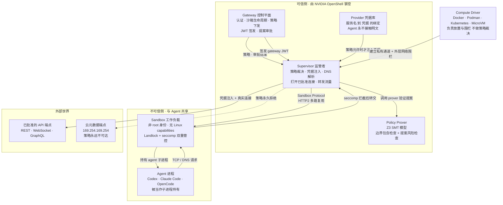
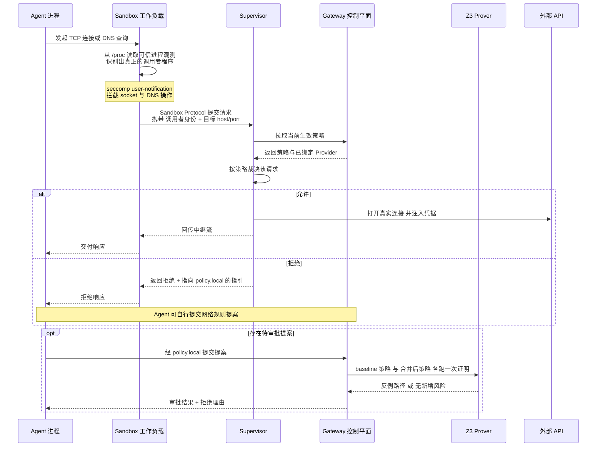
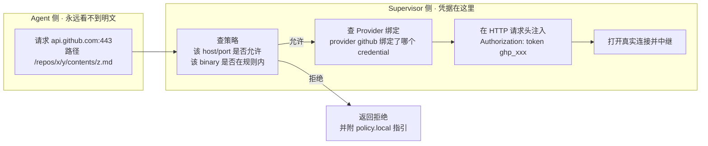
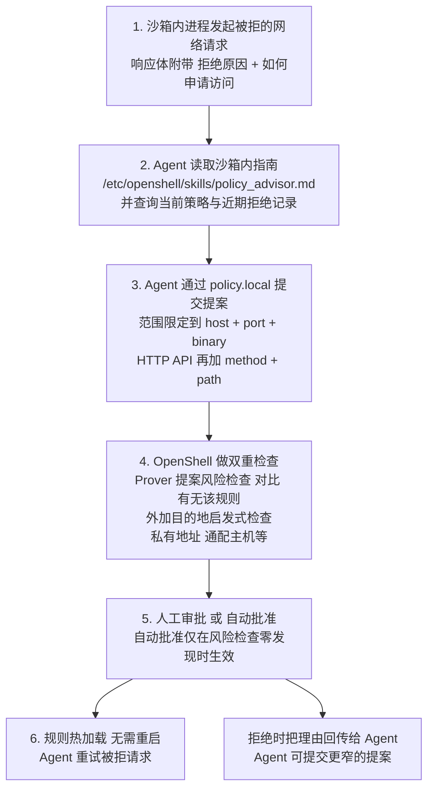
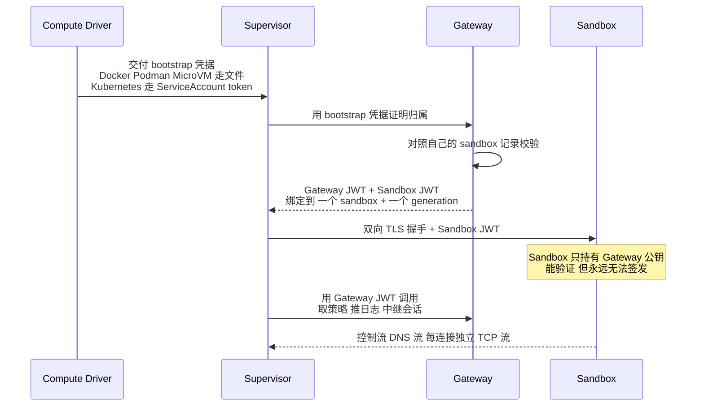
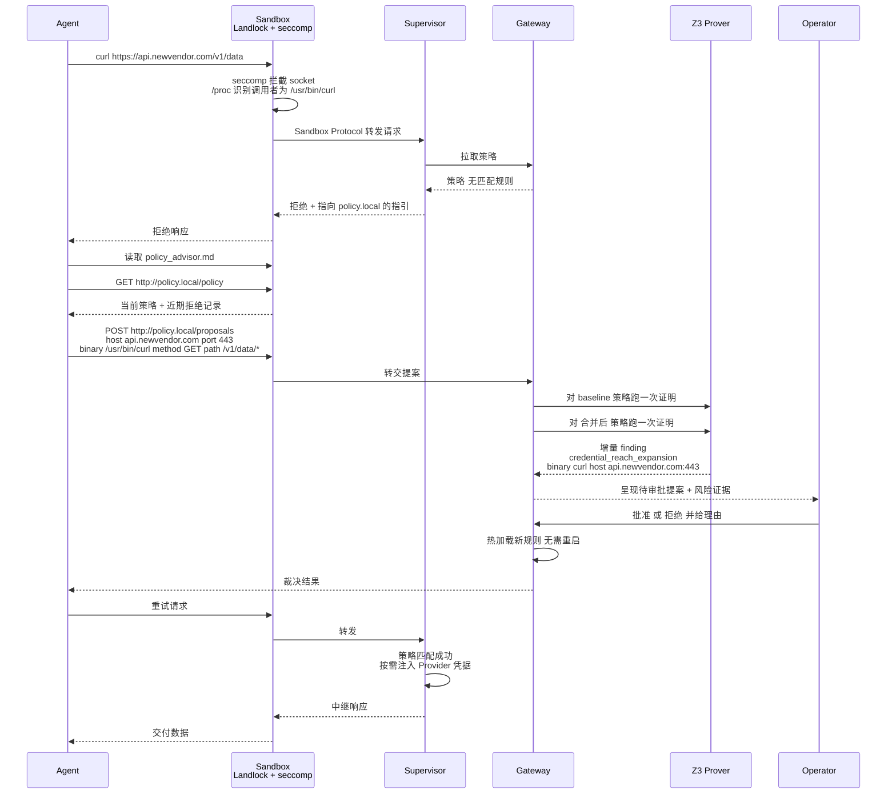

## 一、引子：Agent 拿到网络权限之后，谁来兜底？

过去两年，AI Agent 的能力边界一路扩张：读文件、装包、调 API、拿凭证跑活。每一次扩张都伴随一个老问题——**权限给多了会出事，给少了 Agent 干不成活**。

行业的标准解法今天大致分三派：

**第一派：容器 / 微虚机隔离派。** Docker、gVisor、Firecracker、Kubernetes 这条线，代表作是各家 Agent Sandbox 运行时。它们的思路是「把 Agent 关进一个笼子」，靠 cgroup、namespace、seccomp、pci rootfs 隔离把伤害控制住。

**第二派：策略拦截派。** 典型是 Microsoft Agent Governance Toolkit 这类项目。它们在 Agent 调用工具的 API 层插一道决策点，根据 OWASP Agentic Top 10 之类的规则清单做 allow / deny / audit / escalate 的裁决。

**第三派：提示词与沙箱护栏派。** 靠 LLM 自查、系统提示注入、输出过滤来约束行为。

这三条路都有用，但它们共同缺了一个东西：**「这次权限变更到底放开了什么」的精确答案。**

现实中的 Agent 权限变更长这样：Agent 被网络策略拦住了，于是它提交一条提案——「我需要访问 `api.example.com:443`，用 `curl`，方法 `GET /v1/items/*`」。人看一眼，脑子只处理了一个模糊的直觉：「这个 host 好像还行？」然后点了批准。

问题在于：**人脑不擅长判断集合包含关系。**

「加了 `GET` 就意味着不能 `POST` 了吗？」「`/v1/items/*` 会不会顺带盖住 `/v1/items/../admin`？」「我批准的是 `curl`，那如果沙箱里还有 `nc` 呢——它能绕过 L7 检查吗？」「如果这个 Agent 再 spawn 一个子 Agent，子 Agent 的策略是不是也在这个边界内？」

这些问题的答案，恰好是**形式化方法擅长而人脑最不擅长的**：集合包含、偏序、可达性。

NVIDIA 在 2026 年 2 月开源的 **OpenShell**（⭐18.8k，Rust，Apache-2.0），把这个想法做成了一个真正的产品：把 Agent 策略的每一次变更，都变成一个 **SMT 证明义务**，用 Z3 求解器去证明「候选策略没有超出运营方定义的边界」，并给出**具体的反例**（counterexample）。

这就是本文要拆解的东西：一个把「Agent 权限治理」从**启发式黑名单**推向**可证明的包含关系**的开山之作。

---

## 二、项目定位与核心价值

### 2.1 一句话定义

> **OpenShell 是 NVIDIA 官方开源的「自主 Agent 私有安全运行时」**：它给 Agent 完整的文件、进程、网络、API 能力，但用内核级管控 + 形式化策略验证，把这些能力锁在一份可审计的策略边界内。

官方仓库：[github.com/NVIDIA/OpenShell](https://github.com/NVIDIA/OpenShell)

| 维度 | 数据 |
|---|---|
| Stars | 18,805 |
| Forks | 1,886 |
| 主语言 | Rust（crates/ 目录下 810 个文件） |
| License | Apache-2.0 |
| 首次提交 | 2026-02-24（约 8 个月） |
| 最近推送 | 2026-10-24（活跃） |
| 仓库规模 | 2107 个 tree 节点 / 约 93 MB |
| 官方文档 | docs.nvidia.com/openshell/latest |
| 治理 | NVIDIA 官方项目，有 RFC board 与公开 Roadmap |

**8 个月从 0 冲到 1.88 万星**，在 NVIDIA 官方开源项目里属于非常快的起量速度。

### 2.2 能力矩阵

OpenShell 的能力不是单一的「沙箱」，而是**四层能力的组合**：

| 能力层 | 具体内容 | 与传统方案的关系 |
|---|---|---|
| **运行时隔离** | Landlock LSM（ABI 3+）+ seccomp user-notification + `SO_BINDTODEVICE` socket 绑定 + 非 dumpable broker | 比容器更硬（内核级），比微虚机更轻（无 VM 启动开销） |
| **网络代理与协议检查** | L4 TCP 中介 + L7 REST 协议检查（method / path 规则）+ WebSocket / GraphQL / MCP / JSON-RPC 协议分类 | 唯一能在 Agent 与外网之间做协议级内容检查的方案 |
| **凭据作用域化** | Provider 把「服务名 ↔ 凭据」绑定，Supervisor 只在策略允许的端点上注入凭据；Agent 永远看不到明文 | 解决「Agent 拿到 AWS key 就等于拿到整个云账号」的老问题 |
| **形式化策略验证** | Z3 SMT 模型 + 边界包含检查 + 提案风险检查 + 反例生成 | **本项目独有的差异化能力**，无人对标 |

### 2.3 架构上的三句核心命题

OpenShell 的架构文档把设计意图浓缩成两句话，而这两句话恰好定义了它与所有竞品的分界线：

> **第一句：运行时用内核强制执行。**
> 每个 Agent 跑在隔离沙箱里，内核机制约束它能访问哪些文件、能发起哪些系统调用；每一条网络连接在离开沙箱之前都要过策略检查。Agent 从来看不到真实凭据——OpenShell 只把它加到「绑定到已批准端点」的请求上。

> **第二句：策略变更用形式化验证把关。**
> 在一次策略变更被批准之前，OpenShell 用形式化验证标记出这次变更会新放开的高风险访问（比如「带凭据触达一个新主机」「调用一个新 API 方法」），让这些变更必须经过人工评审。

**「运行时执行 + 变更期证明」的双轨结构**，是 OpenShell 全部设计的骨架。

---

## 三、整体架构：信任边界两侧的博弈

### 3.1 顶层架构

OpenShell 的核心是一个**双向信任边界的对切结构**。理解这张图，剩下 90% 的设计都好懂。



**这张图最关键的信息有三条：**

1. **Supervisor 在沙箱外，Sandbox 在沙箱内。** Agent 与 Sandbox 共享边界，所以 Sandbox 里**没有任何值得偷的东西**——没有网关签名密钥、没有网关 JWT、没有 Provider 凭据。Agent 能验证自己在跟正确的 Supervisor 说话，但**无法冒充一个**。

2. **Supervisor 是唯一的裁决点。** Compute Driver 只负责「摆放和围栏」（创建运行时资源、安装外层 egress 围栏、提供已验证的描述符），**从不判断某个请求是否被允许**。这正是「同一份策略在任何 runtime 下行为一致」的原因。

3. **Prover 在 Gateway 里，不在 Supervisor 里。** 验证是**变更期**的事（审批之前），执行是**运行期**的事（请求转发时）。两者解耦，Prover 因此可以完全独立于 Gateway 部署成独立的 `openshell-prover` 命令，在 CI 里跑。

### 3.2 一次网络请求的完整旅程



注意第 3 步：**sandbox 识别调用者程序靠的是 `/proc` 的可信进程观测，不是 Agent 自报的路径**。这条设计直接堵死了一个经典绕过：Agent 声称自己是 `/usr/bin/curl`，实际是 `/tmp/evil`。Supervisor 拿到的是真实身份。

### 3.3 四种 runtime 如何建同一堵墙

OpenShell 的隔离后端通过 `IsolationBackend` RPC 服务抽象，让不同运行时用各自的原生工具建同一堵墙：

| Runtime | Supervisor 位置 | 通信方式 | 外层 egress 封锁方式 |
|---|---|---|---|
| Docker | 独立容器 | 认证 Unix socket（driver 拥有卷） | 工作负载容器**关闭网络** |
| Podman | 独立容器 | 认证 Unix socket | 工作负载容器**关闭网络** |
| Kubernetes | 独立 Pod | Private Service + 双向 TLS | NetworkPolicy 只允许 Supervisor 服务 |
| MicroVM | 宿主机进程 | 认证 vsock | Guest **没有网络设备** |

三条协议定义在 `proto/isolation_backend.proto` 与 `proto/sandbox_protocol.proto`：

| RPC | 职责 |
|---|---|
| `IsolationBackend.Describe` | 协商协议与能力 |
| `IsolationBackend.OpenBoundary` | 把已置备资源绑定到一次认证过的启动 |
| `IsolationBackend.SuspendBoundary` / `ResumeBoundary` | 可选地保留/恢复工作负载状态 |
| `SandboxProtocol.Exchange` | 承载准入、进程控制与 I/O、TCP 决策、中继数据 |
| `SandboxProtocol.Mediate` | 承载 DNS 中介握手、查询与响应 |

**准入序列是 Attach → Confirm → StartAgent。在 StartAgent 之前，没有任何工作负载代码运行。**

---

## 四、核心引擎一：内核级运行时管控

### 4.1 四项内核能力，且都是「主动探测后才准入」

OpenShell 对内核能力的要求写得非常硬：

| 内核模块 | 要求 | 细节 |
|---|---|---|
| Landlock LSM | **必需**，ABI 3+（Linux 6.2 引入） | 强制基线保护私有通道与 bootstrap 文件，即使 filesystem policy 是 `best_effort` 也**永不关闭**这条基线 |
| seccomp | **必需** | 嵌套 user-notification 过滤器 + 原子 `SECCOMP_IOCTL_NOTIF_ADDFD`（配合 `SECCOMP_ADDFD_FLAG_SEND`） |
| Task-memory 访问 | **必需** | 非 dumpable broker 需能通过 `process_vm_readv` 或 `/proc/<pid>/mem` 读取同 UID 子进程内存；**broker 永不写入工作负载内存** |
| Socket 设备绑定 | **必需** | 所有 TCP/UDP socket 用 `SO_BINDTODEVICE` 绑定到 loopback；被接受的 socket 继承该绑定 |

**「内核版本号不等于支持」**——这句话是文档里明确写出来的。判定逻辑是**主动探测**：

> 一个被禁用的 Landlock LSM，或一个阻止了必需 seccomp 操作运行时 profile，会导致启动 **fail closed**。上游 Linux 6.2+ 内核提供所需的 Landlock ABI；发行版 backport 必须通过同样的主动资格检查。

这个「主动探测 + fail closed」的哲学贯穿全项目，是它与「读个版本号就信了」类方案的根本差别。

### 4.2 Landlock 的两档严格度

```yaml
landlock:
  compatibility: best_effort   # 或 hard_requirement
```

| 值 | 行为 |
|---|---|
| `best_effort` | 沙箱在**没有**文件系统规则的情况下运行，并记录一条 high-severity finding |
| `hard_requirement` | 沙箱**启动失败** |

两档都会跳过镜像中缺失或工作负载打不开的单个路径。区别只在「一个路径都套不上」或「Landlock 根本没强制住策略规则」时。

沙箱日志里的 `Landlock ruleset built` 事件会报告**应用了多少路径、跳过了多少路径**——这是可审计的。

### 4.3 进程身份：拒绝 root 是硬规则

```yaml
process:
  run_as_user: "1500"
  run_as_group: "1500"
```

- `run_as_user` 只能是 `sandbox` 或一个数字 UID
- 数字 ID 必须在 **1 到 4294967294** 之间——**OpenShell 直接拒绝 root**
- 每个字段独立，可以只设一个让 compute driver 决定另一个
- 普通 exec 使用与规范进程相同的身份

「拒绝 root」这条规则看着简单，但它是后面整个 Prover 模型能成立的地基：**因为工作负载永远不是 root，它才可能用 Landlock + seccomp user-notification 把自己关进笼子**；如果 Agent 是 root，它可以自己把 Landlock 规则卸掉。

---

## 五、核心引擎二：Provider 凭据作用域化

### 5.1 问题的本质：凭据不是「能不能给」，而是「能带到哪」

传统做法有两种，都不好：

- **给 Agent 完整凭据**（把 AWS key 写进环境变量）→ Agent 一旦被 prompt injection，key 就全出去了
- **完全不给凭据** → Agent 干不了活，operator 又不敢开

OpenShell 的第三种做法：**凭据由 Supervisor 保管，只在策略允许的端点上注入**。



### 5.2 凭据注入的几种形态

策略 schema 里的凭据字段设计得相当细：

```yaml
network_policies:
  gcp_storage:
    endpoints:
      - host: storage.googleapis.com
        port: 443
        protocol: rest
        access: full
        credential_binding:
          provider: work-gcp
        request_body_credential_rewrite: true
        credential_signing: sigv4
        signing_service: storage
        signing_region: us-east-1
    binaries:
      - path: /usr/bin/curl
```

| 字段 | 作用 |
|---|---|
| `credential_binding.provider` | 绑定某个已挂载 Provider 的静态凭据（其 profile 未定义端点时有效） |
| `request_body_credential_rewrite` | 替换 REST 请求体中的凭据占位符（UTF-8 JSON / form / text，上限 256 KiB） |
| `websocket_credential_rewrite` | 替换客户端 WebSocket **文本消息**中的凭据占位符 |
| `allow_uninspected_credentials` | 允许带凭据端点跳过请求检查或使用 `tls: skip`（默认 false） |
| `credential_signing` | AWS 请求签名：`sigv4` / `sigv4:body` / `sigv4:no_body` |
| `signing_service` / `signing_region` | AWS 服务名与区域覆盖 |

凭据占位符的格式是 `openshell:resolve:env:KEY`——**Agent 在源码里看到的是这个占位符，不是真实 key**。

### 5.3 一条铁律：元数据端点永远不可达

策略 schema 里写着：

> Network policy never authorizes an outbound endpoint whose destination is loopback, link-local, or unspecified, including the cloud metadata address `169.254.169.254`.

这一条**没有例外**，是 policy 层和 runtime 层双重封锁。后面会看到，Prover 也把它建模成第一类 finding。

---

## 六、核心引擎三（本文重点）：用 Z3 证明策略变更

这是 OpenShell 最独特、也最有价值的一块。

### 6.1 两种证明，用途完全不同

| 检查类型 | 提问方式 | 何时跑 | 谁调用 |
|---|---|---|---|
| **边界包含检查**（boundary check） | 「候选策略是否**没有超出**运营方定义的边界策略？」 | 变更**之前** | `openshell-prover` CLI，或父 Agent 为子 Agent 写策略时自检 |
| **提案风险检查**（proposal risk check） | 「这条提案相比当前策略，**新增了什么**高风险访问？」 | 每次 Agent 提交网络规则提案时 | Gateway 自动执行 |

**这两件事互不蕴含**——文档明确写了：「通过其中一个不代表通过另一个」。一个通过了提案风险检查的规则，依然可能超出你的边界；一个通过了边界检查的策略，依然可能包含提案风险检查会标记的内容。

### 6.2 边界包含检查怎么用

```yaml
# boundary.yaml —— 运营方定义的「环境允许的最大权限」
version: 1
filesystem_policy:
  read_only:
    - /usr
    - /etc
```

```yaml
# candidate.yaml —— 候选策略
version: 1
filesystem_policy:
  read_only:
    - /usr
  read_write:
    - /tmp
```

```shell
$ openshell-prover check candidate.yaml --boundary boundary.yaml
result: exceeds_boundary
coverage: domains=filesystem,network_l4,network_rest,process,landlock
counterexample: filesystem write /tmp
```

**输出是这个设计的精华**：不只是「失败」，而是给出**具体的反例**——「候选策略允许写 `/tmp`，而边界不允许」。这正是 SMT 求解器相比人工审阅的价值：它给出一个**可复现、可断言、可写进 CI 的证据**。

退出码契约也很清晰：

| 结果 | 退出码 | 含义 |
|---|---|---|
| `within_boundary` | 0 | 候选策略在 prover 检查的范围内没有超出边界 |
| `exceeds_boundary` | 1 | 候选策略允许了边界不允许的访问，`counterexample` 给出示例 |
| `error` | 2 | prover 无法执行检查（文件缺失、策略非法等） |
| `unsupported` | 3 | 策略用到了 prover 无法检查的东西 |
| `inconclusive` | 3 | prover 无法完成（超时、策略过大等） |

**只有 `within_boundary` 算通过。其余一切按失败处理。** 这是典型的 fail-closed 设计。

### 6.3 Z3 模型：把策略编码成 SAT 问题

`crates/openshell-prover/src/model.rs` 是整个证明引擎的核心。我们来看它怎么把一份 YAML 策略变成 Z3 的布尔约束。

**第一步：索引端点与二进制**

```rust
// 来自 crates/openshell-prover/src/model.rs
/// Unique identifier for a network endpoint in the model.
#[derive(Debug, Clone, Hash, PartialEq, Eq)]
pub struct EndpointId {
    pub policy_name: String,
    /// Position within the policy rule's endpoint list.
    pub endpoint_index: usize,
    pub host: String,
    pub port: u16,
}

impl EndpointId {
    /// Stable string key used for Z3 variable naming.
    pub fn key(&self) -> String {
        // Length-prefix the authored name so delimiters cannot alias another rule.
        format!(
            "{}:{}:{}:{}",
            self.policy_name.len(),
            self.policy_name,
            self.endpoint_index,
            self.port
        )
    }
}
```

注意那个 `self.policy_name.len()` 前缀——**长度前缀编码**。这是防止键冲突的经典技巧：规则名 `rule:2001` 和规则名 `rule` 配上 host `2001:db8::1`，如果直接用 `:` 拼接就会撞车。模型测试里专门有一条：

```rust
// 来自 crates/openshell-prover/src/model.rs
#[test]
fn endpoint_keys_distinguish_rule_names_with_delimiters() {
    let left = EndpointId {
        policy_name: "rule:2001".to_string(),
        endpoint_index: 0,
        host: "db8::1".to_string(),
        port: 443,
    };
    let right = EndpointId {
        policy_name: "rule".to_string(),
        host: "2001:db8::1".to_string(),
        ..left
    };
    assert_ne!(left.key(), right.key());
}
```

**第二步：编码策略允许关系**

```rust
// 来自 crates/openshell-prover/src/model.rs
fn encode_policy_allows(&mut self) {
    for (policy_name, rule) in &self.policy.network_policies {
        for (endpoint_index, ep) in rule.endpoints.iter().enumerate() {
            for port in ep.effective_ports() {
                let eid = EndpointId { /* ... */ };
                for b in &rule.binaries {
                    let key = format!("{}:{}:{}", b.path.len(), b.path, eid.key());
                    let var = Bool::new_const(format!("policy_allows_{key}"));
                    self.solver.assert(&var);
                    self.policy_allows.insert(key, var);
                }
            }
        }
    }
}
```

每个 `(binary, endpoint)` 组合对应一个布尔常量 `policy_allows_<key>`。**注意这里的方向**：`assert(&var)` 是把它约束为 **true**——因为这份 endpoint 确实在策略里被允许了。模型从「策略写了什么」出发，而不是从「策略允许什么」出发。

**第三步：编码 L7 强制与写能力**

```rust
// 来自 crates/openshell-prover/src/model.rs
fn encode_l7_enforcement(&mut self) {
    // ...
    // L7 enforced?
    let l7_var = Bool::new_const(format!("l7_enforced_{ek}"));
    if ep.is_l7_enforced() {
        self.solver.assert(&l7_var);
    } else {
        self.solver.assert(&!l7_var.clone());
    }
    self.l7_enforced.insert(ek.clone(), l7_var);

    // L7 allows write?
    let allowed = ep.allowed_methods();
    let write_set: HashSet<&str> = WRITE_METHODS.iter().copied().collect();
    let has_write = if allowed.is_empty() {
        true // L4-only: all methods pass
    } else {
        allowed.iter().any(|m| write_set.contains(m.as_str()))
    };

    let l7_write_var = Bool::new_const(format!("l7_allows_write_{ek}"));
    if ep.is_l7_enforced() {
        if has_write {
            self.solver.assert(&l7_write_var);
        } else {
            self.solver.assert(&!l7_write_var.clone());
        }
    } else {
        // L4-only: all methods pass through
        self.solver.assert(&l7_write_var);
    }
    self.l7_allows_write.insert(ek, l7_write_var);
}
```

这段代码表达了一条**关键的语义区分**：

- `l7_enforced` = 这个端点是否做 L7（HTTP 协议级）检查
- `l7_allows_write` = 这个端点是否允许写方法（POST/PUT/PATCH/DELETE）

对于 `protocol: tcp` 的纯 L4 端点，`allowed_methods()` 为空 → `has_write = true`（所有方法都过），并且 `l7_enforced = false`。这正确刻画了「TCP 隧道无法限制 HTTP 方法」这个事实。

**第四步：编码二进制能力**

```rust
// 来自 crates/openshell-prover/src/model.rs
fn encode_binary_capabilities(&mut self) {
    for bpath in &self.binary_paths.clone() {
        let cap = self.binary_registry.get_or_unknown(bpath);

        let bypass_var = Bool::new_const(format!("binary_bypasses_l7_{bpath}"));
        if cap.bypasses_l7() {
            self.solver.assert(&bypass_var);
        } else {
            self.solver.assert(&!bypass_var.clone());
        }
        self.binary_bypasses_l7.insert(bpath.clone(), bypass_var);

        let exfil_var = Bool::new_const(format!("binary_can_exfil_{bpath}"));
        if cap.can_exfiltrate {
            self.solver.assert(&exfil_var);
        } else {
            self.solver.assert(&!exfil_var.clone());
        }
        self.binary_can_exfil.insert(bpath.clone(), exfil_var);

        let http_var = Bool::new_const(format!("binary_can_construct_http_{bpath}"));
        if cap.can_construct_http {
            self.solver.assert(&http_var);
        } else {
            self.solver.assert(&!http_var.clone());
        }
        self.binary_can_construct_http.insert(bpath.clone(), http_var);
    }
}
```

**第五步：组合成可达性公式**

这是整个模型最精妙的一段：

```rust
// 来自 crates/openshell-prover/src/model.rs
/// Build a Z3 expression for whether data can be exfiltrated via this path.
pub fn can_exfil_via_endpoint(&self, bpath: &str, eid: &EndpointId) -> Bool {
    let ek = eid.key();
    let access_key = format!("{}:{bpath}:{ek}", bpath.len());

    let has_access = match self.policy_allows.get(&access_key) {
        Some(v) => v.clone(),
        None => return Self::false_val(),
    };

    let exfil = self.binary_can_exfil.get(bpath).cloned()
        .unwrap_or_else(Self::false_val);
    let bypass = self.binary_bypasses_l7.get(bpath).cloned()
        .unwrap_or_else(Self::false_val);
    let l7_enforced = self.l7_enforced.get(&ek).cloned()
        .unwrap_or_else(Self::false_val);
    let l7_write = self.l7_allows_write.get(&ek).cloned()
        .unwrap_or_else(Self::false_val);
    let http = self.binary_can_construct_http.get(bpath).cloned()
        .unwrap_or_else(Self::false_val);

    Bool::and(&[
        has_access,                                    // 策略允许这个 binary 访问这个 endpoint
        exfil,                                         // 这个 binary 有能力外传数据
        Bool::or(&[
            Bool::and(&[!l7_enforced, http.clone()]),   // 路径 A: 无 L7 检查 但 binary 能造 HTTP
            Bool::and(&[l7_write, http]),               // 路径 B: 有 L7 检查 且 允许写 且 binary 能造 HTTP
            bypass,                                     // 路径 C: 这个 binary 直接绕过 L7
        ]),
    ])
}
```

把这段翻译成人话——**数据能通过这条路径外传，当且仅当**：

1. 策略允许这个 binary 访问这个 endpoint（`has_access`）
2. **并且** 这个 binary 有外传能力（`can_exfiltrate`）
3. **并且** 满足以下三条路径中至少一条：
   - **路径 A**：这个端点没有 L7 检查，但这个 binary 能构造 HTTP 请求 → 它可以随便发 GET/POST
   - **路径 B**：这个端点有 L7 检查、允许写方法，且 binary 能构造 HTTP → 它可以发 POST/PUT 之类
   - **路径 C**：这个 binary 本身就绕过 L7（`bypasses_l7`）→ 协议层根本管不住它

**这就是把「策略配置」翻译成「可证明的可达性」的全过程。** Z3 求这个公式是否 SAT——如果 SAT，就存在一条真实的、可被利用的外传路径。

### 6.4 二进制能力注册表：把「这个程序有多危险」变成数据

上面的 `bypasses_l7` / `can_exfiltrate` / `can_construct_http` 三个属性来自**二进制能力注册表**——一组 YAML 描述符，位于 `crates/openshell-prover/registry/binaries/`。

```yaml
# 来自 crates/openshell-prover/registry/binaries/curl.yaml
binary: /usr/bin/curl
description: "Command-line HTTP client"
protocols:
  - name: http
    transport: https
    description: "HTTP/HTTPS requests — can construct arbitrary method, path, headers, body"
    bypasses_l7: false
    actions:
      - { name: get, type: read, description: "HTTP GET request" }
      - { name: post, type: write, description: "HTTP POST with arbitrary body" }
      - { name: put, type: write, description: "HTTP PUT with arbitrary body" }
      - { name: delete, type: destructive, description: "HTTP DELETE request" }
      - { name: upload, type: write, description: "File upload via multipart POST" }
spawns: []
can_exfiltrate: true
exfil_mechanism: "POST/PUT file contents to any reachable endpoint, or encode in URL query parameters"
can_construct_http: true
```

```yaml
# 来自 crates/openshell-prover/registry/binaries/nc.yaml
binary: /usr/bin/nc
description: "Netcat — arbitrary TCP/UDP connections"
protocols:
  - name: raw-tcp
    transport: tcp
    description: "Raw TCP connection — can send/receive arbitrary data"
    bypasses_l7: true
    actions:
      - { name: connect, type: read, description: "Establish TCP connection" }
      - { name: send, type: write, description: "Send arbitrary data over TCP" }
      - { name: listen, type: read, description: "Listen for incoming connections" }
spawns: []
can_exfiltrate: true
exfil_mechanism: "Stream arbitrary data over raw TCP connection"
can_construct_http: false
```

注册表里目前有 9 个：`curl` / `nc` / `wget` / `git` / `ssh` / `gh` / `node` / `python3` / `claude`。

**请注意 `nc` 和 `curl` 的对比**：

| 二进制 | `bypasses_l7` | `can_construct_http` | `can_exfiltrate` |
|---|---|---|---|
| `/usr/bin/curl` | false | **true** | true |
| `/usr/bin/nc` | **true** | false | true |

`nc` 的 `bypasses_l7: true` 意味着：**任何时候你在策略里给了 `nc` 网络权限，L7 层的 HTTP 方法检查就完全失效了**，因为它直接走原始 TCP。Z3 模型因此可以把「给 nc 开网络权限 + 该主机有凭据在作用域内」判定为**直接的 finding**。

**这就是注册表的价值：把「这个二进制有多危险」从散落各处的经验判断，变成一份可版本管理、可审阅、可被求解器消费的数据。**

### 6.5 四个形式化问题

Prover 回答四个问题，每个「是」的答案就是一个独立的 finding 类别：

| 类别 | 形式化提问 |
|---|---|
| `link_local_reach` | 策略是否授予了对 `169.254.0.0/16` 或 `fe80::/10` 内主机的可达性？ |
| `l7_bypass_credentialed` | 是否让一个 `bypasses_l7` 的二进制（如 nc/git/ssh）到达了**有凭据在作用域内**的主机？ |
| `credential_reach_expansion` | 是否让某个二进制到达了它**之前到不了**的（host, port）？且那里有凭据？ |
| `capability_expansion` | 在**本来就有**凭据可达性的 (binary, host, port) 上，是否新增了 HTTP 方法？ |

前两个是**无条件风险**，后两个是**增量（delta）属性**——Gateway 会在 baseline 策略和合并后策略上各跑一次 prover，只把**新增的路径**浮现出来。

```rust
// 来自 crates/openshell-prover/src/queries.rs
pub(crate) fn is_link_local(host: &str) -> bool {
    match host.parse::<IpAddr>() {
        Ok(IpAddr::V4(v4)) => v4.is_link_local(),
        Ok(IpAddr::V6(v6)) => v6.is_unicast_link_local(),
        Err(_) => false,
    }
}

/// Return true for static cloud metadata hostnames that should be treated like
/// link-local metadata reach without performing DNS resolution.
pub(crate) fn is_known_metadata_hostname(host: &str) -> bool {
    let normalized = host.trim().trim_end_matches('.').to_ascii_lowercase();
    matches!(normalized.as_str(), "metadata.google.internal")
}
```

这里有一个值得注意的**刻意的保守取舍**：

> We don't perform DNS resolution at validation time; the model evaluates the policy as written.

**Prover 不做 DNS 解析。** 它按策略文本评估，不去解析 `api.example.com` 到底指向哪里。这既避免了 DNS rebinding 带来的 TOCTOU，也意味着「`evil.example.com` 解析到 `169.254.169.254`」这种攻击**不在 Prover 的射程内**——它由运行时的 `allowed_ips` 机制来兜底。

### 6.6 证据形状与增量去重

```rust
// 来自 crates/openshell-prover/src/finding.rs
pub struct ExfilPath {
    pub binary: String,
    pub endpoint_host: String,
    pub endpoint_port: u16,
    pub mechanism: String,        // human-readable description
    pub policy_name: String,      // rule the path traverses
    pub category: String,         // one of the category constants
    pub method: String,           // populated for capability_expansion; empty otherwise
}
```

Gateway 的 `finding_delta` 按 `(finding query, binary, host:port, path category, method)` 做键，这样在已可达的主机上新增一个方法，只会浮现**一条**新路径，而不是把已有方法集整个重发一遍。

还有一个**类别抑制规则**：

> `capability_expansion` paths whose `(binary, host, port)` tuple is also in the `credential_reach_expansion` delta are suppressed by the gateway.

即：一个全新的带凭据可达性，只用 `credential_reach_expansion` 一条 finding 描述，不会同时冒出 N 条 per-method finding。**这让审批界面的信噪比高出一个量级。**

### 6.7 Prover 明确「不决定」什么

这一节写得非常克制，值得完整引用：

> - **Semantic risk of an action.** The prover models *can the binary do this?*, not *is this destructive?*. `PUT /repos/.../contents/file.md` and `GET /repos/.../contents/file.md` are both authenticated actions; the reviewer (or a downstream layer like an LLM contextual reviewer or an intent file) decides if the action is desired.
> - **Cross-sandbox or cross-binary intent.** The model is per-sandbox.
> - **Runtime behavior.** The prover analyzes the policy as written; it doesn't observe the proxy's actual decisions. **The proxy is the enforcement layer; the prover is the change-review layer.**

**Prover 证明的是「能力边界」，不是「业务意图」。** 这条界线划得很清楚，也是它能长期演进的前提——把语义判断交给 LLM reviewer 或 intent file，把集合包含交给 SMT 求解器，各司其职。

---

## 七、策略 Advisor：让 Agent 自己申请权限

有了 Prover，还需要一个「谁提出提案」的机制。OpenShell 的 policy advisor 承担这个角色。

### 7.1 五步提案流



### 7.2 `policy.local`：沙箱内的本地 API

OpenShell 在沙箱内提供 `http://policy.local`，**只能从沙箱内部访问，不需要网络规则也不需要代理设置**。Agent 用它：

- 读取当前策略
- 查询近期拒绝记录
- 提交提案
- 等待裁决结果

配套还在沙箱内放了三处指引：`/etc/openshell/skills/policy_advisor.md` 完整指南、`/etc/openshell/skills/policy-advisor/SKILL.md` Agent skill、以及（镜像没有的话）`/AGENTS.md` 里的指针。

### 7.3 自动批准的门槛

自动批准**只在风险检查零发现时生效**。这与 Prover 的 fail-closed 哲学是一致的：**证明不了安全，就不许自动通过。**

另外还有一条容易被忽略的机制：OpenShell 会**自己起草提案**——从被阻断的连接里自动生成草案（包括那些没有任何规则命名的主机名）。这些草案走**和 Agent 提交的提案完全相同的检查与审批流程**，自动批准对它们同样适用。

但被阻断的请求**始终保持拒绝状态**，必须等规则批准并加载后 Agent 才会重试。

---

## 八、认证：三重连接，三种令牌



| 连接 | 谁发起 | 保护方式 |
|---|---|---|
| Supervisor → Gateway | Supervisor 主动外拨 | Gateway JWT（Gateway 启用 TLS 时叠加 TLS） |
| Supervisor → Sandbox | Supervisor 拨入工作负载 | 双向 TLS + Sandbox JWT |
| Agent → Supervisor | Agent **从不直接连接** | 由上面那条通道承载 |

**核心不变式**：Gateway 是**唯一签发凭据**的组件，且每个凭据**精确命名一个 sandbox**。

### 8.1 Generation 机制

每次沙箱运行，Gateway 签发一对 JWT：

- **Gateway JWT** —— 随每次 Supervisor 调用发送，只允许 Supervisor 需要的调用（取策略、推日志、中继会话）。**它不是用户凭据**，管不了别的 sandbox。
- **Sandbox JWT** —— 随每次 Supervisor 调用发往 Sandbox。Sandbox 只有 Gateway 公钥，**能验证但永远无法创建一个**。

**每个令牌只对自己的连接有效，两者都绑定到一个 sandbox 和该 sandbox 的一次运行（generation）。** 重启沙箱 = 新 generation = 新令牌 + 新 TLS 证书，旧令牌立即失效。

**Supervisor 断连时，Sandbox 会冻结 Agent。** 只有**同一个** Supervisor 进程能重连并恢复它——新的 Supervisor 即使拿着有效凭据，也**接管不了一个运行中的沙箱**。

---

## 九、端到端全链路

把所有部件串起来，一个 Agent 想访问一个未授权 API 的完整故事：



**注意第 8-9 步**：Prover 被调用了**两次**（baseline 与 merged），做差得到增量。这就是「Delta 属性」的实现方式——**不是每次都重新评估整个策略的绝对风险，而是精确定位这次变更新引入了什么。**

---

## 十、与同类项目的设计差异

选三个最有对比价值的对手。**注意对比的是设计思路，不是功能清单。**

### 10.1 四方对照

| 维度 | NVIDIA OpenShell | NVIDIA 非官方… n/a | Docker/gVisor 系沙箱 | Microsoft Agent Governance Toolkit | 传统容器沙箱 |
|---|---|---|---|---|---|
| **核心抽象** | 策略 = 可被证明的集合 | — | 容器 / 虚机边界 | 工具调用点的策略拦截 | 命名空间 + cgroup |
| **控制点位置** | Supervisor 在边界外裁决 | — | 内核 namespace | 进程内 API 层 | 内核 |
| **凭据处理** | Supervisor 持有 按端点注入 | — | 明文进环境变量 | 不处理 | 明文进环境变量 |
| **变更审批** | **Z3 SMT 证明 + 反例** | — | 无（构建期固定） | 规则匹配 + LLM 判断 | 无 |
| **协议级检查** | L4 TCP + L7 REST + WS/GraphQL/MCP | — | 无 | 无 | 无 |
| **形式化保证** | 集合包含 / 可达性 | — | 无 | 无 | 无 |
| **跨 runtime 一致性** | 4 runtime 同一策略同行为 | — | 容器 vs VM 语义有别 | 与 runtime 无关 | 差异大 |

### 10.2 与 Microsoft Agent Governance Toolkit 的差异

两者都在做「Agent 行为管控」，但**位置和目标完全不同**：

- **AGT** 在**工具调用 API 层**拦截，用 `agent_startup` / `pre_model_call` / `pre_tool_call` / `post_tool_call` 五个干预点 + 一套 OWASP Agentic Top 10 规则清单，做 allow / deny / audit / escalate / defer 五态裁决。它回答「**此刻这个调用该不该做**」。
- **OpenShell** 在**基础设施层**建立边界，并额外回答「**这份策略本身是不是越界了**」。它不拦截调用，而是让非法调用根本发不出去。

**互补而非竞争**：AGT 的「结构性不可能违规」管的是运行时行为，OpenShell 的 Prover 管的是**变更期的权限边界**。前者假定策略是对的，后者怀疑策略。

### 10.3 与内核级沙箱（nono 等）的差异

nono 那类项目的思路是「把 Agent 关进 OS 内核级沙箱」，用 Landlock / Seatbelt 直接约束 syscall。OpenShell **也用 Landlock**——但它把 Landlock 放在一个**三段式信任边界**里：

| 维度 | 纯内核沙箱 | OpenShell |
|---|---|---|
| 内核机制 | Landlock / Seatbelt | Landlock + seccomp user-notification + `SO_BINDTODEVICE` |
| 网络 | 靠用户态代理或完全禁网 | **seccomp 拦截 socket → Supervisor 中介**（Agent 连出网必须过策略） |
| 凭据 | 通常明文注入 | **Supervisor 按端点注入，Agent 永不见明文** |
| 策略变更 | 靠 diff 人工审 | **SMT 证明 + 反例** |
| 部署 | 单进程本地 | **Gateway 控制平面 + 4 种 runtime + K8s Helm** |

关键差别：**纯内核沙箱解决「Agent 能不能碰到这个文件」，OpenShell 解决「Agent 能碰的东西、加上这件事本身值不值得批准」两个维度。**

### 10.4 与传统 Agent 框架（LangGraph / CrewAI）的差异

这是一个**正交关系**——传统 Agent 框架根本不涉及运行时安全。LangGraph 管的是「Agent 的思考流程怎么流转」，OpenShell 管的是「Agent 的权限边界在哪里、怎么证明没越界」。

两者可以叠加：LangGraph 跑在 OpenShell 沙箱里，框架负责决策，OpenShell 负责保证这个决策的爆炸半径可控。

---

## 十一、优缺点分析

### 11.1 架构简洁性 / 扩展性 / 易用性

| 维度 | 评价 | 说明 |
|---|---|---|
| **架构简洁性** | ★★★★☆ | Supervisor/Workload/Gateway 三方职责切得很干净，「谁裁决、谁执行、谁摆放」一句话能说清。但 Prover 的四个 finding 类别 + 增量抑制 + delta 键设计，认知负担不低 |
| **扩展性** | ★★★★★ | **IsolationBackend 抽象是整个项目最漂亮的设计**。新增一种隔离机制只需实现两组 RPC，Gateway API 与策略模型完全不用动。外部 compute driver 通过 `openshell.compute.isolation-backend` 标签接入 |
| **易用性** | ★★★☆☆ | 安装一条命令（`curl -LsSf .../install.sh \| sh`），但**安全模型的学习曲线陡峭**：策略 schema 有几十个字段，landlock 两档语义、credential_binding、enforcement 三态都需要理解。`unsupported` / `inconclusive` 的处理也需要用户建立信任 |

### 11.2 性能 / 复杂度 / 维护性

| 维度 | 评价 | 说明 |
|---|---|---|
| **性能** | ★★★★☆ | 网络请求多一跳 Supervisor 中继，这是**所有 L7 检查方案的共同代价**（Envoy、POPA 之类同理）。Prover 是变更期操作，不在热路径上，10 秒默认超时足够。内存与启动开销远低于微虚机方案 |
| **复杂度** | ★★☆☆☆ | 这是最大的代价。810 个 crate 文件、Z3 依赖、四种 runtime、三重令牌、两套检查语义、四种 finding 类别、七个 reason code……**运维门槛很高**。团队需要同时懂 Rust、内核安全、SMT 求解、容器编排 |
| **维护性** | ★★★★☆ | 大量设计被写进了代码注释与文档：`#[non_exhaustive]` 标注可扩展枚举、`ReasonCode::as_str()` 提供稳定标识符、`coverage.domains` 是机器可读的建模范围声明、CLI JSON 有 `schema_version` 与 `prover_version` 分离。**这些细节说明团队清楚「这个项目会长期演进」** |

### 11.3 值得单独点名的三个设计决策

**决策一：Prover 不做 DNS 解析。**

保守但诚实。它明确声明「模型按策略文本评估」，把 DNS rebinding 交给运行时的 `allowed_ips` 机制。**与其做一个半吊子的 DNS 解析引入 TOCTOU，不如明确划界。**

**决策二：`unsupported` 是一等结果，不是错误。**

```rust
// 来自 crates/openshell-prover/src/containment.rs
#[non_exhaustive]
pub enum ReasonCode {
    UnsupportedPolicyShape,
    UnresolvedWorkdir,
    UnresolvedBinaryPath,
    UnresolvedFilesystemPath,
    SolverTimeout,
    SolverUnknown,
    ResourceLimit,
    InvalidWitness,
    Cancelled,
}
```

「我检查不了」和「我检查了，没问题」被严格区分。**九个 reason code 全部 fail-closed**——`CheckResult` 只在 `Within` 时才算通过。

**决策三：端点键用长度前缀编码。**

`format!("{}:{}:{}:{}", self.policy_name.len(), self.policy_name, ...)`——一个 `:` 分隔符的经典坑（规则名 `rule:2001` 与 host `2001:db8::1` 撞车）被一个长度前缀彻底消除，还配了专门的单元测试。**这种细节的质量，是判断一个项目能不能长期维护的好指标。**

---

## 十二、实践：跑起来

### 12.1 安装与第一个沙箱

```shell
# 一键安装（Linux / macOS Apple Silicon / WSL2）
curl -LsSf https://raw.githubusercontent.com/NVIDIA/OpenShell/main/install.sh | sh

# 创建沙箱
openshell sandbox create --name demo
```

安装器会装好 CLI 和一个本地 Gateway。默认沙箱镜像是**最小化 Ubuntu，不预装任何 Agent**。

### 12.2 跑第一个 Agent

```shell
# 官方示例：用 OpenCode 对接一个免费的 OpenRouter 模型
openshell run my-sandbox -- opencode
```

这个过程会展示 OpenShell 最核心的交互模式：**当 Agent 需要新的网络访问时，OpenShell 会拦下并提示，你可以批准新访问。**

### 12.3 在 CI 里做策略边界检查

这是 Prover 最有价值的用法——把策略边界变成流水线里的一道门禁：

```yaml
# .github/workflows/policy-check.yml
name: Policy Boundary Check
on:
  pull_request:
    paths: ['policies/**']

jobs:
  check:
    runs-on: ubuntu-latest
    steps:
      - uses: actions/checkout@v4
      - name: Install prover
        run: |
          curl -LsSf https://raw.githubusercontent.com/NVIDIA/OpenShell/main/install.sh | sh
      - name: Verify candidate policy is within boundary
        run: |
          openshell-prover check policies/candidate.yaml \
            --boundary policies/enterprise-boundary.yaml \
            --output json --timeout 30s
```

JSON 输出里应该重点检查这几个字段：

```json
{
  "schema_version": 1,
  "prover_version": "0.1.0",
  "result": "within_boundary",
  "exit_code": 0,
  "coverage": { "domains": ["filesystem", "network_l4", "network_rest", "process", "landlock"] },
  "counterexample": null,
  "reason_code": null
}
```

**注意 `coverage.domains`**——它声明了 prover 实际建模了哪些权限域。如果你的策略用了 GraphQL 或 MCP 规则，`coverage` 不会包含它，`result` 会是 `unsupported`。**脚本必须同时检查 `result` 和 `coverage.domains`，而不是只看退出码。**

### 12.4 开启策略 Advisor

```shell
# 全局开启
openshell settings set --global \
  --key agent_policy_proposals_enabled \
  --value true \
  --yes

# 只给单个沙箱开启
openshell settings set <sandbox-name> \
  --key agent_policy_proposals_enabled \
  --value true

# 查看生效值及其来源
openshell settings get <sandbox-name>
```

### 12.5 审查与裁决提案

```shell
# 列出待审批提案 含规则 Agent 理由 风险检查结果
openshell rule get <sandbox-name> --status pending

# 批准
openshell rule approve <sandbox-name> --chunk-id <proposal-id>

# 拒绝并给理由 理由会回传给 Agent
openshell rule reject <sandbox-name> \
  --chunk-id <proposal-id> \
  --reason "Scope this to docs/ paths only."
```

### 12.6 SDK

| 语言 | 安装命令 |
|---|---|
| Python | `uv add openshell` |
| TypeScript | `npm install @nvidia/openshell-sdk` |
| Go | `go get github.com/NVIDIA/OpenShell/sdk/go@latest` |
| Rust | `cargo add openshell-sdk --git https://github.com/NVIDIA/OpenShell --tag <release-tag>` |

**SDK 用来把应用连到 Gateway，不装 CLI。** SDK 与 Gateway 尽量使用同一个 OpenShell 版本。

### 12.7 给 Coding Agent 装 OpenShell Skill

```shell
npx skills add NVIDIA/OpenShell
```

这些 skill 教你的 Agent 驱动 OpenShell CLI、写沙箱策略、调试 Gateway 与推理路由。**它们住在仓库的 `skills/` 目录，不依赖 OpenShell 源码检出。**

---

## 十三、趋势判断与工程经验

### 13.1 四个趋势判断

**趋势一：Agent 权限治理会从「黑名单」走向「可证明的边界」。**

过去三年所有 Agent 安全方案都在做同一件事——枚举危险行为然后拦截。问题是黑名单永远不完整，而且**没人能说清楚一次变更到底放开了什么**。OpenShell 用 SMT 求解器回答的这个问题，第一次有了「机器可判定」的答案。我预计 12-18 个月内，主流 Agent 沙箱产品会引入某种形式的策略证明能力。

**趋势二：「证明」与「执行」的分层会成为架构标准。**

OpenShell 把 Prover 放在 Gateway（变更期），把 Supervisor 放在沙箱外（运行期），两者用同一份策略但职责完全分离。这个分层的好处是：**证明器可以独立部署到 CI，运行时不必携带求解器依赖**。任何要把「策略校验」做成流水线的团队都会采用这个结构。

**趋势三：凭据作用域化会取代「给 Agent 完整凭据」。**

`credential_binding` + `openshell:resolve:env:KEY` 占位符 + 按端点注入，这套机制比「把 key 塞进环境变量然后祈祷」强出一个数量级。**它把「Agent 需要调这个 API」和「Agent 能拿到这把 key 的全部权限」这两件事解耦了。**

**趋势四：二进制能力注册表会成为一个新的安全工件。**

`curl.yaml` / `nc.yaml` 这类描述符把「这个程序有多危险」变成了**可版本管理的数据资产**。可以预见的是：这类注册表会像 CVE 数据库或 SBOM 一样成为标配，甚至被集成进 CI——「你新加的这个二进制，它的 L7 绕过能力是什么？」

### 13.2 五条可直接复用的工程经验

**经验一：安全边界要「主动探测 + fail closed」，不能靠读版本号。**

OpenShell 对 Landlock ABI 和 seccomp 能力的判定是**启动前实际探测**，探测失败就拒绝准入。这条经验适用于任何依赖内核特性的方案——**发行版 backport 的内核版本号可能是对的，但特性可能被裁掉了。**

**经验二：「我检查不了」必须是一等公民，且必须 fail closed。**

OpenShell 的 `unsupported` / `inconclusive` 都有独立退出码和 reason code，且都按失败处理。**一个把「不知道」当成「没问题」的安全系统，是最危险的安全系统。**

**经验三：用长度前缀消除分隔符歧义。**

`format!("{}:{}:{}:{}", name.len(), name, ...)` 一行代码消除了一整类键冲突，还配了回归测试。**任何用复合字符串做 map key 的地方都该过一遍这个检查。**

**经验四：把「我检查什么、我没检查什么」写进机器可读输出。**

`coverage.domains` 让调用方能自动判断「这个通过结果覆盖了我关心的所有域吗」。**这比在文档里写一句「目前支持 A、B、C」强一个数量级**——文档会过期，机器可读字段不会。

**经验五：证明器要知道自己的边界。**

「The prover models *can the binary do this?*, not *is this destructive?*」——这句话把形式化证明的适用范围划得清清楚楚。**一个不知道自己边界的证明器，比没有证明器更危险，因为它会给人虚假的安全感。**

### 13.3 总结

NVIDIA OpenShell 做了一件此前没有人认真做过的事：**把 Agent 权限策略从一份「需要人读懂并相信」的 YAML，变成一个「可以被机器证明」的数学对象。**

它的技术底座是三根柱子：

1. **Landlock + seccomp + socket 绑定的内核级隔离**，让工作负载没有 root、没有 capabilities、无法绕过网络中介；
2. **Supervisor / Workload 的信任边界对切**，让凭据、策略决策、真实连接全部留在 Agent 够不着的一侧；
3. **Z3 SMT 求解器 + 二进制能力注册表**，让每一次策略变更都变成一个可证明、可反例、可进 CI 的证明义务。

第三根柱子，是这个项目在 2026 年最值得关注的地方。

当 Agent 越来越多地自主获取权限，当 prompt injection 越来越难以靠黑名单防住，**我们需要一种能精确回答「这次变更放开了什么」的手段**。Z3 求解器在这个场景下不是炫技，而是**恰好是对的工具**——集合包含关系本来就是 SMT 最擅长的命题。

2024 年 Gartner 把 Context Engineering 列为战略技术趋势时，Parlant 用「运行时只注入相关规则」回答了「怎么控制 Agent 说什么」；今天 OpenShell 用「形式化证明策略边界」回答了「怎么控制 Agent 能做什么」。**这两个问题合起来，才是自主 Agent 真正需要的治理层。**

---

## 附录：关键资源

| 资源 | 地址 |
|---|---|
| GitHub 仓库 | https://github.com/NVIDIA/OpenShell |
| 官方文档 | https://docs.nvidia.com/openshell/latest |
| Roadmap | https://github.com/orgs/NVIDIA/projects/233 |
| Prover README | `crates/openshell-prover/README.md` |
| 架构文档 | `docs/about/architecture.mdx` |
| Prover 文档 | `docs/how-it-works/policies/prover.mdx` |
| Advisor 文档 | `docs/how-it-works/policies/advisor.mdx` |
| 策略 Schema | `docs/how-it-works/policies/schema.mdx` |
| Prover 源码 | `crates/openshell-prover/src/{model,queries,containment}.rs` |
| 二进制注册表 | `crates/openshell-prover/registry/binaries/*.yaml` |
| Isolation Backend 协议 | `proto/isolation_backend.proto` / `proto/sandbox_protocol.proto` |
| PyPI / npm / Go / crates.io | `openshell` / `@nvidia/openshell-sdk` / `github.com/NVIDIA/OpenShell/sdk/go` / `openshell-sdk` |
| License | Apache-2.0 |
