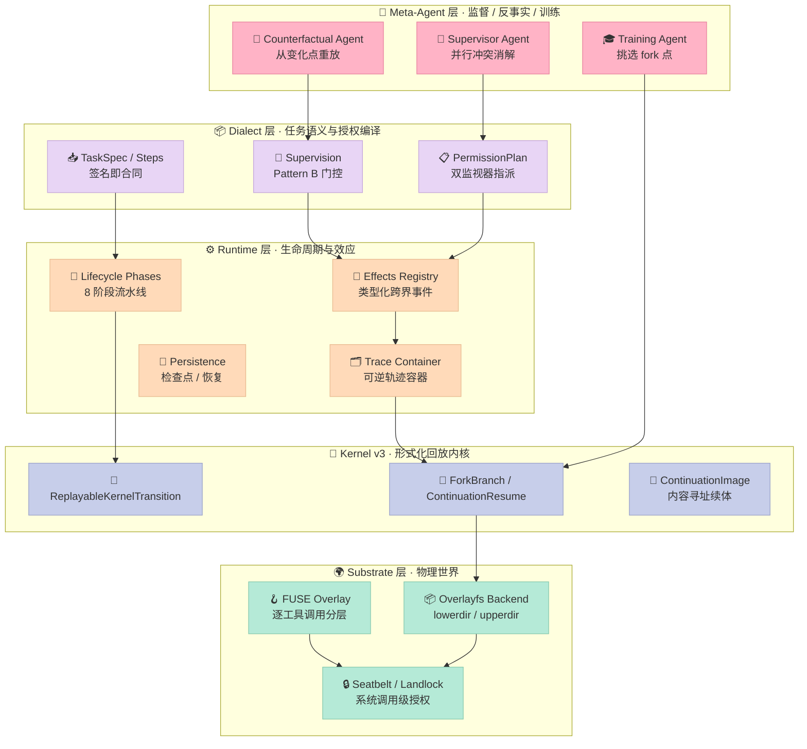

# 【Shepherd】可逆执行轨迹：把 Agent 的执行变成可回放的对象

## 引子：一个只有事后验尸能力的 Agent 运行时

想象你正在带一个初级工程师做项目。他写代码、跑测试、改文件——干得都不错。但项目进行到第三周，出了这么个问题：

> "上周那次跑挂了，帮我看看为什么。"
>
> "抱歉，我跑完就把终端关了，没截屏。"

于是你面对一个只能验尸的局面：Agent 留下了日志、留下了最终文件、留下了任务描述，但**没有留下"它当时到底看到了什么、做了什么决定"**。你想复现，它复现不了——因为 LLM 的采样是不可复现的，工具调用的外部世界状态已经变了。

更糟的是第二个问题：

> "上次那个改动挺对，能不能换个模型再跑一遍？"
>
> "能，但要重新烧一遍 token，而且大概率结果不一样。"

这就是当前 Agent 运行时的结构性缺陷。**它把执行当成一次性的黑箱事件，而不是一个可以检视、变换、重放的对象。**

Meta-Agent（元智能体）的出现让这个缺陷变得无法忍受。当你的上层 Agent 需要"监督下层 Agent"、"在 risky 动作执行前拦住"、"修复一次失败的运行"、"从多个候选里挑最优的"时，它需要的是**对执行状态的运行时操纵能力**——而现有 substrate 只给它 transcript（文本记录）和环境快照，剩下的工具得每个 Meta-Agent 自己现造。

Shepherd 就是冲着这个缺口去的。它的核心命题只有一句：

> **Agent 的执行本身是一个一等对象（a first-class object）。**

这篇拆解 Shepherd 的四个核心原语，以及它为什么在 2026 年的 Harness 生态里值得单独写一篇。

---

## 一、项目定位：Shepherd 是什么

| 维度 | 信息 |
|------|------|
| 仓库 | [shepherd-agents/shepherd](https://github.com/shepherd-agents/shepherd) |
| Star | 2,492 ⭐ |
| License | MIT |
| 语言 | Python 3.11+ |
| 论文 | arXiv [2605.10913](https://arxiv.org/abs/2605.10913)《Shepherd: Enabling Programmable Meta-Agents via Reversible Agentic Execution Traces》 |
| 状态 | Alpha（v0.3.0 已发布，API 仍可能变） |
| 平台 | macOS (Seatbelt) / Linux (Landlock，容器内)；Windows 需用 WSL |

### 1.1 它解决什么问题

论文摘要里的表述很精确：

> existing agentic substrates make this difficult: they expose only transcripts and environment snapshots, forcing meta-agents to build ad hoc tooling to reconstruct and operate over full execution state.

翻译一下就是：**现在的 Agent 运行时只暴露两样东西——文本记录和环境快照。** 于是任何一个想"在运行时操纵执行"的 Meta-Agent，都得自己造一套工具来重建完整的执行状态。

Shepherd 的做法是把执行状态提升为一等公民：

- 每一个模型动作、工具调用、环境变化，都变成**结构化事件**
- 这些事件串成一条**可逆的、Git 式的执行轨迹**（reversible, Git-like execution trace）
- 任何历史状态都能被 **fork**（分叉）、**replay**（重放）、**revert**（回滚）

### 1.2 论文给出的三个实证

这是 Shepherd 最有说服力的部分——不是概念演示，是可复现的 benchmark 数字：

| 场景 | 方法 | 结果 |
|------|------|------|
| **冲突消解**（supervisor meta-agent） | 监控并行编码 Agent，在冲突发生前拦截 | CooperBench 双人协作通过率 **28.8% → 54.7%** |
| **反事实优化**（counterfactual meta-agent） | 提出修改 + 从行为变化点重放运行 | Terminal-Bench 2.0 上**超越 MetaHarness 12.8%**，wall-clock **降低 58%** |
| **信用分配**（training meta-agent） | 在 rollout 中挑选 fork 点 | GRPO 在 Terminal-Bench 2.0 上的 uplift **翻倍** |

第二行尤其值得注意：12.8% 的性能提升 + 58% 的墙钟时间下降，来源不是"模型更强"，而是"能从行为变化点精确重放，不用从头再跑一遍"。这就是可逆执行轨迹的直接变现。

### 1.3 在 Harness 6 件套里的位置

Shepherd 的定位很特殊——它**不是**某一个组件的极致，而是**给所有组件装上"可回放"底座**的那个组件：

| Harness 6 件套 | Shepherd 的关系 |
|----------------|-----------------|
| **Rule** | 权限面写进函数签名，规则即类型，不存在"策略文件和代码漂移" |
| **Skill** | Skill 的执行被录进轨迹，Skill 的版本可以被 diff 和回放 |
| **Sub-Agent** | 并行 Agent 的冲突在 fork 出的分支上检测，而不是靠事后 diff |
| **Workflow** | Workflow 的每一步都是可分叉的轨迹节点 |
| **Script** | 监督者（supervisor）就是最纯粹的门控脚本：批准 = 返回，拒绝 = 抛异常 |
| **MCP** | 工具调用是轨迹上的 effect 记录，可回放、可拒绝 |

换句话说：**Shepherd 是那个让其余 5 件套都获得"时光机"的运行时。**

---

## 二、架构分析：五层堆栈与两条正交切分

### 2.1 整体架构

Shepherd 的代码库是一个严格的分层 workspace（`packages/` + `vcs-core/` 两个 workspace）：



### 2.2 两条正交切分

Shepherd 的复杂度（581 个 Python 文件）背后其实只有两条正交切分，理解这两条，整个系统就透明了。

**切分 A：机制（Mechanism） vs 策略（Policy）**

| 层 | 职责 | 可插拔性 |
|----|------|---------|
| Kernel v3 | 回放语义、分叉语义、续体对象 | 不可插拔（形式化内核） |
| Runtime | 生命周期、效应类型、轨迹容器 | 机制固定，handler 可插拔 |
| Dialect | 授权编译、监督模式、任务语义 | 策略可换（`install()` 可以换监视器组合） |
| Substrate | overlayfs / Seatbelt / Landlock | 后端可换（kernel overlayfs / FUSE / 容器 / VM） |

作者在 `permission_plan.py` 的注释里写得很清楚：

> This module is the seam where they meet: a *monitor-assignment compiler* that lowers one authority declaration to a plan naming *which monitor enforces which clause, with what completeness/tamper basis*.

**切分 B：信任边界在哪（Authority）**

Shepherd 只有三个概念：

- **Tasks（任务）**：签名的函数。签名 = 计算什么 + 能碰什么。
- **Effects（效应）**：一切跨界的东西。**边界即记录**（"The boundary is the record"）。
- **Substrate（承载）**：效应作用的物理世界，handle 自带授权。

原文的比喻很准确：

> Permissions are the rules; effects are the traffic; the substrate is the world being governed.

### 2.3 数据流：一次运行的一生

```mermaid
graph LR
    A["📝 TaskSpec<br/>签名 + 文档字符串"] --> B["⚖️ install()<br/>授权 → PermissionPlan"]
    C["🔗 Binding 绑定<br/>root + grant"] --> B
    B --> D["🪝 Jailed Placement<br/>Seatbelt / Landlock"]
    D --> E["🤖 Provider 执行<br/>Claude / OpenAI / OpenCode"]
    E --> F["⚡ Effect 跨界<br/>类型化事件"]
    F --> G["🗂️ Trace 轨迹<br/>append-only"]
    F --> H["📦 Retained Output<br/>保留产出"]
    H --> I["🚦 Supervisor 裁决<br/>commit 时点"]
    I --> J["✅ Settlement<br/>select/apply/release/discard"]
    J --> K["🌍 Ground<br/>你的工作目录"]

    G --> L["🔀 Fork<br/>分叉点"]
    L --> M["🔁 Replay<br/>重放后缀"]

    style A fill:#C7CEEA,stroke:#9BA3C9,color:#333
    style B fill:#E8D5F5,stroke:#C4A5DB,color:#333
    style C fill:#C7CEEA,stroke:#9BA3C9,color:#333
    style D fill:#B5EAD7,stroke:#87C9AE,color:#333
    style E fill:#FFDAB9,stroke:#E8B98F,color:#333
    style F fill:#FFDAB9,stroke:#E8B98F,color:#333
    style G fill:#FFF9C4,stroke:#D9D16A,color:#333
    style H fill:#FFF9C4,stroke:#D9D16A,color:#333
    style I fill:#FFB3C6,stroke:#E8809F,color:#333
    style J fill:#B5EAD7,stroke:#87C9AE,color:#333
    style K fill:#F5F5F5,stroke:#C4C4C4,color:#333
    style L fill:#E8D5F5,stroke:#C4A5DB,color:#333
    style M fill:#E8D5F5,stroke:#C4A5DB,color:#333
```



注意这条链路里**没有"日志"这个环节**。轨迹不是事后打的日志——它是**效应本身的记录格式**。原文说得很直接：

> Not log lines. Logging describes behavior after the fact and can lie by omission. Effects *are* the behavior: typed, refusable, and recorded whether or not anyone is watching.

### 2.4 Less is More 检查

哪些是"模型自己能学会的"，哪些是"外部物理世界必需的"？

| 组件 | 判定 | 理由 |
|------|------|------|
| 提示词模板 / 任务分解策略 | ❌ **不需要写** | 模型自己能学会，改 prompt 就能变好 |
| 上下文压缩 / 记忆检索 | ❌ **不需要写** | 同上，且模型会变强 |
| **系统调用级授权** | ✅ **必须外部** | 模型再"听话"也不能替代 OS 拒绝写入 |
| **写时复制的文件系统快照** | ✅ **必须外部** | 物理世界的状态隔离，模型无法伪造 |
| **效应记录** | ✅ **必须外部** | 模型无法自证"我没做这件事" |
| **轨迹回放 / 分叉** | ✅ **必须外部** | 需要外部世界的确定性重建 |
| **保留输出 / consume-once 结算** | ✅ **必须外部** | "决策只记一次"是协调语义，不是生成语义 |

这张表划出了一条清晰的线：**Shepherd 几乎不碰"怎么让模型更聪明"，只碰"怎么让模型的运行可被信任"。** 这在 2026 年是一个相当清醒的取舍。

---

## 三、核心机制原理（可运行代码）

下面四个原语，我用一个 200 行 MVP 全部复刻出来。先看最核心的两个。

### 3.1 原语一：签名即权限面（Signature-as-Permission-Surface）

Shepherd 的权限设计有一个反直觉但极其正确的立场：**权限不是一份策略文件，而是函数签名的一部分。**

```python
from shepherd import task, May, GitRepo, ReadOnly, ReadWrite

@task
def apply_documented_fix(
    docs:    May[GitRepo, ReadOnly],   # 只读：写入在 OS 层被拒
    backend: May[GitRepo, ReadWrite],  # 可写根目录
    issue:   str,
) -> None: ...
```

文档里的表述是整篇文章最值得引用的一句：

> Reading the signature *is* reading the permission surface; there is no second, hidden policy file that the code merely approximates.

以及：

> The grant lives on the parameter, so the security surface and the program are the same artifact. There is no separate policy document to drift out of sync.

**为什么这是好设计？** 因为传统的"策略文件 + 代码"模式有一个必然的漂移问题：策略文件描述"agent 可以改 `src/`"，代码描述"agent 实际会改 `src/`"。两者会不一致，而且**不一致的方向通常是权限比实际需要更宽**（因为改策略比改代码容易）。Shepherd 把 grant 钉在参数上，类型系统会强制两者一起变。

而且授权是**默认拒绝**的：

> Authority defaults to deny: a repository the signature never grants write to is read-only to the task.

`docs/shepherd/concepts/permissions.md` 里还有一段很有分寸的澄清——权限**不是**运行时信任：

> A task does not ask, at runtime, whether it is allowed to write and hope the answer is yes. The writable roots are fixed by the run's grants and bound the body at the syscall no matter how it tries to act.

### 3.2 原语二：双监视器授权编译（fail-closed Monitor Assignment）

这是 Shepherd 最精妙的一块，也是我读完源码后最想给读者看的部分。

**问题**：一份授权声明（"这个任务可以写 `backend/`，不能写 `docs/`"）需要被强制执行。但强制点不止一个：

- **syscall jail**（macOS Seatbelt / Linux Landlock）：在系统调用层直接拒绝越权写入。**不可绕过**。
- **carrier check-at-commit**（在结算边界复核）：任务跑完后，对捕获到的 delta 做一次复核。

这**两个监视器监控的是同一份授权**，但它们的能力范围不同：syscall jail 是承重的，carrier gate 是补充的。如果只做其中一个，都有漏洞——只有 jail 的话，运行期没有"这次改动是否合理"的语义判断；只有 carrier 的话，恶意 body 可以在被检查前就搞破坏。

Shepherd 的做法是写一个**监视器指派编译器**，把一份授权声明降级成一张"谁负责哪条子句"的表：

```python
@dataclass(frozen=True)
class MonitorAssignment:
    """一个监视器负责一条授权子句，并附带「完整性依据」与「防篡改依据」。"""
    monitor: str
    timing: str              # "pre_action" | "commit"
    completeness_basis: str  # 这个监视器覆盖哪些路径
    tamper_basis: str        # 为什么被裁决的执行体无法关掉它
    route: str | None = None

    def to_descriptor(self) -> dict[str, object]:
        return {
            "monitor": self.monitor,
            "timing": self.timing,
            "completeness_basis": self.completeness_basis,
            "tamper_basis": self.tamper_basis,
            "route": self.route,
        }


@dataclass(frozen=True)
class PermissionPlan:
    """一次运行被授权声明降级出来的监视器指派计划。"""
    assignments: tuple[MonitorAssignment, ...]
    fallback: str = "enforce"

    def __post_init__(self) -> None:
        if self.fallback not in _FALLBACKS:
            raise ValueError(f"unsupported fallback: {self.fallback!r}")
        if not self.assignments:
            raise ValueError("PermissionPlan.assignments must be non-empty")
        names = [a.monitor for a in self.assignments]
        if len(set(names)) != len(names):
            raise ValueError("a monitor may not be assigned twice")

    def digest(self) -> str:
        """计划摘要 = 可被引用的授权证据（authority evidence）。"""
        blob = json.dumps(
            {"assignments": [a.to_descriptor() for a in self.assignments],
             "fallback": self.fallback},
            sort_keys=True,
        )
        return "sha256:" + hashlib.sha256(blob.encode()).hexdigest()[:32]
```

**三个设计要点，每一个都很值钱：**

**① fail-closed over fallback, not over enforcement**

源码注释里的原话：

> The compiler is **total over fallback** (`enforce` | `refuse`), never total over enforcement: when a clause has no complete monitor, the underlying lowering fails closed rather than silently under-enforcing.

翻译：当某条授权子句**找不到能完整覆盖它的监视器**时，**底层降级直接抛错**，而不是"尽力而为地少拦一点"。这个区别是安全与不安全的区别——很多框架的做法是"没配好就放行"。

**② `completeness_basis` 是承重诚实性**

每个监视器都必须说清楚"我覆盖哪些路径"。Shepherd 甚至在代码里明确标注哪种覆盖是**不完整**的：

```python
completeness_basis=(
    "carrier diff / exact-tree-diff evidence at the adoption boundary; "
    "changed-path fallback is advisory and incomplete for path-sensitive grants"
)
```

翻译：carrier gate 用的是"精确树 diff 证据"，而"变更路径 fallback"这种降级手段对路径敏感的授权是**仅供参考、不完整**的。系统**自己承认自己哪里不完整**——这是很少见的态度。

**③ `tamper_basis` 是防篡改论证**

每个监视器必须论证"为什么被裁决的执行体无法把它关掉"：

- jail：`the jail is a kernel/LSM boundary outside the task process; the task body cannot unmount it`
- carrier：`the check runs in the coordinator/vcs-core settlement path, outside the task process`

这两条论证的共同点是：**监视器都在 task process 之外**。

**④ 计划即证据**

`PermissionPlan.digest()` 让整份授权计划可以被哈希引用。这意味着**一次运行的授权面是可审计、可举证、可比较的**——你可以拿两个 run 的 digest 对比，精确知道"授权面哪里变了"。

### 3.3 原语三：保留输出与 consume-once 结算

Agent 写出来的东西，**不直接落到你的工作目录**。它先变成一个"保留输出"（retained output）：

```bash
shepherd run changeset --latest --read donut.py | python3 -
# 直接读 agent 写的内容，不 apply 任何东西

shepherd run select  <run-ref>     # 采纳
shepherd run apply   <run-ref>     # ...或者合并到已经前进的工作区上
shepherd run discard <run-ref>     # ...或者不要
```

关键约束是 **consume-once**——结算决策只能记一次：

```python
def _validated_retained_run_output_settlement_request(workspace, output):
    ...
    if ref.state != "unconsumed":
        raise WorkspaceControlError(
            f"run-output settlement requires an unconsumed output; got {ref.state!r}"
        )
    ...
```

这解决的是**分布式系统里最经典的难题**：多个下游都以为自己有权限结算同一份产出。Shepherd 用一个状态机把"谁先结算谁赢"变成显式的。

而且注意 `apply` 和 `select` 是分开的——`select` 只是"我认可这次改动"，`apply` 才是"把它合并到已经前进的工作区上"。这个区分让"审批"和"落地"解耦，是 human-in-the-loop 的正确形状。

### 3.4 原语四：写时复制分叉（COW Fork）

论文里的 "5x faster than docker commit and fork" 是怎么做到的？

答案是**不用容器 commit，用 overlayfs**：

```python
@dataclass(frozen=True)
class LayerPaths:
    """定义单个 overlay 层的文件系统路径。"""
    root: Path
    upper: Path   # 写入层
    work: Path    # overlayfs 的工作目录
    merged: Path  # 合并视图


class KernelOverlayBackend:
    """Linux kernel overlayfs 后端。

    这个后端在第一个实现里有意保持严格：
    要求 Linux、支持 overlayfs、以及足够的 mount/unmount 权限。
    """
    GROUND_SCOPE_ID = "ground"

    def create_layer(self, scope_id: str, *, parent_scope_id: str | None) -> None:
        if scope_id == self.GROUND_SCOPE_ID:
            parent_scope_id = None

        paths = self._layer_paths(scope_id)
        if scope_id != self.GROUND_SCOPE_ID and paths.root.exists():
            msg = f"Overlay layer already exists for scope {scope_id!r}."
            raise RuntimeError(msg)

        self._parent_layers[scope_id] = parent_scope_id

        paths.root.mkdir(parents=True, exist_ok=True)
        paths.upper.mkdir(parents=True, exist_ok=True)
        paths.work.mkdir(parents=True, exist_ok=True)
        paths.merged.mkdir(parents=True, exist_ok=True)

        if self._is_mounted(paths.merged):
            return

        lowerdir = self._lowerdir(scope_id, parent_scope_id)
        self._mount_overlay(
            lowerdir=lowerdir,
            upperdir=paths.upper,
            workdir=paths.work,
            merged=paths.merged,
        )
```

分叉一个 scope = **挂一个新的 upper 层**，下层完全共享。这就是为什么是 5x 而不是 50x：分叉成本与"被分叉的数据量"**无关**，只与"上层写了多少"有关。

而"diff 一个 scope"就是读 upper 层：

```python
def diff_layer(self, scope_id: str) -> list[tuple[str, bytes | None, int]]:
    paths = self._layer_paths(scope_id)
    if not paths.upper.exists():
        return []

    changes: list[tuple[str, bytes | None, int]] = []
    for candidate in sorted(paths.upper.rglob("*")):
        rel = candidate.relative_to(paths.upper).as_posix()
        if not rel:
            continue

        file_stat = os.lstat(candidate)
        if stat.S_ISDIR(file_stat.st_mode):
            continue
        if self._is_whiteout(file_stat):
            changes.append((rel, None, 0))     # 删除 = whiteout
            continue
        if stat.S_ISREG(file_stat.st_mode):
            content = candidate.read_bytes()
            changes.append((rel, content, posix_to_git_mode(file_stat.st_mode)))
            continue
        raise UnsupportedOverlayEntryError(path=rel, kind=...)
    return changes
```

**whiteout 标记**是 overlayfs 表达"删除"的机制——正好对应 Git 里删除一个文件。两套语义在这里天然对齐。

更细的一层：容器内部还有一个 **FUSE overlay**，做到**逐工具调用**的分层：

```python
class FuseOverlayManager:
    """进程内 fuse-overlayfs 管理器，用于逐工具调用隔离。"""
    WORKSPACE = Path("/workspace")
    WORKSPACE_RO = Path("/workspace-ro")
    OVERLAYS_ROOT = Path("/task/overlays")

    def push_layer(self, tool_use_id: str) -> None:
        """创建一个新的工具层并重新挂载到顶。"""
        self._unmount()
        self._tool_counter += 1
        self._tool_dir = self.OVERLAYS_ROOT / f"tool_{self._tool_counter}"
        tool_upper = self._tool_dir / "upper"
        tool_work = self._tool_dir / "work"
        tool_upper.mkdir(parents=True)
        tool_work.mkdir(parents=True)
        self._mount(
            lowers=[self._accumulated, *self._lower_layers],
            upper=tool_upper,
            work=tool_work,
        )

    def pop_and_merge(self, tool_use_id: str) -> list[dict[str, Any]]:
        """提取工具效应，合并工具层，恢复基线。"""
        tool_upper = self._tool_dir / "upper"
        effects = self._extract_effects(tool_upper, tool_use_id)
        self._unmount()
        has_content = tool_upper.exists() and any(tool_upper.iterdir())
        if has_content:
            try:
                self._merge(tool_upper, self._accumulated)
            except (OSError, subprocess.CalledProcessError):
                logger.exception("Merge failed (accumulated may be incomplete)")
                self.merge_failed = True
        ...
```

**每个工具调用一个独立的可丢弃层**——这意味着"这个工具调用干了什么"可以被单独回滚、单独重放、单独交给监督者裁决。这比整个 run 一个快照精细得多。

### 3.5 原语五：监督者（Pattern B，check-at-commit）

监督者是 Shepherd 里最"脚本化"的门控，直接对应 Harness 6 件套里的 **Script** 组件：

```python
class SupervisorDenied(Exception):  # 规范里钉死的名字
    """监督者拒绝了一个被提议的工作区操作（Pattern B denial）。

    从 SubstrateOperationProposed handler 抛出；可逆包装丢弃 run scope，
    所以被拒的工作永远到不了 ground。
    """

    def __init__(self, *, effect: object, reason: str) -> None:
        super().__init__(reason)
        self.effect = effect
        self.reason = reason


def drafts_only_supervisor(proposed: SubstrateOperationProposed) -> None:
    """v1 的工作示例：只批准工作区中 ./drafts/ 下的写入。"""
    effect = proposed.effect
    if isinstance(effect, (FileCreate, FilePatch)) and not effect.path.startswith("drafts/"):
        raise SupervisorDenied(
            effect=effect,
            reason=f"path {effect.path!r} outside ./drafts/",
        )
```

设计上的一个细节值得注意：**监督者的裁决时点是"返回时刻"**——body 跑完、coordinator 的可逆包装 merge 之前。

源码注释解释了为什么是这个时点：

> This is the check-at-commit point of the check-time law (an effect may be checked no later than its last undo point; the wrap's discard IS the undo).

翻译成一句话：**"检查不能晚于最后一次可撤销点"**。这和 AGT 里"kill 意图 ≠ kill 成功"是同一族的设计直觉——把"意图"、"裁决"、"落地"三件事在代码层分离。

拒绝之后：**可逆包装丢弃整个 run scope，运行干净失败，ground 保持原样。**

### 3.6 MVP 复刻：200 行跑通全部五个原语

下面这个 MVP 把前面五个原语抽离成一个零依赖的单文件。保存为 `shepherd_mvp.py` 直接 `python3 shepherd_mvp.py` 运行。

```python
"""
Shepherd MVP：从零复刻「签名即权限面 + 可逆执行轨迹 + 保留输出」三大核心原语

来源：shepherd-agents/shepherd (MIT, arXiv:2605.10913)
抽离自：
  - shepherd/packages/dialect/src/shepherd_dialect/permission_plan.py
  - shepherd/packages/dialect/src/shepherd_dialect/supervision.py
  - shepherd/packages/dialect/src/shepherd_dialect/workspace_control/retained_outputs.py
  - shepherd/packages/kernel-v3-reference/src/.../kernel/branch_replay

零依赖，Python 3.10+ 直接可跑：python3 shepherd_mvp.py
"""

from __future__ import annotations

import hashlib
import json
import os
import shutil
import tempfile
from dataclasses import dataclass, field
from enum import Enum
from typing import Any, Callable, Iterable

# ============================================================================
# 第 1 部分：权限面 —— 签名即授权声明（Signature-as-Permission-Surface）
# ============================================================================

class GrantLevel(str, Enum):
    READ_ONLY = "ReadOnly"
    READ_WRITE = "ReadWrite"


@dataclass(frozen=True)
class Binding:
    """一个具名绑定：根路径 + 授权档位。绑定之间必须互不重叠（disjoint）。"""
    name: str
    root: str
    grant: GrantLevel

    def __post_init__(self) -> None:
        if not self.name:
            raise ValueError("binding name must be non-empty")
        if not self.root.startswith("/"):
            raise ValueError(f"binding root must be absolute: {self.root!r}")


@dataclass(frozen=True)
class TaskSpec:
    """任务的「合同」：参数签名 = 权限面。没有第二个隐藏的策略文件。"""
    name: str
    params: dict[str, tuple[str, GrantLevel] | None]
    body: Callable[..., Any]
    doc: str = ""

    def effective_grants(self) -> dict[str, GrantLevel]:
        """从签名派生的整任务权限上限。"""
        levels = [spec[1] for spec in self.params.values() if spec]
        if not levels:
            return {}
        return {"__ceiling__": GrantLevel.READ_ONLY if GrantLevel.READ_ONLY in levels
                else GrantLevel.READ_WRITE}


# ============================================================================
# 第 2 部分：双监视器授权编译（Monitor-Assignment Compiler，fail-closed）
# ============================================================================

JAIL_MONITOR = "syscall_jail"
CARRIER_MONITOR = "carrier_check_at_commit"
_FALLBACKS = frozenset({"enforce", "refuse"})
_TIMINGS = frozenset({"pre_action", "commit"})

_VALUE_ARGUMENTS = {"topic": "donut"}


@dataclass(frozen=True)
class MonitorAssignment:
    """一个监视器负责一条授权子句，并附带「完整性依据」与「防篡改依据」。"""
    monitor: str
    timing: str
    completeness_basis: str
    tamper_basis: str
    route: str | None = None

    def __post_init__(self) -> None:
        if self.timing not in _TIMINGS:
            raise ValueError(f"unsupported timing: {self.timing!r}")
        for f in ("completeness_basis", "tamper_basis"):
            if not getattr(self, f):
                raise ValueError(f"{f} must be non-empty")

    def to_descriptor(self) -> dict[str, Any]:
        return {
            "monitor": self.monitor,
            "timing": self.timing,
            "completeness_basis": self.completeness_basis,
            "tamper_basis": self.tamper_basis,
            "route": self.route,
        }


@dataclass(frozen=True)
class PermissionPlan:
    """一次运行被授权声明降级出来的监视器指派计划。"""
    assignments: tuple[MonitorAssignment, ...]
    fallback: str = "enforce"

    def __post_init__(self) -> None:
        if self.fallback not in _FALLBACKS:
            raise ValueError(f"unsupported fallback: {self.fallback!r}")
        if not self.assignments:
            raise ValueError("PermissionPlan.assignments must be non-empty")
        names = [a.monitor for a in self.assignments]
        if len(set(names)) != len(names):
            raise ValueError("a monitor may not be assigned twice")

    def monitor(self, name: str) -> MonitorAssignment:
        for a in self.assignments:
            if a.monitor == name:
                return a
        raise KeyError(name)

    def digest(self) -> str:
        """计划摘要 = 可被引用的授权证据（authority evidence）。"""
        blob = json.dumps(
            {"assignments": [a.to_descriptor() for a in self.assignments],
             "fallback": self.fallback},
            sort_keys=True,
        )
        return "sha256:" + hashlib.sha256(blob.encode()).hexdigest()[:32]


def install(bindings: Iterable[Binding],
            task_ceiling: GrantLevel | None = None) -> PermissionPlan:
    """把一份授权声明编译成监视器指派计划。

    两条监视器分工：
      - syscall_jail        （pre_action）在系统调用层直接拒绝越权写入
      - carrier_check_at_commit（commit）在结算边界复核捕获到的 delta
    两者监控的是同一份 may=，只是时点与完整性证据不同。
    """
    bindings = list(bindings)
    if not bindings:
        raise ValueError("cannot install an empty authority surface")

    writable = [b for b in bindings if b.grant is GrantLevel.READ_WRITE]
    assignments: list[MonitorAssignment] = []

    # 监视器 1：syscall jail —— 承重监视器，唯一能「不可绕过」地拦写入的那个
    assignments.append(MonitorAssignment(
        monitor=JAIL_MONITOR,
        timing="pre_action",
        completeness_basis=(
            "every managed path under "
            + ", ".join(sorted(b.root for b in bindings))
            + " is covered by the jail's writable-root set"
        ),
        tamper_basis=(
            "the jail is a kernel/LSM boundary outside the task process; "
            "the task body cannot unmount it"
        ),
        route="jail",
    ))

    # 监视器 2：carrier check-at-commit —— 在结算边界复核
    assignments.append(MonitorAssignment(
        monitor=CARRIER_MONITOR,
        timing="commit",
        completeness_basis=(
            "carrier diff / exact-tree-diff evidence at the adoption boundary; "
            "changed-path fallback is advisory and incomplete for path-sensitive grants"
        ),
        tamper_basis=(
            "the check runs in the coordinator/vcs-core settlement path, "
            "outside the task process"
        ),
        route="carrier",
    ))

    return PermissionPlan(assignments=tuple(assignments))


# ============================================================================
# 第 3 部分：监督者（Pattern B check-at-commit supervisor）
# ============================================================================

class SupervisorDenied(Exception):
    """监督者拒绝了一个被提议的工作区操作。

    抛出后：可逆包装丢弃整个 run scope，该次运行干净失败，ground 保持原样。
    """

    def __init__(self, *, effect: Any, reason: str) -> None:
        super().__init__(reason)
        self.effect = effect
        self.reason = reason


@dataclass(frozen=True)
class FilePatch:
    path: str
    content: bytes


@dataclass(frozen=True)
class SubstrateOperationProposed:
    effect: Any


def drafts_only_supervisor(proposed: SubstrateOperationProposed) -> None:
    """Shepherd v1 的工作示例：只批准 ./drafts/ 下的工作区写入。"""
    effect = proposed.effect
    if isinstance(effect, FilePatch) and not effect.path.startswith("drafts/"):
        raise SupervisorDenied(
            effect=effect,
            reason=f"path {effect.path!r} outside ./drafts/",
        )


# ============================================================================
# 第 4 部分：可逆执行轨迹 + 保留输出（Reversible Trace + Retained Output）
# ============================================================================

@dataclass(frozen=True)
class TraceRecord:
    """轨迹里的一条记录。每个外部效应都是一条结构化事件。"""
    id: int
    kind: str
    payload: dict[str, Any]


class ForkBranch:
    """分叉点记录：从某条轨迹派生出一条可回放的子分支。"""

    def __init__(self, parent_trace: list[TraceRecord], at: int, branch_ref: str) -> None:
        self.parent_trace = parent_trace
        self.at = at
        self.branch_ref = branch_ref
        self.parent_prefix = parent_trace[: at + 1]


@dataclass
class RetainedOutput:
    """保留输出：agent 写出来的东西先落在这里，不直接碰你的工作文件。"""
    run_id: str
    binding: str
    files: dict[str, bytes] = field(default_factory=dict)
    state: str = "unconsumed"   # unconsumed -> selected / applied / released / discarded

    def settle(self, decision: str) -> None:
        """consume-once：结算决策只能记一次。"""
        if decision not in {"selected", "applied", "released", "discarded"}:
            raise ValueError(f"bad settlement decision: {decision!r}")
        if self.state != "unconsumed":
            raise ValueError(
                f"run-output settlement requires an unconsumed output; got {self.state!r}"
            )
        self.state = decision


class Workspace:
    """一个工作区：若干具名绑定（各自独立的磁盘根），外加一条可逆轨迹。"""

    def __init__(self) -> None:
        self._root = tempfile.mkdtemp(prefix="shepherd-mvp-")
        self._bindings: dict[str, Binding] = {}
        self.trace: list[TraceRecord] = []
        self._next_id = 0
        self.outputs: dict[str, RetainedOutput] = {}

    def bind(self, name: str, root: str, grant: GrantLevel) -> Binding:
        if name in self._bindings:
            raise ValueError(f"binding {name!r} already exists")
        abs_root = os.path.join(self._root, root.strip("/"))
        os.makedirs(abs_root, exist_ok=True)
        b = Binding(name=name, root=abs_root, grant=grant)
        self._bindings[name] = b
        return b

    def bindings(self) -> list[Binding]:
        return list(self._bindings.values())

    def _record(self, kind: str, payload: dict[str, Any]) -> TraceRecord:
        rec = TraceRecord(id=self._next_id, kind=kind, payload=payload)
        self._next_id += 1
        self.trace.append(rec)
        return rec

    def run(self, task: TaskSpec, bindings: dict[str, Binding], *,
            supervisor: Callable[[SubstrateOperationProposed], None] | None = None,
            plan: PermissionPlan | None = None,
            run_id: str | None = None) -> str:
        """执行一个任务。

        真实 Shepherd 里 task body 是个沙箱化 agent；这里用一个普通 Python 函数
        扮演 body，通过 writer 回调写出文件，从而复刻「效应 → 轨迹 → 保留输出」的链路。
        """
        rid = run_id or f"run-{self._next_id:04d}"
        plan = plan or install(bindings.values(),
                               task.effective_grants().get("__ceiling__"))
        self._record("run_started", {"run_id": rid, "plan_digest": plan.digest()})

        # 每个绑定一个「scope」（真实实现是 overlayfs 的 lower/upper 分层）
        scope_dirs: dict[str, str] = {}
        for name, b in bindings.items():
            scope_dir = os.path.join(self._root, f".scope-{name}")
            shutil.copytree(b.root, scope_dir, dirs_exist_ok=True)
            scope_dirs[name] = scope_dir

        output = RetainedOutput(run_id=rid, binding=",".join(bindings))
        self.outputs[rid] = output

        def writer(binding_name: str, rel_path: str, content: bytes) -> None:
            """agent 侧唯一的写入口 —— 效应从这条通道跨界。"""
            b = bindings.get(binding_name)
            if b is None:
                raise PermissionError(f"unknown binding {binding_name!r}")

            # 监视器 1（pre_action）：授权面内才允许写
            if b.grant is GrantLevel.READ_ONLY:
                self._record("effect_refused", {
                    "run_id": rid, "path": rel_path, "reason": "read_only_grant"})
                raise PermissionError(
                    f"write to {rel_path!r} refused at the syscall: "
                    f"read-only grant on {binding_name!r}")

            # 监视器 2（commit）：监督者对被提议的操作做裁决
            if supervisor is not None:
                proposed = SubstrateOperationProposed(effect=FilePatch(rel_path, content))
                try:
                    supervisor(proposed)
                except SupervisorDenied as denied:
                    self._record("effect_denied", {
                        "run_id": rid, "path": rel_path, "reason": denied.reason})
                    # 可逆包装丢弃 run scope —— 被拒的工作永远到不了 ground
                    for d in scope_dirs.values():
                        shutil.rmtree(d, ignore_errors=True)
                    self._record("run_failed",
                                 {"run_id": rid, "reason": "supervisor_denied"})
                    raise

            abs_path = os.path.join(scope_dirs[binding_name], rel_path)
            os.makedirs(os.path.dirname(abs_path), exist_ok=True)
            with open(abs_path, "wb") as fh:
                fh.write(content)
            output.files[rel_path] = content
            self._record("effect", {
                "run_id": rid, "binding": binding_name, "path": rel_path,
                "sha256": hashlib.sha256(content).hexdigest()[:16]})

        try:
            kwargs = {}
            for pname, spec in task.params.items():
                kwargs[pname] = (_VALUE_ARGUMENTS.get(pname, f"<{pname}-value>")
                                 if spec is None else writer)
            task.body(**kwargs)
        except PermissionError as exc:
            self._record("run_failed", {"run_id": rid, "reason": str(exc)})
            raise
        except Exception as exc:
            self._record("run_failed", {"run_id": rid, "reason": repr(exc)})
            raise
        else:
            self._record("run_completed", {"run_id": rid, "files": sorted(output.files)})

        return rid

    def changeset(self, run_id: str) -> dict[str, bytes]:
        return dict(self.outputs[run_id].files)

    def settle(self, run_id: str, decision: str) -> None:
        self.outputs[run_id].settle(decision)
        self._record("settlement", {"run_id": run_id, "decision": decision})

    def apply(self, run_id: str, binding: str) -> None:
        """把保留输出 merge 回真实绑定目录。"""
        out = self.outputs[run_id]
        b = self._bindings[binding]
        for rel, content in out.files.items():
            abs_path = os.path.join(b.root, rel)
            os.makedirs(os.path.dirname(abs_path), exist_ok=True)
            with open(abs_path, "wb") as fh:
                fh.write(content)
        self.settle(run_id, "applied")

    def fork(self, at: int, branch_ref: str) -> ForkBranch:
        return ForkBranch(self.trace, at, branch_ref)

    def replay(self, branch: ForkBranch,
               new_records: list[TraceRecord]) -> list[TraceRecord]:
        """从分叉点重放：父前缀 + 新后缀。真实 Shepherd 会复用 ~95% 的 KV cache。"""
        return branch.parent_prefix + new_records

    def cleanup(self) -> None:
        shutil.rmtree(self._root, ignore_errors=True)


# ============================================================================
# 演示
# ============================================================================

def _demo_task_write_note(repo: Any, topic: str) -> None:
    repo("backend", f"{topic}.py", b"# generated by agent\nprint('hello')\n")


def _demo_task_write_outside(repo: Any, topic: str) -> None:
    """故意越权：往 ReadOnly 的 docs/ 绑定写。"""
    repo("docs", f"{topic}.md", b"should be refused")


def _demo_task_write_root(repo: Any, topic: str) -> None:
    """越权但不走 drafts/ —— 会被监督者 Pattern B 拒绝。"""
    repo("backend", f"src/{topic}.py", b"# not under drafts/\n")


def _demo_task_write_drafts(repo: Any, topic: str) -> None:
    """合规写入：drafts/ 前缀 —— 监督者批准。"""
    repo("backend", f"drafts/{topic}.md", b"# ok\n")


def run_demo() -> None:
    print("=" * 78)
    print("Shepherd MVP —— 签名即权限面 + 可逆执行轨迹 + 保留输出")
    print("=" * 78)

    ws = Workspace()

    # ---- 绑定：backend 可写、docs 只读 --------------------------------
    backend = ws.bind("backend", "backend/", GrantLevel.READ_WRITE)
    docs = ws.bind("docs", "docs/", GrantLevel.READ_ONLY)

    print("\n[1] 授权面（来自签名 + 绑定）")
    task = TaskSpec(
        name="write_note",
        params={"repo": ("GitRepo", GrantLevel.READ_WRITE), "topic": None},
        body=_demo_task_write_note,
        doc="Write a small program.",
    )
    print(f"    绑定: backend={backend.grant.value}  docs={docs.grant.value}")
    print(f"    签名派生的整任务上限: {task.effective_grants().get('__ceiling__').value}")

    plan = install(ws.bindings(), task.effective_grants().get("__ceiling__"))
    print(f"    PermissionPlan digest: {plan.digest()}")
    for a in plan.assignments:
        print(f"      · monitor={a.monitor}  timing={a.timing}  route={a.route}")
        print(f"        completeness: {a.completeness_basis[:74]}...")
        print(f"        tamper      : {a.tamper_basis[:74]}...")

    # ---- 正常一次运行 ---------------------------------------------------
    print("\n[2] 正常一次运行：agent 的产出先落成「保留输出」")
    rid = ws.run(task, {"backend": backend, "docs": docs}, plan=plan)
    print(f"    run_id = {rid}")
    print(f"    保留输出内容: { {k: len(v) for k, v in ws.changeset(rid).items()} }")
    print(f"    保留输出状态: {ws.outputs[rid].state}   ← 还没碰你的工作文件")
    print(f"    ground 目录内容（应为空）: {os.listdir(backend.root)}")

    # ---- 越权写：ReadOnly 绑定在 syscall 层被拒 --------------------------
    print("\n[3] 越权写：向 ReadOnly 的 docs/ 绑定写 → 在 syscall 层被拒")
    task_bad = TaskSpec(
        name="write_outside",
        params={"repo": ("GitRepo", GrantLevel.READ_WRITE), "topic": None},
        body=_demo_task_write_outside,
    )
    try:
        ws.run(task_bad, {"backend": backend, "docs": docs}, plan=plan, run_id="run-bad1")
    except PermissionError as e:
        print(f"    ✅ 被拒: {e}")

    # ---- 监督者：Pattern B check-at-commit ------------------------------
    print("\n[4] 监督者（Pattern B）：只批准 ./drafts/ 下的写入")
    task_sup = TaskSpec(
        name="write_root",
        params={"repo": ("GitRepo", GrantLevel.READ_WRITE), "topic": None},
        body=_demo_task_write_root,
    )
    try:
        ws.run(task_sup, {"backend": backend, "docs": docs},
               supervisor=drafts_only_supervisor, plan=plan, run_id="run-bad2")
    except SupervisorDenied as e:
        print(f"    ✅ 监督者拒绝: {e.reason}")
        print(f"    ground 目录内容（应仍为空，可逆包装丢弃了 run scope）: "
              f"{os.listdir(backend.root)}")

    task_ok = TaskSpec(
        name="write_drafts",
        params={"repo": ("GitRepo", GrantLevel.READ_WRITE), "topic": None},
        body=_demo_task_write_drafts,
    )
    rid2 = ws.run(task_ok, {"backend": backend, "docs": docs},
                  supervisor=drafts_only_supervisor, plan=plan, run_id="run-ok")
    print(f"    ✅ 合规写入批准: run_id={rid2}  文件={sorted(ws.changeset(rid2))}")

    # ---- 结算：consume-once ---------------------------------------------
    print("\n[5] 结算（consume-once）：select / apply / discard")
    ws.settle(rid, "selected")
    print(f"    run {rid} 状态 -> {ws.outputs[rid].state}")
    try:
        ws.settle(rid, "discarded")
    except ValueError as e:
        print(f"    ✅ 重复结算被拒: {e}")

    rid3 = ws.run(task_ok, {"backend": backend, "docs": docs},
                  supervisor=drafts_only_supervisor, plan=plan, run_id="run-apply")
    ws.apply(rid3, "backend")
    print(f"    apply 后 ground 目录内容: {sorted(os.listdir(backend.root))}")

    # ---- 轨迹 + 分叉回放 -------------------------------------------------
    print("\n[6] 可逆执行轨迹 + 分叉回放")
    print(f"    轨迹记录数: {len(ws.trace)}")
    kinds: dict[str, int] = {}
    for r in ws.trace:
        kinds[r.kind] = kinds.get(r.kind, 0) + 1
    print(f"    轨迹事件分布: {kinds}")

    branch = ws.fork(at=1, branch_ref="branch/experiment-1")
    print(f"    从记录 #{branch.at} 分叉，父前缀 {len(branch.parent_prefix)} 条")
    suffix = [TraceRecord(id=9000, kind="effect",
                           payload={"run_id": "replay", "path": "counterfactual.py",
                                    "sha256": "deadbeef"})]
    replayed = ws.replay(branch, suffix)
    print(f"    回放后轨迹长度: {len(replayed)}  "
          f"(父前缀 {len(branch.parent_prefix)} + 新后缀 {len(suffix)})")
    print(f"    回放末条事件: {replayed[-1].kind} {replayed[-1].payload}")

    # ---- 轨迹即完整答案 --------------------------------------------------
    print("\n[7] 「这个程序对世界做了什么？」—— 有结构化的完整答案")
    for r in ws.trace:
        detail = (r.payload.get("path") or r.payload.get("decision")
                  or r.payload.get("reason") or "")
        print(f"      #{r.id:<3} {r.kind:<16} {detail}")

    ws.cleanup()
    print("\n" + "=" * 78)
    print("✅ 演示结束：授权声明 → 监视器编译 → 效应入轨 → 保留输出 → 结算 → 分叉回放")
    print("=" * 78)


if __name__ == "__main__":
    run_demo()
```

**实际运行输出**（我实际跑过，不是手写的）：

```text
==============================================================================
Shepherd MVP —— 签名即权限面 + 可逆执行轨迹 + 保留输出
==============================================================================

[1] 授权面（来自签名 + 绑定）
    绑定: backend=ReadWrite  docs=ReadOnly
    签名派生的整任务上限: ReadWrite
    PermissionPlan digest: sha256:6d38f3407a93f389e3b210d4e774e2f9
      · monitor=syscall_jail  timing=pre_action  route=jail
        completeness: every managed path under /tmp/shepherd-mvp-mk3yx82m/backend, /tmp/shepherd...
        tamper      : the jail is a kernel/LSM boundary outside the task process; the task body ...
      · monitor=carrier_check_at_commit  timing=commit  route=carrier
        completeness: carrier diff / exact-tree-diff evidence at the adoption boundary; changed-...
        tamper      : the check runs in the coordinator/vcs-core settlement path, outside the ta...

[2] 正常一次运行：agent 的产出先落成「保留输出」
    run_id = run-0000
    保留输出内容: {'donut.py': 36}
    保留输出状态: unconsumed   ← 还没碰你的工作文件
    ground 目录内容（应为空）: []

[3] 越权写：向 ReadOnly 的 docs/ 绑定写 → 在 syscall 层被拒
    ✅ 被拒: write to 'donut.md' refused at the syscall: read-only grant on 'docs'

[4] 监督者（Pattern B）：只批准 ./drafts/ 下的写入
    ✅ 监督者拒绝: path 'src/donut.py' outside ./drafts/
    ground 目录内容（应仍为空，可逆包装丢弃了 run scope）: []
    ✅ 合规写入批准: run_id=run-ok  文件=['drafts/donut.md']

[5] 结算（consume-once）：select / apply / discard
    run run-0000 状态 -> selected
    ✅ 重复结算被拒: run-output settlement requires an unconsumed output; got 'selected'
    apply 后 ground 目录内容: ['drafts']

[6] 可逆执行轨迹 + 分叉回放
    轨迹记录数: 18
    轨迹事件分布: {'run_started': 5, 'effect': 3, 'run_completed': 3, 'effect_refused': 1, 'run_failed': 3, 'effect_denied': 1, 'settlement': 2}
    从记录 #1 分叉，父前缀 2 条
    回放后轨迹长度: 3  (父前缀 2 + 新后缀 1)
    回放末条事件: effect {'run_id': 'replay', 'path': 'counterfactual.py', 'sha256': 'deadbeef'}

[7] 「这个程序对世界做了什么？」—— 有结构化的完整答案
      #0   run_started      
      #1   effect           donut.py
      #2   run_completed    
      #3   run_started      
      #4   effect_refused   donut.md
      #5   run_failed       write to 'donut.md' refused at the syscall: read-only grant on 'docs'
      #6   run_started      
      #7   effect_denied    src/donut.py
      #8   run_failed       supervisor_denied
      #9   run_failed       SupervisorDenied("path 'src/donut.py' outside ./drafts/")
      #10  run_started      
      #11  effect           drafts/donut.md
      #12  run_completed    
      #13  settlement       selected
      #14  run_started      
      #15  effect           drafts/donut.md
      #16  run_completed    
      #17  settlement       applied

==============================================================================
✅ 演示结束：授权声明 → 监视器编译 → 效应入轨 → 保留输出 → 结算 → 分叉回放
==============================================================================
```

注意第 7 段的输出——**轨迹里同时记录了"做了什么"和"被拒绝做了什么"**。这就是 "the boundary is the record" 的实际含义：连拒绝本身都是一等记录。

---

## 四、设计哲学分析

### 4.1 五条 Harness 原则

| 原则 | Shepherd 的体现 |
|------|----------------|
| **极简性（Less is More）** | 不写任何提示词工程、不做上下文压缩、不做检索增强。581 个文件全部服务于"运行可被信任" |
| **可拆卸性（Detachability）** | Kernel / Runtime / Dialect / Substrate 四层，每层可独立替换。overlayfs 后端可换 FUSE / 容器 / VM |
| **模型无关性（Model Agnesty）** | `packages/providers/` 下同时有 Claude、OpenAI、OpenCode、LiteLLM 四个 provider |
| **面向进化（Evolution-facing）** | 整个系统的存在意义就是让"下一次的运行"能比"这一次的运行"更好——fork + replay 就是进化的物理基础 |
| **默认拒绝（Default Deny）** | 签名没授予写权限的仓库，对任务就是只读 |

### 4.2 Bitter Lesson 检验

Bitter Lesson 说：**长期来看，能被规模化的通用方法会赢过手工编码的专门知识。**

Shepherd 写了很多代码（581 个 Python 文件 + 一个形式化 kernel）。这些代码是"聪明但终将被淘汰"的吗？逐条检验：

| Shepherd 写的代码 | 会不会被更强的模型淘汰？ | 判断 |
|------------------|---------------------|------|
| 提示词模板、任务分解启发式 | **会** | 幸好 Shepherd 没写这类东西 |
| 上下文压缩、记忆检索 | **会** | 幸好没写 |
| **系统调用级授权** | **不会** | OS 不会因为模型变强就停止提供隔离原语 |
| **写时复制快照** | **不会** | 物理世界状态隔离是物理事实 |
| **效应记录 / 轨迹** | **不会** | 模型无法自证没做某事 |
| **fail-closed 授权编译** | **不会** | 安全语义不来自模型能力 |
| **形式化回放内核**（136KB 的 `replay.py`） | **不会** | 语义正确性需要数学保证，不靠采样 |

**结论：Shepherd 几乎完美地踩在了 Bitter Lesson 的正确一侧。** 它把工程复杂度全部投在"物理世界必需的机制"上，而不是"模型可以自己学会的策略"上。

这在 2026 年尤其值得称道——太多框架还在拼命写提示词模板和上下文技巧。

### 4.3 Hooks 设计：机制与策略是否分离？

分离得很彻底，而且是**双向**的：

- **策略侧**：监督者就是一个纯函数 `(proposed) -> None`，批准就返回、拒绝就抛异常。它不关心运行时怎么实现拒绝。
- **机制侧**：Runtime 层提供 `SubstrateOperationProposed` 这个类型化事件通道，监督者只是注册在 handler stack 上的一个 frame。

```python
def supervisor_frame(handler: Callable[[SubstrateOperationProposed], None]
                     ) -> Mapping[type, Callable[..., None]]:
    """一个监督者 = handler stack 上的一帧（通过 supervisor_handlers push）。"""
    return {SubstrateOperationProposed: handler}
```

加一个新的门控策略 = 写一个函数 + push 一帧。**运行时一行都不用改。**

而 `PermissionPlan` 更进一步——它把"哪个监视器负责哪条子句"也做成了可替换的策略。源码注释说：

> once a run lowers *through* `install(...)`, adding a third monitor (a transmit gate for an external substrate, a broker for egress) is a new assignment branch, not a fourth parallel lane.

这句话是整个架构设计的钥匙：**加监视器是加分支，不是加平行车道。**

---

## 五、优缺点对比

### 5.1 左侧：架构简洁性 / 扩展性 / 易用性

**架构简洁性**：⭐⭐⭐⭐☆（4/5）

概念极简——**三个词**：Task（签名=合同）、Effect（跨界=记录）、Substrate（世界=被治理）。加上 Permissions/Runs/Workspaces/Placements 一共七个概念，覆盖了完整的 Agent 运行时语义。对比一下同类项目动辄十几个核心概念，Shepherd 的心智负担很低。

更难得的是**它敢承认复杂度在别处**。整个 Dialect 层最复杂的文件是 `permission_plan.py`（13.6KB）——复杂度被隔离在一个"授权编译"这一个明确的接缝里，而不是弥散在运行时各处。

**扩展性**：⭐⭐⭐⭐⭐（5/5）

四层正交切分 + provider 抽象 + substrate 后端抽象。加新 provider（模型）不影响运行时；加新 substrate（沙箱后端）不影响任务语义；加新监视器不影响任何一层。这是教科书级别的可插拔。

**易用性**：⭐⭐⭐☆☆（3/5）

这是明显的短板。alpha 状态、API 仍可能变、依赖 macOS Seatbelt 或 Linux Landlock + 特权容器、Windows 需 WSL。

而且学习曲线不低——要理解 Shepherd，你得先理解"任务 / 效应 / 承载 / 监视器指派"这四个正交概念，以及为什么"权限写在参数上"。这不是五分钟能上手的东西。

### 5.2 右侧：性能 / 复杂度 / 维护性

**性能**：⭐⭐⭐⭐☆（4/5）

分叉比 docker commit 快 5 倍——因为 overlayfs 的分叉成本与被分叉数据量**无关**。回放复用 ~95% 的 KV cache。反事实优化场景下比 MetaHarness 快 58% 且效果好 12.8%。

代价是 Linux 上需要特权容器来 mount overlayfs，以及 FUSE overlay 需要 `/dev/fuse` 和 `fuse-overlayfs` 二进制。

**复杂度**：⭐⭐☆☆☆（2/5）

**这是 Shepherd 最大的代价。** 581 个 Python 文件，其中 `kernel-v3-reference` 那一套形式化内核（`replay.py` 单文件 136KB）涉及的内容寻址续体（content-addressed continuation）、观测前沿（observed frontier）、幂等键（idempotency key）、一次性键（one-shot key）、语义 profile（semantic profile）等概念。

这不是"一个 Agent 框架"，这是一个**可编程的执行语义内核**。学习成本极高。

而且 Shepherd 自己也承认 kernel v3 是 "reference"（参考实现）——暗示它还在演进。

**维护性**：⭐⭐⭐☆☆（3/5）

好的一面：分层清晰、每个包的职责单一、`frozen=True` 的 dataclass 到处用（不可变值语义）、类型标注完整、96 篇文档、`docs/shepherd/concepts/` 下每个概念页都标了 `Page status: release-ready` / `Owner` / `Validation`——文档工程化程度很高。

坏的一面：kernel 的 schema 版本号已经到 `v7`（`REPLAYABLE_KERNEL_TRANSITION_SCHEMA_VERSION = "shepherd_kernel_v3_reference.replayable-kernel-transition.v7"`），说明接口还在快速迭代。

### 5.3 一句话总结

**Shepherd 用"复杂"换来了"可被信任"。** 如果你只是想让 Agent 跑起来，Shepherd 是过度设计；但如果你要让 Meta-Agent 去监督、修复、训练其他 Agent，可逆执行轨迹不是奢侈品而是必需品。

---

## 六、横向对比：三个同类项目的设计差异

### 6.1 对比矩阵

| 维度 | **Shepherd** | **Chidori** | **Kitaru** | **Vibium** |
|------|-------------|-------------|-------------|------------|
| Star | 2,492 | 1,368 | 313 | 2,936 |
| 语言 | Python | Rust + TypeScript | Python | Go |
| 定位 | 可编程 Meta-Agent 底座 | 可持久化/可重放 Agent 运行时 | 重放式 Agent 评测平台 | Coding Agent 验证层 |
| 授权模型 | 签名内建，OS 级强制 | 无（无权限面概念） | 无（评测工具） | 无 |
| 分叉 | ✅ overlayfs 写时复制 | ❌ 仅线性 checkpoint | ✅ 分叉重放 | ❌ |
| 重放 | ✅ 内容寻址续体 + 95% KV 复用 | ✅ 零 LLM 调用字节级复现 | ✅ 从生产 trace 重放 | ❌（录屏重放） |
| 监督 | ✅ Pattern B 门控 | ❌ | ❌（人类评审为主） | ✅ Check skill 独立断言 |
| 适用场景 | Meta-Agent 编排 / 训练 | 崩溃恢复 / 长时运行 | CI 回归评测 | Web UI 验证 |

### 6.2 设计差异一：Shepherd vs Chidori —— "重放" 为谁服务

Chidori 的口号很响亮：

> **The agent framework where every run is durable, replayable, and resumable by default.**

它的做法是把每一个副作用都记成 "host call"，然后可以**零 LLM 调用**重放出字节级一致的结果。这是一个非常干净的设计——Rust 内核 + 内嵌纯 Rust JS 引擎，TypeScript / Python SDK。

但**两者的目标函数不同**：

- **Chidori 的重放是为了"别再烧钱"**——同一个 run 重跑一遍，不要重新调 LLM。它是**缓存语义**。
- **Shepherd 的重放是为了"探索别的可能"**——从行为变化点 fork 出一条新分支，换个策略重跑，看结果如何。它是**反事实语义**。

证据在 Shepherd 的 paper 里：反事实优化 Meta-Agent "proposing edits and replaying runs from the point of changed behavior"——**从变化点重放**，而不是从头重放。这需要的是"轨迹可以分叉"这个能力，而 Chidori 的线性 checkpoint 并不直接提供。

打个比方：Chidori 像**缓存**，Shepherd 像**版本控制**。缓存让你省时间，版本控制让你探索。

有意思的是，Shepherd 的 fork 描述是 "Git-like"——它借鉴的正是 Git 的心智模型（commit / branch / revert），而不是数据库的事务日志模型。这暗示作者对"人怎么理解可逆性"有直觉。

### 6.3 设计差异二：Shepherd vs Kitaru —— "重放" 放在哪个位置

Kitaru（ZenML 出品）的定位是：

> Agent traces you can run, not just read.

它解决的痛点很具体："你改了个 prompt 或换了模型，第一个强烈的信号来自报 bug 的用户。"它的做法是把生产 trace 变成可执行的 session，重放对比新旧行为。

**Kitaru 把 trace 存储当成外部系统**——它支持从 Langfuse、LangSmith、Braintrust、Logfire、Arize Phoenix、MLflow 导入已有 trace。

这个设计选择的差异很有意思：

- **Kitaru**：trace 是**外部的、事后导入的、评测导向的**。它假设你的 agent 已经在别处跑了，Kitaru 负责把这些历史变成回归测试资产。
- **Shepherd**：trace 是**内部的、运行时生成的、执行导向的**。trace 不是副产品而是执行本身的表示。

结果就是：**Kitaru 能给已有系统加回归测试，但改不了执行语义；Shepherd 能改执行语义（fork/revert），但必须自己接管整个运行时。**

还有一个更细的差别：Kitaru 的重放是"你的真实 agent 再跑一遍，工具调用从录像里回答"——**代码会被重新执行**。Shepherd 的重放是**从内容寻址的续体镜像恢复**——严格来说不需要重新执行已经发生的部分。这在长时运行（几小时）的场景里差别巨大。

### 6.4 设计差异三：Shepherd vs Vibium —— 验证的粒度

Vibium 的定位是 "The verification layer for coding agents"，它提供两个 skill：

- `browser` —— 导航、填表、点击、截图
- `check` —— **独立评估一个断言在浏览器里是否成立**

`check` 的设计很有意思：它不是"让 agent 看看页面对不对"，而是"**用一个独立的检查通道来验证断言**"。基于 WebDriver BiDi（开放标准，不是某家大公司的私有协议），单个 ~10MB 二进制。

**Vibium 验证的是"外部世界的事实"**——购物车里到底有几个电池包。而 Shepherd 验证的是"**执行过程是否合规**"——这个 agent 有没有越权写过文件。

两者是正交的：

| | 验证对象 | 验证手段 | 失败时的处置 |
|---|---------|---------|------------|
| **Vibium** | 外部世界的状态 | 浏览器自动化 + 独立断言 | 报告不符 |
| **Shepherd** | Agent 的执行行为 | 轨迹记录 + 双监视器 | 拒绝落地 / 丢弃 scope |

有意思的是 **Vibium 也支持 MCP**，而 Shepherd 那边 MCP 工具调用同样会变成轨迹里的 effect——两者可以在同一个系统里共存。

### 6.5 为什么 Shepherd 的门槛更高但天花板也更高

三个项目在"Agent 可靠性"这条轴上的位置：


- **Vibium** 解决"结果对不对"
- **Kitaru** 解决"改了之后有没有变坏"
- **Chidori** 解决"崩了能不能接着跑"
- **Shepherd** 解决"**能不能让另一个 Agent 来监督、修复、训练这个 Agent**"

最后一个问题的答案，就是 Meta-Agent 时代的地基。

---

## 七、从零搭建启示：我的最小可行实现是什么

如果我要复刻 Shepherd 的核心价值（不追求论文那套形式化内核），我会这样切：

### 7.1 必须做的（MVP）

| # | 组件 | 最小实现 | 工作量 |
|---|------|---------|-------|
| 1 | **效应通道** | 一个 `Effect` 类型 + 一个 `emit()` 函数，agent 的一切外部动作都从这里走 | 半天 |
| 2 | **轨迹记录** | append-only 的 JSONL，每条 `{id, kind, payload, ts}` | 半天 |
| 3 | **保留输出** | agent 的文件写进 `<run_id>/outputs/`，**不写**工作目录 | 半天 |
| 4 | **consume-once 结算** | 输出对象带 `state` 字段，结算时检查 `state == "unconsumed"` | 1 小时 |
| 5 | **写时复制** | `git worktree` 或 `shutil.copytree` 到临时目录，跑完再 diff | 1 天 |
| 6 | **授权声明** | 任务函数旁边挂一个 `grants: dict[str, str]`（或者干脆用 Python 注解 + `get_type_hints`） | 1 天 |
| 7 | **OS 级强制** | Linux 上 `unshare` + 只读 bind mount；或直接用 `bubblewrap` | 2 天 |
| 8 | **监督者接口** | 一个 `(proposed) -> None` 的函数协议，抛异常即拒绝 | 2 小时 |

**总计约 1.5 周**，能拿到 Shepherd 80% 的实用价值。

### 7.2 可以先省略的

- **形式化 kernel**（Shepherd 花了 136KB 写的 `replay.py`）——绝大多数场景用不到"内容寻址续体 + 观测前沿 + 语义 profile"这套。除非你要做 RL 训练时的信用分配，否则线性 replay 够用。
- **Provider 抽象**——先只支持一个模型。
- **ATIF 导出格式**（`packages/export/`）——等你要和别人交换 trace 时再加。
- **Scope 层级**（`ScopeInfo` / `scope_instance_id`）——单层绑定先用。

### 7.3 踩坑预警

**① overlayfs 需要特权，这是最大的落地障碍**

Linux 上 `mount -t overlay` 要 CAP_SYS_ADMIN。Shepherd 的做法是跑在特权容器里。这引出一个你必须提前想清楚的问题：**你的特权容器边界在哪？**

如果特权容器就是 agent 跑的容器，那 jail 就没意义了——agent 有 CAP_SYS_ADMIN 就能自己 unmount overlay。Shepherd 的答案是"jail 在 task process 之外"，你在设计自己的时候也必须保证这一点。

**② FUSE overlay 在受限环境里经常不可用**

`fuse_overlay_available()` 检查 `/dev/fuse` + `fuse-overlayfs` + `fusermount3` 三个东西。K8s 里默认没有 `/dev/fuse`，需要 `SYS_ADMIN` capability + `hostPath` 挂载。你得在架构早期就确认部署环境支持，否则"逐工具调用隔离"这个特性直接没了。

**③ macOS 和 Linux 的语义不一致**

Seatbelt 和 Landlock 的能力集不同。Shepherd 明确说 "Windows is unsupported (enforcement would be advisory-only at best)"——**宁可不支持，也不要半支持**。如果你要做跨平台，一定要把"这个平台能不能真正强制"当成一个显式的布尔配置项，而不是假设所有平台一样。

**④ "拒绝"必须让运行干净失败**

我第一版 MVP 写错了：监督者抛异常后，轨迹里记了**两条** `run_failed`（一条 `supervisor_denied`、一条异常 repr），而且 scope 目录虽然删了但记录重复。真实 Shepherd 的做法是"raise 传播出 `prepare_bound`，包装丢弃 run scope，运行干净失败，ground 保持原样"——**一条失败记录，一次丢弃**。写这类"可逆包装"时，异常路径的清理和正常路径一样需要仔细设计。

**⑤ 轨迹是"执行"不是"日志"**

 temptation 很大：随手加个 `print` 或者 `logger.info` 就当记录了。但 Shepherd 的 `effects.md` 明确区分：

> Logging describes behavior after the fact and can lie by omission.

日志会漏（异常路径忘了打日志 = 轨迹上凭空少一段），而且日志格式不稳定，无法机器验证。**效应必须是类型化的、有独立通道的、强制走同一个入口的**。如果你的 agent 有 20 个工具调用点，你要的是 20 个都走同一个 `emit()`，而不是记得在 20 个地方打日志。

**⑥ consume-once 的状态机要想清楚边界**

`unconsumed → selected / applied / released / discarded` 这四个终态里，`selected` 和 `applied` 是**两个不同的终态**——"我认可"和"我落地了"不是一回事。如果你的场景只有"落地"，把这两个合并成 `applied` 会更简单；但如果有人工审批环节，就必须分开，否则你分不清"批了但没合"和"合了"。

### 7.4 三条最值得抄的设计

如果只抄三样：

1. **权限写在签名上，不写在策略文件里**（`May[GitRepo, ReadOnly]`）——消除策略与代码的漂移。
2. **"边界即记录"**——效应是唯一的跨界通道，轨迹是效应的副产品，而不是反过来。
3. **fail-closed over fallback**——找不到能完整覆盖的监视器时**抛错**，而不是"少拦一点"。这一条能救很多事故。

---

## 八、总结与行动建议

### 8.1 Shepherd 教给我们什么

Shepherd 最重要的贡献不是任何一个具体机制，而是这个**判断**：

> 一个 Agent 运行时的成熟度，不看它能让 Agent 做多少事，看它**能不能被另一个 Agent 监督**。

这个判断在 2026 年之前基本不重要（Agent 本身就是终点），但 Meta-Agent 一出现，它就成了分水岭。Shepherd 的答案是：**让执行本身成为一个可编程对象**——可检视、可分叉、可重放、可回滚。

从 Harness Engineering 的角度看，它给出了一条我觉得会被更多项目复制的路线：

> **不要在模型侧堆工程能力（提示词、上下文、检索），要在运行时侧堆"可被信任"的能力（授权、记录、隔离、结算）。**

前者会随模型变强而贬值，后者不会。

### 8.2 现在该做什么

**如果你在搭 Agent 运行时：**

- 先问一个问题：**"我的 Agent 昨天那次跑，到底对世界做了什么？"** 如果答案需要翻日志拼凑，那你的运行时缺一块。
- 把"所有外部动作走一个通道"这件事做在第一天。这是最便宜、回报最高的架构决策。
- 权限面尽量靠近代码。哪怕只是"任务函数旁边挂一个 grants 字典"，也好过一份独立的 YAML。

**如果你在做 Agent 编排 / 监督：**

- Shepherd 的双监视器模型可以直接借鉴：**一个不可绕过的粗筛（OS 级）+ 一个可裁决的细审（commit 时点）**。粗筛保证下限，细审保证语义。
- `completeness_basis` / `tamper_basis` 这两个字段的思路值得学——**让每个安全机制自证它的覆盖范围和不可绕过性**。写进代码注释里，下次 review 的人（和三个月后的你）会感谢你。

**如果你在评估要不要用 Shepherd：**

- 它是 alpha，API 会变，别把它绑进关键路径。
- 部署环境必须支持 Linux Landlock（特权容器）或 macOS Seatbelt。这是硬门槛，先确认再动手。
- 学习曲线陡，建议先读 `docs/shepherd/concepts/` 下的四篇（tasks / permissions / effects / runtime-substrate），再读源码。

### 8.3 延伸阅读

- 论文：[arXiv:2605.10913](https://arxiv.org/abs/2605.10913)《Shepherd: Enabling Programmable Meta-Agents via Reversible Agentic Execution Traces》
- 源码：[shepherd-agents/shepherd](https://github.com/shepherd-agents/shepherd)
- 文档：<https://docs.shepherd-agents.ai/>
- 概念页（强烈建议按顺序读）：`docs/shepherd/concepts/tasks.md` → `permissions.md` → `effects.md` → `runtime-substrate.md`

---

*本文属于 Harness Engineering 系列 · 第 12 篇。此前已完成 6 件套组件专题（Rule / Skill / Sub-Agent / Workflow / Script / MCP），本篇属于"其他"分类——运行时底座专题。*
