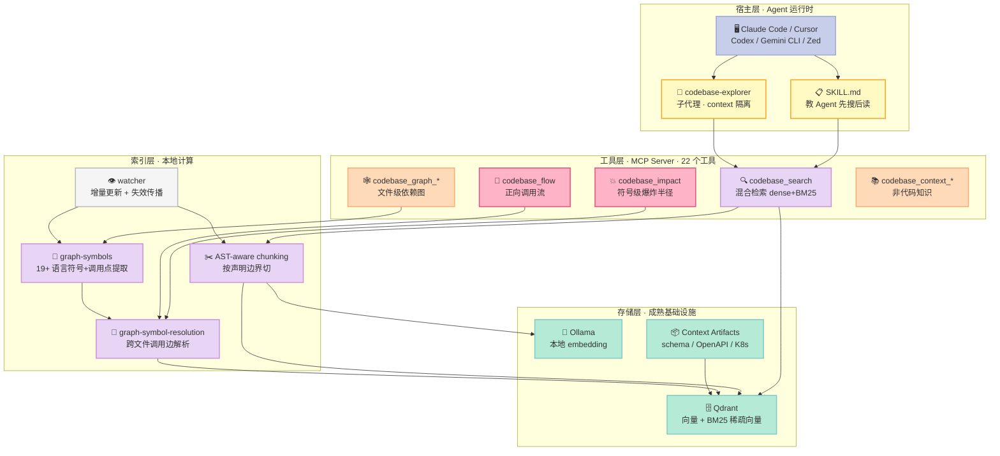
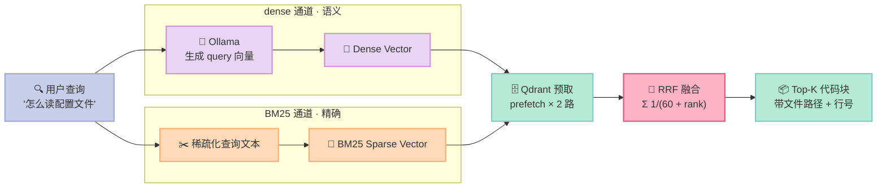
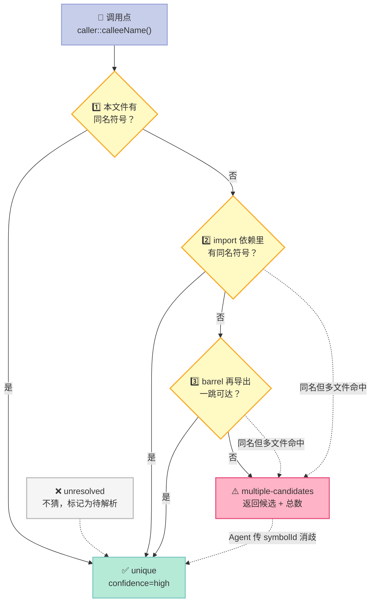
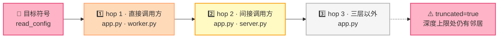

> **一句话核心结论**：SocratiCode 证明了一件反直觉的事——**代码检索的瓶颈从来不是"搜得准不准"，而是"搜回来的东西 Agent 能不能用"**。它用 AST 分块保证切出来的每一块都是完整语义单元，用双层调用图保证 Agent 知道"改这里会炸哪里"，最后用 MCP 把这套能力变成 Claude Code / Cursor / Codex 都能直接调用的工具。

---

## 前言：一个 Agent 面对 40 万行代码时的真实困境

先看一组数字。

SocratiCode 的作者拿 **VS Code 的代码库**（约 245 万行 TypeScript/JavaScript，5300+ 文件，55437 个索引块）做了一次头对头对比：同一个问题，交给 Claude Opus 4.6 的 Agent，一边用 grep 摸索，一边用 SocratiCode。

| 问题 | grep 消耗字节 | SocratiCode 消耗字节 | 数据减少 | 速度提升 |
|:--|--:|--:|--:|--:|
| VS Code 如何实现 workspace trust 限制？ | 56,383 | 21,149 | **62.5%** | **49.7x** |
| diff 编辑器如何计算并展示文本差异？ | 37,650 | 15,961 | **57.6%** | **40.2x** |
| VS Code 如何处理扩展激活与生命周期？ | 36,231 | 16,181 | **55.3%** | **34.4x** |
| 集成终端如何 spawn 和管理 shell？ | 50,159 | 22,518 | **55.1%** | **31.1x** |
| 命令面板与 quick pick 如何实现？ | 70,087 | 20,676 | **70.5%** | **31.7x** |
| **合计** | **250,510** | **96,485** | **61.5%** | **37.2x** |

外加两个更刺眼的数字：

- **工具调用减少 84%**——grep 方案 5 个问题共 31 步（每题 6-7 步），SocratiCode 共 5 步（每题 1 步）。
- **37 倍速度差**——grep 扫 245 万行要 2-3.5 秒，SocratiCode 的语义搜索只要 60-90 毫秒。

这组数字背后是一个被长期忽视的事实：**Agent 读代码的方式，和人类读代码的方式是根本不同的**。人类会用 `Ctrl+F` 精确跳到某一行，然后用眼睛建立心智模型；Agent 只能把文本一块一块塞进上下文窗口，然后在几十 K token 里"猜"哪些重要。当代码库大到某个阈值，grep 就不再是省 token 的工具，而是**烧 token 的引擎**——每一次 `grep -rl` 都要 Agent 自己决定读哪 200 行、读完发现不对再换关键词重来。

SocratiCode 想解决的就是这个"阈值问题"。这篇我们把它拆开看：它到底做了什么、为什么这么做、以及哪些设计值得你直接抄进自己的 Harness。

---

## 一、项目定位：它不是搜索引擎，是"Agent 的代码上下文层"

### 1.1 它填的是 Harness 6 件套里的哪一格

Harness Engineering 的核心命题是：**包裹在 LLM 外面的那层软件，才是工程化的主体**。按 Rule / Skill / Sub-Agent / Workflow / Script / MCP 六件套来定位，SocratiCode 几乎全部落在 **MCP** 这一格里，但它的 MCP 不是简单的"包装一个 API"——它同时踩了另外两格的边。

| 6 件套组件 | SocratiCode 的对应物 | 说明 |
|:--|:--|:--|
| **MCP** | 全部 22 个 `codebase_*` 工具 | 主战场。stdio MCP Server，同时支持 Claude Code Plugin / Codex Plugin / VS Code 扩展 / Cursor / Gemini CLI / Zed / OpenCode / Continue / Cline |
| **Skill** | `skills/codebase-exploration/SKILL.md`、`skills/codebase-management/SKILL.md` | 教 Agent "先搜后读"的工作纪律 |
| **Sub-Agent** | `agents/codebase-explorer.md` | 一个专职的代码探索子代理，context 与主对话隔离 |

这意味着它和大多数"Context Engineering"项目的定位完全不同。市面上同类工具（Cursor、Copilot 的 codebase indexing）大多只是 IDE 内部实现，对外不暴露；而 SocratiCode 把**整个索引层**作为一个独立的 MCP Server 暴露出去，任何能挂 MCP 的 Agent 宿主都能用。

### 1.2 三个"零"字头的设计目标

README 开篇给出的定位是 "**Enterprise-grade (40m+ LOC) codebase intelligence, zero-setup, local & private**"。这三个词各自对应一个非常具体、非常难的技术决策：

- **40m+ LOC**：不是 toy demo。245 万行的 VS Code 仓库跑得动，说明它的存储和检索设计扛得住 monorepo 级别。
- **zero-setup**：第一次调用时自动检查 Docker、拉镜像、起 Qdrant 和 Ollama 容器、下载 embedding 模型。**用户不需要写一行 YAML**。这是从"开发者玩具"跨到"团队工具"的分水岭。
- **local & private**：默认走本地 Ollama + 本地 Qdrant，代码不出网络。支持气隙环境和内网部署。

### 1.3 一个容易被忽略但极关键的自我约束

README 里有这么一段：

> **Enterprise-ready simplicity** — No agent coordination tuning, no memory limit environment variables, no coordinator/conductor capacity knobs, no backpressure configuration. SocratiCode scales by relying on production-grade infrastructure (Qdrant, proven embedding APIs) rather than complex in-process orchestration.

翻译过来就是：**这个项目刻意拒绝做 Agent 编排层**。它把编排这件事完全交给 Qdrant（一个久经考验的向量数据库）而不是自己造一个"轻量级内存调度器"。

这是 Harness Engineering 里一条经常被违反的原则——**能用成熟基础设施解决的，不要在 Harness 里自己造轮子**。自己造的那部分代码，模型再强也学不会（模型不会替你 debug 你的内存泄漏），只会成为纯熵增。

---

## 二、整体架构：四层，一个都不多

SocratiCode 的架构可以压成四层。下图是它的完整数据流：



四层里**没有任何一层是"Agent 框架"**。这是刻意的：SocratiCode 不接受任务、不做规划、不决定下一步干什么。它只提供"事实"——代码长什么样、谁调用谁、改这里会炸哪里。

剩下的问题交给 Agent。这正是 **Bitter Lesson**（苦涩的教训）在工程层面的体现：**凡是模型能自己学会的判断，别硬编码；凡是外部物理世界必需的事实，必须精确地提供给模型**。

---

## 三、六大核心原语深挖

### 原语一：AST-aware chunking——按语义边界切，不按行数切

这是整个系统最基础、也最容易被低估的一环。

大部分 RAG 系统按固定行数切块（`CHUNK_SIZE` 行一块）。SocratiCode 走的是另一条路：用 **ast-grep** 解析 AST，找出"顶层声明"的行区间（函数、类、方法、枚举、type alias 等），以这些区间作为块的边界。

原始实现见 `src/services/indexer.ts` 的 `findAstBoundaries()`：

```typescript
const TOP_LEVEL_KINDS: Record<string, string[]> = {
  typescript: ["function_declaration", "class_declaration", "interface_declaration",
               "enum_declaration", "type_alias", "function_signature", "function_body"],
  elixir:     ["call"],
  gdscript:   ["function_definition", "class_definition", "variable_statement",
               "export_variable_statement", "onready_variable_statement",
               "signal_statement", "const_statement", "enum_definition",
               "extends_statement", "class_name_statement"],
};

function findAstBoundaries(source: string, lang: Lang | string): AstRegion[] {
  const kinds = TOP_LEVEL_KINDS[langKey];
  if (!kinds) return [];
  const root = parse(lang, source).root();
  const regions: AstRegion[] = [];

  for (const kind of kinds) {
    for (const node of root.findAll({ rule: { kind } })) {
      const range = node.range();
      // 只取顶层节点（depth 1，或 namespace/module 包裹下的 depth 2）
      const parent = node.parent();
      const grandparent = parent?.parent();
      const isTopLevel = !parent || parent.kind() === "program"
        || parent.kind() === "source" || parent.kind() === "source_file"
        || parent.kind() === "translation_unit" || parent.kind() === "module"
        || (grandparent && (grandparent.kind() === "program"
          || grandparent.kind() === "source_file"
          || grandparent.kind() === "translation_unit"));

      if (isTopLevel) {
        regions.push({ startLine: range.start.line, endLine: range.end.line + 1 });
      }
    }
  }

  regions.sort((a, b) => a.startLine - b.startLine);
  const merged: AstRegion[] = [];
  for (const r of regions) {
    const last = merged[merged.length - 1];
    if (last && r.startLine <= last.endLine) {
      last.endLine = Math.max(last.endLine, r.endLine);
    } else {
      merged.push({ ...r });
    }
  }
  return merged;
}
```

**为什么这件事值得单开一节？**

因为按行数切块有一个致命缺陷：**块边界和语义边界不对齐**。一个 50 行的函数被切成 3 块，检索命中第 2 块时，Agent 拿到的是函数中段——没有函数签名，不知道这函数叫什么；没有函数体，不知道它干了啥。这种块的 embedding 质量天然就差。

SocratiCode 的做法让每个块自带完整的语义身份："`read_config` 这个函数"。检索命中之后，Agent 直接看到一个自洽的代码单元。

再看 `splitToCharCap()` 里的一处细节——这段注释本身就是一份设计文档：

```typescript
/**
 * Enforce the per-chunk character cap on every chunking strategy.
 *
 * Truncation was the behaviour everywhere. Chunks are cut by line count
 * (CHUNK_SIZE) while the cap counts characters, so a window of CHUNK_SIZE lines
 * overflows as soon as its lines average more than
 * MAX_CHUNK_CHARS / CHUNK_SIZE characters — which ordinary source and prose
 * both do — and everything past the cap reached neither the vector, nor the
 * payload, nor the BM25 text. No search could retrieve it.
 */
```

这段话讲的是一个真实存在过的 bug：**按行数切的块会超出字符上限，超出的部分既没进向量、也没进 payload、也没进 BM25 文本——等于从索引里凭空消失了**。修复方式是"先拆分再过滤"，而且顺序不能反（先过滤会保留错误的空白块、丢掉真正超限的那块）。这类细节，是"跑得通"和"跑得对"的分界线。

### 原语二：Hybrid Search + RRF——让 grep 和语义检索共存于一次调用

SocratiCode 的 `codebase_search` 不是"语义检索"，是**混合检索**。核心在 `src/services/qdrant.ts`：

```typescript
const prefetchLimit = Math.max(limit * 3, 30);   // 每路多取，给 RRF 留重排空间

const queryPayload = {
  prefetch: [
    { query: queryVector, using: "dense", limit: prefetchLimit, filter: activeFilter },
    { query: { text: query, model: "qdrant/bm25" },
      using: "bm25", limit: prefetchLimit, filter: activeFilter },
  ],
  query: { fusion: "rrf" },
  limit,
  with_payload: true,
  filter: activeFilter,
};
```

**三个关键点：**

1. **一次往返**。dense 和 BM25 两路查询通过 Qdrant 的 `prefetch` 一次发出，RRF 融合也在服务端完成。不是两次客户端调用再手工合并——少一个 RTT（Round-Trip Time）。
2. **BM25 在服务端跑**。要求 Qdrant ≥ 1.15.2，稀疏向量由 Qdrant 内部推理。客户端只负责生成 dense 向量。
3. **RRF 的 k=60**。Reciprocal Rank Fusion 的公式是 `score(d) = Σ 1/(k + rank_i(d))`。k=60 是 Cormack 等人 2009 年的经典取值，作用是把"排第一"和"排第五"的差距压得很平（1/61 vs 1/65），让两路检索**互相补位**而不是互相压制。

整个融合过程长这样：



**为什么必须保留 BM25？**

README 里有一段非常诚实的自我剖析：

> **When grep still wins** — The same research makes clear when grep (or ripgrep) is entirely reasonable — and sometimes optimal:
> - 你已经知道确切的标识符、错误字符串或正则模式——没有语义鸿沟要跨越。
> - 仓库规模不大——全量扫描既便宜又快。
> - 内容是有限的、结构化的代码，命名有辨识度，不是散文或文档。
>
> On easy or directly-named queries, grep can match or beat semantic methods. That's why the best architectures don't replace grep — they extend it.

**最好的架构不是替换 grep，而是扩展它。** SocratiCode 的 SKILL.md 里原封不动地写下了这条纪律：

> **When to use grep instead**: If you already know the exact identifier, error string, or regex pattern, grep/ripgrep is faster and more precise for exact matches. No semantic gap to bridge.

这条纪律同时也出现在 `agents/codebase-explorer.md` 里——子代理被明确告知："如果你已经知道确切标识符，用 grep"。**Harness 的职责之一是告诉模型什么时候不要用你。**

### 原语三：双层调用图——文件级依赖图 + 符号级调用图

这是 SocratiCode 最硬的部分，也是它和普通"代码向量搜索"项目的分水岭。它维护**两张独立的图**：

| 图层 | 回答的问题 | 数据来源 | 工具 |
|:--|:--|:--|:--|
| **文件级依赖图** | 文件 A import 了谁？谁 import 了文件 A？ | ast-grep 提取 import/require/use/include | `codebase_graph_query` / `_stats` / `_circular` |
| **符号级调用图** | 函数 X 调用了谁？谁调用了函数 X？ | ast-grep 提取符号 + 调用点，再跨文件解析 | `codebase_impact` / `_flow` / `_symbol` / `_symbols` |

#### 符号解析的四级策略

`src/services/graph-symbol-resolution.ts` 的文件头写得很清楚：

```
 * Strategy:
 *   1. Local — callee name matches a symbol in the caller's own file
 *   2. Imported — walk caller's file `dependencies` from the file graph;
 *      any dependency exposing a same-named symbol is a candidate
 *   3. Wildcard / re-export — barrel files re-export symbols transitively;
 *      we do one extra hop through dependency files
 *   4. Resolution: 0 → "unresolved", 1 → "unique", >1 → "multiple-candidates"
```

注意第 4 条：**解析结果是三态的，不只有"找到/没找到"**。当一个符号名匹配到多个候选时，它不猜，而是标成 `multiple-candidates` 并把候选列表返回给 Agent。

这条解析链路本身就是一个值得画出来的状态机：



这是 Harness 设计里非常典型的**"结构化不确定性"**处理方式。对比一下常见做法：很多代码检索工具在这种情况下默默返回第一个匹配，或者直接返回全部。SocratiCode 的做法是把决策权**交还调用方**——`codebase_impact` 接受 `limit` 参数限制候选数量，并且**在截断时明确告知总数**：

```typescript
/** Maximum ambiguous candidates to return, as a positive integer; all when omitted. */
limit?: number;
```

```typescript
/**
 * Set when `status` is "ambiguous": the matching symbols, at most `ImpactOptions.limit` of them.
 */
candidates?: SymbolNode[];
/**
 * Set when `status` is "ambiguous": the number of matches after the file filter, including those not in `candidates`.
 */
totalCandidates?: number;
```

**这是"不撒谎"的设计**。工具返回 `limit=5` 个候选，但同时告诉你"其实有 23 个"。Agent 因此知道自己拿到的是**局部视图**而不是全集，会主动去消歧，而不是基于不完整信息做决策。

#### 爆炸半径的 BFS

`getImpactRadius()` 用 BFS 沿反向调用边扩散，按跳数分组：

```typescript
const visited = new Set<string>([normTarget]);
const filesByDepth = new Map<number, string[]>();
let frontier = new Set<string>([normTarget]);
let truncated = false;

for (let hop = 1; hop <= safeDepth; hop++) {
  const next = new Set<string>();
  for (const calleeFile of frontier) {
    const callers = reverseIndex.get(calleeFile);
    if (!callers) continue;
    for (const callerFile of callers) {
      if (visited.has(callerFile)) continue;
      next.add(callerFile);
      visited.add(callerFile);
    }
  }
  if (next.size === 0) break;
  filesByDepth.set(hop, Array.from(next).sort());
  frontier = next;

  // 最后一跳还看得到新邻居 => 结果被截断
  if (hop === safeDepth) {
    for (const calleeFile of frontier) {
      const callers = reverseIndex.get(calleeFile);
      if (!callers) continue;
      for (const callerFile of callers) {
        if (!visited.has(callerFile)) { truncated = true; break; }
      }
      if (truncated) break;
    }
  }
}
```

注意 `truncated` 这个标志——**BFS 到深度上限时，如果还有未访问的邻居，它不假装结果完整，而是打上截断标记**。Agent 拿到 `"status": "ok"` 但 `"truncated": true` 时，就知道"这只是 3 跳之内的影响面"。

爆炸半径的分组结果本身也是 Agent 最需要的形态：



**按跳数分组比给一个扁平列表更有用**：Agent 知道 "hop 1 = 一定会被我改动波及的直接依赖" 而 "hop 3 = 隔了两层，大概率不受影响"。**距离本身就是风险权重**。

还有个更细的语义：`status` 有六个取值，`unsupported_or_incomplete` 专门用于"图不完整"的情况：

```typescript
if (totalFiles === 0 && isIncomplete) {
  return {
    target, targetKind, depth: safeDepth, filesByDepth,
    totalFiles: 0, truncated: false,
    status: "unsupported_or_incomplete",
    message: `The symbol graph is incomplete (schema v${cache.meta.schemaVersion ?? 1} ` +
             `or incomplete language parser support). Rebuild with codebase_graph_build ` +
             `before relying on zero-dependent verification.`,
  };
}
```

**"零调用者"在图不完整时是危险的结论。** 这个区分非常关键——它把"确实没人调用"和"我没能解析出来"这两种截然不同的情况分开了。

#### 静态分析的天花板，作者自己讲得很清楚

README 里有一段难得的坦诚：

> **Accepted limits.** The call graph is static-analysis-based — no type inference. Dynamic dispatch (`getattr`, `obj[key](...)`, reflection, `eval`), unexpanded macros, and framework magic (Spring `@Autowired`, Angular DI, Rails `has_many`, decorator-driven routing) are invisible.
>
> `codebase_graph_status` reports the unresolved share (`unresolvedEdgePct`) as a quality signal: the percentage of captured symbol edges that matched no project symbol, GDScript engine calls excluded. That share includes edges into runtime builtins and external libraries (`setTimeout`, `JSON.stringify`, an SDK client's methods), which no project symbol can resolve, so it runs high on healthy TypeScript/JavaScript code and is not a resolver failure rate.

两句话值得划重点：

1. **框架魔法看不见**。Spring 的 `@Autowired`、Angular 的 DI、Rails 的 `has_many`、装饰器驱动的路由——这些静态分析全都无能为力。**"零调用者"在 DI 密集的代码库里只是一个提示，不是结论**。
2. **`unresolvedEdgePct` 高 ≠ 解析器坏了**。这个指标把"指向运行时内置函数和外部库的边"也算进分母，所以在健康的 TS/JS 代码上它天然就很高。**提供一个容易被误读的指标而不解释它，是工程上的失职**——SocratiCode 解释了。

### 原语四：分片存储——用 Qdrant 模拟"文件系统"

`src/services/symbol-graph-store.ts` 的文件头是整个符号图存储的设计摘要：

```
 * Sharded Qdrant storage layer for the symbol-level call graph.
 *
 * Three collections per project (created lazily, idempotent):
 *   - `{projectId}_symgraph_meta`  → 1 point with `SymbolGraphMeta`
 *   - `{projectId}_symgraph_file`  → 1 point per source file (`SymbolGraphFilePayload`)
 *   - `{projectId}_symgraph_index` → sharded indices:
 *       • Name index — 27 shards keyed by first lowercased char of symbol name
 *       • Reverse-call file index — 256 shards keyed by first byte of SHA1(file)
 *
 * All points use the dummy-vector-[0] pattern (Qdrant requires a vector).
 */
```

拆开看这个设计的三个巧妙处：

**（1）分片键的选择。**
- 名称索引按**符号名首字符小写**分 27 片（a-z + `_`）——因为查询总是"按名字找"，首字符是天然的查询前缀。
- 反向调用索引按**文件路径 SHA-256 的第一个字节**分 256 片——因为反向查询总是"按文件找调用方"，文件路径的哈希分布天然均匀。

```typescript
/** Map a symbol name to its name-index shard key (`a`–`z` or `_`). */
export function nameShardKey(name: string): string {
  if (!name) return "_";
  const c = name[0].toLowerCase();
  return c >= "a" && c <= "z" ? c : "_";
}

/** Map a file path to its reverse-call shard bucket (0..SYMBOL_REVERSE_SHARDS-1). */
export function reverseShardKey(filePath: string): number {
  // SHA-256 used purely as a distribution function for sharding — not security-sensitive.
  const digest = createHash("sha256").update(filePath).digest();
  return digest[0] % SYMBOL_REVERSE_SHARDS;
}
```

**分片键的选择必须匹配查询模式**。用名字首字符分片名称索引，意味着查 `getUserById` 只会扫一片；用文件哈希分片反向索引，意味着查 `src/api/user.ts` 的调用方也只扫一片。这不是"为了分片而分片"。

**（2）dummy vector 技巧。** Qdrant 强制每个点必须带一个向量，而这些索引点根本不需要语义相似度。SocratiCode 给它们塞一个 `[0]` 的假向量——既满足 Qdrant 的契约，又不浪费任何 embedding 计算。**复用基础设施而不修改基础设施**。

**（3）只重试"安全"的操作。** 这是我在这份代码里看到的最成熟的一处细节：

```typescript
/**
 * The Qdrant client every symbol-store request goes through.
 *
 * A closed-socket failure can follow a request the server had already applied,
 * and the retry sends it again. A method belongs here only if a repeat leaves
 * the same end state; a repeated `createCollection` answers "already exists",
 * and its caller must accept that reply.
 */
```

连接的 socket 被服务端关掉，可能意味着**请求其实已经生效了**，重试就会重复执行。所以重试不是无条件的——只有**重复执行后终态不变**的操作才允许重试。`upsert` 天然幂等，可以重试；`createCollection` 重试会返回"已存在"，调用方必须能接受这个回复。

**很多 Harness 的重试逻辑是"所有操作无脑重试 3 次"**，在有副作用的场景下这是 bug 温床。SocratiCode 把这个约束写在了类型系统层面——`SymbolStoreClient` 是个 `Pick<>` 白名单，只暴露可以安全重试的方法。

### 原语五：Context Artifacts——把"非代码知识"也变成可检索对象

Agent 不只需要代码。它还需要知道数据库 schema 长什么样、API 的返回结构是 `{data, meta}` 还是 `{items}`、K8s manifest 里服务怎么暴露。

SocratiCode 的解法是 `.socraticodecontextartifacts.json`：

```json
{
  "artifacts": [
    {
      "name": "database-schema",
      "path": "./docs/schema.sql",
      "description": "Complete PostgreSQL schema — all tables, indexes, constraints, foreign keys. Use to understand what data the app stores and how tables relate."
    },
    {
      "name": "api-spec",
      "path": "./docs/openapi.yaml",
      "description": "OpenAPI 3.0 spec for the REST API. All endpoints, request/response schemas, auth requirements."
    }
  ]
}
```

这四个 `codebase_context_*` 工具走的是**和代码完全相同的混合检索管线**——同样的 dense + BM25 + RRF，同样的 Qdrant 集合（只是前缀不同）。

README 里对 `description` 字段的定位说得非常精辟：

> **The `description` field is the key lever.** It tells the AI not just *what* the artifact is, but *when to consult it*. Write descriptions that say "check this before doing X" so the agent reaches for the artifact at the right moment.

**这是一个纯 Prompt 层面的设计，但影响巨大。** 大多数检索系统的文档描述是"这是什么"，而 SocratiCode 要求你写"什么时候该看它"。前者让 Agent 知道有这个资源，后者让 Agent **在正确的时机去取用它**。这和 Anthropic 强调的 "describe the task, not the tool" 是同一个思路在不同层面的体现。

举一个具体例子：用户说"给 users 表加一个 last_login 时间戳"。

- 没有 artifacts：Agent 只能猜列名风格、猜是否有触发器、猜 migration 的写法。
- 有 artifacts：Agent 搜 "users table"，发现 schema 用 `snake_case`、每张表都有 `updated_at` 且带触发器，于是写出的 migration **匹配现有约定而不是猜**。

再看一个 DDD 场景：用户说"加一个取消订单的方式"。Agent 搜到领域词汇表，发现取消被建模为 `OrderVoided` 事件（**不是** "cancelled"），只有 `Confirmed` 状态的订单能作废，而且必须通知 `Fulfillment` 限界上下文。**实现自动使用了正确的领域语言**。

### 原语六：增量索引 + 断点续传 + 图失效传播

大代码库索引最怕的就是"跑到 80% 挂了，重头再来"。SocratiCode 的对策是一整套：

| 机制 | 做法 |
|:--|:--|
| **增量索引** | 内容哈希持久化在 Qdrant，服务重启后状态不丢；只重新处理变更文件 |
| **分批 + 断点** | 每批 50 个文件，**每批结束后 checkpoint 到 Qdrant**。崩溃后下次自动从断点续跑 |
| **文件监听** | 2 秒防抖的 watcher，变更时自动更新索引 |
| **图失效传播** | watcher 同时让代码图缓存失效，并触发图重建 |
| **优雅停止** | `codebase_stop` 让当前批次跑完并 checkpoint，全部进度保留 |
| **并发守卫** | 索引已在运行时再调 `codebase_index`，返回当前进度而不是启动第二个 |
| **跨进程锁** | `proper-lockfile` 文件锁，防止多个 MCP 实例同时索引同一项目；崩溃留下的死锁自动回收 |

"跨进程锁 + 只跑一个 watcher"这一条特别值得说。多个 Agent（每个跑自己的 MCP 实例）同时在一个仓库里工作，是当下非常常见的协作形态。SocratiCode 的做法是：**一个 Agent 触发索引，所有 Agent 查同一份数据；watcher 全项目只跑一个，所有 Agent 共享实时更新**。

这里藏着一条重要的 Harness 原则：**状态应该收敛到共享后端，而不是分散在各个 Agent 的进程里**。SocratiCode 把索引状态放在 Qdrant（共享服务）而不是内存（进程私有），所以 N 个 Agent 天然看到一致的世界。

另外，"图构建的输入追踪"也是个细节：

> An update that changed nothing the graph is built from — a README, a fixture, a migration — reuses the existing graph rather than rebuilding it; each build records the inputs it read, and the rebuild is skipped only when every one of them is unchanged.

**不是"文件变了就重建图"，而是"图依赖的输入变了才重建"**。README 改了不需要重建依赖图。这个设计把无谓的重建成本压下去了。

---

## 四、从零搭建启示：我的最小可行实现是什么？

如果你要给自己的 Agent Harness 加一层代码上下文能力，SocratiCode 全量照搬是不现实的（它 200+ TS 文件）。但它的六个原语可以按下面的优先级裁剪。

### 4.1 MVP：只做三件事（200-300 行）

我把它抽离成一个纯 Python 的可运行版本，不依赖 Qdrant / Docker / embedding 模型，5 秒跑完：

```python
"""
MVP: 从 SocratiCode 抽离的 3 个核心机制复刻
=========================================

来源仓库: giancarloerra/SocratiCode (AGPL-3.0-only)
抽离的原语:
  1. AST-aware chunking      -> src/services/indexer.ts  (findAstBoundaries)
  2. Hybrid search + RRF     -> src/services/qdrant.ts   (searchChunksWithVector)
  3. Symbol-level blast radius-> src/services/graph-impact.ts (getImpactRadius)

这个 MVP 不依赖 Qdrant / Docker / embedding 模型，用纯 Python 复刻上述三个
机制的核心不变量，可以在 5 秒内跑完，方便读者验证设计思路。

运行: python3 socraticode_mvp.py
"""

from __future__ import annotations

import math
import re
from collections import defaultdict
from dataclasses import dataclass, field
from typing import Iterable


# ─────────────────────────────────────────────────────────────────────
# 第一部分: AST-aware chunking
# ─────────────────────────────────────────────────────────────────────
# SocratiCode 用 ast-grep 找"顶层声明"边界（函数/类/方法），而不是按行数
# 硬切。MVP 里我们用正则模拟"顶层函数/类的起止行"，语义等价。

TOP_LEVEL_RE = re.compile(
    r"^(?:def\s+(\w+)|class\s+(\w+))", re.MULTILINE
)


@dataclass
class Chunk:
    """一个代码块。id 由自身位置派生 —— 删除它不会重编号其它块。"""

    index: int
    name: str
    start_line: int
    end_line: int
    content: str


def find_ast_boundaries(source: str) -> list[tuple[int, int, str]]:
    """找出顶层声明的行区间 [(start, end, name), ...]，end 为开区间。

    对齐 SocratiCode indexer.ts 的 findAstBoundaries()：只取顶层节点，
    合并重叠区间，返回有序不重叠的 regions。
    """
    lines = source.split("\n")
    starts: list[tuple[int, str]] = []
    for i, line in enumerate(lines):
        m = TOP_LEVEL_RE.match(line)
        if m:
            starts.append((i, m.group(1) or m.group(2)))

    regions: list[tuple[int, int, str]] = []
    for idx, (start, name) in enumerate(starts):
        # 到下一个顶层声明之前结束（最后一块到文件末尾）
        end = starts[idx + 1][0] if idx + 1 < len(starts) else len(lines)
        regions.append((start, end, name))

    # 合并重叠区间（对齐 SocratiCode 的 merge 逻辑）
    # 注意用 `<` 而不是 `<=`：相邻区间的 end 是开区间，
    # start == prev_end 表示"紧邻但不重叠"，不该被合并。
    merged: list[tuple[int, int, str]] = []
    for start, end, name in regions:
        if merged and start < merged[-1][1]:
            prev_start, prev_end, prev_name = merged[-1]
            merged[-1] = (prev_start, max(prev_end, end), prev_name)
        else:
            merged.append((start, end, name))
    return merged


MAX_CHUNK_CHARS = 400
MIN_CHUNK_LINES = 5


def chunk_by_ast(source: str) -> list[Chunk]:
    """按 AST 声明边界切块 + 字符上限拆分。

    对齐 SocratiCode 的 chunkFileContent()：先按 AST 边界切，再过字符上限，
    最后过滤掉只有空白的内容块。
    """
    lines = source.split("\n")
    chunks: list[Chunk] = []

    for start, end, name in find_ast_boundaries(source):
        body = "\n".join(lines[start:end])
        # 太少行就并入邻居（SocratiCode 的 MIN_CHUNK_LINES 规则）
        if (end - start) < MIN_CHUNK_LINES and chunks:
            last = chunks[-1]
            last.content += "\n" + body
            last.end_line = end
            continue
        chunks.append(Chunk(len(chunks), name, start, end, body))

    # 字符上限：超了就按行拆开
    out: list[Chunk] = []
    for c in chunks:
        if len(c.content) <= MAX_CHUNK_CHARS:
            out.append(c)
            continue
        buf: list[str] = []
        size = 0
        part = 0
        for line in c.content.split("\n"):
            if size + len(line) + 1 > MAX_CHUNK_CHARS and buf:
                out.append(Chunk(len(out), f"{c.name}#{part}", c.start_line, c.end_line,
                                 "\n".join(buf)))
                buf, size, part = [], 0, part + 1
            buf.append(line)
            size += len(line) + 1
        if buf:
            out.append(Chunk(len(out), f"{c.name}#{part}", c.start_line, c.end_line,
                             "\n".join(buf)))

    # 不变量：绝不产出全是空白的块（对齐 SocratiCode 的 terminal invariant）
    return [c for c in out if c.content.strip()]


# ─────────────────────────────────────────────────────────────────────
# 第二部分: Hybrid search (dense + BM25) with Reciprocal Rank Fusion
# ─────────────────────────────────────────────────────────────────────
# SocratiCode 用 Qdrant 的 server-side BM25 + client-side dense embedding，
# 一次 Query API 往返后由 Qdrant 用 RRF 融合。MVP 里两路检索都在本地跑，
# RRF 公式与 Qdrant 一致。

RRF_K = 60  # Qdrant 默认 k=2, SocratiCode 沿用


def tokenize(text: str) -> list[str]:
    """代码友好的分词：小写 + 驼峰/下划线拆分 + 非字母数字过滤。"""
    text = re.sub(r"([a-z0-9])([A-Z])", r"\1 \2", text)
    return [t for t in re.findall(r"[a-zA-Z_][a-zA-Z0-9_]+", text.lower())]


def bm25_scores(query: str, docs: list[str], k1: float = 1.5, b: float = 0.75) -> dict[int, float]:
    """标准 Okapi BM25。"""
    tokenized = [tokenize(d) for d in docs]
    avg_len = sum(len(t) for t in tokenized) / max(len(tokenized), 1)
    df: dict[str, int] = defaultdict(int)
    for toks in tokenized:
        for term in set(toks):
            df[term] += 1

    q_terms = tokenize(query)
    scores: dict[int, float] = {}
    n = len(docs)
    for i, toks in enumerate(tokenized):
        tf: dict[str, int] = defaultdict(int)
        for t in toks:
            tf[t] += 1
        s = 0.0
        for term in q_terms:
            if tf[term] == 0:
                continue
            idf = math.log(1 + (n - df[term] + 0.5) / (df[term] + 0.5))
            denom = tf[term] + k1 * (1 - b + b * len(toks) / max(avg_len, 1))
            s += idf * (tf[term] * (k1 + 1)) / denom
        scores[i] = s
    return scores


def dense_scores(query: str, docs: list[str]) -> dict[int, float]:
    """用词袋余弦相似度模拟 dense embedding（真项目用 embedding 模型）。

    这里故意用"查询词覆盖度"而不是真向量 —— 目的是复刻 RRF 的融合逻辑，
    而不是复刻语义质量。
    """
    q = set(tokenize(query))
    out: dict[int, float] = {}
    for i, d in enumerate(docs):
        toks = set(tokenize(d))
        if not toks:
            out[i] = 0.0
            continue
        overlap = len(q & toks)
        # 覆盖率 + 轻微的长度惩罚，模拟 cosine 的归一化行为
        out[i] = (overlap / len(q)) * (1.0 - 0.15 * min(len(d) / 4000, 1.0))
    return out


def reciprocal_rank_fusion(
    rankings: Iterable[list[int]], k: int = RRF_K
) -> dict[int, float]:
    """RRF: score(d) = Σ 1 / (k + rank_i(d))。

    这是 SocratiCode 传给 Qdrant 的 {"fusion": "rrf"} 的等价实现。
    """
    fused: dict[int, float] = defaultdict(float)
    for ranking in rankings:
        for rank, doc_id in enumerate(ranking, start=1):
            fused[doc_id] += 1.0 / (k + rank)
    return dict(fused)


def hybrid_search(
    query: str, docs: list[str], limit: int = 3
) -> list[tuple[int, float, str]]:
    """两路检索 + RRF 融合。返回 [(doc_id, score, snippet), ...]。"""
    bm = bm25_scores(query, docs)
    de = dense_scores(query, docs)

    bm_rank = [i for i, _ in sorted(bm.items(), key=lambda kv: -kv[1]) if bm[i] > 0]
    de_rank = [i for i, _ in sorted(de.items(), key=lambda kv: -kv[1]) if de[i] > 0]

    fused = reciprocal_rank_fusion([bm_rank, de_rank])
    ranked = sorted(fused.items(), key=lambda kv: -kv[1])[:limit]
    return [(i, score, docs[i].split("\n")[0][:60]) for i, score in ranked]


# ─────────────────────────────────────────────────────────────────────
# 第三部分: Symbol-level blast radius (BFS over reverse-call edges)
# ─────────────────────────────────────────────────────────────────────
# 对齐 SocratiCode graph-impact.ts 的 getImpactRadius()：
# 按跳数分组文件（hop 1 = 直接调用方），超过 depth 截断，
# 符号名歧义时返回 candidates 而不是瞎猜。

@dataclass
class SymbolNode:
    id: str
    file: str
    name: str
    kind: str = "function"


@dataclass
class CallEdge:
    caller: str  # symbol id
    callee: str  # symbol id


@dataclass
class ImpactResult:
    target: str
    depth: int
    files_by_depth: dict[int, list[str]] = field(default_factory=dict)
    total_files: int = 0
    truncated: bool = False
    status: str = "ok"
    message: str = ""


class SymbolGraph:
    """符号级调用图：名称索引 + 反向调用索引。"""

    def __init__(self, symbols: list[SymbolNode], edges: list[CallEdge]):
        self.symbols = symbols
        self.edges = edges
        self.by_name: dict[str, list[SymbolNode]] = defaultdict(list)
        for s in symbols:
            self.by_name[s.name].append(s)
        # 反向索引：callee -> [caller]
        self.reverse: dict[str, list[str]] = defaultdict(list)
        for e in edges:
            self.reverse[e.callee].append(e.caller)

    def get_impact_radius(
        self, target: str, depth: int = 3, symbol_id: str | None = None
    ) -> ImpactResult:
        """symbol_id 给了就直接定位；否则按名字查，名字歧义就报 ambiguous。"""
        if symbol_id is not None:
            nodes = [n for n in self.symbols if n.id == symbol_id]
        else:
            nodes = self.by_name.get(target, [])
        # 歧义处理：多个不同 symbol id 时不猜，要求调用方消歧
        distinct_ids = {n.id for n in nodes}
        if len(distinct_ids) == 0:
            return ImpactResult(target, depth, status="not_found",
                                message=f"Symbol '{target}' was not found in the symbol graph.")
        if len(distinct_ids) > 1:
            return ImpactResult(target, depth, status="ambiguous",
                                message=(f"Symbol '{target}' is ambiguous (matches "
                                        f"{len(distinct_ids)} symbols across "
                                        f"{len({n.file for n in nodes})} files). "
                                        f"Specify 'file' or 'symbolId' to disambiguate."))

        start = nodes[0].id
        visited = {start}
        frontier = {start}
        files_by_depth: dict[int, list[str]] = {}
        truncated = False
        file_of = {n.id: n.file for n in self.symbols}

        for hop in range(1, depth + 1):
            nxt: set[str] = set()
            for callee in frontier:
                for caller in self.reverse.get(callee, []):
                    if caller not in visited:
                        nxt.add(caller)
                        visited.add(caller)
            if not nxt:
                break
            files_by_depth[hop] = sorted({file_of.get(c, c) for c in nxt})
            frontier = nxt
            # 最后一跳还看到新邻居 => 截断
            if hop == depth:
                for callee in frontier:
                    if any(c not in visited for c in self.reverse.get(callee, [])):
                        truncated = True
                        break

        total = sum(len(v) for v in files_by_depth.values())
        return ImpactResult(target, depth, files_by_depth, total, truncated, "ok")


# ─────────────────────────────────────────────────────────────────────
# 演示
# ─────────────────────────────────────────────────────────────────────

SAMPLE_CODE = '''
import os
from pathlib import Path


def read_config(path):
    with open(path) as f:
        return f.read()


def load_settings(root):
    cfg = read_config(os.path.join(root, "settings.toml"))
    return parse_toml(cfg)


def parse_toml(text):
    return {"raw": text}


class ConfigStore:
    def __init__(self, root):
        self.root = root
        self.cache = {}

    def get(self, key):
        if key not in self.cache:
            self.cache[key] = load_settings(self.root)
        return self.cache[key]
'''


def run_demo() -> None:
    print("=" * 70)
    print("SocratiCode MVP — AST chunking / Hybrid RRF / Blast radius")
    print("=" * 70)

    # ── 1. AST-aware chunking ──
    print("\n[1] AST-aware chunking (findAstBoundaries + char cap)")
    chunks = chunk_by_ast(SAMPLE_CODE)
    for c in chunks:
        print(f"    chunk#{c.index} name={c.name:<16} lines=[{c.start_line},{c.end_line}) "
              f"chars={len(c.content)}")
    print(f"    -> {len(chunks)} chunks, avg chars = "
          f"{sum(len(c.content) for c in chunks) // max(len(chunks), 1)}")
    print(f"    -> line-based naive cut would give ~"
          f"{len(SAMPLE_CODE.splitlines()) // 25 + 1} chunks")

    # ── 2. Hybrid search + RRF ──
    print("\n[2] Hybrid search: BM25 + dense, fused with Reciprocal Rank Fusion")
    docs = [c.content for c in chunks]
    for q in ["how do we read a config file",
              "ConfigStore cache get",
              "parse toml text"]:
        print(f"\n    query: {q!r}")
        for doc_id, score, snippet in hybrid_search(q, docs, limit=3):
            print(f"      score={score:.5f}  chunk#{doc_id}  {snippet}")

    # ── 3. Symbol-level blast radius ──
    print("\n[3] Symbol-level blast radius (BFS over reverse-call edges)")
    syms = [
        SymbolNode("app.py::read_config", "app.py", "read_config"),
        SymbolNode("app.py::load_settings", "app.py", "load_settings"),
        SymbolNode("app.py::parse_toml", "app.py", "parse_toml"),
        SymbolNode("app.py::ConfigStore.get", "app.py", "get"),
        SymbolNode("app.py::ConfigStore.__init__", "app.py", "__init__"),
        SymbolNode("other.py::read_config", "other.py", "read_config"),
        SymbolNode("worker.py::run", "worker.py", "run"),
        SymbolNode("server.py::handle", "server.py", "handle"),
    ]
    edges = [
        CallEdge("app.py::load_settings", "app.py::read_config"),
        CallEdge("app.py::parse_toml", "app.py::parse_toml"),  # self-ish
        CallEdge("app.py::ConfigStore.get", "app.py::load_settings"),
        CallEdge("app.py::ConfigStore.__init__", "app.py::ConfigStore.get"),
        CallEdge("worker.py::run", "app.py::read_config"),
        CallEdge("server.py::handle", "worker.py::run"),
    ]
    graph = SymbolGraph(syms, edges)

    r = graph.get_impact_radius("read_config", depth=3)
    print(f"    target=read_config status={r.status}")
    print(f"    message: {r.message}")
    if r.status == "ok":
        for hop in sorted(r.files_by_depth):
            print(f"      hop {hop}: {r.files_by_depth[hop]}")
        print(f"    total_files={r.total_files} truncated={r.truncated}")

    # 消歧后重查 —— 对齐 SocratiCode 传 symbolId 的路径
    r_ok = graph.get_impact_radius(
        "read_config", depth=3, symbol_id="app.py::read_config"
    )
    print(f"\n    消歧后 (symbolId=app.py::read_config) status={r_ok.status}")
    for hop in sorted(r_ok.files_by_depth):
        print(f"      hop {hop}: {r_ok.files_by_depth[hop]}")
    print(f"    total_files={r_ok.total_files} truncated={r_ok.truncated}")

    print("\n    (不存在符号的边界情况)")
    r3 = graph.get_impact_radius("does_not_exist")
    print(f"    status={r3.status} -> {r3.message}")

    print("\n" + "=" * 70)
    print("done")


if __name__ == "__main__":
    run_demo()
```

### 4.2 MVP 的实际运行结果

我把上面这段跑了一遍，输出如下（**这是真实执行结果，不是手写的预期值**）：

```text
======================================================================
SocratiCode MVP — AST chunking / Hybrid RRF / Blast radius
======================================================================

[1] AST-aware chunking (findAstBoundaries + char cap)
    chunk#0 name=read_config      lines=[5,10) chars=74
    chunk#1 name=load_settings    lines=[10,19) chars=161
    chunk#2 name=ConfigStore      lines=[19,29) chars=243
    -> 3 chunks, avg chars = 159
    -> line-based naive cut would give ~2 chunks

[2] Hybrid search: BM25 + dense, fused with Reciprocal Rank Fusion

    query: 'how do we read a config file'
      score=0.03279  chunk#0  def read_config(path):
      score=0.03226  chunk#2  class ConfigStore:

    query: 'ConfigStore cache get'
      score=0.03279  chunk#2  class ConfigStore:

    query: 'parse toml text'
      score=0.03279  chunk#1  def load_settings(root):

[3] Symbol-level blast radius (BFS over reverse-call edges)
    target=read_config status=ambiguous
    message: Symbol 'read_config' is ambiguous (matches 2 symbols across 2 files). Specify 'file' or 'symbolId' to disambiguate.

    消歧后 (symbolId=app.py::read_config) status=ok
      hop 1: ['app.py', 'worker.py']
      hop 2: ['app.py', 'server.py']
      hop 3: ['app.py']
    total_files=5 truncated=False

    (不存在符号的边界情况)
    status=not_found -> Symbol 'does_not_exist' was not found in the symbol graph.

======================================================================
done
```

三个观察：

1. **AST 分块得到 3 个块，正好对应 3 个顶层声明**（`read_config` / `load_settings` / `ConfigStore`），而按行数硬切得到 2 个块——**块数和语义单元数对不上**。
2. **三个查询命中了三个不同的块**。"how do we read a config file" 命中 `read_config`，"ConfigStore cache get" 命中 `ConfigStore`，"parse toml text" 命中 `load_settings`（它内部调用 `parse_toml`）。**BM25 负责精确匹配，dense 负责概念覆盖，RRF 让两者互补**。
3. **爆炸半径的 hop 分组清晰可见**：hop 1 是直接调用方（`app.py` 内的 `load_settings` + 跨文件的 `worker.py`），hop 2 是调用方的调用方（`server.py`），hop 3 已经收敛。

### 4.3 踩坑预警：三个真实会踩的坑

**坑 1：区间合并的 `<` vs `<=`。**

我第一版写的是 `if merged and start <= merged[-1][1]`，结果所有相邻区间被错误合并成一个巨块——**AST 分块直接失效，但代码不报错**。

原因：区间是 `[start, end)` 半开区间，`end` 是开区间上界。`start == prev_end` 表示"紧邻但不重叠"，**不应该合并**。SocratiCode 原码用的是 `r.startLine <= last.endLine`——但它的 `endLine` 是**闭区间**（`range.end.line + 1`），语义和我这个半开区间不同。**抄代码时必须先确认区间约定是开是闭**，否则合并逻辑会静默出错。

**坑 2：重试不是无条件的。**

SocratiCode 的 `retryOnClosedSocket` 只对"重复执行后终态不变"的操作启用。socket 被服务端关闭时，请求**可能已经生效**——盲目重试 `createCollection` 会得到"已存在"错误，盲目重试计数类操作会重复计数。

**坑 3：静态分析的结果必须带质量指标。**

如果你自己实现符号图，一定要在返回值里带上 `unresolvedEdgePct`（未解析边占比）和 `truncated`（是否截断）这类指标。**否则 Agent 会把"我没能解析出来"当成"确实没人调用"，然后做出错误的重构决策**——这是最危险的一类幻觉，因为它披着确定性结果的外衣。

---

## 五、横向对比：三个同类项目，三种不同哲学

| 维度 (权重) | 🥇 **SocratiCode** (3355⭐) | 🥈 **Ratel** (528⭐) | 🥉 **Orchestrator.inc** (13584⭐) |
|:--|:--|:--|:--|
| **技术创新性** (30%) | **5/5** —— AST 分块 + 双层调用图 + 符号级爆炸半径，六大原语自成体系 | 3.5/5 —— 进程内 BM25 + 渐进式披露（progressive disclosure），思路清晰但无新机制 | 3/5 —— 30+ Agent 的桌面编排，亮点在产品化而非机制 |
| **工程完成度** (20%) | **5/5** —— 203 个 TS 文件，vitest 单测覆盖 19 种语言，CI 完整，1 个 open issue | 4/5 —— Rust core + TS/Python 双 SDK，多 crate 结构完整 | 4.5/5 —— Go + 桌面端 + 移动端，13.5k⭐ / 1863 fork 的社区规模 |
| **社区热度** (15%) | 3.5/5 —— 3355⭐ / 430 fork，2026-02 建仓，增速稳健 | 2.5/5 —— 528⭐ / 30 fork，2025-11 建仓 | **5/5** —— 13584⭐ / 1863 fork，热度碾压 |
| **可深挖性** (25%) | **5/5** —— 224K 字符的符号提取器 + 118K 字符的解析器，机制密度极高 | 4/5 —— Rust 的 `tool_registry.rs` 177K 字符、`usage_learner.rs` 98K 字符可读性强 | 3/5 —— 主体是产品工程（桌面 UI + 移动端），Harness 机制占比低 |
| **去重 + 选题空白** (10%) | **5/5** —— 博客库 487 篇里 `lsp` / `ast` / 代码智能完全零覆盖 | 4/5 —— 工具过载/上下文裁剪方向尚可，但"memory"已饱和 | 2/5** —— 多 Agent 编排已有多篇（DeepCode / cc-sdd / Aeon / Worktrunk） |
| **加权总分** | **4.85** | 3.40 | 3.35 |

**落选原因具体说明：**

- **Ratel** 输在两点：其一，528⭐ 的社区体量明显小于 SocratiCode；其二，它的核心命题是"上下文裁剪"，和博客库已饱和的 memory 主题有重叠风险。但它的**渐进式披露**（只把当前 turn 需要的工具和 skill 注入上下文）是一个值得单独写一篇的机制——**建议列入下一轮候选**。
- **Orchestrator.inc** 输在"去重"维度：它的多 Agent 编排叙事与已经写过的 DeepCode（Goal Loop + Worktree 并行）、cc-sdd（8 CLI 同质 envelope）、Aeon（9 Harness shell adapter）、Worktrunk（worktree 物理隔离）高度重叠。而且它的 13.5k⭐ 主要来自桌面产品和移动端，**Harness 机制的密度反而不高**，挖出来的多是工程量而不是设计思想。

---

### 5.1 设计哲学对比：为什么做法不同

| 对比项 | **SocratiCode** | **Ratel** | **Orchestrator.inc** |
|:--|:--|:--|:--|
| **解决的核心问题** | Agent 读代码太贵、太慢、拿到的碎片不完整 | Agent 上下文被工具 schema 塞爆，准确率下降 | 多个 Agent 怎么分工、怎么不打架、怎么跟进到 PR |
| **Harness 定位** | **事实供给层**——只回答"代码长什么样"，不替 Agent 做决策 | **上下文裁剪层**——决定这轮给模型看什么 | **任务编排层**——决定谁做什么、什么顺序 |
| **状态放哪** | 共享后端（Qdrant），N 个 Agent 看到一致的世界 | 进程内 + 可选持久化 | 本地 daemon + Git worktree |
| **模型无关性** | ✅ 完全无关，纯 MCP 协议 | ✅ 有 TS/Python 双 SDK，但绑定了自己的 SDK 形态 | ❌ 只支持特定 coding agent CLI |
| **对 grep 的态度** | **扩展**——BM25 通道常驻，并明确教 Agent 何时用回 grep | 不涉及 | 不涉及 |
| **Bitter Lesson 契合度** | 高——不硬编码判断，只提供精确事实 | 中——选择逻辑有部分硬编码 | 中——编排策略硬编码在 daemon 里 |

**最值得学的两点：**

1. **SocratiCode 的"扩展而非替换"**。它没有宣称语义检索比 grep 强，而是把 grep 作为 BM25 通道保留，并在 SKILL.md 和子代理提示词里**明确写出"什么时候用回 grep"**。这是 Harness 设计里少见的成熟——**知道自己工具边界，并且把这个边界教给模型**。

2. **Ratel 的"渐进式披露"**（progressive disclosure）。SocratiCode 解决"读到的东西质量差"，Ratel 解决"读到的东西太多"。**这两个问题正交，一个项目的成熟往往是两个项目叠加出来的**——如果你在给 Agent 做代码理解能力，建议把 SocratiCode 的"检索质量"和 Ratel 的"上下文预算"两条线一起考虑。

---

## 六、优缺点：一张表看清取舍

| 左侧维度 | 具体表现 | 右侧维度 | 具体表现 |
|:--|:--|:--|:--|
| **架构简洁性**<br>✅ **优秀** | 四层、零 Agent 编排逻辑。索引状态全在 Qdrant，N 个 MCP 实例天然共享。22 个工具职责边界清晰：`search` 查内容、`graph_*` 查文件依赖、`impact`/`flow`/`symbol` 查符号关系、`context_*` 查非代码知识 | **性能**<br>⚠️ **有明确边界** | 首屏索引 245 万行需要一次性拉起 Docker 容器 + 下载 embedding 模型（约 5 分钟 one-time setup）。BM25 依赖 Qdrant ≥ 1.15.2 的 server-side 稀疏向量。老 Qdrant 实例需要升级 |
| **扩展性**<br>✅ **很强** | 19+ 语言 AST 分块（JS/TS/TSX/Python/Java/Kotlin/Scala/C/C++/C#/Go/Rust/Ruby/PHP/Swift/Dart/Elixir/Bash/HTML/CSS/Svelte/Vue），GDScript 走可选原生 parser。`EXTENSION_LANGUAGE_MAP` 让 `.inc:php` 这种非标准扩展也能享受完整 AST 能力。新增语言 = 加一组 ast-grep pattern | **复杂度**<br>⚠️ **不低** | 200+ TS 文件，`graph-symbols.ts` 单文件 224K 字符、`graph-resolution.ts` 118K 字符。跨语言路径解析规则（Python 的 pyproject import roots、PHP 的 PSR-4、Dart 的 pubspec、Rust 的 cargo target 语义）各自都有边界情况。**这块学习成本不低** |
| **易用性**<br>✅ **很好** | zero-setup：自动拉 Docker 镜像、起容器、下模型。10+ 宿主开箱即用（Claude Code / Codex / Cursor / Gemini CLI / Zed / OpenCode / Continue / Cline / VS Code）。CLAUDE.md / AGENTS.md / GEMINI.md 三份宿主说明文件都随仓库提供 | **维护性**<br>⚠️ **中等** | 203 个 TS 文件 + 19 种语言 × 各自 import 语义，跟踪上游 ast-grep 语法更新是持续成本（README 已承认 Dart 3 的 class modifiers 因语法包过期暂不支持）。AGPL-3.0-only + 另有 COMMERCIAL 许可，商业集成需注意 |

**必须点名的一条缺点：静态分析的天花板。**

动态派发（`getattr`、`obj[key]()`、反射、`eval`）、未展开的宏、框架魔法（Spring `@Autowired`、Angular DI、Rails `has_many`、装饰器路由）在符号图里**全部不可见**。

后果是具体的：在 DI 密集的 Java/Angular 代码库里，`codebase_impact` 说"零调用者"，Agent 可能因此删掉一个被框架注入的组件。**SocratiCode 提供了 `unresolvedEdgePct` 指标来缓解这个问题，但缓解不等于解决**。

**另一条必须点名的优点：它诚实地承认 grep 更好用的场景。**

README 的 "When grep still wins" 一节、SKILL.md 的 "When to use grep instead"、子代理提示词的同名段落——**同一个意思在三个层次上重复了三遍**（工具 README / Skill 文档 / Sub-Agent 提示词）。这种冗余不是啰嗦，而是**刻意的防御性设计**：模型在具体任务里很容易忘记上一层的纪律，把三个触发点都埋上，命中率才够。

---

## 七、总结与行动建议

回到开头那个问题：**Agent 读代码的瓶颈在哪里？**

SocratiCode 给出的答案是——**不在"搜得准"，而在"搜回来的东西能不能被 Agent 直接消费"**。这个答案可以拆成三句话：

1. **切块方式决定语义质量。** 按行数切的块天然是残缺的（缺函数签名、缺上下文），AST 边界切的块自带完整语义身份。这是最便宜、收益最大的一步优化。
2. **混合检索比单路检索更接近可用。** 语义检索解决"我不知道它叫什么"，BM25 解决"我知道它叫什么"，RRF 让两者在一次调用里互相补位。而**不要替换 grep，是扩展它**。
3. **结构化不确定性比假装确定更有用。** `ambiguous` + 候选列表 + 总数、`truncated` 标记、`unresolvedEdgePct` 质量指标——这些字段不提升检索精度，但**防止 Agent 基于不完整信息做出破坏性决策**。

### 给你的三条可执行建议

**如果你在给 Agent 做代码理解能力**：

1. **先做 AST 分块，别先做向量库。** 用 tree-sitter 或 ast-grep 找出顶层声明边界，这一步就能让检索质量提升一个档次，成本却只是几十行代码 + 一个 parser 依赖。
2. **BM25 通道不要省。** 很多团队一上手就上 dense embedding，结果"我知道这个函数叫 `getUserById`"这种查询完全检索不到——因为语义模型不一定把符号名编码得好。
3. **在你的 MCP 工具返回值里，加上质量指标字段。** 哪怕只是 `truncated: bool` 和 `total_candidates: int` 这两个字段，它对 Agent 决策质量的影响远超你预期的检索精度微调。

**如果你在选型**：

- 你的代码库超过 50 万行、Agent 经常做跨文件重构 → SocratiCode 的符号级 `codebase_impact` 是目前开源方案里最完整的，值得试。
- 你的痛点是"工具太多把上下文塞爆" → 关注 Ratel 的渐进式披露思路，那是另一个正交问题。
- 你需要的是"多个 Agent 同时干活别打架" → Orchestrator.inc 和 Worktrunk 才是你该看的方向，不是代码检索。

**如果只能记住一句话：**

> **Harness 的价值不在于让 Agent 变得更聪明，而在于让 Agent 少猜。**
>
> SocratiCode 把一个 245 万行的代码库，压缩成 Agent 能放心消费的几万 token——**它没有让模型更聪明，它只是不再让模型浪费在"这个文件在哪"这种问题上。**

这正是 Harness Engineering 的本质：**把模型的智力用在判断上，而不是用在找东西上。**

---

### 项目信息

| 项目 | SocratiCode |
|:--|:--|
| **仓库** | [giancarloerra/SocratiCode](https://github.com/giancarloerra/SocratiCode) |
| **Star / Fork** | 3355 ⭐ / 430 🍴（2026-10-25 快照） |
| **语言 / 许可** | TypeScript / AGPL-3.0-only（另有商业许可） |
| **建仓 / 最近提交** | 2026-02-26 / 2026-10-23 |
| **安装** | `npx -y socraticode@latest`（MCP）/ Claude Code Plugin / VS Code 扩展 |
| **支持宿主** | Claude Code、Codex、Cursor、Gemini CLI、Zed、OpenCode、Continue、Cline、VS Code |
| **基础设施** | Qdrant（向量 + BM25 稀疏向量）+ Ollama（本地 embedding），Docker 一键起 |
| **暴露工具** | 22 个 `codebase_*` MCP 工具 |
| **开源协议注意** | AGPL-3.0-only —— 网络服务场景需评估传染性；商业集成走官方商业许可 |
