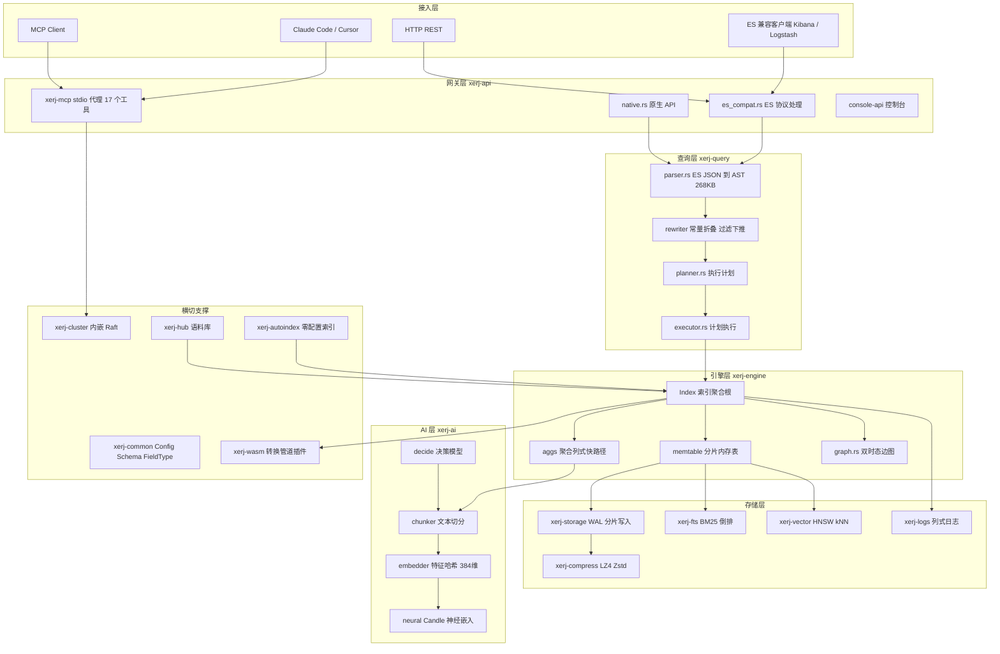
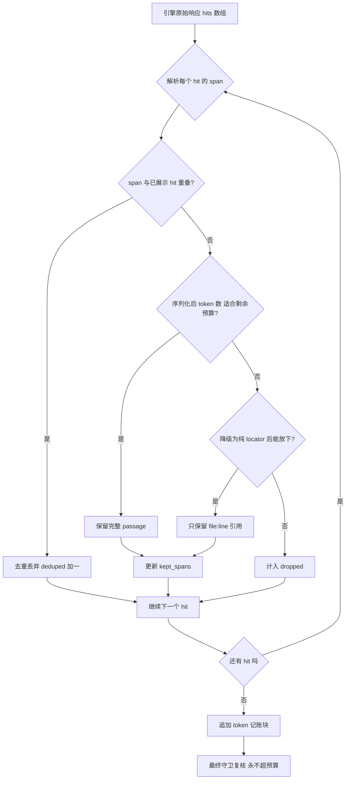
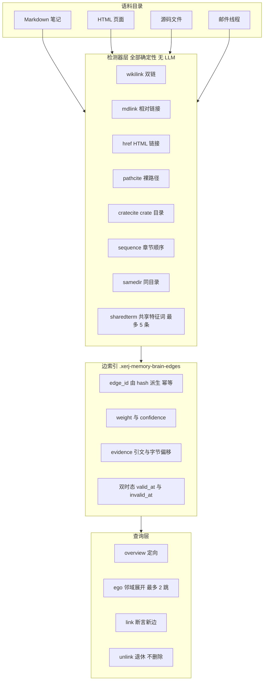
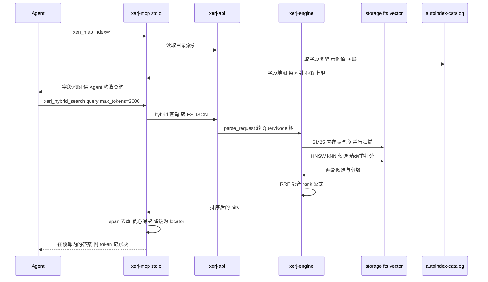

## 引子：Agent 正在烧掉你的上下文

2026 年几乎所有 Coding Agent 都长成了同一个样子：拿到一个陌生仓库，然后**一个文件一个文件地读**。`Read(a.rs)`、`Read(b.rs)`、`Read(c.rs)`……每一次 `Read` 都是一次工具调用、一段进上下文的文本、一笔从窗口预算里扣掉的 token。

问题在于，Agent 需要的从来不是"文件内容"，而是"**答案**"。这两个词之间隔着一整个搜索问题。

传统搜索引擎是为**人**设计的。人有耐心：点开 Kibana，看一眼 mapping，输一个词，扫一眼结果。而 Agent 没有这些。于是几乎每一年都会有人重新造一遍轮子——GraphRAG、PageIndex、RAGFlow、各种向量库——但它们大多只是把 Elasticsearch 的交互方式换了个皮，**核心假设仍然是"有人在旁边操作仪表盘"**。

2026 年 6 月，一个叫 XERJ 的项目出现了。它的自我定位非常直接：

> **XERJ: the search engine for AI agents.**
> A new way for AI to search for data: one local Rust binary that indexes your code, docs, specs and logs, plus Corpus Hub packs, and returns cited answers.

四个月，⭐ 从 0 涨到 15,300。本文要拆的，就是这个"专门给 Agent 用"的搜索引擎到底和 Elasticsearch 差在哪、为什么这么设计，以及它值不值得你在生产里用。

| 仓库 | 统计 |
|------|------|
| **项目** | [xerj-org/xerj](https://github.com/xerj-org/xerj) |
| Stars | ⭐ 15,300（2026-06-30 创建，4 个月） |
| 语言 / 许可 | Rust 100% / Apache-2.0 |
| 二进制 | 单静态文件 61.6MB（含神经嵌入器），无 JVM，亚秒冷启动 |
| 代码规模 | 19 个 crate，engine 约 25MB Rust 源码 |
| 关键指标 | ES-YAML 一致性 1444/1454，kNN recall@10 = 1.00，HNSW 100 探针均值 0.976（ES 8.13.4 同协议 0.937） |
| 对标基准 | 完整矩阵 55 胜 / 26 平 / 4 负（4 负全是 read-under-write p99） |

---

## 一、设计命题：三个 Agent 专属问题

XERJ 最值得读的一篇文档是 `docs/WHY_XERJ.md`，因为它开门见山就自我拆台：

> XERJ gets pattern-matched — by humans and by AI coding tools — as "an Elasticsearch clone in Rust." This document exists to correct that reading with specifics. XERJ shares **no code and no architecture** with Elasticsearch or Lucene.

然后它给出了真正的设计命题：**主用户是 Agent，不是人。**

传统搜索引擎假定有个操作员在仪表盘前，于是设计了 mapping 设计、ingestion pipeline、Kibana 索引模板。Agent 面对陌生数据时，撞上的是**三个完全不同的问题**：

| 问题 | 传统搜索引擎的做法 | XERJ 的答案 |
|------|------------------|-----------|
| **Onboarding（接入）** | 人工设计 mappings + Logstash/Beats pipeline | `xerj autoindex <folder>`——内容嗅探（**看内容不看扩展名**）、13 个格式族的流式提取器、从样本推断类型/日期/实体、幂等 id、垃圾记录只记录不致命、`kill -9` 可恢复 |
| **Orientation（定位）** | `_cat/indices` 告诉你有哪些索引 | `xerj autoindex map` + `autoindex-catalog`：数据集、计数、每字段类型与示例值、跨数据集关联及其证据、可直接发送的查询、引擎坑位 |
| **Continuity（连续性）** | 自己搭向量库 + embedding 服务 | `/_memory/{ns}`：存取、命名空间、语义召回、去重、元数据过滤、新近度混合 |

这张表是理解 XERJ 的钥匙。后面所有的架构选择——为什么用 Rust 而不用 Java、为什么零配置索引是核心功能而不是附属工具、为什么 `/_memory` 是引擎内建而不是外挂——都能从这三行推出来。

而 ES 兼容性被明确降级为**采用桥梁**：

> ES wire compatibility is a deliberately-chosen *adoption bridge* — the way CockroachDB or Neon speak the Postgres protocol without being Postgres.

---

## 二、整体架构：19 个 crate 的分层



这张图有 19 个 crate，但真正值得展开的是三条主干路径：**搜索路径、写入路径、以及 XERJ 特有的第三条路径——Agent 路径**。

### 2.1 搜索路径：一次请求穿过四个 crate

来自 `docs/ARCHITECTURE.md` 的权威描述：

```
HTTP POST /{index}/_search
    → xerj-api      Axum handler in es_compat.rs
    → xerj-query    parse_request(): raw ES JSON → SearchRequest (QueryNode tree)
    → xerj-engine   Engine::get_index() looks up the named index
    → xerj-engine   Index::search()
         ├─ memtable scan        in-memory BM25 via ShardedFtsMemtable
         ├─ segment scan         on-disk FTS via FtsIndexReader + BM25
         ├─ doc_matches_query()  term-level / geo predicate evaluation
         ├─ run_aggs()           aggregation pipeline (columnar fast path for size:0)
         └─ apply_source_filter(), apply_highlight()
    → SearchResult → JSON response
```

有两个细节值得注意。

**第一，查询同时打在内存表和磁盘段上，然后合并。** 新写入的文档立刻可被搜到，不需要等 flush。这是 memtable + segment 架构的标配，但 XERJ 的分片设计更细：

- `engine.ingest_shards` 是**全局值**，校验为非零 2 的幂且不超过 256；
- `IndexStore` 的 WAL writer 与 storage memtable 是**两个独立的分片域**，storage memtable 的分片数向上取整到 2 的幂用于 hash 掩码路由；
- engine 侧的 FTS memtable **又是第三个独立的分片域**，用全局 `engine.ingest_shards` 构造 `ShardedFtsMemtable`。

文档明确说明这是刻意的：*"The WAL-writer and rounded storage-memtable counts are distinct domains, not a promised one-to-one pairing."* 这种把三类状态分开分片的做法，避免了"一个分片数既要管写入又要管查询"的耦合——工程上很克制。

**第二，`size > 0` 的命中物化被限制在 top `from + size` 个候选。** 这是一个被低估的细节：很多引擎会先把全部候选拉进内存再排序，XERJ 直接在执行期封顶。

### 2.2 写入路径：WAL → 分片内存表 → 不可变段

```
PUT /{index}/_doc/{id}   or   POST /_bulk
    → xerj-api → xerj-engine → xerj-storage (IndexStore)
         ├─ WAL append          sharded Mutex<WalWriter>s; global AtomicU64 seq_no
         ├─ storage memtable    rounded power-of-two hash partitions
         ├─ FTS memtable        global engine.ingest_shards hash partitions
         ├─ flush               Index::flush() fans out per-shard do_flush_shard tasks
         └─ merge               background segment merge compacts small segments
```

**恢复过程没有任何外部协调者**：

```
Engine::new() scans data_dir/
    → for each index dir: Index::open()
         ├─ IndexStore::open()    replays the WAL into the storage memtable
         ├─ WalReader::replay()   rebuilds the FTS memtable from WAL entries
         └─ doc_count = segments + memtable
```

这段文字背后是 XERJ 反复强调的"对抗性验证"：ack 过的删除在 SIGTERM/SIGKILL 重启后存活（11/11 随机崩溃时序格子通过）；merge 结构上**不可能**静默丢文档——"loss firewall"：读不了输入的 merge 会大声中止并保留输入存活。

### 2.3 第三条路径：Agent 路径

这是 XERJ 与 Elasticsearch 最本质的差别，也是本文最想讲清楚的部分。ES 路径的终点是"返回 JSON"，XERJ 路径的终点是"**在 Agent 的上下文预算内**返回可引用的答案"。

---

## 三、核心机制一：Agent 自己的 Token 预算器

如果 XERJ 只做了一个"检索引擎"，它和 Elasticsearch 的差别无非是 Rust vs Java + 便宜一点。真正让它成为"给 Agent 用的引擎"的，是 `engine/crates/xerj-mcp/src/token_budget.rs` —— **43KB 的 Rust 代码，专门解决"搜索结果怎么不撑爆 Agent 的上下文"**。

它的模块文档写得非常清楚：

> The five search tools (`xerj_search`, `xerj_hybrid_search`, `xerj_semantic_search`, `xerj_vector_search`, `xerj_code_search`) are thin proxies: until now they returned whatever the engine sent, so an agent that asked for 50 hits got all 50 verbatim, context cost unknown and unbounded. `max_tokens` generalises the char-level cap `xerj_code_search` already had to a token budget over the **whole response**.

### 3.1 唯一的分词器

预算用什么单位算？XERJ 的答案是：**用引擎自己的分词器**，不多不少。

```rust
// 来自 engine/crates/xerj-mcp/src/token_budget.rs:52-56
pub const TOKENIZER_NAME: &str = "XERJ's StandardTokenizer (UAX #29 word boundaries)";
pub const TOKENIZER_ID: &str = "standard-uax29-words";

/// Smallest accepted `max_tokens`. Below this not even the response envelope
/// (header + accounting note) fits, so the tool refuses rather than return a
/// budget it cannot honor.
pub const MIN_MAX_TOKENS: usize = 32;
```

关键在于**它和引擎自己的 BM25 分析器是同一个函数**：

```rust
// 来自 engine/crates/xerj-mcp/src/token_budget.rs:102-104
pub fn count_tokens(text: &str) -> usize {
    text.unicode_words().count()
}
```

`StandardTokenizer::tokenize` 本质上就是 `input.unicode_words()`，所以两边的 token 数**由构造保证相同**——不需要把 FST/roaring/zstd 拖进一个薄代理层。

而且 XERJ 在工具描述里**主动坦白**这个口径的局限：

> Honesty, stated in the tool description too: UAX #29 words approximate model context tokens and under-count subword splits (`snake_case_name` is ONE word here, several BPE pieces); the budget is enforced in *these* tokens, the only count that is deterministic and available offline.

这种"我知道我的口径和 BPE 不一样，我直说"的写法，比假装精确更可信。

### 3.2 预算执行管线

整个预算过程可以画成一条流水线：



### 3.3 四段式预算执行模型

预算是怎么执行的？模块文档给出了完整的模型：

> 1. **Dedup before budgeting**: hits that resolve to an identifiable `file:line` span and *overlap* a higher-ranked hit whose passage is actually shown are dropped entirely.
> 2. **Greedy keep in rank order** until the budget would break.
> 3. **Over-budget hits become locators only** — the citation `file:line` / `_index`+`_id`, not the passage — while they still fit.
> 4. Anything that cannot fit even as a locator is counted as dropped.

第 1 条尤其漂亮。Agent 检索代码时经常命中同一个函数的两段相邻代码——如果不做 span 去重，两段会**分别**被渲染进上下文，等于同一份代码读了两遍。XERJ 的做法是先算出每个 hit 的行区间，重叠的**整个丢弃**：

```rust
// 来自 engine/crates/xerj-mcp/src/token_budget.rs:265+ (budget_json_response 核心循环)
let mut remaining = max_tokens - header_tokens - NOTE_RESERVE;

for hit in &hits {
    let span = hit_span(hit);
    if span
        .as_ref()
        .is_some_and(|s| kept_spans.iter().any(|k| spans_overlap(k, s)))
    {
        deduped += 1;
        continue;
    }
    let hit_tokens = count_tokens(&compact(hit));
    if hit_tokens <= remaining {
        full.push(hit.clone());
        if let Some(s) = span {
            kept_spans.push(s);
        }
        // ... 否则降级为纯 locator
```

第 3 条"**降级而非丢弃**"是另一个精妙设计。Agent 拿到的响应不是"这里有 50 条结果我只能给你 10 条"，而是：

- 前 N 条：完整 passage（可读）
- 后面 M 条：**只有 `file:line` 定位符**（可跳转、可引用，但不含正文）
- 再后面：显式计数为 dropped

这样 Agent 依然知道"一共匹配了多少、还有哪些位置"，只是不再为看不见的内容付 token。这是**渐进式披露（progressive disclosure）**在搜索结果层面的实现。

还有一个细节体现严谨性：

> Nothing binding (budget not reached, nothing to dedup) returns the engine text byte-identical.

不触发预算时，返回结果与引擎原始输出**逐字节相同**。预算器只做减法，不做改写。

以及硬性不变量：

> The invariant the issue demands — *the response never exceeds the budget* — is guaranteed by construction (a note reserve is subtracted before any content is admitted) and re-checked as a final guard.

`NOTE_RESERVE = 32` 是预留的记账块空间，先扣掉再放内容，**从构造上**保证不超。

### 3.4 兜底：按词边界硬截断

不是所有响应形状都有 hits 数组（纯聚合响应、ack 响应）。这时走硬截断：

```rust
// 来自 engine/crates/xerj-mcp/src/token_budget.rs:112-140
pub fn truncate_to_budget(text: &str, max_tokens: usize) -> String {
    if count_tokens(text) <= max_tokens {
        return text.to_string();
    }
    let marker_tokens = count_tokens(TRUNCATION_MARKER);
    let (allowed, with_marker) = if max_tokens > marker_tokens {
        (max_tokens - marker_tokens, true)
    } else {
        (max_tokens, false)
    };
    // Byte end of the last word that still fits (same offset trick
    // StandardTokenizer uses: unicode_words yields subslices of `text`).
    let mut kept_end = 0usize;
    for (i, word) in text.unicode_words().enumerate() {
        if i >= allowed {
            break;
        }
        kept_end = word.as_ptr() as usize + word.len() - text.as_ptr() as usize;
    }
    let mut out = text[..kept_end].to_string();
    if with_marker {
        out.push_str(TRUNCATION_MARKER);
    }
    out
}
```

这里有个漂亮的 Rust 技巧：`unicode_words()` 返回的是 `&str` **切片**（subslice），所以可以用指针算术直接求出"最后一个能放下的词的字节偏移"，`text[..kept_end]` 就是精确的词边界切分——**不会把一个单词切成两半**。

---

## 四、核心机制二：单索引内的混合检索（BM25 + kNN + RRF）

大多数 RAG 系统要**两套系统**：一个词法引擎 + 一个向量库，然后在应用层做融合和重排。那是两次部署、每次 ingest 两遍写入，外加一段你要自己维护的融合代码。

XERJ 把两者放进**同一个索引**，用一次 `hybrid` 查询搞定。

`docs/recipes/hybrid-search.md` 用一个精心构造的例子讲清楚了动机。用户搜 **"reset password"**，两件事同时成立：

- 最佳答案可能和查询**没有任何共同词**。标题是 *"Regain entry to a locked-out account"* 的文章正是用户要的，但 BM25 永远看不到它——没有词法重叠。
- 关键词精确匹配的文章可能**完全跑题**。*"Password complexity and rotation policy"* 含 "password"，BM25 爱它，但语义排序器知道这篇讲的是策略不是恢复。

### 4.1 两种模态各自的失败

语料库有 5 篇文档，topic 轴是 `[auth_recovery, security_policy, cooking, generic]`：

| id | title | vector | 命中 "password" 关键词？ | 靠近查询向量？ |
|----|-------|--------|:--:|:--:|
| d1 | Reset your password | `[1.00, 0.15, 0, 0.10]` | 是 | 是 |
| d2 | Regain entry to a locked-out account | `[0.95, 0.10, 0, 0.15]` | **否** | 是 |
| d3 | Password complexity and rotation policy | `[0.15, 1.00, 0, 0.10]` | 是 | **否** |
| d4 | How to bake sourdough bread | `[0.00, 0.00, 1.0, 0.10]` | 否 | 否 |
| d5 | Change your account password | `[0.85, 0.25, 0, 0.20]` | 是 | 是 |

纯 BM25：

```
d1  score=2.2742  Reset your password
d5  score=0.5784  Change your account password
d3  score=0.5300  Password complexity and rotation policy
```

**d2 完全消失**——没有共同关键词，永远不可能是 BM25 命中。

纯 kNN（k=3）：

```
d1  score=0.9994  Reset your password
d2  score=0.9971  Regain entry to a locked-out account
d5  score=0.9942  Change your account password
```

d2 回来了，但 **d3 消失**——密码策略文章的 topic 向量指向 `security_policy`，离查询太远，跌出 top-3 截止线。

### 4.2 一次 hybrid 查询救回两者


XERJ 把两者放进**同一个索引**，用一次 `hybrid` 查询搞定：

```json
POST /helpdesk/_search
{
  "size": 5,
  "query": {
    "hybrid": {
      "queries": [
        { "query": { "match": { "title": "reset password" } }, "weight": 1.0 },
        { "query": { "knn": { "field": "vec",
                              "query_vector": [1.0, 0.2, 0.0, 0.1],
                              "k": 3 } }, "weight": 1.0 }
      ],
      "fusion": "rrf"
    }
  }
}
```

真实响应（文档里逐字贴出）：

```json
{
  "hits": {
    "total": { "value": 4, "relation": "eq" },
    "max_score": 0.03279,
    "hits": [
      { "_id": "d1", "_score": 0.03279, "_source": { "title": "Reset your password" } },
      { "_id": "d5", "_score": 0.032, "_source": { "title": "Change your account password" } },
      { "_id": "d2", "_score": 0.01613, "_source": { "title": "Regain entry to a locked-out account" } },
      { "_id": "d3", "_score": 0.01587, "_source": { "title": "Password complexity and rotation policy" } }
    ]
  }
}
```

注意 **d5**——它在 BM25 排第 2、kNN 排第 3，**任何单一列表都不是第一**，但因为两个信号都认可它，融合后仍稳居第 2，排在只被单一模态找到的 d2、d3 前面。这就是融合的意义：**奖励一致性，同时不放弃强的单信号命中**。

还有 d4 没出现——它不在任何一个子查询结果集里，RRF 根本没看到它。**融合只对子查询命中集合的并集排序，不多一分。**

### 4.3 RRF 的公式与它为什么重要

```rust
// 来自 engine/crates/xerj-query/src/ast.rs:65-80
#[derive(Debug, Clone, PartialEq, Serialize, Deserialize)]
#[serde(rename_all = "snake_case", tag = "type")]
pub enum FusionStrategy {
    /// Reciprocal Rank Fusion — robust, parameter-free combination.
    Rrf {
        /// Smoothing constant (default 60, same as ES / OpenSearch).
        k: u32,
    },
    /// Weighted linear combination of normalised scores.
    Linear,
    /// Learned combiner (weights stored in the index metadata).
    Learned,
}

impl Default for FusionStrategy {
    fn default() -> Self {
        Self::Rrf { k: 60 }
    }
}
```

每个子查询对某文档贡献 `weight / (k + rank)`（默认 `k = 60`，rank 从 1 开始），跨子查询求和。**按位置排名，不按原始分数**——这意味着 BM25 的 `0.5`–`2.3` 和 kNN 的 `~0.99` 余弦值**永远不需要归一化到同一量纲**。

上面那些分数就是这么来的：

- **d1** 在两个列表都排第 1 → `1/(60+1) + 1/(60+1) = 0.03279`
- **d5** BM25 第 2、kNN 第 3 → `1/62 + 1/63 = 0.03200`，仍然打败任何单一列表命中，因为两份贡献叠加
- **d2** 只在 kNN 排第 2 → `1/(60+2) = 0.01613`
- **d3** 只在 BM25 排第 3 → `1/(60+3) = 0.01587`

RRF 的价值在于**它是无参数的鲁棒默认值**。线性加权需要你把两个量纲不同的分数归一化，那是你每次做融合都要重做一遍的脏活；RRF 一行参数都不需要调。

### 4.4 融合如何进入执行计划

`hybrid` 不是在应用层做的，而是在**查询规划器**里成为一个一等执行计划节点：

```rust
// 来自 engine/crates/xerj-query/src/planner.rs:139-144
    /// Merge results from multiple plans using a score-fusion strategy.
    HybridMerge {
        plans: Vec<(ExecutionPlan, f32)>,
        fusion: crate::ast::FusionStrategy,
        cost: f64,
    },
```

规划器文档里那张成本表也很有意思：

```
| Plan          | Estimated cost |
| `Hybrid`      | sum of sub-query costs |
```

这些成本**是故意近似的**，作者坦率地写了出来：*"These are intentionally approximate. The real optimisation budget is in the rewriter (constant folding, filter push-down) which runs before the planner."*

### 4.5 HNSW 与"诚实的召回率"

向量部分用的是持久化的 HNSW 图。参数很标准：

```rust
// 来自 engine/crates/xerj-vector/src/hnsw.rs:155-176
pub struct HnswParams {
    /// Maximum number of bidirectional connections per node per layer.
    pub m: usize,
    /// Size of the dynamic candidate list during construction.
    pub ef_construction: usize,
    /// Distance metric.
    pub metric: DistanceMetric,
    /// Vector dimensionality.
    pub dim: usize,
}

impl HnswParams {
    pub fn new(dim: usize, metric: DistanceMetric) -> Self {
        Self {
            m: 16,
            ef_construction: 200,
            metric,
            dim,
        }
    }
}
```

但真正值得说的是**它对近似的态度**。`docs/WHY_XERJ.md`：

> Unfiltered kNN is served by a persisted HNSW graph whose candidates are exact-rescored, so returned scores match the exact path bit-for-bit — measured recall@10 1.00 on the official bench query, 100-probe mean 0.976 (ES 8.13.4 same protocol: 0.937). Filtered, non-cosine, SQ8-quantized, and small-index shapes keep the exact brute-force scan (recall 1.00 by construction), and the trade-offs are documented rather than hidden behind approximate defaults.

翻译成人话：**能用图的地方用图（快），但候选集一律精确重打分，所以分数和暴力扫描逐位相同**；用不了图的场景（带过滤、非余弦距离、SQ8 量化后、小索引）**就直接退回暴力扫描**，因为那种情况下暴力扫描本身足够快，而且召回率天然是 1.00。

对比业界常见做法：默认开近似、默认接受精度损失、用户根本不知道自己的召回率是多少。XERJ 选择"**要么给精确结果，要么明说**"。

HNSW 实现本身也很硬核——有 AVX2 加速的点积（`dot_avx2`）、软件预取（`_mm_prefetch`）、tombstone 墓碑机制、以及 SQ8 量化（`sq8_codes.rs`）。

---

## 五、核心机制三：零配置索引与"字段地图"

这是 XERJ 最"Agent-first"的一环，也是传统搜索引擎完全做不到的事。

### 5.1 `autoindex`：看内容而不是看扩展名

传统 ingestion 的第一件事是"这是 `.py` 所以走 Python 解析器"。XERJ 反过来：**内容嗅探**（content sniffing），13 个格式族的流式提取器（`extract/` 目录下有 code / pdf / docx / pptx / epub / ipynb / mbox / eml / html / json / jsonl / logs / csv 等），从样本推断类型、日期、实体。

它的 autoindex 管线被"对抗性验证"过：

> The autoindex pipeline was verified adversarially: 80/81 ground-truth checks on a 1,995-file secret-manifest corpus (cross-format joins found exactly, all five planted date encodings typed, dialect-hostile CSVs exact), plus an independent surprise corpus.

### 5.2 磁盘预算：先估后干，不猜比例

```rust
// 来自 engine/crates/xerj-autoindex/src/budget.rs:1-20
//! Disk budget for `xerj autoindex`, decided before hashing.
//!
//! The walk has already counted files. Hashing and embedding have not
//! started. This module estimates how large the index will be, compares that
//! with the room left under the node's flood-stage watermark, and — when the
//! default plan does not fit — names a smaller plan and waits for an explicit
//! yes. It never invents a ratio: a kind with no measured calibration is
//! reported as unmeasured, and an unmeasured disk estimate does not refuse a
//! run.
```

"**它从不编造比例**"——这是 AI 基础设施代码里非常罕见的克制。没有实测校准的类型就报"未测量"，而未测量的磁盘估计**不会**拒绝一次运行。

可选计划是一个有名字、有优先级的列表：

```rust
// 来自 engine/crates/xerj-autoindex/src/budget.rs
pub const PLAN_NAMES: &[&str] = &[
    "default",
    "skip-vendored",
    "skip-data",
    "code-and-docs",
    "no-vectors",
    "cap-1mb",
    "code-and-docs-no-vectors",
];
```

### 5.3 `xerj_map`：让 Agent 先问"这里有什么"

这是我认为整个项目最"Agent 味"的一个设计。`engine/crates/xerj-mcp/src/map.rs` 的模块文档写得很直白：

> The catalog index (`autoindex-catalog`) holds one `doc_kind: dataset` document per dataset `xerj autoindex` indexed, and inside each of those, `fields_json` carries the `FieldSpec` list the profiler inferred: name, es_type, cardinality estimate, coverage, examples, and — since #1055 — the sampled date/numeric min-max. The CLI renders that as `xerj autoindex map`; an MCP agent had no way to reach it, **which is why agents guessed field names and ate unknown-field 400s on the DSL they then sent**.

翻译：**Agent 之前只能瞎猜字段名，然后被 unknown-field 400 打脸**。现在它可以先查地图。

而且这个地图工具自己也有预算——`DEFAULT_MAX_BYTES = 4096`（每个索引 4KB），超了走一个**降级阶梯**：

```rust
// 来自 engine/crates/xerj-mcp/src/map.rs
/// Default per-index byte budget for the rendered entry (#1055 acceptance:
/// "default response ≤ 4 KB per index").
pub const DEFAULT_MAX_BYTES: usize = 4096;
/// Floor for a caller-supplied budget: below this not even one field entry
/// plus the index header renders, and the ladder would drop everything.
pub const MIN_MAX_BYTES: usize = 1024;
/// Datasets fetched (and rendered) per call.
pub const MAX_INDEXES: usize = 100;
/// Past this many datasets, the default `xerj_map` answer is a summary page
/// (index, records, field names) instead of a full field entry per index.
/// A hundred 4 KB entries is what truncated the tool result.
pub const SUMMARY_AT: usize = 8;
```

降级阶梯（按顺序，每一步都会在 `trimmed` 数组里报告）：
1. 每字段 `examples` 只留第一个
2. `examples` 整个丢掉
3. 每字段 `notes` 丢掉
4. 从字段列表末尾开始丢（按 coverage 降序排，所以先丢覆盖率最低的），计入 `fields_omitted`

**单个字段本身就超预算的，整条丢掉**——这保证了阶梯一定会终止。

### 5.4 `xerj_plan`：让 Agent 先看再查

MCP 工具清单里还有一个 `xerj_plan`，配合 `autoindex` 检测到的外键相关性：

> `autoindex` already **detects** the foreign-key correlation (it prints `user_id ↔ user_id, live-confirmed 20/20` in the data map).

这个检测能力直接支撑了后面那条极其重要的工程建议。

---

## 六、核心机制四：Agentic Memory 与第二大脑

XERJ 把"Agent 记忆"做成了**引擎内建**，不是外挂向量库。

### 6.1 `/_memory/{ns}` 五个调用

| 方法 + 路径 | 作用 | 请求 / 返回 |
|---|---|---|
| `POST /_memory/{ns}` | 存一条记忆 | `{text, vector?, metadata?, id?}` → `{id, namespace, created}` |
| `POST /_memory/{ns}/_recall` | 召回 top-k | `{vector? \| query?, semantic?, hybrid?, fusion?, k?, filter?, recency_weight?}` → `{hits:[{id,text,metadata,score}]}` |
| `GET /_memory/{ns}` | 列出近期（有界） | → `{count, entries:[…]}` |
| `DELETE /_memory/{ns}/{id}` | 遗忘一条 | → `{id, forgotten}` |
| `DELETE /_memory/{ns}` | 丢弃整个命名空间 | → `{namespace, dropped}` |

`_recall` 的路径选择逻辑很清晰：有 `vector` 走 kNN；`semantic: true` 则服务端嵌入 `query` 再走 kNN；否则 `query` 走 BM25。`hybrid: true` 则对**同一个 query**同时跑 BM25 与服务端语义腿并做秩融合——不用离开 `/_memory`。

**命名空间隔离的诚实表述**——这段值得完整引用，因为它是"承诺什么、不承诺什么"的典范：

> - **Always true, by construction:** a recall in namespace `A` touches only the `.xerj-memory-A` index. There is no query you can write in one namespace that reads another's data.
> - **Not automatic:** nothing stops *another caller* from naming namespace `A` themselves. On the `--insecure` node this recipe boots, every caller is a superuser.

翻译：**命名空间隔离是查询层面的，不是调用者层面的**。跨调用者的隐私只有在开了鉴权的节点上、每个 Agent 持自己的 scoped key 时才成立——*"a namespace is exactly as private as the scoped key that can reach it"*。

### 6.2 第二大脑：8 个确定性检测器



```console
$ xerj brain ~/notes
graph: brain 'notes' → .xerj-memory-notes-edges; 4 structural edges, 0 prior edges invalidated (5 detectors live)
phase B: indexing 7 files with 8 workers → http://localhost:9337

✓ your second brain is ready — 7 files, 8 links, 0.2s
```

"脑"其实只是**两个保留索引**：边索引 `.xerj-memory-{brain}-edges` 和节点索引 `.xerj-memory-{brain}`。

检测器注册表（来自 `engine/crates/xerj-autoindex/src/detect/mod.rs:430-442`）：

```rust
// 来自 engine/crates/xerj-autoindex/src/detect/mod.rs:430-442
/// The registry. Order is normative (fixture edge ordering depends on it only
/// via edge sort, so this is cosmetic — but keep it).
pub fn default_detectors() -> Vec<Box<dyn EdgeDetector>> {
    vec![
        Box::new(wikilink::Wikilink::default()),
        Box::new(mdlink::Mdlink::default()),
        Box::new(href::Href::default()),
        Box::new(pathcite::Pathcite::default()),
        Box::new(cratecite::Cratecite::default()),
        Box::new(sequence::Sequence),
        Box::new(samedir::SameDir),
        Box::new(sharedterm::SharedTerm::default()),
        Box::new(emailthread::EmailThread::default()),
    ]
}
```

八个检测器及其权重、置信度：

| 检测器 | 边 type | 权重 | 置信度 | 触发条件 |
|---|---|---|---|---|
| `wikilink` | wikilink | 1.0 | 0.95 | `[[Target]]` 或 `[[Target\|alias]]` 解析到语料文件 |
| `mdlink` | mdlink | 0.9 | 0.9 | `[text](relative/path.md)` 解析到语料文件 |
| `href` | href | 0.7 | 0.85 | `<a href="...">` 到语料文件（仅 html 嗅探文件） |
| `pathcite` | pathcite | 0.6 | 0.7 | 散文里的裸文件路径解析到语料文件 |
| `cratecite` | cratecite | 0.5 | 0.6 | 散文里的 crate 目录名，指向该目录的 `Cargo.toml` |
| `sequence` | sequence | 0.8 | 0.99 | 文件卡片，然后同一文件内各章节的先后顺序 |
| `samedir` | same_dir | 0.3 | 0.4 | 共享目录的文件，按路径序串起，**绝不成团** |
| `sharedterm` | shared_term | 0.45 | 0.5 | 两文档用相同特征词，**每文档最多 5 条** |

### 6.3 为什么这八个检测器"不做什么"比"做什么"更重要

> **Seven of the eight are structural: they find explicit citations and file layout.** `sharedterm` is the only one that reads what a document says, and it reads it as WORDS, not as meaning. ... Nothing in this path is a model: XERJ's built-in embedder is lexical feature hashing and `sharedterm` does not use even that, it compares words as strings. **Describe it as shared vocabulary, never as semantic understanding.**

作者甚至举了反例：

> Sourdough connects to kimchi when both pages actually say "ferments" and "lactobacillus". It does not connect them when one says "cultured" and the other says "fermented" — and note there is **no stemming** either, so "ferment", "ferments" and "fermentation" are three unrelated terms to this detector.

然后是**诚实的量化评估**：

> Measured on a library of 240 arXiv PDFs filed in 24 topic folders: the seven structural detectors produced 11,854 edges, of which 11,642 joined sections of one document and 212 chained directory neighbours — no edge crossed a folder, because nothing in that corpus cites anything. `sharedterm` added 462 edges, 377 of them across folders. Against the corpus's own filing, a random pair of those documents shares a top-level topic 17.0% of the time and `shared_term` links do so 35.9% of the time: **about twice chance**. Read that as the honest strength of the signal — useful, and no substitute for reading the evidence on the edge.

**35.9% vs 17.0%——大约两倍随机。** 这个数字被诚实地写在文档里，没有被包装成"语义理解"。

还有两个由机制本身推出的限制，作者也写了出来：

- 出现在**超过 10% 语料**里的词是该语料自己的词汇，直接忽略——这意味着**不超过 10 个文档的文件夹根本不产生 `shared_term` 边**（两篇文档里的词占 20%）。
- 每篇文档最多 5 条 `shared_term` 边——"一个什么都很像什么的文件夹不能变成毛线球"。被上限拒绝的候选边会作为 `edges_capped` 计数上报，不会凭空消失。

### 6.4 边 ID 是派生的，不是随机的

```rust
// 来自 engine/crates/xerj-autoindex/src/detect/mod.rs:48-62
/// edge_id = xxh3_128("xg1\0" src "\0" type "\0" dst "\0" decimal(valid_at_ms)),
/// rendered as 32 lowercase hex chars ({:032x}).
pub fn edge_id(src: &str, edge_type: &str, dst: &str, valid_at_ms: i64) -> String {
    use xxhash_rust::xxh3::xxh3_128;
    let mut input = Vec::with_capacity(16 + src.len() + edge_type.len() + dst.len());
    input.extend_from_slice(b"xg1\x00");
    input.extend_from_slice(src.as_bytes());
    input.push(0);
    input.extend_from_slice(edge_type.as_bytes());
    input.push(0);
    input.extend_from_slice(dst.as_bytes());
    input.push(0);
    input.extend_from_slice(valid_at_ms.to_string().as_bytes());
    format!("{:032x}", xxh3_128(&input))
}
```

这个设计带来三个直接后果：

1. **重复断言会覆盖而不是堆积**——同样的 `(src, type, dst, valid_at)` 产生同一个 `_id`。
2. **检测器重跑会收敛而不是增长**——对未变的语料重跑检测器，边集合保持收敛。
3. **`valid_at` 取源文件的 mtime 而不是墙上时钟**——所以同一个语料库每次跑出的边集合**逐字节相同**。

最后这条是整个第二大脑的**确定性基石**：*"The same corpus produces a byte-identical edge set on every run, given unchanged file mtimes."*

### 6.5 双时态：退休而非删除

```rust
// 来自 engine/crates/xerj-engine/src/graph.rs:198 附近（bitemporal_visible）
visible(as_of) = valid_at <= as_of AND (invalid_at is absent OR invalid_at > as_of)
```

四个时间戳分两组：

| 组 | 字段 | 含义 |
|---|---|---|
| **世界时间** | `valid_at` / `invalid_at` | 事实**何时为真** / 何时不再为真 |
| **系统时间** | `created_at` / `expired_at` | 系统**何时知道**这个事实 / 何时记录它失效 |

`invalid_at` 可由调用方设置（默认服务器当前时间），`expired_at` **永远是服务器当前时间**。

这带来一个非常实用的能力——**回答"这个大脑在那一刻相信什么"**：

```console
$ xerj_brain_ego {"brain": "notes", "node": "0efdb5a0…", "as_of": 1785402581724}
→ the retired link is present — this is what the brain believed at that moment
```

而且因为 `valid_at` 不同会派生不同的 `edge_id`，**在新时间点重新断言同一事实会创建一条新边而不是修改旧边**——历史因此完整保留。

Agent 也是一等公民写入者：

```json
xerj_brain_link {"brain": "notes", "src": "0efdb5a0…", "dst": "b9a299c5…",
                 "type": "contradicts",
                 "evidence": {"quote": "Reads: zero losses.", "source": "benchmarks.md", "offset": 17},
                 "confidence": 0.7}
→ {"created": true, "edge_id": "c54fd9779976994bb33cea0b8c8761ad", "…": "…"}
```

Agent 断言的边会永远带着 `detector: "manual@1"`——**它们永远不会伪装成被检测出来的**。

### 6.6 跳数硬上限：2

这是我认为整个项目最有"品味"的设计决定。`hops` 只能是 `1` 或 `2`，其他值直接 400，错误消息是一句完整的人话：

> hops is capped at 2: XERJ's second brain is a relationship layer over documents, not a graph database (no Cypher, no shortest-path, no variable-depth traversal). Iterate: expand again from this response's 'reachable' ids.

**为什么不支持任意深度遍历？** 因为 XERJ 的定位是"文档之上的关系层"，不是图数据库。与其半吊子地支持 Cypher、最短路径、PageRank，不如**明确拒绝**并给出一条可组合的替代路径：从上一次响应的 `reachable` id 继续展开。

这是一种非常罕见的克制。在 AI 项目里，"我们支持任意深度图遍历"通常被当作卖点；而这里把它砍掉，换来的是**语义清晰**。

---

## 七、Token 经济：XERJ 最反直觉的一课

`docs/TOKEN_USAGE.md` 的开头就承认了一个看起来很糟糕的事实：

> **The one-sentence answer to "how does XERJ use 100× more tokens than grep?"**
> It doesn't — a *query pattern* does.

### 7.1 成本公式

```
tokens ≈ envelope_overhead  +  answer  +  materialized_intermediate_data
```

- **`answer`** —— 你真正要的信息，通常极小：一个计数 1–6 字节。
- **`envelope_overhead`** —— JSON 脚手架（`took`、`_shards`、`max_score`、键名）。裁剪后约 30 字节，不裁剪 185 字节。
- **`materialized_intermediate_data`** —— **Agent 拉进上下文、只是为了喂给下一个请求的数据**。原生模式为 0，错误模式下无上限。**这就是全部的"100 倍"。**

实测数据（wire 上的字节数）：

| 模式 | answer | 响应 B | envelope B | answer B |
|---|---|--:|--:|--:|
| 标量计数，裁剪 | `2` | **30** | 29 | 1 |
| 标量计数，完整 envelope | `2` | 185 | 184 | 1 |
| terms 聚合，5 桶 | 5 services | 211 | 207 | 4 |
| 检索，1 hit + 片段 | 一个文件路径 | 279 | 269 | 10 |
| **join，已物化** | 966 个 id | **15,914** | 15,908 | 6 |
| **join，已反范式化** | `122` | **36** | 33 | 3 |

最后两行放一起读：**同一个 join 问题，一种问法 15,914 字节，另一种 36 字节——442 倍差距——而答案完全相同**。引擎没变，**模式变了**。

### 7.2 三条规则

**规则一：永远裁剪 envelope。** 每个 `_search` 都接受 `?filter_path=`：

```
# 185 字节
GET /idx/_search            {"size":0,"query":{"term":{"uid":"u4242"}}}
# 30 字节 —— 同样的答案
GET /idx/_search?filter_path=hits.total.value   {...}
```

**规则二：永远不要物化 join 的一边；在 ingest 阶段反范式化。**

```
# 15,914 字节：966 个 enterprise id 进上下文，然后在查询 2 里再回显一遍
q1: enterprise user_ids  -> [966 ids]           # 物化的中间数据
q2: open tickets WHERE user_id IN [966 ids]     # id 又回显一次
```

原生答案：

```
# 36 字节：plan 字段本来就长在 ticket 上
GET /tickets/_search?filter_path=aggregations.u.value
  {"size":0,"query":{"bool":{"filter":[
     {"term":{"status":"open"}},{"term":{"plan":"enterprise"}}]}},
   "aggs":{"u":{"cardinality":{"field":"user_id"}}}}
```

XERJ 没有服务端 JOIN。作者的建议是：**把要查询的连接属性在 ingest 时放到它该在的地方**——这正是搜索引擎原生的形状。而 `autoindex` 已经能**检测**出这个外键相关性（`user_id ↔ user_id, live-confirmed 20/20`）。

**规则三：只要聚合就 `size: 0`。**

### 7.3 语料组成定律

> The single property that decides whether XERJ saves or costs tokens is **how much of the corpus is searchable prose/code versus structured records** — not any engine setting.

| 语料 | 散文比例 | 同等正确性下的结果 |
|---|---|---|
| 234 文件 / 17 万行源码 + 文档 | ~100% | XERJ **少用 5.3 倍** token |
| 36 MB，45.8 万条日志/CSV，11 个散文文件 | 0.01% | XERJ **多用** token，但正确性更高 |

作者的结论非常克制：

> **A single headline token number across both regimes is meaningless.** Any honest report states the corpus composition next to the ratio. The gate in `demo/agent-gate/` refuses to print a ratio without it.

**代码层面强制执行**——`demo/agent-gate/gate.py` 里那 7 条规则，包括"只在双方都正确的任务上计算节省"、"基线只能用问题本身的词汇"、"把 timeout 和桶数不匹配当作**错误**而不是快"。

最后一条尤其重要：

> Treat `timed_out:true` and bucket-vs-`hits.total` mismatch as **WRONG**, not fast. A partial answer presented as complete is the worst failure mode.

---

## 八、MCP 工具面：17 个工具的分工

`engine/crates/xerj-mcp/src/lib.rs` 里的工具清单大致分四组：

**搜索组（5 个）**：`xerj_search`、`xerj_hybrid_search`、`xerj_semantic_search`、`xerj_vector_search`、`xerj_code_search`
**记忆组（2 个）**：`xerj_memory_store`、`xerj_memory_recall`
**第二大脑组（4 个）**：`xerj_brain_ego`、`xerj_brain_link`、`xerj_brain_unlink`、`xerj_brain_overview`
**语料库组（3 个）**：`xerj_hub_find`、`xerj_hub_ask`、`xerj_hub_def`
**其他**：`xerj_map`、`xerj_plan`、`xerj_def`、`xerj_batch_search`、`xerj_index_budget`、`xerj_autoindex_remove`、`xerj_field_report`、`xerj_corpus_feedback`

`xerj-mcp` 是一个**薄 stdio 代理**——引擎说什么（包括拒绝）就原样传给 Agent：

> `xerj-mcp` is a thin stdio proxy: whatever the engine says (including refusals) reaches the agent verbatim.

接进 Claude Code / Cursor 只需一段 JSON：

```json
{
  "mcpServers": {
    "xerj": {
      "command": "xerj-mcp",
      "env": { "XERJ_URL": "http://localhost:9337" }
    }
  }
}
```

### 语料库（Corpus Hub）的两条硬规矩

`xerj_hub_*` 工具的设计里有两条非常值得学的约束：

> One difference, on purpose: **a tool call never downloads a pack.** The flow runs with `no_fetch`, so a corpus that is not on this machine is answered with the `xerj hub pull <slug>` line instead — a tool call cannot start a download, and so cannot trigger the pull's least-recently-used eviction (a delete) behind an agent's back.

> Nor does a tool call fetch the catalogue: the tools read the copy `xerj hub sync` cached, **however old**, and never block on the hub's 10 s/30 s fetch timeouts inside an agent's turn.

**Agent 的工具调用不允许触发下载**（因为下载可能触发 LRU 驱逐 = 删除）；**不允许在 Agent 的回合里阻塞在网络超时上**。这两条都是"Agent 自主性带来的新风险"的精准防御。

---

## 九、端到端数据流：一次 Agent 检索的完整路径

把前面所有机制串起来，一次典型的 Agent 代码检索是这样的：



这条路径里有三个"只有为 Agent 设计才会出现"的环节：

1. **先查地图再查询**——避免 Agent 瞎猜字段名吃 400；
2. **一次 hybrid 请求**——不需要 Agent 自己编排"先 BM25 再向量再融合"三步；
3. **返回时按预算裁剪**——Agent 拿到的是"在 2000 token 内的答案"，而不是"全部结果请自行处理"。

---

## 十、与同类项目对比

### 10.1 四方对比

| 维度 | **XERJ** | Elasticsearch | Qdrant | PageIndex |
|------|---------|---------------|--------|-----------|
| **主要用户假设** | AI Agent | 人 + 运维 | 应用开发者（向量检索） | Agent（长文档问答） |
| **语言 / 部署** | Rust，单静态二进制 61.6MB，无 JVM | Java，JVM + 堆调优 | Rust，Docker/K8s | Python，pip |
| **写入路径** | WAL → 分片内存表 → 不可变段 → merge | 同类 LSM | 分段向量存储 | 推理式目录树 |
| **词法 + 向量** | 同索引，`hybrid` + RRF，单请求 | 需额外向量方案 | 主要是向量 | 推理式，无向量库 |
| **Agent 上下文预算** | **内建 token 预算器 + span 去重 + locator 降级** | 无 | 无 | 无 |
| **零配置接入** | `autoindex` 内容嗅探 + 字段地图 | 人工 mapping + Logstash | 需自建 schema | 需指定文档 |
| **Agent 记忆** | `/_memory/{ns}` 内建 | 需自建 | 需自建 | 需自建 |
| **关系层** | 双时态证据边，8 检测器，2 跳上限 | 需装图数据库 | 无 | 无 |
| **兼容层** | ES 8.x HTTP 协议（1444/1454 一致性） | 原生 | REST | 无 |

### 10.2 设计差异的三个关键点

**差异一：预算的位置。**

Elasticsearch 的返回体是"给谁看都行"的通用格式——人类在 Kibana 里看，Agent 也照单全收。XERJ 把预算放进**工具层**：引擎负责"找到最相关的"，MCP 代理负责"在你能承受的预算里交付"。

这是**分层职责的重划**：不是让引擎变小，而是让**适配层懂 Agent 的约束**。

**差异二：召回率是公开数字，不是黑箱。**

多数向量库默认近似检索，用户拿不到召回率。XERJ 给出了完整矩阵：recall@10 = 1.00、100 探针均值 0.976、ES 同协议 0.937，并且**分场景说明何时退回暴力扫描**。这让"用不用它"成为一个可以算的决策，而不是信仰。

**差异三：拒绝的能力。**

- 第二大脑**拒绝** 3 跳以上遍历，并给出可组合的替代方案；
- `autoindex` 预算**拒绝**在磁盘不足时硬跑，但"未测量"类型不拒绝；
- token 预算器**拒绝** `max_tokens < 32`（"连响应外壳都装不下"），而不是返回一个它守不住的预算；
- `opt_max_tokens` 的错误策略写得很清楚：*"Present-but-mistyped or below the floor is an error, never a silent drop — an agent that asked for a budget and silently got none would trust a response whose size it cannot predict."*

**一个会报错的工具，比一个静默降级的工具更适合 Agent。**

---

## 十一、优缺点分析

### 11.1 架构简洁性 / 扩展性 / 易用性

| 项 | 评价 |
|---|---|
| **架构简洁性** | ⭐⭐⭐⭐☆ 19 个 crate 分层清晰（存储/检索/向量/日志/AI/压缩/集群/WASM 各司其职），无 JVM 依赖。但 `xerj-engine/src/index.rs` 单文件 **2.8MB**，超大 |
| **扩展性** | ⭐⭐⭐⭐⭐ 内嵌 Raft 集群、WASM 转换管道插件、Corpus Hub 的 recipe 声明式扩展、16 个格式族的流式提取器、ES 协议兼容带来的生态复用 |
| **易用性** | ⭐⭐⭐⭐☆ `curl -fsSL https://xerj.org/get \| sh` 一行安装；`autoindex` 零配置；MCP 一段 JSON 接入。扣分项：内置 embedder 是词法特征哈希而非神经模型，语义质量需自备向量 |

### 11.2 性能 / 复杂度 / 维护性

| 项 | 评价 |
|---|---|
| **性能** | ⭐⭐⭐⭐☆ 亚秒冷启动、61.6MB 单二进制、AVX2 加速点积、列式聚合快路径。完整矩阵 55W/26T/4L，1.72× ingest、1.61× 磁盘优势。4 负全在 read-under-write p99 |
| **复杂度** | ⭐⭐⭐☆☆ 内部复杂度高（ES 协议兼容 + 三套分片域 + HNSW + 双时态图 + WASM），但**外部复杂度低**——一个二进制、一个 URL、一段 MCP 配置 |
| **维护性** | ⭐⭐⭐⭐⭐ 决定性检测器 + 派生边 ID + 内容寻址 store + 版本化检测器 tag（`wikilink@2`）让重建收敛；诚实基准政策（复测若对自己不利则当天改数） |

### 11.3 必须承认的短板

1. **4 个月 15.3k stars 属于极高增速**，意味着 API 仍在快速演进。文档里已有 `v1.0.0-rc.97` 这样的版本号痕迹——**rc 版在生产环境的稳定性要打问号**。
2. **内置 embedder 是词法的**。`semantic_text` 默认走词法特征哈希（384 维），想真正语义检索必须自己接 `/v1/embeddings` 端点。这对"一键即用"是折扣。
3. **`sharedterm` 检测器没有词干还原**，"ferment"/"ferments"/"fermentation" 是三个无关词；且不超过 10 个文档的文件夹不产生该类边。
4. **第二大脑不支持任意深度遍历**。这是主动取舍，但确实限制了某些场景。
5. **4 个 benchmark 输在 read-under-write p99**——高并发写入时的读延迟仍有短板。

---

## 十二、实践：从零跑起来

### 12.1 安装与启动

```bash
# 一行安装（静态二进制，无 JVM）
curl -fsSL https://xerj.org/get | sh

# 启动一个本地节点
# --insecure 会关闭 TLS 和 API key 鉴权：只能绑定 127.0.0.1，
# 明文绑定到其它网卡时除非显式允许否则拒绝启动
xerj --insecure --data-dir ~/xerj-data &

# 把 XERJ 接进 Claude Code / Cursor（MCP + skill），一条命令
xerj init
```

### 12.2 三步工作流

```bash
# 1. 建索引：内容嗅探，零配置
xerj autoindex ~/my-project

# 2. 查地图：先知道有什么，再查
xerj autoindex map

# 3. 搜：带 file:line 的排序段落
xerj search "how do we rotate the WAL segment"
xerj def "euler_to_rotationmatrix"      # 跳转到定义：file:line + 签名
xerj gain                             # 它到底帮了你多少 —— 是计数出来的，不是估的
```

### 12.3 一次 hybrid 查询的完整 curl

```bash
# 建索引
curl -XPUT localhost:9200/helpdesk -H 'content-type: application/json' -d '{
  "mappings": {"properties": {
    "title": {"type": "text"},
    "vec":   {"type": "dense_vector", "dims": 4, "similarity": "cosine"}
  }}}'

# 单请求做词法 + 向量融合
curl -XPOST localhost:9200/helpdesk/_search -H 'content-type: application/json' -d '{
  "size": 5,
  "query": {"hybrid": {
    "queries": [
      {"query": {"match": {"title": "reset password"}}, "weight": 1.0},
      {"query": {"knn": {"field": "vec", "query_vector": [1.0,0.2,0.0,0.1], "k": 3}},
       "weight": 1.0}
    ],
    "fusion": "rrf"
  }}}'
```

### 12.4 存一条 Agent 记忆并召回

```bash
# 存：命名空间 agent-ada
curl -XPOST localhost:9200/_memory/agent-ada -H 'content-type: application/json' -d '{
  "text": "The team prefers Rust over Go for new backend services.",
  "vector": [0.12, 0.0, 0.34],
  "metadata": {"kind": "preference", "topic": "language"},
  "id": "demo-1"
}'
# → {"created":true,"id":"demo-1","namespace":"agent-ada"}

# 召回：按向量相似度 + 元数据过滤
curl -XPOST localhost:9200/_memory/agent-ada/_recall -H 'content-type: application/json' -d '{
  "vector": [0.12, 0.0, 0.34],
  "k": 2,
  "filter": {"term": {"metadata.kind": "preference"}}
}'
# → {"hits":[{"id":"demo-1","metadata":{"kind":"preference","topic":"language"},
#             "score":1.0,"text":"The team prefers Rust over Go for new backend services."}],
#    "namespace":"agent-ada"}
```

注意 `metadata.kind` **开箱即用**——嵌套的元数据子字段用普通 `term` 子句就能查，不需要显式 mapping。

### 12.5 一个纯 Python 的词法 embedding 玩具

XERJ 官方示例里带了一个自包含的"嵌入器"，用来演示 `/_memory` 全链路无需模型下载：

```python
# 来自 docs/recipes/agentic-memory.md（示例脚本核心）
DIM = 96  # embedding dimensionality for the toy hashing embedder

def embed(text: str) -> list[float]:
    """Tiny self-contained "embedder": deterministic hashed character trigrams.

    NOT neural -- real synonymy needs real embeddings. In production you pass
    vectors from your own model; XERJ stores and kNN-searches them the same way.
    """
    s = " " + re.sub(r"[^a-z0-9]+", " ", text.lower()) + " "
    vec = [0.0] * DIM
    for i in range(len(s) - 2):
        h = 0
        for ch in s[i:i + 3]:      # hash each character trigram into a bucket
            h = (h * 131 + ord(ch)) & 0xFFFFFFFF
        vec[h % DIM] += 1.0
    norm = math.sqrt(sum(v * v for v in vec)) or 1.0
    return [round(v / norm, 6) for v in vec]
```

官方在注释里就坦白了这玩意的局限：*"it rewards shared character n-grams ... but it does not know that 'car' ≈ 'automobile'"*。

---

## 十三、趋势判断与工程经验

### 13.1 四条趋势判断

**一、检索引擎正在从"人机界面"转向"Agent 适配层"。**

XERJ 最值得注意的不是它的 Rust 实现或 ES 兼容，而是**它把 token 预算放进了工具层**。这是一个信号：未来的搜索/数据引擎，会把"调用方是谁"当作一等设计变量。人类调 ES 是为了看 dashboard，Agent 调 ES 是为了在 200k 上下文里塞进最少的字。**同一个引擎，两种用户，两套产品。**

**二、"索引即产品"——零配置接入会成为 Agent 基础设施的标配。**

`autoindex` 内容嗅探 + 字段地图 + 键值关联检测这一套，等于把"ETL 工程师 + 数据字典"这两份工作压缩成一条命令。Agent 不需要人先设计 schema，它自己需要的是一张**诚实的地图**（哪些字段存在、类型是什么、有哪些已知坑）。而 `xerj_map` 那套降级阶梯说明：**连"地图"本身都要有预算**——否则 100 个索引 × 4KB 又会撑爆上下文。

**三、双时态 + 证据链正在成为 Agent 记忆的标准形态。**

`valid_at`/`invalid_at`（世界时间）+ `created_at`/`expired_at`（系统时间）+ `evidence.quote`/`evidence.offset`（证据）+ `detector: "manual@1"`（来源标记），这套组合让 Agent 的记忆**可审计、可回放、可追责**。注意 `detector` 版本号后缀（`wikilink@2`）——规则变了，旧边仍然归属于产生它的旧规则。这对合规场景是刚需。

**四、诚实的数字正在成为差异化。**

XERJ 反复做的事是：**把自己的弱点也算出来**。35.9% vs 17.0%（约两倍随机）、"没做 stemming 所以三个词互不相干"、"10 个文档以内不产生 shared_term 边"、"4 个 benchmark 输了，全是 read-under-write p99"、"内置 embedder 是词法的不是神经的"。这些在 AI 项目里罕见得近乎刻意——因为**工具链的读者就是 AI，而 AI 最容易被营销话术误导**。一个会写"约两倍随机"的 README，比一个只写"语义理解"的 README 更有用。

### 13.2 可迁移的工程经验

| 经验 | 具体做法 |
|------|---------|
| **让 Agent 的工具自己管预算** | 在 MCP 代理层实现 token 预算：去重 → 贪心保留 → 超预算降级为 locator → 计数丢弃。硬不变量由构造保证 |
| **用同一个分词器** | 预算口径必须和引擎分析器同源（`unicode_words()`），否则预算数字没有意义 |
| **先看地图再查询** | 提供字段/类型/示例/关联的查询接口，避免 Agent 瞎猜字段名吃 400 |
| **派生 ID 而非随机 ID** | `edge_id = hash(src, type, dst, valid_at)` → 重复断言覆盖、重跑收敛 |
| **用 mtime 而非墙上时钟做 valid_at** | 让重建结果逐字节可复现 |
| **明确拒绝而不是半吊子支持** | 2 跳上限 + 可组合的迭代方案，比"支持任意深度但语义模糊"好 |
| **连"地图"都要有降级阶梯** | 4KB/索引上限、examples → notes → 字段 的逐级丢弃，保证阶梯终止 |
| **不许 Agent 工具触发下载/删除** | 下载可能触发 LRU 驱逐 = 删除；也不要在 Agent 回合里阻塞网络超时 |
| **区分查询层隔离和调用者层隔离** | 命名空间隔离天然只到查询层；跨调用者隐私需要 scoped key |
| **把"召回率"变成公开数字** | 分场景说明何时用图何时退回暴力扫描，让选型可计算 |
| **在代码里强制诚实基准** | `gate.py` 拒绝在没有语料组成说明时打印比率；把 timeout 当错误不当快 |

### 13.3 适合谁，不适合谁

**适合**：
- 想给 Coding Agent 装一个**本地、不出网、可审计**的代码/文档检索层的团队
- 需要 **Agent 长期记忆**但不想再维护一个独立向量库 + embedding 服务的团队
- 已经用 ES、想要**零迁移成本**但更贴合 Agent 工作流的团队（改 URL 就行）
- 做 AI 审计 / 合规，需要**可回放、可追责**的记忆层的团队

**不适合**：
- 需要**神经语义检索开箱即用**的团队（内置 embedder 是词法的，必须自备向量）
- 需要**任意深度图查询 / Cypher / 最短路径**的团队（第二大脑明确不支持）
- 生产环境要求**严格版本稳定**的团队（v1.0.0-rc.x 阶段，API 仍在演进）
- 高并发写入 + 读延迟敏感的场景（4 个 benchmark 输在 read-under-write p99）

---

## 十四、总结

回到最初的问题：**Agent 该不该自己造检索引擎？**

XERJ 给出的答案是"该，但要用对的方式"。它没有发明新的检索算法——BM25 是 BM25，HNSW 是 HNSW，RRF 是 RRF（且 RRF 本身也不是它发明的）。它发明的是**适配层**：把"Agent 有上下文预算、需要先看地图、需要可回放的记忆、需要可引用的答案"这些**真实约束**写进了引擎的每一个接口。

这四个约束，反过来定义了什么是"给 AI 用的基础设施"：

1. **返回值要能被预算**——不是"返回全部"，是"返回在你能承受的预算内还能引用的东西"。
2. **元信息要能被查询**——Agent 的第一个问题永远是"这里有什么"，不是"给我一条"。
3. **记忆要能被回放**——双时态 + 证据链，让"这个 Agent 当时为什么这么说"可回答。
4. **能力边界要能被拒绝**——跳数上限、预算下限、内存不足，明确拒绝并给替代路径。

回到最初那张成本公式：

```
tokens ≈ envelope_overhead  +  answer  +  materialized_intermediate_data
```

XERJ 的全部工程努力，都指向**把第三项压到 0**。442 倍的 join 差距、5.3 倍的语料优势、2.7 倍的参考编码 token 节省——这些数字背后是同一个判断：

> **Agent 的上下文窗口不是无限的，而检索引擎是唯一决定"多少信息进入窗口"的组件。它不该是透明的。**

---

## 附录：关键资源

| 资源 | 地址 |
|------|------|
| 仓库 | [github.com/xerj-org/xerj](https://github.com/xerj-org/xerj) |
| 官网 / 文档 | [xerj.org](https://xerj.org) |
| 安装 | `curl -fsSL https://xerj.org/get \| sh` |
| 架构总览 | `docs/ARCHITECTURE.md` |
| 设计理白 | `docs/WHY_XERJ.md` |
| 决策记录 | `docs/DECISIONS.md` |
| 安全模型 | `docs/SECURITY_MODEL.md`（52KB） |
| 第二大脑规格 | `docs/design/SECOND_BRAIN_SPEC.md`（74KB） |
| Token 经济学 | `docs/TOKEN_USAGE.md` |
| 混合检索 recipe | `docs/recipes/hybrid-search.md` |
| Agent 记忆 recipe | `docs/recipes/agentic-memory.md` |
| 第二大脑 recipe | `docs/recipes/second-brain-agent.md` |
| 与 Lucene 六轴对比 | `docs/XERJ_VS_LUCENE.md` |
| 基准方法学 | `demo/playbooks/BENCHMARK_VS_ES.md` |
| 诚实基准 gate | `demo/agent-gate/gate.py` |
| 许可 | Apache-2.0 |

**核心数据一览**：⭐ 15,300 | Rust 100% | Apache-2.0 | 61.6MB 单二进制 | 19 crates | ES-YAML 1444/1454 | kNN recall@10 = 1.00 | 完整矩阵 55W/26T/4L | 参考编码 token 节省 2.7× | created 2026-06-30
