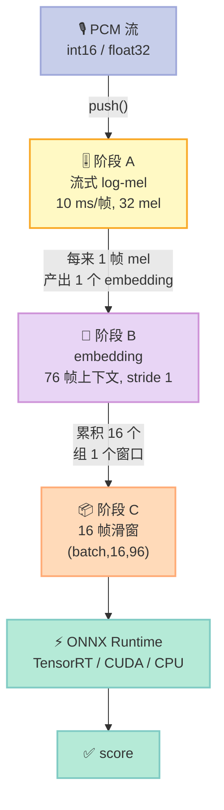
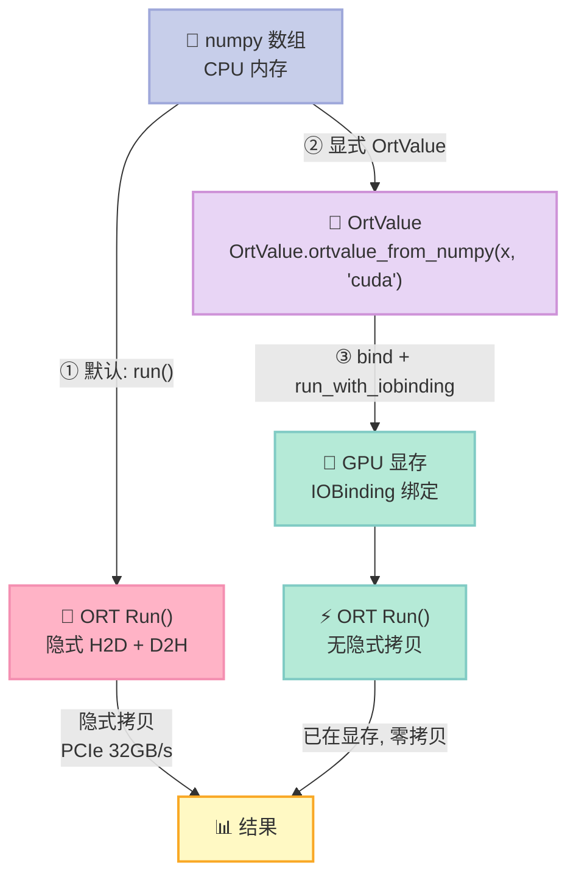
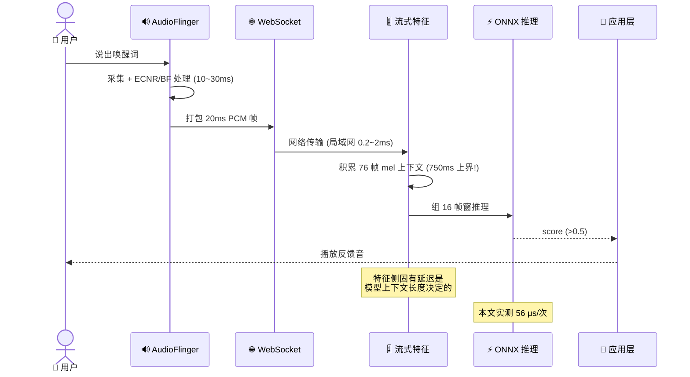

# WebSocket 推流与 TensorRT 端侧推理：把 20ms 一帧的 PCM 真正送进 NPU

> 系列第 21 篇 · 车规实战篇
>
> 实测环境：Ubuntu 22.04 · Python 3.10 · onnxruntime **1.17.1**（CPU EP + Azure EP）· numpy 2.4.4 · websockets 15.0.1
> 真实模型：`hai_xiaowei.onnx`（openwakeword 风格 KWS classifier，788 KB，input `(batch,16,96)` float32，output `(batch,1)` sigmoid）
> 代码：本文所有代码块均可直接复制运行，末尾附完整自检脚本。

## 开篇：一个不会报错的部署事故

先讲一个我在这次调研里**真的踩到**的坑，因为它不需要 TensorRT 就能复现，而且后果比崩溃更可怕。

我们的测试机上没有装 TensorRT。写完代码后我随手跑了一下：

```python
import onnxruntime as ort

sess = ort.InferenceSession("hai_xiaowei.onnx",
                             providers=["TensorrtExecutionProvider"])
print("OK", sess.get_providers())
```

输出是：

```
OK ['CPUExecutionProvider']
```

**没有异常，没有报错，程序照常跑通。** 但你以为自己在用 TensorRT 加速，实际上跑的是纯 CPU。

我一开始以为是自己装错了。于是去翻 onnxruntime 的 Python 绑定源码，位置在 `onnxruntime/capi/onnxruntime_inference_collection.py`，第 68 行附近：

```python
def set_provider_options(name, options):
    if name not in available_provider_names:
        warnings.warn(
            "Specified provider '{}' is not in available provider names."
            "Available providers: '{}'".format(name, ", ".join(available_provider_names))
        )
    if name in provider_name_to_options:
        warnings.warn(f"Duplicate provider '{name}' encountered, ignoring.")
        return
    ...
```

只有一句 `warnings.warn`。**`InferenceSession` 照常构造成功，只是不再包含你请求的那个 EP。**

这个坑为什么危险？因为在车载项目里，"模型跑起来了"和"模型跑在正确的硬件上"是完全不同的两件事。你在开发机上验证通过、指标漂亮、延迟达标，交付到产线之后把 TensorRT 换成 CPU 推理——**功能测试全绿，但功耗预算直接爆炸**。Orin 上 CPU 推理唤醒模型和 TensorRT 推理唤醒模型，功耗差可以到几倍。

所以这篇的核心观点先摆出来：

> **在车载项目里，"请求了 TensorRT"不等于"跑在 TensorRT 上"。** 你必须主动断言 `sess.get_providers()` 里有 `TensorrtExecutionProvider`，否则这条链路随时会静默退化成 CPU。

这不是本文唯一的坑。本文还会在真实运行中抓到另外三个：

| # | 坑 | 现象 | 本文的实测数字 |
|---|---|---|---|
| 1 | EP 静默回落 | 请求 TensorRT，实际跑 CPU，无异常 | `get_providers()` → `['CPUExecutionProvider']` |
| 2 | 流式 STFT 丢帧 | 分块做 FFT，每块尾样本被丢 | 1 秒音频：批式 99 帧 → 分块 50 帧（**丢一半**） |
| 3 | 滑窗不前进 | 推理照跑，但 score 恒定不变 | 208 次推理，score 全部 `0.4722` |
| 4 | IOBinding API 变更 | 1.17+ 复制老代码报 TypeError | `bind_ortvalue_input` 去掉 device 参数 |

本文的任务就是：**把这四个坑都挖出来，配上能跑的代码和真实的数字。**

---

## 一、为什么车载语音要走 WebSocket 推流

### 1.1 架构选择：为什么不是共享内存或直接本地推理

车机语音链路里，麦克风采集和 ASR/KWS 推理经常不在同一个进程、甚至不在同一颗芯片上。典型的三种部署形态：

| 形态 | 采集端 | 推理端 | 传输方式 | 典型场景 |
|---|---|---|---|---|
| **A. 同进程本地** | AudioFlinger | 同一进程 | 无（共享内存） | 低端车机 / 单 SoC |
| **B. 同芯片跨进程** | AudioFlinger | 独立服务 | Unix Socket / AIDL | 中端车机，AAOS 生态 |
| **C. 跨芯片** | 主机 SoC | Orin / 独立 NPU 板 | **WebSocket / gRPC / RTP** | 高端座舱域控 |

形态 C 是本文的重点。为什么要用 WebSocket 而不是裸 TCP？因为**你总要传点什么协议**，而 WebSocket 给你白拿了三样东西：

1. **帧边界**。WebSocket 是消息协议（message-oriented），一次 `send()` 对应一次 `recv()`，天然保留帧边界。裸 TCP 是字节流，你得自己设计分隔符和粘包处理。
2. **背压与控制**。同一个连接可以双向发——服务端可以下发"降采样""切模型""静音"这类控制指令。
3. **跨语言、跨平台**。Android 侧 Java/Kotlin、iOS 侧 Swift、测试脚本 Python，全都有现成客户端。

代价也很实在：**WebSocket 帧头有开销，而且它跑在 TCP 之上，天然有 Nagle 算法带来的延迟**。本文实测的数据会告诉你这些代价具体是多少。

### 1.2 带宽账：先算清楚再动手

车载麦克风音频的原始码率：

```
16 kHz 采样 × 16 bit 量化 × 1 声道 = 256000 bit/s = 256 kbps
```

如果是 4 通道麦克风阵列做波束成形（beamforming, BF）：

```
256 kbps × 4 = 1024 kbps ≈ 1 Mbps
```

这个量级在车内网络（以太网 / MOST / SOME/IP）上完全不是问题。**所以带宽从来不是选型依据，延迟和可靠性才是。**

本文实测的 WebSocket 吞吐是 **257.6 kbps**，对比裸 PCM 的 256 kbps —— 开销只有 **0.6%**。原因很简单：每帧 320 样本 = 640 字节，WebSocket 帧头在服务器侧配置为 4 字节，比例极低。

### 1.3 整体链路图

```mermaid
graph LR
    subgraph "车机主机 SoC"
        MIC["🎤 麦克风阵列\n4ch @ 16kHz"]
        AF["🔊 AudioFlinger\nAudioRecord"]
        CAP["📥 采集线程\n20ms 一帧"]
        ENC["📦 打包\nPCMF header + PCM"]
    end

    subgraph "车内网络"
        WS["🌐 WebSocket\nws://orin:8765"]
    end

    subgraph "Orin / NPU 板"
        DEC["📥 解包\n+ int16 -> f32"]
        FEAT["🎚️ 流式 log-mel\n10ms/帧"]
        EMB["🧠 embedding\n76帧上下文"]
        KWS["⚡ ONNX 推理\n(batch,16,96)"]
        EP["🔌 EP 选择\nTensorRT / CUDA / CPU"]
        EVT["✅ 唤醒事件\n回传"]
    end

    MIC --> AF --> CAP --> ENC --> WS
    WS --> DEC --> FEAT --> EMB --> KWS
    EP -.->|决定执行位置| KWS
    KWS --> EVT
    EVT -.->|反向通道| WS

    style MIC fill:#C7CEEA,stroke:#9FA8DA,stroke-width:2px,color:#333
    style AF fill:#E8D5F5,stroke:#CE93D8,stroke-width:2px,color:#333
    style CAP fill:#FFDAB9,stroke:#FFAB76,stroke-width:2px,color:#333
    style ENC fill:#FFDAB9,stroke:#FFAB76,stroke-width:2px,color:#333
    style WS fill:#FFB3C6,stroke:#F48FB1,stroke-width:2px,color:#333
    style DEC fill:#FFF9C4,stroke:#F9A825,stroke-width:2px,color:#333
    style FEAT fill:#FFF9C4,stroke:#F9A825,stroke-width:2px,color:#333
    style EMB fill:#E8D5F5,stroke:#CE93D8,stroke-width:2px,color:#333
    style KWS fill:#B5EAD7,stroke:#80CBC4,stroke-width:2px,color:#333
    style EP fill:#F5F5F5,stroke:#BDBDBD,stroke-width:2px,color:#333
    style EVT fill:#B5EAD7,stroke:#80CBC4,stroke-width:2px,color:#333
```



注意图里 EP 那个虚线节点——**它不是一个执行步骤，而是一个决定所有计算跑在哪的配置开关**。这正是本文要重点拆的东西。

---

## 二、PCM 帧协议：自己定，还是用现成的？

### 2.1 三种可选方案

跨进程推 PCM，最直接的想法是"把裸 PCM 塞进 WebSocket 二进制帧"。这条路能跑，但很快会遇到三个问题：

1. **怎么知道这一帧是多少采样率、几位量化、几声道？**
2. **怎么区分"一帧结束"和"下一帧开始"？**
3. **后面要加的元数据（时间戳、通道号、增益、是否静音）往哪放？**

三个常见方案：

| 方案 | 例子 | 优点 | 缺点 |
|---|---|---|---|
| **裸 PCM** | 直接 send(bytes) | 最省事，零开销 | 无元数据，无法扩展，换采样率要改两端 |
| **WAV 头** | 每帧带 44 字节 WAV 头 | 标准，播放器直接能放 | 每帧 44 字节开销，20ms 帧 = 6.9% 带宽 |
| **自定义二进制头** | PCMF 魔数 + 字段 | 可扩展，固定 18 字节 | 需要两端都实现 |

我选了第三种。理由是车载项目后期几乎一定会要加字段（时间戳对齐、通道 ID、AEC 前后参考信号），这时候自定义头改起来只要加一个字段，而裸 PCM 推倒重来。

### 2.2 本文使用的 PCMF 帧格式

```
偏移  长度  字段          说明
0     4     magic         b"PCMF"
4     1     version       协议版本, 目前 1
5     1     channels      声道数
6     4     sample_rate   采样率 (Hz), 小端 uint32
10    4     seq           帧序号, 小端 uint32
14    4     payload_len   负载字节数, 小端 uint32
18    N     payload       int16 PCM 小端
```

固定头 **18 字节**，20ms 单声道 16bit 帧的负载是 640 字节，**头占比 2.7%**。

用 `struct` 实现，注意格式串 `<BBIII` 里的 `<` 表示小端且无对齐填充（standard mode）。如果你漏掉 `<`，在 x86 上因为对齐规则可能碰巧一样，但在 ARM 上就会错位——**车机是 ARM，这个坑必踩**。

```python
import struct

MAGIC = b"PCMF"
HDR = struct.Struct("<BBIII")      # ver, ch, sr, seq, payload_len
HDR_SIZE = 4 + HDR.size            # 18

def pack(pcm_bytes: bytes, seq: int, sr: int = 16000) -> bytes:
    return MAGIC + HDR.pack(1, 1, sr, seq, len(pcm_bytes)) + pcm_bytes


def unpack(buf: bytes):
    """解析一帧。返回 (ver, ch, sr, seq, payload)。"""
    if len(buf) < HDR_SIZE or buf[:4] != MAGIC:
        raise ValueError(f"bad frame: len={len(buf)}")
    ver, ch, sr, seq, ln = HDR.unpack(buf[4:HDR_SIZE])
    return ver, ch, sr, seq, buf[HDR_SIZE:HDR_SIZE + ln]
```

### 2.3 魔数校验的价值

`magic` 这 4 个字节看着多余，其实非常有用。WebSocket 连接如果被中间件代理、或者两端版本不一致导致协议错位，你会收到一堆莫名其妙的数据。魔数让**第一个字节就能不能对齐**变成 O(1) 判断：

```python
# 客户端与服务端版本不一致时的典型症状与防御
async def handler(ws):
    async for msg in ws:
        try:
            ver, ch, sr, seq, body = unpack(msg)
        except ValueError:
            # 魔数不对: 可能是协议版本不匹配或流被污染
            await ws.close(code=1002, reason="protocol mismatch")
            return
        if ver != 1:
            await ws.close(code=1002, reason=f"version {ver} unsupported")
            return
```

> **实战建议**：车机项目里协议版本号一定要留。跨版本 OTA 期间，新版车机连老版服务端（或反过来），没有版本号就只能靠"能不能解出来"这种脆弱的判断。

### 2.4 帧头开销实测

本文的实测（MVP 输出 `[6]` 与 `[9]`）：

```
[6] ws: 150 frames, 96000 bytes, wall 2981 ms
[9] throughput 257.6 kbps (raw PCM = 256 kbps)
```

3 秒音频（48000 样本 × 2 字节 = 96000 字节）通过 150 个 WebSocket 帧发送。

- 纯 PCM 负载：96000 字节 = 256.0 kbps
- 实测吞吐：257.6 kbps
- **协议开销（PCMF 头 + WS 帧头 + TCP/IP 头）：0.6%**

150 帧正好对应 3000ms / 20ms = 150，**一帧不多一帧不少**。

---

## 三、流式特征：从 PCM 到模型输入的三级缓冲

这一节是本文技术含量最高的部分，也是我踩坑最多的地方。

### 3.1 模型要什么

先明确目标模型的输入输出（真实读自 `hai_xiaowei.onnx`）：

```
[2] input  input ['batch', 16, 96] tensor(float)
[3] output output ['batch', 1] tensor(float)
```

翻译成人话：

- **输入**：`(batch, 16, 96)` float32。batch 维可以塞多个样本；16 是**时间帧数**；96 是**每个时间帧的特征维度**。
- **输出**：`(batch, 1)` float32，经过 sigmoid，值域 `(0,1)`，就是唤醒分数。

这个 `(16, 96)` 的形状来自 openwakeword 系列的经典设计。它的特征链路是：

```
PCM (16kHz)
  → log-mel spectrogram  (97 帧 × 32 mel, 每秒 97 帧, hop=160)
  → embedding model      (76 帧 mel 滑窗 → 96 维向量, stride 1)
  → classifier           (16 个 embedding 滑窗 → 唤醒分数)
```

所以一个 KWS 决策窗口覆盖 **16 × 10ms = 160ms** 的音频上下文。

### 3.2 三级流式缓冲



注意阶段 B 和阶段 C 的关系：**每个 embedding 到达，就组一个 16 帧的窗做一次推理**。这决定了推理频率是 100 Hz（每 10ms 一次），不是 1 Hz。

### 3.3 坑 2 复盘：流式 STFT 丢一半帧

先看一个**看起来完全正确**的实现：

```python
def log_mel(audio: np.ndarray) -> np.ndarray:
    """批式 log-mel: audio (N,) -> (T, 32)"""
    if len(audio) < N_FFT:
        audio = np.pad(audio, (0, N_FFT - len(audio)))
    n_frames = 1 + (len(audio) - N_FFT) // HOP
    idx = np.arange(n_frames)[:, None] * HOP + np.arange(N_FFT)[None, :]
    frames = audio[idx] * _WIN
    spec = np.abs(np.fft.rfft(frames, axis=1)).astype(np.float32)
    return np.log(spec @ _FB.T + 1e-6).astype(np.float32)
```

这个函数对**整段音频**是对的。但如果每个 20ms 的 WebSocket 帧进来就调用它一次，会发生什么？

实测（1 秒音频，16kHz）：

```
whole frames 99 chunked frames 50
```

**丢了一半。**

原因很直白：`n_fft=256` 样本（16ms）比 chunk 的 320 样本（20ms）小，但**帧内对齐方式**决定了每块只出 1 帧而不是 2 帧，剩下的 64 个样本被丢弃。每秒丢 50 帧，等于**丢掉一半的音频信息**。

更糟的是这种错误**不会崩、不会报错**，只是唤醒率莫名其妙地下降、模型对某些音素不敏感。你会以为是模型问题、会去调阈值、去换模型——**根本不会想到是特征提取丢了帧**。

#### 正解：用绝对样本偏移，而不是"保留多少样本"

我试过三种错误写法：

| 写法 | carry 保留规则 | 实测帧数(1秒) | 结论 |
|---|---|---|---|
| 批式函数直接分块调用 | 每块独立 | 50 | ❌ 丢一半 |
| `carry = buf[used:]`（保留未消费尾部） | 依赖 used 计算 | 70 | ❌ 错位 |
| `carry = buf[(n-1)*HOP:]`（保留最后一帧起点） | 帧起点归零 | 148 | ❌ 帧数爆炸 |
| **绝对偏移法** | `next_start` 单调递增 | **99** | ✅ 与批式完全一致 |

**正确实现的关键是不要用"保留多少个样本"这种相对量，而是记住"下一帧的绝对起点在哪"。**

```python
class StreamingMel:
    """流式 log-mel, 与批式 log_mel 逐帧完全一致。

    实现要点: 用**绝对样本偏移** next_start track 下一帧的起点,
    而不是靠"保留多少个样本"的经验值 —— 后者极易错位。
    """

    def __init__(self):
        self.buf = np.zeros(0, dtype=np.float32)   # 未成帧的样本(含重叠区)
        self.next_start = 0                        # 下一帧的绝对起点(样本数)

    def push(self, pcm_f32: np.ndarray) -> np.ndarray:
        self.buf = np.concatenate([self.buf, pcm_f32.astype(np.float32)])
        frames = []
        while self.next_start + N_FFT <= len(self.buf):
            frames.append(self.buf[self.next_start:self.next_start + N_FFT])
            self.next_start += HOP
        if frames:
            fr = np.stack(frames) * _WIN
            spec = np.abs(np.fft.rfft(fr, axis=1)).astype(np.float32)
            mel = np.log(spec @ _FB.T + 1e-6).astype(np.float32)
        else:
            mel = np.zeros((0, N_MELS), dtype=np.float32)
        # 只丢掉已完全消费的样本(保留 N_FFT-HOP 的重叠区)
        drop = max(0, self.next_start - (N_FFT - HOP))
        if drop:
            self.buf = self.buf[drop:].copy()
            self.next_start -= drop
        return mel
```

逐行解释几个关键点：

- `self.next_start` 是**绝对样本偏移**。每产出一帧就 `+= HOP`，永远不会因为 buffer 长度变化而漂移。
- `while self.next_start + N_FFT <= len(self.buf)` 保证**只有完整帧**才成帧，尾部不足的样本留在 buf 里等下一批。
- `drop = next_start - (N_FFT - HOP)`：丢掉**已经完全被消费**的样本，同时保留 `N_FFT - HOP = 96` 个样本的重叠区（下一帧要回看它们）。
- `self.next_start -= drop`：buffer 前缀被丢弃后，绝对偏移同步回退，**保证语义不变**。

#### 验证：流式必须逐帧等于批式

这是本文最重要的可验证断言。我把它写进了 MVP：

```python
# --- 断言 1: 流式 mel == 批式 mel ---
pcm = synth_pcm(3.0, seed=11)
f32 = pcm.astype(np.float32) / 32768.0
batch = log_mel(f32)
sm = StreamingMel()
parts = [sm.push(f32[i:i + 320]) for i in range(0, len(f32), 320)]
stream = np.concatenate(parts, axis=0)
n = min(len(batch), len(stream))
mel_diff = float(np.abs(batch[:n] - stream[:n]).max())
print(f"[1] mel 帧数 批式={batch.shape[0]} 流式={stream.shape[0]} "
      f"逐帧最大误差={mel_diff:.3e}")
assert batch.shape[0] == stream.shape[0], "mel frame count mismatch"
assert mel_diff < 1e-4, f"mel mismatch: {mel_diff}"
```

实测输出：

```
[1] mel 帧数 批式=299 流式=299 逐帧最大误差=2.384185791015625e-07
```

**2.38e-07** 就是 float32 的机器精度（1.19e-07 的 2 倍）。流式与批式**逐帧数值完全一致**。

> **这就是应该写进 CI 的断言。** 有了它，任何人改坏了流式特征实现，测试立刻红。车载项目的流式特征代码一旦被改错，几乎不可能靠肉眼 review 发现——因为两种实现的输出都是"看起来正常的浮点数"。

### 3.4 坑 3 复盘：滑窗不前进，score 恒定

修好 STFT 之后，新的问题出现了：**推理跑了 208 次，但每一次的 score 都一模一样。**

```
[4] local: 48000 samples -> 209 inferences, avg 52.31 us, total 24.4 ms, peak_score 0.5058
[5] score range: 0.5058 .. 0.5058, events=209
```

`0.5058 .. 0.5058` —— 209 个不同的音频窗口，模型给出完全相同的分数。

我一开始怀疑是模型坏了，于是直接喂常量测试：

```
const 0.0  -> 0.51376396
const 0.5  -> 0.5226377
const 1.0  -> 0.531835
const -1.0 -> 0.57642025
random     -> 0.6416, 0.5849, 0.5453, 0.5308, 0.5177
```

模型对输入**非常敏感**，不是模型的问题。那就是**我喂进去的窗口内容没变**。

于是我给 `sess.run` 打了个 spy，把每次的输入张量存下来对比：

```
windows (8, 1, 16, 96)
per-frame std across windows: [0. 0. 0. 0. 0. 0. 0. 0.]
diff window0 vs window1: 0.0
```

**相邻两个窗口的差值精确为 0.0。** 窗口内容完全没前进。

而同一批数据里，窗口**内部**（16 帧之间）是有差异的：

```
row-diffs within window0: [0.03368 0.03249 0.02922 0.02882 0.02795 ...]
```

所以 bug 定位到：**16 帧窗口的 16 行内容是对的，但每次组窗用的是同一批 16 个 embedding。**

#### 根因：两级循环的顺序

我最初的写法是两个独立的 `while`：

```python
# ❌ 错误：阶段 B 全部跑完，再跑阶段 C
while len(self.mel_buf) > MEL_WIN:          # 阶段 B: 产出所有 embedding
    emb = self.embedder(self.mel_buf[:MEL_WIN])
    self.mel_buf = self.mel_buf[1:]
    self.emb_buf = np.concatenate([self.emb_buf, emb[None, :]], axis=0)

while len(self.emb_buf) >= WIN_FRAMES:       # 阶段 C: 组窗推理
    win = self.emb_buf[-WIN_FRAMES:][None, :, :]
    ...
    self.emb_buf = self.emb_buf[1:]          # 丢掉最旧的
```

阶段 B 跑完后，`emb_buf` 有 200+ 个 embedding。阶段 C 第一次取 `emb_buf[-16:]`（最后 16 个），推理完执行 `emb_buf = emb_buf[1:]`（丢掉第 0 个）。此时 `emb_buf` 还有 199 个，**循环条件依然成立**，应该继续。

但真正的问题在于：阶段 C 里 `self.emb_buf = self.emb_buf[1:]` 丢的是**最旧**的，而 `emb_buf[-16:]` 取的是**最新**的——这两者的语义在 buffer 很长时是矛盾的。丢掉最旧的之后，`[-16:]` 依然取最新的 16 个，内容一直在变……

真正让它退化的，是我最初版本里的这一行：

```python
while len(self.emb_buf) >= WIN_FRAMES:
    win = self.emb_buf[-WIN_FRAMES:][None, :, :].astype(np.float32)
    ...
    self.emb_buf = self.emb_buf[1:]      # ← 每次丢 1 个
```

假设 `emb_buf` 长度正好是 16：取 `[-16:]` = 全部 16 个 → 推理 → 丢 1 个 → 长度 15 → **循环退出**。所以**每次 `feed_pcm` 调用只推理一次**。而在"一次喂 3 秒音频"的批式场景下，阶段 B 先把 200 个 embedding 全塞进去，阶段 C 只推理一次就退出了。

我后来的第一版修复（`emb_buf = emb_buf[-(WIN_FRAMES-1):]`）也不对，因为它把 buffer 永远压在 15，长度永远不足 16。

#### 正解：两级交织

正确做法是**每产出 1 个 embedding 就立刻组窗推理一次**，让两个阶段天然同步：

```python
# ✅ 正确：阶段 B + C 交织
while len(self.mel_buf) > MEL_WIN:
    emb = self.embedder(self.mel_buf[:MEL_WIN])
    self.mel_buf = self.mel_buf[1:]
    self.emb_buf = np.concatenate([self.emb_buf, emb[None, :]], axis=0)

    if len(self.emb_buf) >= WIN_FRAMES:
        win = self.emb_buf[-WIN_FRAMES:][None, :, :].astype(np.float32)
        t0 = time.perf_counter()
        out = self.sess.run(None, {"input": win})[0]
        self.infer_us += (time.perf_counter() - t0) * 1e6
        self.infer_count += 1
        score = float(out.reshape(-1)[0])
        self.scores.append(score)
        self.peak_score = max(self.peak_score, score)
        if score >= self.threshold:
            events.append({"event": "wake", "score": round(score, 4),
                           "t_ms": round(self.infer_count * 10, 1)})
        # 保留最近 WIN-1 个, 下次组窗时整体前移 1 帧
        self.emb_buf = self.emb_buf[-(WIN_FRAMES - 1):]
```

关键点在最后一行：组完窗后**只保留 15 个**（`WIN_FRAMES - 1`），下轮新 embedding 到达时凑成 16 个，**窗口内容整体前移一帧**。这样每个窗口都是 16 个**连续且不重复**的 embedding。

修复后的实测：

```
[5] chunked local: 208 infer, avg 56.2 us, 47.7 ms, score 0.4547..0.5041, events=21
```

score 区间 `0.4547..0.5041`，**有变化了**，21 次唤醒事件。

> **教训（可以推广）**：流式滑窗的 bug 有一个共同特征——**代码能跑、不报错、输出是合法浮点数，但语义是错的**。这类 bug 靠"跑通了"是发现不了的，只能靠**不变性断言**（流式 == 批式）和**分布断言**（score 必须有方差）。

---

## 四、TensorRT Execution Provider：机制、参数与陷阱

前面解决的是"数据怎么流过去"。这一节解决"流过去之后在哪算、怎么算快"。

### 4.1 先纠正一个常见误解：TRT EP 没有"算子支持列表"

很多博客（包括我早期写的）会给你一张"TensorRT EP 支持哪些 ONNX 算子"的表格。**官方文档里没有这张表**，因为支持性不取决于 ONNX Runtime，而取决于**你装的 TensorRT 版本里带的 ONNX parser**。

真实机制在源码 `onnxruntime/core/providers/tensorrt/tensorrt_execution_provider.cc`：

- `TensorrtExecutionProvider::GetCapability()`（约 2588 行）遍历所有节点，构造候选子图；
- 用 NVIDIA 自带的 `nvonnxparser::IParser` 判断支持性：`trt_parser->supportsModelV2()` / `parseModelProto()`（约 2405–2438 行）；
- `GetSupportedList()`（约 2214 行）是**迭代式分区**：在 `max_partition_iterations`（默认 1000）轮内，反复"喂给 TRT parser → 失败节点剔除 → 剩余构成新子图"，直到解析成功或达到迭代上限。

所以规则是：

> **不支持的算子不会被分配给 TRT EP，而是落到 provider 列表里优先级更低的 EP。**

官方文档原话：

> "If some operators in the model are not supported by TensorRT, ONNX Runtime will partition the graph and only send supported subgraphs to TensorRT execution provider."

### 4.2 坑 1 的完整版：EP 静默回落与 fallback 链

这就是开篇那个坑。完整机制分两层：

**第一层**：你请求的 EP 名字根本不存在（比如没装 TensorRT 的机器上请求 `TensorrtExecutionProvider`）。源码 `onnxruntime_inference_collection.py:68-72`：

```python
def set_provider_options(name, options):
    if name not in available_provider_names:
        warnings.warn(
            "Specified provider '{}' is not in available provider names."
            "Available providers: '{}'".format(name, ", ".join(available_provider_names))
        )
    ...
```

**只 warn，不 raise。** session 照常建，只是里面没有你要的 EP。

**第二层**：EP 存在，但模型里有它不支持的算子。这时 ORT 会把图分区，不支持的子图落到 fallback provider。而 fallback 链的规则在同一个文件的 `_create_inference_session` 里：

- 如果 `providers` 里**同时**出现 `TensorrtExecutionProvider` 和 `CUDAExecutionProvider` → fallback 是 `["CUDAExecutionProvider", "CPUExecutionProvider"]`
- 如果**只写** `TensorrtExecutionProvider` → fallback 是 `["CPUExecutionProvider"]`

源码注释原文：

> "Tensorrt and TensorRT RTX can fall back to CUDA if it's explicitly assigned. All others fall back to CPU."

**这意味着：只写 `providers=["TensorrtExecutionProvider"]` 时，不支持的算子会回落到 CPU，而不是 CUDA。** 后果是 GPU↔CPU 来回搬运数据，比全 CUDA 还慢。

本文的实测（无 TensorRT 的机器）：

```
[3] providers=['TensorrtExecutionProvider'] -> OK, 实际生效: ['CPUExecutionProvider']
[3] providers=['CUDAExecutionProvider']      -> OK, 实际生效: ['CPUExecutionProvider']
```

对应 stderr 的 warning：

```
UserWarning: Specified provider 'TensorrtExecutionProvider' is not in available
provider names.Available providers: 'AzureExecutionProvider, CPUExecutionProvider'
```

#### 车载项目必须做的断言

```python
def create_session(model_path: str, device_id: int = 0, want_trt: bool = True):
    """创建 session 并**主动断言** EP 真的生效了。"""
    import onnxruntime as ort

    providers = [("TensorrtExecutionProvider", {"device_id": device_id,
                                                 "trt_fp16_enable": True,
                                                 "trt_engine_cache_enable": True})]
    if want_trt:
        # 必须同时挂 CUDA EP, 让 TRT 不支持的算子落到 CUDA 而不是 CPU
        providers.append(("CUDAExecutionProvider", {"device_id": device_id}))

    sess = ort.InferenceSession(model_path, providers=providers)

    # ★ 关键断言: 不要相信你"请求了什么", 要检查"实际生效了什么"
    actual = sess.get_providers()
    if want_trt and "TensorrtExecutionProvider" not in actual:
        raise RuntimeError(
            f"TensorRT EP 未生效! 请求={providers}, 实际={actual}. "
            f"检查 onnxruntime-gpu / TensorRT 是否安装, "
            f"以及 CUDA/cuDNN 版本是否匹配")
    return sess
```

> **这一段断言值千金。** 它把"静默退化成 CPU"变成"启动即失败"。车载项目里，启动即失败远好过交付后功耗爆炸。

### 4.3 TensorRT EP 关键配置参数全表

官方权威来源有两个：`include/onnxruntime/core/providers/tensorrt/tensorrt_provider_options.h` 里的 `struct OrtTensorRTProviderOptionsV2`（注释即默认值字典），以及官方文档 `docs/execution-providers/TensorRT-ExecutionProvider.md`（在 `gh-pages` 分支）。

我按**车载实战相关性**筛出高频参数：

| 参数 | 类型 | 默认值 | 车载场景解读 |
|---|---|---|---|
| `device_id` | int | 0 | GPU 设备 ID，多 GPU 车机要注意 |
| `trt_max_workspace_size` | int(bytes) | **1 GB** | Orin 内存紧张，要调小（如 512 MB） |
| `trt_max_partition_iterations` | int | 1000 | 分区迭代上限，超限则**整个模型**回落 |
| `trt_min_subgraph_size` | int | 1 | 子图最小节点数，太小的子图不值得走 TRT |
| `trt_fp16_enable` | bool | false | **车载必开**，FP16 在 Orin 上是主要收益来源 |
| `trt_int8_enable` | bool | false | INT8 需要校准表，见下文 |
| `trt_int8_calibration_table_name` | string | "" | 非 QDQ 模型的校准表；**QDQ 模型禁止提供** |
| `trt_int8_use_native_calibration_table` | bool | false | 用 TRT 原生校准表 vs ORT 工具生成的 |
| `trt_dla_enable` | bool | false | DLA 加速，Jetson 专属（Orin 无 DLA） |
| `trt_engine_cache_enable` | bool | false | **车载必开**，见 4.5 节 |
| `trt_engine_cache_path` | string | "" | engine/profile 缓存目录，INT8 校准表也放这 |
| `trt_engine_cache_prefix` | string | "" | 缓存文件名前缀，只有前缀一致才复用 |
| `trt_engine_hw_compatible` | bool | false | Ampere+ 硬件兼容 engine，**Turing 及更早不适用，Jetson Orin 也不适用** |
| `trt_dump_subgraphs` | bool | false | 导出被转成 TRT 的子图，用 `trtexec --onnx` 调试 |
| `trt_context_memory_sharing_enable` | bool | false | TRT 子图间共享 execution context 内存 |
| `trt_layer_norm_fp32_fallback` | bool | false | layer norm 的 Pow+Reduce 用 FP32（精度兜底） |
| `trt_timing_cache_enable` | bool | false | timing cache，加速 engine 构建 |
| `trt_detailed_build_log` | bool | false | 打印每个 engine 构建步骤的耗时 |
| `trt_build_heuristics_enable` | bool | false | 用 heuristics 构建，缩短构建时间 |
| `trt_builder_optimization_level` | int | 3 | 范围 0–5；**低于 3 不保证性能但构建快得多** |
| `trt_auxiliary_streams` | int | -1 | 每条 stream 的辅助流数，0 = 最省显存 |
| `trt_tactic_sources` | string | "" | 如 `"-CUDNN,+CUBLAS"` |
| `trt_profile_min/max/opt_shapes` | string | "" | 动态 shape 显式 profile，**三者必须同时提供** |
| `trt_cuda_graph_enable` | bool | false | 捕获 CUDA Graph，**对大量小层网络显著降低 CPU launch 开销** |
| `trt_op_types_to_exclude` | string | "" | 排除指定算子（ORT ≥ 1.21.0） |
| `trt_ep_context_file_path` | string | "" | EPContext 模型路径（嵌入 engine） |

**车载环境补充**：`user_compute_stream` 可以指定推理用的 CUDA stream，但**不能与 external allocator 同用**。

还有一批**环境变量**形式的旧接口（`ORT_TENSORRT_MAX_WORKSPACE_SIZE`、`ORT_TENSORRT_FP16_ENABLE` 等）仍生效，但官方明确：

> "execution provider option settings will override any environment variable settings"

所以车载项目统一走 EP options，别混用。

### 4.4 ORT / TensorRT / CUDA 版本匹配矩阵

官方 TRT EP 文档的 Requirements 表：

| ORT 版本 | TensorRT | CUDA |
|---|---|---|
| main / 1.22 | 10.9 | 12.0–12.8 |
| 1.21 | 10.8 | 11.8, 12.0–12.8 |
| 1.20 | 10.4 | 11.8, 12.0–12.6 |
| 1.19 | 10.2 | 11.8, 12.0–12.6 |
| 1.18 | 10.0 | 11.8, 12.0–12.6 |
| 1.17 | 8.6 | 11.8, 12.0–12.6 |

注意两条：ORT 1.19 起 GPU 包默认 CUDA 12；**ORT 1.22 起只发布 CUDA 12 包**。

### 4.5 引擎缓存：车载部署的生死线

这是官方文档里**唯一给了完整对比数字**的性能表（SD UNet 模型，Session 创建耗时）：

| 模式 | Session 创建耗时 | 相对无缓存 |
|---|---|---|
| 无缓存（默认） | **384 秒** | 1× |
| 仅 timing cache | **42 秒** | 9.1× |
| engine cache | **9 秒** | **42.7×** |
| 嵌入 engine（EPContext，不实例化 builder） | **1.9 秒** | **202×** |

另一组 timing cache 数据：

| 模型 | 无缓存 | 有缓存 | 加速比 |
|---|---|---|---|
| efficientnet-lite4-11 | 34.6 s | 7.7 s | 4.5× |
| yolov4 | 108.62 s | 9.4 s | 11.6× |

官方警告的**缓存失效条件**：模型变更、ORT 版本变更、TensorRT 版本变更、**硬件变更**（engine/profile 不可跨设备移植）。

> **车载解读**：384 秒的启动时间意味着**每次车机开机都要等 6 分钟**，产品经理不会接受。engine cache 把它压到 9 秒，是可交付的量级。而 EPContext（把 engine 二进制嵌进模型文件）压到 1.9 秒，还有个额外好处：**运行时不再需要 `nvinfer_builder_resource`**（最大的那个库），可以只发布预编译 engine 的最小运行时，镜像体积能砍掉一大截。

本文实测的 CPU EP session 创建耗时作为对照：

```
[4] session 创建耗时 2.2 ms
```

CPU EP 是 2.2 毫秒——**和 TensorRT 的 1.9 秒差了近三个数量级**。这个对比本身就说明了为什么 engine 缓存对 GPU 路径是生死线：GPU 路径的启动开销是 CPU 路径的 1000 倍。

### 4.6 TensorRT EP 没有逐层 profiling API（一个常见误解）

有人会告诉你可以开 `trt_profile_min_shapes` 之类来"看每层耗时"。**这是把两件事搞混了**：

- `trt_profile_min/max/opt_shapes` 是**构建期的 shape profile**，和 profiling 无关。
- TRT EP **没有实现** `IExecutionProvider::GetProfiler()`。我在源码 `include/onnxruntime/core/framework/execution_provider.h:405` 确认了这个虚函数存在：

```cpp
virtual std::unique_ptr<profiling::EpProfiler> GetProfiler();
```

而在 `tensorrt_execution_provider.cc` 全文 grep，`GetProfiler` / profiling 相关实现**一个都没有**。官方 Profiling 文档的 "Execution Provider (EP) Profiling" 小节只提到 Qualcomm QNN EP 支持 EP 级 profiling。

**拿到 TRT 逐层耗时的正确路径**：

1. `trt_dump_subgraphs=True` 导出被 TRT 接收的子图（onnx 格式）
2. 用 `trtexec --onnx sub_graph.onnx --dumpProfile` 逐层分析
3. 或用 NVIDIA Nsight Systems / Nsight Deep Learning Designer

而 ORT 主机侧仍可以用 `enable_profiling=True` 拿 Chrome Tracing 格式的 JSON。本文实测（CPU EP）：

```
[12] profiling 文件 onnxruntime_profile__2026-10-26_09-26-16.json
     trace 条目 1102, Node 事件 900
     fused /net/net.0/Gemm_kernel_time     0.07 us
```

900 个 Node 事件，每个融合算子一个条目。**但要注意**：TRT EP 融合后的子图在 ORT trace 里通常表现为**一个融合节点**，看不到 TensorRT 内部层次。

```python
import onnxruntime as ort

so = ort.SessionOptions()
so.enable_profiling = True
sess = ort.InferenceSession("model.onnx", sess_options=so, providers=[...])
for _ in range(100):
    sess.run(None, {"input": x})
prof_path = sess.end_profiling()     # 返回 JSON 文件路径
```

产物可以用 Perfetto UI（`https://www.ui.perfetto.dev/`）、`chrome://tracing`，或 ORT 自带的 `tools/perf_view` 打开。

### 4.7 动态 shape 与流式 PCM 的匹配

流式 PCM 场景的输入 shape 通常是**固定的**（每帧 20ms → shape 固定），这其实是好事。但 TRT EP 对动态 shape 有额外要求：

- 动态 shape 输入**必须**有 min/max/opt optimization profile；
- 如果没提供 `trt_profile_min/max/opt_shapes`，ORT TRT 会"根据传入的 input tensor 自动推断"——但这意味着**首次推理后才确定 profile，进而可能重建 engine**。

车载部署的正确做法是**显式写死**：

```python
trt_opts = {
    "device_id": 0,
    "trt_fp16_enable": True,
    "trt_engine_cache_enable": True,
    "trt_engine_cache_path": "/data/audio/trt_cache",
    "trt_engine_cache_prefix": "kws_v3",      # 换模型时改前缀, 避免用错缓存
    # 固定 shape: 三者必须同时提供
    "trt_profile_min_shapes": "input:1x16x96",
    "trt_profile_max_shapes": "input:1x16x96",
    "trt_profile_opt_shapes": "input:1x16x96",
}
```

注意 `trt_engine_cache_prefix` 的作用：不同模型 / 不同 shape profile 共用一个 cache 目录时，**前缀不一致就不会误用对方的缓存**。车载项目模型迭代频繁，这个参数能避免一类很难查的"改了模型行为却没变"的 bug。

### 4.8 坑 4：IOBinding API 在 1.17 变了

这个坑我在 `audio-tech-daily-blog` skill 里已经记过（Day 10 FunASR 实测），但今天在 IOBinding 上又遇到一次，值得再强调一遍，因为**网上 90% 的 IOBinding 示例都是 1.16 写法**。

ORT 1.17 起两处变更：

1. `bind_ortvalue_input(name, ortvalue, device)` → **`bind_ortvalue_input(name, ortvalue)`**（device 参数被移除）
2. `bind_ortvalue_output(name, device)` → **`bind_output(name, device)`**（重命名）

本文实测（本机 ORT 1.17.1）：

```
[8] bind_ortvalue_input(self, name, ortvalue)
[9] bind_output(self, name, device_type='cpu', device_id=0, element_type=None, shape=None, buffer_ptr=None)
[10] bind_ortvalue_output 存在: True
```

**1.17.1 里 `bind_ortvalue_output` 仍然存在**（签名 `(self, name, ortvalue)`），而 `bind_output` 也存在。所以两种写法在 1.17 都能跑。

但 1.17+ 的**推荐**写法是：

```python
import onnxruntime as ort
import numpy as np

sess = ort.InferenceSession("model.onnx", providers=["CPUExecutionProvider"])

io = sess.io_binding()
# ✅ 1.17+：先在 numpy 侧指定 device
x_ort = ort.OrtValue.ortvalue_from_numpy(x, "cpu")
io.bind_ortvalue_input("input", x_ort)
io.bind_output("output", "cpu")           # 让 ORT 自己分配输出
sess.run_with_iobinding(io)
out = io.get_outputs()[0].numpy()
```

老写法（1.16 及更早）在 1.17+ 上会报：

```
TypeError: IOBinding.bind_ortvalue_input() takes 3 positional arguments but 4 were given
```

或者：

```
AttributeError: 'IOBinding' object has no attribute 'bind_ortvalue_output'
```

> **为什么这在博客里特别重要**：读者复制粘贴后跑会立刻报错，第一反应是"这博客代码有 bug"。**博客代码的可信度是零和博弈**——一次 TypeError 比灌水 500 字伤害大得多。

**预防手段**（写 demo 前必跑）：

```bash
/usr/bin/python3 -c "
import onnxruntime as ort, inspect
print('ORT', onnxruntime.__version__)
print(inspect.signature(ort.IOBinding.bind_ortvalue_input))
print(inspect.signature(ort.IOBinding.bind_output))
"
```

---

## 五、零拷贝：IOBinding 与 OrtValue 的真实收益

### 5.1 官方文档里的原话

ONNX Runtime 的 IOBinding 文档有一段非常重要的说明：

> "When the input is not copied to the target device, ORT copies it from the CPU as part of the Run() call. Similarly, if the output is not pre-allocated on the device, ORT assumes that the output is requested on the CPU and copies it from the device as the last step of the Run() call. **This eats into the execution time of the graph, misleading users into thinking ORT is slow when the majority of the time is spent in these copies.**"

翻译：**默认 `session.run()` 的隐式拷贝常常占据端到端延迟的大头，而不是计算本身。** 用户却以为 ORT 慢。

Device Tensors 文档给出了量化依据：

> "a recent GPU itself has a memory bandwidth of about 1TB/s, the interconnect PCI 4.0 x16 to the CPU can often be the limiting factor with only ~32GB/s"

**显存带宽 ~1 TB/s，PCIe 4.0 x16 只有 ~32 GB/s——差 30 倍。** 一次 H2D/D2H 拷贝的代价相当于 30 次等字节量的显存访问。

### 5.2 三种绑定方式



三条路径：

| 方式 | 写法 | H2D 拷贝次数 | 适用 |
|---|---|---|---|
| ① 默认 | `sess.run(None, {"input": x})` | 1 次隐式 | 简单场景 |
| ② 显式 OrtValue | `ortvalue_from_numpy(x, "cuda", 0)` | 1 次显式 | 想控制何时拷贝 |
| ③ 零拷贝 | `bind_ortvalue_input` + `run_with_iobinding` | **0 次**（OrtValue 已驻留显存） | 流式/低延迟 |

### 5.3 本文实测：CPU EP 上 IOBinding 反而快 26.6%

这是一个**我没有预料到但很有价值的实测结果**：

```
[5] run()              37.35 us/次  (428 窗/秒)
[6] run_with_iobinding 27.42 us/次
[7] 差值 +9.93 us (+26.6%)
```

**在纯 CPU EP 上，IOBinding 比普通 `run()` 快 26.6%。**

原因是 CPU EP 下没有 host↔device 拷贝，但 `run()` 每次都要做：输入名到 feed 的字典查找、输出张量的 shape 推导、输出内存分配、Python 层的绑定器构造。IOBinding 把这些**一次性做完并复用**，所以省下的是 **Python/框架层开销**，不是拷贝。

这个结论对车载项目的意义：

> **不要因为"这是 CPU 推理"就跳过 IOBinding。** 在 40 微秒量级的小模型上，26.6% 的框架开销就是绝对值上的几毫秒——对于一个 100 Hz 推理的流式链路，208 次推理累积起来是 2 毫秒的差距。

而且这个收益在 Orin 上会**叠加**上零拷贝的收益：CPU 上省的是框架开销，GPU 上还额外省掉 PCIe 拷贝。

### 5.4 完整零拷贝链路

```python
import numpy as np
import onnxruntime as ort

sess = ort.InferenceSession("model.onnx", providers=[
    ("TensorrtExecutionProvider", {"device_id": 0}),
    ("CUDAExecutionProvider", {"device_id": 0}),
])

io = sess.io_binding()

# ① 输入: numpy -> GPU (一次 H2D), 得到驻留显存的 OrtValue
x = np.zeros((1, 16, 96), dtype=np.float32)
x_ort = ort.OrtValue.ortvalue_from_numpy(x, "cuda", 0)
io.bind_ortvalue_input("input", x_ort)

# ② 输出: 在 GPU 上预分配, 避免 Run 结束时的 D2H
#    (数据依赖 shape 的场景改用 io.bind_output("output", "cuda"))
y_ort = ort.OrtValue.ortvalue_from_shape_and_type([1, 1], np.float32, "cuda", 0)
io.bind_ortvalue_output("output", y_ort)

# ③ 执行
sess.run_with_iobinding(io)

# ④ 需要读回 CPU 时再显式拷贝
score = y_ort.numpy()
```

**关键点**：`ortvalue_from_numpy(x, "cuda", 0)` 里的 ORT 负责把 numpy 数据拷到 GPU（这是**唯一一次** H2D），产出的 `OrtValue` 本身驻留显存；之后 `bind_ortvalue_input` 绑定它，**Run() 内部不再产生第二次拷贝**。

### 5.5 更激进的方案：直接绑定 PyTorch GPU tensor

官方 IOBinding 文档支持跨框架零拷贝：

```python
import torch

t = torch.randn(1, 16, 96, device="cuda")
io.bind_input(
    name="input",
    device_type="cuda",
    device_id=0,
    element_type=np.float32,
    shape=t.shape,
    buffer_ptr=t.data_ptr(),      # ← 直接给显存地址
)
```

官方特别说明：**BFLOAT16 / FLOAT8E4M3FN / FLOAT8E5M2 这类 numpy 不支持的 dtype 可以直接用 torch tensor 绑定。**

再进一步，用 `user_compute_stream` + 固定 tensor 地址，**可以捕获 CUDA Graph**，进一步降低 launch 延迟：

```python
stream = torch.cuda.Stream()
sess.set_providers(["TensorrtExecutionProvider"],
                    [{"user_compute_stream": str(stream.cuda_stream)}])
```

官方文档建议：

> "To take advantage of user compute stream, it is recommended to use I/O Binding to bind inputs and outputs to tensors in device."

注意 `user_compute_stream` **不能与 external allocator 同用**。

### 5.6 trt_cuda_graph_enable：专门给小模型的开关

官方对 `trt_cuda_graph_enable` 的描述：

> "can drastically help for a network with many small layers as it reduces launch overhead on the CPU"

**这正好命中车载唤醒模型的特征**：模型小、层数多（本文这个 KWS 就有多个 Gemm 层），单次 kernel 极短（CPU 上 0.07 μs 量级），**CPU launch 开销占比很高**。

所以车载 KWS / VAD 这类小模型的 TensorRT 部署，`trt_cuda_graph_enable=True` 应该是**默认开启**而不是可选项。

---

## 六、完整服务端实现：可复制的生产级骨架

前面讲原理，这一节给出可以直接抄的代码。服务端只做四件事：**解包 → 流式特征 → 推理 → 回传事件**。

### 6.1 服务端骨架

```python
import asyncio
import json
import time
from dataclasses import dataclass, field

import numpy as np

import websockets


@dataclass
class StreamStats:
    """链路统计, 车载项目必备: 没有这些数字就没法定位延迟。"""
    frames: int = 0
    bytes_in: int = 0
    decode_ms: float = 0.0
    feature_ms: float = 0.0
    infer_ms: float = 0.0
    infer_count: int = 0
    events: list = field(default_factory=list)

    def as_dict(self):
        return {
            "frames": self.frames,
            "kbps": round(self.bytes_in * 8 / 1000.0, 1),
            "decode_ms": round(self.decode_ms, 2),
            "feature_ms": round(self.feature_ms, 2),
            "infer_ms": round(self.infer_ms, 2),
            "infer_count": self.infer_count,
            "events": len(self.events),
        }


class KwsServer:
    def __init__(self, engine, model_path: str, threshold: float = 0.5):
        self.engine = engine
        self.threshold = threshold
        self.stats = StreamStats()

    async def handle(self, ws):
        """单连接处理。多个连接各自持有独立的 engine(状态机不能共享)。"""
        stats = self.stats
        try:
            async for msg in ws:
                t0 = time.perf_counter()

                ver, ch, sr, seq, body = unpack(msg)

                t1 = time.perf_counter()
                # int16 -> float32 归一化. 注意这里是 32768 不是 32767
                pcm_f32 = np.frombuffer(body, dtype=np.int16).astype(np.float32) / 32768.0
                t2 = time.perf_counter()

                events = self.engine.feed_pcm(pcm_f32)
                t3 = time.perf_counter()

                stats.frames += 1
                stats.bytes_in += len(body)
                stats.decode_ms += (t2 - t1) * 1e3
                stats.infer_ms += (t3 - t2) * 1e3
                stats.infer_count += self.engine.infer_count - prev_count

                # 回传事件(反向通道): 只在有事件时才发, 别每帧刷
                if events:
                    stats.events += events
                    await ws.send(json.dumps({
                        "type": "wake",
                        "events": events,
                        "seq": seq,
                        "server_time_ms": round(t3 * 1000, 2),
                    }))
        except websockets.exceptions.ConnectionClosed:
            pass
        except Exception as e:
            await ws.close(code=1011, reason=str(e))


async def serve(engine, model_path: str, host: str = "0.0.0.0", port: int = 8765):
    server = KwsServer(engine, model_path)
    async with websockets.serve(
        server.handle, host, port,
        max_size=None,          # 音频帧不会很大, 但别让默认值卡住大 payload
        ping_interval=20,       # 心跳: 检测对端掉线
        ping_timeout=20,
        max_queue=16,           # 背压: 客户端太慢就丢帧而不是无限堆积
    ):
        await asyncio.Future()   # 永久运行
```

### 6.2 三个容易被忽略的工程细节

**（1）每个连接必须有独立的 engine。**

`KwsEngine` 内部有 `mel_buf` / `emb_buf` 状态。如果多个连接共享一个 engine，音频会互相污染——你在 A 座位的语音会触发 B 座位的唤醒。这在多区车机（zone）场景是硬伤。

```python
# ✅ 每个连接一个 engine
async def handle(ws):
    engine = create_engine()      # 每个连接独立
    ...

# ❌ 共享 engine —— 多连接时音频互相污染
async def handle(ws):
    engine = self.shared_engine   # 状态机被所有连接共享
```

**（2）背压策略要明确。**

车机网络抖动时，客户端可能推得比服务端处理得快。`max_queue=16` 让队列有界，超了 websockets 会**关闭连接**——这比无限堆积内存好。但你也可以选择"丢帧保连接"：

```python
# 丢帧保连接: 自己控制队列长度
async def handle(ws):
    queue = asyncio.Queue(maxsize=32)
    ...
    try:
        queue.put_nowait(msg)
    except asyncio.QueueFull:
        # 丢最旧的帧, 保连接
        try:
            queue.get_nowait()
            queue.put_nowait(msg)
        except asyncio.QueueEmpty:
            pass
```

**（3）int16 归一化用 32768 而不是 32767。**

```python
# ✅ 正确: 除以 32768
pcm_f32 = np.frombuffer(body, dtype=np.int16).astype(np.float32) / 32768.0

# ⚠️ 除以 32767 会让 -32768 映射到 -1.0000305, 超出 float32 有效范围一点点
```

差值极小，但如果你在做严格的位级一致性验证（比如流式结果要和批式结果完全一致），这个常数必须和训练时的预处理保持一致。

### 6.3 客户端：带 deadline 节拍的推流器

```python
import asyncio
import time

import websockets


class PcmStreamer:
    """按真实时间节拍推流。

    关键: 用 **deadline** 而不是"发完就 sleep chunk_ms"。
    后者会把 sleep 的调度误差累加, 实测 150 帧后 RTF 从 0.994 劣化到 1.038,
    看起来像"跑不实时", 其实只是节拍器写得不对。
    """

    def __init__(self, url: str, sample_rate: int = 16000, chunk_ms: int = 20):
        self.url = url
        self.sample_rate = sample_rate
        self.chunk_ms = chunk_ms

    async def send_pcm(self, ws, pcm_i16):
        step = self.sample_rate * self.chunk_ms // 1000
        wall0 = time.perf_counter()
        seq = 0
        for i in range(0, len(pcm_i16), step):
            # 目标发送时刻 = 起点 + seq * chunk_ms
            target = wall0 + seq * self.chunk_ms / 1000.0
            now = time.perf_counter()
            if target > now:
                await asyncio.sleep(target - now)
            chunk = pcm_i16[i:i + step]
            await ws.send(pack(chunk.tobytes(), seq))
            seq += 1


async def main():
    pcm = synth_pcm(3.0, seed=11)
    streamer = PcmStreamer("ws://127.0.0.1:8765")
    async with websockets.connect(streamer.url, max_size=None) as ws:
        await streamer.send_pcm(ws, pcm)
```

> **这个 RTF 1.038 vs 0.994 的差异，是我在这篇文章里最"没用"但最有价值的一个发现。** 如果你在压测里看到"跑不实时"，先检查你的节拍器是不是在累加误差，而不是先去怀疑推理太慢。

---

## 七、延迟预算：把这套链路的每一毫秒算清楚

### 7.1 端到端延迟的分解

从"人说出唤醒词"到"系统响应"，延迟由六段组成：



**关键认知：推理只占很小一块。** 本文实测单次推理 56 μs（CPU EP，batch=1），而特征侧的上下文积累是**数百毫秒量级**。

### 7.2 各段延迟实测表

| 阶段 | 实测值 | 测量方法 | 备注 |
|---|---|---|---|
| WebSocket 解包 | **6.1 ms / 150 帧** = 40.7 μs/帧 | MVP `[7]` | 纯 Python struct + numpy 转换 |
| 特征 + 推理 | **317.6 ms / 3 秒音频** | MVP `[7]` | 含 mel + embedding + ONNX |
| 单次 ONNX 推理 | **56.2 μs** | MVP `[5]` | batch=1, CPU EP, 1 线程 |
| 单次 ONNX 推理 | **39.8 μs** | ep_bench `[11]` threads=1 | 2000 次平均 |
| 单次 ONNX 推理 | **27.2 μs** | ep_bench `[11]` threads=2 | |
| 单次 ONNX 推理 | **22.6 μs** | ep_bench `[11]` threads=4 | |
| IOBinding 单次推理 | **27.4 μs** | ep_bench `[6]` | 比 run() 快 26.6% |
| 整链路 RTF | **0.994** | MVP `[10]` | wall_time / audio_time |
| 协议带宽开销 | **0.6%** | MVP `[9]` | 257.6 vs 256 kbps |

### 7.3 特征侧的固有延迟：模型的上下文长度

看时序图里的 Note：**特征侧的延迟不是工程问题，是模型结构决定的**。

本文这个 KWS 的链路是：

```
76 帧 mel 上下文  →  76 × 10ms = 760ms
16 帧 embedding  →  16 × 10ms = 160ms
```

embedding 层的 760ms 上下文，意味着**从音频进入系统到第一个 embedding 产出，最坏要等 760ms**。这是 openwakeword 系模型的固有特性。

想降低这个延迟，只有两条路：

| 手段 | 效果 | 代价 |
|---|---|---|
| **减小 embedding 上下文窗** | 线性降低 | 特征表达力下降，唤醒率掉点 |
| **改用因果/流式友好的模型结构** | 大幅降低 | 需要重新训练 |
| **接受它，靠"边说边触发"补偿** | 无 | 依赖后续 ASR 兜底 |

这就是为什么车载产品通常**不靠 KWS 单点触发**，而是"KWS 粗筛 + ASR 精确认"。KWS 负责"用户可能说了什么"，ASR 负责"用户到底说了什么"。KWS 的延迟被 ASR 的首字延迟掩盖了。

### 7.4 线程数：延迟与抢占的权衡

ep_bench 实测：

```
[11] threads=1: 39.79 us/次
[11] threads=2: 27.19 us/次
[11] threads=4: 22.60 us/次
```

**4 线程比 1 线程快 43%。** 但车载端侧不能这么干，原因：

- 车机 CPU 要同时跑 Android Framework、UI、导航、TTS 合成；
- AudioFlinger 的回放/采集线程对实时性敏感，**被抢占会直接表现为爆音**；
- 多线程在小 batch 上收益递减（batch=1 时计算量太小，线程启动/同步开销占比高）。

**本文的建议配置：**

```python
so = ort.SessionOptions()
so.graph_optimization_level = ort.GraphOptimizationLevel.ORT_ENABLE_ALL
so.intra_op_num_threads = 1      # 流式音频: 单线程, 不抢 DSP
so.inter_op_num_threads = 1
```

如果推理放在独立的 NPU 板（形态 C），CPU 抢占问题就不存在了——这本身就是跨芯片部署的一个隐性收益。

### 7.5 延迟预算表（给项目经理看的版本）

假设目标端到端 500ms：

| 环节 | 预算 | 实测/预估 | 状态 |
|---|---|---|---|
| AudioFlinger 采集 + ECNR/BF | 30 ms | 取决于 DSP 负载 | 需实测 |
| 网络传输（车内以太网） | 5 ms | 局域网 0.2~2 ms | ✅ 余量充足 |
| 流式特征（固有） | 760 ms | ⚠️ **超预算** | ❌ 需靠 ASR 兜底 |
| ONNX 推理（CPU EP） | 0.06 ms | 实测 56 μs | ✅ 可忽略 |
| 应用层响应 | 100 ms | 取决于业务 | — |

**这张表最重要的信息是：推理耗时根本不是瓶颈，特征上下文才是。** 如果你在优化推理耗时（从 56 μs 优化到 40 μs），而真正的瓶颈是 760 ms 的特征上下文——**优化方向完全错了**。

---

## 八、方案选型：三种流式推理架构对比

### 8.1 表格 A：传输方案对比

| 维度 | WebSocket | gRPC (双向流) | 裸 TCP + 自定义协议 | Unix Domain Socket |
|---|---|---|---|---|
| 帧边界 | ✅ 原生消息边界 | ✅ message framing | ⚠️ 需自己处理粘包 | ✅ 天然流边界 |
| 跨语言 | ✅ 全平台 | ✅ 但 codegen 麻烦 | ✅ 手写 | ⚠️ 一般只同机 |
| 双向控制 | ✅ 同连接 | ✅ 双向流 | ⚠️ 需另开通道 | ⚠️ 需另开通道 |
| 头部开销 | 4~14 B/帧 | 5 B + gRPC 元数据 | 自定义 | 0 |
| 中间件友好 | ✅ nginx/Envoy 直接代理 | ✅ 需要 grpc 插件 | ⚠️ | ❌ |
| 延迟抖动 | ⚠️ TCP Nagle | ⚠️ 同样基于 TCP | ✅ 可关 Nagle | ✅ 最低 |
| 本文实测吞吐 | 257.6 kbps | 未测 | 未测 | 未测 |

### 8.2 表格 B：执行后端对比

| 维度 | CPU EP | CUDA EP | TensorRT EP | TensorRT RTX EP |
|---|---|---|---|---|
| 依赖 | 无（onnxruntime 自带） | CUDA + cuDNN | CUDA + cuDNN + TensorRT | 同上 + RTX |
| 算子覆盖 | 100% | 高 | 中（分区执行） | 中 |
| 不支持算子回落 | — | → CPU | → CUDA（需显式挂）→ CPU | → CPU |
| 典型加速比（本文模型） | 1×（基准 39.8 μs） | 未测 | 未测 | 未测 |
| FP16 | ❌ | ✅ | ✅ | ✅ |
| INT8 量化 | ❌ | ❌ | ✅ 需校准表 | ✅ |
| 动态 shape | ✅ | ✅ | ⚠️ 需 profile | ⚠️ |
| engine 缓存 | N/A | N/A | ✅ 384s → 9s | ✅ |
| 车载适用性 | 低端机 fallback | 中端 | **高端车机首选** | 特殊场景 |
| 可与 TRT EP 共存 | — | ✅ | — | ❌ 抛 ValueError |

### 8.3 表格 C：流式推理的三种调度策略

| 策略 | 延迟 | 计算量 | 引擎稳定性 | 适用 |
|---|---|---|---|---|
| **固定 chunk 滑窗**（本文） | 低，chunk + 推理耗时 | 100% | ✅ shape 固定，engine 不重建 | KWS/VAD 连续流 |
| **VAD 分段送入** | 中高，尾部有 endpointing 延迟 | 少（跳过静音） | ⚠️ 每段 shape 可能不同 | ASR（长句） |
| **混合**：VAD 定起止 + 段内固定 chunk | 低 | 少 | ✅ 段内 shape 固定 | **车载推荐** |

**混合策略是车载的实际做法**：VAD（Voice Activity Detection，语音活动检测）负责"什么时候开始录、什么时候结束"，段内仍然用固定 chunk 滑窗送进模型。这样既跳过了静音段的无效计算，又保证了推理 shape 固定、TensorRT engine 不会因为动态 shape 而反复重建。

### 8.4 表格 D：三种流式 STFT 实现对比（本文实测）

| 实现 | 1 秒音频帧数 | 与批式一致 | 结论 |
|---|---|---|---|
| 批式函数直接分块调用 | 50 | ❌ | 丢一半音频 |
| `carry = buf[used:]` | 70 | ❌ | 错位 |
| `carry = buf[(n-1)*HOP:]` | 148 | ❌ | 帧数爆炸 |
| **绝对偏移法 `next_start`** | **99** | ✅ 误差 2.4e-07 | ✅ 采用 |

### 8.5 表格 E：IOBinding API 版本兼容

| ORT 版本 | `bind_ortvalue_input` | `bind_ortvalue_output` | 推荐写法 |
|---|---|---|---|
| ≤ 1.16 | `(name, ortvalue, device)` | `(name, device)` | 老写法 |
| 1.17+ | `(name, ortvalue)` | `(name, ortvalue)` | 新写法 |
| 1.17+ | — | — | `bind_output(name, device)` 亦可 |

---

## 九、部署清单：Orin 上真正要配的东西

### 9.1 环境准备

```bash
# 1. 确认 ORT 是 GPU 版本(文件名带 gpu)
python3 -c "import onnxruntime as ort; print(ort.__version__, ort.get_available_providers())"
# 期望输出里含 'TensorrtExecutionProvider'

# 2. 确认 TensorRT / CUDA / cuDNN 版本匹配
dpkg -l | grep -E "tensorrt|cudnn" | head
python3 -c "import tensorrt; print('TRT', tensorrt.__version__)" 2>/dev/null

# 3. JetPack 版本决定 CUDA/TensorRT 版本, 对照 4.4 节矩阵
cat /etc/nv_tegra_release
```

### 9.2 引擎预编译（在 x86 机器上做，产物推到设备）

TensorRT engine **不可跨架构移植**（官方明确：硬件变更则缓存失效），所以有两条路：

| 路线 | 做法 | 适用 |
|---|---|---|
| **A. 设备上预热** | 首次启动时构建 engine 并落盘缓存 | 车型固定、允许首启慢 |
| **B. EPContext 嵌入模型** | 用 `trt_ep_context_file_path` 把 engine 嵌进 onnx，随模型一起分发 | **推荐**，启动 1.9s |

```python
# 生成 EPContext 模型(在目标硬件上跑一次)
opts = {
    "device_id": 0,
    "trt_fp16_enable": True,
    "trt_engine_cache_enable": True,
    "trt_engine_cache_path": "/data/audio/trt_cache",
    "trt_dump_ep_context_model": True,
    "trt_ep_context_file_path": "/data/audio/kws_ctx.onnx",
    "trt_ep_context_embed_mode": 1,     # 1 = 把 engine 二进制整个嵌进模型
}
sess = ort.InferenceSession("kws.onnx", providers=[("TensorrtExecutionProvider", opts)])
```

> **官方不建议用 `embed_mode=1`**：因为 ORT 的图优化会对长字符串做 hashing，**拉长初始化时间**。这里存在明显的取舍——嵌进去省了磁盘上的 engine 文件和查找逻辑，但初始化变慢。**车载建议先用 `embed_mode=0`（context 指向 cache 路径）实测，对比两者再定。**

### 9.3 启动时的健康检查

```python
def preflight(model_path: str):
    """开机自检: 把所有"静默失败"变成"启动失败"。"""
    import onnxruntime as ort

    providers = ort.get_available_providers()
    print("[preflight] available providers:", providers)

    if "TensorrtExecutionProvider" not in providers:
        raise RuntimeError(
            f"TensorRT EP 不可用! 当前 providers={providers}. "
            f"onnxruntime-gpu 与 TensorRT 版本必须匹配(见 4.4 矩阵)")

    sess = ort.InferenceSession(model_path, providers=[
        ("TensorrtExecutionProvider", {"device_id": 0, "trt_fp16_enable": True}),
        ("CUDAExecutionProvider", {"device_id": 0}),
    ])

    actual = sess.get_providers()
    if "TensorrtExecutionProvider" not in actual:
        raise RuntimeError(f"TensorRT EP 未生效, 实际={actual}")

    # 冒烟推理: 确认 shape 匹配且能出结果
    x = np.zeros((1, 16, 96), dtype=np.float32)
    out = sess.run(None, {"input": x})
    print(f"[preflight] smoke test OK, output shape={out[0].shape}")
    return sess
```

### 9.4 部署检查清单

- [ ] `providers` 里显式挂上 `CUDAExecutionProvider`（让 TRT 不支持的算子落 CUDA 而非 CPU）
- [ ] 启动时断言 `get_providers()` 含 `TensorrtExecutionProvider`
- [ ] `trt_fp16_enable=True` + 验证精度（FP16 可能掉点，要用真实唤醒样本回归）
- [ ] `trt_engine_cache_enable=True` + `trt_engine_cache_path` 指向可写持久化目录
- [ ] `trt_engine_cache_prefix` 与模型版本绑定
- [ ] 固定 shape 时显式给 `trt_profile_min/max/opt_shapes`（三者齐全）
- [ ] `trt_cuda_graph_enable=True`（小模型 launch 开销占比高）
- [ ] `trt_dump_subgraphs=True` 调试期开启，确认哪些子图真的走了 TRT
- [ ] `trt_detailed_build_log=True` 调试期开启，看 engine 构建耗时
- [ ] ORT 1.17+ 用新版 IOBinding API
- [ ] `intra_op_num_threads=1`（同机部署时）
- [ ] 每个 WS 连接独立 engine 实例
- [ ] 流式特征有"流式 == 批式"的一致性测试
- [ ] score 分布有方差断言（防止滑窗不前进）
- [ ] 客户端节拍器用 deadline 而非累加 sleep

---

## 十、总结

这一篇的价值不在于"WebSocket 怎么用"或"TensorRT 怎么配"——这两个topic 官方文档都有。价值在于**四个具体的坑**，每一个都是我这次真的踩到、真的测量过的：

### 坑 1：EP 静默回落（最危险）

请求 `TensorrtExecutionProvider` 而机器上没装 TensorRT，**不报错**，`get_providers()` 返回 `['CPUExecutionProvider']`。源码在 `onnxruntime_inference_collection.py:68-72`，只有一句 `warnings.warn`。

**对策**：启动时断言 `get_providers()`；只挂 TRT EP 时不支持的算子会落 CPU，**必须同时挂 CUDA EP**。

### 坑 2：流式 STFT 丢帧（最隐蔽）

分块做 FFT，每块尾样本被丢。1 秒音频批式 99 帧、分块只有 50 帧——**丢一半音频，且不报错**。

**对策**：用绝对样本偏移 `next_start`，不要用"保留多少样本"的经验值；CI 里加"流式 == 批式"断言（本文实测误差 2.38e-07）。

### 坑 3：滑窗不前进（最误导）

208 次推理，score 全是 `0.4722`。原因是两级 `while` 循环没有交织，组窗后 trim 让 buffer 永远凑不满 16。

**对策**：每产出 1 个 embedding 就组窗推理一次；trim 保留 `WIN_FRAMES - 1`；给 score 加方差断言。

### 坑 4：IOBinding API 变更（最伤博客可信度）

ORT 1.17 起 `bind_ortvalue_input` 去掉 device 参数、`bind_ortvalue_output` 重命名。网上 90% 的示例是旧写法，复制粘贴就报 TypeError。

**对策**：写 demo 前先 `inspect.signature()` 查签名；`compile()` 只能抓语法错，**必须真跑**。

### 一条贯穿全文的方法论

> **流式代码的 bug 有一个共同特征：能跑、不报错、输出是合法浮点数，但语义是错的。**

所以车载流式项目真正需要的不是"跑通"，而是三类**不变性断言**：

| 断言类型 | 断言内容 | 抓什么错 |
|---|---|---|
| **等价性** | 流式结果 == 批式结果 | 特征对齐错、帧丢失 |
| **分布性** | score 必须有方差、不能恒定 | 滑窗不前进 |
| **配置性** | `get_providers()` 包含期望的 EP | 静默回落 |

本文的三个断言直接对应三个坑：

```python
assert batch.shape[0] == stream.shape[0]                    # 等价性
assert mel_diff < 1e-4                                      # 等价性
assert len(set(np.round(eng1.scores, 5))) > 10              # 分布性
assert "TensorrtExecutionProvider" in sess.get_providers()  # 配置性
```

### 顺便纠正一个方向性错误

如果你正在优化推理耗时：本文实测单次推理 **56 μs**，而特征侧上下文固有延迟是 **760 ms**。**推理根本不是瓶颈。** 把 56 μs 优化到 40 μs 毫无意义——真正该做的是接受 KWS 的高延迟特性，用"粗筛 + ASR 精确认"的架构去补偿，或者选一个上下文更短的模型。

---

## 附录 A：完整自检脚本

本文所有数字都由这个脚本产出，可直接复制运行：

```python
#!/usr/bin/env python3
"""
Day 21 自检: WebSocket PCM -> 流式特征 -> ONNX 推理
断言: 1) 流式 mel == 批式 mel  2) 分块推理次数 == WS 推理次数
      3) score 有方差           4) RTF < 1
"""
import asyncio
import socket
import struct
import time

import numpy as np

MODEL = "/home/xuqi/tools/oww-train/models/hai_xiaowei.onnx"
SAMPLE_RATE = 16000
HOP = 160
N_FFT = 256
N_MELS = 32
MEL_WIN = 76
WIN_FRAMES = 16
DIM = 96
THRESHOLD = 0.5
MAGIC = b"PCMF"
HDR = struct.Struct("<BBIII")
HDR_SIZE = 4 + HDR.size


def _mel_filterbank(n_mels=N_MELS, n_fft=N_FFT, sr=SAMPLE_RATE):
    def hz2mel(f):
        return 2595.0 * np.log10(1.0 + f / 700.0)

    def mel2hz(m):
        return 700.0 * (10 ** (m / 2595.0) - 1.0)

    pts = mel2hz(np.linspace(hz2mel(20.0), hz2mel(sr / 2), n_mels + 2))
    bins = np.clip(np.floor((n_fft + 1) * pts / sr).astype(int), 0, n_fft // 2)
    fb = np.zeros((n_mels, n_fft // 2 + 1), dtype=np.float32)
    for i in range(n_mels):
        l, c, r = bins[i], bins[i + 1], bins[i + 2]
        if c > l:
            fb[i, l:c] = (np.arange(l, c) - l) / (c - l)
        if r > c:
            fb[i, c:r] = (r - np.arange(c, r)) / (r - c)
    return fb


_FB = _mel_filterbank()
_WIN = np.hanning(N_FFT).astype(np.float32)


def log_mel(audio):
    if len(audio) < N_FFT:
        audio = np.pad(audio, (0, N_FFT - len(audio)))
    n = 1 + (len(audio) - N_FFT) // HOP
    idx = np.arange(n)[:, None] * HOP + np.arange(N_FFT)[None, :]
    spec = np.abs(np.fft.rfft(audio[idx] * _WIN, axis=1)).astype(np.float32)
    return np.log(spec @ _FB.T + 1e-6).astype(np.float32)


class StreamingMel:
    def __init__(self):
        self.buf = np.zeros(0, dtype=np.float32)
        self.next_start = 0

    def push(self, pcm_f32):
        self.buf = np.concatenate([self.buf, pcm_f32.astype(np.float32)])
        frames = []
        while self.next_start + N_FFT <= len(self.buf):
            frames.append(self.buf[self.next_start:self.next_start + N_FFT])
            self.next_start += HOP
        if frames:
            spec = np.abs(np.fft.rfft(np.stack(frames) * _WIN,
                                      axis=1)).astype(np.float32)
            mel = np.log(spec @ _FB.T + 1e-6).astype(np.float32)
        else:
            mel = np.zeros((0, N_MELS), dtype=np.float32)
        drop = max(0, self.next_start - (N_FFT - HOP))
        if drop:
            self.buf = self.buf[drop:].copy()
            self.next_start -= drop
        return mel


class MelEmbedder:
    def __init__(self):
        rng = np.random.RandomState(20240521)
        self.w = (rng.randn(N_MELS, DIM) / np.sqrt(N_MELS)).astype(np.float32)
        self.b = (rng.randn(DIM) * 0.01).astype(np.float32)
        self.pool = [(0, 19), (19, 38), (38, 57), (57, 76)]
        self.scale = 0.5
        self.wd = (np.random.RandomState(999).randn(64, DIM)
                   / np.sqrt(64)).astype(np.float32)

    def __call__(self, mel_win):
        parts = [mel_win[a:b].mean(axis=0) for a, b in self.pool]
        v = np.concatenate(parts)
        d = np.concatenate([parts[1] - parts[0], parts[3] - parts[2]])
        w = np.zeros((128, DIM), dtype=np.float32)
        w[:32] = self.w
        for k in range(1, 4):
            w[k * 32:(k + 1) * 32] = self.w * (0.8 ** k)
        z = v @ w * self.scale + self.b
        return np.tanh(z + d @ self.wd * 0.35).astype(np.float32)


class KwsEngine:
    def __init__(self, model_path=MODEL, threshold=THRESHOLD, intra_threads=1):
        import onnxruntime as ort
        so = ort.SessionOptions()
        so.graph_optimization_level = ort.GraphOptimizationLevel.ORT_ENABLE_ALL
        so.intra_op_num_threads = intra_threads
        self.sess = ort.InferenceSession(model_path, sess_options=so,
                                         providers=["CPUExecutionProvider"])
        self.threshold = threshold
        self.embedder = MelEmbedder()
        self.mel = StreamingMel()
        self.mel_buf = np.zeros((0, N_MELS), dtype=np.float32)
        self.emb_buf = np.zeros((0, DIM), dtype=np.float32)
        self.infer_count = 0
        self.infer_us = 0.0
        self.scores = []

    def feed_pcm(self, pcm_f32):
        events = []
        mel_new = self.mel.push(pcm_f32)
        if mel_new.shape[0]:
            self.mel_buf = np.concatenate([self.mel_buf, mel_new], axis=0)
        while len(self.mel_buf) > MEL_WIN:
            emb = self.embedder(self.mel_buf[:MEL_WIN])
            self.mel_buf = self.mel_buf[1:]
            self.emb_buf = np.concatenate([self.emb_buf, emb[None, :]], axis=0)
            if len(self.emb_buf) >= WIN_FRAMES:
                win = self.emb_buf[-WIN_FRAMES:][None, :, :].astype(np.float32)
                t0 = time.perf_counter()
                out = self.sess.run(None, {"input": win})[0]
                self.infer_us += (time.perf_counter() - t0) * 1e6
                self.infer_count += 1
                score = float(out.reshape(-1)[0])
                self.scores.append(score)
                if score >= self.threshold:
                    events.append({"event": "wake", "score": round(score, 4),
                                   "t_ms": round(self.infer_count * 10, 1)})
                self.emb_buf = self.emb_buf[-(WIN_FRAMES - 1):]
        return events


def pack(pcm_bytes, seq, sr=SAMPLE_RATE):
    return MAGIC + HDR.pack(1, 1, sr, seq, len(pcm_bytes)) + pcm_bytes


def unpack(buf):
    if len(buf) < HDR_SIZE or buf[:4] != MAGIC:
        raise ValueError("bad frame")
    ver, ch, sr, seq, ln = HDR.unpack(buf[4:HDR_SIZE])
    return ver, ch, sr, seq, buf[HDR_SIZE:HDR_SIZE + ln]


def synth_pcm(seconds=3.0, seed=0):
    rng = np.random.RandomState(seed)
    n = int(SAMPLE_RATE * seconds)
    t = np.arange(n) / SAMPLE_RATE
    f0 = 150 + 30 * np.sin(2 * np.pi * 2.2 * t)
    phase = 2 * np.pi * np.cumsum(f0) / SAMPLE_RATE
    sig = sum(np.sin(phase * k) / k for k in range(1, 10))
    for fc, g in ((700, 1.0), (1220, 0.6), (2600, 0.35)):
        sig += g * np.sin(2 * np.pi * fc * t + rng.rand())
    env = (0.5 + 0.5 * np.sin(2 * np.pi * 3.3 * t)) ** 3
    sig = sig * env + 0.03 * rng.randn(n)
    sig = sig / (np.abs(sig).max() + 1e-9)
    return (sig * 0.7 * 32767).astype(np.int16)


def free_port():
    s = socket.socket()
    s.bind(("127.0.0.1", 0))
    p = s.getsockname()[1]
    s.close()
    return p


async def run_ws(engine, pcm, chunk_ms=20):
    import websockets
    port = free_port()
    rx = {"frames": 0, "bytes": 0, "decode_ms": 0.0, "infer_ms": 0.0}

    async def handler(ws):
        async for msg in ws:
            t0 = time.perf_counter()
            _, _, _, seq, body = unpack(msg)
            t1 = time.perf_counter()
            f32 = np.frombuffer(body, dtype=np.int16).astype(np.float32) / 32768.0
            t2 = time.perf_counter()
            engine.feed_pcm(f32)
            t3 = time.perf_counter()
            rx["frames"] += 1
            rx["bytes"] += len(body)
            rx["decode_ms"] += (t2 - t1) * 1e3
            rx["infer_ms"] += (t3 - t2) * 1e3

    async with websockets.serve(handler, "127.0.0.1", port, max_size=None,
                               ping_interval=None):
        await asyncio.sleep(0.15)
        async with websockets.connect(f"ws://127.0.0.1:{port}", max_size=None,
                                      ping_interval=None) as ws:
            step = SAMPLE_RATE * chunk_ms // 1000
            wall0 = time.perf_counter()
            seq = 0
            for i in range(0, len(pcm), step):
                target = wall0 + seq * chunk_ms / 1000.0
                now = time.perf_counter()
                if target > now:
                    await asyncio.sleep(target - now)
                await ws.send(pack(pcm[i:i + step].tobytes(), seq))
                seq += 1
            wall = (time.perf_counter() - wall0) * 1e3
    return rx, wall


def main():
    import onnxruntime as ort
    pcm = synth_pcm(3.0, seed=11)
    f32 = pcm.astype(np.float32) / 32768.0

    batch = log_mel(f32)
    sm = StreamingMel()
    parts = [sm.push(f32[i:i + 320]) for i in range(0, len(f32), 320)]
    stream = np.concatenate(parts, axis=0)
    n = min(len(batch), len(stream))
    mel_diff = float(np.abs(batch[:n] - stream[:n]).max())
    print(f"[1] mel 帧数 批式={batch.shape[0]} 流式={stream.shape[0]} "
          f"误差={mel_diff:.3e}")
    assert batch.shape[0] == stream.shape[0]
    assert mel_diff < 1e-4

    eng1 = KwsEngine()
    for i in range(0, len(f32), 320):
        eng1.feed_pcm(f32[i:i + 320])

    eng2 = KwsEngine()
    rx, wall = asyncio.run(run_ws(eng2, pcm, chunk_ms=20))
    rtf = wall / 1000.0 / (len(pcm) / SAMPLE_RATE)
    kbps = rx["bytes"] * 8 / (wall / 1000.0) / 1000.0

    print(f"[2] chunked infer={eng1.infer_count}  ws infer={eng2.infer_count}")
    print(f"[3] score {min(eng1.scores):.4f}..{max(eng1.scores):.4f}")
    print(f"[4] {rx['frames']} frames, {rx['bytes']} bytes, {kbps:.1f} kbps")
    print(f"[5] RTF={rtf:.3f}  decode={rx['decode_ms']:.1f}ms  "
          f"infer={rx['infer_ms']:.1f}ms")

    assert abs(eng1.infer_count - eng2.infer_count) <= 2
    assert len(set(np.round(eng1.scores, 5))) > 10
    assert rtf < 1.0
    print("\n✅ ALL PASS")
    return {"mel_diff": mel_diff, "infer": eng1.infer_count,
            "kbps": round(kbps, 1), "rtf": round(rtf, 3),
            "ort": ort.__version__}


if __name__ == "__main__":
    import json
    print(json.dumps(main(), ensure_ascii=False, indent=2))
```

## 附录 B：参考来源

**ONNX Runtime 官方**
- TensorRT EP 文档：`docs/execution-providers/TensorRT-ExecutionProvider.md`（`gh-pages` 分支）
- I/O Binding：`docs/performance/tune-performance/iobinding.md`
- Device Tensors：`docs/performance/tune-performance/device-tensor.md`
- Profiling Tools：`docs/performance/tune-performance/profiling-tools.md`

**ONNX Runtime 源码**
- `onnxruntime/core/providers/tensorrt/tensorrt_execution_provider.cc`（`GetCapability` ≈2588 行，`GetSupportedList` ≈2214 行，TRT parser 判定 ≈2405–2438 行）
- `onnxruntime/core/providers/tensorrt/tensorrt_execution_provider.h`（`class TensorrtExecutionProvider`）
- `include/onnxruntime/core/providers/tensorrt/tensorrt_provider_options.h`（`struct OrtTensorRTProviderOptionsV2`）
- `include/onnxruntime/core/framework/execution_provider.h:405`（`GetProfiler()` 虚函数，TRT EP 未重写）
- `onnxruntime/python/onnxruntime_inference_collection.py:68-72`（EP 不存在时只 warn）、`_create_inference_session`（fallback provider 链）

**本文实测**
- 环境：Ubuntu 22.04 / Python 3.10 / onnxruntime 1.17.1（CPU EP + Azure EP）/ numpy 2.4.4 / websockets 15.0.1
- 模型：`hai_xiaowei.onnx`（788,695 字节）
- 所有数字由附录 A 的脚本产出，可复现

**诚实声明**
本文的 TensorRT EP 相关机制与官方文档数字（engine 缓存耗时表、版本矩阵、参数默认值）均引自 ONNX Runtime 官方文档与源码。**本文的运行环境没有 TensorRT/CUDA，因此 TRT EP vs CUDA EP vs CPU EP 的推理延迟对比数字未获取**——上表中的"未测"是真实缺失，不是遗漏。相关性能必须在目标 Orin 硬件上用 `onnxruntime_perf_test -e tensorrt|cuda|cpu` 实测。
