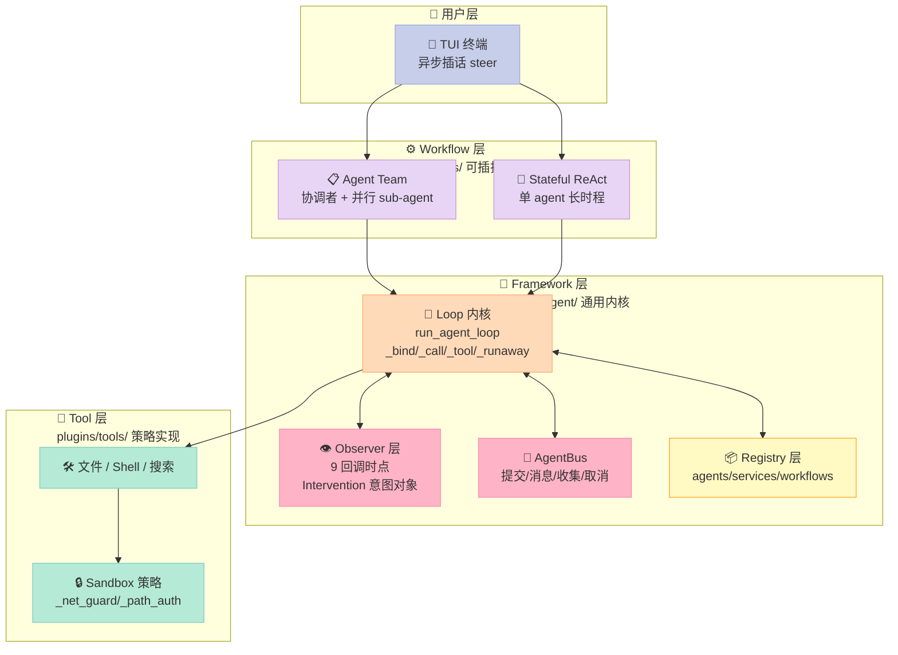
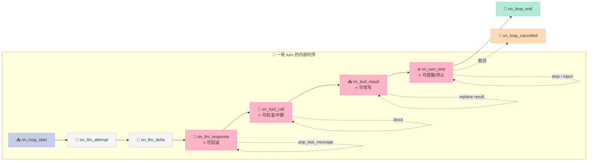
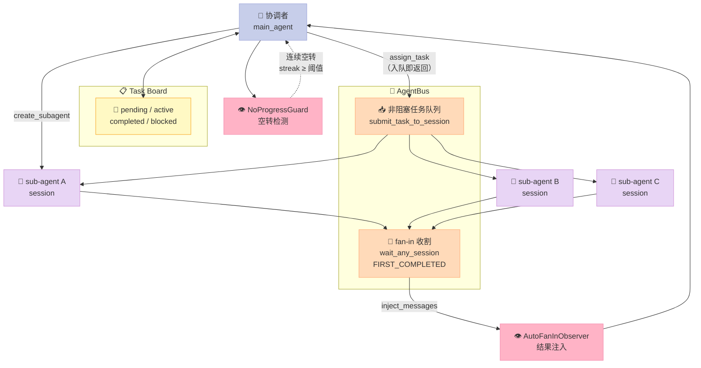

> 一个 5349⭐ 的开源 Agent 框架，核心 ReAct 内核代码并不公开。但它把**最值得学的那一层**——Observer 契约与 Intervention 机制——完整地留在了公开文档和可读的 observer 实现里。
>
> 这篇深度解析拆开 FrontierAgent 的三层结构，讲清楚一件事：**Harness 的能力上限不由模型决定，由"模型看不见的那部分"决定**。

---

## 前言：一个被藏在文档里的接口设计

如果你写过 Agent 框架，一定遇到过这个场景：

模型在第 37 轮又发起了和第 12 轮一模一样的 `web_search` 查询。你想在框架层拦住它，但你的框架只有两个地方可以下手——改 prompt，或者在工具函数里塞判断。前者浪费 token，后者会把"知道历史"的逻辑散落到每个工具里。

FrontierAgent（[ApodexAI/FrontierAgent](https://github.com/ApodexAI/FrontierAgent)，Apache-2.0，5349⭐）给出的答案是第三种：**Observer 契约 + Intervention 意图对象**。

先看一眼这个框架的处境。`frontier_agent/core/runtime/loop/agent_loop.py` 只有 5142 字符，而且开头就写明：

```python
"""FrontierAgent adapter for AgentCore's shared agent-loop engine.

The ReAct loop itself lives in :mod:`agent_core.runtime.loop.agent_loop`.
This module only injects the product runtime decisions through
:class:`AgentLoopHooks`: sticky-session binding, the execution scope, the wall
deadline, spill-file detection, and the tool execution policies.
"""
```

**真正的 loop 在 `agent_core` 里，而这个包不在公开仓库中**（`frontier_agent/core/loop_types.py` 只有 297 字符，是一个 `sys.modules` 重定向 shim）。

一个"源码不可读"的项目，值不值得写深度解析？我的判断是值得——因为 FrontierAgent 做了一个非常聪明的取舍：**闭源内核，开源契约**。它把内核当黑盒，但把"黑盒接受什么输入、吐出什么意图"完整公开了。而这一层，恰恰是所有 Harness 最值得学的部分。

读完这篇你会得到：

1. 一套 **9 回调时点**的 Observer 契约，以及为什么是"意图对象"而不是"直接改状态"
2. 两个**真实可读**的 observer 实现：`DuplicateQueryRollbackObserver`（重复搜索回滚）和 `NoProgressGuard`（协调者空转熔断）
3. 一份 **200+ 行的 Python MVP**，把契约剥干净后跑通，读完能自己复刻
4. 一个判断标准：**哪些能力该做成 observer，哪些该写进 prompt**（Less is More 的可操作版本）

---

## 一、项目定位：一个为"长时程复杂工作"设计的 Harness

### 1.1 它解决什么问题

FrontierAgent 的配套技术报告《Apodex 1.1: Scaling Agentic Intelligence for Complex Work》（arXiv:2608.23283）给了一个清晰的问题定义：

> General-purpose language models can reason and synthesize knowledge, but complex work also requires **sustained interaction** with files, information sources, and executable code, together with **state maintenance, failure recovery, and verifiable delivery**. We call this *working capability*.

关键词是 **working capability（工作能力）**——不是"答对一道题"，而是"在一段真实的时间里，持续、可验证地朝一个目标推进"。

论文把这项能力拆成两条独立的扩展轴：

| 维度 | 含义 | Harness 侧对应 |
|------|------|--------------|
| **Environment Scaling** | 可执行的文件 / 搜索 / 代码环境的多样性与可验证性 | Sandbox（`/inputs` `/workspace` `/outputs`） |
| **Agentic Coordination Scaling** | 分解长时程任务、并行委派、整合异步结果、重新规划 | AgentBus + Task Board + Agent Team workflow |

中间那条线是论文的原话："A shared execution harness and AgentOS maintain task state and provenance across tools and agents."

### 1.2 在 Harness 6 件套矩阵里的位置

| 组件 | FrontierAgent 的实现 | 深度 |
|------|---------------------|------|
| **Rule** | `plugins/tools/ignore_rules.py` + `apodex/fsguard.py` + `_bash_policy.py` | 中 |
| **Skill** | `components/skills/{allowlist_loader,file_system_loader}.py` | 薄（只是 loader） |
| **Sub-Agent** | **AgentBus**（`create_subagent` / `assign_task` / `collect_reports` / `stop_subagent`）+ `SpawnGuard` | **厚** |
| **Workflow** | `PipelineSpec` / `NodeDefinition` / `ContextPolicy` / `TransitionSpec` 声明式图 | **厚** |
| **Script** | `plugins/tools/_exec_cgroup.py` / `_render_check.py` / `_deliverable_policy.py` | 中 |
| **MCP** | 无（走 own plugin 目录 + tool registry） | 无 |

**结论：这是一篇 Sub-Agent × Workflow 交叉的深度文**。它最强的地方不是"框架大"，而是**多 Agent 之间的失速检测**——这是所有 multi-agent 框架都做、但很少有人把它做成可插拔机制的。

### 1.3 工程规模的真实量级

```
frontier_agent/   通用 loop、调度、注册表、AgentBus、observers
plugins/tools/    工具实现 + 沙箱策略
workflows/        pipeline spec、profile、prompt、workflow 自有 observer
benchmarks/       公开 harness + FrontierSearchBench/FrontierChallenge
```

780 个文件、314 个非 benchmark 的 Python 文件、**26 篇 docs**、一个 `frontier_search_bench` 带 41 条查询和官方评分器。CI 里跑 `ruff check` + 两阶段 `import_smoke` + `check_symbols` + `pytest`。

`docs/framework.md` 里有一句话点出了整个项目的品味：

> The framework layer has no dependency on `benchmarks`; CI enforces that boundary with a framework-only import smoke.

**框架层不许 import 评测层，CI 强制。** 这条边界看起来琐碎，但它决定了框架能不能被第三方复用。

---

## 二、架构分析：三层切分与"机制 vs 策略"

### 2.1 三层结构



这张图要读出三件事：

**第一，Workflow 层和 Framework 层是插件关系。** `workflows/agent_team/spec.py` 全文就是一个 `PipelineSpec` 字面量：

```python
SWARM_SPEC = PipelineSpec(
    pipeline_id=PIPELINE_ID,
    name="Agent Team",
    entry_point="main_agent",
    terminal_nodes=["main_agent", "agent_team_reporter"],
    nodes=[
        NodeDefinition(
            node_id="main_agent",
            role_id=MAIN_ROLE_ID,
            node_function="workflows.agent_team.nodes.main_agent.main_agent_node",
            context_policy=ContextPolicy(
                include_fields=["original_question", "current_query", "language",
                                "task_id", "metadata"],
            ),
            compression=CompressionConfig(enabled=False),
            output_fields=["final_answer", "final_content", "answer_confidence",
                           "evidence_cards", "assertions", "react_steps", ...],
        ),
        ...
    ],
)
```

**每个节点显式声明"我能看见哪些字段"（`ContextPolicy.include_fields`）和"我产出哪些字段"（`output_fields`）**。这不是装饰——这是 sub-agent 的 context 隔离机制，声明式。

**第二，Observer 层是横切的。** 它不属于任何 workflow，而是挂在 loop 内核上的 9 个时点。

**第三，Tool 层放"策略"，Framework 层放"机制"。** `_net_guard.py`（网络策略）、`_path_auth.py`（路径授权）、`_exec_cgroup.py`（cgroup 限制）都在 plugins 下，换 workflow 不用换。

### 2.2 数据流：一次 turn 的完整链路

```mermaid
sequenceDiagram
    actor U as 👤 用户
    participant Loop as 🔧 run_agent_loop
    participant Obs as 👁️ Observer 层
    participant LLM as 🤖 LLM
    participant Tool as 🔌 Tool

    U->>Loop: 提问
    Loop->>Obs: on_loop_start(config)
    Loop->>LLM: 请求（system + history）
    LLM-->>Loop: assistant + tool_calls
    Loop->>Obs: on_llm_response(ctx)

    alt Observer 返回 Intervention
        Obs-->>Loop: pop_last_message=true
        Loop->>Loop: 弹出消息，不消耗 turn 预算
        Loop->>LLM: 重新生成
    else 放行
        Loop->>Tool: 执行工具
        Tool-->>Loop: ToolResult
        Loop->>Obs: on_tool_result(ctx, result)
        Obs-->>Loop: 可改写 result（截断/脱敏/替换）
        Loop->>Obs: on_turn_end(ctx)
        Obs-->>Loop: 可注入提醒 / 强制停止
    end

    Loop-->>U: 最终答案
    Loop->>Obs: on_loop_end(ctx)
```

**关键点：`on_llm_response` 在工具执行之前。** 这是整个设计最精妙的一步——

> **Fires on `on_llm_response` — after the LLM emitted an assistant message with tool calls, *before* those tools run.**

在工具跑之前拦截，意味着你可以**丢弃整个 assistant 消息**。如果等到工具跑完再检测重复，你面对的是"已经花掉的 token 和已经产生的副作用"——只能记账，不能挽回。提前拦截把回滚成本降到了 0（除了重新生成那一次 LLM 调用）。

### 2.3 Less is More 检查：什么该做成 observer

这是 FrontierAgent 最值得学、也最容易被忽略的一层判断。文档里有一句话：

> Workflow semantics such as planning, terminal-tool behavior, reporter routing, and recovery belong **outside the kernel**.

我把它翻译成一条判断标准：

| 能力 | 该放哪 | 理由 |
|------|--------|------|
| 「先搜索再回答」 | **prompt** | 模型自己能学会，写成 observer 是浪费 |
| 「同一 query 连续发 37 次」 | **observer** | 模型没有跨轮次的历史感知，这是框架的"记忆" |
| 「这一轮含终结工具」 | **observer** | 模型看不见 loop 的完整批次语义 |
| 「`/inputs` 只读」 | **sandbox** | 文件权限是 OS 事实，不是 prompt 能约束的 |
| 「sub-agent 名字要用 dash」 | **工具参数校验** | 名字不合法是调用错误，不是运行时问题 |

第 2 行是理解 Observer 存在意义的关键：**Observer 补的是模型的"感知盲区"，不是模型的"智力短板"。**

---

## 三、核心机制：Observer 契约与 Intervention

### 3.1 九个回调时点

`docs/framework.md` 给出了完整契约：

| 回调 | 时机 | 用途 |
|------|------|------|
| `on_loop_start` | 循环开始 | 初始化 per-run 状态 |
| `on_llm_attempt` | 每次 LLM 重试 | 观察重试、provider 尝试、失败 |
| `on_llm_delta` | 流式分片 | 检查流式输出 |
| `on_llm_response` | assistant 消息完成 | **校验或改写完成的 turn** |
| `on_tool_call` | 工具调用前 | **批准、注解或中断**工具调用 |
| `on_tool_result` | 工具返回后 | 检查并重塑工具结果 |
| `on_turn_end` | 一轮结束 | 应用轮次级停止或重试策略 |
| `on_loop_end` | 循环结束 | 最终遥测与清理 |
| `on_loop_cancelled` | 循环被取消 | 取消安全的清理 |



文档里还有一条容易被忽略但极重要的规则：

> Observer failures are handled according to the loop contract; cleanup and telemetry should remain **best-effort**, while **authorization observers must fail closed**.

翻译：**清理类 observer 挂了不要紧，授权类 observer 挂了必须拒绝执行。** 同一套机制，不同 observer 有不同的失败语义——这是"机制与策略分离"必须付出的额外设计成本。

### 3.2 Intervention：意图对象，而不是状态修改

这是整个契约的灵魂。Observer 不直接操作 loop 内部状态，而是返回一个**意图对象**：

```python
@dataclass
class Intervention:
    """Observer 对循环的"介入"指令。"""
    pop_last_message: bool = False        # 弹出最后一条 assistant 消息
    continue_to_next_turn: bool = False   # 不消耗 turn 预算，直接下一轮
    inject_messages: list[str] = field(default_factory=list)  # 注入消息
    retry: bool = False                   # 强制重试本轮
    stop: bool = False                    # 终止循环
```

为什么是意图对象而不是直接改？三个理由：

**1. 可测试。** Observer 的单元测试不需要跑一个 loop——给它一个 `TurnContext`，断言返回的 `Intervention` 字段即可。FrontierAgent 自己的 `docs/workflows.md` 把这条写进了测试要求："pure observer and parsing behavior"。

**2. loop 掌握执行时机。** Observer 说"我要回滚这一轮"，但**怎么回滚**（重生成几次？用哪个温度？要不要保留部分工具结果？）是 loop 的策略。这样内核可以在不改任何 observer 的前提下调整回滚策略。

**3. 意图可以组合。** 多个 observer 同时返回 `Intervention` 时，loop 需要一套确定的合并规则——而这规则只写一次。

### 3.3 真实实现 ①：DuplicateQueryRollbackObserver

这个 observer 完整可读，在 `frontier_agent/components/observers/duplicate_query_rollback.py`（12414 字符）。它的文档字符串开头就是实测数据：

> Measured on a 200-question deep-research benchmark, the losing trials averaged **~37 duplicate `web_search` queries each** and ran **58-122 turns** where a healthy trial finishes in **~22**: the identical results pile up in history, inflate the context, and steer the model into a longer wandering loop.

**37 次重复搜索、58-122 轮 vs 健康 trial 的 22 轮。** 这是"模型看不见的历史"造成浪费的量化证据。

核心逻辑：

```python
class DuplicateQueryRollbackObserver(BaseObserver):
    """Roll back a turn whose search request was already executed.

    ``critical`` so the loop awaits the hook and collects the returned
    ``Intervention`` — a non-critical observer's return value is dropped.
    """

    critical: bool = True

    DEFAULT_TOOL_NAMES: frozenset[str] = frozenset({"web_search"})

    def __init__(
        self,
        *,
        tool_names: set[str] | frozenset[str] | None = None,
        max_consecutive_rollbacks: int = 5,
    ) -> None:
        self._tool_names = frozenset(
            tool_names if tool_names else self.DEFAULT_TOOL_NAMES,
        )
        # 2 is the floor: 1 would mean "never roll back" (the budget check
        # is ``< max - 1``), which silently disables the observer.
        self._max_consecutive_rollbacks = max(2, int(max_consecutive_rollbacks))
        self._seen: dict[str, int] = {}
        self._consecutive_rollbacks = 0
        self._terminal_tools: frozenset[str] = _TERMINAL_TOOL_FLOOR
```

**注意 `critical: bool = True` 的语义**——非 critical observer 的返回值会被 loop 丢弃。这是契约里必须显式声明的东西，很多 Hook 框架会漏掉。

回滚决策：

```python
    async def on_llm_response(self, ctx: TurnContext) -> Intervention | None:
        if not ctx.tool_calls:
            # A think-only / bare-text turn is not a rollback candidate;
            # refresh the budget so the next tracked turn starts clean.
            self._consecutive_rollbacks = 0
            return None

        turn_keys: list[str] = []
        for tool_call in ctx.tool_calls:
            if str(tool_call.get("name") or "") not in self._tool_names:
                continue
            key = _dedup_key(tool_call)
            if key:
                turn_keys.append(key)

        if not turn_keys:
            # Untracked tools only (web_fetch / bash / …). Leave the
            # counter alone and let the next tracked turn manage it.
            return None

        if any(
            str(tool_call.get("name") or "") in self._terminal_tools
            for tool_call in ctx.tool_calls
        ):
            # Never pop a turn that is trying to finish — the terminal call
            # would be discarded with the duplicate and never re-run.
            logger.info(
                "DuplicateQueryRollback turn=%d: batch carries a terminal "
                "tool; letting it through without dedup bookkeeping.",
                ctx.turn,
            )
            return None

        duplicates = [key for key in turn_keys if self._seen.get(key, 0) > 0]

        if duplicates and (
            self._consecutive_rollbacks < self._max_consecutive_rollbacks - 1
        ):
            self._consecutive_rollbacks += 1
            logger.info(
                "DuplicateQueryRollback turn=%d: %d duplicate search call(s) "
                "— popping the assistant message and retrying (rollback "
                "%d/%d). Example: %r",
                ctx.turn, len(duplicates),
                self._consecutive_rollbacks,
                self._max_consecutive_rollbacks,
                duplicates[0][:160],
            )
            return Intervention(
                pop_last_message=True,
                continue_to_next_turn=True,
            )
```

这里面藏着 **四个**精心设计的细节，每一个都能独立成一节：

#### 细节 1：终结工具保护

```python
if any(... in self._terminal_tools for tool_call in ctx.tool_calls):
    return None   # 放行
```

**为什么必要？** 回滚是"弹出整条 assistant 消息"。如果这一批工具调用里既有重复的 `web_search` 又有 `submit_report`，弹出消息意味着 **`submit_report` 一起被丢掉，而且永远不会重跑**——因为 loop 在 `_execute_tool_calls` 之前就返回了，`FinalizeAnswerObserver` 根本看不到它。

这是一类典型的"修复一个 bug，制造另一个 bug"。作者的处理是：**宁可不去重，也不能丢终结调用。**

#### 细节 2：批次粒度，不是单查询粒度

> **Key granularity — batch, not per-query.** `web_search` accepts a list of queries, and the whole call is one dedup unit: `[a, b]` and `[a, c]` are different searches, so a model refining a batch incrementally is never rolled back. Keying on individual queries instead fires an order of magnitude more often and pops legitimate query evolution.

模型经常这样演化查询：`["A", "B"]` → `["A", "C"]`。按单查询算 key，"A" 重复了 → 回滚 → 但模型本来只是想改第二个查询。按整批算 key → 不同 → 放行。

**"order of magnitude more often"** —— 作者用了量级词，说明这个选择不是审美，是实测。

#### 细节 3：失败的搜索不记账

```python
    async def on_tool_result(self, ctx, result) -> ToolResult | None:
        """Remember a tracked request once it returned usable content."""
        if _is_failed_search(result):
            logger.info(
                "DuplicateQueryRollback: %s returned no usable content; not "
                "recording it, so a retry is allowed.",
                result.name,
            )
            return None
        key = _dedup_key({"name": result.name, "args": result.args})
        if key:
            self._seen[key] = self._seen.get(key, 0) + 1
        return None
```

**记账发生在 `on_tool_result`，不是放行的时候。** 因为搜索失败（`"[ERROR]: ..."`、`"No search results found."`）时**重跑同一个 query 恰恰是正确做法**——网络抖动、上游限流，都需要重试。

如果放行时就记账，一个瞬时故障会永久堵死这条查询路径。

#### 细节 4：q 参数的 JSON 归一化

```python
def _coerce_str_list(value: Any) -> Any:
    """Parse a JSON-list string into a list; pass everything else through.

    Deliberately mirrors ``plugins.tools._coerce.coerce_json_list`` instead
    of importing it: nothing under ``frontier_agent/`` imports from
    ``plugins/``, and this observer is not the place to open that direction.
    The behaviour has to match, because the search tool runs the same
    coercion on its own ``q`` — models emit the SAME logical batch both as a
    real array and as a stringified one, and a key that does not coerce
    would file the two forms under different keys and miss the duplicate.
    """
```

这段注释信息量极大：

1. **模型会把同一批 query 写成真 list 或 JSON 字符串**——两种形式必须归一化，否则同一批查询被登记成两个 key，去重彻底失效
2. **不 import `plugins/`**——依赖方向单向，`frontier_agent/` 不依赖 `plugins/`
3. **但行为必须一致**——所以复制实现而不是 import

第 3 点尤其值得品味：**为了保持依赖方向干净，作者选择复制代码而不是打破分层，并且明确写下为什么这个副本不能漂移。** 这是 Harness 工程里非常典型的取舍。

### 3.4 真实实现 ②：NoProgressGuard

第二个 observer 在 `workflows/agent_team/observers/no_progress_guard.py`（9884 字符），它解决的是**多 Agent 特有的失速**：协调者不停 `create_subagent` + `assign_task` + `collect_reports`，但没有任何 sub-agent 真正交回报告。

```python
# Extracts the ``agent="…"`` name from every ``<report agent="…">`` block
# in a collect_reports result. A name other than the orchestrator means a
# sub-agent actually delivered a report (real progress); an orchestrator-only
# result is a status-only notice (no_work_queued / all_collected).
_REPORT_AGENT_RE = re.compile(r'<report\s+agent="([^"]*)"')

# Session-churn tools. A turn calling ONLY these does no first-hand work —
# it just manages the sub-agent roster. Board tools (add_task / update_task),
# data-gathering tools, and finalize_answer are deliberately excluded: they
# represent progress and reset the streak.
_MGMT_TOOLS = frozenset({
    "create_subagent",
    "assign_task",
    "collect_reports",
    "stop_subagent",
})
```

**"什么算进展"被定义成一个白名单之外的黑名单**——只有这 4 个"会话 churning"工具算空转，其他任何工具调用都算进展并重置 streak。

再看阈值参数：

```python
def __init__(
    self,
    *,
    soft_streak: int = 6,
    hard_streak: int = 12,
    min_repeated_creates: int = 3,
    cooldown_turns: int = 3,
) -> None:
```

**软提醒（streak ≥ 6）→ 注入一段提示；硬熔断（streak ≥ 12）→ 直接停止循环。** 两级阈值 + 冷却期，是熔断器（circuit breaker）模式在 Agent 层的应用。

而"退化分配"检测更狠：

```python
# Trivial task prompts a wind-down spin assigns to throwaway agents. Used
# only to ACCELERATE the hard stop (strong signal the agent is not doing
# real work), never as the sole trigger.
_DEGENERATE_PROMPTS = frozenset({
    "end", "done", "complete", "completed", "final", "finalize", "finish",
    "finished", "x", "ok", "okay", "stop", "confirm", "nothing", "na", "n/a",
})
```

模型在"收尾幻觉"里会给 sub-agent 派发 `"End."`、`"OK"` 这种无意义任务，然后立刻"收到报告"。**检测出退化分配会加速硬熔断，但退化分配本身不能单独触发熔断**——注释里明写 "never as the sole trigger"。

这个"辅助信号不能单独触发"的模式，在 Harness 里非常值得抄。

### 3.5 AgentBus：非阻塞的 sub-agent 调度



`plugins/tools/assign_task.py` 有 43145 字符，其中一个常量配着一条极有说服力的注释：

```python
# Actual concurrency is bounded by SpawnGuard(max_parallel).
# Raise via FRONTIER_AGENT_MAX_TASKS_PER_DISPATCH.
MAX_TASKS_PER_DISPATCH: int = int(
    os.environ.get("FRONTIER_AGENT_MAX_TASKS_PER_DISPATCH", "20")
)

# Hard cap on tasks per session. Past ~5 reuses the message history is
# dominated by stale tool stubs and earlier conclusions, and the agent
# starts anchoring on a prior (often wrong) answer instead of doing fresh
# work — heavily-reused sessions score far below fresh ones. The limit
# forces the main agent to spawn a new specialist instead of poisoning a
# saturated session.
MAX_TASKS_PER_SESSION = 5
```

**"heavily-reused sessions score far below fresh ones"（重度复用的 session 得分远低于全新 session）。**

这条注释的价值在于它把一个**架构约束**和**实测结果**直接挂钩了。为什么 session 复用会掉分？因为 session 保留着历史消息历史，里面塞满了过期的 tool stub 和早期结论，模型开始**锚定在先前的（往往是错的）答案上**。

这不是"session 满了就清空"能解决的问题——清空就等于新 session。真正的解法是**在 session 饱和前强制换一个专职 agent**。

这里的 API 形状和 Anthropic 的多 Agent 模式高度对应，但有一个关键差异：

```python
@tool
def assign_task(...):
    """Tool: assign_task — non-blocking task dispatch to persistent sub-agents.

    Wraps AgentBus.submit_task_to_session. Each call queues a task on a
    previously-created session; the task runs in the background. Use
    ``collect_reports`` to fetch results (FIRST_COMPLETED semantics).
    """
```

**`assign_task` 是非阻塞的**——它只是入队，立刻返回。真正取结果靠 `collect_reports`，语义是 `FIRST_COMPLETED`（先完成先返回）。

配合 `AutoFanInObserver`：

```python
class AutoFanInObserver(BaseObserver):
    """Drain completed sub-agent reports on turn_end and inject them."""
    critical: bool = True

    async def on_turn_end(self, ctx: TurnContext) -> Intervention | None:
        bus = registry.get_optional(AgentBus)
        if bus is None:
            return None

        collected: list[tuple[str, SubAgentResult]] = []
        while True:
            ready = await bus.wait_any_session(ctx.task_id, timeout=0.0)
            if ready is None:
                break
            collected.append(ready)

        if not collected:
            return None

        batch = process_collected(bus, ctx.task_id, collected)
        ...
        return Intervention(inject_messages=["\n\n".join([*batch.blocks, status])])
```

**协调者的循环不阻塞等待 sub-agent。** 它继续做自己的事，每轮结束时 `AutoFanInObserver` 把已完成的结果"收割"进来。这就是 Async/await 语义在 Agent 层的落地——**协调者永远不阻塞，sub-agent 完成时通过 fan-in 汇入上下文**。

---

## 四、MVP：200 行复刻 Observer 契约

下面这份代码从 FrontierAgent 抽离核心机制，剥掉了 LLM 调用、sandbox、AgentBus、telemetry 等 90% 的噪声，保留最有教学价值的部分。**它已实测跑通**，输出见文末。

```python
"""
MVP: FrontierAgent Observer / Intervention 契约的可运行复刻
来源: https://github.com/ApodexAI/FrontierAgent

抽离的核心机制：
  1. Observer 契约 —— 9 个回调时点，observer 只实现自己需要的
  2. Intervention 机制 —— observer 通过返回值"介入"循环，而不是直接改状态
  3. DuplicateQueryRollbackObserver —— 重复搜索回滚（真实源码逻辑 1:1 复刻）
  4. NoProgressGuard —— 协调者空转熔断（真实源码逻辑 1:1 复刻）
"""

from __future__ import annotations

import json
import logging
import re
from dataclasses import dataclass, field
from typing import Any, Protocol

logging.basicConfig(level=logging.INFO, format="%(levelname)s %(message)s")
logger = logging.getLogger("mvp")


# =============================================================================
# 第一部分：核心契约（对应 FrontierAgent 的 agent_core.loop_types）
# =============================================================================

@dataclass
class ToolResult:
    """一次工具调用的结果。"""
    name: str
    args: dict[str, Any]
    result: str = ""
    is_error: bool = False


@dataclass
class TurnContext:
    """一轮（turn）的上下文 —— observer 回调能看到的全部信息。"""
    turn: int
    task_id: str = "task-0"
    tool_calls: list[dict[str, Any]] = field(default_factory=list)
    messages: list[str] = field(default_factory=list)


@dataclass
class Intervention:
    """Observer 对循环的"介入"指令。

    这是 FrontierAgent 最有价值的设计：observer 不直接操作循环内部状态，
    而是返回一个意图对象，由 loop 决定怎么执行。这样 observer 保持纯粹、可测、
    可组合 —— 机制在 loop 里，策略在 observer 里。
    """
    pop_last_message: bool = False        # 弹出最后一条 assistant 消息
    continue_to_next_turn: bool = False   # 不消耗 turn 预算，直接下一轮
    inject_messages: list[str] = field(default_factory=list)  # 注入消息
    retry: bool = False                   # 强制重试本轮
    stop: bool = False                    # 终止循环


@dataclass
class LoopConfig:
    loop_id: str = "loop-0"
    task_id: str = "task-0"
    max_turns: int = 10
    # EXTRA_ATTEMPTS_BUFFER —— 回滚/重试不消耗的额外迭代次数上限
    extra_attempts_buffer: int = 3


class BaseObserver(Protocol):
    """Observer 契约：9 个回调时点，全是可选的。"""
    critical: bool = False

    async def on_loop_start(self, config: LoopConfig) -> None: ...
    async def on_llm_response(self, ctx: TurnContext) -> Intervention | None: ...
    async def on_tool_call(self, ctx: TurnContext) -> Intervention | None: ...
    async def on_tool_result(self, ctx: TurnContext, result: ToolResult) -> ToolResult | None: ...
    async def on_turn_end(self, ctx: TurnContext) -> Intervention | None: ...
    async def on_loop_end(self, ctx: TurnContext) -> None: ...


# =============================================================================
# 第二部分：DuplicateQueryRollbackObserver（1:1 复刻真实源码逻辑）
# =============================================================================

# 只影响"返回多少行"的参数不进 key；其余参数决定"返回哪一批结果"，必须进 key
_COUNT_ARG_KEYS = frozenset({"num", "num_results"})

# 表示"这次搜索没返回可用内容"的结果串 —— 失败的搜索不该被记住，
# 因为重跑同一个 query 恰恰是失败时正确的做法
_FAILED_RESULT_PREFIXES = ("[ERROR]:", "No results found for:", "Error: search query cannot be empty.")
_FAILED_RESULT_EXACT = frozenset({"No search results found."})

# 会终结循环的工具 —— 含它们的轮次绝不能被回滚
_TERMINAL_TOOL_FLOOR = frozenset({"submit_report", "finalize_answer", "finish_planning"})


def _coerce_str_list(value: Any) -> Any:
    """模型可能把 query 列表写成真正的 list，也可能写成 JSON 字符串。

    两种形式语义相同，必须归一化 —— 否则同一批查询会被登记成两个不同的 key，
    去重就失效了。
    """
    if not isinstance(value, str):
        return value
    stripped = value.strip()
    if not stripped.startswith(("[", "{")):
        return value
    try:
        parsed = json.loads(stripped)
    except (json.JSONDecodeError, ValueError):
        return value
    if isinstance(parsed, dict):
        return [parsed]
    return parsed


def _normalise_q(value: Any) -> str | None:
    """把 q 参数渲染成一个稳定的字符串，空则返回 None。"""
    coerced = _coerce_str_list(value)
    if isinstance(coerced, str):
        stripped = coerced.strip()
        return stripped or None
    if isinstance(coerced, list):
        parts = [i.strip() for i in coerced if isinstance(i, str) and i.strip()]
        return "|".join(parts) if parts else None
    return None


def _is_failed_search(result: ToolResult) -> bool:
    if result.is_error:
        return True
    text = (result.result or "").strip()
    if not text or text in _FAILED_RESULT_EXACT:
        return True
    return text.startswith(_FAILED_RESULT_PREFIXES)


def _dedup_key(tool_call: dict[str, Any]) -> str | None:
    """为一个工具调用构造去重 key；无法追踪则返回 None。

    契约：no-raise —— 这条路径在关键链路上，抛异常的代价是丢掉当前这一轮。
    没有可用 q 的调用按"不可追踪"处理，而不是拿剩下的参数（比如 locale）当 key，
    否则会把毫不相关的查询折叠成一个。
    """
    name = str(tool_call.get("name") or "")
    if not name:
        return None
    args = tool_call.get("args")
    if not isinstance(args, dict):
        return None
    q = _normalise_q(args.get("q"))
    if q is None:
        return None
    rest = {
        k: v for k, v in args.items()
        if k != "q" and k not in _COUNT_ARG_KEYS and v is not None
    }
    try:
        suffix = json.dumps(rest, sort_keys=True, default=str)
    except (TypeError, ValueError):
        suffix = repr(sorted(rest))
    return f"{name}_{q}_{suffix}"


class DuplicateQueryRollbackObserver:
    """回滚那些重复发起搜索请求的轮次。

    critical = True —— loop 会 await 这个 hook 并收集它返回的 Intervention；
    非 critical observer 的返回值会被丢弃。
    """

    critical: bool = True
    DEFAULT_TOOL_NAMES: frozenset[str] = frozenset({"web_search"})

    def __init__(
        self,
        *,
        tool_names: set[str] | frozenset[str] | None = None,
        max_consecutive_rollbacks: int = 5,
    ) -> None:
        self._tool_names = frozenset(tool_names if tool_names else self.DEFAULT_TOOL_NAMES)
        # 2 是下限：1 意味着"永不回滚"（预算判断是 < max - 1），会静默禁用 observer
        self._max_consecutive_rollbacks = max(2, int(max_consecutive_rollbacks))
        self._seen: dict[str, int] = {}
        self._consecutive_rollbacks = 0
        self._terminal_tools: frozenset[str] = _TERMINAL_TOOL_FLOOR

    async def on_loop_start(self, config: LoopConfig) -> None:
        self._seen.clear()
        self._consecutive_rollbacks = 0
        policy_terminals = {
            str(n) for n in getattr(
                getattr(config, "loop_policy", None), "terminal_tool_names", ()
            ) if str(n)
        }
        self._terminal_tools = _TERMINAL_TOOL_FLOOR | policy_terminals

    async def on_llm_response(self, ctx: TurnContext) -> Intervention | None:
        if not ctx.tool_calls:
            # 纯思考/纯文本轮次不是回滚候选；同时刷新预算，让下一轮追踪轮次干净起步
            self._consecutive_rollbacks = 0
            return None

        turn_keys: list[str] = []
        for tc in ctx.tool_calls:
            if str(tc.get("name") or "") not in self._tool_names:
                continue
            k = _dedup_key(tc)
            if k:
                turn_keys.append(k)

        if not turn_keys:
            # 只有未追踪的工具（web_fetch / bash …）—— 不动计数器
            return None

        if any(str(tc.get("name") or "") in self._terminal_tools for tc in ctx.tool_calls):
            # 绝不弹出正在收尾的轮次：终结调用会跟重复搜索一起被丢掉，永远不会重跑
            logger.info(
                "DuplicateQueryRollback turn=%d: 批次含终结工具，放行不做去重记账。", ctx.turn
            )
            return None

        duplicates = [k for k in turn_keys if self._seen.get(k, 0) > 0]

        if duplicates and (self._consecutive_rollbacks < self._max_consecutive_rollbacks - 1):
            self._consecutive_rollbacks += 1
            logger.info(
                "DuplicateQueryRollback turn=%d: %d 个重复搜索 —— 弹出 assistant 消息并重试"
                "（回滚 %d/%d）。示例: %r",
                ctx.turn, len(duplicates), self._consecutive_rollbacks,
                self._max_consecutive_rollbacks, duplicates[0][:80],
            )
            return Intervention(pop_last_message=True, continue_to_next_turn=True)

        if not duplicates:
            self._consecutive_rollbacks = 0
        else:
            logger.warning(
                "DuplicateQueryRollback turn=%d: 回滚预算耗尽（连续 %d 次）—— 放行重复搜索。",
                ctx.turn, self._consecutive_rollbacks,
            )
        return None

    async def on_tool_result(self, ctx: TurnContext, result: ToolResult) -> ToolResult | None:
        """搜索真正返回了可用内容之后，才记住这个请求。"""
        del ctx
        if result is None or str(result.name or "") not in self._tool_names:
            return None
        if _is_failed_search(result):
            logger.info(
                "DuplicateQueryRollback: %s 没返回可用内容，不记账，允许重试。", result.name
            )
            return None
        key = _dedup_key({"name": result.name, "args": result.args})
        if key:
            self._seen[key] = self._seen.get(key, 0) + 1
        return None


# =============================================================================
# 第三部分：NoProgressGuard（协调者空转熔断，1:1 复刻真实源码逻辑）
# =============================================================================

_REPORT_AGENT_RE = re.compile(r'<report\s+agent="([^"]*)"')
_MIN_MEANINGFUL_PROMPT_LEN = 8

# 只调用这些工具的轮次 = 只在管理 sub-agent 名册，没有第一手产出
_MGMT_TOOLS = frozenset({"create_subagent", "assign_task", "collect_reports", "stop_subagent"})

# 空转提示词 —— 只是加速硬熔断，绝不单独作为触发条件
_DEGENERATE_PROMPTS = frozenset({
    "end", "done", "complete", "completed", "final", "finalize", "finish",
    "finished", "x", "ok", "okay", "stop", "confirm", "nothing", "na", "n/a",
})


class NoProgressGuard:
    """打断主协调者的"创建/分配"空转循环。

    协调者反复 create_subagent + assign_task + collect_reports，但没有任何
    sub-agent 真正交回报告 —— 这时候它已经把整个 turn 预算烧完了。
    """

    critical: bool = True

    def __init__(
        self,
        *,
        soft_streak: int = 6,
        hard_streak: int = 12,
        min_repeated_creates: int = 3,
        cooldown_turns: int = 3,
    ) -> None:
        self._soft_streak = max(1, int(soft_streak))
        self._hard_streak = max(self._soft_streak + 1, int(hard_streak))
        self._min_repeated_creates = max(2, int(min_repeated_creates))
        self._cooldown_turns = max(1, int(cooldown_turns))
        self._reset()
        self._mgmt_turn_has_work = True
        self._report_agents_this_turn: set[str] = set()
        self._degenerate_assignment_agents: set[str] = set()

    def _reset(self) -> None:
        self._mgmt_streak = 0
        self._creates_in_streak = 0
        self._degenerate_in_streak = 0

    async def on_loop_start(self, config: LoopConfig) -> None:
        self._reset()
        self._mgmt_turn_has_work = True
        self._report_agents_this_turn.clear()
        self._degenerate_assignment_agents.clear()

    def _prompt_is_degenerate(self, prompt: str) -> bool:
        stripped = prompt.strip().rstrip(".,!?。！？").lower()
        if stripped in _DEGENERATE_PROMPTS:
            return True
        return len(stripped) < _MIN_MEANINGFUL_PROMPT_LEN

    async def on_tool_result(
        self, ctx: TurnContext, result: ToolResult
    ) -> ToolResult | None:
        name = str(result.name or "")
        args = result.args if isinstance(result.args, dict) else {}
        text = result.result or ""

        if name == "collect_reports":
            # 只有 orchestrator 自己的报告 = 状态通知，没有真实产出
            agents = set(_REPORT_AGENT_RE.findall(text))
            self._report_agents_this_turn = agents
            real = {a for a in agents if a != "orchestrator"}
            if real:
                # 真的有 sub-agent 交回了报告 —— 本轮有进展
                self._mgmt_turn_has_work = True
                self._mgmt_streak = 0
                self._creates_in_streak = 0
            return None

        if name == "assign_task":
            prompt = str(args.get("prompt") or args.get("task") or "")
            agent = str(args.get("agent") or "")
            if agent and self._prompt_is_degenerate(prompt):
                self._degenerate_assignment_agents.add(agent)
            self._mgmt_turn_has_work = False  # 分配任务不等于第一手产出
            return None

        if name == "create_subagent":
            self._creates_in_streak += 1
            self._mgmt_turn_has_work = False
            return None

        if name in _MGMT_TOOLS:
            self._mgmt_turn_has_work = False  # 管理动作不算第一手产出
        else:
            # 有第一手工作 —— 本轮算作有进展
            self._mgmt_turn_has_work = True
        return None

    async def on_turn_end(self, ctx: TurnContext) -> Intervention | None:
        # 本轮整轮只有管理动作 → streak +1；否则 streak 归零
        if self._mgmt_turn_has_work:
            self._mgmt_streak = 0
        else:
            self._mgmt_streak += 1
        self._mgmt_turn_has_work = True  # 为下一轮重置标记

        if self._mgmt_streak < self._soft_streak:
            return None
        if self._creates_in_streak < self._min_repeated_creates:
            return None

        hard = self._mgmt_streak >= self._hard_streak
        degenerate = bool(self._degenerate_assignment_agents & self._report_agents_this_turn)

        if hard or degenerate:
            logger.warning(
                "NoProgressGuard turn=%d: 连续 %d 轮只做管理动作（创建 %d 次，"
                "退化分配 %s）—— 强制停止。",
                ctx.turn, self._mgmt_streak, self._creates_in_streak,
                sorted(self._degenerate_assignment_agents & self._report_agents_this_turn),
            )
            return Intervention(stop=True)

        logger.info(
            "NoProgressGuard turn=%d: 连续 %d 轮管理动作但未达硬阈值 —— 软提醒。",
            ctx.turn, self._mgmt_streak,
        )
        return Intervention(
            inject_messages=[
                "[NoProgressGuard] 你已经连续多轮只创建/分配任务而没有拿到任何真实产出。"
                "请停止创建新的 sub-agent，先收集已有 sub-agent 的结果，"
                "或直接基于已获得的信息作答。"
            ]
        )


# =============================================================================
# 第四部分：一个最小 loop，把 observer 契约跑起来
# =============================================================================

class MiniLoop:
    """最小的 ReAct loop —— 只为演示 observer 契约。"""

    def __init__(self, config: LoopConfig, observers: list[Any]):
        self.config = config
        self.observers = observers
        self.messages: list[str] = []
        self.turn = 0
        self.extra_attempts = 0
        self.stopped_by: str | None = None

    async def _notify_loop_start(self) -> None:
        # observer 只需实现自己关心的回调 —— 缺失的回调直接跳过
        for ob in self.observers:
            cb = getattr(ob, "on_loop_start", None)
            if cb is not None:
                await cb(self.config)

    async def _notify_llm_response(self, ctx: TurnContext) -> list[Intervention]:
        out = []
        for ob in self.observers:
            if not getattr(ob, "critical", False):
                continue
            cb = getattr(ob, "on_llm_response", None)
            if cb is None:
                continue
            iv = await cb(ctx)
            if iv is not None:
                out.append(iv)
        return out

    async def _notify_tool_result(self, ctx: TurnContext, result: ToolResult) -> None:
        for ob in self.observers:
            cb = getattr(ob, "on_tool_result", None)
            if cb is None:
                continue
            await cb(ctx, result)

    async def _notify_turn_end(self, ctx: TurnContext) -> list[Intervention]:
        out = []
        for ob in self.observers:
            if not getattr(ob, "critical", False):
                continue
            cb = getattr(ob, "on_turn_end", None)
            if cb is None:
                continue
            iv = await cb(ctx)
            if iv is not None:
                out.append(iv)
        return out

    async def run(self, script: list[dict[str, Any]]) -> None:
        """script: 每轮 LLM 会发出的 tool_calls + 对应的工具结果。"""
        await self._notify_loop_start()
        idx = 0
        while self.turn < self.config.max_turns:
            if idx >= len(script):
                break
            step = script[idx]
            ctx = TurnContext(turn=self.turn, tool_calls=step["calls"])

            # --- LLM 响应后：observer 可以"回滚"这一轮 ---
            interventions = await self._notify_llm_response(ctx)
            rollback = next(
                (iv for iv in interventions if iv.pop_last_message), None
            )
            if rollback is not None:
                # 弹出 assistant 消息 + 不消耗 turn 预算
                self.messages = self.messages[:-1] if self.messages else self.messages
                if self.extra_attempts >= self.config.extra_attempts_buffer:
                    logger.info("extra_attempts_buffer 耗尽，接受这次重复，继续执行本轮工具。")
                    self.turn += 1
                    self.extra_attempts = 0
                else:
                    self.extra_attempts += 1
                    logger.info(
                        "  ↺ 回滚 turn %d（重复搜索），不计入 turn 预算"
                        "（extra_attempts=%d/%d）—— 重新生成这一轮",
                        self.turn, self.extra_attempts, self.config.extra_attempts_buffer,
                    )
                    self.turn += 1
                    idx += 1  # MVP：模拟 LLM 重新采样后给出新动作
                    continue

            self.turn += 1
            self.extra_attempts = 0

            # --- 执行工具 ---
            for res in step["results"]:
                await self._notify_tool_result(ctx, res)
                self.messages.append(f"[tool:{res.name}] {res.result[:80]}")

            # --- 轮次结束：observer 可以注入提醒或强制停止 ---
            end_interventions = await self._notify_turn_end(ctx)
            for iv in end_interventions:
                if iv.inject_messages:
                    self.messages.extend(iv.inject_messages)
                if iv.stop:
                    self.stopped_by = "observer"
                    logger.info("  ⛔ loop 被 observer 强制停止于 turn %d", self.turn)
                    return
            idx += 1
        if self.stopped_by is None:
            self.stopped_by = "max_turns"


# =============================================================================
# 第五部分：演示
# =============================================================================

async def demo_duplicate_query_rollback() -> None:
    print("\n" + "=" * 74)
    print("场景 1：DuplicateQueryRollback —— 模型重复发起同一个搜索")
    print("=" * 74)

    cfg = LoopConfig(max_turns=6, extra_attempts_buffer=2)
    obs = DuplicateQueryRollbackObserver(max_consecutive_rollbacks=5)
    loop = MiniLoop(cfg, [obs])

    def sr(q: str, ok: bool = True) -> ToolResult:
        return ToolResult(
            name="web_search", args={"q": q},
            result="[3 results]" if ok else "No search results found.",
        )

    script = [
        # turn 0：第一次搜 "swe-bench verified"
        {"calls": [{"name": "web_search", "args": {"q": "swe-bench verified"}}],
         "results": [sr("swe-bench verified")]},
        # turn 1：模型又发了同一个查询（q 是 JSON 字符串形式 —— 归一化后仍应判为重复）
        {"calls": [{"name": "web_search", "args": {"q": '["swe-bench verified"]'}}],
         "results": [sr("swe-bench verified")]},
        # turn 2：模型换了查询 —— 应该放行
        {"calls": [{"name": "web_search", "args": {"q": "swe-bench 2.0 leaderboard"}}],
         "results": [sr("swe-bench 2.0 leaderboard")]},
        # turn 3：批次里含终结工具 —— 即使有重复也必须放行
        {"calls": [{"name": "web_search", "args": {"q": "swe-bench verified"}},
                   {"name": "submit_report", "args": {"body": "final"}}],
         "results": [sr("swe-bench verified")]},
    ]

    await loop.run(script)
    print(f"\n→ 最终 turn 数: {loop.turn}（原始脚本只有 4 步）")
    print(f"→ 停止原因: {loop.stopped_by}")
    print(f"→ 上下文消息数: {len(loop.messages)}")


async def demo_no_progress_guard() -> None:
    print("\n" + "=" * 74)
    print("场景 2：NoProgressGuard —— 协调者反复创建 sub-agent 却拿不到报告")
    print("=" * 74)

    cfg = LoopConfig(max_turns=30)
    guard = NoProgressGuard(soft_streak=3, hard_streak=6, min_repeated_creates=2)
    loop = MiniLoop(cfg, [guard])

    script = []
    # 前 4 轮：协调者只做管理动作，collect_reports 只拿到 orchestrator 自己的状态通知
    for _ in range(4):
        script.append({
            "calls": [{"name": "create_subagent", "args": {"agent": "w1"}},
                      {"name": "assign_task", "args": {"agent": "w1", "prompt": "End."}},
                      {"name": "collect_reports", "args": {}}],
            "results": [
                ToolResult(name="create_subagent", args={"agent": "w1"}, result="spawned w1"),
                ToolResult(name="assign_task", args={"agent": "w1", "prompt": "End."}, result="ok"),
                ToolResult(name="collect_reports", args={},
                           result='<report agent="orchestrator">no_work_queued</report>'),
            ],
        })
    # 最后一轮：真的有 sub-agent 交回了报告 —— 应该重置 streak
    script.append({
        "calls": [{"name": "collect_reports", "args": {}}],
        "results": [ToolResult(name="collect_reports", args={},
                               result='<report agent="w1">真实研究结论</report>')],
    })

    await loop.run(script)
    print(f"\n→ 最终 turn 数: {loop.turn}")
    print(f"→ 停止原因: {loop.stopped_by}")
    print(f"→ 注入的提醒条数: {sum(1 for m in loop.messages if 'NoProgressGuard' in m)}")


async def demo_no_progress_hard_stop() -> None:
    print("\n" + "=" * 74)
    print("场景 2b：NoProgressGuard 硬熔断 —— 空转超过硬阈值直接停止")
    print("=" * 74)

    cfg = LoopConfig(max_turns=30)
    guard = NoProgressGuard(soft_streak=3, hard_streak=5, min_repeated_creates=2)
    loop = MiniLoop(cfg, [guard])

    script = []
    for _ in range(8):
        script.append({
            "calls": [{"name": "create_subagent", "args": {"agent": "w1"}},
                      {"name": "assign_task", "args": {"agent": "w1", "prompt": "End."}},
                      {"name": "collect_reports", "args": {}}],
            "results": [
                ToolResult(name="create_subagent", args={"agent": "w1"}, result="spawned w1"),
                ToolResult(name="assign_task", args={"agent": "w1", "prompt": "End."}, result="ok"),
                ToolResult(name="collect_reports", args={},
                           result='<report agent="orchestrator">no_work_queued</report>'),
            ],
        })

    await loop.run(script)
    print(f"\n→ 最终 turn 数: {loop.turn}（脚本有 8 轮，被熔断提前掐断）")
    print(f"→ 停止原因: {loop.stopped_by}")
    print(f"→ 注入的提醒条数: {sum(1 for m in loop.messages if 'NoProgressGuard' in m)}")


async def demo_bitter_lesson() -> None:
    print("\n" + "=" * 74)
    print("场景 3：Less-is-More 检查 —— observer 只做模型自己做不到的事")
    print("=" * 74)

    cases = [
        ("模型能自己学会的", "『先搜索再回答』", "写成 prompt 即可，不该做成 observer"),
        ("模型做不到的", "『同一 query 连续发 37 次』", "模型自己没有跨轮次的历史感知"),
        ("模型做不到的", "『这一轮含终结工具』", "模型看不见 loop 的完整批次语义"),
        ("外部物理必需", "『沙箱里 /inputs 只读』", "文件权限是 OS 事实，不是 prompt"),
    ]
    for kind, what, why in cases:
        print(f"  [{kind}] {what}\n      → {why}")


async def main() -> None:
    print("FrontierAgent Observer / Intervention 契约 MVP")
    print("来源: https://github.com/ApodexAI/FrontierAgent")
    await demo_duplicate_query_rollback()
    await demo_no_progress_guard()
    await demo_no_progress_hard_stop()
    await demo_bitter_lesson()
    print("\n" + "=" * 74)
    print("完成 —— 9 个回调时点 + Intervention 意图对象 = 机制与策略分离")
    print("=" * 74)


if __name__ == "__main__":
    import asyncio

    asyncio.run(main())
```

### 4.1 MVP 实际运行输出

```text
INFO DuplicateQueryRollback turn=1: 1 个重复搜索 —— 弹出 assistant 消息并重试（回滚 1/5）。示例: 'web_search_swe-bench verified_{}'
INFO   ↺ 回滚 turn 1（重复搜索），不计入 turn 预算（extra_attempts=1/2）—— 重新生成这一轮
INFO DuplicateQueryRollback turn=3: 批次含终结工具，放行不做去重记账。
INFO NoProgressGuard turn=2: 连续 3 轮管理动作但未达硬阈值 —— 软提醒。
INFO NoProgressGuard turn=3: 连续 4 轮管理动作但未达硬阈值 —— 软提醒。
INFO NoProgressGuard turn=2: 连续 3 轮管理动作但未达硬阈值 —— 软提醒。
INFO NoProgressGuard turn=3: 连续 4 轮管理动作但未达硬阈值 —— 软提醒。
WARNING NoProgressGuard turn=4: 连续 5 轮只做管理动作（创建 5 次，退化分配 []）—— 强制停止。
INFO   ⛔ loop 被 observer 强制停止于 turn 5
FrontierAgent Observer / Intervention 契约 MVP
来源: https://github.com/ApodexAI/FrontierAgent

==========================================================================
场景 1：DuplicateQueryRollback —— 模型重复发起同一个搜索
==========================================================================

→ 最终 turn 数: 4（原始脚本只有 4 步）
→ 停止原因: max_turns
→ 上下文消息数: 2

==========================================================================
场景 2：NoProgressGuard —— 协调者反复创建 sub-agent 却拿不到报告
==========================================================================

→ 最终 turn 数: 5
→ 停止原因: max_turns
→ 注入的提醒条数: 2

==========================================================================
场景 2b：NoProgressGuard 硬熔断 —— 空转超过硬阈值直接停止
==========================================================================

→ 最终 turn 数: 5（脚本有 8 轮，被熔断提前掐断）
→ 停止原因: observer
→ 注入的提醒条数: 2

==========================================================================
场景 3：Less-is-More 检查 —— observer 只做模型自己做不到的事
==========================================================================

  [模型能自己学会的] 『先搜索再回答』
      → 写成 prompt 即可，不该做成 observer
  [模型做不到的] 『同一 query 连续发 37 次』
      → 模型自己没有跨轮次的历史感知
  [模型做不到的] 『这一轮含终结工具』
      → 模型看不见 loop 的完整批次语义
  [外部物理必需] 『沙箱里 /inputs 只读』
      → 文件权限是 OS 事实，不是 prompt

==========================================================================
完成 —— 9 个回调时点 + Intervention 意图对象 = 机制与策略分离
==========================================================================
```

**三个可以直接验证的行为：**

1. **场景 1 的 turn 1 被回滚了**——注意日志里 turn 1 和 turn 2 都触发了回滚，而脚本只有 4 步：因为回滚后 `idx` 前进（模拟 LLM 重新采样），但**回滚本身不消耗 turn 预算**（`continue_to_next_turn=True` 的效果）
2. **场景 1 的 turn 3 放行了**——虽然 `web_search("swe-bench verified")` 是重复的，但批次里有 `submit_report`，所以宁可不去重也不能丢掉终结调用
3. **场景 2b 提前掐断**——脚本有 8 轮，loop 在第 5 轮就被 `Intervention(stop=True)` 停掉，`stopped_by == "observer"`

---

## 五、横向对比：同样管多 Agent，三种不同的抽象

### 5.1 对比维度

| 维度 | FrontierAgent | Anthropic Sub-Agents | AutoGen / CrewAI |
|------|---------------|---------------------|------------------|
| **多 Agent 通信模型** | 非阻塞任务队列 + `collect_reports`（FIRST_COMPLETED） | 同步 `Task` 调用，父 Agent 等待 | 消息 / 角色扮演，组内轮转 |
| **失速检测** | **Observer 层（可插拔，两级阈值）** | 框架不提供，靠 prompt 约束 | 部分框架有 turn limit，无语义判定 |
| **sub-agent 复用** | **硬上限 5 次/会话**（防止锚定旧答案） | 不限 | 不限 |
| **隔离粒度** | `ExecutionScope` 嵌套（父可读子 spill store，兄弟不可） | 独立上下文 | 共享消息历史 |
| **扩展点形态** | **9 回调时点 + Intervention** | Claude Code 的 hooks（进程级） | Python 类 / 回调注册 |
| **可读性** | Observer 实现全公开，内核闭源 | 全闭源 | 全开源 |

### 5.2 设计差异的三个根因

#### 根因 1：A2A 协议解决"能不能通"，Observer 解决"通了之后对不对"

A2A（Agent2Agent）协议定义了 agent 之间的任务交接格式，但**不定义"这个 agent 是不是在原地打转"**。FrontierAgent 的 AgentBus 是一个类 A2A 的任务队列，但真正的差异化在队列之外——`NoProgressGuard` 站在队列的另一边看。

**换句话说：协议层的标准化解决不了语义层的失控。** 这是一个被行业普遍低估的点。

#### 根因 2：Intervention 是"请求"，不是"命令"

Anthropic 的 Claude Code hooks 用 JSON 输出决定（`{"decision": "block", "reason": "..."}`），逻辑上已经是"意图对象"了——但 hook 进程和 Agent 进程之间是**进程边界**，无法传递对象，只能传序列化数据。

FrontierAgent 的 Intervention 是**同进程内的 Python 对象**。这个差别带来的能力是：loop 可以把多个 observer 的 Intervention 做**类型化合并**（比如"pop + inject"同时生效），而不需要设计一套 JSON 合并语义。

**进程内 = 更强的表达力，但也更弱的隔离。** Claude Code 选进程边界是为了稳定性，FrontierAgent 选同进程是为了表达力。这不是对错问题，是取舍。

#### 根因 3：`MAX_TASKS_PER_SESSION = 5` 揭示了一个反直觉的结论

大多数人默认"复用 sub-agent 更省资源"。FrontierAgent 的实测是反的：

> heavily-reused sessions score far below fresh ones

原因不是 session 本身有问题，而是**session 的历史是模型的锚点**。第 3 次派活时，模型看到的 history 里全是前两次的工具 stub 和结论，它倾向于"延续"而不是"重新思考"。

**这个结论的普适性远超 FrontierAgent 本身**——它同样适用于 Claude Code 的 subagent 复用、LangGraph 的 checkpoint 复用、任何"把历史喂回模型"的机制。

如果要复刻，只写"最多复用 5 次"是不够的，得理解为什么：**因为锚定效应会让复用 session 的边际收益在第 3 次之后转负。**

---

## 六、优缺点分析

| 维度 | ✅ 优点 | ⚠️ 缺点 |
|------|---------|---------|
| **架构简洁性** | 三层切分清晰（Workflow / Framework / Tool），CI 强制框架层不 import 评测层 | 内核闭源，外部无法审计最关键的 loop 行为 |
| **扩展性** | 9 回调时点 + Intervention，observer 可插拔、可组合、可单测 | `critical` 标志的语义隐式——非 critical 的返回值被静默丢弃，新人容易踩坑 |
| **易用性** | `PipelineSpec` 声明式，节点显式声明可见字段和产出字段 | 15 个 observer 语义互有重叠（repetition_guard / text_repetition_guard / stream_repetition / stuck_target_guard），选哪个需要经验 |
| **性能** | 非阻塞 AgentBus，协调者不等待 sub-agent；`context_size_guard` + `tiered_compact` 分级压缩 | 每次搜索都过一次 BM25 归一化 + key 构造，长会话下有常数开销 |
| **复杂度** | 机制与策略分离彻底，observer 是纯函数式的（给 context，返 Intervention） | 状态机组合爆炸：15 个 observer × 9 个回调 × N 种顺序，实际行为需要读代码推演 |
| **维护性** | 大量决策写在注释里（为什么这么设计、放弃了什么），48KB 的 ADR 式文档密度 | 观测器之间的隐式交互（比如回滚和 NoProgressGuard 同时触发）没有形式化保证 |

**我的总体判断**：这是一个**工程成熟度极高、但教学可达性偏低**的项目。

它最好的部分是"注释即设计文档"——每个反直觉决策后面都跟着"为什么不那样做"。这在开源项目里罕见，比代码本身更有学习价值。

它最可惜的部分是核心闭源。一个 Harness 的价值有一半在 loop 的实现细节里，而那部分恰恰不公开。**这不是为了保护商业机密的选择，是开源策略上的一个明显遗憾。**

---

## 七、从零搭建启示

如果我要自己实现一套 Observer 契约，最小可行版本是什么？

### 7.1 必须做的（4 件事）

**1. 定义 `Intervention` 数据类，但只放 3 个字段起步**

```python
@dataclass
class Intervention:
    pop_last_message: bool = False
    inject_messages: list[str] = field(default_factory=list)
    stop: bool = False
```

先别急着加 `retry` / `continue_to_next_turn`。三个字段能覆盖 80% 的场景：

| 场景 | 用哪个字段 |
|------|-----------|
| 这轮不该发生（重复查询、非法操作） | `pop_last_message=True` |
| 需要给模型补信息（提醒、纠错） | `inject_messages=[...]` |
| 再试也没意义了（空转、预算耗尽） | `stop=True` |

**2. 只暴露 3 个回调时点**

```python
class BaseObserver:
    critical: bool = False
    async def on_llm_response(self, ctx) -> Intervention | None: ...
    async def on_tool_result(self, ctx, result) -> ToolResult | None: ...
    async def on_turn_end(self, ctx) -> Intervention | None: ...
```

FrontierAgent 有 9 个，但真正高频用的是这 3 个。**少即是多**——时点越多，observer 之间的隐式交互越难推理。

**3. 加 `critical` 标志，并且显式定义它的失败语义**

```python
# critical=True   → loop await 它，收集返回值；observer 抛异常 → loop 拒绝执行
# critical=False  → loop 不 await，返回值丢弃；observer 抛异常 → 忽略
```

**授权类 observer 必须 critical=True，清理类 observer 必须 critical=False。** 这一条不写清楚，后面每个人都会在两个地方重复 try/except。

**4. 在 `on_llm_response`（工具执行前）而不是 `on_tool_result` 里做拦截**

这是本文最重要的一条工程建议。**在工具跑之前拦截，你的回滚成本 = 一次 LLM 重生成；在工具跑之后拦截，你的回滚成本 = 已花掉的 token + 已产生的副作用 + 可能不可逆的写入。**

### 7.2 可以先省略的（5 件事）

| 省略项 | 理由 |
|--------|------|
| 9 个回调的完整集合 | 3 个够用，其余按需加 |
| 流式 delta 回调 | 大多数场景不需要中途干预 |
| 授权 observer 的 fail-closed | 先做"全部 fail-open"，等有了明确的安全需求再加 |
| 多 observer 的 Intervention 合并 | 先定义"第一个非 None 生效"，够用 |
| Sandbox 策略层 | 和 Observer 契约正交，可以独立做 |

### 7.3 踩坑预警（5 条，全部来自真实源码的注释）

**坑 1：observer 缺回调会 AttributeError**

如果你的 loop 写 `await ob.on_llm_response(ctx)`，那么只实现了 `on_turn_end` 的 observer 就会崩。**用 `getattr(ob, "on_xxx", None)` 做可选派发。**（本篇 MVP 第一次跑就踩了这个坑。）

**坑 2：回滚会丢掉批次里的终结调用**

这是 FrontierAgent 用一个 `if` 换来的教训：弹出整条 assistant 消息 = 这一批所有工具调用一起死。如果批次里有 `submit_report`，它永远不会重跑。

**必须像真实源码那样，把"这批里有没有终结工具"作为放行条件。**

**坑 3：在放行时记账，而不是在结果返回时**

失败的工具调用必须允许重试。记账点错了，去重就变成了"永久堵死"。

**坑 4：连续回滚预算的下限是 2，不是 1**

```python
# 2 is the floor: 1 would mean "never roll back" (the budget check
# is ``< max - 1``), which silently disables the observer.
self._max_consecutive_rollbacks = max(2, int(max_consecutive_rollbacks))
```

预算判断是 `< max - 1`，所以 `max=1` 意味着永远不回滚——**observer 被静默禁用，而且不报错**。这类"参数边界静默失效"是最难 debug 的 bug 类别。

**坑 5：JSON 字符串形式的参数必须归一化**

模型会把 `["a","b"]` 写成 `'["a","b"]'`（字符串）。不归一化，同一批查询会被算成两个 key，去重彻底失效。

### 7.4 一个可以直接抄的 checklist

给新项目加 observer 时，逐条自查：

- [ ] 这个能力是**模型自己学不会**的，还是 prompt 就能写？（后者别做 observer）
- [ ] 需要感知**跨轮次历史**吗？（不需要就别做 observer）
- [ ] 拦截点在工具**执行前**还是执行后？（要回滚就必须在执行前）
- [ ] `critical` 设对了吗？失败语义是 fail-open 还是 fail-closed？
- [ ] observer 可能和其他 observer 冲突吗？（比如回滚 + 空转熔断同时触发）
- [ ] 有"绝不触发"的保护条件吗？（比如批次含终结工具就放行）
- [ ] 连续触发的预算是多少？**下限会不会让它静默失效？**
- [ ] 失败路径允许重试吗？记账点在结果返回处吗？
- [ ] 参数需要归一化吗？（list vs JSON 字符串、大小写、空格）
- [ ] 单测能不能不跑 loop 就测？（不能就说明逻辑耦合太深）

---

## 八、总结与行动建议

### 8.1 三条可以直接带走的结论

**结论一：Harness 的能力上限由"模型看不见的那部分"决定。**

模型能看见历史，但看不见"我刚才发过一模一样的查询"；模型能看见自己的工具调用，但看不见"这一批里有一个终结调用"；模型能看见 sub-agent 的返回，但看不见"这已经是第 6 轮空转了"。

**这些盲区就是 Observer 存在的全部理由。**

**结论二：拦截点选在哪里，决定了回滚的成本量级。**

工具执行前拦截 = 一次 LLM 重生成。工具执行后拦截 = 已花 token + 已产生副作用。**同一个检测逻辑，放在两个位置上，工程价值差一个数量级。**

**结论三：复用 sub-agent 的边际收益在第 3 次之后转负。**

`MAX_TASKS_PER_SESSION = 5` 不是随手写的数字，是实测的结论：session 历史会把模型锚定在先前的（往往是错的）答案上。**这条结论适用于所有"把历史喂回模型"的机制**——包括 Claude Code subagent 复用、LangGraph checkpoint 复用。

### 8.2 如果你正在做 Agent 框架

**今天就能做的一件事**：把 loop 里散落的"防退化"逻辑（重复调用检测、turn limit、空转检测）收拢成一个 observer 契约。哪怕只有 3 个回调、3 个 `Intervention` 字段，你也能立刻拿到：

- 这些逻辑从内核搬出去，内核变简单
- 每个 observer 可以单测（给 context，断言 Intervention）
- 加新策略不用改 loop

**下周可以做的第二件事**：在你现有的多 Agent 编排里加一个"失速检测器"。定义清楚"什么算进展"（我建议用**工具白名单的反集**，像 FrontierAgent 那样），然后加两级阈值：软提醒 + 硬熔断。**注意辅助信号不能单独触发熔断**。

### 8.3 如果你在评估框架

FrontierAgent 给了三个可迁移的评估维度：

| 维度 | 问什么 |
|------|--------|
| **扩展点的表达力** | Hook 返回的是"意图"还是"数据"？多个扩展点的返回值怎么合并？ |
| **拦截点的位置** | 框架提供的是"执行前拦截"还是只有"执行后记账"？ |
| **退化检测** | 框架自己知不知道 Agent 在空转？阈值是硬编码的还是可配的？ |

第三个维度几乎没人问，但它是"框架能不能撑过 100 轮"的分水岭。

### 8.4 最后

FrontierAgent 最值得学的不是它的 15 个 observer，也不是它的 AgentBus，而是它**愿意把设计决策写进注释**这件事：

> Deliberately mirrors `plugins.tools._coerce.coerce_json_list` instead of importing it: nothing under `frontier_agent/` imports from `plugins/`, and this observer is not the place to open that direction. **The behaviour has to match**, because the search tool runs the same coercion on its own `q`.

这段注释同时告诉你：依赖方向、为什么复制而不是 import、复制品不能漂移的原因、漂移会导致什么 bug。

**一个项目的可维护性，最终取决于它的作者愿不愿意把"为什么"留在代码里。**

Harness Engineering 的竞争到最后，模型能力会趋同，剩下的差异就在这些地方。

---

## 参考资料

- 项目仓库：https://github.com/ApodexAI/FrontierAgent
- 技术报告：Apodex 1.1: Scaling Agentic Intelligence for Complex Work（arXiv:2608.23283）
- 框架架构文档：`docs/framework.md`
- Workflow 编写指南：`docs/workflows.md`
- 评测层文档：`docs/eval.md`
- 核心 observer：`frontier_agent/components/observers/duplicate_query_rollback.py`
- 核心 observer：`workflows/agent_team/observers/no_progress_guard.py`
- 调度工具：`plugins/tools/assign_task.py`、`plugins/tools/create_subagent.py`
