# 【Agent Client Protocol】核心架构与设计原理深度解析

## 引子：一个没有标准答案的问题

如果你在 2024 年问「我怎么让 VS Code 用上 Claude Code」，答案是一堆各写各的插件适配层。

如果你在 2026 年再问一次，答案开始分裂成两种流派：

**流派 A（进程内集成）**：像 `Continue`、早期 `Cline` 那样，把 Agent 的核心循环直接写进 IDE 插件里。这条路的问题是——IDE 厂商和 Agent 厂商互相绑定，任何一方想换掉对方都得重写。

**流派 B（进程外集成）**：像 `Claude Code` 那样，Agent 是个独立的 CLI 进程，IDE 通过某种方式去驱动它。这条路的问题是——每个 IDE × 每个 Agent 的组合都要写一遍胶水。10 个 IDE × 10 个 Agent = 100 份胶水。

**ACP（Agent Client Protocol）就是流派 B 的标准化答案。** 它定义了一套 JSON-RPC 2.0 协议，让「代码编辑器」和「Coding Agent」这两个角色可以解耦地组合。

这个仓库不是某个具体 Agent，而是**协议本身**——一个 Rust crate + JSON Schema + 5 语言 SDK + 51 篇 RFD + 完整治理体系。⭐4,516，Apache-2.0，100 位贡献者，由 Zed 团队推动。

这篇文章要讲清楚三件事：

1. **ACP 在协议生态里的位置**——它不是 MCP 的替代品，也不是 A2A 的竞品，而是补上了「编辑器 ↔ Agent」这条边
2. **几个反直觉但极其关键的设计决策**——终端句柄所有权反转、能力协商取代版本协商、MCP-over-ACP 隧道
3. **v2 揭示的趋势**——Agent 正在从「一问一答的回合制」走向「常驻的、可以自己在后台干活的工作单元」

---

## 一、项目定位与核心价值

### 1.1 一句话定义

> **ACP 是一套基于 JSON-RPC 2.0 的双向协议，标准化「代码编辑器（Client）」与「Coding Agent」之间的通信，让任意编辑器接住任意 Agent。**

### 1.2 仓库统计

| 指标 | 数值 |
|---|---|
| Stars | ⭐ 4,516 |
| Forks | 455 |
| 主语言 | Rust |
| License | Apache-2.0 |
| 创建时间 | 2025-06-23 |
| 最近推送 | 2026-10-26 |
| 贡献者 | 100 位（`benbrandt` 434 commits / `agu-z` 238 / `ignatov` 26……） |
| 仓库结构 | 311 tree nodes：Rust schema crate（33 文件）+ schema-generator + 197 个 docs |
| 协议版本 | v1 稳定 / v2 Draft（2026-07-20 发布） |

### 1.3 生态：5 个官方 SDK + 2 个真实 Agent 适配器

`agentclientprotocol` 组织下有 15 个仓库：

| 仓库 | Stars | 语言 | 作用 |
|---|---|---|---|
| `agent-client-protocol` | ⭐4,516 | Rust | 协议本体 + Schema crate |
| `claude-agent-acp` | ⭐2,694 | TypeScript | **把 Claude Code 包装成 ACP Agent** |
| `codex-acp` | ⭐490 | TypeScript | 把 Codex 包装成 ACP Agent |
| `registry` | ⭐437 | — | Agent 注册表（发现 / 安装 / 配置） |
| `python-sdk` | ⭐341 | Python | 官方 SDK |
| `typescript-sdk` | ⭐266 | TypeScript | 官方 SDK |
| `rust-sdk` | ⭐230 | Rust | 官方 SDK（运行时层） |
| `kotlin-sdk` | ⭐97 | Kotlin | 官方 SDK |
| `java-sdk` | ⭐78 | Java | 官方 SDK |
| `acp-tck` | ⭐1 | Python | **Test Compatibility Kit**（兼容性测试套件） |

**这两个数字说明一切**：`claude-agent-acp` ⭐2,694 意味着「把 Claude Code 接入任意 ACP 编辑器」是一个真实且被大量使用的需求。协议不是纸上谈兵。

### 1.4 核心价值

ACP 解决的是一个**组合爆炸问题**。在没有标准之前：

```
IDE × Agent 的胶水矩阵 = O(n²)
```

有了 ACP：

```
IDE 实现一次 ACP Client + Agent 实现一次 ACP Agent = O(n + m)
```

这个 reduction 的价值，在 Agent 数量爆炸的 2026 年只会越来越大。

---

## 二、协议生态定位：四象限正交

这是理解 ACP 最重要的一张图。**它和 MCP、A2A、LSP 都不冲突，而是各占一个正交的象限。**

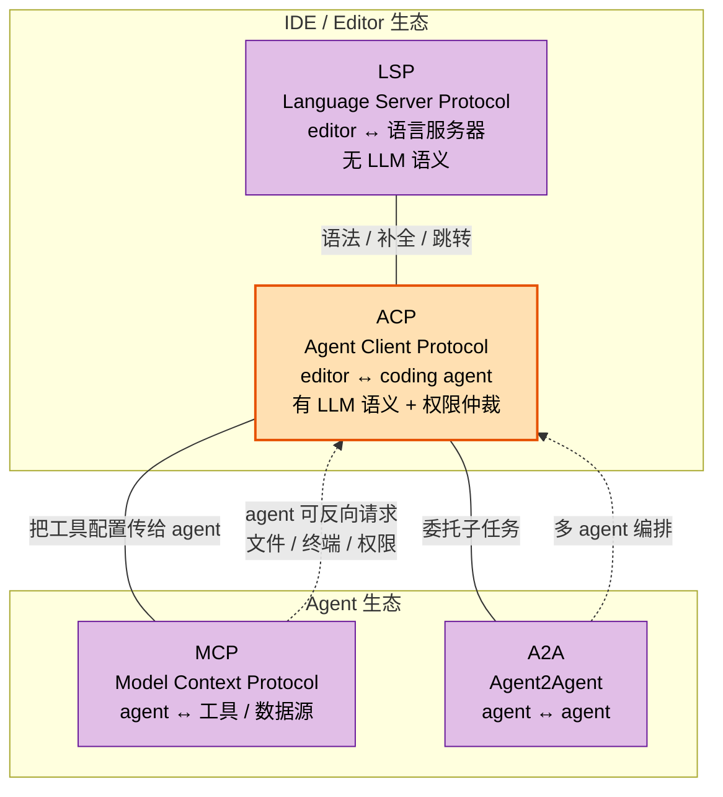

**四个协议的分工**：

| 协议 | 连接的是 | 谁是主动方 | 有无 LLM 语义 |
|---|---|---|---|
| **LSP** | editor ↔ 语言服务器 | editor | 无（纯语法） |
| **ACP** | editor ↔ coding agent | 双向 | 有（prompt / plan / tool call / 权限） |
| **MCP** | agent ↔ 工具 / 数据源 | agent | 有（但只管工具侧） |
| **A2A** | agent ↔ agent | 双向 | 有（但只管 agent 间） |

**关键洞察**：ACP 是**唯一一个把「宿主环境」和「智能体」放在同一个协议层里**的协议。编辑器在 ACP 里同时扮演三个角色：

1. **宿主**——提供文件系统、终端、进程生命周期
2. **渲染器**——把 Agent 的 plan / tool call / diff 画成 UI
3. **仲裁者**——决定哪些危险操作需要用户批准

这不是「顺便支持」的，而是协议设计的核心。ACP 的三条设计哲学里明确写着：

> 1. **MCP-friendly**：基于 JSON-RPC，尽可能复用 MCP 类型
> 2. **UX-first**：为「人与 AI Agent 交互的 UX 难题」而设计
> 3. **Trusted**：假设你信任这个模型，但仍然保留对工具调用的控制权

**Trusted 这条最值得玩味。** ACP 的信任模型是「编辑器信任 Agent，但 Agent 不能自己给自己授权」。这跟 MCP 的模型不一样——MCP 里 agent 拿到 tool 就能直接调，权限是 server 侧的配置问题；ACP 里权限请求是**运行时的一次次对话**，要过用户。

---

## 三、整体架构

### 3.1 顶层结构

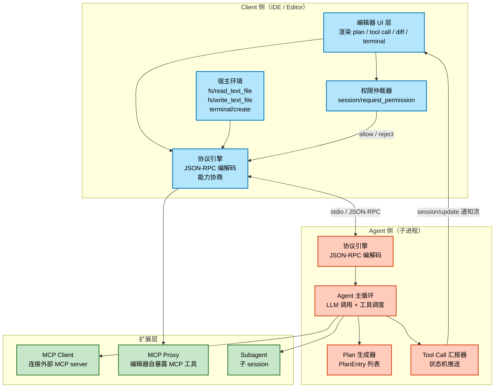

### 3.2 传输层：stdio 是默认，HTTP 还在讨论中

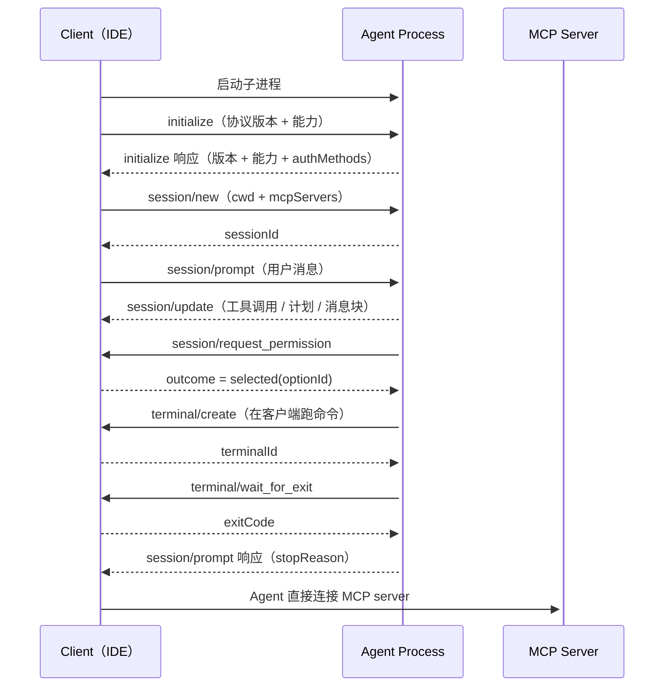

**传输层的现实约束**：

- ACP 用 JSON-RPC 编码，**MUST 是 UTF-8**
- **stdio**：client 把 agent 作为子进程启动，消息用 `\n` 分隔，**MUST NOT 含内嵌换行**
- **agent MUST NOT 往 stdout 写任何非 ACP 消息**（stderr 可以写日志）
- **Streamable HTTP**：**「draft proposal in progress」**——还在讨论中
- 自定义传输：**MAY**，但 MUST 保持 JSON-RPC 消息格式和生命周期

> **实战细节**：stdio 的「stdout 纯净性」是很多自研集成踩坑最多的地方。Agent 里的 `print()` 语句会直接污染协议流。ACP 把这条写成了 MUST，是血的教训。

### 3.3 能力协商：省略即不支持

这是 ACP 最重要的兼容性设计。

```json
{
  "jsonrpc": "2.0",
  "id": 0,
  "method": "initialize",
  "params": {
    "protocolVersion": 1,
    "clientCapabilities": {
      "fs": {
        "readTextFile": true,
        "writeTextFile": true
      },
      "terminal": true
    },
    "clientInfo": {
      "name": "my-client",
      "title": "My Client",
      "version": "1.0.0"
    }
  }
}
```

Agent 的响应：

```json
{
  "jsonrpc": "2.0",
  "id": 0,
  "result": {
    "protocolVersion": 1,
    "agentCapabilities": {
      "loadSession": true,
      "promptCapabilities": {
        "image": true,
        "audio": true,
        "embeddedContext": true
      },
      "mcpCapabilities": {
        "http": true,
        "sse": true
      }
    },
    "agentInfo": {
      "name": "my-agent",
      "title": "My Agent",
      "version": "1.0.0"
    },
    "authMethods": []
  }
}
```

**协议原文的三条硬规则**：

1. `initialize` 请求 **MUST** 包含 client 支持的**最新**协议版本
2. 如果 Agent 支持该版本，**MUST** 响应同版本；否则 **MUST** 响应它自己支持的最新版本
3. 如果 Client 不支持 Agent 响应的版本，**SHOULD** 关闭连接并告知用户

**关于能力（Capabilities）的三条规则**：

1. `initialize` 里的所有能力都是 **OPTIONAL**
2. **引入新能力不算破坏性变更**
3. **客户端和 Agent MUST 把 `initialize` 请求里省略掉的所有能力当作 UNSUPPORTED**

第 3 条是精髓。它意味着：

- 协议版本 `1` 可以永远不变
- 新特性（比如 v1 后来加的 session compaction、notices）通过**新增能力字段**发布
- 老客户端收到新字段 → 忽略 → 正常工作
- 新客户端遇到老 Agent → 字段缺失 → 视为不支持 → 降级运行

**这就是「版本协商 + 能力协商」双轨制**：版本管**破坏性变更**（rare），能力管**特性演进**（frequent）。v1 从发布到现在累计 **15+ 个 RFD**，没有一次大迁移——这就是这套机制的产出。

Rust 侧的版本类型把这条规则编码进了类型系统：

```rust
// 来自 agent-client-protocol-schema/src/version.rs:5-12
/// Protocol version identifier.
///
/// This version is only bumped for breaking changes.
/// Non-breaking changes should be introduced via capabilities.
#[cfg_attr(feature = "schemars", derive(schemars::JsonSchema))]
#[derive(
    Debug, Clone, Copy, Serialize, Deserialize, PartialEq, Eq, PartialOrd, Ord, From, Display,
)]
pub struct ProtocolVersion(u16);
```

**注意 `LATEST` 常量的 cfg 陷阱**——这是个很精细的工程决策：

```rust
// 来自 agent-client-protocol-schema/src/version.rs:31-39
    /// The latest stable supported version of the protocol.
    ///
    /// Currently this is version `1`.
    ///
    /// This shorthand is intentionally unavailable when the
    /// `unstable_protocol_v2` feature is enabled, so code that opts into the
    /// v2 draft must choose `V1` or `V2` explicitly.
    #[cfg(not(feature = "unstable_protocol_v2"))]
    pub const LATEST: Self = Self::V1;

    #[cfg(feature = "unstable_protocol_v2")]
    pub const V2: Self = Self(2);
```

**为什么？** 因为一旦有人打开了 `unstable_protocol_v2` feature，他就是在明确参与 v2 草案。此时如果 `LATEST` 还指向 V1，代码会悄悄连到 v1 上——用户以为自己写的是 v2。所以这里直接**删掉** `LATEST`，强迫开发者显式选 `V1` 或 `V2`。

**Rust 用编译期手段消除了「以为自己在用 v2 其实连的是 v1」这类静默错误**——这是 TypeScript 版 SDK 很难做到的。

---

## 四、核心机制一：终端句柄所有权反转

这是 ACP 最反直觉、也最有价值的设计。

### 4.1 所有权反转是什么

在 MCP 里，工具跑在 **agent 侧**：

```
Agent  →  MCP Server  →  执行命令  →  返回结果
```

在 ACP 里，终端跑在 **client 侧**：

```
Agent  →  Client: "terminal/create(command=npm, args=[test])"
Client →  真实 shell 进程: 执行
Client →  Agent: "terminalId = term_xyz789"
Agent  →  Client: "terminal/wait_for_exit(term_xyz789)"
Client →  Agent: "exitCode = 0"
```

**Agent 手里只有一个句柄，永远碰不到真实的 PTY。**

### 4.2 为什么这个反转很重要

三个理由，缺一不可：

**理由一：安全边界。** Agent 可能来自第三方（Claude Code 适配器、Codex 适配器）。如果终端跑在 agent 侧，编辑器就失去了「这个 agent 能跑什么命令」的控制权。反转之后，编辑器可以在 `terminal/create` 那里做**任意策略检查**——命令白名单、路径限制、审批流。

**理由二：UI 一体化。** 编辑器自己跑终端，意味着它能直接把输出渲染进自己的终端面板。Agent 侧的 PTY 对编辑器来说是个黑盒。

**理由三：生命周期可控。** `terminal/release` 由协议强制要求——不释放就泄漏进程。这是协议级强制的资源管理。

### 4.3 完整的终端方法集

| 方法 | 方向 | 作用 |
|---|---|---|
| `terminal/create` | Client | 启动命令，**立即**返回 terminalId（不等完成） |
| `terminal/output` | Client | 取当前输出 + 退出状态（不等完成） |
| `terminal/wait_for_exit` | Client | 阻塞直到命令退出 |
| `terminal/kill` | Client | 杀进程，**但 terminal 仍然有效** |
| `terminal/release` | Client | 杀进程 + 释放资源，terminalId **失效** |

`terminal/create` 的完整参数：

```json
{
  "jsonrpc": "2.0",
  "id": 5,
  "method": "terminal/create",
  "params": {
    "sessionId": "sess_abc123def456",
    "command": "npm",
    "args": ["test", "--coverage"],
    "env": [
      {
        "name": "NODE_ENV",
        "value": "test"
      }
    ],
    "cwd": "/home/user/project",
    "outputByteLimit": 1048576
  }
}
```

响应：

```json
{
  "jsonrpc": "2.0",
  "id": 5,
  "result": {
    "terminalId": "term_xyz789"
  }
}
```

> **响应立即返回是刻意设计**：这让命令能在后台跑，Agent 同时去做别的事。

### 4.4 输出截断的边界处理

`outputByteLimit` 的规则很讲究：

> The Client **MUST** ensure truncation happens at a character boundary to maintain valid string output, even if this means the retained output is slightly less than the specified limit.

**截断必须落在字符边界上**，宁可少留一点也不许切碎 UTF-8 多字节字符。截断方向是**从开头截**（保留最新的输出）。

这是典型的「协议把实现的脏活规定死」——如果不定这条，各家实现会切出半个 emoji。

### 4.5 协议给出的超时处方

协议文档直接给了一个 5 步超时实现方案（因为「创建终端 + 等退出」是 Agent 最常见的操作模式）：

```text
1. 用 terminal/create 创建终端
2. 启动目标时长的计时器
3. 并发等待：计时器到期 或 terminal/wait_for_exit 返回
4. 若计时器先到：
   - 调 terminal/kill 终止命令
   - 调 terminal/output 取最终输出
   - 把输出带进给模型的响应
5. 结束时调 terminal/release
```

注意第 4 步：kill 之后还要再取一次 output——**因为 kill 之前 buffer 里可能已经有有用的诊断信息**。这是真实系统里才会写出来的细节。

### 4.6 终端嵌入 Tool Call

终端可以被直接嵌进 tool call 的 content 里：

```json
{
  "jsonrpc": "2.0",
  "method": "session/update",
  "params": {
    "sessionId": "sess_abc123def456",
    "update": {
      "sessionUpdate": "tool_call",
      "toolCallId": "call_002",
      "title": "Running tests",
      "kind": "execute",
      "status": "in_progress",
      "content": [
        {
          "type": "terminal",
          "terminalId": "term_xyz789"
        }
      ]
    }
  }
}
```

> When a terminal is embedded in a tool call, the Client displays live output as it's generated and **continues to display it even after the terminal is released**.

**释放后仍然继续显示**——因为终端输出是「这次工具调用的证据」，不是「终端这个资源的属性」。这个语义区分（资源 vs 证据）很关键。

---

## 五、核心机制二：Tool Call 生命周期状态机

### 5.1 创建

```json
{
  "jsonrpc": "2.0",
  "method": "session/update",
  "params": {
    "sessionId": "sess_abc123def456",
    "update": {
      "sessionUpdate": "tool_call",
      "toolCallId": "call_001",
      "name": "read_file",
      "title": "Reading configuration file",
      "kind": "read",
      "status": "pending"
    }
  }
}
```

### 5.2 状态机

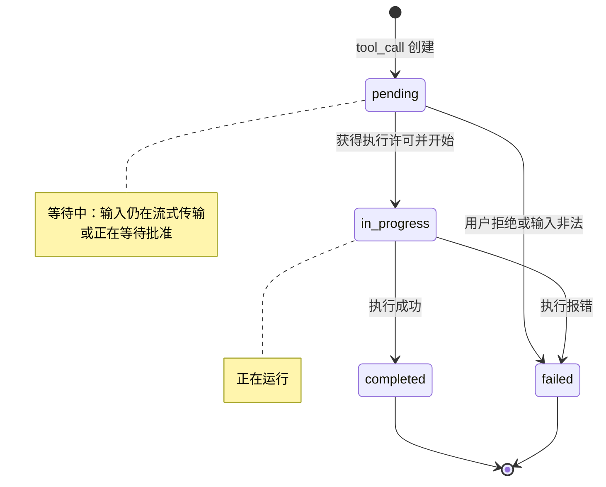

四个状态：**pending / in_progress / completed / failed**。

### 5.3 ToolKind：10 种类型

| kind | 含义 |
|---|---|
| `read` | 读文件或数据 |
| `edit` | 修改文件或内容 |
| `delete` | 删除文件或数据 |
| `move` | 移动或重命名文件 |
| `search` | 搜索信息 |
| `execute` | 运行命令或代码 |
| `think` | 内部推理或规划 |
| `fetch` | 获取外部数据 |
| `switch_mode` | 切换会话模式 |
| `other` | 其他（默认） |

**为什么要分类？** 协议原文：*Tool kinds help Clients choose appropriate icons and optimize how they display tool execution progress.*

**编辑器据此选图标**——读文件是放大镜，编辑是铅笔，删除是垃圾桶。这是把「LLM 的工具语义」映射到「人类的心智模型」的关键一层。如果不分类，编辑器只能全部显示成一个转圈。

### 5.4 更新的增量语义

```json
{
  "jsonrpc": "2.0",
  "method": "session/update",
  "params": {
    "sessionId": "sess_abc123def456",
    "update": {
      "sessionUpdate": "tool_call_update",
      "toolCallId": "call_001",
      "status": "in_progress",
      "content": [
        {
          "type": "content",
          "content": {
            "type": "text",
            "text": "Found 3 configuration files..."
          }
        }
      ]
    }
  }
}
```

规则：**所有字段除 `toolCallId` 外都是可选的，只需包含要改的字段。**

### 5.5 三种 Content 形态

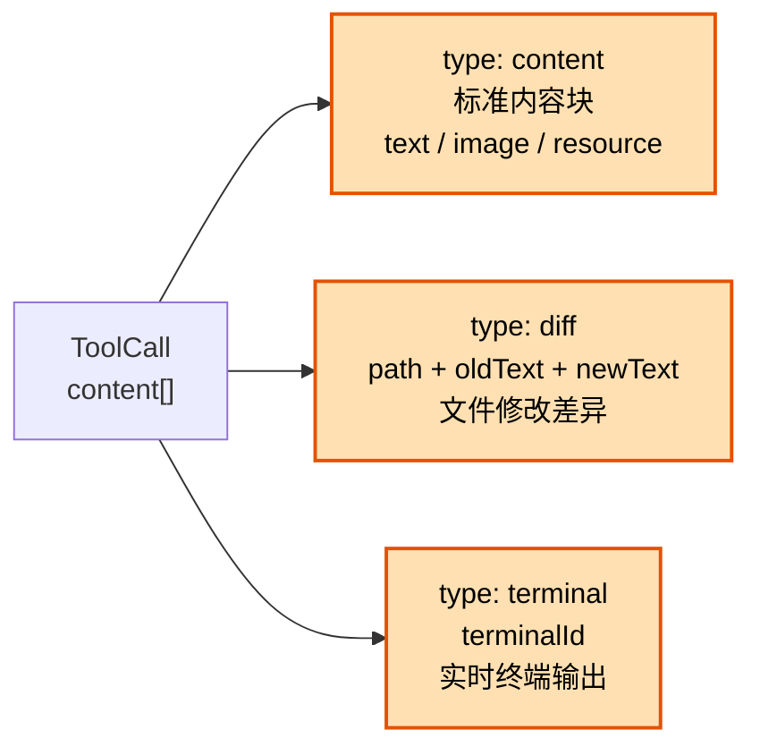

Diff 的结构：

```json
{
  "type": "diff",
  "path": "/home/user/project/src/config.json",
  "oldText": "{\n  \"debug\": false\n}",
  "newText": "{\n  \"debug\": true\n}"
}
```

> `oldText` 为 null 表示新文件。

### 5.6 locations：Follow-along 机制

```json
{
  "path": "/home/user/project/src/main.py",
  "line": 42
}
```

Tool call 可以报告它正在操作哪些文件。这让编辑器可以实现「跟着 Agent 走」——自动滚动到 Agent 正在改的那一行。

**这是 LSP 做不到的事**：LSP 的诊断是编辑器主动拉的，ACP 的 locations 是 Agent 主动推的。方向相反，但互补。

---

## 六、核心机制三：权限请求模型

### 6.1 请求

```json
{
  "jsonrpc": "2.0",
  "id": 5,
  "method": "session/request_permission",
  "params": {
    "sessionId": "sess_abc123def456",
    "toolCall": {
      "toolCallId": "call_001"
    },
    "options": [
      {
        "optionId": "allow-once",
        "name": "Allow once",
        "kind": "allow_once"
      },
      {
        "optionId": "reject-once",
        "name": "Reject",
        "kind": "reject_once"
      }
    ]
  }
}
```

### 6.2 四种选项语义

| kind | 语义 |
|---|---|
| `allow_once` | 只允许这一次 |
| `allow_always` | 允许并记住选择 |
| `reject_once` | 只拒绝这一次 |
| `reject_always` | 拒绝并记住选择 |

`kind` 是给客户端的**提示（hint）**，用来选图标和 UI 处理方式。

### 6.3 响应：两种 outcome

```json
{
  "jsonrpc": "2.0",
  "id": 5,
  "result": {
    "outcome": {
      "outcome": "selected",
      "optionId": "allow-once"
    }
  }
}
```

或取消：

```json
{
  "jsonrpc": "2.0",
  "id": 5,
  "result": {
    "outcome": {
      "outcome": "cancelled"
    }
  }
}
```

> If the current prompt turn gets cancelled, the Client **MUST** respond with the `"cancelled"` outcome.

**`cancelled` 是强制的**——如果 turn 被取消了，客户端绝不能挂着一个未决的权限请求。这避免了「agent 在等权限、用户已经取消」的僵死状态。

### 6.4 权限与工具调用解耦

注意 `params.toolCall` 只是一个 `ToolCallUpdate`（带 `toolCallId`），而不是完整的 tool call。**权限请求和工具调用是两个独立对象**。

v2 进一步解耦：*Permission prompts carry their own required `title` and optional `description`, with an extensible `subject` instead of a hard-wired tool call.* —— 权限请求有了自己的标题和描述，还有一个可扩展的 `subject`（v1 只有 `ToolCallPermissionSubject` / `CommandPermissionSubject` / `OtherRequestPermissionSubject`）。

**这意味着未来请求权限的对象可以不是工具调用**——比如「允许 agent 读取这个目录」「允许切换到 plan 模式」。

---

## 七、Plan：Agent 的思考可视化

### 7.1 数据结构

```rust
// 来自 agent-client-protocol-schema/src/v2/plan.rs:447-465
#[serde_as]
#[skip_serializing_none]
#[cfg_attr(feature = "schemars", derive(schemars::JsonSchema))]
#[derive(Debug, Clone, Serialize, Deserialize, PartialEq, Eq)]
#[serde(rename_all = "camelCase")]
#[non_exhaustive]
pub struct PlanEntry {
    /// Human-readable description of what this task aims to accomplish.
    pub content: String,
    /// The relative importance of this task.
    /// Used to indicate which tasks are most critical to the overall goal.
    pub priority: PlanEntryPriority,
    /// Current execution status of this task.
    pub status: PlanEntryStatus,
    /// The _meta property is reserved by ACP to allow clients and agents to attach additional
    /// metadata to their interactions.
    #[serde_as(deserialize_as = "DefaultOnError")]
    #[serde(default)]
    #[serde(rename = "_meta")]
    pub meta: Option<Meta>,
}
```

三个字段：**content（做什么）/ priority（多重要）/ status（当前状态）**。

### 7.2 PlanUpdateContent：三种载体

```rust
// 来自 agent-client-protocol-schema/src/v2/plan.rs:81-109
#[serde(tag = "type", rename_all = "snake_case")]
#[non_exhaustive]
pub enum PlanUpdateContent {
    /// Structured plan entries.
    Items(PlanItems),
    /// **UNSTABLE**
    #[cfg(feature = "unstable_plan_operations")]
    File(PlanFile),
    /// **UNSTABLE**
    #[cfg(feature = "unstable_plan_operations")]
    Markdown(PlanMarkdown),
    /// Custom or future plan update content.
    #[serde(untagged)]
    Other(OtherPlanUpdateContent),
}
```

三种载体：**Items（结构化条目）/ File（文件 URI）/ Markdown（原始 Markdown）**。

**为什么要三种？** 因为 Agent 的规划来源不同：
- 有的 Agent 直接输出结构化任务列表
- 有的 Agent 把计划写进 `PLAN.md`（v2 的 File 变体就是为了这个）
- 有的 Agent 只输出 Markdown

**协议不去强迫 Agent 用哪种**，而是给客户端三选一的渲染路径。

### 7.3 完整替换语义

> When updating an item-based plan, the agent must send a complete list of all entries with their current status. The client replaces that plan with each update.

**每次更新都是全量替换，不是增量补丁。** 这跟 tool call 的增量更新语义不同。

**为什么？** 因为 plan 是「当前全貌」，用户在界面上看到的是一个 checklist。如果用增量更新，客户端要处理「删了一条怎么办」这种边缘情况。全量替换让客户端逻辑简单得多——直接 set 就行。

**代价是带宽**：每次更新都要重发整个列表。对于 10 条任务的 plan 完全无所谓。

---

## 八、v2：从「回合制」到「常驻工作单元」

v2 Draft 发布于 2026-07-20，是 ACP 最重要的一次演进。官方公告里说得很直接：

> When we launched ACP v1, most agents happily emitted events only after a user-initiated message and usually stopped once they finished generating. But these days, agents are able to work longer and even orchestrate more and more work in the background.

### 8.1 三大主题

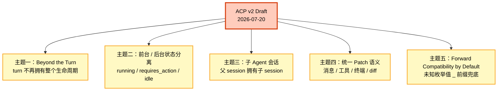

### 8.2 主题一：Beyond the Turn

v1 的隐含假设是「一个 prompt 请求 = 一个 turn = 生命周期边界」。v2 打破了这个假设：

> Now `session/update` notifications can proceed freely at any point in the session, and a prompt response returns the `messageId` of the user message inserted into the conversation, **not the end of the turn**.

**关键变化**：`session/prompt` 的响应不再代表「工作结束」，只代表「消息已接收」。

配套的是 `StateUpdate` 三态状态机：

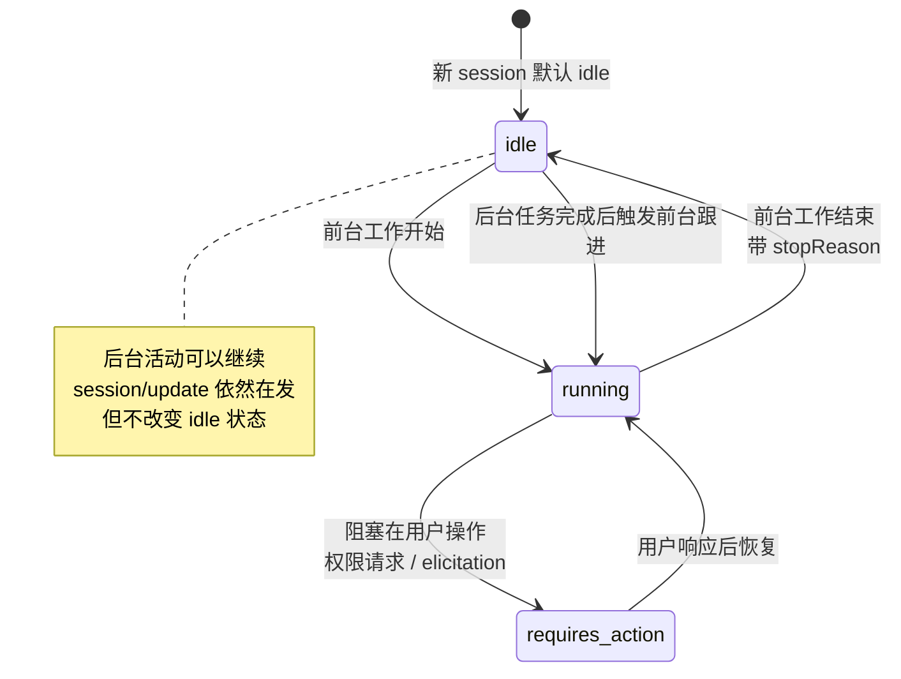

**协议原文的关键约束**：

> Background activity can continue and emit other `session/update` notifications while `idle`. Those notifications, including a detached task's progress or completion, **do not by themselves change this state**.

以及：

> A permission request only warrants `requires_action` when foreground work is blocked on user action.

**「后台任务完成 ≠ 状态变化」**——这是最容易搞错的一点。后台任务发通知、报进度、报完成，状态都还是 `idle`。只有当「前台工作真的需要用户做什么」时才是 `requires_action`。

还有一条极细的规则：

> Repeated snapshots are idempotent, not additional work, completions, or usage.

**重复的状态快照是幂等的**，不重复计费、不算新工作。协议把「多次推同一个状态」的行为明确为无害。

### 8.3 主题三：子 Agent 会话

v2 引入了**子 session** 概念——父 session 可以拥有子 session：

```rust
// 子 session 的授权是逐个授予的
pub struct SubagentSessionCapabilities { /* ... */ }
```

协议原文：

> Client-initiated session mutations permitted for a specific subagent session.
> A mutation requires an explicit per-child capability; support for the method on ordinary sessions does not grant support on a child.

**「普通 session 支持某个方法，不代表子 session 也支持」**——每个子 session 要单独授权。

还有一条关键的顺序约束：

> The first update for an unknown `SubagentUpdate::session_id` announces the child and **MUST be sent before any live request or notification bearing the child's session ID**.

**必须先宣告子 session，之后才能用它的 ID 发任何东西。** 这避免了客户端收到一个「凭空出现的 session ID」而不知道它是什么。

**这是把「多 Agent 编排」拉进协议层的尝试**——不需要 A2A 那种完整的 agent 间协议，而是在 editor↔agent 这一层解决「agent 自己开子 agent」的场景。

### 8.4 主题四：统一 Patch 语义

v2 把 v1 只在 tool call 上用的增量语义，统一到了所有会话项：

> User and agent messages, tool calls, and terminal output are patched by stable IDs with uniform semantics: **omitted fields stay unchanged, `null` clears, values replace, and chunks append.**

| 操作 | 语义 |
|---|---|
| 字段省略 | 保持原值不变 |
| `null` | 清除该字段 |
| 具体值 | 替换该字段 |
| chunk | 追加 |

### 8.5 主题五：Forward Compatibility by Default

v2 让所有类枚举字段接受未知变体：

> Enum-like values across the schema accept unknown variants with a `_` prefix for implementation-specific extensions.

Rust 侧的实现在这里非常讲究。看 `PlanUpdateContent` 的 `Other` 兜底分支：

```rust
// 来自 agent-client-protocol-schema/src/v2/plan.rs:151-186
impl<'de> Deserialize<'de> for OtherPlanUpdateContent {
    fn deserialize<D>(deserializer: D) -> Result<Self, D::Error>
    where
        D: serde::Deserializer<'de>,
    {
        let mut fields = BTreeMap::<String, serde_json::Value>::deserialize(deserializer)?;
        let type_ = fields
            .remove("type")
            .ok_or_else(|| serde::Error::missing_field("type"))?;
        // ... 校验 type_ 是字符串 ...
        let plan_id = fields
            .remove("planId")
            .ok_or_else(|| serde::Error::missing_field("planId"))?;
        // ... 校验 plan_id 是字符串 ...

        if is_known_plan_update_content_type(&type_) {
            return Err(serde::Error::custom(format!(
                "known plan update content `{type_}` did not match its schema"
            )));
        }

        Ok(Self { type_, plan_id, fields })
    }
}

fn is_known_plan_update_content_type(type_: &str) -> bool {
    KNOWN_PLAN_UPDATE_CONTENT_TYPES.contains(&type_)
}
```

**这段代码解决了一个非常真实的坑。**

考虑：客户端收到 `{"type": "items", "planId": "p1", "entries": "MALFORMED"}`。此时 `items` 分支反序列化失败。Rust 的 `#[serde(untagged)]` 会**自动尝试下一个分支**——于是 `Other` 分支会成功，把它当成一个「自定义类型 items」吞下去。

**结果**：客户端把一个畸形的已知类型消息当成未知扩展处理了，静默丢失了真实数据。

ACP 的解法是：**在 `Other` 兜底分支里显式检查判别符是不是已知的**。是已知类型 → 直接报错，不允许落到兜底分支。

AGENTS.md 里的规则说得很清楚：

> A malformed value for a known discriminator must not fall through to an untagged fallback variant.

**这是「扩展性」和「正确性」的经典冲突**，ACP 选择了两头都要：既支持未知类型（扩展性），又拒绝畸形已知类型（正确性）。很多协议只做了前者。

---

## 九、扩展性：三套机制

### 9.1 `_meta` 字段

几乎每个结构体都有：

```rust
/// The _meta property is reserved by ACP to allow clients and agents to attach additional
/// metadata to their interactions. Implementations MUST NOT make assumptions about values at
/// these keys.
```

### 9.2 `_` 前缀自定义方法

> Create custom methods by prefixing their name with underscore (`_`)

### 9.3 自定义能力

通过 `_meta` 在 `initialize` 里广告。

### 9.4 严格 vs 宽容的边界

ACP 并不是「一律宽容」。AGENTS.md 给出了明确的判断标准：

> Use `DefaultOnError`/`VecSkipError` only when the fallback means **less** (no metadata, an unsupported capability, a missing display item). If the receiver **acts on the value** (runs, reads, connects, or applies something), keep it strict so a request fails with `-32602` instead of silently doing something else; use `DefaultOnNull` on such lists so `null` still means empty.

翻译成工程语言：

| 情况 | 策略 | 例子 |
|---|---|---|
| 降级后**信息变少** | 宽容（`DefaultOnError`） | `_meta` 元数据、显示用的图标 |
| 降级后**语义变少** | 严格（返回 `-32602`） | 会被实际执行的命令参数 |

**「接收方会拿这个值去干活」就必须严格**。这条规则把「宽容降级」的边界从模糊的直觉变成了可操作的判据。

`VecSkipError` 则是中间态——列表里某个元素坏了就跳过它，但**列表本身不能是 null**（用 `DefaultOnNull` 让 null 仍然表示空列表）。

---

## 十、MCP-over-ACP：协议套协议

v2 里有一个非常精巧的设计：**用 ACP 通道承载 MCP 请求**。

### 10.1 为什么要

MCP 的 stdio 传输要求 server 和 client 在**同一个进程空间**。但 Agent 可能是远程的、被沙箱隔离的、或者根本不支持 stdio。

ACP 的架构文档描述了这个困境：

> As agents may only support MCP over stdio, the code editor can provide a small proxy that tunnels requests back to itself.

v2 把这个「隧道」标准化进了协议本身。

### 10.2 消息结构

```rust
// 来自 agent-client-protocol-schema/src/v2/mcp.rs:155-171
pub struct MessageMcpRequest {
    /// The declared ACP MCP server receiving this request.
    pub server_id: McpServerAcpId,
    /// The caller-generated identifier for the inner MCP request.
    pub request_id: McpRequestId,
    /// The inner MCP method name.
    pub method: String,
    /// Optional inner MCP params; null is equivalent to omission.
    #[serde(default)]
    pub params: Option<serde_json::Map<String, serde_json::Value>>,
    /// ACP extension metadata (not inner MCP params._meta).
    #[serde_as(deserialize_as = "DefaultOnError")]
    #[serde(default)]
    #[serde(rename = "_meta")]
    pub meta: Option<Meta>,
}
```

**四个关键点**：

1. `server_id` —— 目标 MCP server（用 ACP 的 ID 体系标识）
2. `request_id` —— **调用方生成的 ID**，与外层 ACP JSON-RPC 的 `id` **独立**
3. `method` —— 内层 MCP 方法名（如 `tools/call`）
4. `params` —— 内层 MCP 参数

**「内层 request_id 与外层 JSON-RPC id 独立」** 是必须的：MCP server 可能发多条通知（比如 progress），这些都挂在同一个内层 request 上，如果复用外层 id 就无法表达「一个请求的多个后续通知」。

### 10.3 双层 outcome 语义

这是 MCP-over-ACP 最精妙的部分：

```rust
// 来自 agent-client-protocol-schema/src/v2/mcp.rs:76-98
#[serde(untagged)]
#[non_exhaustive]
pub enum MessageMcpResponse {
    /// An opaque inner MCP result.
    Result {
        /// Required, even if JSON null.
        #[serde(deserialize_with = "Deserialize::deserialize")]
        result: Value,
        meta: Option<Map<String, Value>>,
    },
    /// A structured inner MCP error.
    Error {
        /// Required, non-null MCP error object.
        error: McpError,
        meta: Option<Map<String, Value>>,
    },
}
```

**规则**：

> The successful outer ACP `mcp/message` response carries **exactly one** inner MCP outcome: an opaque result (including JSON null), or an MCP error. **Outer ACP errors are reserved for binding and runtime failures.**

翻译成表格：

| 情况 | 外层 ACP | 内层 MCP |
|---|---|---|
| 工具调用成功 | 成功 | `result`（可以是 null） |
| 工具调用失败（业务错误） | **成功** | `error` 对象 |
| 绑定失败 / 运行时崩溃 | **失败** | — |

**「工具报错了」不算「协议层失败了」。** 内层错误用「外层成功 + 内层 error」表达，因为从 ACP 的视角看，**隧道本身工作正常**，只是被隧道的内容失败了。

这个区分让监控和重试逻辑变得正确：外层错误 → 重试或熔断；内层错误 → 交给 Agent 决定怎么办。

### 10.4 严格校验

对应的测试用例非常密集：

```rust
// 来自 agent-client-protocol-schema/src/v2/mcp.rs:328-352
#[test]
fn a_carrier_key_is_required_and_errors_must_be_valid() {
    for wire in [
        Value::Null,
        json!([]),
        json!({}),
        json!({"_meta": null}),
        json!({"unexpected": 1}),
        json!({"error": null}),
        json!({"error": 1}),
        json!({"error": []}),
        json!({"error": {}}),
        json!({"error": {"code": 1}}),
        json!({"error": {"message": "x"}}),
        json!({"error": {"code": null, "message": "x"}}),
        json!({"error": {"code": 1, "message": null}}),
        json!({"error": {"code": 1.5, "message": "x"}}),
        json!({"error": {"code": "1", "message": "x"}}),
    ] {
        assert!(
            serde_json::from_value::<MessageMcpResponse>(wire.clone()).is_err(),
            "accepted {wire}"
        );
    }
}
```

注意 `json!({"error": {"code": "1", "message": "x"}})` 也在拒绝列表里——**`code` 必须是数字，字符串 `"1"` 不行**。这种严格程度在实践中极有价值：MCP server 的实现千奇百怪，隧道层必须做归一化。

### 10.5 一个完整的 MCP-over-ACP 请求

```json
{
  "jsonrpc": "2.0",
  "id": 42,
  "method": "mcp/message",
  "params": {
    "serverId": "srv_filesystem",
    "requestId": "mcp-req-001",
    "method": "tools/call",
    "params": {
      "name": "read_file",
      "arguments": {
        "path": "/home/user/project/main.py"
      }
    }
  }
}
```

响应（工具失败时）：

```json
{
  "jsonrpc": "2.0",
  "id": 42,
  "result": {
    "error": {
      "code": -32000,
      "message": "File not found",
      "data": {
        "path": "/home/user/project/main.py"
      }
    }
  }
}
```

**注意**：HTTP 语义上的「成功」（有 `result`），但内层是错误。

---

## 十一、Schema-as-Code：Rust 是唯一真源

### 11.1 生成管线

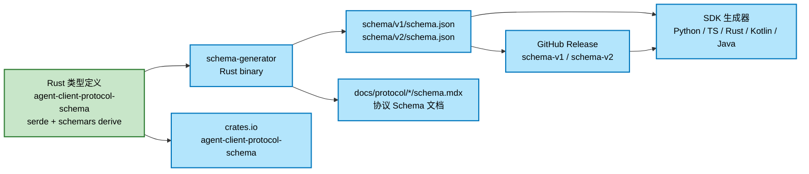

**Rust 类型是唯一真源（single source of truth）**。JSON Schema 和协议文档都是从它生成的，不是手写的。

这跟 LSP 的做法一致（LSP 用 TypeScript 定义 + 代码生成），跟 MCP 不同（MCP 用 JSON Schema 手写后生成 TypeScript）。

### 11.2 生成器入口

```rust
// 来自 schema-generator/src/main.rs:14-19
use agent_client_protocol_schema::v1::{
    AGENT_METHOD_NAMES, AgentNotification, AgentRequest, AgentResponse, CLIENT_METHOD_NAMES,
    ClientNotification, ClientRequest, ClientResponse, JsonRpcMessage, Notification,
    PROTOCOL_LEVEL_METHOD_NAMES, ProtocolLevelNotification, Request, Response,
};
```

**注意导入的是 `AGENT_METHOD_NAMES` / `CLIENT_METHOD_NAMES` 这些「方法名注册表」**——生成器不是靠遍历 struct，而是靠这几个常量表来决定「有哪些方法、每个方法对应哪些类型」。

方法名常量在源码里长这样：

```rust
// 来自 agent-client-protocol-schema/src/v2/agent.rs（方法名常量）
pub const INITIALIZE_METHOD_NAME: &str = "initialize";
pub const SESSION_NEW_METHOD_NAME: &str = "session/new";
pub const SESSION_PROMPT_METHOD_NAME: &str = "session/prompt";
pub const SESSION_CANCEL_METHOD_NAME: &str = "session/cancel";
pub const SESSION_LIST_METHOD_NAME: &str = "session/list";
pub const SESSION_DELETE_METHOD_NAME: &str = "session/delete";
pub const SESSION_FORK_METHOD_NAME: &str = "session/fork";
pub const SESSION_RESUME_METHOD_NAME: &str = "session/resume";
pub const SESSION_CLOSE_METHOD_NAME: &str = "session/close";
pub const PROVIDERS_LIST_METHOD_NAME: &str = "providers/list";
pub const PROVIDERS_SET_METHOD_NAME: &str = "providers/set";
pub const PROVIDERS_DISABLE_METHOD_NAME: &str = "providers/disable";
```

**注意 v2 新增的 `providers/*` 系列**——这是把「多 Provider 管理」也纳入协议（Agent 侧的 LLM provider 切换）。

### 11.3 双向消息枚举

```rust
// 来自 schema-generator/src/main.rs:48-88
#[derive(Serialize, Deserialize, JsonSchema)]
#[serde(untagged)]
#[schemars(inline)]
#[allow(clippy::large_enum_variant)]
enum AgentOutgoingMessage {
    Request(Request<AgentRequest>),
    Response(Response<AgentResponse>),
    Notification(Notification<AgentNotification>),
}

#[derive(Serialize, Deserialize, JsonSchema)]
#[serde(untagged)]
#[schemars(inline)]
#[allow(clippy::large_enum_variant)]
enum ClientOutgoingMessage {
    Request(Request<ClientRequest>),
    Response(Response<ClientResponse>),
    Notification(Notification<ClientNotification>),
}
```

**每个方向 3 种消息形态**（Request / Response / Notification），共 6 个顶层枚举。生成器把它们组合成根 schema。

v2 还加了 **JSON-RPC Batch** 的支持：

```rust
// 来自 schema-generator/src/main.rs:69-88
#[cfg(feature = "unstable_protocol_v2")]
#[derive(Serialize, Deserialize, JsonSchema)]
#[serde(untagged)]
#[schemars(inline)]
enum AgentBatchCallMessage {
    Request(Request<AgentRequest>),
    Notification(Notification<AgentNotification>),
    ProtocolLevelNotification(Notification<ProtocolLevelNotification>),
}
```

### 11.4 批量消息的非空约束

```rust
// 来自 agent-client-protocol-schema/src/rpc.rs:75-124
/// Error returned when constructing an empty JSON-RPC batch.
#[derive(Debug, Clone, Copy, PartialEq, Eq, Display)]
#[display("JSON-RPC batch must contain at least one message")]
#[non_exhaustive]
pub struct EmptyJsonRpcBatch;

impl std::error::Error for EmptyJsonRpcBatch {}

#[derive(Debug, Clone, Serialize, Deserialize, PartialEq, Eq)]
#[serde(transparent)]
pub struct JsonRpcBatch<M>(
    #[cfg_attr(feature = "schemars", schemars(length(min = 1)))] Vec<JsonRpcMessage<M>>,
);
```

**空 batch 在 JSON-RPC 2.0 里是非法的**，所以 ACP 用 `new()` 返回 `Result` 而不是直接构造，并且在 JSON Schema 里用 `length(min = 1)` 表达。

---

## 十二、治理体系：RFD 与工作小组

ACP 的治理是它区别于「某家公司提个 PR 就能改协议」的关键。

### 12.1 RFD 流程

仓库里有 **51 篇 RFD**（Request for Discussion），在 `docs/rfds/`。

v2 Draft 公告里回顾：

> Since releasing v1, we have been able to leverage the future-compatible nature of the protocol and our RFD process to ship **15+ RFDs** and their related features.

**15+ RFD，零次大迁移。** 这就是能力协商机制 + RFD 流程的联合产出。

### 12.2 Interest Group vs Working Group

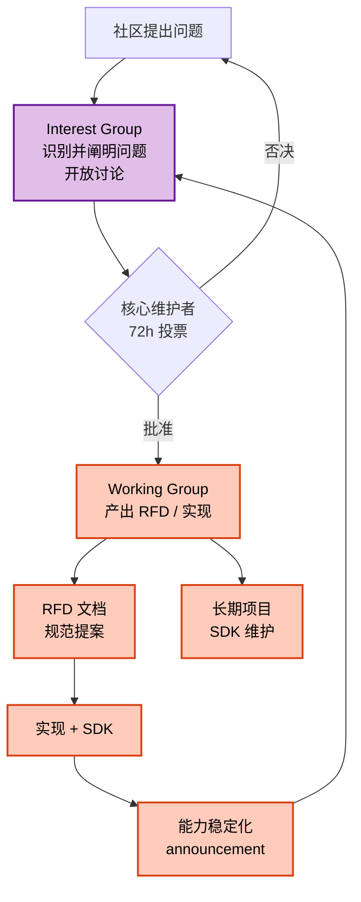

- **Interest Group（IG）**：发现问题、公开讨论。不产出代码
- **Working Group（WG）**：产出 RFD 或社区维护的实现（比如 SDK）

WG 维护者职责明确：*Long-term projects in the ACP ecosystem, such as SDKs or other components are maintained by dedicated Working Groups.*

### 12.3 稳定化公告

`docs/announcements/` 下有 **21 个稳定化公告**：

- `elicitation-stabilized.mdx`
- `session-config-options-stabilized.mdx`
- `session-list-stabilized.mdx`
- `session-resume-stabilized.mdx`
- `session-close-stabilized.mdx`
- `session-delete-stabilized.mdx`
- `logout-method-stabilized.mdx`
- `request-cancellation-stabilized.mdx`
- `message-id-stabilized.mdx`
- `tool-call-name-stabilized.mdx`
- `additional-directories-stabilized.mdx`
- `boolean-config-option-stabilized.mdx`
- `model-config-category-stabilized.mdx`
- `session-usage-stabilized.mdx`
- `session-info-update-stabilized.mdx`
- `implementation-information.mdx`
- `acp-agent-registry-stabilized.mdx`
- `sdk-1-0-releases.mdx`
- `transports-working-group.mdx`
- `acp-v2-draft.mdx`
- `sergey-ignatov-lead-maintainer.mdx`

**「稳定化」是一个显式的状态转换**——从 unstable feature flag 变成 v1 正式规范的一部分，每个能力单独公告。这跟「v2 一次性大版本发布」的思路完全相反：**v1 的能力在持续增长，v2 只是收编那些确实需要破坏性变更的部分**。

---

## 十三、端到端数据流

把上面所有机制串起来看一次完整的 prompt turn：

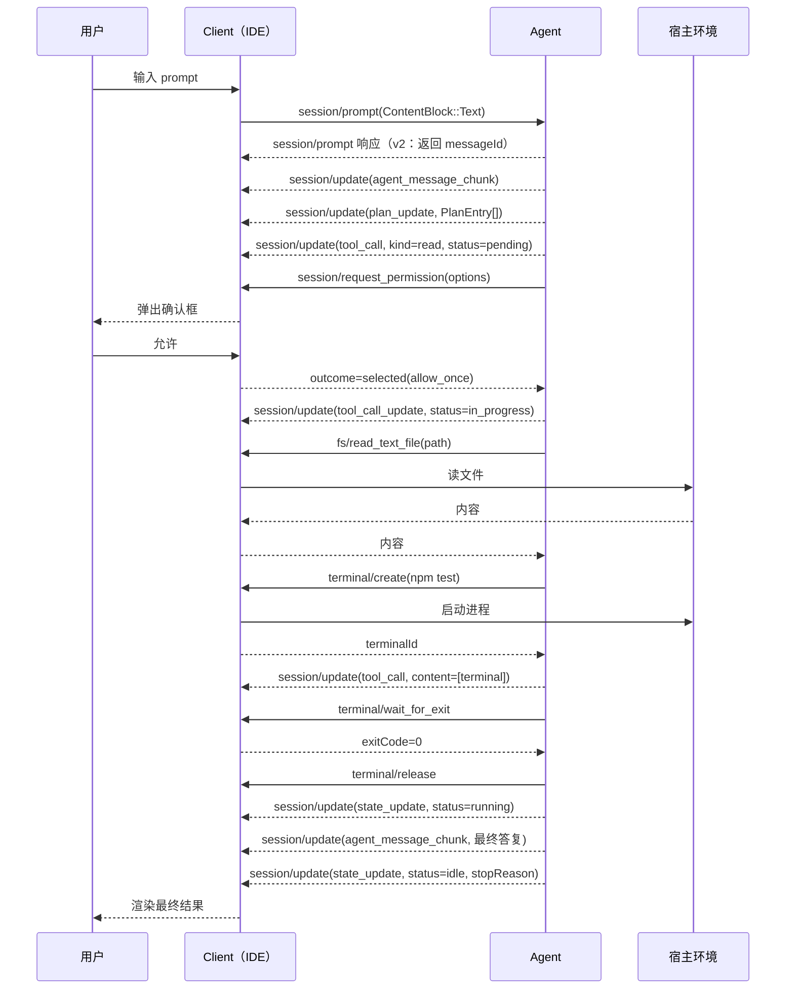

**注意三个细节**：

1. **`session/prompt` 的响应在最开始就返回了**（v2 语义），不是最后
2. **权限请求和工具调用是分离的两个往返**
3. **`state_update` 是独立于内容流的第三个通道**——内容、状态、成本三者解耦

---

## 十四、与同类项目对比

### 14.1 五维对比

| 维度 | ACP | MCP | A2A | LSP | AG-UI |
|---|---|---|---|---|---|
| 连接双方 | editor ↔ agent | agent ↔ tool | agent ↔ agent | editor ↔ LS | agent ↔ 前端 |
| 传输 | stdio（+HTTP 草案） | stdio / SSE / HTTP | HTTP / JSON-RPC | stdio / TCP | SSE / WebSocket |
| 方向 | **双向** | 单向为主 | 双向 | 双向但请求驱动 | 单向为主 |
| 权限模型 | **运行时逐次协商** | server 侧配置 | 无 | 无 | 无 |
| 终端/文件 | **client 侧拥有** | agent 侧拥有 | 无 | 无 | 无 |
| 载荷语义 | prompt / plan / tool call / diff | tools / resources / prompts | task / artifact | 诊断 / 补全 / 跳转 | 事件 / 状态 |
| 成熟度 | v1 稳定 + v2 Draft | v1 稳定 | v0.x | 极成熟 | v1 稳定 |

### 14.2 关键设计差异

**ACP vs MCP：所有权模型完全相反**

| | MCP | ACP |
|---|---|---|
| 工具执行位置 | agent 侧 | **client 侧** |
| 权限决策点 | server 启动时配置 | **每次工具调用时协商** |
| 文件访问 | tool 抽象（read_file tool） | **client 直接提供 fs 方法** |
| 终端 | 通常是 `execute_command` tool | **client 提供 terminal 生命周期管理** |

这不是「谁更好」的问题，是**信任边界画在哪**的问题。MCP 的信任边界在 agent↔tool 之间；ACP 的信任边界在 editor↔agent 之间。

**ACP vs LSP：同一个 host，不同的语义**

LSP 也是 editor↔server 的 JSON-RPC，架构上非常像。区别在：

| | LSP | ACP |
|---|---|---|
| server 行为 | 确定性、可重复 | **不确定、生成式** |
| 交互模式 | 请求-响应 | **流式通知 + 反向请求** |
| 权限 | 无概念 | **核心概念** |
| 状态 | 文档状态 | **会话状态 + 计划状态 + 成本状态** |
| 错误 | 诊断（软失败） | **权限请求（硬阻塞）** |

LSP 里 server 从不请求用户做什么。ACP 里 agent 可以随时弹窗问用户。这是「非确定性系统」和「确定性工具」的根本差异。

**ACP vs A2A：方向不同**

A2A 管 agent 之间。ACP 管 editor 与 agent。当 agent 需要调用另一个 agent 时，有两种做法：
- 走 A2A（agent 间直连，editor 不感知）
- 走 ACP 的子 session（editor 感知，能渲染子 agent 的 plan 和 tool call）

**子 session 是 ACP 独有的「透明编排」**——editor 能看到整个 agent 树。这在需要审批和审计的场景里价值很大。

### 14.3 ACP 的独特之处

| 特性 | ACP 独有 |
|---|---|
| 终端句柄所有权反转 | ✓ |
| Tool call 的 `kind` 语义分类 | ✓ |
| `locations` follow-along | ✓ |
| 权限选项四态（allow_once/always × reject_once/always） | ✓ |
| Plan 作为一等协议对象 | ✓ |
| 前台/后台状态分离 | ✓ |
| 成本/用量作为会话更新 | ✓ |
| 子 Agent 会话 | ✓ |
| MCP-over-ACP 隧道 | ✓ |
| Agent Registry（发现/安装/配置） | ✓ |

---

## 十五、优缺点分析

### 15.1 优势侧

| 维度 | 评价 | 说明 |
|---|---|---|
| **架构简洁性** | ★★★★★ | JSON-RPC 2.0，无自定义传输，5 个方法族的清晰分层 |
| **扩展性** | ★★★★★ | 能力协商 + `_meta` + `_` 前缀 + 未知枚举兜底，四层扩展点 |
| **易用性** | ★★★★☆ | 5 语言官方 SDK + TCK 测试套件 + Agent Registry，新手接入门槛低 |
| **协议完备度** | ★★★★★ | 从 initialize 到权限、终端、plan、子 session、成本，几乎覆盖全部真实需求 |
| **互操作性** | ★★★★★ | 5 SDK + Claude Code / Codex 真实适配器 + Zed 背书 |

### 15.2 代价侧

| 维度 | 评价 | 说明 |
|---|---|---|
| **复杂度** | ★★★★☆ | 协议面很大：v1 稳定方法 + v2 draft + 大量 unstable feature flags，学习曲线陡峭 |
| **维护性** | ★★★☆☆ | RFD 治理 + 21 个稳定化公告意味着**长期维护负担重**；协议本身也是产品 |
| **性能** | ★★★★☆ | JSON-RPC over stdio 的开销可忽略，但 ACP 逐条推送 tool call 更新的方式在大输出场景有冗余 |
| **生态成熟度** | ★★★☆☆ | 协议本体成熟（v1 稳定 15+ RFD），但 **第三方编辑器/Agent 适配仍需时间** |
| **v2 迁移** | ★★★☆☆ | v2 是 Draft，`unstable_protocol_v2` feature gate 后类型还会变 |
| **过度设计风险** | ★★★★☆ | 6 种扩展机制 + 严格/宽容双策略，对小场景可能过重 |

### 15.3 真实取舍

**能力协商的代价是「双方都要维护能力表」。** 一个新客户端要实现 `session.compaction` 支持，就得读懂一整套 capability 语义。省略即不支持的规则虽然优雅，但也意味着**静默降级**——用户以为功能可用，实际因为某个 capability 没对上而没生效。

**Rust 作为 schema 真源的代价是门槛。** 想贡献一个 Python 特有的扩展，必须先理解 Rust 的 serde 泛型、`schemars` derive 和 `#[serde(untagged)]` 的 fallback 语义。对社区贡献者不友好。

**严格校验的代价是互操作性风险。** 前面 MCP-over-ACP 的测试里，`{"error": {"code": "1", ...}}` 被拒绝。但真实的 MCP server 实现千奇百怪，隧道层这么严格可能把大量「本来能跑」的组合挡在门外。ACP 用「外层宽容 + 内层严格」缓解了一部分，但边界依然存在。

---

## 十六、实践：写一个最小 Agent

### 16.1 用 TypeScript SDK

```bash
npm install @agentclientprotocol/sdk
```

### 16.2 最小 Agent（stdio 传输）

```typescript
import { AgentSideConnection } from "@agentclientprotocol/sdk";

const agent = new AgentSideConnection((conn) => ({
  // 1. 握手：告知我们支持什么
  initialize: async (params) => ({
    protocolVersion: 1,
    agentCapabilities: {
      loadSession: false,
      promptCapabilities: { image: false, audio: false, embeddedContext: true },
      mcpCapabilities: { http: false, sse: false },
    },
    agentInfo: { name: "my-agent", version: "0.1.0" },
    authMethods: [],
  }),

  // 2. 创建会话
  newSession: async (params) => ({
    sessionId: "sess_" + Math.random().toString(36).slice(2),
    modes: { currentModeId: "default", availableModes: [] },
  }),

  // 3. 处理 prompt
  prompt: async (params, ctx) => {
    const { sessionId, prompt } = params;

    // 3.1 汇报计划
    await conn.notification("session/update", {
      sessionId,
      update: {
        sessionUpdate: "plan",
        planId: "plan_1",
        entries: [
          { content: "读取 main.py", priority: "high", status: "in_progress" },
          { content: "重构 HTTP 客户端", priority: "medium", status: "pending" },
        ],
      },
    });

    // 3.2 汇报工具调用
    await conn.notification("session/update", {
      sessionId,
      update: {
        sessionUpdate: "tool_call",
        toolCallId: "call_001",
        name: "read_file",
        title: "Reading main.py",
        kind: "read",
        status: "in_progress",
      },
    });

    // 3.3 通过 client 的 fs 能力读文件（终端/文件跑在客户端侧！）
    const file = await conn.request("fs/read_text_file", {
      sessionId,
      path: "/home/user/project/main.py",
    });

    // 3.4 完成工具调用
    await conn.notification("session/update", {
      sessionId,
      update: {
        sessionUpdate: "tool_call_update",
        toolCallId: "call_001",
        status: "completed",
        content: [
          { type: "content", content: { type: "text", text: `读取了 ${file.content.length} 字节` } },
        ],
        locations: [{ path: "/home/user/project/main.py" }],
      },
    });

    // 3.5 输出最终答复
    await conn.notification("session/update", {
      sessionId,
      update: {
        sessionUpdate: "agent_message_chunk",
        content: { type: "text", text: "已完成重构。" },
      },
    });

    return { stopReason: "end_turn" };
  },
}));

process.stdin.pipe(agent.stdinStream);
agent.stdoutStream.pipe(process.stdout);
```

**注意几个点**：

- `conn.request("fs/read_text_file", ...)` 是 **agent 反向请求 client**——文件读取实际发生在客户端进程里
- `conn.notification("session/update", ...)` 是单向流式推送
- 工具调用的状态通过 `tool_call` → `tool_call_update` 两步推进

### 16.3 用终端能力

```typescript
// 在 prompt 处理器里
const { terminalId } = await conn.request("terminal/create", {
  sessionId,
  command: "npm",
  args: ["test"],
  cwd: "/home/user/project",
  outputByteLimit: 1_048_576,
});

// 命令在后台跑，Agent 可以继续做别的事

// 需要等结果时
const status = await conn.request("terminal/wait_for_exit", {
  sessionId,
  terminalId,
});

// 拿输出（截断过也能拿）
const out = await conn.request("terminal/output", { sessionId, terminalId });

// 必须释放
await conn.request("terminal/release", { sessionId, terminalId });
```

### 16.4 用 Rust（schema crate）

```bash
cargo add agent-client-protocol-schema
```

```rust
use agent_client_protocol_schema::v1::ProtocolVersion;
use agent_client_protocol_schema::rpc::JsonRpcMessage;

fn build_initialize() -> serde_json::Value {
    serde_json::json!({
        "jsonrpc": "2.0",
        "id": 0,
        "method": "initialize",
        "params": {
            "protocolVersion": ProtocolVersion::V1.as_u16(),
            "clientCapabilities": { "terminal": true },
        }
    })
}

fn main() {
    let msg = build_initialize();
    println!("{}", serde_json::to_string(&msg).unwrap());
}
```

### 16.5 用 Python SDK

```bash
pip install agent-client-protocol
```

```python
import asyncio
from agent_client_protocol import AgentSideConnection

async def main():
    async def handle(params, conn):
        await conn.session_update(
            session_id=params.session_id,
            update={
                "sessionUpdate": "agent_message_chunk",
                "content": {"type": "text", "text": "Hello from Python!"},
            },
        )
        return {"stopReason": "end_turn"}

    conn = AgentSideConnection(handle)
    await conn.run_stdio()

asyncio.run(main())
```

---

## 十七、趋势判断

### 趋势一：协议层正在成为 Agent 时代的「操作系统 ABI」

2026 年的 AI 生态正在快速分层：

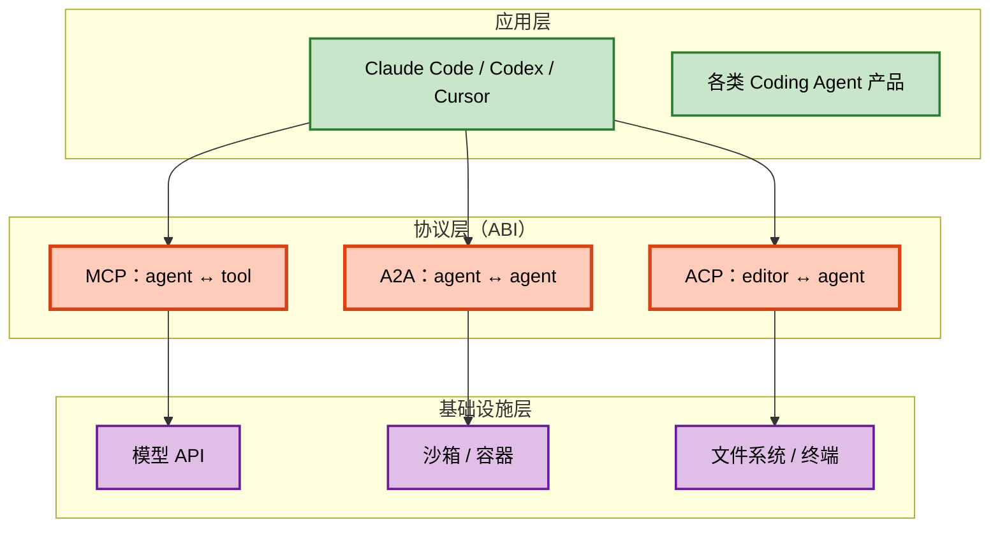

**协议层就是 ABI。** 操作系统当年靠 UNIX ABI 让无数软件移植，Agent 生态靠 ACP / MCP / A2A 达成同样的事。判断一个协议是否成功，看它的 SDK 数量和第三方实现数量——ACP 目前 5 官方 SDK + 2 个头部 Agent 适配器 + 1 个注册表 + 1 个 TCK。

### 趋势二：从「回合制」到「常驻工作单元」是 2026 H2 的主线

v2 的「Beyond the Turn」不是一个小改动，它反映的是 Agent 能力的真实演进：

- Agent 开始能**在后台持续工作**（编译、跑测试、长时间重构）
- Agent 开始能**自己派生子 Agent**（子 session）
- Agent 开始能**自己发起对话**（agent-initiated work）

这直接推翻了「prompt = turn = 生命周期」的旧模型。新的模型是：

> **Session 是常驻的。Agent 在 session 里维护「前台工作」和「后台活动」两条线，通过状态机告诉编辑器「我现在需要你」还是「我在自己忙」。**

**这个模式和 A2A 的 agent 间编排是同一个趋势的两面**——都在解决「Agent 系统的生命周期不再由用户的单次提问界定」的问题。

### 趋势三：终端/文件的所有权归属会成为下一个竞争焦点

ACP 把终端和文件系统放在 **client 侧**，MCP 放在 **agent 侧**。这不是细节，这是**信任模型的分野**：

| 模型 | 适合 |
|---|---|
| 终端在 agent 侧（MCP 式） | 沙箱化、容器化、多租户 |
| 终端在 client 侧（ACP 式） | 本地开发、权限可见、UI 一体化 |

**2026 年的现实是两者并存**：ACP 在本地开发场景赢，SWE-agent 类云端沙箱用 MCP 式。判断一个 Agent 产品该用哪种，看它的终端要跑在谁的机器上、谁承担安全责任。

### 趋势四：协议治理会成为 Agent 生态的新护城河

51 篇 RFD、21 个稳定化公告、Interest/Working 双层小组——这不是社区活跃度的副产品，而是**刻意设计的「慢治理」**。

对比一下：多数开源协议的演进方式是「谁提 PR 谁说了算」，结果是半年一次破坏性变更。ACP 的做法是：

1. **能力协商**让新特性可以纯增量发布
2. **RFD 流程**让重大变更先有讨论
3. **稳定化公告**让每个能力的生命周期显式可见
4. **版本只在必要时 bump**

**结果是 v1 从发布到现在 15+ RFD 零次大迁移。** 这比「star 数」更能说明协议的长期生命力。

### 趋势五：Rust 作为 schema 真源 + 多语言 SDK 生成

ACP 用 Rust 定义协议、用 `schemars` 生成 JSON Schema、再由 JSON Schema 生成 5 语言 SDK。这条管线的优势是**单一真源**，代价是**贡献门槛**。

未来值得观察的是：如果社区贡献主要以 PR 形式进入 Rust crate，那这条管线会持续；如果出现大量 Python/TS 原生的提案，ACP 可能需要补一条「多语言 schema 定义 + 一致性测试」的旁路。

---

## 十八、总结

ACP 表面上是一个 JSON-RPC 协议，实际上在回答一个很具体的问题：

> **当 Agent 可以改你的代码、跑你的命令、读你的文件时，谁来决定它能做什么？**

ACP 的答案是：**编辑器**。

这个答案背后是一整套连贯的设计：

| 设计 | 解决的问题 |
|---|---|
| 终端句柄所有权反转 | Agent 碰不到真实 shell，策略检查留在编辑器 |
| 运行时权限协商 | Agent 不能自己给自己授权 |
| 能力协商取代版本协商 | 新特性纯增量发布，v1 零大迁移 |
| 双向 JSON-RPC | Agent 可以主动要资源，不只是被动接受 |
| Plan 一等对象 | 用户的注意力被引导到「计划」而不是「输出」 |
| ToolKind 10 类 | LLM 语义 → 人类心智模型的映射 |
| locations follow-along | 人能跟得上 Agent 在干什么 |
| 前台/后台状态分离 | Agent 从回合制变成常驻工作单元 |
| 子 Agent 会话 | 编排透明化，editor 能看到整棵 agent 树 |
| MCP-over-ACP | 协议可嵌套，打破 stdio 的进程空间限制 |
| 严格判别符校验 | 扩展性不牺牲正确性 |
| RFD + 双层小组 | 协议的长期维护质量 |

**从工程角度看，ACP 最值得学习的不是任何一个具体字段，而是「把不确定性工程化」这件事本身。** 当系统的一端是 LLM——输出不确定、会犯错、会突然想跑个危险命令——协议就必须承担起「把不确定性约束在可预测的形状里」的职责。

ACP 用能力协商做到了版本稳定，用所有权反转做到了权限可控，用状态机做到了生命周期可观察，用 RFD 做到了演进可控。

**这四条「可控」，是 LLM 应用从 demo 走向生产的必经之路。** 未来还会有更多协议，但只要还涉及「AI 主动操作别人的资源」，就会面对同样的四个问题——而 ACP 目前给出的答案是最完整的。

---

## 附录：关键资源

| 资源 | 地址 |
|---|---|
| 仓库 | https://github.com/agentclientprotocol/agent-client-protocol |
| 协议官网 | https://agentclientprotocol.com/ |
| 规范文档 | https://agentclientprotocol.com/protocol/v1/overview |
| v2 Draft 公告 | https://github.com/agentclientprotocol/agent-client-protocol/blob/main/docs/announcements/acp-v2-draft.mdx |
| Rust schema crate | https://crates.io/crates/agent-client-protocol-schema |
| Rust 运行时 crate | https://crates.io/crates/agent-client-protocol |
| TypeScript SDK | https://www.npmjs.com/package/@agentclientprotocol/sdk |
| Python SDK | https://github.com/agentclientprotocol/python-sdk |
| Rust SDK | https://github.com/agentclientprotocol/rust-sdk |
| Java SDK | https://github.com/agentclientprotocol/java-sdk |
| Kotlin SDK | https://github.com/agentclientprotocol/kotlin-sdk |
| Claude Code 适配器 | https://github.com/agentclientprotocol/claude-agent-acp |
| Codex 适配器 | https://github.com/agentclientprotocol/codex-acp |
| Agent Registry | https://github.com/agentclientprotocol/registry |
| TCK 兼容性套件 | https://github.com/agentclientprotocol/acp-tck |
| JSON Schema | `schema/v1/schema.json` / `schema/v2/schema.json` |
| License | Apache-2.0 |
