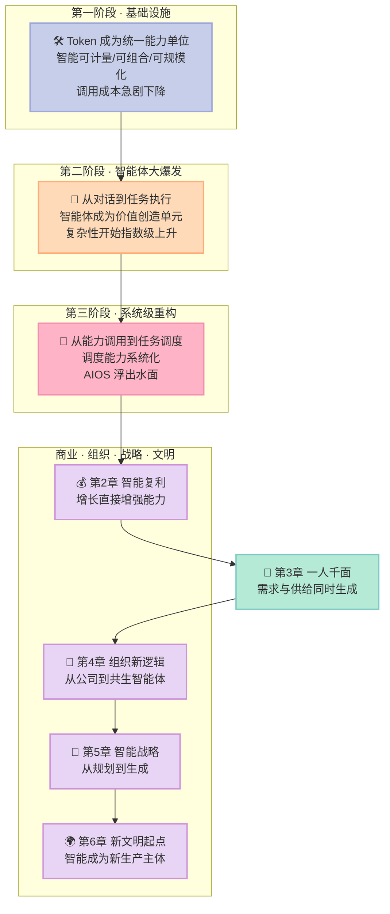
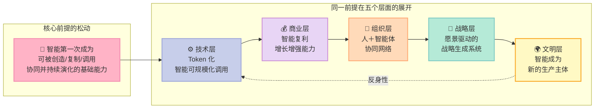

# 【曾鸣·智能AI时代】系列总览 —— 6 章全景与底层逻辑主线

2026 年一开年，OpenClaw 在开发者圈里出圈，很多人第一反应是"又一款爆款 Agent"。

但曾鸣在书里给了一个更冷的判断：**OpenClaw 的价值不在于它有多强，而在于它标志着 AI 从"会说话"变成了"会干活"。** 而"会干活"这件事，只是 AI 产业化三个阶段里的第二个。

更值得警惕的是他接下来那句话——**2025 年 ChatGPT 发布、2026 年 OpenClaw 出圈，这些都还只是"能力竞争"。真正决定未来几年产业格局的竞争，从"谁的能力更强"变成"谁围绕这些能力建立了新的系统"。**

这就是这本书的价值所在。它不讲模型架构，不讲提示词技巧，也不讲怎么用 AI 提效。它干的是一件更笨也更硬的事：**从第一性原理出发，把"智能"这个新变量代入商业、组织、战略的全部默认前提，逐条推演一遍，看哪些还站得住，哪些已经松动了。**

这个系列共 8 篇。这一篇是总览，先把 6 章的全貌和那条贯穿始终的底层逻辑主线摊开。

---

## 一、这本书在讲什么：一次自我纠偏的推演

作者在书里坦白了他的起点：**这几年研究 AI 对经济、商业、企业的影响，虽然不时蹦出好想法，但总觉得是盲人摸象。**

盲人摸象意味着什么？意味着手里每块碎片都是真的，但拼不出全貌。2025 年 AI 编程大发展，不少 AI 原生组织实现突破创新；2026 年春节 OpenClaw 快速出圈。这些现象背后浮现出一些越来越明确的趋势。曾鸣在努力梳理这些趋势时，**一个完整框架才慢慢涌现出来。**

这里有两句话值得单独拎出来，因为它们定义了整本书的写作姿态：

> **"重要的不是结论，而是思考过程本身是否有借鉴作用。"**
>
> **"未来究竟会如何展开，没有人能够准确预言，但理解变化背后的底层逻辑，或许是我们参与未来最重要的起点。"**

作者自己承认：AI 还在大发展的早期，本书大部分观点**缺乏完整的事实验证**，面向未来的推论一定会有错误和疏漏。

这种坦诚恰恰是这本书比大多数"AI 时代生存指南"高明的地方。**它不承诺预测，只承诺提供一副思考的骨架。**

### 与同类书的定位对比

| 维度 | 曾鸣《智能AI时代》 | 《智能商业》/《智能战略》(2018-2019) | 主流 AI 应用/工具书 | AI 行业趋势预测类 |
|---|---|---|---|---|
| 核心问题 | 智能成为基础设施后，商业组织战略的底层约束变了什么 | 互联网与万物互联时代的商业与战略方法论 | 怎么把某个工具用好 | 明年哪个赛道会爆 |
| 推演起点 | 第一性原理 + 经济约束条件变化 | 生态位与网络效应 | 具体工具与场景 | 现象归纳 |
| 核心原创概念 | 智能复利、黑洞效应、60 分奇点、一人千面、认知虹吸 | 点线面、网络效应、协同网络 | 无 | 无（多为既有词汇重述） |
| 时代锚点 | 2025-2026 AI 原生组织与 OpenClaw | 移动互联网与物联网 | 单点工具 | 短期热点 |
| 对"不确定性"的态度 | 明确承认推演可能出错，但给出框架 | 给出方法论 | 不涉及 | 常常给出确定预测 |
| 适合的读者 | 想理解底层逻辑的经营者、创业者、组织设计者 | 互联网时代从业者 | 工具使用者、初级实践者 | 找风口的人 |

**一句话结论：这本书不是让你学会用 AI，而是让你重新学一遍怎么思考商业。**

---

## 二、6 章全景：从能力竞争到系统竞争

曾鸣把 AI 产业化划分为三个阶段，这构成第 1 章；随后五章依次处理商业机制、组织形态、战略方法，最后升维到文明尺度。

### 6 章核心观点速览

| 章 | 标题 | 一句话核心结论 | 关键概念 | 落点 |
|---|---|---|---|---|
| 第 1 章 | AI 产业化的展开 | 竞争会从能力竞争自然进入系统竞争 | Token 计量、复杂度爆炸、双边市场、调度、AIOS | 技术与产业 |
| 第 2 章 | 智能复利和黑洞效应 | 增长第一次直接增强能力，而这是优势的唯一来源 | 智能复利、两道转化、复杂性奇点、60 分奇点 | 经济机制 |
| 第 3 章 | 一人千面 | 商业从"发现需求"转向"生成需求"，供给也随之实时生成 | 意图理解、需求生成、需求判断力、智能调度 | 商业范式 |
| 第 4 章 | AI 时代的组织新逻辑 | 没有岗位、没有层级，组织是创智人才与智能体的协同网络 | 创智人才、认知共创、组织 OS、共生智能体 | 组织形态 |
| 第 5 章 | 智能战略 | 战略从规划未来转向在行动与反馈中持续生成 | 愿景、张力机制、战略生成系统、战略共创 | 决策方法 |
| 第 6 章 | 新文明的起点 | 人类第一次不再是自己文明的唯一智能主体 | 智能主体、社会大变革、创业者角色变化 | 文明尺度 |

---

## 三、底层逻辑主线：五个层面，一个前提

总览篇真正的价值不在目录，而在**把六章串起来的那根线**。

请看这张图：

### 这根线到底说了什么

**过去三个时代，技术革命改变的都只是工具，没有改变智能本身在人类社会中的位置。**

蒸汽机替代体力，电力成为能源基础设施，互联网让连接无处不在——但**理解世界、形成判断、创造知识、制定目标、组织协作，这些能力始终默认属于人类自身**。

而 AI 第一次动了这个前提。当大模型与智能体进入真实世界，智能不再只是附着在人身上的能力，**它变成了一种可以被创造、复制、调用、协同和持续演化的基础能力**。

这一个前提的松动，逐层传导：

| 层面 | 旧默认前提 | 松动后的新现实 |
|---|---|---|
| 技术 | 智力只能由人提供，受限于人的培养周期 | Token 化的智能可被规模化调用，认知供给接近无穷 |
| 商业 | 规模经济（工业）/ 网络效应（互联网）主导增长 | 智能复利：增长直接增强能力，能力再推动增长 |
| 组织 | 层级、岗位、流程是为了协调人的判断而设 | 智能进入组织认知层，很多协同可被系统吸收 |
| 战略 | 未来可被预测，因此可被规划 | 未来在行动与反馈中生成，战略成为持续生成能力 |
| 文明 | 人类是唯一的智能主体 | 智能成为新的生产主体，人的独特性需要重新定义 |

**为什么这条线不是拼凑的？** 因为每一个层面都遵循同一套推导纪律：先找到该领域赖以成立的**经济约束条件或认知默认前提**，再问"当智能成为可规模化调用的基础能力后，这个前提还成立吗"。

第 2 章用的正是这个方法：规模经济的源头不是蒸汽机，而是**前期投入巨大、边际成本骤降的成本结构**；网络效应的源头不是互联网，而是**连接成本趋近于零**。AI 时代对应的新约束是什么？**普通认知能力的供给从稀缺变为接近无穷，且使用会增强系统本身。**

这才是本书比同类"AI 趋势书"扎实的地方——**它不是在描述现象，是在推导机制。**

### 一个反直觉的提醒

作者在第 2 章给出了一个容易被跳过的限定：**智能复利不自动等于竞争优势。**

能力提升要经过两道转化才能变成优势——先转化为用户可感知的价值，再转化为相对竞争者的差距。**任何一道转化断裂，复利就只是行业整体能力的抬升，而不是你的护城河。**

这也是为什么第 2 章值得单独读一整篇，而不是在总览里一句带过。

---

## 四、系列导航：8 篇的推进顺序

| # | 篇目 | 解决什么问题 | 状态 |
|---|---|---|---|
| 00 | **本文：系列总览** | 6 章全景与底层逻辑主线 | ✅ |
| 01 | [AI 产业化三阶段](/2026/10/27/ai-business-zengming-01-ai-industrialization-3-stages/) | 技术能力如何走向系统结构 | ✅ |
| 02 | [智能复利与黑洞效应](/2026/10/27/ai-business-zengming-02-intelligence-compounding-black-hole/) | AI 时代新的增长与优势机制 | ✅ |
| 03 | [一人千面](/2026/10/27/ai-business-zengming-03-one-person-thousand-faces/) | 商业范式为何从匹配转向生成 | ✅ |
| 04 | [AI 时代的组织新逻辑](/2026/10/27/ai-business-zengming-04-ai-era-organization/) | 没有岗位和层级的组织怎么运转 | ✅ |
| 05 | [智能战略](/2026/10/27/ai-business-zengming-05-vision-driven-strategy/) | 愿景驱动的战略生成系统如何搭建 | ✅ |
| 06 | [新文明的起点](/2026/10/27/ai-business-zengming-06-new-civilization/) | 智能成为新生产主体意味着什么 | ✅ |
| 07 | [全书贯通](/2026/10/27/ai-business-zengming-07-full-book-synthesis/) | 五层如何由同一机制驱动 | ✅ |

**建议的阅读顺序是 00 → 01 → 02 → 03 → 04 → 05 → 06**，这是书本身的顺序，因为 03 章的"智能调度"直接承接 01 章的"调度"，02 章的"60 分奇点"又是 03 章"调度壁垒"的商业前提。

如果你时间有限，只读两篇：**先读 02（智能复利），再读 03（一人千面）**。这两篇是全书商业部分的主干，也是最容易直接转化为行动决策的部分。

---

## 五、这本书适合谁，不适合谁

### 适合

- **正在做 AI 原生创业的创始人**——尤其是在"到底该切哪个点"上纠结的。第 2 章末尾的广告领域案例、第 3 章的点线面生态位定位，直接给判断框架。
- **负责组织设计的 HR / 管理者 / CEO 助理**——第 4 章会告诉你，岗位、层级、汇报线这些概念本身正在失效。
- **在传统企业里推 AI 落地的业务负责人**——本书反复强调一个区分：**用 AI 工具**和**构建 AI 系统**，是两件事。后者才有复利。
- **战略与咨询从业者**——第 5 章把战略从"规划"重新定义为"生成"，这是一个可以立刻搬进工作坊的框架。

### 不太适合

- **想找"AI 快速变现套路"的读者**——本书没有速成模板，反而反复强调路径依赖、复杂性奇点这些需要时间的东西。
- **纯技术实现岗位**——本书几乎不谈具体架构、模型选择、部署方案。
- **期望得到确定预测的读者**——作者反复声明推演可能出错，它给的是框架而非结论。

### 一个阅读提醒

这本书的许多判断写在 2025-2026 这个**智能体刚出圈、复利尚未被普遍验证**的时间点上。曾鸣自己也承认缺乏完整的事实验证。

正确的读法不是"照着做"，而是：**用它提出的问题去检查你自己的业务。** 每读一章，问一句"这一章的默认前提，在我的组织里还成立吗"。

---

## 六、行动建议

读完这篇总览，你至少可以做三件事：

**第一件事：做一次"前提盘点"。** 拿一张纸，把你所在组织的四条默认前提写下来——组织靠层级协调、战略靠预测制定、增长靠规模扩张、产品靠预先定义。然后逐条问：**当智能可以被规模化调用之后，这条前提还成立吗？** 不成立的部分，就是你未来两年的风险区。

**第二件事：找到你业务的"最小闭环"。** 第 2 章的核心判据是：系统是否拥有**真实的任务闭环**——行动、结果、反馈三段是否完整，有没有被人工在中间切断。这个判据比"我们上了多少 AI 工具"有用得多，因为它指向的是一个二元的、可验证的状态。

**第三件事：判断你所处的是第几阶段。** 如果你的 AI 还在"能对话、能生成内容"，你在第 2 阶段的早中期；如果你的组织开始出现"多个智能体协同但经常打架、上下文丢失、成本失控"，你正在撞上第 2 到第 3 阶段的墙——**调度能力**会从这一刻起变成你最稀缺的能力。

**最后一句提醒，也是全书最重要的一句判断：**

> 在 AI 时代，企业之间真正的差距，可能不再是**谁拥有 AI**，而是**谁真正形成了 AI 原生的任务系统**。

这个系列接下来 7 篇，会把这条主线逐层拆开。第 01 篇先回答：智能体浪潮究竟会走向哪里。

---

> **行动建议**：不要把这本书当预言来读，把它当体检报告来读。先盘点你业务的四条默认前提，再检查你的任务闭环是否真实存在，然后判断你正卡在产业化的哪一阶段。框架只有落到自己的业务上，才会变成判断力。
