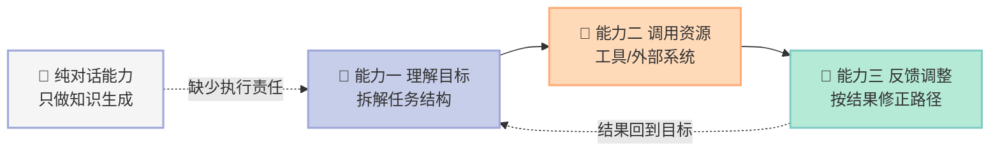
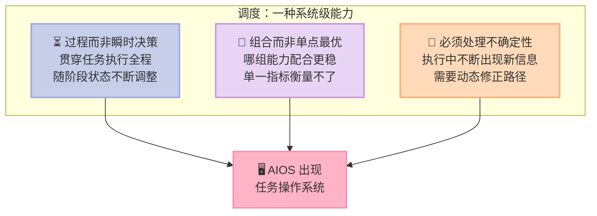
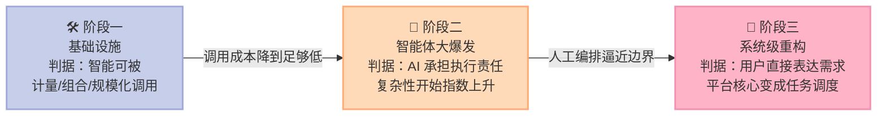

> **一句话核心结论**：AI 产业化的真正转折不在智能体有多强，而在竞争重心从"能力竞争"迁移到"系统竞争"——**谁能让大量持续运行的智能体被有效组织起来，谁才拿下一阶段的入场券。**

---

## 前言：为什么这一章值得读

2026 年一开年，OpenClaw 迅速出圈，开发者圈里几乎人人都在讨论它。

但如果只把它当成一个"更强的 Agent 产品"来理解，你大概率会看错这一章。因为作者关心的问题从来不是"哪个产品能赢"，而是：**当智能开始承担真实任务，产业竞争的规则本身发生了什么变化？**

这个问题之所以现在才变得可回答，是因为一个前提刚刚成立。

回想 2022 年底 ChatGPT 发布，两个月月活突破 1 亿，创下消费级应用最快增长纪录。三年后的今天，人们已经习惯了一个能理解语言、生成内容、写代码、分析问题的"越来越聪明的聊天机器人"。

**但过去三年，AI 大多停留在"知识生成层"。它给建议、给方案，真正的执行仍然要你在不同系统里完成。**

2025 年初 Claude Code（Anthropic 推出的终端 AI 编程助手）开启智能体时代，2026 年 OpenClaw 出圈，OpenClaw 可以调用软件、操作电脑、写代码。**支撑它的是四个同时到位的因素：模型能力大幅提升、API 开放、协议标准完善、开源社区发展。**

四者缺一不可。这不是一家公司的胜利，是**一整条产业链条件同时成熟**的产物。

读完这一章你会得到三个东西：一把判断产业阶段的尺子（三个阶段各自的特征）、一份"复杂性爆炸"的问题清单，以及一个具体的判断——**你在第二阶段还能补什么短板。**

---

## 一、核心概念：AI 产业化的三个阶段到底是什么

曾鸣把 AI 的产业化路径划成三段。划分依据不是技术指标，而是**人性和社会发展规律**，参照的是前几次工业化的历史经验。

### 阶段一：基础设施建设 —— 智能第一次变成"可调用的公共能力"

工业时代最重要的基础设施是能源，互联网时代是信息网络。AI 时代正在形成的新基础设施是：**可被持续调用的通用人工智能。**

这一阶段的标志是 **Token（词元）成为统一的计量单位**。

2026 年基于 Token 形成的共识，标志着第一阶段初步成形。两个标志性表述：

- **黄仁勋在英伟达 GTC2026 提出 TokenFactory（词元工厂）**：未来的数据中心本质是在生产 Token，就像工业时代的炼油厂持续输出能源。
- **奥尔特曼反复强调，OpenAI 提供的不是某一个具体应用，而是 Token 本身。**

两个来自不同公司的表述，指向同一个变化。作者从中提炼出智能作为基础设施的三个必要条件：

| 条件 | 含义 | 为什么重要 |
|---|---|---|
| **可计量** | 每次调用可被精确记录，Token 成为统一能力单位 | 能力一旦被精确计量，就具备工业化条件，成本结构清晰、规模效应显现 |
| **可组合** | 生成/理解/推理/编程通过统一方式调用 | 构建新系统不必从零开始，而是在已有能力之上组织 |
| **可规模化** | 调用方式统一、成本结构清晰，使用量在各类产品中快速增长 | 具备基础设施性质，产业围绕它形成新的资源配置方式 |

作者提醒了一个容易被跳过的历史规律：

> **所有重大且深刻的产业变化，通常都不是在技术刚刚被发明的时候发生的，而是发生在技术的基础设施化之后。**

蒸汽机发明之后，不是立刻出现现代工业体系；互联网 1990 年代初出现之后，也不是立刻形成今天的平台经济。真正推动社会重构的，是新技术变成**稳定、低成本、可大规模调用的公共能力**。

**这一阶段最重要的历史意义：人类第一次把智力本身，转化成一种可以被大规模调用的能力。**

过去，智力始终是高度稀缺、难以复制的资源。一个组织的发展速度，很大程度上受限于高水平认知能力的供给速度。今天这个边界第一次被突破——程序员长期与 Claude Code 协同开发，研究人员让智能体持续跟踪行业信息。

### 阶段二：智能体大爆发 —— 从"能对话"到"能交付"

用户开始期待系统能围绕一个目标持续推进任务，直到拿到结果。而一旦进入复杂场景，**对话这种交互方式的限制就变得明显**：

- **多步骤任务会很快撞到边界**：每一步都要重新描述上下文，每次决策都靠用户手动连接，复杂度一上升成本就迅速增加。
- **对话不承担执行责任**：它能建议、能生成方案，但执行仍需用户在不同系统完成。AI 停留在辅助位置，没有进入任务本身。

当一个 AI 系统要完成真实任务时，至少需要三类能力：

**这三类能力组合在一起，就不再是对话，而是一个可以自主行动的系统——智能体（Agent）。**

作者在这里给出了一个很关键的判断：

> 智能体真正重要的地方并不是"更聪明"，而是它**围绕目标，在时间维度上持续运行**。

传统软件本质是功能集合，用户调用一次功能完成一次操作；智能体越来越像一个**持续存在的工作单元**。

而这一阶段的竞争单位也变了：

> **智能体是价值创造单元，而非能力单元。**

能力包括信息搜索、内容理解、文本生成、数据分析、代码执行、工具调用、页面操作、计划制订。但单一能力不是用户真正关心的东西——**用户不会说"我今天要去使用一个能力"，用户关心的是"有没有一个智能体能帮我把事情做成"。**

### 阶段三：系统级重构 —— 从"能力调用"到"任务调度"

第三阶段的关键变化是：**用户不再以浏览智能体为主，而是直接表达需求。**

用户不想买智能体，也不想浏览能力清单，**他们真正想要的是完成任务**。系统自己拆解任务、组合能力、调度智能体、完成执行。

这个阶段的平台核心能力不再是信息排序，而是**调度（Orchestration）**——注意它不是传统意义的资源分配，也不是简单地"选哪个智能体"。作者强调调度有三个特征：

**为什么调度会从局部功能长成系统级能力？** 因为智能体数量足够多时，用户面对的已经不是工具，而是**一个不断扩张的智能网络**——不同智能体互相调用、互相协同、互相影响。

而传统操作系统的核心是管理计算资源：CPU、内存、文件系统、进程调度。**因为工业时代的软件本质是确定性程序**，系统最重要的问题是如何高效管理资源。

AIOS 面对的问题完全不同：它管理的**不只是算力，还有任务流、上下文、能力协同与长期状态**。

作者给 AIOS 归纳了三重角色：

| 角色 | 具体职责 | 类比 |
|---|---|---|
| **入口角色** | 与用户直接交互，理解任务目标，转化为可执行过程（不再只是"帮选择"，还参与整个任务） | 传统 OS 的 Shell |
| **调度角色** | 在统一框架中组织不同智能体的调用，而非局部编排 | 传统 OS 的进程调度 |
| **开发者支持角色** | 统一接口方式、上下文管理机制、一定程度的运行规范 | 传统 OS 的 SDK 与系统调用规范 |

---

## 二、底层机制：三个阶段靠什么切换

### 切换的开关是什么

**从阶段一到阶段二的开关是"成本"。** AI 过去几年真正突破的，不只是能力，还有**能力获取成本的急剧下降**。当强大的推理、生成、搜索、代码、分析能力通过 API 被统一调用，整个产业的创新门槛迅速降低。

这带来一个反直觉的结果：**AI 时代最先爆发的未必是少数超级应用，而更可能是海量任务系统。**

工业时代最重要的变化是机器降低了体力劳动成本；今天 AI 在快速降低智力劳动成本。大量过去"不经济"的小需求被激活——一个小型研究需求、一个局部运营流程、一个客户分析任务，过去不值得专门组建团队，现在一个人加几个智能体就能快速完成。

**从阶段二到阶段三的开关是"复杂性"。** 这也是作者认为**整个 AI 产业里最容易被低估的问题**。

### 复杂性爆炸：能力释放的另一面

> 每一次能力的大规模释放，都会同时带来复杂性的急剧上升。

| 时代 | 能力释放 | 随之而来的复杂性 | 应对产物 |
|---|---|---|---|
| 工业革命 | 生产能力大幅提升 | 前所未有的组织复杂性 | 现代企业制度、流水线、层层管理 |
| 互联网 | 信息流动效率提升 | 信息爆炸 | 搜索引擎、推荐系统、平台治理 |
| AI | 智能体进入工作流 | 行为不可预测性急剧上升 | 调度能力、AIOS |

过去的软件系统大多数时候有极高确定性。即使内部复杂，功能边界也相对明确——**Excel 不会突然决定帮你修改战略方向，ERP 也不会主动重新定义供应链逻辑。**

智能体不是这样。它根据上下文动态决策，主动调用资源，持续调整路径，在执行中不断生成新的中间状态。**系统行为越来越难以完全预定义。**

**复杂系统最核心的特征不是能力，而是不可预测性迅速增加。**

一旦多个智能体真正参与企业运营，问题就不再是"某一个智能体够不够强"，而是"整个系统能不能稳定运行"。作者列出了一串在真实环境里会被迅速放大的问题：

- 不同智能体之间的**上下文如何保持一致**？
- 多个系统之间的**信息如何避免失真**？
- 一个智能体生成的**错误会不会被后续系统持续放大**？
- 多个智能体同时调用资源，**成本如何控制**？
- 系统做出错误决策，**责任到底归属于谁**？

这五个问题，就是从阶段二走向阶段三时你必须回答的五个问题。

### 双边市场：阶段二最深层的产业矛盾

> **未来不会缺智能体，真正稀缺的将是谁能够有效组织大量持续运行的智能系统。**

当智能体多到用户无法自己判断时，就会出现入口。逻辑链条是这样的：

1. **智能体是任务完成系统，而任务往往没有清晰边界。** 同样是行业研究，有的擅长信息收集，有的擅长结构分析，有的擅长财务建模——使用前很难判断哪个更适合。
2. **能力表现高度依赖上下文。** 同一个智能体在不同任务上下文里可能效果完全不同，它不像传统软件有稳定固定的功能边界。
3. **试错成本极高。** 生成一段文案错了无所谓，参与企业运营、客户服务、财务分析、供应链管理时错了是真金白银。
4. **选择是连续的不是一次性的。** 用户不只要决定用哪个智能体，还要决定在什么阶段用哪个，以及这些选择之间如何衔接。

当这些问题叠加，**用户购买的就从来不只是能力，更是确定性。**

于是自然涌现出双边市场：平台帮用户降低探索成本，缩短"我有一个问题"到"我找到一个能解决问题的智能体"之间的距离；开发者侧为了更容易被发现、被接入、被调用，会逐渐走向一定程度的标准化。

> **工业时代，人们购买产品；互联网时代，人们获取信息；AI 时代，人们会越来越直接地购买任务结果。**

这和互联网早期一样——网站可以有无数个，但最终只有少数成为高频入口。

---

## 三、关键细节深挖：一个真实任务如何推动系统走向 AIOS

作者用了一个具体的场景来解释抽象的架构演化。

**场景：某新能源汽车企业的 CEO 制定战略。**

过去这需要多个部门协同，往往耗时数月。未来如果有 AI 系统理解任务结构，它就能：

- 自动拆解目标
- 让智能体持续跟踪政策、竞争态势、供应链、财务数据、消费者洞察
- 多个智能体协同时动态调整策略
- 逐步形成**持续运行的组织记忆系统**，管理上下文并沉淀长期认知

这里有两个细节值得放大：

**第一，系统是围绕任务目标持续动态运行的，而不是"启动一次、算一次"。**

今天的软件本质是功能集合，用户自己负责组织任务；未来的任务系统会越来越主动地组织整个工作过程。

**第二，未来任务系统会长期管理上下文。** 真实战略任务不是一次性的，很多关键判断需要持续数周甚至数月不断修正——新的政策、新的竞争动作、新的市场反馈会不断改变原有结论。**传统组织之所以需要大量会议，本质上就是因为人类需要不断重新同步上下文。**

一个成熟的 AI 任务系统还会越来越像一个**持续运行的组织记忆系统**：它不只知道当前任务是什么，还会持续保留过去的关键判断、记住某个方案为什么被放弃、哪些假设已经发生变化、哪些风险正在上升、哪些结论需要重新验证。

### 历史类比：能力竞争必然让位于系统竞争

这是本章最有价值的一个判断：**在每一次重大技术革命的早期，竞争首先围绕能力本身展开；能力成熟后，决定产业格局的通常是谁围绕这些能力建立了新的系统。**

| 时代 | 早期竞争焦点 | 后期决定格局的东西 |
|---|---|---|
| 工业时代 | 机器能力：蒸汽机、生产设备、制造能力 | 大规模工业体系——流水线、供应链、现代企业制度、全球制造网络 |
| 互联网时代 | 连接能力：浏览器、服务器、数据库、网络协议 | 重新组织信息、交易与协同——谷歌重组信息发现，脸书重组社交关系，阿里巴巴重组商业协同 |
| AI 时代 | 大模型能力能否成立 | **这样的基础能力能为用户解决什么问题** |

值得注意的是作者的一个时间校准：**OpenAI 创建于 2015 年，2017 年开始基于 Transformer 模型架构训练 GPT 模型，至今已接近 10 年。** 放在产业发展的大历史背景下，即使现在智能体热度高涨，整个过程的展开也需要几年时间。

**所以如果你觉得"AI 改变一切"来得太突然，可能只是把 10 年的技术积累压缩成了 1 年的舆论感知。**

### 终点：AI 进入组织认知层

作者在章末把这个判断说透了：

> **AI 第一次真正进入组织认知层。**

工业时代最重要的组织逻辑是围绕标准化生产建立的大规模分工体系。互联网时代提高了信息流动效率，但**任务本身仍然主要由人组织**——人负责理解目标、协调资源、管理上下文、持续推进复杂工作流，软件始终是辅助系统。

今天更深层的变化开始出现：智能系统不只是支持工作，还会越来越深地参与**任务拆解、信息组织、能力协同、动态调整、长周期执行、上下文管理**。

**一旦系统进入任务层，整个商业世界的组织逻辑就会逐渐发生变化。** 未来很多企业之间的差距，可能不再是"谁拥有 AI"，而是"**谁真正形成了 AI 原生的任务系统**"。

---

## 四、优势、代价与局限

| 维度 | 阶段一：基础设施 | 阶段二：智能体爆发 | 阶段三：系统级重构 |
|---|---|---|---|
| **带来的优势** | 智能成本骤降，创新门槛降低；小需求被激活 | 智力劳动成本快速下降；一个产品经理加几个智能体可完成过去一个团队的工作 | 任务成为核心单位，用户只需表达目标；系统承担复杂度 |
| **付出的代价** | 算力与能源消耗激增；能力被统一抽象后易被同质化竞争 | 复杂性指数上升；试错成本高；责任边界模糊 | 高度依赖调度成熟度；一旦系统失效，全链路受影响 |
| **适用场景** | 所有需要智能的场景，无差别适用 | 局部任务、流程明确、容错度高的场景 | 长周期、多方协同、上下文复杂的战略类任务 |
| **不适用场景** | 需要绝对确定性与责任归属的场景 | 后果不可逆、试错成本极高的场景 | 规则高度确定、已有成熟标准软件的场景 |
| **最容易被低估的坑** | 只关注模型能力，忽略成本与计量 | 以为智能体是"更强的工具"，忽略执行责任与复杂度 | 把 AIOS 理解成"AI 版 Windows"，忽略任务组织方式 |

**三个阶段的关系不是替代，而是叠加。** 今天绝大多数企业其实同时处在阶段一尾部与阶段二早中段：基础设施基本就位，智能体刚开始进入工作流。

作者也明确划了边界：

> **这里的讨论重点是 AI 产业化的发展路径，不涉及 ASI（超级人工智能）的发展。**

以及：

> 本章对智能体、调度与 AIOS 的讨论，**只是对未来产业演化路径的一种推演，真实世界的发展肯定比今天任何一种线性预测更加复杂**。这些讨论的目的不是预测未来，而是帮助理解我们正在进入一个怎样的时代。

---

## 五、对你的启发与行动建议

### 如果你是 AI 原生创业公司的创始人

**先判断你在解决什么复杂度的问题。** 复杂度决定你所在的阶段，也决定你能不能吃到下一阶段的红利。局部、标准化、周期短的任务——比如文案生成、素材生产——竞争极其激烈，因为大家都在做，没有独特学习路径。

**优先建设"任务闭环"而不是"更多智能体"。** 你的智能体数量增加一倍，而可靠性不变，系统的复杂度就翻倍而价值不变。

**AIOS 方向是明确的，但不是现在的主战场。** 调度能力会越来越重要，但第三阶段是产业演化的结果，不是当下的竞争焦点。

### 如果你是传统企业的业务负责人

**先做一件事：数一数你的 AI 调用里，有多少是"人对 AI 负责"，多少是"AI 对结果负责"。** 前者再多，也只是工具化，不会产生复利。

**其次，把"复杂性清单"贴在墙上。** 上面那五个问题——上下文一致性、信息失真、错误放大、成本失控、责任归属——你的组织今天大概率一个都没解决。**这就是你真正的竞争空间所在，而不是再买一个工具。**

**最后，注意你组织里的隐性成本。** 传统组织之所以需要大量会议、层层汇报，本质是人类需要不断重新同步上下文。当 AI 承担任务层，**这部分组织成本是被系统性吸收的机会**——这是组织重构的起点，也是第 04 篇的主题。

### 如果你是在观望的从业者

这一章给你的不是"要不要用 AI"，而是**一个坐标轴**。先判断自己在阶段一的哪个位置、阶段二的哪个位置，比纠结"该学哪个框架"有用得多。

**记住三个切换开关：成本降下来了（进入阶段二）、复杂性超载了（走向阶段三）、组织逻辑需要重写了（下一阶段）。**

---

> **行动建议**：今天就做两件事。第一，在你负责的业务里挑一个**后果可控但频次高**的任务，让 AI 从"给建议"变成"直接交付结果"，观察你是否还必须全程盯着——这是从阶段二往闭环走的第一步。第二，把上面那五个复杂性问题逐条对照你的团队，**没有答案的那些，就是你未来 12 个月真正的竞争战场**。
