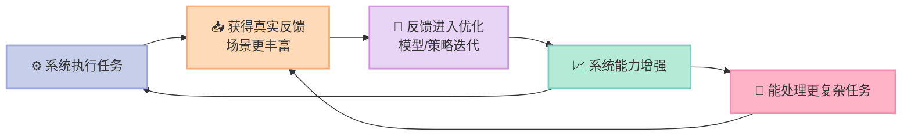
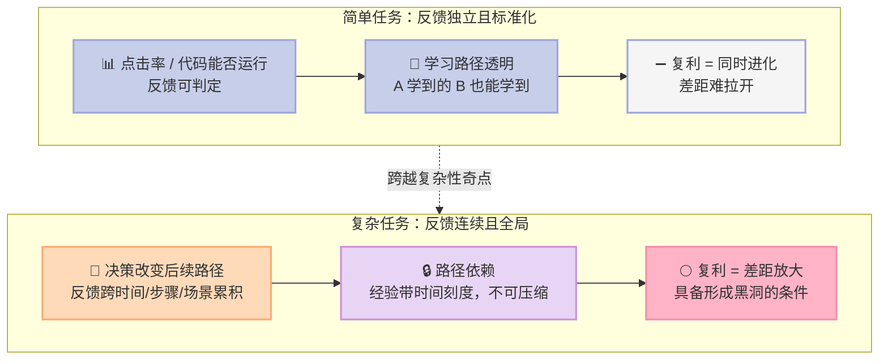
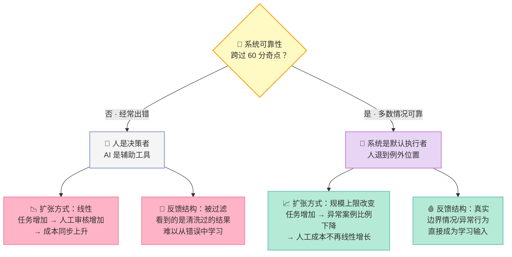

> **一句话核心结论**：**智能复利是一种价值创造机制，而不是优势生成机制。** 只有当能力提升能被用户持续感知、且能持续改变任务分配时，复利才会跃迁为黑洞效应——而这个跃迁的开关，是一个叫"60 分奇点"的结构性转折。

---

## 前言：为什么这一章值得读

先问你一个可能有点冒犯的问题：**你的公司用了 AI 之后，能力变强了吗？**

如果答案是"是"，那第二个问题更关键：**变强的部分，有多少转化成了客户能感知的价值？又有多少转化成了相对竞争对手的差距？**

这两个问题会暴露一个大多数 AI 创业故事刻意回避的事实：**很多公司确实在变强，但变强没有带来任何商业差异。**

这一章的价值在于，它提供了一套**可证伪的推导**，而不是一个励志故事。作者先用工业时代和互联网时代的规律做类比，推出 AI 时代的新机制，然后立刻给这个机制加了三道限制——**复利不等于优势**。

读完你会得到三个具体的东西：一个判断增长质量的指标（有没有真实任务闭环）、一个可操作的分水岭（60 分奇点）、以及一个关于"该切多复杂的题"的决策框架。

---

## 一、核心概念：智能复利与黑洞效应到底是什么

### 先看历史：每个时代都有自己的增长机制

作者的方法论非常克制：**技术本身不会直接决定商业结构，真正决定商业结构的是技术改变了经济系统中的某些基本约束条件。**

| 时代 | 技术改变的关键约束 | 涌现出的增长机制 | 竞争优势 |
|---|---|---|---|
| 工业时代 | 前期投入巨大、边际生产成本骤降 | **规模经济**：规模越大单位成本越低 | 企业规模本身就是壁垒 |
| 互联网时代 | 连接成本被压低到接近于零 | **网络效应**：节点越多网络价值越大 | 用户规模与网络结构 |
| AI 时代 | 普通认知能力从稀缺变为供给接近无穷，**且使用会增强系统本身** | **智能复利** | 黑洞效应 |

工业时代的推导很直白：一个铁匠铺无法摊薄机器、厂房、铁路、电力系统的前期投入，所以**不扩大规模就无法生存**，于是规模第一次变成竞争优势。**没有人"发明"了规模经济，是约束条件变了，它才成为可能。**

互联网时代同理：连接变便宜后，价值创造逻辑从"生产得更多"变成"连接得更多"，节点越多网络价值越大，于是网络效应出现。

### 智能复利：用得越多，系统越强

AI 突破的关键约束是这一条：

> 在过去几乎所有经济体系中，**高质量智力始终是一种极其稀缺的资源**。互联网可以让专家被更快找到，但并不能让专家变多。

而 AI 系统与传统资产有一个根本差别：

> 传统经济系统中，大多数资产都遵循一个基本规律：**使用会带来损耗**。机器会磨损，设备会老化，人会疲劳，组织会随规模扩大而迟缓——增长通常意味着资源消耗。
>
> **AI 系统则不同：一个系统完成的任务越多，接触的场景就越丰富；反馈越多，反馈又重新进入模型优化过程，进一步提升系统能力。**

**系统的使用过程，第一次成为系统的学习过程和增值过程。**

作者用特斯拉的自动驾驶举了一个非常具体的例子：

- **传统汽车工业**：一辆车卖出去，能力基本固定。驾驶经验属于驾驶者，不在车辆本身。车开得再多，也不会"学会"新能力。
- **特斯拉自动驾驶系统**：每一辆车在真实道路上的运行都持续产生反馈——复杂路况、极端天气、边界场景、异常行为、驾驶决策，这些数据不断反馈到系统，用于模型训练与策略优化。**每一次驾驶不仅是在完成任务，还是在训练系统。**

于是新的增长循环出现了：

**AI 第一次让能力本身进入复利循环，增长直接增强能力，能力推动增长。** 这里变化的不是工具效率，而是价值创造机制本身。

### 黑洞效应：复利跨越复杂性奇点后的引力

**智能复利是系统内部的能力演化机制，竞争优势是企业在市场中的相对位置。两者之间并不存在天然的对等关系。**

而黑洞效应是复利的**跃迁形态**：

> 当智能复利**跨越特定任务的复杂性奇点**时，产生不可逆的、越来越大的竞争优势——这个现象称为黑洞效应。

"黑洞"这个比喻的关键在于**引力增强**。黑洞不是主动扩张的，而是因为自身质量足够大，周围的一切自然向其聚集。

一旦能力差距开始持续放大，并且能吸引更多任务与反馈，资源流动的方向就会改变：**高价值任务流、稀缺反馈数据、开发者能力、用户信任**，都会逐步向少数系统集中。

> **互联网有网络效应，AI 时代有强大的认知虹吸。**

**这个过程最令人绝望的地方是：你不是在和一家公司竞争，而是在和整个生态的流向竞争。**

---

## 二、底层机制：三道限制，把复利拆开看

### 第一道限制：能力提升 → 用户价值，会遇到边际递减

推荐系统从"很不准"变成"基本可用"，用户能明显感受到改善；但达到较高水平之后，进一步优化往往进入**边际递减区间**——模型指标持续进步，用户主观体验却越来越小。

自动驾驶、客服、内容生成都有类似情况。系统可以在边界条件上不断优化、减少极端错误、提升复杂场景处理能力，这些改进对绝大多数用户来说，**未必会持续转化为更高的使用频率或更强的支付意愿**。

**能力提升并不自动带来价值提升。**

### 第二道限制：用户价值 → 竞争优势，靠的是相对性

即使能力提升能持续转化为用户价值，也不意味着企业之间的差距会自动拉大。**如果多个企业建立了类似的学习闭环，同时在类似任务中获取反馈，它们可能会同时变强。**

自动驾驶就是这个局面的写照：国内多家公司在相近时间进入真实道路学习阶段，各家系统都在持续迭代，能力不断提升。**但从用户体验看，差距并没有迅速拉开**——多数用户很难明确区分哪个系统明显更好。结果是竞争并没有因为"谁更聪明"而终结，而是继续围绕价格、补贴、资源展开。

更进一步，**在某些情况下后来者甚至能取得后发优势**：在一个尚未稳定的技术路径中，先行者走的路线未必最优，后来者可以观察先行者、跳过部分试错阶段，直接采用更优算法或更合理的系统结构。

> **如果学习过程本身是可观察、可模仿、可优化的，那么先学到并不等于最终更强。**

**结论：智能复利是一种价值创造机制，而不是优势生成机制。**

### 第三道限制：复杂性奇点——复利在什么任务上会变成黑洞

以上讨论都建立在一个前提上：**系统处理的是相对标准化、可复制的任务。** 复杂任务的关键特征不在于难度本身，而在于**反馈是连续性与全局性的**。

简单任务里，一次反馈就是一次独立的学习——一个推荐是否被点击、一段代码是否能运行，标准清晰，不同系统在相同数据分布中获得类似反馈。**这种结构下，学习路径是透明的，很难拉开差距。**

复杂任务完全不同。以"帮用户策划并执行一场复杂的跨国商务旅行"为例：需要理解用户偏好、处理动态航班信息、权衡成本与效率、处理突发签证问题。**每一次决策的对错都会改变后续的所有路径。**

**在复杂任务中，复利的含义从"做得越多，学得越多"变成了"经历过什么，决定了你能学到什么"。**

作者用了一个对照来说明路径依赖有多硬：

> 如果有两套 AI 系统，A 系统在真实商业环境中处理了 3 年的复杂决策，B 系统刚刚从实验室里用海量合成数据训练出来，**即便 B 的参数量更大、算力更强，在面对真实世界的复杂性时，A 的稳健性和"直觉"也会远超 B**。因为 A 拥有那段**不可压缩的历史**。

很多经验无法被直接购买，也无法被快速复制。这也是为什么 AI 时代的先发优势比互联网时代更难撼动——**互联网时代的先发优势有时可以用巨额补贴撬动，因为迁移成本主要是改变习惯；而复杂任务的学习具有强烈路径排他性，后来者拿到同样的数据，如果没有经历过同样的时间序列和反馈修正，也无法复现同样的能力。**

**领先一步往往意味着领先一个时代，因为你占据了演化序列的先机。**

### 黑洞效应的四个条件

| # | 条件 | 缺失会怎样 |
|---|---|---|
| 1 | **学习空间足够大**：任务复杂度足够高，系统不会在短时间内收敛到上限 | 很快触顶，没有持续探索空间，复利早早停止 |
| 2 | **能力差距能被用户持续感知**：改进在核心体验而非边界条件 | 用户行为不变，市场结构不变 |
| 3 | **反馈具有强路径依赖**：经验无法被简单复制，时间成为关键变量 | 能力可被购买，学习可被追赶，后发优势成立 |
| 4 | **能力差距能持续影响任务分配**：更强的系统获得更多更复杂的任务 | 差距不被放大，复利只是能力增强而非差距放大 |

**只有这 4 个条件同时成立，智能复利才可能从能力增强机制演化为能力差距放大机制。**

---

## 三、关键细节深挖：为什么大多数系统进不了复利

问题来了：**大量企业已经部署 AI 系统，它们每天都在执行任务、接触新输入，为什么它们没有进入"越用越强"的状态？**

答案是一个断层：**在"能够完成任务"和"能够通过完成任务而增强自身"之间，隔着"对结果负责"。**

### AI 客服的日常：看着在闭环，其实没有

AI 客服能回答订单查询、物流状态、退款规则等大量标准问题。表面看，它在处理真实任务、持续接触用户输入。但**一旦问题稍微复杂一点**——涉及跨规则冲突、异常情况、用户情绪——系统就容易出错。

这时企业通常安排人工客服实时监控与介入：检查 AI 回复是否准确、纠正错误，甚至直接接管对话。

**结果就是：真正对结果负责的仍然是人。**

这带来两个后果：

1. **任务规模无法扩大。** 每个任务都需要人工在关键节点审核兜底，AI 处理得越多，人工盯得越多。系统停留在接近线性的扩张模式——**AI 做得越多，人也必须参与得越多。**
2. **反馈质量被破坏。** AI 接触的不是完整真实反馈，而是被人为筛选、修正之后的结果。系统看不到错误是如何产生的，看不到用户的真实反应，无法从完整因果链中学习。**它没有经历完整的"行动—结果—反馈"闭环。**

> **这就是为什么大量企业虽然在用 AI，却没进入 AI 驱动增长的状态。它们使用的是 AI 工具，不是构建 AI 系统。**

### 60 分奇点：从"人对 AI 负责"到"AI 对结果负责"

作者把 AI 能够直接对结果负责的突破，称为 **60 分奇点**。

**它不是一个技术上的分数，而是一个结构性的转折点。**

**GitHub Copilot 的例子最能说明这个变化：**

- **早期**：开发者对每一段代码仔细检查，系统的输出被大量修改甚至重写。**AI 参与了过程，但没有承担结果。**
- **可靠性提高后**：开发者直接接受建议并在此基础上继续开发。**AI 生成的代码直接进入生产环境**，错误和成功都成为真实反馈。

那么"什么样的代码最终进入生产环境，什么样的方案导致系统崩溃，什么样的架构在真实业务中表现更稳定，什么样的问题会在长期运行中暴露风险"——这些真实世界的结果都会不断回流到系统。

**为什么跨过 60 分会带来质变？** 不是因为系统突然变得非常强，而是因为系统进入了一个完整的"行动—结果—反馈—学习"闭环。**这个循环与智能复利，第一次在现实中完成闭合。**

从这一刻起，增长的含义变了：传统系统中增长意味着更多用户、更多收入；在智能复利系统中，**增长还意味着更多任务、更多学习机会、更强能力。增长不再只是结果，还会成为能力提升的原因。**

这也解释了一个典型现象：**一旦跨过某个门槛，使用频率会突然上升，用户黏性显著增强，产品从可选工具变成默认入口。** 这不是线性的，是结构性的。

---

## 四、优势、代价与局限

| 维度 | 智能复利 | 黑洞效应 | 60 分奇点 |
|---|---|---|---|
| **是什么** | 增长直接增强能力的价值创造机制 | 复利跨越复杂性奇点后的不可逆优势 | AI 对结果负责的结构性转折点 |
| **什么时候成立** | 系统有真实任务闭环 | 四个条件同时满足 | 系统可靠性达到组织可放权的水平 |
| **最大的陷阱** | 误把能力提升当成商业差异 | 把"变强"当成"领先"，忽视路径依赖 | 用工具思维代替系统思维 |
| **对组织的要求** | 数据在线化、反馈直接回流 | 愿意让任务分配跟随能力差距 | 承担后果的意愿与风险承受力 |
| **适用场景** | 标准化、可复制的重复任务 | 复杂、全局性、长周期的业务问题 | 后果可控但频次高的任务起步 |
| **不适用场景** | 一次性、无法积累经验的场景 | 学习空间已饱和的成熟市场 | 后果不可逆、试错成本极高的场景 |

**作者对全书最重要的限定也在这里：**

> 黑洞效应的意义**不在于描述现在，而在于提供一个理解未来演化的框架**。这并不是今天已经普遍存在的现实，而是一种在特定条件下可能出现的演化路径。

---

## 五、对创业者的启发与行动建议

### 该切多复杂的题：一个具体对照

作者用广告领域做了一次拆解，这是全章最落地的部分。

**❌ 低复杂度切法**：聚焦一个点突破，比如通过文生图、文生视频自动生成广告素材。
- *优势*：客户需求很清楚，技术路径清晰，创业公司容易起步
- *死穴*：这是**局部、单点的任务**，很难往外扩展；技术上又很难形成独特学习路径，难以和竞争对手拉开差距
- *结果*：能帮客户大幅提高效率，但**竞争激烈，很难获取大的商业价值**

**⚠️ 中复杂度切法**：从广告投放切入。
- 工作流需要覆盖的环节本身就多，更重要的是**它能否理解什么因素能带来好的结果**
- 这需要更多的行业知识和长期的有效数据积累
- **从"提供广告投放的工具"到"承诺对广告效果负责"，是一个质的飞跃**——因为后者才有智能复利的飞轮
- *新挑战*：客户是否愿意按效果付费

**✅ 高复杂度切法**：承诺直接用 AI 管理客户的用户增长问题。
- 客户的核心诉求就是用户增长，**如果他不用再雇负责用户增长的员工**，你解决问题的复杂度就上了一台阶
- 智能复利增长的空间又大了，**也就有可能创造黑洞效应**

**❌ 一步到位的切法**：直接用智能体系统全面接管一个企业的运营。
- 虽然这是未来目标，但目前阶段受限于技术能力、场景知识稀疏、客户配合意愿低，**很难完成智能体的闭环**，因而无法突破 60 分奇点

### 战略上的两难

> **在未来几年的发展中，最大的战略挑战之一就是在"问题的复杂度"和"智能体的闭环能力"之间寻找动态平衡**——希望既能第一时间推动智能复利的飞轮，又有足够的空间学习成长，形成自己的生态，并最终创造黑洞效应。

这个平衡是动态的：早期要快、要有闭环；后期要复杂、要有空间。

### 指标要换：从市场视角切换到系统内部视角

> **在 AI 时代，增长的目的不是规模，而是智能的不断提升，是智能复利的形成。**

| 传统核心指标 | 在 AI 时代的新定位 |
|---|---|
| 收入、市场份额、用户规模 | 变成**结果变量**，而不是决定未来的核心变量 |
| —— | 系统是否拥有**真实的任务闭环**？ |
| —— | 是否能够**持续获得高质量反馈**？ |
| —— | 这些反馈是否在**改变能力边界**？ |

**如果这些问题的答案是否定的，那么企业即使在增长，也可能错失了最关键的积累窗口。** 一旦行业进入智能能力竞争阶段，这种差距会迅速显现，而且往往难以弥补。

反过来，**已经建立稳定任务闭环的企业，它所处的位置可能比表面规模更加重要**，因为它有可能享受智能复利带来的能力指数级增长。

---

> **行动建议**：先做一次诚实的自检——**你手上的 AI 系统，是"人对 AI 负责"还是"AI 对结果负责"？** 找一件后果可控、频次够高的事，把结果的最终责任完整交给系统，让错误直接回流、不经人工清洗，这是跨过 60 分奇点的唯一路径。然后回头审视你切的那个问题：**它的复杂度，有没有高到能持续产生不可压缩的经验？** 如果没有，你赚的只是效率的钱，不是复利的钱。
