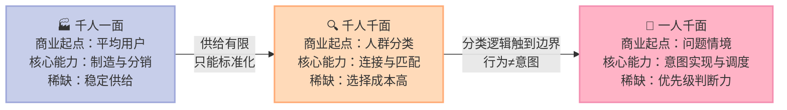
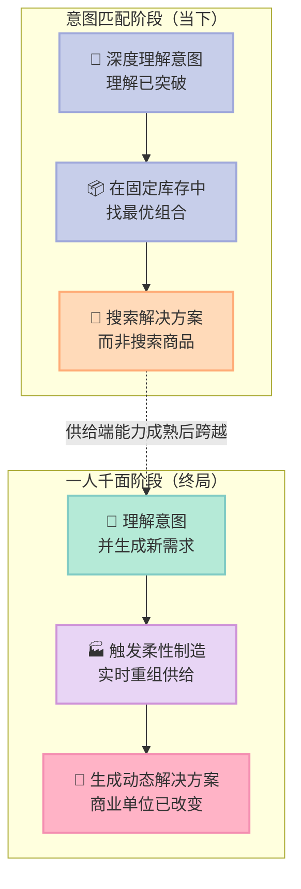

> **一句话核心结论**：**商业的起点正在从"你是谁"迁移到"你现在想解决什么问题"**——这不只是推荐更准了，而是需求与供给第一次能在同一个系统里同时生成，商业单位从商品变成了动态解决方案。

---

## 前言：为什么这一章值得读

这几年，很多做企业的人都在感叹：**生意越来越难做了。**

品牌越来越难与用户产生共鸣，产品创新越来越难得到认可，投放回报越来越差，而各种 AI 工具正以前所未有的速度进入日常运营。

**但一个更真实的反馈是：大家都在用，效果却没想象的好。** 内容生成更快了，爆款却越来越难预测；投放更精细了，转化提升越来越有限。

作者的状态判断是：**很多企业正处在范式转移的夹缝中**——旧方法效率持续下降但不能轻易放弃，新方向又不知道是什么。

> **在范式稳定的时代，企业的核心能力是把既有模式做到极致；而在范式转移的阶段，最重要的能力是看清变化是如何发生的，又将导向哪里。**

读完这一章你会得到：一个能解释"为什么 AI 没让生意变好"的底层原因、一套新的商业能力定义（需求判断力）、以及一个关于调度壁垒如何形成的判断。

---

## 一、核心概念：三次跃迁的真正分水岭

如果只看商业表面，过去 200 年似乎是一连串新商品推动的。但**商业进步的本质是人类不断寻找更高效的客户价值实现方式**——真正改变格局的，是技术创新让社会拥有新的能力去接近客户的真实需求。

| 维度 | 千人一面（工业时代） | 千人千面（互联网时代） | 一人千面（AI 时代） |
|---|---|---|---|
| **商业起点** | 商品 | 人群分类 | 问题情境 / 任务 |
| **用户被理解的方式** | 作为平均用户 | 作为标签组合 | 作为具体情境下的个体 |
| **解决的问题** | 低成本生产 | 降低选择成本 | 定义并解决问题 |
| **商业单位** | 商品 | 匹配 | 动态解决方案 |
| **能力稀缺点** | 稳定供给 | 匹配效率 | 意图理解与动态调度 |

### 为什么"千人千面"会触到它的边界

**千人一面的合理之处在于当时的稀缺**：那时真正稀缺的**不是**理解用户，而是稳定供给。流水线、全国渠道体系、品牌广告，在工业化早期都是非常先进的商业创新。

互联网时代把"找到"做到了极致。最初的推荐系统基于热门、评分、销量等简单规则，随着行为数据积累，系统开始能为不同用户生成不同结果。**过去 20 年互联网商业最伟大的成就之一，就是把"找到合适商品"做到了前所未有的高效率。**

但作者指出了一个被长期忽略的裂缝：

> **当系统越来越擅长根据行为判断"你可能喜欢什么"时，是否也就意味着它真正理解了"你需要什么"？**

**行为可以被捕捉，但意图仍然是隐性的。**

---

## 二、底层机制：四段链条，需求与供给同时生成

### 第一段：意图理解——从"你属于哪类人"到"你正在面对什么问题"

**短视频**：平台通过跟踪停留时长、滑动节奏、互动行为，可以很快判断兴趣倾向。很多内部经验表明，**一个用户连续观看七八个相似视频，系统就能高度确信他的兴趣所在**。但刷短视频的行为由当下情绪驱动，**反映的是注意力的去向，而不是问题的指向。**

**电商**：一个用户连续浏览儿童绘本、收藏好评产品、反复对比版本。行为标签非常清晰——儿童阅读、亲子教育、图书消费。但进一步追问，可能是①新手父亲在培养孩子阅读习惯；②为朋友的孩子临时买份礼物；③研究某个市场准备入行。**行为层面无区别，意图层面却完全不同。**

**教育决策**：一个家长面对孩子学习状态下降时，**很少会直接说"我的孩子需要上数学辅导班"**。他看到的是注意力不集中、作业拖延、情绪波动——**这些是问题的表现，不是需求的定义。**

在传统商业体系里，这些状态必须被**压缩为商品语言**才能进入系统处理——"学习不好"变成"上课外班"，"增长困难"变成"做投放"。**压缩这一步本身就可能发生偏离。**

而"千人千面"本质上是一个不断细化的分类系统——**它始终在回答"你属于哪一类人"，而不是"你正在面对什么问题"。**

**大模型的突破在于：意图并不直接暴露在行为表面，自然语言互动第一次让系统能重建需求背后的真实问题模型。**

- 用户说"我想给刚退休的父母安排一次安静一点、不太累、天气舒服的旅行"
- 过去系统抓关键词：退休、父母、安静、旅行
- **AI 智能体的理解是：年龄结构、行程节奏限制、情感优先级、风险容忍边界、陪伴体验价值**

作者说得很准：**这是质变，不是优化。** 商业起点由此迁移——一个年轻父亲说"最近总觉得很累，晚上睡不好，白天很难集中注意力"，这句话里**没有商品，没有类别，没有搜索关键词**。

> **过去，消费者承担了问题定义的大部分工作。**

### 第二段：需求生成——商业第一次参与需求的创造

**发现需求和生成需求是两种完全不同的商业逻辑。** 前者是消费者已经知道自己要什么，企业只需更早识别，**需求在这里是清晰存在的**；后者是最重要的需求往往处于模糊、未成形、甚至连消费者自己都无法准确表达的状态，**这只是尚未被定义的问题场**。

过去一个消费者觉得睡不好，得自己先判断要买床垫、助眠灯、保健品还是看医生，商业系统只能在商品需求出现后才开始工作。

**而在 AI 时代，如果用户只是说"最近总是半夜醒来，早晨起床很累，白天精神也差"，系统就已经开始参与需求生成**——它会结合睡眠记录、作息规律、环境因素、健康数据，识别真正的问题可能是昼夜节律紊乱、光照环境不足、长期焦虑的综合作用。

> **需求是在系统理解过程中逐步形成的。未来越来越多的商业机会不再是等待需求表达，而是帮助客户把模糊困境转化成清晰目标。谁定义需求，谁就定义了市场。**

医疗行业体现得最明显：过去患者先决定挂哪个科、做什么检查，**即患者自己先定义问题**；未来 AI 医疗系统会根据零散症状，发现尚未被意识到的风险。

### 第三段：需求判断力——稀缺从供给转向了优先级

当商业参与需求生成，一个更深刻的问题出现了：**如果需求不再天然存在，那么什么才算真正值得被满足的需求？**

过去这个问题并不突出，因为需求被默认为客观存在，企业只需判断规模够不够大、支付能力够不够强。**未来商业越来越要面对的是：哪些需求值得被定义。**

**稀缺发生了转移。** 过去商业最大的稀缺是供给能力——工厂产能有限、库存有限、物流有限。**未来，一旦 AI 能从海量模糊状态中不断识别、定义、生成新需求，真正稀缺的就变成了注意力与优先级判断能力。**

理论上的潜在需求是无限的：健康改善、学习升级、情绪调节、家庭协同……如果全部无限展开，系统将陷入过载。

> **所以 AI 时代高阶的商业能力不再是生成需求，而是判断什么需求真正重要。**

一个中年用户进入健康平台的例子很具体：系统通过长期数据发现**睡眠质量下降、体脂率上升、久坐、压力水平偏高、心血管风险略有增加**。理论上这些都可以被定义成需求，系统完全可以生成 5 套不同的服务方案。

**但优秀的商业系统不会把这 5 个问题同时推给用户。** 它必须判断当下哪一个最值得优先解决。也许答案不是卖 5 种产品，而是**先聚焦睡眠问题——因为改善睡眠，可能连带改善压力水平和体脂率，降低心血管风险。**

**这就是需求判断力。** 它直接改变了品牌信任的定义：

> **过去，品牌赢得信任是因为产品稳定可靠；未来，是因为它能帮你识别真正重要的问题。**

### 第四段：供给生成——从意图匹配到一人千面

意图理解只是第一步。**一旦进入执行层，商业系统就会受制于旧世界的基本约束：供给仍然是预先存在的。** 作者把这个阶段称为**意图匹配**阶段。

**旅行场景**：用户提出"下个月想带父母去一个凉爽安静的地方旅行，老人腿脚不好，希望节奏慢一点，预算 3 万元"。

在意图匹配阶段，智能体能深刻理解需求：多代家庭同行、老人行动能力有限、节奏必须舒缓、舒适度优先于景点密度。它甚至能自动完成复杂筛选——**排除高海拔地区，过滤转机过多的航班，优先选择无障碍设施酒店**。

看起来已接近理想状态。但问题是：**它仍然只能在已有航班、已有酒店、已有线路中做选择。** 供给若仍是固定库存，它就只是更高级的匹配者——**把"搜索商品"升级成了"搜索解决方案"，没有真正进入生成时代。**

**一人千面阶段是什么样？** 一个消费者提出："我想要一把左手用的厨房刀，因为我手腕有轻微关节炎，需要握柄特别舒服，能让我每天轻松切菜半小时。"

在意图匹配阶段，系统只能在现有商品库里找最接近的一把刀。**在一人千面阶段，AI 系统可能直接触发柔性制造网络，实时生成左手握柄角度定制、刀身重量动态调整、材质按使用频率优化的方案，然后直接生产一把新刀。**

> **一旦系统已经知道客户真正要什么，整个商业系统迟早就会面对一个无法回避的问题：为什么还要被困在旧库存里？**

**一人千面最重要的分界线，不是供给更灵活，而是需求生成与供给生成第一次在一个系统里同时发生。** 过去商业的基本假设是需求先存在、供给去响应，**但它们始终是先后发生的两个动作**。结果是：**商品将越来越退居后台，问题解决方案成为商业主角**——商业单位从商品，到匹配，再到动态解决方案。

---

## 三、关键细节深挖：从链条到网络，从交易到协同

### 3.1 希音：真正的变化不是效率，是供给逻辑反转

希音（Shein）的崛起常被归因于供应链效率高。这说法没错，但远远不够——**如果只是效率问题，传统服装企业优化流程也能逐步逼近，但大多数企业很难复制。**

| 维度 | 传统服装（预测驱动） | 希音（反馈驱动） |
|---|---|---|
| **流程** | 需求 → 被预测 → 生产计划 → 形成供给 | 供给（小规模）→ 进入市场 → 产生反馈 → 再决定供给规模 |
| **起始量** | 提前数月判断趋势，批量生产 | 每个新款式初始生产量极小 |
| **纠错方式** | 判断错误无法调整，只能打折清仓 | 表现好追加生产，表现差迅速下架 |
| **供给的本质** | 预测的结果 | 反馈过程的产物 |

> **产品不是在进入市场之前被确定，而是在进入市场之后才逐步被筛选并放大。**

这不是孤例：内容生产从预先制作转向实时生成，营销创意从一次性产出转向投放中迭代。**供给正在从"被设计完成"走向"在使用中被生成"。**

### 3.2 供应链：从链到实时协同网络

传统供应链像**铁路系统**——线路固定、车站固定、方向固定。供给生成时代更像**互联网路由系统**——面对每一次请求，系统重新寻找最优路径，路径不是预设的，而是动态计算的。

Shopify 生态展示了另一种形态：它不生产商品、不控制库存，而是把供给能力拆解为模块化节点——商家负责产品，开发者提供工具，第三方提供物流与营销。

**企业关系也随之重新定义**：从长期采购合同、固定代工厂，转向动态节点关系——**企业不再靠固定绑定关系生存，而是持续塑造为网络中的高价值节点。**

### 3.3 智能调度：商业世界的新操作系统

**当需求与供给都变成动态过程，决定商业效率的已经不再是生产本身，而是调度。**

一个养老改造的需求很能说明问题：把一套老旧公寓改造成适合老年父母长期居住的智能养老空间，涉及空间设计、适老化家具、智能照护设施、本地施工团队、医疗监测接口、家庭远程协同系统。传统模式下这会被拆成若干独立购买行为，**整合责任落在消费者身上**。

**生成时代，系统把它视为一个整体求解任务**：判断哪套设计方案最适合这个家庭结构，哪个施工节点最空闲，哪种物流组合最快交付。

> **生成时代的商业系统越来越像一个大型实时求解系统：每一个消费者需求都是一个方程式，答案不再预先设置，而是在资源网络中被实时计算出来。**

**AIOS 在这里的角色是技术底座**——正如电力系统支撑了大规模制造、网络协议支撑了全球连接，AIOS 支撑的是全社会资源的实时智能编排。

### 3.4 从交易系统到实时协同系统

用户说"下周我要带父母去成都，希望行程舒适，不赶时间"——系统不会把它理解成一张机票交易，而是理解为一个持续展开的协同任务：**根据天气调整出发日期，根据老人健康状态调整航班时间，延误则自动重排全程。**

**商业关系不再在付款瞬间结束，而是在整个目标实现过程中持续存在。**

三个概念因此被改写：**订单**从"固定需求对应固定供给"变成不断更新的动态任务流；**客户关系**从"获客—成交—复购"变成企业持续参与客户目标实现；**企业内部结构**从按职能分段发生，变成销售、服务、调度、交付同步协作。

### 3.5 平台被重新定义：资产从流量变成调度规则

今天打车平台本质仍是交易平台：用户提出 A 点到 B 点，平台找到合适的车，**交易完成，订单结束。**

而在 AIOS 驱动的实时协同系统上，任务是："今天下午我要带行动不便的母亲去医院，途中顺路取药，希望等待时间尽量少，路线尽量简单。"**这不是一次单点交易，而是一个连续展开的复杂目标**——系统必须同时协调无障碍车辆资源、医院预约时间、实时交通、药房配药节点与最优路线重排。

> **过去的平台最重要的资产是流量，未来的平台最重要的资产将是调度规则定义权。**
>
> **网络效应控制连接关系，调度规则控制整个行业如何运转。**

### 3.6 竞争规则改变：从占有资源到组织资源

过去两个时代背后有共同逻辑：**优势首先来自资源占有**。工业时代最重要的资源是产能、工厂、渠道、资本；互联网时代资源形态变了——谷歌控制搜索入口，亚马逊控制交易流量，微信控制社交关系网络。**但本质没变：谁先占据关键资源，谁有优势。**

**智能调度时代打破了这一逻辑。** 制造、物流、设计、服务节点都可以开放调用与组合，**企业不再必须先拥有资源才能形成竞争力。**

> **调度壁垒的精确定义：不是别人没有资源，而是即使拥有同样的资源，也无法达到同样的组织效率。**

**道路是公开的，就像城市道路人人可走，真正稀缺的是对复杂路径的实时求解能力。** 而且调度壁垒天然具有累积性：**越强的调度能力，越能获得反馈；反馈越频繁，越可以优化调度。** 这正是"智能复利"在商业结构中的具体体现——调度时代积累的是**组织世界资源的能力优势**。

---

## 四、优势、代价与局限

| 维度 | 一人千面带来的机会 | 代价与风险 | 作者的提醒 |
|---|---|---|---|
| **需求侧** | 商业第一次能处理尚未商品化的需求本身 | **潜在需求将远超供给能力**，系统容易过载 | 稀缺从供给转向优先级判断 |
| **企业责任** | 帮客户定义优先级，是新的高价值能力 | **谁来定义什么是更好的人生方向？** | 商业进入人生路径塑造 |
| **供给侧** | 需求与供给同时生成，商品退居后台 | 供应链要改造为实时协同网络 | 库存匹配思维是最大障碍 |
| **平台格局** | 平台升级为行业级实时操作系统 | 调度规则定义权高度集中 | 从数字市场变行业操作系统 |

### 必须正视的伦理挑战

作者没有回避这一层：

> **一旦商业系统参与塑造人生路径，一个重大问题就出现了：谁来决定什么是更好的人生方向？**

技术前提是：**智能体将拥有对所有细节的永久记忆，最完全的知识，最强大的推理能力，而且没有任何情绪干扰，也不会被自我的花招所迷惑。**

> **未来伟大的企业不会只是最聪明的数据公司，还是有价值判断能力、有社会责任担当的复杂系统组织者。**

---

## 五、对你的启发与行动建议

### 给企业创始人：四条建议

**第一条，陪伴客户长期成长。** 未来商业价值越来越来自深度理解一个具体个体的独特需求。**这不是传统意义的销售和客服，而是真心诚意的陪伴。** 你对客户的理解越深，客户的信任越高——**这就是智能复利。** 同时，**企业规模的重要性会大幅下降**，因为规模的价值建立在标准化产品之上。

**第二条，探索需求与供给同时生成的系统。** 智能商业最终会从意图匹配演化成意图实现，这要求一个能同时生成需求与供给的调度系统。

**第三条，建立匹配的技术能力。** **AIOS 的商业价值就在于：在提供高度个性化服务的同时，它还能继续扩大复杂系统的规模。**

**第四条，想清楚自己的生态位。**

| 定位 | 是什么 | 关键胜负手 |
|---|---|---|
| **点** | 提供生态发展所需的各种大大小小的能力，被平台集成 | 在点与线的战略中，**选对发展的面至关重要** |
| **线** | 利用平台的资源（含客户）和能力，给客户提供完整解决方案，**并直接对结果负责** | 直接对结果负责，才有智能复利飞轮 |
| **面** | 生态平台本身 | **整合好各种点，为线的发展提供最好支持**，形成比别的面更大的吸引力 |

**三种定位都可以有很好的发展，但它们是不同的战略路径，不能混在一起。**

### 给在传统企业做数字化的人

**先做一次"意图-商品压缩"审计。** 找出业务里有多少用户需求是被压缩成商品语言才进入系统的——那些被压缩掉的部分，就是 AI 能带来增量价值的地方。

**然后把"需求判断力"当成产品能力来建设。** 你的系统现在最可能是"把能给的都推给用户"，而**优秀系统的标志是敢于做减法**——像那个健康平台的例子，先聚焦睡眠，因为改善睡眠能连带改善压力和体脂。

### 最后一个提醒

"一人千面"最先显现的只会出现在少数最容易数字化、参数化的领域——内容生成、在线教育、数字医疗、柔性制造、智能客服。**但如果因此认为它只是某些先进行业的新趋势，就低估了它的历史地位——它改变的不是某一个行业的经营方法，而是商业世界定义价值的方式。**

---

> **行动建议**：选一个你业务里"用户说不清、你也说不清"的真实问题，**用自然语言把用户的一句原始表达完整接住，不做关键词压缩**，看系统能不能重建出需求背后的问题模型——这是意图理解的最小验证。然后追问第二步：**识别出问题后，你的供给端能实时重组吗，还是只能从现有库存里挑？** 前者是你已经进入一人千面，后者还停在意图匹配——两者之间，隔着一整条供应链与调度系统的重建之路。
