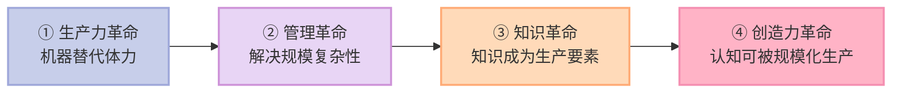
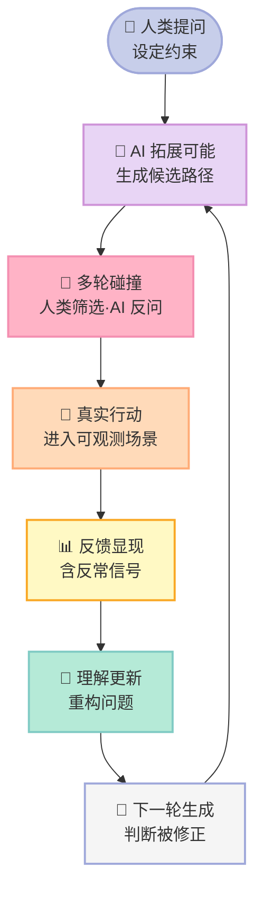
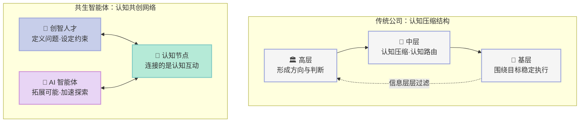

> **一句话核心结论**：AI 时代的组织不再需要"公司"这个容器——当认知本身可被规模化生产，层级、岗位与流程就失去了存在基础，组织的最小单元从**岗位**变成**认知节点**，创智人才与 AI 智能体共同构成一个持续学习的**共生智能体**。

---

## 前言：为什么这一章值得读

如果你是一位 CEO，你大概已经明显感受到一种割裂。

一边是 AI 带来的效率红利。**一个原本需要团队协作数周的任务，现在一个人借助多个智能体，几小时内就能推进到可用状态。** 但战略依然要靠层层会议才能形成共识，跨部门协作依然充满摩擦。

另一边是完全相反的样本。一些 AI 原生组织规模极小，推进极快：一个人同时做产品、开发、运营；**一个十几人的团队能完成过去数百人规模公司的工作量**。他们没有复杂层级，没有清晰岗位边界，甚至不靠正式流程推进工作，而是在高速互动中自然形成方向。

这种割裂不是执行问题，**它说明组织本身的逻辑正在变**。

曾鸣在第四章里问了一个我们几乎从不追问的问题：**我们为什么假定组织必须这样运行？** 过去一百多年，层级结构、岗位分工、绩效预算已深深嵌入我们对"组织"的全部理解，很少有人再去看它的成立前提——而那个前提，正在被抽走。

---

## 一、核心概念：公司从来不是天生的

### 1.1 公司是工业革命的产物

我们如此熟悉的公司**不是天然存在的**，而是一种在特定生产方式下逐渐形成的协作结构。

工业革命之前当然也有大量组织——家庭、宗族、行会、商帮、军队、教会，但它们大多建立在熟人关系或强权控制之上，可以维持局部协作，却很难支撑大规模、持续稳定的复杂生产。

真正改变一切的是蒸汽机、电力系统、流水线与现代制造体系。人类第一次需要在前所未有的规模上，把大量互不相识的人、机器与资本组织起来，一个新问题随之变得极其重要：**如何让整个系统稳定运行。** 一辆汽车该怎么生产——答案一旦被定义清楚，组织最重要的任务就变成把它稳定复制十万次、百万次。

于是组织演化出一整套互相支持的结构：

| 结构 | 解决的问题 | 存在前提 |
|---|---|---|
| **分工** | 复杂任务拆成标准动作 | 复杂任务可被拆解成可复制单元 |
| **层级** | 规模扩大后的信息协调 | 信息与任务无法自由流动 |
| **管理体系**（预算·绩效·流程·汇报） | 维持系统稳定运行 | 答案已确定，只需高效执行 |

**换句话说，公司不是为了最大化创造力而设计的，它本质上是一台围绕"稳定执行既有答案"建立起来的机械系统。** 福特流水线、通用电气管理体系、丰田精益生产，都是这套逻辑的巅峰。**工业时代最重要的组织能力，是规模化执行既有答案。**

互联网极大提高了信息流动速度，敏捷开发、矩阵组织、扁平化结构都由此而生，但**互联网时代的大多数组织，本质上仍然延续着工业时代的基本逻辑**——"扁平化"只是减少层级，"敏捷"仍是在优化执行效率。**互联网公司比传统工业企业灵活得多，但依然属于执行系统。**

### 1.2 三次跃迁与第四次：创造力革命

管理学家把过去几个世纪的人类进步概括为三次跃迁，而 AI 带来的可能是第四次：

前三次跃迁有一个共同的底层逻辑：**每一次技术进步，都会把原本稀缺的能力变成可规模化供给的能力，从而迫使组织形态重构。** 体力可复制，于是有工厂；复杂协调可复制，于是有科层制；知识可复制，于是有知识型组织。

**第四次不同的地方在于：AI 第一次触及了"认知本身"。** 判断、推理、归纳、生成——这些长期被认为只能由人类完成的活动，正在被系统化、规模化地提供。**知识本身，正从一种稀缺资源转变为一种可以被调用的能力。**

推论很直接：律师、咨询顾问、产品经理的竞争力在于他们"知道什么"；**当 AI 能在极短时间内调取并生成大量知识时，这种优势迅速被削弱。** 核心因此变成了：**不再是谁掌握更多知识，而是谁能在知识无限可得的情况下提出更好的问题、构建更好的判断框架，并在变化中持续修正认知。** 人的价值从知识拥有者转向**认知创造者**——这就是**第四次革命：创造力革命**，以及随之诞生的新主体**创智人才**（creative-intelligence talent）：他们的价值不在于完成任务，而在于推动认知生成。

### 1.3 真正的裂缝：中层承担的是认知压缩与认知路由

过去大多数组织中，**认知能力是高度稀缺的**。CEO 不可能直接理解一线发生了什么，一线员工也无法理解整个组织的目标与处境。信息流动与理解成本极高，于是工业时代组织不得不发展出一整套层级结构，把复杂问题层层拆解、抽象化、传递与执行。

> **传统公司本质上是一种认知压缩结构。** 高层形成方向与判断；中层把复杂战略翻译成可执行任务，同时把一线信息重新压缩、整理、向上传递；基层围绕明确目标稳定执行。

**中层管理最核心的价值，并不只是"管理人"，而是承担了组织中的认知压缩与认知路由功能。**

而今天这个前提正在被抽走：过去依赖中层完成的信息整理、任务拆解、跨部门协调，**已被 AI 接管**；实时反馈可直接进入系统，不必层层汇报；CEO 的判断也能更直接地进入整个组织。

**大量过去因为认知传递成本而存在的层级，正在逐渐失去存在基础。**

## 二、底层机制：从信息协同到认知共创

### 2.1 两种协作范式

> 过去，组织最重要的任务是围绕一个**已经被理解的问题**，稳定执行既定答案。
> 今天，组织最重要的能力是**持续形成新的理解**。

传统组织像一台围绕既定目标运行的机械系统，未来组织更像一个**持续演化的认知网络**。**这就是"信息协同"与"认知共创"的分水岭。**

| 维度 | 传统组织（信息协同） | AI 原生组织（认知共创） |
|---|---|---|
| **协作目标** | 信息被充分传递，执行到位 | 认知生成质量，持续逼近真实理解 |
| **讨论性质** | 对齐已知信息、分配任务 | 追问"我们是不是一开始就理解错了" |
| **反馈作用** | 结果之后评估执行是否到位 | 早期进入系统，修正认知本身 |

三个变化最值得注意。**讨论的性质变了**——最关键的讨论往往不直接指向行动，"这个问题本身是否需要被重新定义？"看似低效，却决定了结果方向。**决策的形成方式变了**——AI 让验证方案的成本大幅降低，最终决策不来自某个瞬间。**反馈的作用变了**——一次用户流失不再只是执行不力，还可能意味着**问题定义本身有偏差**。

所以一些 AI 原生组织会刻意降低"完美输出"的要求，更强调"快速试探与反馈"：**只有在高频反馈下，认知才可能持续校正。**

### 2.2 AI 在认知循环中的位置

AI 在这个循环中做三件事：**扩展认知空间**（极短时间生成多个可能路径，揭示人类难以察觉的模式）、**加速判断收敛**（模拟不同选择的后果）、**压缩反馈周期**（一个假设过去可能要数周才能验证）。

人类的角色也随之变了：**不再是信息的整合者或决策的执行者，而更像认知过程的设计者与约束者**——设定问题边界，判断哪些路径值得继续探索。

**认知不再是线性生成的，而是一个不断循环的系统。** 这也是小团队在 AI 环境下能跑赢大组织的原因：它们不一定拥有更多资源，但在认知生成与修正的效率上优势明显。

## 三、关键细节深挖

### 3.1 人才市场的重定价：创智人才有多稀缺

**2025 年，Meta 对核心 AI 研究者开出远超传统认知的薪酬。** 但不只是因为这些人技术更强——更因为他们**经历过一轮全新的认知训练**：长期在 AI 系统最前沿与模型互动，形成了对未来能力边界的直觉。这种能力很难通过传统教育体系快速复制。

类似逻辑也体现在**帕兰提尔（Palantir）**的招聘上。它直接招聘**高中毕业生做实习生**，提出 **"Skip the debt. Skip the indoctrination."**（跳过债务，跳过洗脑）的口号。它想表达的不是"学历无用"，而是：**AI 时代最关键的能力不再是掌握既有知识，而是快速进入真实问题，在与系统、反馈和复杂环境的互动中形成新认知。**

反向推论同样成立：**经验本身正在被 AI 系统外部化。** 过去一个优秀工程师往往需要 10 年以上的积累；今天，一个非常年轻的开发者借助 AI 系统，也许几年之内就能接触最前沿技术。所以创智人才越来越依赖**好奇心、主动性、快速学习能力与跨领域理解**，而非资历。

**为什么"愿意迈出第一步"变得比能力更重要？** 因为在传统组织里最小单元是**岗位**——一个岗位对应一组职责、一套稳定边界。但在共同探索中，问题该怎么应对、需要什么能力组合，事先都无法定义清楚。**很多挑战如此崭新，大家都没有经验可循；比能力更重要的，反而是谁愿意先尝试。** 这就是为什么今天很多企业招聘把**"愿意主动承担责任"**当作首要考量标准。

### 3.2 从岗位到认知节点：共生智能体

曾鸣给出的新概念是**共生智能体（symbiotic agent）**。

**"共生"体现在**：人类与 AI 不是各自独立运行，也不是工具与使用者的关系，而是在**同一个认知循环**中持续互动——人类提出问题与约束，AI 拓展可能性与路径，新的判断在互动中逐步形成，再进入下一轮探索。

**"智能体"体现在**：这个系统表现出类似生命体的特征——持续感知环境变化，根据反馈调整自身状态，并在多轮互动中优化判断路径。**从外部看，它不再是一个执行结构，而更像一个具备学习能力的整体。**

与传统协作最本质的差异在于：**传统组织依赖分工来降低复杂性，新型组织依赖认知同步来应对复杂性。** 每个节点不再只执行任务，而是持续参与认知生成：提出问题、修正假设、判断路径、反馈结果。

一个具体的例子：团队最初以为用户需要某个功能，与 AI 系统交互时却发现用户行为背后的**真正动机与最初设想并不相同**。结果是：**很难说是谁做出了决定，决策是在系统中逐步生成的。**

### 3.3 Anthropic：一个"不像公司"的公司

曾鸣多次提到 Anthropic 的内部运作观察，其中反复出现的一个描述是：**"这家公司看起来不像公司。"**

这个"不像"不是指它缺乏管理，而是指它不符合我们对公司最基本的直觉认知：**没有清晰的部门边界，没有稳定的职责分工，没有一个始终主导决策的中心结构。** 大量工作不是按预设流程推进，而是在变化的环境中自发形成、调整与消失。

员工工作的起点往往不是某个明确指令，而是**不断涌现的问题与机会**。当一个方向被认为有潜力时，员工迅速围绕它聚集，资源随之流动。**这种流动不由管理层分配，而更像一种"被吸引"的过程**——新想法越被认同，推进速度就越快。但公司一直有清楚的愿景：所有看似无序的行动都围绕**实现大模型能力的突破**展开。

谷歌知名程序员 Steve Yegge 在采访 Anthropic 内部几十名员工后提出：这家公司成功的原因，是其很特别的运行模式，**员工很像一群快乐的蜜蜂**，每个人都尽可能透明协作；一旦想法被认同，资源就快速向这里集中。**Anthropic 2026 年推出的大爆品 Claude Cowork，从最初有想法到上线只用了 10 天。**

**为什么这类组织能跑得这么快？** 因为它关注的是**认知共创**——互动不再是传递已有观点，而是通过反馈、修正与重构，逐步形成原本不存在的理解。

### 3.4 组织 OS：为什么钉钉禁止员工人工撰写文档

先看一个反常识的现象：**很多公司会反复出现"人越来越多，系统越来越复杂，但组织始终很难真正积累认知"**。核心成员离开后，团队还在，但过去那些重要的判断逻辑很快消失。后来的人能看到结果，却不理解为什么当时那样选择。原因在于：**传统系统只记录结果，不记录过程。**

| 系统 | 记录什么 | 缺失什么 |
|---|---|---|
| ERP（企业资源计划） | 资源 | 决策背景 |
| CRM（客户关系管理） | 客户 | 意图形成过程 |
| 代码仓库 / 文档系统 | 代码版本·文本 | 假设如何形成、争论了什么 |

**工业时代组织中的知识，本质上是高度离散的。** 流程、制度、文档都会被保留，但真正重要的认知往往附着在人身上。而新一代 AI 工作系统（如 Claude Code 一类）正在做一件不同的事：**让工作过程可以被完整地在线记录下来，从而让认知形成过程被沉淀。**

**钉钉公司禁止员工人工撰写文档**，乍看奇怪，细想就能理解意图：希望通过在线对话系统，让员工所有思考过程都被在线保留下来。**过去的产品文档只能记录最终方案，现在的 AI 系统能记录"实际发生了什么"，并尝试理解"为什么会发生"。**

于是浮出一个新概念：**组织操作系统（Organization OS）**——为支撑共生智能体持续运行与进化而形成的新型基础设施，**负责认知的连接、流动、沉淀、反馈与协同，让分散在个体中的经验与判断能在系统层持续存在。**

在这个意义上，组织最重要的稀缺资源不再是资源，而是**上下文和组织的记忆**。

### 3.5 新领导力：从管理者到系统架构师

AI 原生组织的自由度急剧提高：更多智能体参与工作、任务动态生成、决策实时变化。这意味着它**创造力更强，也更脆弱**——高自由度系统天然更容易失控。

典型症状是：**局部创新越来越多，但系统整体越来越混乱。** 模型团队关注能力边界，产品团队关注体验，商业团队关注增长变现。每个方向都可能正确，但如果缺乏共同的持续理解，组织很快进入**认知发散**状态。

于是几个过去看起来"不重要"的老原则重新浮出水面：

- **Context, not control**（张一鸣的核心管理理念：提供充分背景与资源支持，让员工自主决策，而非自上而下的指令管控）。这过去被当作文化理念，**今天它已变成一种组织运行逻辑**——控制会迅速压制系统创造力。
- **Netflix 的"高人才密度 + 高透明度"**：大量业务数据、财务信息甚至关键战略讨论在组织内部高度共享，因为**让系统持续形成高质量判断的前提，是让尽可能多的人获得全面、高质量的信息**。同时强调"成年人原则"——享受自由的前提是知道承担责任。
- **英伟达黄仁勋拥有 50 名以上直接汇报者，且几乎都被统一称为"副总裁"**，不设分层梯队。用传统逻辑看几乎不可运作，但从认知生成角度看完全合理：**层级压缩后，关键判断可以更直接地在更大范围展开；不同判断之间能更早碰撞。**

所以 CEO 的核心任务发生了转移：

> 过去，优秀 CEO 最重要的能力是制定战略、分配资源、建立流程、维持控制——**控制复杂度、维持秩序、提高效率**。
> 未来，领导者更像在设计一个持续演化的生命体——**设计整个组织的认知演化机制**。

**AI 时代最终的竞争，也将成为组织智能之间的竞争。**

## 四、优势、代价与局限

曾鸣自己提醒得很清楚：**共生智能体并不是一个可以被简单复制的最佳实践，而更像一个逐渐浮现的方向。**

| 维度 | 传统公司结构 | 共生智能体 | 判断 |
|---|---|---|---|
| 最小协作单元 | 岗位 | 认知节点 | ⚠️ 尚未完全稳定 |
| 组织目标 | 稳定执行既定答案 | 持续形成新理解 | ✅ 方向明确 |
| 中层角色 | 认知压缩与路由 | 判断碰撞与整合 | ❌ 传统中层价值被削弱 |
| 决策来源 | 特定层级 | 过程学习，难指认个人 | ⚠️ 责任边界模糊 |
| 复杂度性质 | 机械系统复杂性 | 生物系统复杂性 | ⚠️ 治理难度陡增 |
| 规模化能力 | ✅ 极强 | ⚠️ 尚未验证大规模稳定性 | ❌ 存在明显盲区 |

**三个必须正视的代价：**

1. **规模化的稳定性尚未被证明。** 组织很小时理解可以快速同步；一旦规模扩大、智能体增多，就会迅速进入"每个人都在高速探索，整个系统却越来越难维持稳定"的状态。
2. **授权成为真正的业务决定。** 现在**每一个智能体都需要上下文，每一次授权都意味着新的风险边界**；很多小公司为效率让全员享有 CEO 权限，风险在急剧增加。
3. **复杂性持续演化。** 团队刚建立某种稳定工作方式，新模型能力就迅速改写整个流程。**真正的困难不再是"如何协作"，而是"如何让系统持续形成有效认知"。**

**也要说清楚：结构、流程与分工并没有失效。** 在大量相对稳定的业务场景中它们仍然必要，只是**已经无法覆盖越来越多最关键的活动**——那些需要在不确定环境中不断探索、修正与创造的部分。

## 五、对你的启发与行动建议

### 对传统企业的高管

**别再从"要不要上 AI 工具"开始问。** 那是个效率问题，一张采购清单就能回答。真正的问题是：**你的组织里，哪些层级的价值来自"认知压缩与路由"？** 那些岗位正在被 AI 侵蚀，而且这种侵蚀会以"这个中层的信息整理工作现在由 AI 做了"的方式静默发生。

### 对 AI 原生团队

**你在组织设计上的核心优势不是人少，而是认知同步快。** 10 个人但信息不同步，复杂性根本没降低；3 个人但共享完整上下文，才是真正的小型认知网络。

1. **不要过早引入层级。** 岗位边界一设，你的复杂度就被加了回来。任务应被主动认领，项目应自愿发起。
2. **透明是基础设施。** 信息要实时流动，决策路径要可回溯与修正；同时刻意保留"不完美输出"的窗口——追求一次做对的团队会失去学习机会。

### 对个人

**你所在组织的未来形态，很大程度取决于你能否从"知识拥有者"变成"认知创造者"。** 这对应一组可训练的动作：提出更好的问题而不是更快地回答已被问好的问题；在多种可能性之间建立判断框架，而不是在别人给定的框架里做优化；建立跨领域连接，因为这是 AI 暂时最难替代的能力；在连续反馈中修正方向，而不是坚持已被证伪的结论。

**AI 正在放大超级个体。** 硅谷讨论的 **One-person Unicorn（一人独角兽）** 虽仍带理想化色彩，但趋势清楚：**AI 正在快速降低组织规模对于价值创造的必要性。** 一个人的真实生产力，不再只取决于他自己，而取决于他能够调动多少智能能力。

---

> **行动建议**：
> 1. **做一次"认知压缩盘点"**——列出组织里所有纯信息传递与格式转换的环节，标注其 AI 可替代性。
> 2. **选一条真实业务链路，把反馈周期从"周"压到"天"**。认知校正的频率，比流程优化的幅度更关键。
> 3. **写下组织的方向约束，交给三个不同角色的人各自解释一遍**。如果三份解释不一致，你拥有的不是愿景，只是一句口号。
> 4. **积累组织记忆**：把关键决策的"为什么"记录在可检索的地方。这是组织 OS 最小的可用形态。
>
> **组织的未来，不取决于谁拥有最多的人和资源，而取决于谁能让认知持续生成。**
