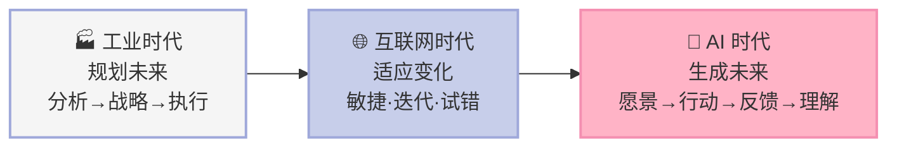
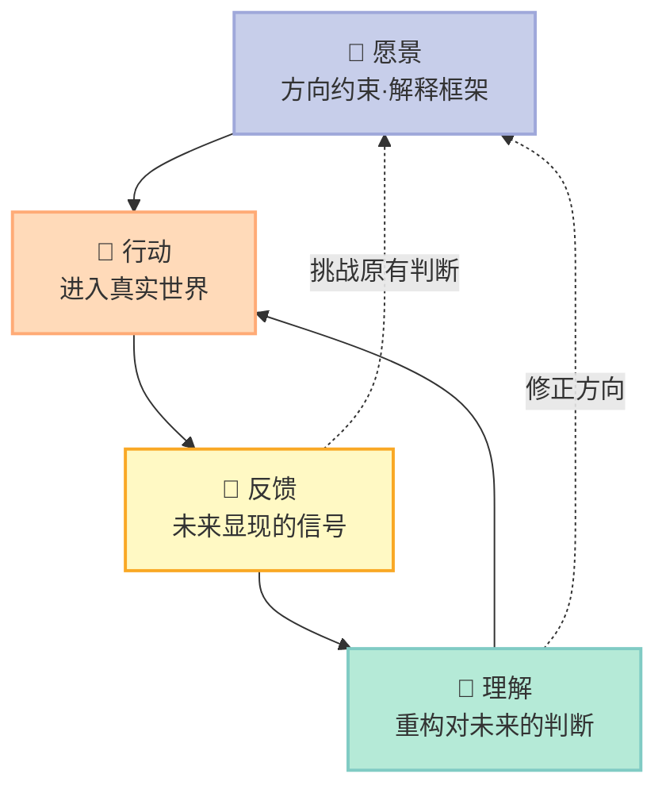
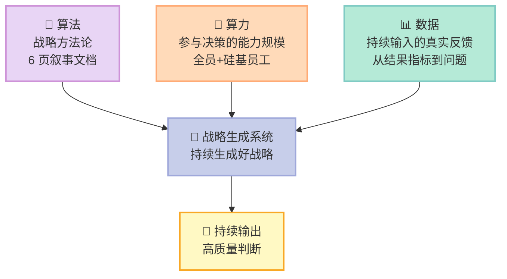

> **一句话核心结论**：在 AI 时代，战略的起点不再是分析与规划，而是一个**可以被持续运作的愿景化过程**——愿景提供方向约束，行动进入真实世界，反馈让未来开始显现，理解不断修正判断，战略在这条循环中被一步步生成出来。

---

## 前言：战略体系越完整，撞墙越早

过去几年有一个反常现象：**战略体系越完整、规划越清晰的公司，反而开始碰到大困难；而一些路径不清晰、不断调整方向的公司，发展得越来越好。**

在线教育平台 Chegg 曾是教科书式的战略成功样本：定位清晰——学生学习支持市场；模式稳固——内容供给加订阅服务。**它不是没有战略，而是战略建立在一个前提上：学习支持的基本方式不会发生结构性变化。** 当大模型问答系统能以接近零边际成本提供即时解答时，这个前提被打破，Chegg 的模式在几个月内失去吸引力。同样的剧本在法律、翻译、内容生产领域重演。

而 OpenAI 的路径看上去像"没想清楚"：在即时战略游戏、机械手、强化学习测试平台之间反复尝试，直到看到 Transformer 架构的潜力，才聚焦大模型训练，推出 GPT-1，摸出 Scaling Law（规模定律）。ChatGPT 最初只是研究人员测试模型能力的一次尝试，用户行为释放的信号远超预期，OpenAI 由此转向面向广泛用户的产品。

**两者的差别不是谁的战略更漂亮，而是谁把战略当成一个持续生成的过程。**

---

## 一、核心概念：愿景化，而不是愿景

### 1.1 愿景为什么在 AI 时代才真正起作用

**大多数公司把愿景当成一句对外的动员语言。** 它写在墙上、放在官网、出现在融资材料里，但在战略讨论中并不参与取舍——做决定靠的仍然是市场规模、竞争格局、财务模型和短期机会。愿景提供方向，却不约束决策。在产业边界清晰、增长路径可预测的年代这不算错：先靠分析定战略，再用愿景凝聚团队。

但当未来不再是一个可以被提前看清的对象，技术、用户行为、商业模式都在变化甚至尚未成型时，**企业最缺的不是信息，而是理解信息的框架。** 这时候，愿景提供两种东西：**解释框架**与**方向约束**。

### 1.2 解释框架与方向约束

| 同一个 AI 信号 | 把 AI 当效率工具的公司 | 把 AI 当新商业系统入口的公司 |
|---|---|---|
| 大模型能力提升 | 降本增效、压缩客服成本 | 用户意图、任务完成、供给重构 |
| 出现细分应用 | 补齐产品功能 | 新的交互范式与价值链位置 |

**信号本身不会告诉你它意味着什么，决定组织如何解读信号的，是组织对未来的基本理解。** 这就是愿景的第一层意义：它不是告诉组织未来一定会发生什么，而是说明我们选择相信什么样的未来。

没有这样的框架，组织就会被外部环境牵着走：今天看到热点就成立项目，明天看到竞品动作就调整方向。**表面看反应很快，实际上它没有战略，只是在被动响应变化。**

第二层意义是**方向约束**。战略从来都是在资源、时间、认知都有限的情况下做取舍。**没有愿景，组织会把"可能正确"误认为"应该投入"，结果是资源被摊薄、团队被分散。**

### 1.3 愿景 vs 愿景化

| 维度 | 愿景（vision） | 愿景化（visioning） |
|---|---|---|
| 本质 | 一个结果、一个静态声明 | 一个持续重构的过程 |
| 时间性 | 写下来就不再变化 | 在行动与反馈中不断被校正 |
| 组织角色 | 创始人或高层的表达 | 全组织可参与、可更新的认知结构 |
| 失败模式 | 变成自我确认的符号 | 方向稳定、路径动态 |
| 判断标准 | 是否能被讲清楚 | 是否能进入真实取舍 |

阿里巴巴 2007 年提出的十年愿景是"打造开放、协同、繁荣的电子商务生态系统"。**这句话十年没变，但组织对每一个词的理解都在不断深入。** 愿景的表述可以稳定，理解必须持续深化。

**许多公司并不缺愿景描述，却缺乏真正的战略方向**——使命宣言没有成为取舍标准，也没有在现实反馈中被不断修正。这样的愿景只是符号，不是系统。

---

## 二、底层机制：战略生成循环

### 2.1 从线性到循环

传统战略是一条直线：分析 → 战略 → 执行 → 反馈 → 调整。行动的角色是执行既定战略。**在生成性世界里，这个前后关系被根本性打破。** 未来无法提前定义时，任何"在行动之前想清楚"的方案，都只是基于有限信息的阶段性判断。于是组织会在"重新规划—再执行"的循环里消耗资源。

**分析无法替代行动带来的认知增量。** 很多关键变量隐藏在真实使用场景中：用户在什么情境下产生需求，哪些细节决定留存。只有产品被真实用户使用后，反馈才会以具体信号的形式显现。**行动是连接组织与未来的接口。**

### 2.2 战略生成的四个环节

**反馈的价值不在于告诉组织现在做得好不好，而在于揭示未来正在如何形成。** 尤其值得注意的是那些**偏离预期、甚至与预期相矛盾的信号**——在传统管理中它们被视为需要纠正的问题，在生成性战略中却可能最有价值，因为正是这些偏差揭示了原有判断的局限。

### 2.3 理解：战略真正发生的地方

**理解不是对已有信息的总结，而是在不完整、变化、甚至相互矛盾的反馈里，持续重构对未来的判断。**

很多公司拥有大量数据，却没有形成战略理解：能看到无数指标变化，却不知道背后代表什么。**数据越多，组织越容易陷入局部最优。**

理解有两个层次。**第一是重新定义问题。** 大模型刚出现时，多数企业问的是"能不能提高写作效率、降低客服成本"——这些问题成立，但未必最重要。更重要的问题可能是：AI 会不会成为新的任务入口？

**第二是识别反馈背后的结构。** 用户说想要某个功能，不一定说明功能重要；用户不用某个功能，也不一定说明方向没价值。**许多真正重要的机会，最初都不会以清晰需求的形式出现，而是以误用、绕路、反常行为的形式出现。** 比如用户不断用对话框完成超出原设计范围的任务，表面看是"乱用"，深层看可能说明：他不想在多个软件之间跳转，而希望直接用自然语言表达意图——**两种理解会带来完全不同的产品方向。**

**所以，理解不是"我原来判断对了"的证明，而是"我原来的判断需要怎样被修正"的过程。** 组织天生倾向于寻找支持原有判断的证据——强愿景没有反馈机制，就会变成自我确认。

---

## 三、关键细节深挖

### 3.1 亚马逊的 6 页叙事文档：把理解变成组织机制

**亚马逊要求管理层开重要业务会议不能用 PPT，而要提前写好完整的 6 页叙事文档；会议开始后所有人先安静阅读二三十分钟，再进入讨论。**

这个机制有意思的地方不是形式，而是它代表另一种战略观。传统战略会议的目标是达成决策：谁逻辑更强、数据更充分、职位更高，谁就更容易推动决策。**而亚马逊的叙事文档机制，不是为了更快形成答案，而是让组织更深入地理解问题。**

这份文档必须完整展开：为什么会出现这个变化；背后的机制是什么；哪些假设成立，哪些可能无法成立。**这本质上是倒逼组织把理解过程显性化。** 真正困难的不是写结论，而是写清楚"为什么"——一旦展开，很多看似确定的判断就会暴露问题。

AWS 早期一个关键例子：问题不是"云计算市场有多大"，而是"**开发者为什么愿意放弃自己管理服务器**"。前者让讨论变成 TAM（总可寻址市场）多大、收费模式是什么；后者把组织带进更深的理解：企业真正的痛点是什么，计算资源为什么从资产变成服务。**问题一旦改变，战略就改变了。**

亚马逊长期强调机制性理解（mechanism-based understanding）：一个指标上涨了，可能是长期趋势也可能只是噪声。**叙事文档本质上是一个组织化的机制性理解。**

### 3.2 ChatGPT：产品方向是被用户"用"出来的

**ChatGPT 的产品发展几乎完全被用户反馈激发。** 上线后短短几周，大量从未被预设的使用方式涌现：写代码、改论文、做作业、当搜索引擎。

尤其值得注意的是，**提示工程（Prompt Engineering）几乎是用户自发创造的。** 最初大多数人只是像聊天一样输入问题，很快一批重度用户意识到：输出质量还高度依赖怎么和模型对话。于是人们开始给模型设定角色、要求分步骤推理、用少样本示例（few-shot examples）引导输出。

**这意味着用户不是在"使用一个软件工具"，而是在学习"如何调用一种新的智能能力"。** 系统对人，逐渐从操作界面变成意图交互的对象。

很多真正重要的产品方向不是 OpenAI 先定义出来的，而是用户先"用"出来的。大量开发者直接用 ChatGPT 写代码、调试，起初更像高级搜索工具，但随着使用深入，越来越多的人把它当作持续协作的开发环境。**后来流行的 AI 编程工作流，也不是产品经理提前规划的，而是在用户的试探与反馈中逐渐形成的。**

### 3.3 愿景的方向约束：特斯拉与 SpaceX

**特斯拉的原始愿景不是做一家成功的电动车公司，而是推动世界向利用可持续能源转型。** 这个愿景一开始并不能提供清晰路径，但方向约束极强：特斯拉不能只满足于在高端汽车市场找到细分定位，必须证明电动车不仅环保，还能在性能与体验上超越燃油车。

SpaceX 的愿景是实现人类多星球生存。它几乎不具备传统战略规划要求的可操作性，**但强烈约束了 SpaceX 对技术与成本的选择**：为什么必须大幅降低发射成本？为什么火箭重复使用不是可选项而是核心方向？

**愿景提供的不是确定答案，而是组织在试探中始终逼近的方向。**

### 3.4 张力机制：看十年、想三年、干一年

在不断生成的世界里，什么在约束战略？

**智能战略的约束机制不再是固定目标，而是持续存在的张力。** 所谓张力，是接受两种力量同时存在：组织必须有长期方向，否则行动会碎片化；组织必须持续根据现实反馈修正判断，否则方向会脱离现实。**这两种力量不可能通过一次性选择来解决，只能通过持续探索来平衡。**

传统管理工具往往试图"消除"张力：要么强调长期、不被短期干扰，要么强调灵活、随时调整。**真正有效的智能战略不偏重任何一方，而是在两者之间建立平衡。**

| 层次 | 真正的作用 | 常见误解 |
|---|---|---|
| 看十年 | 不是把未来定下来，而是约束当下的选择 | 误当十年规划 |
| 想三年 | 不是制订中期计划，而是持续校正长期与短期的关系 | 误当三个独立时间维度的规划 |
| 干一年 | 不是完成任务，而是获取反馈 | 误当执行清单 |

**"想三年"这一层恰恰最容易被忽视。** 很多公司要么直接从愿景跳到年度执行，要么把中期规划做成一个静态文件，结果愿景变成口号、执行变成任务，中间缺少一个不断对齐的过程。组织天然倾向消除张力：长期方向的不确定性让人想要明确目标，现实反馈的复杂性让人想要快速调整。**真正的挑战是设计机制，让张力成为常态。**

### 3.5 战略生成系统：算法、算力与数据的统一

**真正重要的变化不是愿景、行动、反馈、理解第一次出现**——这些要素一直都存在于企业经营中。**真正变化的是它们之间的关系被 AI 彻底重构。**

过去战略高度依赖个体：优秀创始人、资深高管构成判断的核心来源，最多用流程和工具支持决策。但生成性世界里，**反馈的数量与复杂度已经远超个体可以处理的范围**——来自用户行为、技术变化、市场动态的信号高频、多维甚至相互矛盾。依赖个体的结果是二选一：要么所有信息集中处理，决策过慢；要么信息在传递中失真。

大模型的能力来自算法、算力与数据的结合，**战略生成系统是同一种结构**：

**如何落地？** 算法：固化为可重复的决策协议——明确问题定义而不是直接给结论，写清楚关键假设而不是隐含在逻辑中；更轻量的做法是每个重要实验前写下要验证的假设、以及假设被否定意味着什么。算力：扩大决策参与面，一线团队掌握用户反馈、工程团队掌握技术边界，这些能力如果不能进入同一系统，组织就会处于"有信息、无判断"的状态；黄仁勋直接面对超过 50 个直接汇报者且不分层级，正是为了减少信息在层级中的损耗。数据：特斯拉自动驾驶是极致体现，每辆车持续产生真实世界数据，用于识别系统无法处理的情况和需要重新建模的行为模式——**关键不在数据量，而在数据能否被转化为问题。**

### 3.6 共创文化：让战略从少数人的大脑扩散到组织

传统战略是少数高层负责判断、多数人负责执行。这个结构在稳定环境中有效，在生成性世界里会遇到两个根本限制。**第一，信息分布不均。** 最接近用户的信息在一线，技术边界的变化由工程团队感知。如果只有高层参与，绝大多数关键反馈在进入决策层之前就已经被过滤甚至丢失。**组织看到的不是现实本身，而是经过多层加工后的摘要。** **第二，反馈更新速度超过集中决策的处理速度。** 等结论形成，环境已经变了。

所以一线员工的理解和判断是战略生成系统的有机组成部分。黄仁勋要求员工定期提交工作中最重要的 5 件事，就是为了了解一手反馈；Anthropic 没有固定的部门墙，员工主动加入项目来影响资源流向。

**DeepSeek 把这个逻辑推到了更极致的位置。** 甲子光年的一篇分析发现，DeepSeek 内部没有固定部门墙，328 位研发作者中横跨 3 个及以上方向的有 79 人。**大多数大厂的顺序是先设部门、定 KPI、分预算、再启动项目；DeepSeek 的顺序是反过来的：先有人觉得一个问题值得做，再围绕这个问题找人和资源。**

梁文峰在 2024 年 7 月接受暗涌 Waves 采访时说过："我们一般不前置分工，而是自然分工……当一个 idea 显示出潜力时，我们也会自上而下地去调配资源。"

### 3.7 战略共创会：线下高强度碰撞的冷启动

**战略生成系统需要线下人和人的高强度互动，而不能只靠 AI 系统。** 对已有一定规模的企业，开好一场线下战略共创会，是推动战略共创最有效的冷启动方法。

**共创会的目的不是汇报进度，而是通过高质量、高强度的深度碰撞，产生超出所有人预期的战略洞察。** 关于战略的讨论事关每个人的利益和公司未来的生死，一旦产生深度讨论，参与感与情感连接自然产生。

开好共创会，从人员挑选开始就要独具匠心。**一场 20 多人的共创会，往往需要涵盖 5 类人群**：创始人与联合创始人（全局方向）、专业团队高管（专业深度）、关键执行中层（跨部门协同）、民间意见领袖（基层感受）、以及直言不讳的一线员工（用户痛点）。

**所有参会者都必须真正有意愿、有信息、有兴趣、有能力**——这正是思想火花碰撞有价值的前提。共创会的讨论重点应该是四个没有标准答案的问题：**如果继续当前路径，三年后会走到哪里？最近的关键反馈是否挑战了我们对未来的理解？是否出现了新变量，使原有判断需要调整？当前资源配置，是否仍然反映我们的方向选择？**

选对人，经过 3 天高效的思想碰撞，大概率会出现意想不到的惊喜。**共创会其实是身心灵的极限运动。**

---

## 四、优势、代价与局限

**必须说清楚：智能战略不是传统战略的简单升级版，很多场景并不适用。**

| 维度 | 传统战略（规划式） | 智能战略（生成式） | 判断 |
|---|---|---|---|
| 前提假设 | 未来可被提前看清 | 未来在行动中生成 | ⚠️ 前提相反 |
| 战略产出 | 一次性的方向与路径 | 持续运行的理解与判断 | ✅ 更适应 AI 时代 |
| 组织依赖 | 少数个体的经验与洞察 | 系统与机制 | ✅ 可复制、可持续 |
| 见效速度 | 慢但路径清晰 | 快但方向会变 | ⚠️ 需要承受摇摆 |
| 失败模式 | 押错方向 | 失去方向、机会主义 | ❌ 张力失控最危险 |

**四个必须正视的代价与局限：**

1. **它极其依赖反馈质量。** 反馈不真实、不及时、无结构，战略循环就转不起来。**很多公司的问题不是没有循环，而是循环里全是噪声。**
2. **张力极易被消解。** 组织天然倾向消除张力：长期方向的不确定性让人想要明确目标，现实反馈的复杂性让人想要快速调整。**张力很容易被简化为僵化执行或随波逐流。**
3. **它对组织文化要求极高。** 愿景若不能进入真实取舍，就只是符号。**没有共创文化与暴露机制，讨论只会变成观点销售。**
4. **它无法被快速复制。** 6 页叙事文档、共创会、机制性理解，表面是形式，实质是认知习惯。**照抄形式不改变理解方式，只会得到更长的 PPT。**

---

## 五、对你的启发与行动建议

### 对 CEO 与高管

**你最重要的角色不再是选择者，而是张力的维护者。** 这意味着同时做两件看似矛盾的事：持续强化方向，让组织不轻易被短期波动带偏；持续引入现实，让组织不陷入自我确证——鼓励不同声音，重视反常反馈，允许挑战既有判断。

**创始人的作用不是消除不确定性，而是让组织能在不确定性中持续运转。**

1. **把"愿景"改写成可检验的方向判断。** "成为行业领导者"无法进入取舍。改成一句能被证伪的话：谁会先被什么改变，我们赌哪一种变化。
2. **在每个重要决策上同时问两个问题**：这个决策是否强化了我们对长期方向的判断？这个决策是否基于当前真实反馈，而不是抽象假设？**只回答一个，说明张力还停留在讨论里。**
3. **为反常反馈建立正式通道。** 偏离预期的信号最容易被基层当噪音处理掉，**你需要一个让它能上达的机制。**

### 对个人

**AI 时代最稀缺的不是执行力，而是提出好问题并承受被证伪的能力。** 战略工作的实质，就是在一个答案不断变化的环境里持续提高判断质量。

1. **练"为什么"。** 面对任何一个结论，连问三次为什么——亚马逊 6 页叙事文档的价值就在这里。**问不动的地方，通常就是理解最浅的地方。**
2. **主动暴露反常，并区分"可能正确"与"应该投入"。** 把你和别人不一样的判断写下来，注明它依赖于什么假设；前者只需要一个理由，后者需要方向与反馈同时支撑。

---

> **行动建议**：
> 1. **写下你的方向判断**——一句话，说明你相信未来会怎样变化、愿意在哪个方向上持续投入。**然后找三个不同角色的人各自读一遍，看他们理解的是不是同一件事。**
> 2. **把最近一次重要决策拿出来复盘**：它是否同时通过了"方向检验"和"反馈检验"？只过一个的决策，说明张力还停留在讨论里。
> 3. **建立一份反常信号清单**，记录所有与预期相悖的用户行为和实验结果，每两周讨论一次它们意味着什么。**不讨论的清单，三个月后就是垃圾。**
> 4. **把愿景写进决策协议**，而不是只写进墙上的标语——从下一次重要评审开始，先回答两个问题再投票。
>
> **战略不是想清楚未来，而是让组织在行动中持续逼近未来。**
