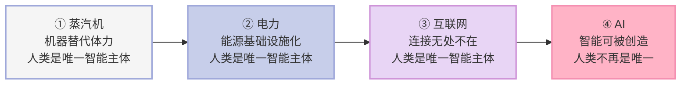
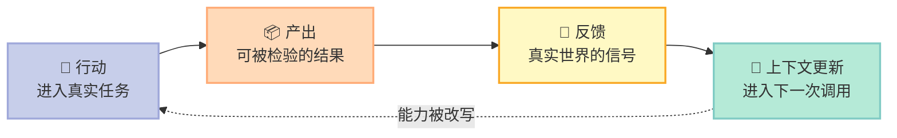
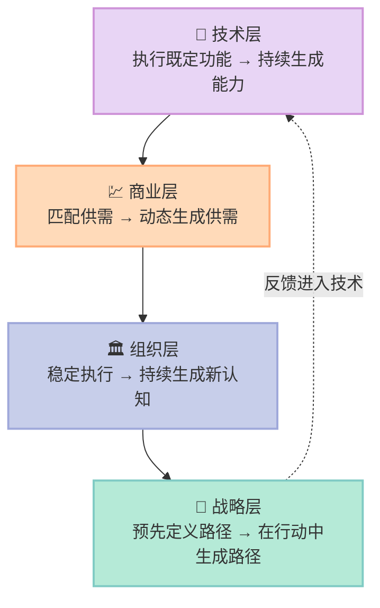

> **一句话核心结论**：人类第一次开始创造智能本身——当智能从附着在人身上的能力，变成可被创造、复制、调用、协同与持续演化的基础能力，技术、商业、组织与战略就不再是并列变化，而是同一条**从稳定结构到持续生成**的链。

---

## 前言：一个被默认了三百年的前提

过去三次技术革命，每一次都重塑了生产方式、商业结构与社会组织：第一次工业革命，机器替代体力；第二次工业革命，电力成为能源基础设施；第三次互联网革命，连接无处不在。

但它们背后有一个共同前提：**人类始终是唯一的智能主体。**

机器提高效率，系统提升连接，但理解世界、形成判断、创造知识、制定目标、组织协作，始终默认属于人类自身。**过去所有的商业制度、组织理论与管理体系，本质上都建立在这个前提之上。**

公司为什么会形成层级结构？因为组织需要依赖人类进行判断与协调。战略为什么长期被视为规划？因为未来默认由人类分析并定义。管理为什么强调流程与控制？因为系统本身不具备这样的理解能力。

**过去的技术革命不断改变工具，却从未真正改变智能本身在人类社会中的位置。**

而 AI 突破了这条边界。当大模型与智能体进入真实世界，智能不再只是附着在人身上的能力，它开始成为一种**可以被创造、复制、调用、协同和持续演化的基础能力**。系统第一次不仅能执行指令，还具备理解、生成、推理、调整与学习的能力。

这一变化挑战的不是某个行业或某种商业模式，而是一个文明级的默认前提：**人类是否仍然是唯一的智能主体。**

一旦这个前提松动，很多过去默认成立的东西都需要被重新理解：什么是工作，什么是创造，什么是组织，什么是学习，什么是决策，甚至——**什么是人的独特性，未来人类靠什么生存。**

---

## 一、核心概念：从稳定结构到持续生成

### 1.1 不是四个并列变化，是同一条链

如果只分开看技术、商业、组织与战略，我们看到的是一组并列变化：AI 能力在提升，商业模式在变化，组织结构在重构，战略方法在失效。**但这些变化之所以在同一时间出现、并呈现出如此强烈的内在一致性，是因为它们在回应同一个更深层的系统性转变。**

工业时代最重要的特点是**稳定结构的形成**。工厂、流程、层级组织、规模化供应链一旦建立，系统的核心目标就是在既定边界内持续提升效率。互联网时代增加了连接，复杂性也有所提升，但绝大多数商业系统仍建立在相对稳定的结构之上。

AI 时代不同。**当智能成为一种基础能力时，系统本身开始具备持续生成能力、生成关系、生成结构的特征。** 前面各章讨论的，其实都是这件事在不同层面的投影。

| 层面 | 工业时代的核心 | AI 时代的核心 |
|---|---|---|
| 技术 | 工具：功能边界相对稳定 | 能力生成系统：边界在使用中拓展 |
| 商业 | 规模化供给 + 供需匹配 | 动态生成供需关系 |
| 组织 | 稳定执行既定任务 | 持续生成新认知 |
| 战略 | 路径规划与控制执行 | 在行动中生成路径 |

### 1.2 智能复利：驱动这一切的共同机制

在这些变化背后，有一个共同的驱动力：**智能复利**（intelligence compounding）。

当智能开始参与系统自身的演化时，每一次行动、每一次反馈、每一次理解更新都在推动系统向更高质量的方向收敛。**技术能力的生成、供需关系的生成、组织认知的生成、战略路径的生成，本质上都是智能复利在不同层面的体现。**

智能复利和资本复利（compound interest）的区别在于：资本复利复利的是**数量**，智能复利复利的是**能力本身**——不是用更多资源做更多的事，而是每一次交互都让系统更会做事。

**注意这条循环的特别之处：它复利的不只是产出，还有"理解"本身。** 每完成一轮，系统对任务的判断就多了一层依据，而下一轮行动就建立在更完整的理解之上。**这就是为什么同一家公司、同一支团队，在使用 AI 半年后与半年前会产生量级不同的产出差距。**

一个具体证据来自 Anthropic：Claude Cowork 从最初有想法到上线只用了 10 天。这背后不是团队加班加点的故事，而是**一个已经具备完整上下文（context）的系统，在少量人的推动下就能直接产出**。

---

## 二、底层机制：四层如何被同一件事打通

### 2.1 技术层：从执行既定功能到持续生成能力

**工业时代的技术本质上是工具**，最重要的特点是功能边界相对稳定。一台机器被设计出来之后能做什么，基本已经确定。蒸汽机、电力系统、流水线、ERP 软件，虽然不断提高效率，但本质上都在执行既定功能。

AI 突破了这一点。**当大模型与智能体进入真实场景时，系统不再按照既定规则运行，而是在使用过程中不断拓展自身能力。** 一个模型上线时并不存在一份完全固定的功能清单，它的能力边界会随着上下文、反馈与真实任务持续变化；甚至很多能力不是被提前设计出来的，而是在系统与环境的互动过程中涌现（emergent）的。

**过去的技术系统本质上是静态能力系统**，企业真正重要的工作是围绕这些静态能力做配置与优化。今天能力本身是动态演化的：一个智能体在不同场景中不断调用新的工具，多个智能体形成新的协作关系，系统甚至会在反馈中逐渐改变自己的工作方式。

**这就是为什么今天 AI 对商业与组织的影响如此深远——它改变的不只是怎么做，还有能够做什么。**

### 2.2 商业层：从匹配既有供需到动态生成供需关系

**工业时代的商业本质上是规模化供给逻辑**：先生产产品，再通过渠道触达需求，供给与需求总体上是相对独立的存在。商业的核心问题，是如何以更低成本、更高效率完成供需匹配。互联网时代只是极大提升了这种匹配效率。

AI 从根本上改变了这一关系。**在越来越多的场景中，需求本身不是稳定明确的，而是在系统互动过程中逐渐被理解、被塑造，甚至被重新定义；与此同时，供给也不是预先存在的，而是在需求确定的过程中实时生成的。**

于是商业系统从匹配既有供需，转向了**动态生成供需关系**。系统能否实时理解人的真实意图并动态生成最适合的解决方案，成为越来越重要的能力；产品的边界也因此开始模糊。**这也是"智能商业终局是一人千面"的由来**——商业不再是围绕标准化产品展开，而是变成一个努力理解用户全方位需求、持续生成解决方案的系统。

反面案例同样清楚：在线教育平台 Chegg 曾是教科书式的战略成功样本——定位清晰、模式稳固、路径可预测。**但它的战略建立在一个前提上：学习支持的基本方式不会发生结构性变化。** 当大模型问答系统能以接近零边际成本提供即时解答时，这个前提被打破，Chegg 依赖的"内容供给 + 订阅服务"模式在几个月内失去吸引力。**供给侧不变，需求侧重写——这正是"匹配"逻辑失效的典型形态。**

### 2.3 组织层：从稳定执行到持续生成新认知

**工业时代的组织，本质上是为稳定任务设计的。** 它最核心的优势在于通过层级、流程与分工，把复杂任务拆解成可执行的标准动作，然后通过管理体系持续优化效率。

互联网时代虽然提高了变化速度，但绝大多数成熟组织仍建立在相对稳定的结构之上。企业可以调整业务、重组部门、优化流程，但组织本身的核心逻辑并没有真正改变——**无论外部世界如何变化，系统默认的仍然是组织负责执行已被定义好的路径。**

在 AI 时代，当系统中的智能不再只属于人类个体，而是分布在大量智能体、工具与协同网络之中时，组织面临的问题不再只是如何提高执行效率，更深层的问题变成了**如何让系统持续形成新的认知**。

**这其实是很多传统组织难以适应 AI 时代的根本原因**：过去大部分组织能力都围绕稳定结构建立，当外部环境开始持续生成新问题、新能力与新协作关系时，**固定结构本身会逐渐变成系统最大的约束**。很多企业并不是不知道 AI 重要，而是原有组织结构已经无法承载新的智能协同方式。

一个具体信号来自 DeepSeek：328 位研发作者中，横跨 3 个及以上方向的有 79 人，组织层级很薄。**大多数大厂的顺序是先设部门、定 KPI、分预算、再启动项目；DeepSeek 的顺序是反过来的——先有人觉得一个问题值得做，再围绕这个问题找人和资源。** 固定结构在这里不是效率工具，而是约束。

### 2.4 战略层：从预先定义路径到在行动中生成路径

**工业时代的战略本质上是路径规划**：分析行业、预测趋势、评估资源，在多个可能性中选择一条最优路径，然后围绕这一判断配置资源并执行。这套逻辑背后有一个重要前提——**未来总体上是可以被提前定义的。**

AI 时代，当 AI 开始持续生成新能力，未来就不再是一个等待被发现的固定对象。**很多重要机会在早期根本无法被准确识别**，很多关键能力也不是被提前设计出来的，而是在真实反馈中逐渐形成。**路径本身成为一种生成结果。**

于是战略真正重要的能力发生了变化：过去重点是预测未来、定义路径、控制执行；未来是企业**能否在持续互动中不断形成新的理解和洞察**。愿景提供方向，行动产生反馈，反馈形成新的理解，理解再不断修正路径——**战略从预先定义未来演化成在行动中持续生成未来。**

---

## 三、关键细节深挖

### 3.1 智能成为新的生产主体，意味着什么

"生产主体"是这一章的核心词。工业时代，**生产的主体始终是人**：机器是工具，资本是资源，需求是外部给定的。人负责理解、判断、创造、协调与承担。

AI 带来的变化是：**智能第一次成为可以被创造、复制、调用与协作的生产要素。** 它不再只附着在特定的人身上，而是分布在一整套系统里。

| 过去的默认 | 当智能可被创造之后 |
|---|---|
| 智能稀缺，集中在少数人身上 | 智能可被复制、调用、编排 |
| 组织靠层级协调人的智能 | 组织变成多智能体协同网络 |
| 岗位是能力单元 | 认知节点是能力单元 |
| 战略靠高层定义 | 战略在行动与反馈中生成 |
| 需求由外部给定 | 需求在互动中被生成 |

这张清单的共同点是：**过去被当作自然规律的东西，现在变成了工程问题。** 层级、岗位、规划、供给，过去只需要"维持"，现在需要被"设计"。

### 3.2 被重新追问的问题

一旦"人类是唯一智能主体"这个前提松动，一批过去很少被真正追问的问题会变得急迫。

**什么是工作？** 如果系统的智能不再只属于人类，工作到底是"人做事"，还是"人与智能共同完成一件事"？

**什么是创造？** 创造力过去被视为人的独特禀赋，如今它的一部分正在变成可被调用的能力。**这不意味着创造贬值了，而是创造的稀缺性从"想出来"转移到了"知道该想什么、该检验什么"。**

**什么是组织的独特价值？** 如果理解、生成、推理都能被系统承担，组织存在的理由就从"协调人的智能"转向"提供上下文、方向与信任"。

**什么是人的独特性？** 这是最难回答的一个。**方向感、审美、价值判断，以及在不确定中承担后果的意愿，目前仍然难以被完整替代——但"目前"这个词，在 AI 领域是不断失效的。**

过去这些问题很少被真正追问，**不是因为它们不重要，而是因为过去的人类社会默认已经拥有稳定答案。**

### 3.3 创业者的角色：从创造一家企业，到参与生成一个新世界

**过去很长时间里，创业者最重要的任务是在一个已经存在的世界中建立优势**：行业有边界，需求有定义，技术有路径，组织有模板。成功属于那些能够更快、更准、更有效地进行规模化执行的人。

但今天，当智能成为一种可以持续生成新能力的基础资源，越来越多过去被视为稳定的东西重新进入开放状态：**行业边界变得模糊，需求本身在不断变化，组织形态开始流动，商业逻辑持续重构。**

于是创业者面对的不再是一张已经被测绘好的地图，而是一个处于生成过程中的世界。

**这意味着创业者的角色正在发生一次深刻变化。** 过去，创业者更多的是在创造一家企业：设计产品、组织团队、寻找市场、建立竞争优势。这些事情今天依然重要，但越来越多的创业者意识到，**自己正在参与的已经不是商业竞争，而是重新定义人如何工作、人与智能如何协作、组织如何形成认知、商业如何生成价值、未来社会如何运行。**

**很多过去被当作背景的东西，今天正在重新变成创业本身的一部分。**

这也是为什么很多前沿 AI 创业公司的探索看上去已经不像在做产品：有的在重新定义搜索与知识获取，有的在重新定义软件与工作流，有的在重新定义组织协作，有的在重新定义人与智能之间的关系，还有的在重新定义**什么才是一个"公司"**。

这些变化表面上看是产品与技术创新，但更深层地看，**它们其实都在参与同一件事：下一代社会运行方式的形成**。而这也许正是这一轮 AI 革命最特殊的地方。

一个可观察的信号是团队形态的变化：2026 年 5 月创立的 Recursive Superintelligence（RSI 公司）估值 46.5 亿美元，员工不到 30 人，联合创始人却有 8 位；Palantir 直接招聘高中毕业生做实习生，提出"Skip the debt. Skip the indoctrination."——**当一家公司不再需要用学历筛选学习能力时，它招的就不是传统意义上的劳动力，而是能创造认知的人。**

### 3.4 为什么这次不一样：三个尺度上的同时位移

**尺度一：时间。** 智能复利让积累开始产生非线性回报——每一次交互都让系统更会做事。

**尺度二：组织。** 当一个人可以调动多个智能体完成原本需要团队协作数周的任务，**公司的规模就不再是能力的硬约束。** 硅谷讨论的 One-person Unicorn（一人独角兽）虽仍带理想化色彩，但趋势清楚：AI 正在快速降低组织规模对价值创造的必要性。

**尺度三：文明。** 智能从一种附着在人身上的能力，变成一种可以被创造、复制、调用和持续演化的基础能力。**过去很多默认稳定的东西重新进入开放状态**——商业如何运行、组织如何协作、战略如何形成、人与系统之间如何分工，甚至"创造力"本身，都被重新定义。

---

## 四、优势、代价与局限

**这一章讲的是正在发生的过程，不是已经落定的结论。它的风险和机会一样真实。**

| 维度 | 判断 | 说明 |
|---|---|---|
| 智能复利的方向 | ✅ 明确 | 每一次交互都在提升系统能力，这一点已被反复验证 |
| 组织形态的最终形态 | ⚠️ 未定 | 认知节点如何与岗位并存，目前没有稳定答案 |
| 一人公司的规模化稳定性 | ⚠️ 未验证 | 复杂度是否随智能体数量同步上升，缺少长期数据 |
| 人的独特性的边界 | ❌ 不可预测 | 三年内可能被重新划定，不能作为长期规划依据 |
| 智能复利的分配方式 | ⚠️ 悬而未决 | 谁拥有这些智能体、谁定义上下文，尚无稳定规则 |

**四个必须正视的问题：**

1. **生成不等于进步。** 持续生成能力、关系与结构，也可能持续生成冗余、混乱与失控。**固定结构之所以存在，本来就是为了对抗这种熵增（entropy）。**
2. **智能复利可能强化而非缩小差距。** 拥有更强上下文、更好数据、更强算力的组织，会在同一套复利机制中获得更大回报。**新范式不天然更公平。**
3. **"人在回路"不是万能挡。** 把人类放在关键决策链上，只是把瓶颈从机器换成了人，并没有解决系统性问题。
4. **我们正在用旧制度承载新变量。** 现有的产权、雇佣、责任与分配制度，几乎都是为"人类是唯一智能主体"的世界设计的。**制度不适配的速度，可能慢于技术变化的速度。**

---

## 五、对你的启发与行动建议

### 对 AI 原生创业者

**你面对的不是一张已经被测绘好的地图，而是一个正在生成的世界。** 这意味着"找到一个足够大的市场然后高效执行"不再是唯一的成功公式。

1. **判断你的方向是否在重新定义什么，而不只是提升效率。** 效率改进会在成熟市场被迅速摊薄，重新定义则会打开新的结构。
2. **把组织本身当作产品来设计。** 如果你的公司依靠层级和流程运行，那它就还是一个工业时代结构——**无论你卖的是不是 AI 产品。**
3. **提前想清楚"什么才是一个公司"。** 当智能可以承担执行与协调，公司的边界由什么定义？这个问题会决定你的护城河是产品还是组织。

### 对传统组织

**最危险的不是不知道 AI 重要，而是原有组织结构已经无法承载新的智能协同方式，却还在按旧结构做优化。**

1. **找出组织里所有"为协调人类智能而存在"的结构**，逐个问：这套结构在智能体协同下还有必要吗？
2. **把方向与判断集中，把执行交给系统。** 人类组织的稀缺性在于方向、品味和承担，而不是传递信息。
3. **保护反常信号。** 智能体擅长把一切拉回既定框架，而环境的真实变化往往先以噪声形式出现。

### 对个人

**如果创造力的稀缺性从"想出来"转移到"知道该想什么、该检验什么"，那么学习的重心也应该随之转移。**

1. **练"提出更好的问题"。** 这是从知识拥有者转向认知创造者的起点。
2. **练在证据不足时做判断。** 未来很长一段时期，判断能力不会被完整替代，**因为它包含责任。**
3. **练把方向说清楚。** 无论你在什么组织里，**方向感正在变成最贵的能力。**

---

> **行动建议**：
> 1. **写下一句话：你所在的系统，正在重新定义什么？** 如果答案只是"提升效率"，那你大概率在一条会被迅速摊薄的路上。
> 2. **检查你的组织里哪一层级的价值只来自"传递与协调人类之间的信息"**，把它列成清单。这一层正在被系统接管。
> 3. **这个季度做一次"智能体参与"的真实实验**：让一个智能体参与一条你当前的业务链路，亲自感受它在哪里可靠、在哪里需要你补上方向。
> 4. **保留你的独立判断**：把它写下来，注明依据。**在一个所有东西都在被自动化的时代，你的独立判断是最值钱的资产。**
>
> **我们不是在一个旧世界里改进效率，而是在参与一个新世界的生成——这才是这一轮 AI 革命真正特别的地方。**
