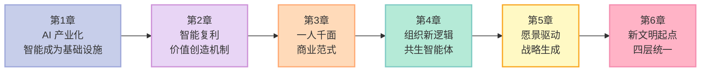
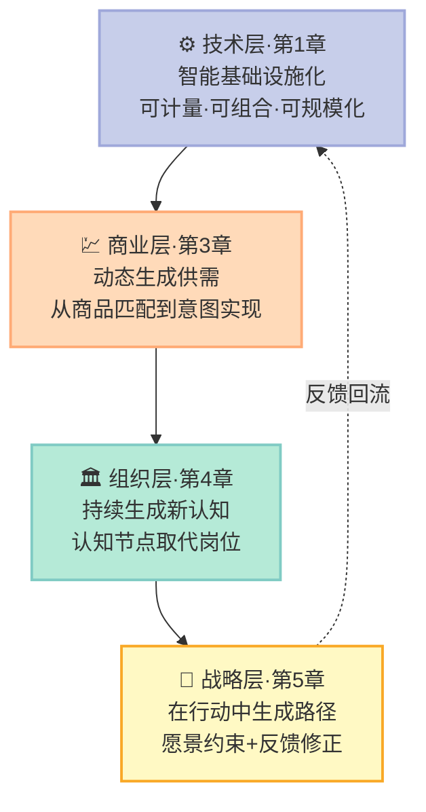

> **一句话核心结论**：这本书的六章不是六个并列话题，而是一条推理链——**当智能从稀缺的人的能力，变成可被规模化调用的基础设施，技术、商业、组织与战略就统一为同一条"从稳定结构到持续生成"的链**；理解这条链，比记住其中任何一个结论都重要。

---

## 前言：为什么一本书可以只讲一件事

《智能商业》的作者在前言里说，这本书本来没有写作计划，它是"涌现"出来的。他前几年研究 AI 对经济、商业、企业的冲击，总觉得是盲人摸象；直到 2025 年 AI 编程带来突破、2026 年初 OpenClaw 出圈，框架才浮出水面。

**这个细节值得注意：框架是在观察过程中长出来的，不是先有结论再找证据。** 这也决定了本书的组织方式——六章的推进顺序不是主题分类，而是**每章解决上一章的问题**。

六章依次回答：AI 变成了什么、这种能力如何变成商业价值、企业怎么服务一个正在被生成的世界、内部组织还撑不撑得住、方向从哪里来，以及这六件事为什么是同一件事。

---

## 一、核心概念：贯穿全书的三个母概念

### 1.1 三个母概念

读完六章，会发现大量概念在反复出现，但真正承重的只有三个。

**第一个是智能复利（intelligence compounding）。** 第二章正式提出：AI 第一次让能力本身进入复利循环——系统执行任务、获得反馈、反馈进入优化、能力增强，于是能处理更复杂的任务、获得更高质量的反馈。**增长第一次直接增强能力，而不只是消耗资源。**

它的位置相当于两个时代的对应物：**规模经济之于工业时代，网络效应之于互联网时代。** 区别在于，资本复利的是数量，智能复利的是能力本身。

**第二个是 60 分奇点（the 60-point singularity）。** 第二章给出的结构性转折：当 AI 从"经常出错"变成"多数情况下可靠"，系统与人的分工关系会反转——**系统成为默认执行者，人退到例外的位置。** 真正的变化不是 AI 更强了，而是人不再需要对每一次行动负责。

**第三个是从稳定结构到持续生成。** 第六章给出的统一视角：工业时代最重要的产出是稳定结构（工厂、流程、层级、供应链），AI 时代最重要的产出则是**持续生成能力、生成关系、生成结构**。

### 1.2 各章核心概念交叉索引

这张表是全书的骨架：每个概念在首现章节提出后，如何在后续章节被复用与放大。

| 核心概念 | 首现 | 在其他章节的投影 | 贯穿全书的判据 |
|---|---|---|---|
| 智能基础设施化 | 第1章 | 第3章 意图理解的技术前提；第6章 智能成为新的生产主体 | 能力可计量·可组合·可规模化 |
| 智能复利 | 第2章 | 第3章 调度壁垒；第4章 认知生成循环；第5章 战略生成；第6章 共同驱动力 | 系统是否对结果负责 |
| 60 分奇点 | 第2章 | 第3章 智能调度；第4章 智能体独立上岗；第5章 战略共创 | 责任从人转向系统 |
| 意图实现 | 第3章 | 第5章 愿景的方向约束；第6章 动态生成供需 | 商业从问题而非商品开始 |
| 认知共创 | 第4章 | 第5章 战略共创会；第6章 组织层持续生成 | 反馈直接进入决策而非事后报告 |
| 战略生成系统 | 第5章 | 第2章 学习闭环；第6章 在行动中生成路径 | 愿景·行动·反馈·理解四环 |
| 黑洞效应 | 第2章 | 第3章 行业集中方式的改变；第6章 智能复利的分配 | 任务是否向强者集中 |

### 1.3 三次范式跃迁的对照

| 时代 | 稀缺的是什么 | 价值创造机制 | 商业起点 | 组织的核心 |
|---|---|---|---|---|
| 工业时代 | 供给能力 | 规模经济 | 商品 | 稳定执行既定答案 |
| 互联网时代 | 连接能力 | 网络效应 | 人群分类 | 更高频的信息协同 |
| AI 时代 | 判断与注意力 | 智能复利 | 问题与意图 | 持续生成新认知 |

**这张表最重要的信息是第三列的替换关系。** 每次技术革命做的都不是"效率提升"，而是**换掉那个时代的价值创造机制本身**，并让商业世界围绕新机制重新组织。

---

## 二、底层机制：同一条链的四个截面

### 2.1 技术层：智能复利如何改变约束条件

第一章的核心判断是：重大产业变化不发生在技术刚被发明时，而发生在技术**基础设施化**之后。蒸汽机之后没有立刻出现现代工业体系，互联网之后也没有立刻出现平台经济。**真正推动社会重构的，是新技术变成一种稳定、低成本、可大规模调用的公共能力。**

大模型符合这个条件，因为智能同时具备**可计量**（以 Token 为单位统一计费）、**可组合**（生成、理解、推理、编程统一调用）、**可规模化使用**三个特征。英伟达 GTC2026 上黄仁勋提出"Token Factory（词元工厂）"：未来的数据中心本质是在生产 Token，如同炼油厂持续输出能源。

第二章接着问：这种新的公共能力改变了经济系统的什么约束条件？**过去所有经济体系中，高质量智力都是极其稀缺的资源**，组织发展速度受限于高水平认知能力的供给速度。而 AI 突破了这个约束，普通认知能力的供给正在接近无穷。

**这个飞轮是六章共用的同一个机制**——技术层叫智能复利，商业层叫调度壁垒，组织层叫认知生成循环，战略层叫战略生成系统。名字不同，结构相同：

**判断一个系统有没有进入这个循环，只要看两件事：结果有没有被人工清洗，反馈能不能改变能力边界。** 这也是七条准则第 1、2 条的由来。

### 2.2 商业层：从"千人千面"到"一人千面"

第三章处理的是一个更根本的迁移。工业时代的商业是"千人一面"：面对的不是具体的人，而是平均用户。互联网时代做到极致的是"千人千面"——但它本质上**是一个不断细化的分类系统，始终在回答"你属于哪一类人"，而不是"你正在面对什么问题"**。

第三章最锋利的一处区分，发生在行为与意图之间。一个用户连续浏览儿童绘本、收藏好评产品、反复对比版本，行为标签非常清晰；但他可能是新手父亲、为朋友的孩子准备礼物、或者在研究某个市场。**在行为层面这三种几乎没有区别，在意图层面却指向完全不同的问题。** 短视频平台能在 7—8 个相似视频内确信用户的兴趣所在，却很难回答"这些内容是否接近用户当下想解决的问题"。

由此推出三层递进：**意图理解**（从原始问题出发而非从商品请求出发）→ **需求生成**（商业第一次参与需求本身的创造）→ **需求判断力**（稀缺的不再是供给，而是判断什么值得优先解决）。

**需求判断力是这一章最容易被低估的结论。** 一个中年用户的健康数据可以生成 5 套服务方案，但优秀的系统不会把 5 个问题同时推给他——它会判断先改善睡眠可能连带改善压力和体脂。**未来商业从满足需求的竞争转向定义优先级的竞争。**

再往后是**意图匹配（intent matching）**——理解了人，但仍在现成库存里找最优组合；真正的终局是**供给生成**。第三章用一例说明差别：用户说"我想要一把左手用的厨房刀，我手腕有轻微关节炎"。在库存里，系统只能挑一把最接近的；到了生成阶段，系统可以触发柔性制造网络，实时生成握柄角度定制、重量动态调整的方案，然后直接生产出来。

**这一章还留了一个诚实的自我修正**：从"提供广告投放工具"到"承诺对广告效果负责"，是复利飞轮能否转起来的分水岭——**没有闭环就没有复利**。

### 2.3 组织层：认知节点取代岗位

第四章追问的是：当商业系统从匹配转向生成，企业内部还能维持原有的分工吗？

答案是否定的。**分工、层级、预算、绩效、汇报关系，全都是为同一个目标设计的：让系统稳定运行。** 在标准化的生产方式下，复杂任务被拆成明确岗位，稳定执行既定答案比持续探索未知更重要。互联网改变了信息流动效率，却没改变这个基本逻辑。

第四章的原创贡献是"**创智人才**"（creative-intelligence talent）：当 AI 能在极短时间内调取并生成大量知识，律师、咨询顾问、产品经理的竞争力在于"知道什么"迅速被削弱，**人的价值从知识拥有者转向认知创造者**。与之配套的还有"**认知节点**"（cognitive node）——组织的最小单元从岗位变为认知节点。

第四章还区分了两个容易混为一谈的概念：**信息协同**（传递已有观点）与**认知共创**（通过反馈、修正与重构，形成原本不存在的理解）。这是小团队在 AI 环境下跑赢大组织的原因。

### 2.4 战略层：愿景驱动，而非规划驱动

第五章的核心命题是：**在生成性世界里，战略从"预先定义未来"变成"在行动中生成未来"。**

推动这个转变的是一组前提的松动。工业时代战略的核心是通过分析与预测描绘未来；互联网时代是承认变化、敏捷迭代；AI 时代完全不同——**未来不再是一个等待被观察、被解释的对象，而成为一个在行动与反馈中不断生成的过程。**

第五章给出的机制是四环循环：**愿景（方向约束）→ 行动（进入真实世界）→ 反馈（未来显现的信号）→ 理解（重构对未来的判断）**。有两个反直觉的点：

第一，**行动是战略生成的起点，而不是执行的起点**。分析无法替代行动带来的认知增量。

第二，**理解不是对已有信息的总结**。它有两个层次：重新定义问题（大模型刚出现时，多数企业问"能不能提高写作效率"，更重要的问题可能是"AI 会不会成为新的任务入口"），以及识别反馈背后的结构（**许多真正重要的机会，最初不会以清晰需求的形式出现，而是以误用、绕路、反常行为的形式出现**）。

配套的落地机制也很有意思：亚马逊的 6 页叙事文档（开会前先安静读 20 分钟，禁止 PPT）、黄仁勋面对 50 多个直接汇报者、DeepSeek 328 位研发作者中 79 人横跨 3 个以上方向、20 多人的战略共创会开 3 天。

---

## 三、关键细节深挖：七条判断准则

把六章的结论压缩成可操作的判断，对 AI 原生创业者最有用。以下七条，每条标注了它来自哪一章、追问什么、以及反面信号是什么。

| # | 判断准则 | 追问的问题 | 反面信号 | 来源 |
|---|---|---|---|---|
| 1 | 任务闭环 | 系统是否对结果直接负责？ | 出了事要人兜底 | 第2章 |
| 2 | 反馈完整性 | 反馈是原始的还是被人工清洗过的？ | AI 看到的是修订后的答案 | 第2章 |
| 3 | 复杂度空间 | 你处理的是标准化任务还是复杂全局任务？ | 反馈可复制、路径透明 | 第2章 |
| 4 | 意图入口 | 你出现在用户表达问题之前还是之后？ | 用户必须先说清要买什么 | 第3章 |
| 5 | 生成而非匹配 | 供给是库存，还是按需实时生成？ | 只能"搜索解决方案" | 第3章 |
| 6 | 认知密度 | 团队在传递信息，还是在共同生成认知？ | 会议很多，认知不增 | 第4章 |
| 7 | 战略生成力 | 方向是被规划出来的，还是被愿景约束后生成的？ | 愿景不进入任何取舍 | 第5章 |

**这七条之间有严格的依赖顺序，而不是并列清单。** 第 1、2 条是前提：没有闭环就没有真实反馈，没有真实反馈就没有能力增长，复利无法启动，第 3 条的复杂度空间也无从展开。第 4、5 条决定积累的能力能否变成商业价值——**能力提升并不自动带来价值提升**：推荐系统从"很不准"变成"基本可用"，用户会明显感受到，但此后进入边际递减区间，指标在涨，主观体验却变化不大。

第 6、7 条是组织侧的对应物：组织还在做信息协同，闭环里的反馈就进不了决策；方向仍是规划出来的，反馈就只能修正执行细节，而不是修正方向本身。

### 3.1 一个反面提醒：智能复利不等于竞争优势

第二章专门用一节打破一个误解：**智能复利是一种价值创造机制，而不是优势生成机制。**

它要经过两道转化：能力提升 → 用户价值 → 竞争优势。第一道会在边际递减区失效；第二道则依赖完全不同的条件——**如果多个企业建立了类似的学习闭环，同时在类似任务中获取反馈，它们会同时变强，彼此差距未必拉开。** 国内多家自动驾驶公司在相近时间进入真实道路学习阶段，系统都在迭代，但多数用户难以区分哪个更好，竞争于是回到价格、补贴、资源这些传统维度。

**后来者甚至可能有后发优势**——先学到不等于最终更强，因为学习过程本身可观察、可模仿、可优化。

### 3.2 黑洞效应：差距被放大的条件

转折发生在任务足够复杂的时候。第二章的判断很精确：**复杂任务的关键特征不在于难度本身，而在于反馈是连续性与全局性的。** 一次反馈是一次独立的学习，还是跨时间、跨步骤、跨场景的累积？后者意味着**路径依赖**——系统经历过什么、犯过什么错、怎么权衡过，直接决定它未来的能力。**"经历过什么，决定了你能学到什么"。**

此时复利从"能力增强机制"跃迁为"能力差距放大机制"：能力差距影响任务分配 → 更复杂的任务带来更高质量的反馈 → 反馈强化能力 → 吸引更多任务。**不是企业主动抢占市场，而是资源在引力下自动向强者聚集。**

四个条件必须同时成立：学习空间足够大、能力差距能被用户持续感知、反馈具有强路径依赖、能力差距能持续影响任务分配。第三章把它翻译成商业语言——**未来的行业集中，可能不再表现为头部企业规模更大，而表现为调度中心越来越少**；调度壁垒的含义是：别人即使拥有同样的资源，也无法达到同样的组织效率，就像所有城市都有道路，但不是所有导航都能找到最优路径。

---

## 四、优势、代价与局限

**必须说清楚：这本书的推演发生在 AI 大发展的早期，大部分观点还缺乏完整的事实验证。** 这是作者在前言里的判断，也是读者最该保留的态度。

| 判断 | 强度 | 依据 | 主要风险 |
|---|---|---|---|
| 智能基础设施化已发生 | ✅ 已被反复验证 | Token 计量、API 统一调用 | 成本结构变化速度 |
| 智能复利机制成立 | ✅ 机制清晰 | 特斯拉自动驾驶数据回流 | 复杂任务闭环难实现 |
| 60 分奇点是普遍结构 | ⚠️ 尚未证实 | Copilot 从"被逐行检查"到"直接进生产" | 可靠性瓶颈因行业而异 |
| 智能复利会形成垄断 | ⚠️ 条件性成立 | 需四个条件同时满足 | 路径可模仿则优势可被抹平 |
| 需求生成带来伦理风险 | ✅ 问题真实 | 商业开始参与人生路径定义 | 价值标准由谁设定 |
| 组织形态终局 | ❌ 不可预测 | 认知节点如何与岗位并存无稳定答案 | 三年内可能重新划定 |

**四个必须正视的代价与局限：**

1. **闭环门槛比想象中高。** 愿意让智能体承担独立决策的后果是一个巨大的信任门槛，**任务的商业价值越大，门槛越高**。这意味着 60 分奇点会先在低风险任务上被突破。
2. **复利可能放大而不是缩小差距。** 拥有更强上下文、更好数据、更强算力的组织，会在同一套复利机制中获得更大回报。**新范式不天然更公平。**
3. **需求生成时代有真实的伦理缺口。** 一旦商业系统参与塑造人生路径，就必须回答：谁来决定什么是更好的人生方向？依据什么标准判断健康优先还是效率优先？**这不再是经济问题，而是价值判断问题。**
4. **我们正在用旧制度承载新变量。** 现有的产权、雇佣、责任与分配制度，几乎都是为"人类是唯一智能主体"的世界设计的，**制度不适配的速度可能慢于技术变化的速度。**

---

## 五、对你的启发与行动建议

### 5.1 对 AI 原生创业者

**你面对的不是一张已经被测绘好的地图，而是一个正在生成的世界。** 把六章压缩成一句：不要优化旧指标，要争取成为某个复杂任务的**第一责任主体**。

1. **先选任务，再选技术。** 准则第 1、3 条决定成败：任务价值越高，闭环门槛越高，学习空间也越大。**避开"容易闭环但没有复杂度"和"复杂度极高但闭环不了"两个陷阱。**
2. **把反馈当作资产来设计。** 问一个问题：**今天你的系统看到的是原始结果，还是被人工审核、修正、缓冲后的结果？** 反馈被清洗过，飞轮就转不起来。
3. **想清楚你在生态里的位置。** 第三章的"点—线—面"框架仍然有效：点是提供单项能力，线是整合能力对结果直接负责，面是生态平台。**三种路径完全不同，混在一起最危险。**
4. **别用效率指标衡量自己。** 收入、份额、用户规模越来越像结果变量。**更该问的是：系统是否有真实的任务闭环？反馈是否在改变能力边界？**

### 5.2 对个人发展的启示

六章对个人的指向高度一致，而且**与"学会更多工具"关系不大**。

| 维度 | 正在贬值的 | 正在升值的 |
|---|---|---|
| 知识 | 记忆与检索 | 提出问题、构建判断框架 |
| 协作 | 信息中转与翻译 | 提供上下文与方向 |
| 产出 | 交付确定性结果 | 定义值得解决的问题 |
| 责任 | 执行他人定义的任务 | 对结果负责并承担后果 |

**三个转向：**

**第一，从知识拥有者转向认知创造者。** 第四章的判断很直接：当知识可以近乎零成本调取，竞争力就来自"知道该问什么、该检验什么"。

**第二，从执行者转向判断者。** 第三章说需求生成时代最稀缺的是**优先级判断力**；第五章说战略工作从"做出正确选择"变成"在方向与反馈之间维持张力"。**两章指向同一种能力：在证据不足时做出可被检验的判断。**

**第三，从消费者转向问题的定义者。** 第三章那句"谁定义需求，谁就定义了市场"，在个人层面同样成立：**当工具能替你执行，能定义问题的人就拥有结构性优势。**

### 5.3 五个开放问题

这本书给出的是思考框架，不是终点。以下五个问题至今没有确定答案：

1. **60 分奇点会先在哪些任务上被突破？谁会率先交出决策权？** 组织恐惧与风险偏好高度相关，答案可能不是技术问题而是组织问题。
2. **黑洞效应形成后，后来者还有机会吗？** 第二章既承认路径依赖，也承认路径可模仿。**在一个学习过程可观察的系统里，"先发"到底意味着什么？**
3. **谁决定什么是好的人生方向？** 需求生成时代的伦理缺口，缺的不是技术而是共识。
4. **没有岗位、没有层级的组织，谁承担失败的责任？** 当任务由智能体完成、决策由系统做出，责任归属规则尚未建立。
5. **智能复利最终会把差距缩小还是放大？** 这取决于算力与数据的分布结构，也取决于调度规则由谁定义——不是纯技术问题。

---

> **行动建议**：
> 1. **用七条准则给自己的业务做一次体检**：逐条标注"满足 / 不满足 / 不知道"。**"不知道"是最值得优先回答的。**
> 2. **画出你系统的完整反馈链路**，标出哪一环有人工过滤。**那一环就是你复利飞轮的断点。**
> 3. **挑一个真实的高频场景，在本季度做一次"智能体直接对结果负责"的实验**，亲自体会信任门槛到底在哪里。
> 4. **写下一句你自己的方向判断**，注明它依赖于什么假设。**交给三个不同角色的人各读一遍，看他们理解的是不是同一件事。**
> 5. **每周保留一次完全属于自己的判断时刻**：不查 AI，不抄答案，只回答"什么值得优先解决"。**这可能是你最后一样不会被自动化的能力。**
>
> **六章讲的是同一条链：从稳定结构到持续生成。看懂这条链，你就不必再为每一个新概念重新开始。**
