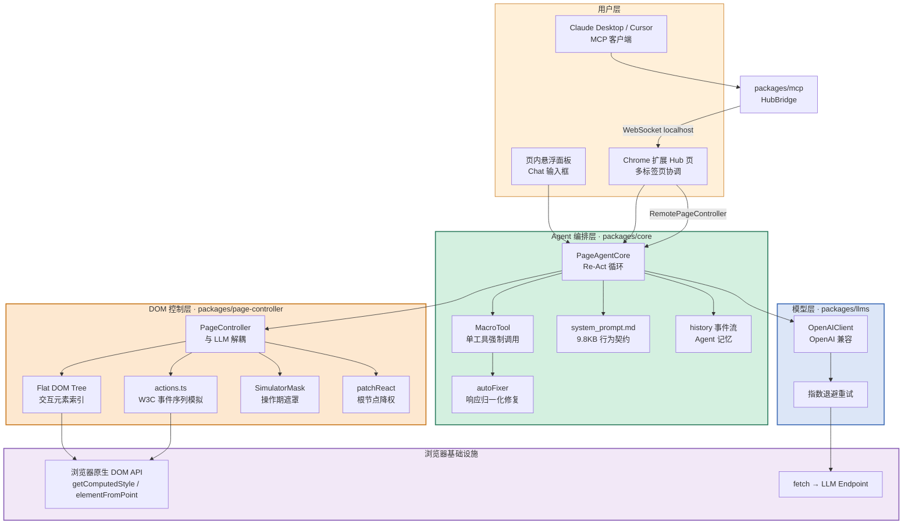
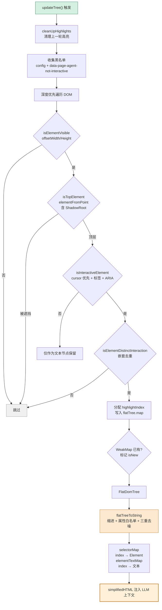
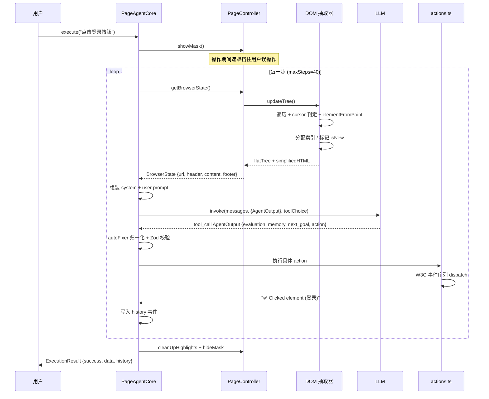
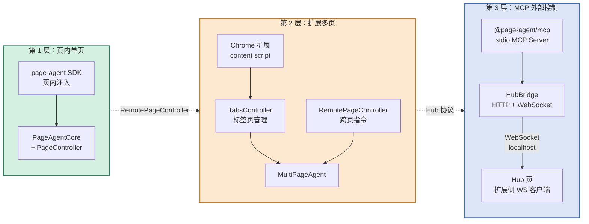

# 【PageAgent】核心架构与设计原理深度解析：把 GUI Agent 塞进网页里的「阿里 in-page Agent」

> 项目地址：https://github.com/alibaba/page-agent
> 一句话定位：**一个 `<script>` 标签，让任何网页立刻拥有自己的 AI Agent。**

## 引子：浏览器 Agent 的第三条路

过去两年，浏览器 Agent 领域几乎被两条技术路线垄断。

**第一条路线是「外部驱动」**：Playwright、Puppeteer、CDP。Agent 跑在 Node 进程里，通过 DevTools Protocol 远程操作一个浏览器实例。这是 browser-use、Stagehand、Chrome DevTools MCP 的基本盘。它的优点是能力边界大（能开新标签页、能下载文件、能截全页图），缺点是**你要部署一套浏览器、扛住 CDP 协议开销、处理远程调试端口的安全性**。

**第二条路线是「视觉驱动」**：截图喂给 VLM，让模型看图点坐标。UI-TARS、OpenCUA、Computer Use 全家桶都是这条路。它更通用（能操作没有 DOM 的远程桌面、Canvas 游戏），但更贵、更慢、更不可靠——像素坐标会随缩放、滚动、动画漂移。

而 2026 年 10 月，阿里巴巴开源的 **PageAgent** 走了**第三条路**：**让 Agent 直接活在网页内部**。

它的思路极其直接：既然 Agent 要操作 DOM，为什么不干脆让 Agent 变成这个页面的一部分？一段 JS 被注入网页，它和网页共享同一个 `window`、同一份 DOM、同一套事件系统。没有浏览器实例，没有 CDP 连接，没有截屏，也不需要多模态模型。

```html
<script src="https://cdn.jsdelivr.net/npm/page-agent/dist/iife/page-agent.demo.js"></script>
```

就这一行。页面加载完，右下角浮出一个对话框，用户说"点击登录按钮"，Agent 就真的去点了。

**这个范式转换带来的架构后果，才是本文真正想讲的东西。**

---

## 一、项目定位与核心价值

### 1.1 仓库事实

| 维度 | 数据 |
|------|------|
| 全名 | `alibaba/page-agent` |
| Stars | 29,583 |
| Forks | 2,638 |
| 主语言 | TypeScript |
| License | MIT |
| 创建时间 | 2025-09-23（约 13 个月） |
| 最近推送 | 2026-10-21 |
| 官网 | https://alibaba.github.io/page-agent/ |
| npm 包 | `page-agent`，最新 1.12.4，累计 78 个版本 |
| Chrome 扩展 | 已上架（ID `akldabonmimlicnjlflnapfeklbfemhj`） |
| Topics | agent / ai-agents / browser-automation / mcp / typescript |

13 个月从 0 涨到 29.5k ⭐，且是阿里集团官方仓库（Copyright 标注 `Alibaba Group Holding Limited`），社区活跃度（2,638 fork、112 open issues）说明它不是「发完就不管」的 demo。

### 1.2 它解决的三个具体问题

**问题一：把 Agent 塞进已有 SaaS 产品，成本太高。**

传统做法是给 ERP/CRM 写一个自动化后端：起服务、接 API、处理登录态、防 CSRF、补前端 UI。PageAgent 的答案是：**把 SDK 打进前端，一行 `<script>`，Agent 直接操作用户自己已经登录好的那个页面**。登录态、权限、二次验证全部天然存在——因为 Agent 用的就是用户自己的浏览器会话。

**问题二：DOM 太大，塞不进 Context。**

一个真实业务后台的 DOM 节点轻松上万。直接喂给 LLM 是几千 token 的纯浪费，还会让模型迷路。PageAgent 的解法是把它压成一份**带索引的"可交互元素清单"**，几百个 token 就能覆盖全页可用操作点。

**问题三：LLM 输出不稳定，会把整个循环带崩。**

浏览器 Agent 的一次失败可能是：模型把 action 名字当成 tool name 直接返回了、参数被 JSON 字符串套了两层、单字段工具的参数写成了裸数字。PageAgent 为此专门写了一层 `autoFixer`（第 7 节详述），把"模型不听话"从崩溃降级为日志。

### 1.3 能力矩阵

| 能力 | PageAgent | 说明 |
|------|-----------|------|
| 感知方式 | **纯文本 DOM** | 无截图、无多模态、无 VLM |
| 部署形态 | **页内 JS** | 无浏览器、无 Python、无扩展（扩展是可选增强） |
| 模型要求 | **任意 OpenAI 兼容** | 本地部署模型也行 |
| 多页操作 | Chrome 扩展 | 跨标签页 |
| 外部控制 | **MCP Server** | Claude Desktop / Cursor 可反向操控浏览器 |
| 自定义工具 | `customTools` | 可注入业务 API |
| 用户交互 | `ask_user` + `onAskUser` | Agent 中途可反问用户 |
| 隐私 | **数据不出浏览器**（默认） | 只有 DOM 文本和 prompt 发给 LLM |

最后一行值得单独强调：**默认部署形态下，页面 DOM 的结构化文本会被发送给你配置的 LLM 服务**。这对处理 PII 的业务系统是个必须在合规评估里过一遍的点——官方 `docs/terms-and-privacy.md` 有说明，部署前请自行评估。

---

## 二、整体架构：七包单仓的四层切分

PageAgent 是一个 TypeScript monorepo（`packages/`），没有构建步骤的复杂度，每个包职责极窄：

```
packages/
├── llms/            LLM 抽象层：OpenAI 兼容客户端 + 重试 + Zod→OpenAI schema
├── page-controller/  DOM 层：Flat DOM Tree 抽取 + 元素动作 + 遮罩 + React 补丁
├── core/            Agent 层：Re-Act 循环 + MacroTool + autoFixer + 系统提示词
├── ui/              UI 层：悬浮面板（Chat 面板）
├── extension/       Chrome 扩展层：Hub 页 + TabsController + 多页 Agent
├── mcp/             MCP Server：stdio MCP ↔ HTTP/WS ↔ 扩展 Hub
├── page-agent/      面向使用者的整合包（npm page-agent）
└── website/         文档站（Vite + React）
```

四层依赖是单向的：`core → page-controller → DOM API`，`core → llms → HTTP`。



**关键设计点：`PageController` 与 LLM 完全解耦。**

源码注释写得很直白：

```typescript
// 来自 packages/page-controller/src/PageController.ts:5-7
/**
 * PageController - Manages DOM operations and element interactions.
 * Designed to be independent of LLM and can be tested in unit tests.
 * All public methods are async for potential remote calling support.
 */
```

三个设计意图：
1. **可单测**：DOM 操作不需要 mock LLM。
2. **全部 async**：为"未来远程调用"留口子——这正是后面 MCP / 扩展跨进程控制的基础。
3. **可替换**：Agent 可以换，DOM 层不动。

---

## 三、核心机制一：Flat DOM Tree —— 把网页压成「可交互元素清单」

这是 PageAgent 最核心也最值得学的部分。整个 `packages/page-controller/src/dom/dom_tree/index.js` 有 **53,167 字节**（本仓库最大单文件），是整个项目的算法核心。

### 3.1 为什么不是 DOM 快照

朴素做法是把 `document.body.innerHTML` 塞给模型——几万 token，且模型分不清哪个能点。PageAgent 走了三步：

**第一步：判定"这个元素能不能被交互"。**

代码里作者留下一段很有价值的自述注释：

```javascript
// 来自 packages/page-controller/src/dom/dom_tree/index.js:690-700
/**
 * Checks if an element is interactive.
 *
 * lots of comments, and uncommented code - to show the logic of what we already tried
 *
 * One of the things we tried at the beginning was also to use event listeners,
 * and other fancy class, style stuff -> what actually worked best was just
 * combining most things with computed cursor style :)
 */
```

结论是：**`getComputedStyle(el).cursor` 是最有效的信号**。因为 CSS 的 `cursor: pointer` 本身就是"这个元素可点击"的最直接声明——前端工程师写 UI 时已经替你标注好了。

代码里维护了一个 28 项的交互光标白名单：

```javascript
// 来自 packages/page-controller/src/dom/dom_tree/index.js:722-756
const interactiveCursors = new Set([
    'pointer',   // Link/clickable elements
    'move',      // Movable elements
    'text',      // Text selection
    'grab',      // Grabbable elements
    'grabbing',  // Currently grabbing
    'cell',      // Table cell selection
    'copy',      // Copy operation
    'alias',     // Alias creation
    'all-scroll',// Scrollable content
    'col-resize','context-menu','crosshair',
    'e-resize','ew-resize','help',
    'n-resize','ne-resize','nesw-resize','ns-resize','nw-resize','nwse-resize',
    'row-resize','s-resize','se-resize','sw-resize',
    'vertical-text','w-resize','zoom-in','zoom-out',
])

// 来自 packages/page-controller/src/dom/dom_tree/index.js:758-768
const nonInteractiveCursors = new Set([
    'not-allowed', // Action not allowed
    'no-drop',     // Drop not allowed
    'wait',        // Processing
    'progress',    // In progress
    'initial',     // Initial value
    'inherit',     // Inherited value
    // 'none', 'default', 'auto' 都被注释掉了
])
```

注意最后三行被注释掉的选择——这是个精明的取舍：`cursor: default` 的元素**未必不可点**（很多自定义组件忘了改 cursor），宁可**误报为可交互**也不要漏报。漏报的代价是 Agent 看不到按钮；误报的代价只是多几个候选索引。

**第二步：多层信号叠加。** 光标只是第一层，代码还组合了：

- **标签白名单**：`a / button / input / select / textarea / details / summary / label / option / optgroup / fieldset / legend`
- **ARIA 属性**：`INTERACTIVE_ARIA_ATTRS` 一组 role 检查
- **快速属性探测**：`onclick` / `role` / `tabindex` / `data-action` / `contenteditable`
- **语义 class 正则**：`/\b(btn|clickable|menu|item|entry|link)\b/i`

```javascript
// 来自 packages/page-controller/src/dom/dom_tree/index.js:1256-1285
const hasInteractiveClass = /\b(btn|clickable|menu|item|entry|link)\b/i.test(
    element.className || ''
)
```

**第三步：`isTopElement` 命中测试。** 这一步很多人会漏掉，但它解决了"看不见的按钮"问题。

```javascript
// 来自 packages/page-controller/src/dom/dom_tree/index.js:966 起
function isTopElement(element) { ... }
```

原理是：用 `document.elementFromPoint(centerX, centerY)` 检查元素中心点位置上，**最顶层渲染的是不是它自己**。如果一个 `<button>` 被一个透明的遮罩 `<div>` 盖住了，DOM 层面它存在，但用户点不到——`elementFromPoint` 会返回那个遮罩。这种元素必须排除，否则 Agent 会反复点一个点不动的东西。

更狠的是它还处理了 **Shadow DOM**：

```javascript
// 来自 packages/page-controller/src/dom/dom_tree/index.js:1025
const topEl = shadowRoot.elementFromPoint(centerX, centerY)
```

现代前端框架（Vue、Lit、原生 Web Components）大量使用 Shadow DOM，`document.elementFromPoint` 穿不透 shadow root，必须对每个 `shadowRoot` 单独调用一次。这是很多简化版 DOM 抽取会漏掉的细节。

**第四步：`isElementDistinctInteraction` 处理嵌套。**

现实页面里 `<button>` 里套 `<span role="button">` 是常态。如果不做区分，LLM 会看到两个都指向同一个视觉元素。

```javascript
// 来自 packages/page-controller/src/dom/dom_tree/index.js:1203-1240
const DISTINCT_INTERACTIVE_TAGS = new Set([
    'a','button','input','select','textarea',
    'summary','details','label','option','li',
])
const DISTINCT_INTERACTIVE_ROLES = new Set([
    'button','link','menuitem','menuitemradio','menuitemcheckbox',
    'radio','checkbox','tab','switch','slider','spinbutton',
    'combobox','searchbox','textbox','listbox','listitem',
    'treeitem','row','option','scrollbar',
])
```

`iframe` 被单独标为**永远独立**——这是对的，iframe 内部是另一个文档。

### 3.2 Flat Tree：为什么是"扁平"的

DOM 天然是树。但 PageAgent 抽取出来的是一个 **FlatDomTree**——一个 `Map<nodeId, Node>` 加一个 `rootId`：

```typescript
// 来自 packages/page-controller/src/dom/dom_tree/type（节选）
export interface FlatDomTree {
    rootId: string
    map: Record<string, ElementDomNode | TextDomNode | InteractiveElementDomNode>
}
```

每个节点带 `children: string[]`（子节点 id 数组）和 `parentId`。

**为什么扁平化？** 两个原因：

1. **序列化友好**：`flatTreeToString` 把它转成 LLM 能读的文本时需要深度优先遍历，扁平 Map 让"从任意节点回溯祖先"变成 O(1) 的数组访问。
2. **索引稳定**：`selectorMap: Map<number, InteractiveElementDomNode>` 把可交互元素按**数字索引**映射到 DOM 引用。LLM 只需要说"点 33 号"，不需要构造 CSS 选择器——避免了 LLM 拼错选择器导致点击失败。

### 3.3 文本序列化：给 LLM 的最终产物

`flatTreeToString` 生成的格式长这样：

```text
[0]<a aria-label=page-agent.js 首页 />
	[1]<div >P />
	[2]<div >page-agent.js
	UI Agent in your webpage />
	[3]<a >文档 />
	[4]<a aria-label=查看源码（在新窗口打开）>源码 />
	[5]<a role=button>快速开始 />
```

设计上有四个精妙之处：

**(1) 缩进表达父子关系。** 用 `\t` 缩进而非嵌套标签，token 成本大幅降低，同时保留了结构信息。系统提示词里明确解释了这一点：

```text
// 来自 packages/core/src/prompts/system_prompt.md:57-61
- Only elements with numeric indexes in [] are interactive
- (stacked) indentation (with \t) is important and means that the element
  is a (html) child of the element above (with a lower index)
- Elements tagged with `*[` are the new clickable elements that appeared
  on the website since the last step - if url has not changed.
- Pure text elements without [] are not interactive.
```

**(2) `*[` 标记新出现的元素。** 这是个非常聪明的信号注入——

```typescript
// 来自 packages/page-controller/src/dom/index.ts:378-380
const highlightIndicator = node.isNew
    ? `*[${node.highlightIndex}]`
    : `[${node.highlightIndex}]`
```

"新出现的元素"是页面状态变化的最强信号。比如 Agent 点开一个下拉菜单，页面新增了 8 个 `<li>`，这些会被标成 `*[41]`、`*[42]`……LLM 一眼就知道"哦，菜单展开了"。这解决了一个真实难题：**Agent 怎么知道自己上一步的操作产生了什么效果**——不需要额外的 diff 计算，DOM 缓存里的 WeakMap 就够了：

```typescript
// 来自 packages/page-controller/src/dom/index.ts:55
const newElementsCache = new WeakMap<HTMLElement, string>()
```

WeakMap 挂在元素上，元素被移除就自动 GC——比用 URL 判断"是否换页"更精确（代码注释里也承认这是简化版，browser-use 用 hash 指纹判断）。

**(3) 属性白名单 + 三重去噪。** 默认只保留 18 个属性（`title`/`type`/`checked`/`name`/`role`/`value`/`placeholder`/`aria-label`/`aria-expanded`/`data-state`/`aria-checked`/`id`/`for`/`target`/`aria-haspopup`/`aria-controls`/`aria-owns`/`contenteditable`）。然后做三种去重：

```typescript
// 来自 packages/page-controller/src/dom/index.ts:333-368
// ① 属性值重复（>5 字符）只留第一个
if (value.length > 5) {
    if (value in seenValues) { keysToRemove.add(key) }
    else { seenValues[value] = key }
}

// ② role 与 tagName 相同则删除 role（<div role="div"> 是废话）
if (attributesToInclude.role === node.tagName) {
    delete attributesToInclude.role
}

// ③ aria-label / placeholder / title 与可见文本重复则删除
const attrsToRemoveIfTextMatches = ['aria-label', 'placeholder', 'title']
```

第 ③ 条特别实用：`<button aria-label="提交">提交</button>` 里 `aria-label` 就是纯 token 浪费。

**(4) 滚动容器显式标注。**

```typescript
// 来自 packages/page-controller/src/dom/index.ts:390-403
if (node.extra.scrollable) {
    let scrollDataText = ''
    if (node.extra.scrollData?.left)  scrollDataText += `left=${node.extra.scrollData.left}, `
    if (node.extra.scrollData?.top)   scrollDataText += `top=${node.extra.scrollData.top}, `
    if (node.extra.scrollData?.right) scrollDataText += `right=${node.extra.scrollData.right}, `
    if (node.extra.scrollData?.bottom)scrollDataText += `bottom=${node.extra.scrollData.bottom}`
    line += ` data-scrollable="${scrollDataText}"`
}
```

于是 Agent 的 scroll 工具可以**直接滚某个具体容器**，而不是傻傻地滚整个 document。

### 3.4 抽取算法全景



---

## 四、核心机制二：MacroTool —— 把 N 个工具压成 1 个强制调用

PageAgent 的 Agent 层借鉴了 browser-use 的 Re-Act 循环，但做了一个关键改造。

### 4.1 传统做法的问题

标准 tool-calling 里，每个 action 是一个独立 tool：

```json
{ "tool": "click_element_by_index", "arguments": { "index": 33 } }
```

问题是：模型在每一步**只输出一个 tool call**，那"我上一步做得怎么样"和"我下一步要干什么"这两句反思就没地方写。传统做法是让模型在 `content` 里自由文本 + tool_call 并行输出——但很多模型（尤其小模型和 reasoning 模型）不会稳定地这么干。

### 4.2 PageAgent 的解法：把反思和动作合并进一个工具的参数

`#packMacroTool()` 的实现：

```typescript
// 来自 packages/core/src/PageAgentCore.ts:386-405
#packMacroTool(): Tool<MacroToolInput, MacroToolResult> {
    const tools = this.tools

    // 每个内层工具变成 union 的一个分支
    const actionSchemas = Array.from(tools.entries()).map(([toolName, tool]) => {
        return z.object({ [toolName]: tool.inputSchema }).describe(tool.description)
    })

    const actionSchema = z.union(actionSchemas as unknown as [z.ZodType, z.ZodType, ...z.ZodType[]])

    const macroToolSchema = z.object({
        evaluation_previous_goal: z.string().optional(),
        memory: z.string().optional(),
        next_goal: z.string().optional(),
        action: actionSchema,
    })

    return {
        description: 'You MUST call this tool every step!',
        inputSchema: macroToolSchema as z.ZodType<MacroToolInput>,
        execute: async (input) => { /* ... */ },
    }
}
```

最终 LLM 看到的工具只有一个，schema 是：

```json
{
  "evaluation_previous_goal": "string, 上一步的成败判定",
  "memory": "string, 本步的记忆与进度",
  "next_goal": "string, 下一步的即时目标",
  "action": {
    "click_element_by_index": { "index": 33 }
  }
}
```

`action` 是一个 **Zod union**，每个分支是 `{ 工具名: 该工具的 inputSchema }`。因为 union 的每个分支 key 都不同，**结构上就保证了"一次只能选一个 action"**——不需要额外校验。

调用时强制指定工具名：

```typescript
// 来自 packages/core/src/PageAgentCore.ts:285-288
const result = await this.#llm.invoke(messages, macroTool, signal, {
    toolChoiceName: 'AgentOutput',
    normalizeResponse: (res) => normalizeResponse(res, this.tools),
})
```

`toolChoiceName: 'AgentOutput'` 让 OpenAI 兼容接口用 `tool_choice: {type:"function", function:{name:"AgentOutput"}}` 强制调用。**模型没有"不调用工具"这个选项**——每一步必然产出结构化动作。

### 4.3 这个设计的三个好处

**(1) 反思和动作在同一个 JSON 里，天然原子。** 不会出现"模型说了要做什么但工具调用对不上"的割裂。

**(2) 兼容性极强。** 任何支持 OpenAI tool-calling 的模型都能用，不需要 reasoning 模型的特殊格式。

**(3) `done` 是一个普通工具。** 不是靠"没有 tool call"来判定完成，而是显式调用 `done`：

```typescript
// 来自 packages/core/src/tools/index.ts:38-52
tools.set(
    'done',
    tool({
        description:
            'Complete task. Text is your final response to the user — keep it concise unless the user explicitly asks for detail.',
        inputSchema: z.object({
            text: z.string(),
            success: z.boolean().default(true),
        }),
        execute: async function (this: PageAgentCore, input) {
            // @note main loop will handle this one
            return Promise.resolve('Task completed')
        },
    })
)
```

这比"无 tool call 即完成"可靠得多——后者在长输出被截断时会误判完成。系统提示词也强化了这个语义：

```text
// 来自 packages/core/src/prompts/system_prompt.md:97-108
You must call the `done` action in one of three cases:
- When you have fully completed the USER REQUEST.
- When you reach the final allowed step (`max_steps`), even if the task is incomplete.
- When you feel stuck or unable to solve user request.
...
- Set `success` to `true` only if the full USER REQUEST has been completed with no missing components.
- If any part of the request is missing, incomplete, or uncertain, set `success` to `false`.
```

注意 `success` 的诚实性要求——**失败要如实报失败**。这在 Agent 落地里比"总是说成功了"重要得多。

---

## 五、核心机制三：Re-Act 循环与双信息流

### 5.1 循环结构

`PageAgentCore.execute()` 是整个 Agent 的心脏（`packages/core/src/PageAgentCore.ts:210-375`）：

```typescript
// 来自 packages/core/src/PageAgentCore.ts:251-325（精简）
while (true) {
    await onBeforeStep?.(this, step)

    try {
        if (step > 0) await waitFor(stepDelay, signal)
        signal.throwIfAborted()

        // ── observe ──
        this.#states.browserState = await this.pageController.getBrowserState()
        await this.#handleObservations(step)

        // ── think ──
        const messages = [
            { role: 'system', content: this.#getSystemPrompt() },
            { role: 'user', content: await this.#assembleUserPrompt() },
        ]
        const macroTool = { AgentOutput: this.#packMacroTool() }
        const result = await this.#llm.invoke(messages, macroTool, signal, { ... })

        // ── act ──
        const macroResult = result.toolResult as MacroToolResult
        const input = macroResult.input
        const output = macroResult.output
        const reflection: Partial<AgentReflection> = {
            evaluation_previous_goal: input.evaluation_previous_goal,
            memory: input.memory,
            next_goal: input.next_goal,
        }
        const actionName = Object.keys(input.action)[0]
        const action = {
            name: actionName,
            input: input.action[actionName],
            output: output,
        }
        this.#emitHistoryChange({ type: 'step', stepIndex: step, reflection, action, usage: result.usage, ... })

        if (actionName === 'done') {
            const success = action.input?.success ?? false
            const data = action.input?.text || 'no text provided'
            taskResult = { success, data, history: this.history }
            finalStatus = 'completed'
            break
        }
    } catch (error) {
        // 内部错误不抛出，转成 history 里的 error 事件
        const isAbortError = (error as any)?.name === 'AbortError'
        taskResult = { success: false, data: message, history: this.history }
        finalStatus = isAbortError ? 'stopped' : 'error'
        break
    } finally {
        await onAfterStep?.(this, this.history)
    }

    step++
    if (step > maxSteps) { /* 步数耗尽，标记 error */ break }
}
```

源码里的类注释把整个范式讲得很清楚：

```typescript
// 来自 packages/core/src/PageAgentCore.ts:34-42
/**
 * ## Re-act Agent Loop
 * - step
 *    - observe (gather information about current environment and context)
 *    - think (LLM calling)
 *      - reflection (evaluate history, generate memory, short-term planning)
 *      - action (give the action to approach the next goal)
 *    - act (execute the action)
 * - loop
 */
```

三个工程细节值得单独说：

**(1) 外部错误抛出，内部错误吸收。** 注释写得很明确：

```typescript
// 来自 packages/core/src/PageAgentCore.ts:206-209
/**
 * external errors (pre-checks/config/hooks) will threw;
 * agent errors will be caught and added to history, and return a failed result
 */
```

配置错误、hook 抛错 → 抛给调用方（是 bug，要暴露）。Agent 执行失败 → 写进 history，返回 `success: false`（是业务结果，不该炸掉整个调用）。

**(2) `finally` 里清理遮罩和高亮。** 而且用的是 `suppress()` 包装：

```typescript
// 来自 packages/core/src/PageAgentCore.ts:368-374
} finally {
    await suppress(() => this.pageController.cleanUpHighlights())
    await suppress(() => this.pageController.hideMask())
    this.#abortController.abort()
    resolveRunning()
    this.#setStatus(finalStatus)
}
```

清理失败不能覆盖真正的错误——所以吞掉异常。

**(3) 状态机的四种终态。** `AgentStatus` = `idle | running | completed | error | stopped`。

### 5.2 双信息流：History vs Activity

这是 PageAgent 在架构上做对的一件事，很多 Agent 框架没分清：

```typescript
// 来自 packages/core/src/PageAgentCore.ts:50-59
/**
 * ## Information Streams
 * 1. **History Events** (`history` array)
 *    - Persistent event stream that forms agent's memory
 *    - Included in LLM context across steps
 *    - Types: steps, observations, user takeovers, llm errors
 *
 * 2. **Activity Events** (via `activity` event)
 *    - Transient UI feedback during task execution
 *    - NOT included in LLM context
 *    - Types: thinking, executing, executed, retrying, error
 */
```

| 流 | 是否进 LLM 上下文 | 用途 |
|----|------------------|------|
| `history` | **是** | Agent 的记忆：上一步做了什么、结果如何、用户接管、LLM 报错 |
| `activity` | **否** | 纯 UI 反馈：正在思考 / 正在执行 / 执行完成（带耗时）/ 重试中 |

这个切分直接解决了两个现实问题：
- **UI 反馈不会污染 Agent 记忆**（否则每次"正在思考"都进上下文，几步就把 context 撑爆）。
- **Agent 记忆不会污染 UI**（UI 只需要最新的瞬时状态，不需要回放全部历史）。

事件类型也很清晰：`statuschange` / `historychange` / `activity` / `dispose`。

### 5.3 端到端时序



---

## 六、核心机制四：actions.ts —— 忠实的 W3C 事件序列模拟

很多 Agent 点击元素只做一句 `element.click()`。PageAgent 做了完整的 W3C Pointer Events + UI Events 规范顺序：

```typescript
// 来自 packages/page-controller/src/actions.ts:57-126
/**
 * Simulate a full click following W3C Pointer Events + UI Events spec order:
 * pointerover/enter → mouseover/enter → pointerdown → mousedown → [focus] →
 * pointerup → mouseup → click
 */
export async function clickElement(element: HTMLElement) {
    blurLastClickedElement()
    lastClickedElement = element

    await scrollIntoViewIfNeeded(element)
    const frame = element.ownerDocument.defaultView?.frameElement
    if (frame) await scrollIntoViewIfNeeded(frame)

    const rect = element.getBoundingClientRect()
    const x = rect.left + rect.width / 2
    const y = rect.top + rect.height / 2

    await movePointerToElement(element, x, y)
    await clickPointer()

    await waitFor(0.1)

    // Hit-test to find the deepest element at click coordinates
    const doc = element.ownerDocument
    await enablePassThrough()
    const hitTarget = doc.elementFromPoint(x, y)
    await disablePassThrough()
    const target =
        hitTarget instanceof HTMLElement && element.contains(hitTarget) ? hitTarget : element

    const pointerOpts = { bubbles: true, cancelable: true, clientX: x, clientY: y, pointerType: 'mouse' }
    const mouseOpts = { bubbles: true, cancelable: true, clientX: x, clientY: y, button: 0 }

    // Hover — pointer events first, then mouse events (spec order)
    target.dispatchEvent(new PointerEvent('pointerover', pointerOpts))
    target.dispatchEvent(new PointerEvent('pointerenter', { ...pointerOpts, bubbles: false }))
    target.dispatchEvent(new MouseEvent('mouseover', mouseOpts))
    target.dispatchEvent(new MouseEvent('mouseenter', { ...mouseOpts, bubbles: false }))

    // Press
    target.dispatchEvent(new PointerEvent('pointerdown', pointerOpts))
    target.dispatchEvent(new MouseEvent('mousedown', mouseOpts))

    // Focus is not part of the standard pointer/mouse event sequence
    element.focus({ preventScroll: true })

    // Release
    target.dispatchEvent(new PointerEvent('pointerup', pointerOpts))
    target.dispatchEvent(new MouseEvent('mouseup', mouseOpts))

    // Click — activation behavior triggers via bubbling
    target.click()

    await waitFor(0.2)
}
```

**为什么必须这么全？** 因为现代前端框架的事件系统依赖完整序列：

| 缺什么 | 什么会坏 |
|--------|---------|
| `pointerover` / `mouseover` | 悬浮态 UI（hover 展开菜单、tooltip）不出现 |
| `pointerdown` / `mousedown` | 拖拽组件、按下态样式不响应 |
| `focus` | 受控组件读不到焦点态 |
| `pointerup` / `mouseup` | `onMouseUp` 绑定不触发 |
| `click` | 导航 / 表单提交不发生 |

React 17 之后事件委托挂在 root 上，事件必须**冒泡**（`bubbles: true`）才能被 React 捕获——`pointerenter`/`mouseenter` 是例外，它们**不冒泡**（`bubbles: false`），这完全符合规范。代码里对这一点的处理精确到 spec。

**`elementFromPoint` 命中测试** 也很讲究：点击坐标上最深的那个元素才是真实的事件 target。代码注释坦承这是临时方案：

```typescript
// 来自 packages/page-controller/src/actions.ts:84-85
// @note This may hit a element in the blacklist
// TODO: This is a temporary workaround. Should have been handled during dom extraction.
```

**输入框的双策略容错**（contenteditable）：

```typescript
// 来自 packages/page-controller/src/actions.ts:139-152
/**
 * Strategy: Try Plan A (synthetic events) first, then verify and fall back
 * to Plan B (execCommand) if the text wasn't actually inserted.
 *
 * Plan A: Dispatch synthetic events
 * Works: React contenteditable, Quill.
 * Fails: Slate.js, some contenteditable editors that ignore synthetic events.
 */
```

Plan A 发 `beforeinput` + `input` 事件（React 受控 contenteditable 依赖这个），Plan B 回退到 `document.execCommand('insertText')`。**先试后验**是这类兼容问题的通用解法。

而对普通 `<input>`/`<textarea>`,用的是 **原生 setter**：

```typescript
// 来自 packages/page-controller/src/actions.ts（import 段）
import { getNativeValueSetter } from './utils'
```

原因：React 会劫持 `input.value` 的 setter，直接赋值不触发 onChange。必须拿到 `HTMLInputElement.prototype` 上**原生的** setter 再调用。这是个经典坑，很多简化实现栽在这里。

### 6.1 React 根节点补丁

```typescript
// 来自 packages/page-controller/src/patches/react.ts:1-12
// Find common React root elements and add data-page-agent-not-interactive attribute
export function patchReact(pageController: PageController) {
    const reactRootElements = document.querySelectorAll(
        '[data-reactroot], [data-reactid], [data-react-checksum], #root, #app, [id^="root-"], [id^="app-"], #adex-wrapper, #adex-root'
    )

    for (const element of reactRootElements) {
        element.setAttribute('data-page-agent-not-interactive', 'true')
    }
}
```

**问题**：React 17+ 会在 root 容器上挂大量事件委托，导致 root 元素自己也被判定为"可交互"，污染索引。

**解法**：给这些 root 元素打上 `data-page-agent-not-interactive` 标记。`PageController.updateTree()` 会自动收集它们进黑名单：

```typescript
// 来自 packages/page-controller/src/PageController.ts:186-189
const blacklist = [
    ...(this.config.interactiveBlacklist || []),
    ...Array.from(document.querySelectorAll('[data-page-agent-not-interactive]')),
]
```

**这个设计的巧妙之处**：宿主应用不需要改任何代码。PageAgent 自己在运行时扫描常见 React 根容器 ID 并打标。而且这个约定是**开放的**——你的业务组件只要加一个 `data-page-agent-not-interactive` 属性，就能告诉 Agent"别碰我"。这是一个干净的、零侵入的排除机制。

作者还在注释里留了一条已知局限：

```typescript
// 来自 packages/page-controller/src/patches/react.ts:14-16
/**
 * @todo (Heavy, might have false negatives) Interaction detection, if element
 * width/height equals body offsetWidth/Height, consider it root element and
 * non-interactive (React often attaches many events to root elements, causing
 * false positives)
 */
```

---

## 七、核心机制五：autoFixer —— 把 LLM 的不听话变成日志

`packages/core/src/utils/autoFixer.ts` 是整个项目里工程价值最高、也最"接地气"的一个模块。它解决的是一个所有 Agent 开发者都会撞上的现实问题：**模型不严格遵守 tool-calling 协议**。

```typescript
// 来自 packages/core/src/utils/autoFixer.ts:9-21
/**
 * Normalize LLM response and fix common format issues.
 *
 * Handles:
 * - No tool_calls but JSON in message.content (fallback)
 * - Model returns action name as tool call instead of AgentOutput
 * - Arguments wrapped as double JSON string
 * - Nested function call format
 * - Missing action field (fallback to wait)
 * - Primitive action input for single-field tools (e.g. `{"click_element_by_index": 2}`)
 */
```

### 7.1 六级修复链

| 级别 | 症状 | 修复 |
|------|------|------|
| #1 | 模型把 action 名当 tool name 返回 | 包装成 `{action: {...}}` |
| #2 | JSON 藏在 `message.content` 里 | 从 content 提取 JSON |
| #3 | JSON 被套了两层 `{name:"AgentOutput", arguments:"..."}` | 再剥一层 |
| #4 | 只返回了 action 层，没有反思字段 | 整体当 action 处理 |
| #5 | 完全没给 action | 兜底为 `{wait: {seconds: 1}}` |
| #6 | 单字段工具参数写成裸数字 | 强制转成 `{index: 2}` |

**#1 的具体代码：**

```typescript
// 来自 packages/core/src/utils/autoFixer.ts:37-41
// case: sometimes the model only returns the action level
if (toolCall.function.name && toolCall.function.name !== 'AgentOutput') {
    log(`#1: fixing tool_call`)
    resolvedArguments = { action: safeJsonParse(resolvedArguments) }
}
```

**#2-#4 的嵌套剥离：**

```typescript
// 来自 packages/core/src/utils/autoFixer.ts:42-73
if (message.content) {
    const content = message.content.trim()
    const jsonInContent = retrieveJsonFromString(content)
    if (jsonInContent) {
        resolvedArguments = safeJsonParse(jsonInContent)

        // case: sometimes the content json includes upper level wrapper
        if (resolvedArguments?.name === 'AgentOutput') {
            log(`#2: fixing tool_call`)
            resolvedArguments = safeJsonParse(resolvedArguments.arguments)
        }

        // case: sometimes even 2-levels of wrapping
        if (resolvedArguments?.type === 'function') {
            log(`#3: fixing tool_call`)
            resolvedArguments = safeJsonParse(resolvedArguments.function.arguments)
        }

        // case: and sometimes action level only
        if (
            !resolvedArguments?.action &&
            !resolvedArguments?.evaluation_previous_goal &&
            !resolvedArguments?.memory &&
            !resolvedArguments?.next_goal &&
            !resolvedArguments?.thinking
        ) {
            log(`#4: fixing tool_call`)
            resolvedArguments = { action: safeJsonParse(resolvedArguments) }
        }
    } else {
        throw new Error('No tool_call and the message content does not contain valid JSON')
    }
}
```

**#5 的兜底极其务实：**

```typescript
// 来自 packages/core/src/utils/autoFixer.ts:93-97
// fix incomplete formats
if (!resolvedArguments.action) {
    log(`#5: fixing tool_call`)
    resolvedArguments.action = { wait: { seconds: 1 } }
}
```

模型没给动作？**不要崩，给它一个 `wait`**。下一轮它会重新观察页面。这比抛异常重试整个任务优雅得多——因为 LLM 调用的钱已经花了，页面状态也还在。

### 7.2 强类型校验 + 原始参数强制转换

```typescript
// 来自 packages/core/src/utils/autoFixer.ts:130-167
function validateAction(action: any, tools: Map<string, PageAgentTool>): any {
    if (typeof action !== 'object' || action === null) return action

    const toolName = Object.keys(action)[0]
    if (!toolName) return action

    const tool = tools.get(toolName)
    if (!tool) {
        const available = Array.from(tools.keys()).join(', ')
        throw new InvokeError(
            InvokeErrorTypes.INVALID_TOOL_ARGS,
            `Unknown action "${toolName}". Available: ${available}`
        )
    }

    let value = action[toolName]
    const schema = tool.inputSchema

    // coerce primitive input for single-field tools
    if (schema instanceof z.ZodObject && value !== null && typeof value !== 'object') {
        const requiredKey = Object.keys(schema.shape).find(
            (k) => !(schema.shape as Record<string, z.ZodType>)[k].safeParse(undefined).success
        )
        if (requiredKey) {
            log(`coercing primitive action input for "${toolName}"`)
            value = { [requiredKey]: value }
        }
    }

    const result = schema.safeParse(value)
    if (!result.success) {
        throw new InvokeError(
            InvokeErrorTypes.INVALID_TOOL_ARGS,
            `Invalid input for action "${toolName}": ${z.prettifyError(result.error)}`
        )
    }

    return { [toolName]: result.data }
}
```

两个细节：

**裸数字强转**：`{"click_element_by_index": 2}` → `{"click_element_by_index": {"index": 2}}`。通过找 schema 里第一个**必填**字段来完成，不需要硬编码字段名——加新工具时自动适配。

**错误信息可操作**：`Unknown action "click_btn". Available: done, wait, ask_user, click_element_by_index, ...`——把可用动作列出来，模型下一轮就不会再犯。

### 7.3 为什么这层放在 Agent 之外

`autoFixer` 是**纯函数**，不依赖 Agent 状态，输入原始响应输出规范响应。这让它：

1. **可单测**（仓库里就有 `PageAgentCore.test.ts`）。
2. **可替换**——换模型时这层不用改。
3. **可观测**——每次修复都打日志，生产环境能统计"哪种模型最不听话"。

---

## 八、Provider 抽象与模型层

`packages/llms` 只有 2 个核心文件：`OpenAIClient.ts`（6,894 字节）和 `utils.ts`（7,865 字节），但设计很讲究。

### 8.1 OpenAI 兼容 = 事实标准

```typescript
// 来自 packages/llms/src/OpenAIClient.ts:42-53
let toolChoice: unknown = 'required'
if (options?.toolChoiceName && !this.config.disableNamedToolChoice) {
    toolChoice = { type: 'function', function: { name: options.toolChoiceName } }
}

const requestBody: Record<string, unknown> = {
    model: this.config.model,
    messages,
    tools: openaiTools,
    parallel_tool_calls: false,
    tool_choice: toolChoice,
}
// Only sent if the caller explicitly set it. Most new models throw if this is set.
if (this.config.temperature !== undefined) {
    requestBody.temperature = this.config.temperature
}
```

两个细节：

**`temperature` 只在显式设置时才发。** 注释写得很清楚："Most new models throw if this is set."——很多新模型（o1 系列、部分 reasoning 模型）对 `temperature` 参数直接报错。**不设置就不发送**是最稳的兼容策略。

**`parallel_tool_calls: false`**——强制单次调用，适配 MacroTool 的语义。

### 8.2 modelPatch：各家的 URL 怪癖

```typescript
// 来自 packages/llms/src/OpenAIClient.ts:59
modelPatch(requestBody, this.config.baseURL)
```

不同厂商的 OpenAI 兼容端点有各种差异（比如 Gemini 的 OpenAI 兼容层要求模型名塞在 URL 路径里）。`modelPatch` 就是集中处理这些差异的地方——**把厂商特判关在一个函数里，而不是散落在各处**。

### 8.3 三级容错

```typescript
// 来自 packages/llms/src/OpenAIClient.ts:85-108
} catch (error: unknown) {
    if ((error as any)?.name === 'AbortError') throw error
    throw new InvokeError(InvokeErrorTypes.NETWORK_ERROR, 'Network request failed', error)
}

if (!response.ok) {
    let errorData: any
    try {
        errorData = await response.json()
    } catch (error) { /* 忽略 */ }
    const errorMessage = errorData?.error?.message || response.statusText

    if (response.status === 401 || response.status === 403) {
        throw new InvokeError(
            InvokeErrorTypes.AUTH_ERROR,
            `Authentication failed: ${errorMessage}`, errorData
        )
    }
    if (response.status === 429) {
        throw new InvokeError(
            InvokeErrorTypes.RATE_LIMIT, ...
        )
    }
```

错误被分成**类型化枚举**：`AUTH_ERROR` / `RATE_LIMIT` / `NETWORK_ERROR` / `INVALID_TOOL_ARGS` / `CONFIG_ERROR`。Agent 层据此决定重试还是放弃。`AbortError` 永远原样抛出——中断不该被当成失败重试。

### 8.4 重试事件回流到 UI

```typescript
// 来自 packages/core/src/PageAgentCore.ts:117-132
this.#llm.addEventListener('retry', (e) => {
    const { attempt, maxAttempts, lastError } = (e as CustomEvent).detail
    this.#emitActivity({ type: 'retrying', attempt, maxAttempts })
    this.history.push({ type: 'error', message: String(lastError), ... })
    this.history.push({ type: 'retry', message: `LLM retry attempt ${attempt} of ${maxAttempts}`, attempt, })
    this.#emitHistoryChange()
})
```

注意：**重试同时进了 `activity`（UI 提示）和 `history`（Agent 记忆）**。Agent 需要知道"我之前失败过"，否则它会以为自己没试过而重复失败——这是很实际的一个考虑。

---

## 九、扩展层与 MCP：跨页与外部控制

PageAgent 的能力边界有三层，逐层向外扩展。

### 9.1 三层能力边界



### 9.2 MCP Hub Bridge：三层协议桥接

MCP Server 的架构很巧，它**不是一个 MCP server 直接控制浏览器**，而是通过一个浏览器内的"hub 页"做中转：

```text
┌──────────────┐  stdio   ┌──────────────────┐  WebSocket   ┌──────────────┐
│ Claude /     │◄────────►│ @page-agent/mcp  │◄────────────►│ Hub tab      │
│ Copilot      │  (MCP)   │ (Node.js)        │  (localhost) │ (extension)  │
└──────────────┘          └──────────────────┘              └──────┬───────┘
                               │                               │
                               ▼ HTTP                           ▼ useAgent
                          ┌──────────────────┐              ┌──────────────┐
                          │ Launcher page    │              │ MultiPage    │
                          │ (localhost:PORT) │              │ Agent        │
                          └──────────────────┘              └──────────────┘
```

为什么需要 launcher + hub 两跳？因为 **MCP server 是 Node 进程，它没法直接操作浏览器扩展**。需要一个浏览器内的页面作为 WebSocket 客户端连回来。

```typescript
// 来自 packages/mcp/src/hub-bridge.js:84-92
async executeTask(task, config) {
    if (!this.connected) throw new Error('Hub is not connected. Is the extension running?')
    if (this.#pendingTask) throw new Error('Agent is already running a task.')

    return new Promise((resolve, reject) => {
        this.#pendingTask = { resolve, reject }
        this.#hub.send(JSON.stringify({ type: 'execute', task, config }))
    })
}
```

**单任务串行化**：`#pendingTask` 存在就拒绝新任务。同时只允许一个 hub 连接：

```typescript
// 来自 packages/mcp/src/hub-bridge.js:103-110
#onConnection(ws) {
    if (this.#hub && this.#hub.readyState === 1) {
        ws.close(4000, 'Another hub is already connected')
        return
    }
    this.#hub = ws
```

**断开时正确 reject**：

```typescript
// 来自 packages/mcp/src/hub-bridge.js:130-137
ws.on('close', () => {
    console.error('[page-agent-mcp] Hub disconnected')
    if (this.#hub === ws) this.#hub = null
    if (this.#pendingTask) {
        this.#pendingTask.reject(new Error('Hub disconnected while task was running'))
        this.#pendingTask = null
    }
})
```

不 reject 的话 MCP 调用方会永远挂起——这是异步桥接最容易漏的错误处理。

**只监听 localhost**：

```typescript
// 来自 packages/mcp/src/hub-bridge.js:9
const LOOPBACK_HOST = 'localhost'
```

安全默认值。WebSocket 没有跨域保护但也没有鉴权，绑到 `0.0.0.0` 等于把浏览器控制权开放给整个网络。

**端口冲突的友好报错**：

```typescript
// 来自 packages/mcp/src/hub-bridge.js:55-63
this.#httpServer.on('error', (err) => {
    if (err.code === 'EADDRINUSE') {
        reject(new Error(`Port ${this.port} is in use. Another Page Agent MCP server may be running.`))
    } else {
        reject(err)
    }
})
```

### 9.3 MCP 工具面

| Tool | Input | 描述 |
|------|-------|------|
| `execute_task` | `{ task: string }` | 阻塞式执行自然语言浏览器任务 |
| `get_status` | — | 返回 `{ connected, busy }` |
| `stop_task` | — | 停止当前任务 |

只有 3 个工具，非常克制。**MCP server 不暴露 DOM 细节，只暴露"让 Agent 干活"这一件事**——这正是 MCP 协议的设计意图。

---

## 十、UI 层与交互细节

### 10.1 遮罩：防止用户误操作

```typescript
// 来自 packages/page-controller/src/PageController.ts:179-183
// Temporarily bypass mask to allow DOM extraction
if (this.mask) {
    this.mask.wrapper.style.pointerEvents = 'none'
}
```

Agent 操作期间，盖一层遮罩挡住用户点击——否则用户正好在 Agent 点击的瞬间拖一下鼠标，整个流程就乱了。

但**抽取 DOM 时必须临时穿透遮罩**，否则 `elementFromPoint` 全部命中遮罩，`isTopElement` 判定会全线崩掉：

```typescript
// 来自 packages/page-controller/src/PageController.ts:211-214
// Restore mask blocking
if (this.mask) {
    this.mask.wrapper.style.pointerEvents = 'auto'
}
```

**同样的模式在 click 里也用到了**：`enablePassThrough()` → `elementFromPoint` → `disablePassThrough()`。

### 10.2 wait 工具的"时间抵扣"

```typescript
// 来自 packages/core/src/tools/index.ts:61-71
execute: async function (this: PageAgentCore, input, { signal }) {
    // try to subtract LLM calling time from the actual wait time
    const lastTimeUpdate = await this.pageController.getLastUpdateTime()
    const secondsSinceLastUpdate = (Date.now() - lastTimeUpdate) / 1000
    const actualWaitTime = Math.max(0, input.seconds - secondsSinceLastUpdate)
    await waitFor(actualWaitTime, signal)

    const waitedSeconds = (secondsSinceLastUpdate + actualWaitTime).toFixed(2)
    return `✅ Waited for ${waitedSeconds} seconds.`
},
```

Agent 说"等 3 秒"，但刚才 LLM 调用已经花了 4 秒——**那就不用再等了**。这种"减去已经流逝的时间"的细节，能实打实缩短任务总时长。

### 10.3 ask_user：Agent 中途反问

```typescript
// 来自 packages/core/src/PageAgentCore.ts:81
onAskUser?: (question: string, options?: { signal: AbortSignal }) => Promise<string>
```

而且是**条件启用**的：

```typescript
// 来自 packages/core/src/PageAgentCore.ts:231-232
// Disable ask_user tool if onAskUser is not set
if (!this.onAskUser) this.tools.delete('ask_user')
```

没设置回调就把工具删掉——LLM 不会调用一个不存在的工具，也不会看到它。

### 10.4 自定义工具与工具替换

```typescript
// 来自 packages/core/src/PageAgentCore.ts:134-146
if (this.config.customTools) {
    for (const [name, tool] of Object.entries(this.config.customTools)) {
        if (tool === null) {
            this.tools.delete(name)
            continue
        }
        this.tools.set(name, tool)
    }
}

if (!this.config.experimentalScriptExecutionTool) {
    this.tools.delete('execute_javascript')
}
```

**`customTools` 用 `null` 表示"删除"**，是个很干净的约定：既能加自定义工具，也能删内置工具。而 `execute_javascript` 默认关闭——让 LLM 在用户页面里执行任意 JS 是**明显的 XSS 风险**，必须显式开启：

```typescript
// 来自 packages/core/src/tools/index.ts:182-197
tools.set(
    'execute_javascript',
    tool({
        description:
            'Execute JavaScript code on the current page. Supports async/await syntax. Use with caution! ' +
            'An `AbortSignal` named `signal` is available in scope: long-running async code MUST honor it ' +
            '(e.g. `await fetch(url, { signal })`, or `signal.throwIfAborted()` in loops)',
        inputSchema: z.object({ script: z.string() }),
        execute: async function (this: PageAgentCore, input, { signal }) {
            const result = await this.pageController.executeJavascript(input.script, signal)
            signal.throwIfAborted()
            return result.message
        },
    })
)
```

而且脚本被包在 async 函数里并注入 `signal`：

```typescript
// 来自 packages/page-controller/src/PageController.ts:385-387
// Wrap script in async function to support await, exposing `signal`.
const asyncFunction = eval(`(async (signal) => { ${script} })`)
const result = await asyncFunction(signal)
```

用户可以写 `await fetch(url, { signal })` 来配合取消。

### 10.5 自定义指令与 llms.txt

```typescript
// 来自 packages/core/src/PageAgentCore.ts:492-501
async #getInstructions(): Promise<string> {
    const { instructions, experimentalLlmsTxt } = this.config

    const systemInstructions = instructions?.system?.trim()
    let pageInstructions: string | undefined

    const url = this.#states.browserState?.url || ''
    if (instructions?.getPageInstructions && url) {
        try {
```

**`getPageInstructions` 是一个 URL 相关的函数**——意味着不同页面可以给 Agent 不同的额外指令。这是把"页面特定知识"注入 Agent 的优雅方式，比如在商品详情页告诉 Agent"价格字段在下方折叠区域"。

`experimentalLlmsTxt` 则对应 llms.txt 这个新兴约定：让站点声明"关于本页面怎么操作 AI Agent"的说明。

---

## 十一、与同类项目的设计差异

先把话说清楚：**PageAgent 明确承认自己派生自 browser-use**：

```
DOM processing components and prompt are derived from browser-use:
Browser Use <https://github.com/browser-use/browser-use>
Copyright (c) 2024 Gregor Zunic
Licensed under the MIT License
```

源码里到处能看到对照注释：

```typescript
// 来自 packages/page-controller/src/PageController.ts:61-76
/** Corresponds to eval_page in browser-use */
private flatTree: FlatDomTree | null = null

/** All highlighted index-mapped interactive elements
 *  Corresponds to DOMState.selector_map in browser-use */
private selectorMap = new Map<number, InteractiveElementDomNode>()

/** Simplified HTML for LLM consumption.
 *  Corresponds to clickable_elements_to_string in browser-use */
private simplifiedHTML = '<EMPTY>'
```

**但这不改变它的独立价值——因为它做的是 browser-use 明确不做的那一半。**

### 11.1 四方对比

| 维度 | **PageAgent** | **browser-use** | **Stagehand** | **UI-TARS Desktop** |
|------|--------------|-----------------|----------------|-------------------|
| 形态 | 页内 JS 库 / 扩展 / MCP | Python 服务 + 浏览器实例 | TypeScript SDK + 浏览器 | 桌面 GUI Agent |
| 感知 | 纯文本 DOM 树 | 纯文本 DOM 树 | DOM + 截图可选 | **纯视觉（VLM 坐标）** |
| 模型要求 | 任意 OpenAI 兼容，**文本模型即可** | 任意文本模型 | 任意 | **必须多模态** |
| 执行方式 | 真实 DOM 事件序列 | Playwright 驱动 | Playwright + `act()` 自然语言 | 鼠标键盘模拟 |
| 部署成本 | **一行 script** | 需要浏览器 + Python 环境 | 需要浏览器 + Node | 需要桌面环境 |
| 登录态 | **天然继承用户会话** | 需自管 Cookie/Profile | 需自管 | 需自管 |
| 跨标签页 | 扩展支持 | 支持 | 支持 | 支持 |
| 外部协议 | **MCP Server** | HTTP API | TypeScript API | — |
| 开源许可 | MIT | MIT | MIT | Apache-2.0 |
| Stars | 29.6k | 高 | 中 | 39.4k |

### 11.2 三个真正的设计分歧

**分歧一：Agent 在浏览器内，还是浏览器外？**

- browser-use / Stagehand：Agent 在**外**，通过 CDP 遥控浏览器。
- PageAgent：Agent 在**内**，和页面共享 `window`。

这个分歧的下游后果是连锁的：

| | 页内（PageAgent） | 页外（browser-use） |
|---|---|---|
| 登录态 | 天然继承 | 要导 Cookie / 用持久化 Profile |
| 部署 | 一行 script | 浏览器 + 驱动栈 |
| 能力上限 | **单页面 + 扩展辅助** | 任意（多标签、下载、本地文件） |
| 隔离性 | **无隔离**（Agent 和业务代码同域） | 独立进程，可沙箱 |
| 崩溃影响 | **可能影响宿主页面** | 影响外部进程 |
| 跨域 | 受同源策略限制 | 不受限 |

**这是 PageAgent 最需要诚实面对的取舍**：它用"能力上限 + 隔离性"换来了"部署成本 + 登录态 + 轻量"。对于"在 ERP 里加个 AI 助手"这个场景，这个交换非常划算；对于"批量爬取 1000 个站点"，则完全不合适。

**分歧二：DOM 感知 vs 视觉感知。**

UI-TARS 系的视觉路线理论上能操作任何东西（Canvas、游戏、远程桌面），但：token 成本高一个数量级、坐标漂移、需要强多模态模型。

DOM 路线快、准、省 token，但**对没有语义 DOM 的界面无能为力**（Canvas 渲染的图表、纯图片的界面）。

PageAgent 走的是 DOM 路线，而且用 `computed cursor` 这个"人类语义信号"做核心判定——这是个聪明的取巧：**前端工程师的 CSS 已经帮我们标注好了哪里能点**。

**分歧三：单页库 vs 服务化平台。**

PageAgent 是**库**（SDK），不是平台。它没有可视化工作流编排、没有租户隔离、没有计费、没有 dashboard。

这既是缺点（企业级能力要自己做）也是优点（**没有平台依赖，SDK 可以嵌进任何产品**）。对比 FastGPT / Dify 那种可视化平台路线，PageAgent 是"库"而非"平台"——**它假设你会用代码集成，而不是拖拽配置**。

### 11.3 什么时候该选哪个

```
需要操作 Canvas / 游戏 / 远程桌面？
  └─ 是 → UI-TARS Desktop（视觉路线）
  └─ 否 ↓
需要跨站批量自动化 / 多标签页重度编排 / 强隔离？
  └─ 是 → browser-use / Stagehand（页外驱动）
  └─ 否 ↓
要在自己的 SaaS 产品里内嵌 AI 助手？
  └─ 是 → PageAgent（页内库）★
  └─ 否 → browser-use（服务化）
```

---

## 十二、优缺点分析

### 12.1 左侧：架构简洁性 / 扩展性 / 易用性

| 维度 | 评价 | 依据 |
|------|------|------|
| **架构简洁性** | ★★★★★ | 7 个包职责单一，依赖单向；`PageController` 与 LLM 完全解耦，可单测 |
| **扩展性** | ★★★★☆ | `customTools` 可增删工具；`customSystemPrompt` / `instructions` / `getPageInstructions` 三层指令注入；`transformRequestBody` 开放请求改写 |
| **易用性** | ★★★★★ | 一行 `<script>` 上手；任意 OpenAI 兼容模型（含本地部署）；3 个 MCP 工具即可外部控制 |
| **可观测性** | ★★★★☆ | history/activity 双流分离；每次 autoFixer 修复都打日志；工具耗时进 activity 事件 |
| **鲁棒性** | ★★★★☆ | 六级响应修复；类型化错误 + 指数退避重试；`finally` 清理遮罩；`suppress` 防止清理异常覆盖主错误 |
| **可测试性** | ★★★★☆ | `PageController` 独立可测；仓库含 `PageAgentCore.test.ts` / `OpenAIClient.test.ts` / `models.live.test.ts` |

### 12.2 右侧：性能 / 复杂度 / 维护性

| 维度 | 评价 | 依据 |
|------|------|------|
| **运行性能** | ★★★★☆ | 纯 DOM 操作无浏览器进程开销；但 `updateTree()` 每次全页遍历 + `getComputedStyle` 有成本，复杂页面需实测 |
| **Token 成本** | ★★★★★ | 纯文本 DOM，远低于视觉路线；属性白名单 + 三重去噪 + 文本截断（20 字符上限）压缩得很狠 |
| **实现复杂度** | ★★★☆☆ | 核心算法（DOM 抽取 + 事件模拟）实打实复杂；但被隔离在 `page-controller` 一个包里，Agent 层反而简单 |
| **维护性** | ★★★☆☆ | DOM 抽取是"猫鼠游戏"——前端框架一改（新的事件委托模式、新的虚拟 DOM 方案）就可能要跟；53KB 的 `dom_tree/index.js` 是单点风险 |
| **安全隔离** | ★★☆☆☆ | **最大短板**。Agent 与业务代码同域同权限，`execute_javascript` 一旦开启即可执行任意代码；默认部署下 DOM 文本会外发给 LLM |
| **能力上限** | ★★☆☆☆ | 单页为主；跨页要装扩展；无本地文件、无下载、无跨域 |
| **生态成熟度** | ★★★★☆ | npm 78 版本、Chrome 扩展已上架、HN 讨论热烈、2,638 fork；阿里官方背书 |

### 12.3 关键权衡的诚实结论

**PageAgent 赌对了什么？**

1. **赌 DOM 语义比像素坐标可靠。** 在 2026 年，主流 Web 应用的 DOM 质量已经足够高，`cursor: pointer` 这类语义信号覆盖率远超想象。
2. **赌"嵌入产品"比"自动化一切"更有商业价值。** 29.6k ⭐ 说明开发者更想要"给我的产品加个 Agent"，而不是"给我一个爬虫"。
3. **赌纯文本模型够用。** 不强依赖多模态，让成本降一个数量级，也让本地部署成为可能。

**PageAgent 还没解决什么？**

1. **同域执行的安全模型。** Agent 和业务代码共享权限域，Prompt Injection 风险被放大——页面上一段恶意的隐藏文本可能骗 Agent 去调用 `execute_javascript`（虽然默认关闭，但一旦开启就是灾难）。源码里 `@todo 数据脱敏过滤器` 这行注释坦承了这个问题**尚未解决**。
2. **DOM 抽取的长期维护成本。** 53KB 的启发式规则集合，跟着前端生态演进会持续打补丁。
3. **跨页能力的割裂。** 扩展层和页内层是两套代码（`RemotePageController` 存在就是为了桥接它们），复杂度明显上升。

---

## 十三、实践：三个可直接运行的例子

### 13.1 最快路径：一行 script

```html
<!DOCTYPE html>
<html>
<head>
    <meta charset="utf-8">
    <title>PageAgent 快速开始</title>
</head>
<body>
    <h1>我的业务页面</h1>
    <button id="login">登录</button>
    <input id="user" placeholder="用户名">
    <input id="pwd" type="password" placeholder="密码">
    <button id="submit">提交</button>

    <!-- 唯一需要的一行 -->
    <script
        src="https://cdn.jsdelivr.net/npm/page-agent@1.12.4/dist/iife/page-agent.demo.js"
        crossorigin="anonymous"
    ></script>
</body>
</html>
```

加载后页面右下角会出现对话框，说"用 admin / 123456 登录并提交"就能跑通全流程。**注意**：demo CDN 用的是官方免费测试 API，官方明确标注"仅供技术评估"。

### 13.2 生产用法：自带模型 + 自定义工具

```typescript
// 来自 README 的官方用法（npm install page-agent 后）
import { PageAgent } from 'page-agent'

const agent = new PageAgent({
    model: 'qwen3.5-plus',
    baseURL: 'https://dashscope.aliyuncs.com/compatible-mode/v1',
    apiKey: 'YOUR_API_KEY',
    language: 'en-US',
})

await agent.execute('Click the login button')
```

接入自己的业务 API（关键：让 Agent 调真正的后端，而不是在页面上瞎点）：

```typescript
import { PageAgent } from 'page-agent'

const agent = new PageAgent({
    model: 'qwen3.5-plus',
    baseURL: 'https://dashscope.aliyuncs.com/compatible-mode/v1',
    apiKey: process.env.LLM_API_KEY!,

    // 自定义工具：参数用 Zod 描述，LLM 会按 schema 调用
    customTools: {
        query_order_status: {
            description: 'Query the order status by order ID. Use this instead of navigating to the order page.',
            inputSchema: z.object({
                orderId: z.string().describe('The order ID, e.g. ORD-2026-1024'),
            }),
            execute: async function (this: PageAgentCore, input) {
                const res = await fetch(`/api/orders/${input.orderId}`)
                const order = await res.json()
                return `Order ${order.id} status: ${order.status}, amount: ${order.amount}`
            },
        },
        // 用 null 删除内置工具，避免 LLM 乱点
        execute_javascript: null,
    },

    // 页面特定指令
    instructions: {
        system: 'You are an ERP assistant. Never modify records in the finance module without explicit confirmation.',
        getPageInstructions: async (url: string) => {
            if (url.includes('/orders/')) {
                return 'The order list is virtualized: only ~20 rows exist in the DOM. Use the pagination controls to see more.'
            }
            return ''
        },
    },
})
```

`getPageInstructions` 这个例子特别值得学——**虚拟滚动列表只渲染 20 行**是 SPA 的常见坑，Agent 看到 20 行就以为只有 20 条订单。这个 callback 就是解决这类"页面结构知识"的正解。

### 13.3 外部控制：Claude Desktop 通过 MCP 操作浏览器

```json
{
    "mcpServers": {
        "page-agent": {
            "command": "npx",
            "args": ["-y", "@page-agent/mcp"],
            "env": {
                "LLM_BASE_URL": "https://dashscope.aliyuncs.com/compatible-mode/v1",
                "LLM_API_KEY": "sk-xxx",
                "LLM_MODEL_NAME": "qwen3.5-plus"
            }
        }
    }
}
```

前提：装好 Chrome 扩展 + Node.js >= 20。然后在 Claude Desktop 里说"打开浏览器帮我查一下订单状态"，MCP server 会拉起 launcher 页 → 扩展开 hub 页 → hub 通过 WebSocket 连回 → 任务下发。

调试时可以用官方 inspector：

```bash
npx @modelcontextprotocol/inspector node packages/mcp/src/index.js
```

### 13.4 部署建议清单

基于源码分析，生产落地时建议检查这几项：

| 检查项 | 原因 |
|--------|------|
| `execute_javascript` 是否关闭 | 同域执行任意代码，Prompt Injection 的直接放大器 |
| DOM 文本是否含 PII | 默认会发给 LLM 服务，需脱敏或改用本地模型 |
| `interactiveBlacklist` 是否配好 | 排除敏感区域（如个人隐私页） |
| `maxSteps` 是否合理 | 默认 40 步，每步一次 LLM 调用，成本要算清 |
| `stepDelay` 是否可调 | 默认 0.4s，页面动画多时可能不够 |
| `onAskUser` 是否接上 | 没有它，Agent 遇到歧义只能瞎猜或失败 |
| `modelPatch` / `transformRequestBody` 是否需要定制 | 某些国产模型的 tool-calling 兼容性需要单独适配 |

---

## 十四、趋势判断与工程经验

### 14.1 三个趋势判断

**判断一：浏览器 Agent 会分裂成"页内库"和"页外平台"两个生态，且页内库会活下来。**

browser-use / Stagehand 解决的是"自动化世界"，PageAgent 解决的是"产品内嵌"。后者对应的是**每一个 SaaS 都需要 AI 助手的未来**——这个市场比爬虫大一个数量级。

判据：PageAgent 29.6k ⭐ + 2,638 fork + 阿里官方仓库 + Chrome 扩展上架 + npm 78 个版本，这是"在被真实产品集成"的信号，不是"被用来跑 demo"的信号。

**判断二：DOM 感知会在 2027 年前成为 Web Agent 的默认路径，视觉路线退守到非 DOM 场景。**

理由：
- 成本：文本 DOM 比截图便宜 10-50 倍。
- 可靠性：`cursor: pointer` 这类语义信号由前端开发者维护，天然准确。
- 模型演进：文本模型的能力已经足够做 DOM 操作，视觉坐标反而是"降维"。

UI-TARS 这类视觉项目会继续在 Canvas / 游戏 / 远程桌面这些场景发光，但主流 Web 应用会走 DOM 路线。

**判断三：Agent 执行的"确定性工具层"会从 Agent 框架里独立出来，成为一个独立品类。**

PageAgent 的 `actions.ts`（W3C 事件序列 + 原生 setter + Shadow DOM 命中测试 + React 补丁）和 `autoFixer.ts`（六级响应修复）都是**与 LLM 无关的确定性代码**。这部分：

- 可以独立测试（不需要 LLM）
- 可以跨框架复用
- 是"Agent 可靠性的真正瓶颈"

未来会有专门的"Agent Action Runtime"品类。**如果一个 Agent 框架的 LLM 调用层写得很漂亮但动作层是 `element.click()`，它在生产环境一定会翻车。**

### 14.2 六条可复用的工程经验

**(1) 用前端已经写好的语义信号，别自己发明。** `getComputedStyle(el).cursor` 比任何事件监听启发式都准——因为 CSS 作者比我们更懂哪个元素可点。

**(2) 误报可接受，漏报不可接受。** 元素被误判为可交互，只是多一个候选索引；被漏判，Agent 就永远看不到那个按钮。`cursor: default` 被刻意从黑名单里注释掉，正是这个取舍的体现。

**(3) 给 LLM 的上下文要做三重去噪。** 属性值去重、role vs tagName 去重、aria-label vs 可见文本去重。每一个都能省下可观 token，而且减少模型混淆。

**(4) 把"页面状态变化"显式编码进上下文。** `*[42]` 标记新元素这一招，成本几乎为零，但让 Agent 能立刻察觉"下拉菜单展开了"。

**(5) LLM 输出不可靠是常态，要设计兜底路径而不是重试。** autoFixer 的六级修复 + `wait` 兜底，比抛异常重试整个任务更省钱也更稳。

**(6) 区分"业务失败"和"程序 Bug"。** Agent 执行失败写进 history 返回 `success: false`；配置错误、hook 异常则抛给调用方。混淆这两者会让线上问题无法定位。

### 14.3 什么时候不该用 PageAgent

诚实地划边界：

- ❌ 需要强隔离 / 处理不可信输入 → PageAgent 与业务同域，不合适
- ❌ 需要跨域批量操作 → 受同源策略限制
- ❌ 目标是 Canvas / 游戏 / 远程桌面 → 用 UI-TARS
- ❌ 需要下载文件、操作本地文件系统 → 用 browser-use
- ❌ 需要可视化编排 / 多租户 / 计费 → 用 Dify / FastGPT 那类平台
- ✅ **在自有 Web 产品里加一个能操作自己界面的 AI 助手** → PageAgent 是目前最合适的方案
- ✅ **给内部系统（ERP / CRM / OA）加自动化助手** → 登录态继承是杀手锏

---

## 附录：关键资源

| 项目 | 链接 |
|------|------|
| GitHub 仓库 | https://github.com/alibaba/page-agent |
| 官网 / Demo | https://alibaba.github.io/page-agent/ |
| 文档站 | https://alibaba.github.io/page-agent/docs/introduction/overview |
| npm（SDK） | https://www.npmjs.com/package/page-agent |
| npm（MCP Server） | `@page-agent/mcp` |
| Chrome 扩展 | https://chromewebstore.google.com/detail/page-agent-ext/akldabonmimlicnjlflnapfeklbfemhj |
| 致谢 / 派生来源 | https://github.com/browser-use/browser-use （DOM 抽取与提示词） |
| License | MIT |
| 最新版本 | v1.12.4（2026-09-06） |

### 源码导读路径

想深挖的同学，建议按这个顺序读：

| 顺序 | 文件 | 大小 | 看什么 |
|------|------|------|------|
| 1 | `packages/core/src/PageAgentCore.ts` | 20 KB | Re-Act 循环、MacroTool 打包、事件系统 |
| 2 | `packages/page-controller/src/dom/dom_tree/index.js` | 53 KB | DOM 抽取核心：cursor 判定、elementFromPoint、Shadow DOM |
| 3 | `packages/page-controller/src/dom/index.ts` | 15 KB | Flat Tree → 文本序列化、三重去噪 |
| 4 | `packages/core/src/utils/autoFixer.ts` | 6 KB | 六级响应修复链 |
| 5 | `packages/page-controller/src/actions.ts` | 19 KB | W3C 事件序列、原生 setter、contenteditable 双策略 |
| 6 | `packages/page-controller/src/PageController.ts` | 11 KB | 与 LLM 解耦的控制层 |
| 7 | `packages/core/src/prompts/system_prompt.md` | 10 KB | 9.8 KB 行为契约，Agent 性格都在这 |
| 8 | `packages/mcp/src/hub-bridge.js` | 4 KB | HTTP + WS 桥接、任务串行化 |
| 9 | `packages/page-controller/src/patches/react.ts` | 760 B | React 根节点降权 |

---

*本文所有数据与代码片段均来自 alibaba/page-agent 仓库 main 分支实测抓取（2026-10-28），Star 数与版本信息以仓库实时状态为准。*
