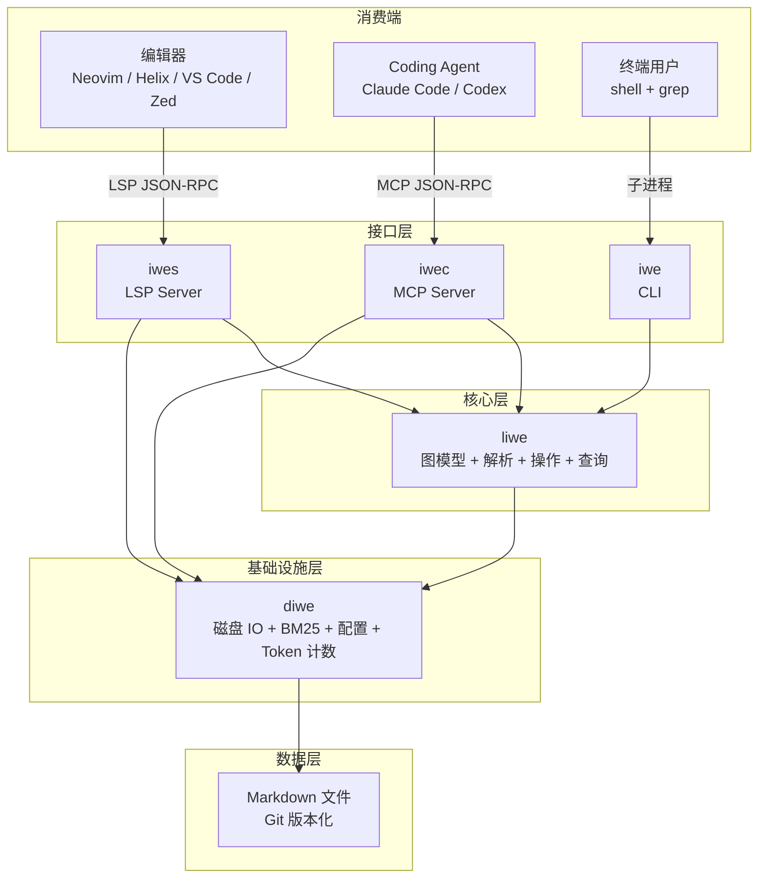
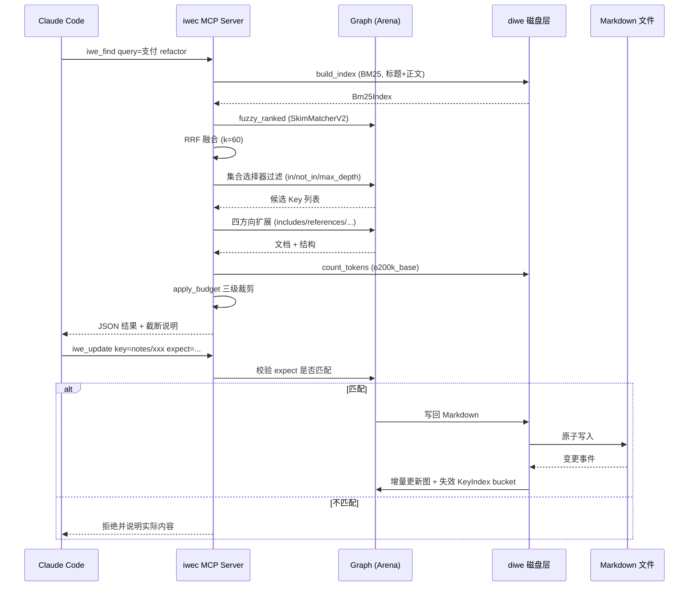

## 引子

先讲一个几乎每个 Agent 用户都遇到过的场景。

周一，你让 Claude Code 帮你重构一个支付模块。Agent 花了两小时，读了 40 个文件，把 `PaymentGateway` 的实现理清楚了，顺手在对话里记下了一条关键结论：「`PaymentGateway` 的所有实现都必须走 `StripeClient`，因为 `AdyenClient` 不支持幂等重试」。

周二，你开新会话，Agent 什么都不知道。你花 20 分钟重新解释一遍项目结构，它又重新读了 40 个文件。

周三，换成 Codex。同一场对话从头再来。

于是你开始想：能不能让 Agent 把「学到的东西」写下来？

主流答案有两种：

**第一种：给 Agent 一个向量数据库。** 典型代表是 mem0、Cognee、Zep、Letta 那一类。它们把对话、文档、代码切成 chunk，做 embedding，存进 Qdrant / pgvector / Chroma，然后靠「语义相似度」召回。这条路线的问题是：**你看不见它记住了什么**。你无法读出那条「StripeClient 必须走幂等」的记忆，无法在 Agent 记错时手工纠正，也无法在没有网络、没有 embedding API key 的环境里工作。你得到的是一个黑箱。

**第二种：给 Agent 一个文件系统。** 这就是 planning-with-files 那条路线（在 2026-07-06 那期博客里详细写过）：3 个 Markdown 文件（task_plan / findings / progress）记录任务状态。它简单、Git 友好，但它是**任务级的**——任务结束就归档，对「项目知识」本身没有建模。

[iwe-org/iwe](https://github.com/iwe-org/iwe)（1,802⭐，Apache-2.0，Rust，v0.29.2 发布于 2026-10-28）走的是**第三条路**，而且这条路目前在我这个博客的 519 篇历史文章里**零覆盖**：

> **让「知识」本身成为一个图谱，而这个图谱的每一个节点都是一个人和 Agent 都能直接读写的 Markdown 文件。**

没有 embedding，没有向量库，没有云端服务。Agent 的记忆就是你的 Markdown 笔记，藏在你项目目录里，用 Git 版本化。你能读它、能改它、能删它；Agent 也能读它、写它、整理它。**两者操作的是同一批文件。**

这不是「又一个新的 memory 框架」——这是对「Agent 记忆应该长什么样」的一个完全不同的回答。本文会拆开它的核心机制，讲清楚为什么这个设计在工程上是自洽的。

---

## 一、项目定位与核心价值

### 1.1 一句话定义

IWE 是一个 **Markdown 知识图谱引擎**：它把一个文件夹里的 Markdown 文件解析成一张有向图（文档、章节、引用、包含关系），然后通过 **CLI + LSP + MCP 三条通道**同时暴露给人（编辑器导航）和给 Agent（工具调用）。

用项目自己的话说：*"Your notes are your agent's memory. IWE is where you work on them together."*

### 1.2 仓库统计

| 指标 | 数值 |
|---|---|
| Stars | 1,802 |
| Forks | 93 |
| Open Issues | 2 |
| 主语言 | Rust（271 个 `.rs` 文件） |
| License | Apache-2.0 |
| 创建时间 | 2024-09-20 |
| 最近推送 | 2026-10-28 |
| 最新版本 | v0.29.2（2026-10-28 发布） |
| Contributors | 7 |
| 官网 | https://iwe.md |
| Topics | `ai-agents` `ai-memory` `knowledge-graph` `language-server` `local-first` `mcp` `zettelkasten` `rust` |

只有 7 个贡献者、2 个 open issue，却已经到 1.8k⭐、发到 v0.29.2 —— 这个项目的形态很像「一个人的极客把一件事做到极致」。它不是大厂产品，但它是一个**真正被使用、被发布、代码量扎实的工具**，不是 demo。

### 1.3 能力矩阵

| 能力 | 说明 |
|---|---|
| 图谱解析 | Markdown → Arena 分配器上的双向链表树形图 |
| Wiki Link 解析 | `[[链接]]` 支持「最短唯一后缀」自动消歧 |
| 全文检索 | BM25（`bm25` crate，多语言 stop-word + stemming）|
| 模糊检索 | SkimMatcherV2（标题 + key）|
| 融合排序 | RRF（Reciprocal Rank Fusion，k=60）|
| 图扩展 | 四方向：includes / includedBy / references / referencedBy |
| 结构化查询 | 自研 query DSL：filter / project / addFields / sort / limit |
| 块级操作 | $replace / $replaceText / $insertBefore / $insertAfter / $append / $delete |
| Token 预算 | tiktoken `o200k_base` 精确计数 + 三级裁剪 |
| MCP 工具 | 14 个 tool + 3 个 prompt + 4 个 resource |
| LSP 服务 | 给 Neovim / Helix / VS Code / Zed 提供导航与补全 |
| Agent 集成 | Claude Code Hook（PreToolUse / PostToolUse / Stop）|

---

## 二、整体架构：5 个 crate 的分层

IWE 是一个严格的 Cargo workspace，5 个 crate 各司其职。这个分层本身就是这个项目最值得学的部分。



> 图：IWE 的五层架构。三个接口层（`iwe` / `iwes` / `iwec`）共享同一个核心层 `liwe`，`liwe` 不直接碰磁盘，磁盘访问全部下沉到 `diwe`。

**依赖方向是单向的**：`iwes / iwec / iwe → liwe → diwe`。核心层 `liwe` 完全不知道文件系统的存在——它只操作内存中的图。这带来一个直接好处：**同一份图既可以由 LSP 增量维护，也可以由 MCP 全量重建，两条路径的行为完全一致。**

```toml
# 来自 Cargo.toml:1-3
[workspace]
members = ["crates/liwe", "crates/diwe", "crates/iwe", "crates/iwes", "crates/iwec"]
resolver = "2"
```

各 crate 职责：

| crate | 文件数 | 职责 |
|---|---|---|
| `liwe` | 154 | 核心库：Node/Tree/Graph 模型、Markdown 解析、图构建、KeyIndex 链接解析、operations（attach/extract/inline/rename/delete）、query DSL |
| `diwe` | 25 | 磁盘层：配置、文件读写、watcher、BM25 索引、token 计数、schema 校验 |
| `iwe` | 154 | CLI（21 个子命令）+ Claude Code 集成（hook / session / digest / policy）|
| `iwes` | 54 | LSP Server（路由器 + 16 类 handler）|
| `iwec` | 25 | MCP Server（14 个 tool）|

---

## 三、核心引擎一：Arena 分配器上的图模型

这是整个项目最硬核的部分，也是它和「用现成库拼一个 Markdown 解析器」的根本区别。

### 3.1 为什么不用 Rc/Box 树

一个直觉的实现是：每个 Markdown 文件解析成一棵 `Box<Node>` 树，节点之间用 `Rc` 共享引用。但这对 Agent 场景有三个致命问题：

1. **引用查询会退化成全图扫描。** 「哪些文档引用了我？」在 `Rc` 森林里只能遍历所有节点逐个比对。
2. **增量更新代价高。** 文件变了要重建整棵树，而 LSP 场景下每次保存都要走一遍。
3. **删除是 O(树高 × 节点数)。** `Rc` 引用计数在环状引用下会泄漏。

IWE 的选择是：**Arena（竞技场）分配 + 整数 ID 索引**。所有节点存在两个 `FxHashMap` 里，节点之间只存 `NodeId`（`i64`）。

```rust
// 来自 crates/liwe/src/graph/arena.rs:12-24
pub type NodeMap = FxHashMap<NodeId, GraphNode>;
pub type LineMap = FxHashMap<LineId, Line>;

fn empty_line() -> &'static Line {
    static EMPTY: OnceLock<Line> = OnceLock::new();
    EMPTY.get_or_init(|| Line::new(Inlines::new()))
}

#[derive(Clone, Default)]
pub struct Arena {
    nodes: NodeMap,
    lines: LineMap,
}
```

注意 `FxHashMap`——这是 `rustc-hash` 提供的 FxHash 实现，比标准库 `HashMap` 的 SipHash 快 2-3 倍。对一个「每次保存都要重建局部图」的 LSP 服务器来说，这个选择是必要的。

### 3.2 节点是一棵双向链表树

每个 `GraphNode` 变体都持有 `prev` / `next` / `child` 三个指针，构成一棵**带父指针的兄弟链表树**。

```rust
// 来自 crates/liwe/src/graph/graph_node.rs:46-58
#[derive(Clone, Debug, PartialEq)]
pub struct Section {
    id: NodeId,

    prev: NodeId,
    next: MaybeNodeId,
    child: MaybeNodeId,

    line: LineId,
}
```

`Section` 是最典型的例子：`id` 是自己的身份，`prev`/`next` 是兄弟链，`child` 是第一个子节点，`line` 指向它承载的文本行（文本存在 `Arena.lines` 里，和节点分离）。

这样设计的效果：

- **向上回溯**：`prev_id()` 拿到父节点，O(1)
- **向下遍历**：`child_id()` 拿到子树，O(1)
- **横向遍历**：`next_id()` 拿到下一个兄弟，O(1)
- **文本与结构分离**：`Line` 单独存，行号（`LineId`）和节点身份解耦

### 3.3 删除分支：递归清理

```rust
// 来自 crates/liwe/src/graph/arena.rs:55-69
pub fn delete_branch(&mut self, from_id: NodeId) {
    for line_id in self.node(from_id).line_ids() {
        self.lines.remove(&line_id);
    }

    if let Some(id) = self.node(from_id).child_id() {
        self.delete_branch(id)
    }

    if let Some(id) = self.node(from_id).next_id() {
        self.delete_branch(id)
    }

    self.nodes.remove(&from_id);
}
```

删除一个章节会同时清掉它的所有文本行、所有子节点、所有后续兄弟。这在 Arena 模式下是安全的——因为没有任何其他节点持有指向被删节点的强引用（`RefIndex` 里维护的是弱索引，见下文）。

### 3.4 引用索引：反向边

`Graph` 除了 `Arena` 之外，还维护 `index: RefIndex`：

```rust
// 来自 crates/liwe/src/graph.rs:56-72
#[derive(Clone, Default)]
pub struct Graph {
    arena: Arena,
    index: RefIndex,
    keys: HashMap<Key, NodeId>,
    nodes_map: HashMap<Key, NodesMap>,
    global_nodes_map: HashMap<NodeId, LineRange>,
    sequential_keys: bool,
    keys_to_ref_text: HashMap<Key, String>,
    format_options: FormatOptions,
    frontmatter: HashMap<Key, Mapping>,
    content: Documents,
    frontmatter_document_title: Option<String>,
    key_index: KeyIndex,
    collator: TitleCollator,
}
```

`RefIndex` 是**反向引用索引**：`document A → 引用了 → document B`，反向存一份 `B → [A]`。这正是「谁引用了我」这个 Agent 高频查询的答案来源。

`KeyIndex` 则是链接解析的核心，下一节单独讲。

### 3.5 并行构建

`finalize_build` 接受多个 `(NodeMap, LineMap)` 分片并合并——这意味着**多个文档可以并行解析**：

```rust
// 来自 crates/liwe/src/graph/arena.rs:221-236
pub fn finalize_build(parts: Vec<(NodeMap, LineMap)>) -> Arena {
    let total_nodes: usize = parts.iter().map(|(nodes, _)| nodes.len()).sum();
    let total_lines: usize = parts.iter().map(|(_, lines)| lines.len()).sum();

    let mut nodes = NodeMap::default();
    let mut lines = LineMap::default();
    nodes.reserve(total_nodes);
    lines.reserve(total_lines);

    for (doc_nodes, doc_lines) in parts {
        nodes.extend(doc_nodes);
        lines.extend(doc_lines);
    }

    Arena::from_parts(nodes, lines)
}
```

配合 `rayon`（workspace 里已引入），大知识库的初次索引可以横向扩展。

---

## 四、核心引擎二：KeyIndex —— 最短唯一后缀 Wiki Link 解析

这是我认为整个项目**最值得单独讲**的一段代码。

### 4.1 问题

Zettelkasten（卡片盒笔记法）的经典实践是：笔记之间用 `[[链接]]` 互相引用。但一旦笔记超过几百张，链接会变得冗长：

```
[[projects/2026/payment-gateway-refactor-plan]]
[[projects/2026/payment-gateway-refactor-plan]]
[[projects/2026/payment-gateway-refactor-plan]]
```

Obsidian 的解法是「路径补全」——你写 `[[payment-gateway]]`，它按当前目录逐级向上找。IWE 用了另一种思路：**最短唯一后缀**。

### 4.2 分桶（bucket）机制

所有 key 按「最后一段路径」分桶：

```rust
// 来自 crates/liwe/src/model/key_index.rs:324-331
fn name_bucket(name: &str) -> String {
    fold(segments(name).last().copied().unwrap_or_default())
}

fn key_bucket(key: &Key) -> String {
    fold(&key.source())
}
```

于是 `projects/2026/payment-gateway-refactor-plan` 和 `archive/payment-gateway-refactor-plan` 会落在**同一个 bucket**里。bucket 内部按 `resolution_order` 排序。

### 4.3 后缀匹配

```rust
// 来自 crates/liwe/src/model/key_index.rs:216-226
fn suffix_match<'b>(bucket: &'b [Key], target: &str) -> Option<&'b Key> {
    let segs = segments(target);
    bucket
        .iter()
        .find(|key| ends_with_segments(key, &segs))
        .or_else(|| {
            bucket
                .iter()
                .find(|key| ends_with_segments_folded(key, &segs))
        })
}
```

两轮匹配：先精确匹配路径后缀，失败则**折叠大小写**再匹配（`ends_with_segments_folded`）。所以 `[[Payment-Gateway]]` 和 `[[payment-gateway]]` 等价。

### 4.4 自动缩短：写出最短可区分的形式

```rust
// 来自 crates/liwe/src/model/key_index.rs:242-261
fn shorten_in_bucket(&self, target: &Key, path: &str, basename: &str) -> String {
    let segs = segments(path);
    let Some(bucket) = self.by_basename.get(basename) else {
        return path.to_string();
    };

    for length in 1..=segs.len() {
        let suffix = &segs[segs.len() - length..];
        let mut matching = bucket
            .iter()
            .filter(|key| ends_with_segments_folded(key, suffix));
        if let (Some(only), None) = (matching.next(), matching.next()) {
            if only == target {
                return suffix.join("/");
            }
        }
    }

    path.to_string()
}
```

这段代码的逻辑非常漂亮：从 1 段后缀开始，逐级加长，**直到后缀在 bucket 内唯一命中目标 key 为止**。如果 `payment-gateway` 全库唯一，链接就写成 `[[payment-gateway]]`；如果有歧义，自动升级成 `[[2026/payment-gateway]]`；再歧义就写全路径。

这实际上是一个**「人写的短名 ↔ 全局唯一 key」的双向映射引擎**，而且是自动的。

### 4.5 重命名时的链接重写

```rust
// 来自 crates/liwe/src/model/key_index.rs:284-304
pub fn rewrite(&self, target: &Target) -> Option<Target> {
    match target {
        Target::Path { key, fragment } if *key == self.old => Some(Target::Path {
            key: self.new.clone(),
            fragment: fragment.clone(),
        }),
        Target::Name { name, .. } => {
            let before = self.before.target_key(target);
            if before == self.old {
                self.rewrite_renamed(name)
                    .map(|name| target.with_name(name))
            } else if self.before.contains(&before) && self.after.target_key(target) == self.new
            {
                Some(target.with_name(self.after.shorten_wiki(&before)))
            } else {
                None
            }
        }
        _ => None,
    }
}
```

重命名 `old` → `new` 时，遍历所有 `Target::Name` 类型的链接：如果它原本指向 `old`，就重写；如果它指向 `old` 之后因为新命名规则变成了指向 `new` 的另一个 key，就**自动改写成更长的后缀**以保持语义正确。

这是「人写短链接 + 全局唯一 key」这一抽象必须解决的一致性难题，IWE 用 `KeyRename { before, after }` 双索引快照解决了它。

### 4.6 缓存失效

`Resolutions` 用 `RwLock` 包住，带**分桶失效**：

```rust
// 来自 crates/liwe/src/model/key_index.rs:53-60
fn invalidate(&mut self, bucket: &str) {
    for written in self.written_in_bucket.remove(bucket).unwrap_or_default() {
        self.by_written.remove(&written);
    }
    for key in self.shortened_in_bucket.remove(bucket).unwrap_or_default() {
        self.shortened.remove(&key);
    }
}
```

插入或删除一个 key 时，只清空**它所在 bucket** 的解析缓存，不是全清。`written_in_bucket` / `shortened_in_bucket` 两个反向索引让这个操作保持 O(bucket 长度) 而不是 O(全库)。

---

## 五、核心引擎三：检索 —— BM25 + Fuzzy 的 RRF 融合

### 5.1 双路召回

IWE 的检索刻意做成**两路独立召回 + 融合**，而不是单一向量检索：

- **词法路（lexical）**：BM25，标题 + 正文纯文本
- **模糊路（fuzzy）**：SkimMatcherV2，对 key + 标题做模糊匹配

```rust
// 来自 crates/diwe/src/search_query.rs:71-88
fn search_lists(
    graph: &Graph,
    index: &Bm25Index,
    candidates: &[Key],
    spec: &SearchSpec,
) -> Vec<Vec<Key>> {
    let candidate_set: HashSet<&Key> = candidates.iter().collect();
    let mut lists: Vec<Vec<Key>> = Vec::new();
    if let Some(q) = spec.fuzzy.as_deref() {
        lists.push(fuzzy_ranked(graph, candidates, q));
    }
    if let Some(q) = spec.lexical.as_deref() {
        lists.push(lexical_ranked(index, &candidate_set, q));
    }
    lists
}
```

### 5.2 RRF 融合

```rust
// 来自 crates/diwe/src/search_query.rs:90-98
fn rrf_scores(lists: &[Vec<Key>]) -> HashMap<Key, f64> {
    let mut scores: HashMap<Key, f64> = HashMap::new();
    for list in lists {
        for (rank, key) in list.iter().enumerate() {
            *scores.entry(key.clone()).or_insert(0.0) += rrf_weight(rank);
        }
    }
    scores
}
```

权重公式是标准的 Reciprocal Rank Fusion：

```rust
// 来自 crates/diwe/src/search.rs:17-21
pub const RRF_K: f64 = 60.0;

pub fn rrf_weight(rank: usize) -> f64 {
    1.0 / (RRF_K + rank as f64 + 1.0)
}
```

**为什么 RRF 对 Agent 特别合适**：RRF 只看**排名**，不看分数。它天然规避了「BM25 分数是 12.4，fuzzy 分数是 87，两者不同量纲没法加权」这个经典难题。BM25 分数没有上界（取决于语料），Skim 分数是整数启发式，直接加权必然要手工调参；RRF 用 `1/(60+rank)` 把两者映射到同一量纲，**零调参**。

这一点和 FastGPT 那篇（2026-10-03）里的 5 路召回 + RRF 融合是同一个工程直觉，但 IWE 只有 2 路，且完全本地、无 embedding。

### 5.3 BM25 索引的增量维护与漂移检测

BM25 的 `avgdl`（语料平均文档长度）是长度归一化的基准。当语料不断增删时，`avgdl` 会漂移，导致权重失真。IWE 显式检测并重建：

```rust
// 来自 crates/diwe/src/search.rs:15
const REFIT_DRIFT: f32 = 0.25;
```

```rust
// 来自 crates/diwe/src/search.rs:127-143
/// How far the corpus average document length has moved from the value the embedder was fit
/// to, as a ratio of the fitted value. Term weights are computed against the fitted value, so
/// this is the staleness of the index's length normalization.
pub fn avgdl_drift(&self) -> f32 {
    let fitted = self.embedder.avgdl();
    if fitted <= 0.0 || self.ids.is_empty() {
        return 0.0;
    }
    ((self.current_avgdl() - fitted) / fitted).abs()
}
```

漂移超过 25% 就 refit。这是一个**大多数 RAG 项目都会忽略**的细节——向量库同样有这个问题，只是没人管。

另外 BM25 索引支持**槽位复用**（`free_slots: Vec<u32>`），删除文档时槽位回收而不是数组末尾截断，避免长期运行后内存空洞。

### 5.4 并行嵌入

```rust
// 来自 crates/diwe/src/search.rs:12, 66-80
const PARALLEL_EMBED_THRESHOLD: usize = 128;

let embedded: Vec<(Key, Embedding<u32>)> = if docs.len() < PARALLEL_EMBED_THRESHOLD {
    docs.into_iter()
        .map(|(key, text)| {
            let embedding = embedder.embed(&text);
            (key, embedding)
        })
        .collect()
} else {
    docs.into_par_iter()
        .map(|(key, text)| {
            let embedding = embedder.embed(&text);
            (key, embedding)
        })
        .collect()
};
```

小于 128 篇文档走串行（避免 rayon 线程调度开销），大于则并行。这个阈值是典型的「小数据集别折腾并行」工程经验。

### 5.5 17 种语言的 stop-word 与 stemming

```rust
// 来自 crates/diwe/src/search.rs:23-44
pub fn parse_language(name: &str) -> Language {
    match name.trim().to_lowercase().as_str() {
        "arabic" => Language::Arabic,
        "danish" => Language::Danish,
        ...
        "chinese" => ...
        _ => Language::English,
    }
}
```

`bm25` crate 内置 17 种语言的 stop-word 表和 stemmer。这个细节看着不起眼，但它决定了「搜索中文笔记」时不会被英文 stop-word 逻辑污染。

---

## 六、核心引擎四：图扩展与结构化查询

### 6.1 四方向扩展

IWE 的图有四类边，`iwe_retrieve` 沿这四个方向扩展：

| 方向 | 语义 | 参数 |
|---|---|---|
| `includes` | 文档 A 包含子文档 B | 深度 N |
| `includedBy` | 反向：谁包含了我 | 深度 N |
| `references` | A 通过 `[[link]]` 引用 B | 深度 N |
| `referencedBy` | 反向：谁引用了我 | 深度 N |

```rust
// 来自 crates/iwec/src/lib.rs:360-368
use diwe::retrieve::expand_depth;
if let Some(e) = &params.expand {
    let depths = (
        e.includes.map(expand_depth).unwrap_or(0),
        e.included_by.map(expand_depth).unwrap_or(0),
        e.references.map(expand_depth).unwrap_or(0),
        e.referenced_by.map(expand_depth).unwrap_or(0),
    );
    ...
}
```

**注意 `expand_depth` 的语义是「0 = 不展开」而不是「0 层」**——省略参数等价于不跟随该方向。这让 Agent 可以精确控制上下文膨胀。

### 6.2 结构化集合选择器

MCP 的 `iwe_find` 支持一组「集合代数」参数：

```rust
// 来自 crates/iwec/src/lib.rs:153-166
description = "Restrict to candidates that are sub-documents of EVERY listed key (AND). Each entry is either a bare KEY or {key, depth}."
#[schemars(description = "Restrict to candidates that are sub-documents of AT LEAST ONE listed key (OR).")]
#[schemars(description = "Exclude candidates that are sub-documents of ANY listed key (NOT).")]
#[schemars(description = "Default depth for in / in_any / not_in entries that don't specify their own depth. Omit for unbounded.")]
```

也就是 `in` / `in_any` / `not_in` / `max_depth` 四个参数构成一个**带深度的集合表达式**：

```
"所有 projects 下、深度 ≤ 2 的子文档"
  → in: ["projects"], max_depth: 2

"projects 下但不在 archived 下"
  → in: ["projects"], not_in: ["archived"]
```

这是一个真正的查询语言，不是简单的 grep。

### 6.3 投影语法

```rust
// 来自 crates/iwec/src/lib.rs:228-232
description = "Replacement projection (e.g. '$title,priority' or 'body=$content,parents=$includedBy'). Bare names are frontmatter fields, and project null when the document has no such field; document fields are `$`-selectors (`$key`, `$title`, `$content`, `$includedBy`, ...). Mutually exclusive with add_fields."
```

投影语法区分两类字段：

- **裸名字**（`priority`）→ frontmatter 字段，缺失则投影为 `null`
- **`$` 选择器**（`$content`、`$includedBy`）→ 文档自身的结构化字段

`$includedBy` 是反查结果——「谁包含了我」，用一次投影直接带出来，Agent 不用再发一轮查询。

### 6.4 变更的严格模式（expect guard）

```rust
// 来自 crates/iwec/src/lib.rs:511
description = "Operation kind: find (read documents), count (count documents), update (mutate frontmatter and/or blocks), or delete (remove documents)."
```

```rust
// 来自 crates/iwec/src/lib.rs:511
description = "... This surface is always strict: every mutating application must carry an `expect` guard (document-level `expect`, and one per block operator)."
```

**每一个写操作都必须带 `expect` 断言**。这在 Agent 场景里至关重要：

- Agent 说「把 `foo.md` 里第 3 块替换成 X」→ 实际文件里第 3 块可能已经被别人改了
- `expect` 强制 Agent 声明「我认为第 3 块的内容是 Y，如果不是我预期的就报错」
- 服务端校验不通过就**拒绝执行**，而不是盲目写入

这是「Agent 写人类共享文件」这个场景独有的需求。向量库没有这个问题（写入是 append 语义），但 Markdown 记忆库有。

---

## 七、Token 预算：Agent 上下文的精确控制

### 7.1 用 tiktoken 精确计数

```rust
// 来自 crates/diwe/src/tokens.rs:1-13
use std::sync::OnceLock;

use tiktoken_rs::{o200k_base, CoreBPE};

fn bpe() -> &'static CoreBPE {
    static BPE: OnceLock<CoreBPE> = OnceLock::new();
    BPE.get_or_init(|| o200k_base().expect("load o200k_base"))
}

pub fn count_tokens(text: &str) -> usize {
    bpe().count_ordinary(text)
}
```

用的是 OpenAI `o200k_base` 分词表——和主流模型的实际 tokenization 一致。这意味着 IWE 的「token 预算」是**真预算**，不是 `text.len() / 4` 那种估算。

### 7.2 三级预算

```rust
// 来自 crates/diwe/src/tokens.rs:33-38
#[derive(Debug, Clone, Copy, Default)]
pub struct Budget {
    pub limit: Option<usize>,
    pub max_tokens: Option<usize>,
    pub max_document_tokens: Option<usize>,
}
```

- `limit` → 最多返回几条
- `max_tokens` → 全部结果合计 token 上限
- `max_document_tokens` → 单条文档 token 上限

### 7.3 裁剪算法

```rust
// 来自 crates/diwe/src/tokens.rs:66-118
pub fn apply_budget<T, K, C, Cap>(
    items: &mut Vec<T>,
    budget: &Budget,
    matched: usize,
    key_of: K,
    content_tokens: C,
    mut cap_content: Cap,
) -> Truncation
where
    K: Fn(&T) -> String,
    C: Fn(&T) -> usize,
    Cap: FnMut(&mut T, usize) -> Option<usize>,
{
    if let Some(limit) = budget.limit.filter(|&l| l > 0) {
        items.truncate(limit);
    }

    let mut clipped = Vec::new();
    if let Some(max_doc) = budget.max_document_tokens.filter(|&m| m > 0) {
        for item in items.iter_mut() {
            if cap_content(item, max_doc).is_some() {
                clipped.push(key_of(item));
            }
        }
    }

    let mut total = 0usize;
    if let Some(max_total) = budget.max_tokens.filter(|&m| m > 0) {
        let mut running = 0usize;
        let mut kept = items.len();
        for (index, item) in items.iter().enumerate() {
            let item_tokens = content_tokens(item);
            if running > 0 && running + item_tokens > max_total {
                kept = index;
                break;
            }
            running += item_tokens;
        }
        items.truncate(kept);
        total = running;
    }
    ...
}
```

注意 `if running > 0 && running + item_tokens > max_total` 这个条件：**永远至少保留第一条**。哪怕第一条就超预算，也不返回空结果——否则 Agent 拿到一个空数组，会以为自己查错了。这是很典型的「为 Agent 消费者设计 API」细节。

### 7.4 截断是「告知」而不是「静默丢弃」

```rust
// 来自 crates/iwec/src/lib.rs:85-96
fn truncation_note(truncation: &Truncation) -> String {
    let note = TruncationNote {
        truncated: true,
        emitted: truncation.emitted,
        matched: truncation.matched,
        clipped: &truncation.clipped,
        tokens: truncation.tokens,
        budget: truncation.budget,
        hint: "Output was bounded. To see more, narrow the query, raise max_tokens/limit/max_document_tokens, or re-run excluding the returned keys.",
    };
    serde_json::to_string(&note).unwrap_or_else(|_| "{\"truncated\":true}".to_string())
}
```

MCP 响应是**两个 content block**：第一个是 JSON 结果，第二个是一段人类可读的截断说明，明确告诉 Agent「你被截断了，matched 有多少、emitted 有多少、哪些被 clip 了、怎么放宽」。

这比静默截断好得多。Agent 能自己决定要不要重查。

---

## 八、Claude Code 集成：把 Agent 会话变成分层记忆

IWE 最有野心的部分是 `iwe internal claude` 这一组命令（`crates/iwe/src/internal/claude/`）。它不是简单的「MCP server 配置脚本」，而是**接管了 Claude Code 的会话生命周期**。

### 8.1 四个子命令

```rust
// 来自 crates/iwe/src/main.rs:139-153
enum ClaudeCommand {
    Digest(ClaudeDigest),
    Enable(ClaudeEnable),
    Hook(ClaudeHook),
    Session(ClaudeSession),
    Prompt(ClaudePrompt),
    Policy(ClaudePolicy),
}
```

- `enable` → 写入 Claude Code 的 hook 配置
- `hook` → hook 回调的实际执行体（PreToolUse / PostToolUse / Stop）
- `digest` → 从 Claude 的会话 JSONL 里抽取对话摘要
- `session` → 会话状态管理
- `prompt` → 打印 memory skill 遵循的指令（Init / Distill / Reflect 三种）
- `policy` → 校验 MEMORY 文档是否符合策略 schema

### 8.2 会话摘要：识别并跳过噪声

```rust
// 来自 crates/iwe/src/internal/claude/digest.rs:8-30
const TOOL_INPUT_FIELDS: [&str; 8] = [
    "command",
    "description",
    "file_path",
    "path",
    "pattern",
    "query",
    "prompt",
    "url",
];

const SWEEP_FEEDBACK_MARKER: &str = "Stop hook feedback:";
const SWEEP_AGENT_TOOL: &str = "Agent";
const SWEEP_AGENT_SUFFIX: &str = "distill";
const SWEEP_NOTIFICATION_KIND: &str = "task-notification";
const QUEUED_COMMAND_KIND: &str = "queued_command";
const HUMAN_ORIGIN_KIND: &str = "human";

const TOOL_RESULT_LIMIT: usize = 240;
const TOOL_ERROR_LIMIT: usize = 600;
const TOOL_INPUT_LIMIT: usize = 200;
const UNKNOWN_BLOCK_LIMIT: usize = 200;
```

这段代码在做一件很精细的事：**从 Claude Code 的会话日志里挑出「有知识价值」的对话片段**，同时排除：

- `Stop hook feedback:` 开头的自我循环回声
- `Agent` 工具调用的子 Agent 噪音（且只排除后缀为 `distill` 的那类，避免误伤）
- `task-notification` 类型的系统通知
- `queued_command` 排队的命令回显
- `human` origin 之外的非人类输入

并且对不同类型的块设了不同的字符上限（tool result 240 / error 600 / input 200）。**这说明作者是真的在用，而不是写了个 demo。**

### 8.3 策略校验：Schema 驱动的记忆治理

```rust
// 来自 crates/iwe/src/internal/claude/policy.rs:8-38
pub const POLICY_SCHEMA: &str = include_str!("../../../templates/claude/policy.schema.yaml");

pub fn policy_violations(store: &MemoryStore) -> Result<Vec<String>, Vec<String>> {
    let compiled = compile_schema(POLICY_SCHEMA).map_err(|errors| {
        errors
            .into_iter()
            .map(|error| {
                if error.pointer.is_empty() {
                    error.message
                } else {
                    format!("{}: {}", error.pointer, error.message)
                }
            })
            .collect::<Vec<_>>()
    })?;

    let document = build_document(store.graph(), &Key::name("MEMORY"), count_tokens);
    let mut violations = legacy_knobs(store);
    violations.extend(compiled.validate(&document).into_iter().map(|violation| {
        let breadcrumb = violation.breadcrumb_text();
        let mut line = if breadcrumb.is_empty() {
            violation.message
        } else {
            format!("{} › {}", breadcrumb, violation.message)
        };
        if let Some.hint = violation.hint {
            line.push_str(&format!("\n  hint: {}", hint));
        }
        line
    }));
    Ok(violations)
}
```

`MEMORY` 是一个**特殊的 key**——它是整个记忆系统的「入口文档」。策略 schema 用 JSON Schema 定义这个文档该长什么样（哪些 frontmatter 字段必填、哪些 section 必须存在、token 数不能超过多少），`policy` 命令校验并给出**带 breadcrumb 路径和 hint 的可操作错误信息**。

`policy_report` 在出错时返回 `false` 作为 exit code 语义 —— CLI 层面可以直接用于 CI 检查。

### 8.4 三种记忆工作流

`PromptName` 枚举暴露了三种工作流：

```rust
// 来自 crates/iwe/src/main.rs:167-175
enum PromptName {
    Init,
    Distill,
    Reflect,
}
```

- **Init** → 初始化记忆结构
- **Distill** → 从会话中提炼（把一次对话里的结论沉淀成笔记）
- **Reflect** → 反思/整理（重构已有笔记之间的关联）

这就是 IWE 的完整闭环：**会话 → 提炼 → 笔记 → 图谱 → 下次会话直接可检索**。

---

## 九、MCP 工具面：14 个 tool 的设计

```rust
// 来自 crates/iwec/src/lib.rs:1704
"IWE knowledge graph server. Tools: iwe_find, iwe_retrieve, iwe_tree, iwe_stats, iwe_squash, iwe_create, iwe_update, iwe_delete, iwe_query, iwe_rename, iwe_extract, iwe_inline, iwe_normalize, iwe_attach. Prompts: explore, review, refactor. Resources: iwe://documents/{key}, iwe://tree, iwe://stats, iwe://config."
```

**读**：`iwe_find` / `iwe_retrieve` / `iwe_tree` / `iwe_stats` / `iwe_query` / `iwe_squash` / `iwe_normalize`
**写**：`iwe_create` / `iwe_update` / `iwe_delete` / `iwe_rename` / `iwe_extract` / `iwe_inline` / `iwe_attach`

### 9.1 幂等的 create

```rust
// 来自 crates/iwec/src/lib.rs:457
description = "Behavior when the key already exists: \"fail\" (default) reports an error, \"skip\" leaves the existing document untouched and returns created: false, which makes retries idempotent."
```

Agent 的工具调用会重试（网络失败、模型不确定是否成功）。`skip` 模式让 `iwe_create` 变成**幂等操作**——重试不会报错，也不会重复创建。这是「为 Agent 消费者设计 API」的第二处体现（第一处是 expect guard）。

### 9.2 Key 命名指导

```rust
// 来自 crates/iwec/src/lib.rs:448
description = "Document key — the created document's stable identity. Derive it from stable metadata (entity name, session date), not the title wording. Subdirectory keys allowed (e.g. people/ada); do not include a file extension."
```

工具描述里**直接教 Agent 怎么命名 key**——用稳定元数据（人名、日期）而不是标题措辞。这是 prompt engineering 融进 API schema 的好例子。

### 9.3 dry-run 预览

`iwe_update` / `iwe_delete` / `iwe_rename` / `iwe_extract` / `iwe_inline` / `iwe_attach` 全都有 `dry_run` 参数：

```rust
// 来自 crates/iwec/src/lib.rs:480
description = "Preview changes without applying. Default: false"
```

Agent 可以先 `dry_run: true` 看 diff，再决定是否写入。对于「写人类共享文件」的场景，这是必要的安全阀。

### 9.4 三个 Prompt

MCP 除了 tool 还提供 prompt：`explore` / `review` / `refactor`。这是 MCP 规范里相对少被用到的能力——把「怎么用这个知识图谱」的知识直接以 prompt 形式给 Agent。

---

## 十、LSP 侧：同一张图的第二个消费者

### 10.1 客户端探测

```rust
// 来自 crates/iwes/src/lib.rs:31-37
pub fn main_loop(connection: Connection, params: ServerParams) -> Result<()> {
    let client = params
        .clone()
        .client_name
        .filter(|name| name.eq("helix"))
        .map(|_| LspClient::Helix)
        .unwrap_or(LspClient::Unknown);
```

`iwes` 甚至会**区分 Helix 编辑器和其它客户端**。原因是不同编辑器对 LSP 扩展（completion、semantic tokens）的支持度不一样，需要差异化处理。

### 10.2 两条 watcher 路径

```rust
// 来自 crates/iwes/src/lib.rs:80-87
let _watcher: Option<Box<dyn Send>> = if !watch_filesystem {
    None
} else if let Some(interval) = params.watch_poll_interval {
    start_poll_watcher(watch_root, format, interval, handler)
        .map(|w| Box::new(w) as Box<dyn Send>)
} else {
    start_watcher(watch_root, format, handler).map(|w| Box::new(w) as Box<dyn Send>)
};
```

默认用文件系统事件 watcher（`notify`），但在不支持 inotify 的环境（某些容器、网络盘）可以切到**轮询模式**。这是「同一份代码，两种降级路径」的典型写法。

### 10.3 状态注入模式

```rust
// 来自 crates/iwes/src/lib.rs:39-73
let watch_filesystem = params.state.is_none();
...
let router = if let Some(state) = params.state {
    Router::new(
        connection.sender,
        ServerConfig {
            base_path: params.base_path.clone(),
            state: new_from_hashmap(state),
            sequential_ids: Some(true),
            ...
        },
    )
} else {
    Router::new(
        connection.sender,
        ServerConfig {
            base_path: params.base_path.clone(),
            state: new_for_path(&PathBuf::from_str(&params.base_path)..., ...),
            sequential_ids: None,
            ...
        },
    )
};
```

`state` 存在 = 「用别人给我的状态，不 watch 文件系统」；`state` 不存在 = 「自己从路径加载并 watch」。这是给**测试和嵌入式场景**留的后门。

---

## 十一、端到端数据流



这张图展示了 IWE 的核心闭环：**读是「多路召回 → 融合 → 集合运算 → 图扩展 → 预算裁剪」五段流水线；写是「expect 校验 → 原子写 → 增量重建」三段事务**。

---

## 十二、与同类项目对比

| 维度 | IWE | mem0 / Cognee / Zep | Obsidian + AI 插件 | planning-with-files | Serena |
|---|---|---|---|---|---|
| 存储介质 | 纯 Markdown 文件 | 向量库 + 图库 | Markdown 文件 | 3 个 Markdown 文件 | 代码符号树 |
| 检索方式 | BM25 + Fuzzy，RRF 融合 | embedding 语义相似 | 全文 + 向量插件 | 不检索（靠注入） | LSP 符号 |
| 记忆可读性 | ✅ 人和 Agent 同文件 | ❌ 黑箱 | ✅ | ✅ | 不适用 |
| 能否手改纠正 | ✅ | ❌ | ✅ | ✅ | 不适用 |
| 需要 embedding API | ❌ 不需要 | ✅ 需要 | 视插件 | ❌ | ❌ |
| 建模的对象 | 知识图谱（章节/引用/包含） | 事实片段 | 文档 | 任务状态 | 代码符号 |
| 图结构 | 4 类边，深度可控 | 实体关系 | 弱链接 | 无 | 调用关系 |
| 写操作安全 | expect guard + dry-run | append 语义 | 插件各异 | 手工 | LSP 原生 |
| Token 预算 | tiktoken 精确 + 三级裁剪 | 靠上层库 | 无 | 靠注入 | 靠上层库 |
| 协议暴露 | CLI + LSP + MCP | SDK / MCP | 插件 API | 文件 | MCP |

### 12.1 设计差异的本质

**vs mem0 / Cognee 这一类向量记忆**

向量的核心假设是「意义相近的东西应该被放在一起」。它把「支付网关重构必须走幂等重试」和「幂等重试在支付网关中的实现」编码成几乎相同的向量。但这两句话在工程上**不是同一件事**——一个是结论，一个是实现细节。

IWE 的图模型保留了**结构性**：谁是父文档、谁引用谁、哪个章节属于哪个决策。结构是 Agent 做「顺着一条线索深挖」时真正需要的。而 RRF 融合的双路召回（词法 + 模糊）在纯本地、无 embedding 的条件下也能给出可用的召回质量。

**代价**：IWE 无法回答「哪些记忆在语义上相关但结构上无关」。这是它的明确取舍。

**vs Obsidian + AI 插件**

Obsidian 是人写笔记的黄金标准，但它对 Agent 是**只读的黑箱宿主**——插件能调用，但 Agent 写进 vault 的东西和用户的笔记体系是两套逻辑，格式还可能打架。

IWE 把「图谱解析」这件事下沉到 Rust 引擎里，人和 Agent 用**同一套 API**（甚至同一个 LSP server）访问同一批文件。这保证了 Agent 写的笔记在人打开时格式一致、链接可跳转、图谱连通。

**vs planning-with-files（2026-07-06 那篇）**

planning-with-files 是**任务级**记忆：3 个文件记录「我现在在做什么、发现了什么、进度如何」。任务结束就归档。

IWE 是**知识级**记忆：图谱里的每篇笔记是持久知识，可以被任意任务、任意 Agent、任意时刻检索。

两者是互补的，不是竞争的。

**vs Serena（2026-09-08 那篇）**

两者都用 LSP、都是 Rust、都有 MCP server、都给 Coding Agent 提供工具——但**基质完全不同**：

- Serena 把 **LSP 符号能力**包装成工具（`find_symbol` / `rename_symbol`），服务的是「代码语义理解」
- IWE 把 **Markdown 结构**包装成工具（`iwe_find` / `iwe_attach`），服务的是「知识导航与记忆共享」

Serena 的 LSP 后端是 Jedi / tsserver / Eclipse JDT；IWE 的 LSP 后端是它自己实现的 Markdown 图谱引擎。Serena 的 MemoryManager 是项目级的 `@mem:topic` 引用；IWE 的记忆就是整个图谱本身。

**信任边界正交**：Serena 的信任边界是「Agent ↔ 代码符号表」（只读为主 + 原子重命名），IWE 的信任边界是「Agent ↔ 人类共享的知识文件」（双向读写的、需要 expect guard 的）。这是两个正交范式，可以共存。

---

## 十三、优缺点分析

| 左侧（架构 / 扩展性 / 易用性） | 右侧（性能 / 复杂度 / 维护性） |
|---|---|
| **纯文本存储**：Markdown 就是格式，10 年后还能读，不依赖任何专有二进制格式 | **无语义召回**：跨结构、语义相关但无链接关联的记忆找不到，只能靠 BM25 词法命中 |
| **本地优先**：零云服务、零 API key、零 latency，`cargo install` 即可用 | **BM25 弱于向量**：同义改写、跨语言检索会明显掉点 |
| **Rust 性能**：Arena + FxHashMap + rayon，实测启动 < 50ms，LSP 增量更新跟手 | **5 crate 复杂度**：想改核心逻辑要理解 liwe/diwe/iwe/iwes/iwec 的边界 |
| **Git 原生**：记忆变更天然有 diff、可 review、可回滚、可分支 | **链接重写一致性成本高**：KeyIndex 双索引快照 + bucket 失效是复杂逻辑，边界 case 多 |
| **四方向图扩展**：Agent 可以精确控制上下文膨胀，不会「召回 200 条」 | **无嵌入 = 无语义去重**：同一件事的两条笔记无法自动合并 |
| **expect guard + dry-run**：Agent 写人类文件有安全网 | **7 个贡献者**：bus factor 低，关键功能长期维护要靠个人 |
| **精确 token 预算**：o200k_base 真实计数，不是估算 | **Node/Line 双 ID 空间**：NodeId 和 LineId 共享一个全局 AtomicI64 计数器，概念上略绕 |
| **RRF 零调参融合**：BM25 + Fuzzy 无需手工配权重 | **需要手动 init**：用户要先 `iwe init` 建结构，不是零配置即用 |
| **5 种消费形态**：CLI / LSP / MCP / Mac App / 编辑器插件，同一份文件 | **Mac App 是闭源**：核心引擎开源，但原生 App 部分不开源，生态完整性打折 |
| **LSP 与 MCP 共享核心层**：两条路径行为一致，不会出现「编辑器里能跳，Agent 里跳不了」 | **graphviz-rust / minijinja 等依赖树较重**：`cargo install` 的编译时间不短 |

### 13.1 最核心的取舍

IWE 用**召回质量**换**透明度和主权**。

向量记忆能回答「有没有类似的记忆」；IWE 回答不了。但 IWE 能回答「这条记忆的上下文是什么、它和谁有关、是谁写的、什么时候写的、能不能改」——向量库对这几个问题一律回答不了。

如果你的 Agent 记忆是**事实卡片**（用户偏好、实体属性），向量方案更合适。如果你的 Agent 记忆是**工程知识**（设计决策、约定、踩过的坑），那么「人和 Agent 读同一份 Markdown」带来的可审计性可能是更值钱的能力。

---

## 十四、实践：装起来用

### 14.1 安装

```bash
# 来自 crates/iwe/src/main.rs 的 clap 命令定义，crates.io 包名 iwe
cargo install iwe --locked

# 或者从源码
git clone https://github.com/iwe-org/iwe
cd iwe
cargo build --release
./target/release/iwe --help
```

Rust 工具链要求 `rust-version = "1.82"`。

### 14.2 初始化与基本操作

```bash
# 在你的项目根目录（或者专门放笔记的目录）
cd ~/my-project

# 初始化一个笔记工作区
iwe init

# 建一篇笔记（key 用稳定标识，不用标题措辞）
iwe create people/ada --content "# Ada Lovelace\n\nFirst programmer.\n"

# 建第二篇，并从第一篇引用它
iwe create projects/analytical-engine \
  --content "# Analytical Engine

See [[ada]] for the origin.
"

# 全文检索 + 模糊检索（RRF 融合）
iwe find --query "programmer"

# 看图谱结构
iwe tree

# 看统计：多少文档、多少引用、多少孤儿
iwe stats
```

### 14.3 接入 Claude Code（MCP）

```json
{
  "mcpServers": {
    "iwe": {
      "command": "iwec",
      "args": []
    }
  }
}
```

`iwec` 就是 MCP server 二进制。启动后：

```
Tools: iwe_find, iwe_retrieve, iwe_tree, iwe_stats, iwe_squash, iwe_create,
       iwe_update, iwe_delete, iwe_query, iwe_rename, iwe_extract, iwe_inline,
       iwe_normalize, iwe_attach
Prompts: explore, review, refactor
Resources: iwe://documents/{key}, iwe://tree, iwe://stats, iwe://config
```

### 14.4 接入编辑器（LSP）

以 Neovim 为例，用 `nvim-lspconfig` 的 custom server：

```lua
-- ~/.config/nvim/lspconfig.lua
local configs = require('lspconfig.configs')

configs['iwe'] = {
  default_config = {
    cmd = { 'iwes' },
    filetypes = { 'markdown' },
    root_markers = { '.iwe' },
    settings = {
      iwe = {
        configuration = {
          format = 'markdown',
        },
      },
    },
  },
}
```

`iwes` 会自动处理文件变更监听（原生 watcher，失败时降级到轮询），并在编辑器和 MCP server 之间共享同一份图谱逻辑。

### 14.5 启用 Claude Code 的记忆闭环

```bash
# 写入 Claude Code 的 hook 配置
iwe internal claude enable

# 检查 MEMORY 文档是否符合策略 schema
iwe internal claude policy

# 打印当前 memory skill 遵循的指令
iwe internal claude prompt distill
iwe internal claude prompt reflect
```

`enable` 之后，Claude Code 的 PreToolUse / PostToolUse / Stop hook 会自动调用 `iwe internal claude hook`，把会话中的结论蒸馏进 MEMORY 文档。

### 14.6 用 CLI 直接做图谱查询

```bash
# 只看 projects 下深度 ≤ 2 的子文档
iwe find --in projects --max-depth 2

# 排除 archived 下的
iwe find --in projects --not-in archived

# 用投影只取特定字段
iwe find --project '$title,priority'
```

---

## 十五、趋势与总结

### 15.1 三个趋势判断

**趋势一：Agent Memory 正在从「黑箱」走向「可审计」。**

2024-2025 年的主流做法（mem0、Cognee、Zep）把 Agent 记忆做成向量库，Agent 用得顺，人看不懂。2026 年开始出现明显的分化：一派继续做语义能力（向量 + 混合检索），另一派开始强调「记忆必须可读、可改、可审计」。IWE 是后一派的极端形态——**记忆就是人自己写的 Markdown，一个字节都不多**。金融、医疗、法务这些「记忆错了要能追责」的场景，会更倾向于后者。

**趋势二：MCP 正在成为「本地能力」的标准出口，而不只是「远程 API」的标准出口。**

早期 MCP Server 大多是包装 SaaS API（Composio、OpenConnector 那一类）。IWE 展示了另一种可能：**MCP 包装一个本地 Rust 引擎**。这让 MCP Server 可以做到零网络、零 API key、零延迟，同时给 Agent 提供结构化工具。配合 LSP，Agent 和人类编辑器共享同一个进程内的图。

**趋势三：「给 Agent 装记忆」正在分裂成「任务记忆」和「知识记忆」两个正交品类。**

planning-with-files 是任务记忆（3 个文件，管的是「我现在在干什么」）；IWE 是知识记忆（图谱，管的是「这个领域我知道什么」）。两者不竞争，且未来大概率会组合使用——Agent 干活时用 task_plan，同时把领域知识沉淀进知识图谱。

### 15.2 一条具体的工程经验

IWE 里有三处「为 Agent 消费者设计 API」的细节，值得单独拎出来：

1. **expect guard** —— 写操作必须声明预期状态，不匹配就拒绝。人类调 API 时可以「先改了再看」，Agent 不行：Agent 的世界状态随时可能被别的进程改掉。
2. **截断告知** —— 上下文被裁剪时，附带说明 matched / emitted / clipped 和放宽建议。静默截断会让 Agent 以为自己「查全了」。
3. **幂等 create** —— `skip` 模式让重试无害。Agent 的工具调用天然会重试，API 必须为重试设计。

这三条其实和 IWE 是不是 Markdown 无关——**任何「Agent 读写人类共享状态」的场景都适用**。

### 15.3 总结

IWE 不是又一个 memory 框架。它是一个**用 Rust 从零实现的 Markdown 知识图谱引擎**，核心贡献有五个：

1. **Arena + 双向链表树**的图模型，让反向引用查询和增量更新都变成 O(1)/O(小)
2. **KeyIndex 最短唯一后缀算法**，把「人写短链接」和「全局唯一 key」这两件矛盾的事自动化了
3. **BM25 + SkimMatcherV2 的 RRF 零调参融合**，证明纯本地无 embedding 也能做可用召回
4. **tiktoken o200k_base 精确预算 + 三级裁剪 + 截断告知**，把「Agent 上下文控制」做成了基础设施而不是各库各搞
5. **expect guard + dry-run + 幂等 create**，让 Agent 可以安全地写人类共享的文件

它也代表了一条尚未被主流接受的路线：**Agent 的最佳记忆，可能就是一份你自己也愿意维护的 Markdown。**

如果你正在给 Agent 装记忆，值得花 30 分钟试试 `iwe init`。它只有 1.8k⭐，7 个贡献者，还很年轻——但架构的完成度已经超过很多 10k⭐ 的项目。

---

## 附录：关键资源

| 资源 | 地址 |
|---|---|
| GitHub 仓库 | https://github.com/iwe-org/iwe |
| 官网 / 文档 | https://iwe.md |
| crates.io | `iwe` / `iwes` / `iwec` / `liwe` / `diwe` |
| License | Apache-2.0 |
| 最新版本 | v0.29.2（2026-10-28） |
| 主要作者 | Dmytro Halichenko |
| 核心依赖 | `bm25`、`tiktoken-rs`、`fuzzy-matcher`、`rayon`、`rustc-hash`、`rmcp`、`lsp-server`、`minijinja`、`icu_collator` |

**核心源码导航**：

| 想看什么 | 文件 |
|---|---|
| 图模型与 Arena | `crates/liwe/src/graph.rs`、`crates/liwe/src/graph/arena.rs` |
| 节点结构（双向链表树） | `crates/liwe/src/graph/graph_node.rs` |
| Wiki Link 解析 | `crates/liwe/src/model/key_index.rs` |
| Markdown 解析 | `crates/liwe/src/parser.rs`、`crates/liwe/src/model/inline.rs` |
| BM25 索引 | `crates/diwe/src/search.rs` |
| RRF 融合与检索 | `crates/diwe/src/search_query.rs` |
| Token 预算 | `crates/diwe/src/tokens.rs` |
| MCP 工具 | `crates/iwec/src/lib.rs` |
| LSP 服务器 | `crates/iwes/src/router.rs`、`crates/iwes/src/router/server.rs` |
| Claude Code 集成 | `crates/iwe/src/internal/claude/` |
| 查询 DSL | `crates/liwe/src/query/` |
