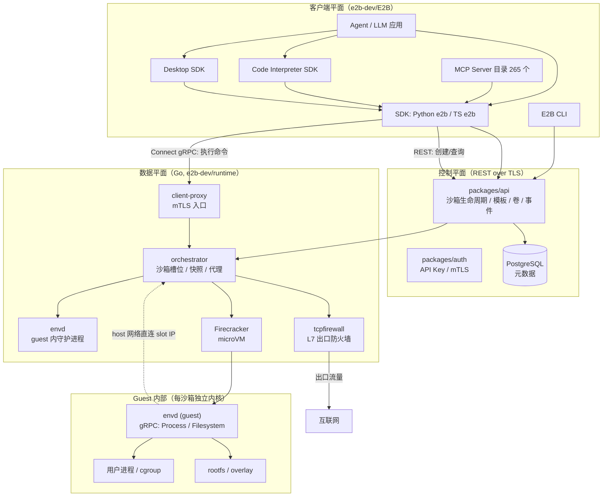
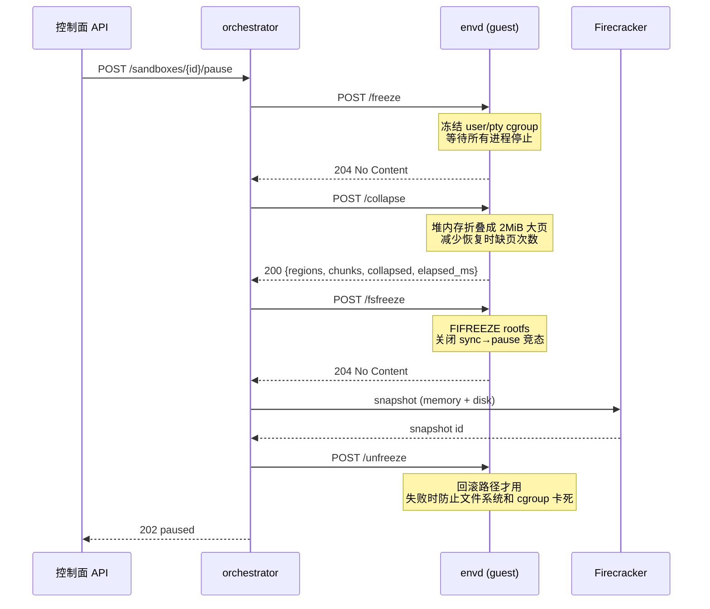
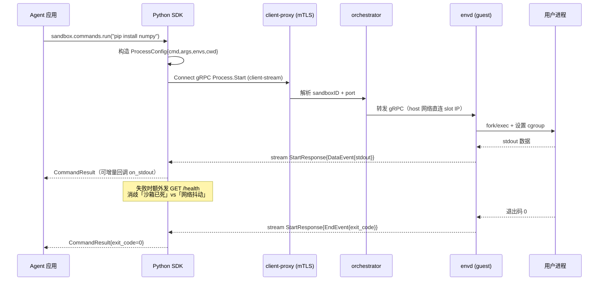

## 引子：Agent 想执行代码，却不能碰你的电脑

写 Agent 的时候，几乎每一个稍微认真一点的项目都会撞上同一道墙。

> "让 Agent 跑一段 Python 看结果" —— 但这段 Python 可能 `pip install` 一个包、可能读一个路径、可能访问一个不该访问的域名。

最常见的解法是 Docker：起一个容器，把 Agent 的 bash 丢进去。听起来够用了，直到你遇到这些场景：

**场景一：Agent 要跑 10 分钟的图构建。** 容器跑完就销毁，下次同样的任务要重新 `pip install` 一遍依赖。Docker 没有"暂停"，只有"销毁"。

**场景二：100 个 Agent 并发。** 每个 Agent 一个容器，Docker daemon 的 CPU 调度抖动让 P99 延迟直接翻倍。你需要真正的 VM 隔离（microVM），但 Firecracker 起一个 VM 要 500ms。

**场景三：Agent 生成的代码必须能被人审计。** 容器里的进程和宿主机共享内核，`/proc` 逃逸的历史漏洞一抓一大把。

**场景四：Agent 要控制图形界面。** 让它点按钮、填表单、看截图。

这四个场景拼在一起，指向一个非常具体的工程需求：**不是"一个容器"，而是一个"云端可暂停、可快照、多租户隔离的 Agent 执行平面"**。

这正是 [e2b-dev/E2B](https://github.com/e2b-dev/E2B) 在做的事。

它的定位一句话说清：

> **E2B 是一个开源的"AI 代码执行基础设施"——让 Agent 把生成的代码扔进云端一个真正隔离的沙箱里跑，沙箱可以冷启动、可以暂停快照、可以毫秒级恢复、可以按毫秒计费，并且自带 MCP Server 目录与 Code Interpreter / Desktop 两套衍生 SDK。**

本文会从架构层面拆解它：**为什么它要自己设计一套 gRPC 协议（envd）而不是复用 SSH/exec？为什么它的暂停流程要"冻结 cgroup + 折叠堆 + 冻结文件系统"三步走？它的 SDK 为什么要在每次连接失败后额外发一次 health probe？**

先看基本盘：

| 项目 | E2B | 备注 |
|---|---|---|
| 仓库 | `e2b-dev/E2B` | 主 SDK + 协议 + Code Interpreter + Desktop |
| 运行时 | `e2b-dev/runtime` | Go，Apache-2.0，⭐1.8k，orchestrator + envd + proxy |
| Stars | ⭐14,608 | 2023-03 创建，3 年多 |
| License | Apache-2.0 | 完全开源，非 open-core |
| 语言 | Python / TypeScript / Go | SDK 双语言 + 运行时 Go |
| 最近提交 | 2026-10-29 | 活跃 |
| 隔离技术 | Firecracker microVM | 每沙箱独立内核 |
| 协议 | Connect (gRPC) + HTTP | `spec/envd/` 有完整 proto |
| MCP Server 目录 | 265 个 | `spec/mcp-server.json`，带类型化配置 schema |

> ⚠️ 顺带说一个重要的行业动态：**曾经对标的 `daytonaio/daytona`（⭐71k）已于 2026 年 6 月归档**——README 首行写着 "This repository is no longer maintained"，核心开发转入私有代码库，仓库里只剩一个 README 和 assets。所以本文选 E2B 作为这个赛道的代表，理由不是它星更多，而是**它是这个赛道里目前唯一还完全开源、且还在活跃开发的项目**。

---

## 一、整体架构：两个仓库，四层平面

E2B 的代码分成两个仓库，职责划分非常清晰：

- **`e2b-dev/E2B`** —— 客户端侧。Python / TypeScript SDK、envd 的 gRPC 协议定义（`.proto`）、OpenAPI 规范、Code Interpreter SDK、Desktop SDK、CLI、MCP Server 目录。
- **`e2b-dev/runtime`** —— 服务端侧。Go 写的 orchestrator（编排器）、envd（跑在 guest 里的守护进程）、client-proxy（入口代理）、auth、api、db 等。



几个关键点：

**1. 控制面和数据面彻底分离。** 创建沙箱、查状态、传文件、拿 metrics 都是 REST（`packages/api`）；只有"在沙箱里跑命令"这种高频、需要流式的操作走 gRPC（Connect 协议）。前者要强一致 + 可审计，后者要低延迟 + 双向流。

**2. envd 是"跑在沙箱里的那个 agent"。** 注意它的名字 —— envd（environment daemon）。它不是被 Agent 调用的"工具"，而是**沙箱内部的一个特权进程**，暴露 `Process` 和 `Filesystem` 两个 gRPC 服务。SDK 通过 orchestrator 的代理把 gRPC 流量转到 guest 里的 envd。

**3. envd 的部分端点是 `x-internal: true`。** 这是个容易被忽略但很重要的设计，我在 `spec/envd/envd.yaml` 里看到原文注释：

```yaml
# Operations marked `x-internal: true` are the orchestrator's control plane. The
# orchestrator reaches them over the host network, straight at the sandbox slot
# IP, so they are never a legitimate destination for traffic arriving through the
# public sandbox URL. The sandbox proxy generates its rejection list from this
# marker, so adding a control operation here is what closes it to the outside.
```

翻译成人话：`/init`（初始化 guest）、`/freeze`、`/unfreeze`、`/collapse`、`/fsfreeze`、`/fsthaw` 这 6 个端点**只能从宿主机网络访问**，公网 URL 打进来会被代理层根据 OpenAPI 里的 `x-internal` 标记自动拉黑。

**这是一个用"协议描述文件"驱动的访问控制**，而不是在每个 handler 里手写 if 判断。新增一个内部控制端点，只要在 OpenAPI 里标上 `x-internal: true`，代理层自动就把它关掉了。这个设计的可扩展性比硬编码白名单好得多。

---

## 二、envd 协议设计：为什么不用 SSH

Agent 沙箱的"远程执行"需求，用 SSH 也能做。E2B 却自己设计了一套 Connect（gRPC）协议，这是一个很值得剖析的决策。

### 2.1 Process 服务：一个服务，八个 RPC

`spec/envd/process/process.proto` 全文只有 3.3KB，但信息密度很高：

```protobuf
// 来自 spec/envd/process/process.proto:5-25
service Process {
    rpc List(ListRequest) returns (ListResponse);
    rpc Connect(ConnectRequest) returns (stream ConnectResponse);
    rpc Start(StartRequest) returns (stream StartResponse);

    rpc Update(UpdateRequest) returns (UpdateResponse);

    // Client input stream ensures ordering of messages
    rpc StreamInput(stream StreamInputRequest) returns (StreamInputResponse);
    rpc SendInput(SendInputRequest) returns (SendInputResponse);
    rpc SendSignal(SendSignalRequest) returns (SendSignalResponse);

    // Close stdin to signal EOF to the process.
    // Only works for non-PTY processes. For PTY, send Ctrl+D (0x04) instead.
    rpc CloseStdin(CloseStdinRequest) returns (CloseStdinResponse);
}
```

对比 SSH 的能力清单，E2B 把"远程执行"拆成了几个正交的原语：

| 原语 | RPC | 语义 |
|---|---|---|
| 列举 | `List` | 列出沙箱内所有活着的进程（pid + config + tag） |
| 启动 | `Start` | **服务端流**：返回一个 `stream StartResponse`，持续推送 stdout/stderr/exit |
| 接入 | `Connect` | **服务端流**：接回一个已经跑着的进程，接着读它的输出 |
| 交互 | `StreamInput` | **客户端流**：持续往 stdin 灌数据 |
| 单发 | `SendInput` | 一次性写一段 stdin |
| 信号 | `SendSignal` | SIGTERM / SIGKILL |
| 改尺寸 | `Update` | 改 PTY 的 rows/cols（终端 resize） |
| 关 stdin | `CloseStdin` | 发 EOF |

### 2.2 三个真正的设计亮点

#### 亮点一：ProcessSelector —— pid 与 tag 的二选一

```protobuf
// 来自 spec/envd/process/process.proto:170-176
message ProcessSelector {
    oneof selector {
        uint32 pid = 1;
        string tag = 2;
    }
}
```

每个进程都可以打一个字符串 `tag`（`StartRequest` 里的 `optional string tag = 3`）。SDK 里有一个 `CommandHandle`，持有的是 tag 而不是裸 pid：

```python
# 来自 packages/python-sdk/e2b/sandbox/commands/command_handle.py
class CommandHandle:
    """Handle to a running command, used to interact with it (e.g. kill)."""
    def __init__(self, pid: int, result: CommandResult):
        self._pid = pid
        self._result = result
    ...
```

为什么重要？因为 **pid 是沙箱内的局部编号**。沙箱重启（从快照恢复）后 pid 会变，但 tag 是你起的名字，语义稳定。SDK 层还有 `commands.run(cmd, tag="install-deps")` 这样的用法 —— 跨快照恢复后，仍能用 `"install-deps"` 这个名字找回那个进程。

#### 亮点二：Connect vs Start 的分离

`Start` 启动进程并返回流；`Connect` 接入一个**已经存在**的进程并读它的输出。

为什么需要 Connect？因为 Agent 的典型循环是：

```
启动后台进程 → 轮询它的输出文件 → 进程自己退出 → Agent 再读一次完整输出
```

如果只有 `Start`，Agent 每次轮询都要重新订阅一次流，之前的输出就丢了。`Connect` 让"启动"和"读输出"解耦。

#### 亮点三：ProcessEvent 的四态 oneof

```protobuf
// 来自 spec/envd/process/process.proto:70-95
message ProcessEvent {
    oneof event {
        StartEvent start = 1;
        DataEvent data = 2;
        EndEvent end = 3;
        KeepAlive keepalive = 4;
    }

    message StartEvent { uint32 pid = 1; }

    message DataEvent {
        oneof output {
            bytes stdout = 1;
            bytes stderr = 2;
            bytes pty = 3;
        }
    }

    message EndEvent {
        sint32 exit_code = 1;
        bool exited = 2;
        string status = 3;
        optional string error = 4;
    }

    message KeepAlive {}
}
```

这里有两个容易被忽略的细节：

**`sint32 exit_code` 用的是 zigzag 编码。** protobuf 的 `int32` 是固定 32 位有符号数，负数会占满 10 个字节；`sint32` 用 zigzag 编码，-1 编码成 1、1 编码成 2，**小负数只需 1 字节**。对于"进程退出码"这种高频、小值域的字段，这是实打实的带宽优化。

**`KeepAlive` 是一等公民。** 长连接必须有保活，否则中间的 LB / NAT 会在空闲超时后静默掐断连接，客户端只看到"流莫名结束了"。E2B 把 KeepAlive 做成事件流的一部分而不是靠 gRPC 的 keepalive 机制，因为它需要穿过 HTTP/2 和各种代理。

#### 亮点四：PTY 与非 PTY 的分流

`StartRequest` 里 `optional bool stdin = 4` 的注释写得很直接：

```protobuf
// This is optional for backwards compatibility.
// We default to true. New SDK versions will set this to false by default.
optional bool stdin = 4;
```

而 `CloseStdin` 的注释说：

```protobuf
// Close stdin to signal EOF to the process.
// Only works for non-PTY processes. For PTY, send Ctrl+D (0x04) instead.
```

这是因为 **PTY（伪终端）没有真正的 EOF 语义**——终端设备的输入端永远不会关闭，只能发 Ctrl+D 字符来模拟。这个细节如果没踩过坑是写不出来的。

### 2.3 Filesystem 服务：xattr 元数据与目录监听

`spec/envd/filesystem/filesystem.proto` 提供了 8 个 RPC，其中 `WatchDir` 值得单独说：

```protobuf
// 来自 spec/envd/filesystem/filesystem.proto:36-48
message WatchDirRequest {
  string path = 1;
  bool recursive = 2;
  // If true, each FilesystemEvent includes the EntryInfo of the affected entry, when available.
  bool include_entry = 3;
  // If true, allows watching paths on network filesystem mounts (NFS, CIFS, SMB, FUSE).
  // Events on network mounts may be unreliable or not delivered at all.
  bool allow_network_mounts = 4;
}
```

`allow_network_mounts` 这个字段的存在本身就说明作者踩过坑——在 NFS/FUSE 上 inotify 不可靠，所以要么明确声明"我不保证"，要么明确说"我为你开了这个开关并承担风险"。

`EntryInfo` 里还有一个很有意思的设计：

```protobuf
// 来自 spec/envd/filesystem/filesystem.proto:69-79
message EntryInfo {
  string name = 1;
  FileType type = 2;
  string path = 3;
  int64 size = 4;
  uint32 mode = 5;
  string permissions = 6;
  string owner = 7;
  string group = 8;
  google.protobuf.Timestamp modified_time = 9;
  // If the entry is a symlink, this field contains the target of the symlink.
  optional string symlink_target = 10;
  // User-defined metadata stored as extended attributes (xattrs) on the file.
  // Keys live under the `user.e2b.` xattr namespace; the prefix is stripped here.
  // Plain `user.*` xattrs written by other tooling are not reflected.
  map<string, string> metadata = 11;
  // True when the entry itself is a symlink; type then describes the symlink's target.
  bool is_symlink = 12;
}
```

**`user.e2b.` 命名的 xattr 命名空间** —— 这是把"业务元数据"挂到文件系统上的原生机制。注意最后那句注释：`Plain user.* xattrs written by other tooling are not reflected`（其他工具写的普通 `user.*` xattr 不会被反映出来）。这是一个刻意的**命名空间隔离**，避免和别的工具抢 `user.*` 空间。

配合 `is_symlink` 与 `symlink_target` 的分离（`type` 描述的是目标类型，不是链接本身），整个 `EntryInfo` 是一份设计得相当扎实的 stat 结果。

---

## 三、SDK 层：一个"错误消歧"的设计范式

E2B 的 SDK 代码质量明显高于一般开源项目。其中**最值得学的不是 API 设计，而是错误处理**。

### 3.1 问题：一次连接失败，意味着什么？

Agent 沙箱的场景下，SDK 发一条命令可能遇到这些失败：

1. 沙箱被用户主动 `kill` 了
2. 沙箱到了超时时间被自动回收
3. 沙箱进程还在，但网络抖了一下（LB 掐了连接）
4. 沙箱所在的宿主机网络故障，压根连不上
5. envd 还没起来（沙箱刚创建，还在 boot）

**如果 SDK 把这些都报成同一个错误**，Agent 就无法做出正确决策：情况 1 应该重建沙箱，情况 3 应该重试，情况 4 应该退避，情况 5 应该等一下再连。

E2B 的解法是：**在连接层失败后额外发一次 health probe，用探针结果消歧。**

### 3.2 实现：健康探针三态

`packages/python-sdk/e2b/envd/api.py` 的 `check_sandbox_health` 返回的是 **三态**，不是布尔：

```python
# 来自 packages/python-sdk/e2b/envd/api.py:53-90
def check_sandbox_health(envd_api: httpx.Client) -> Optional[bool]:
    """Probe the sandbox's envd health endpoint.

    :return: ``True`` if the sandbox is running, ``False`` if it is not, ``None`` if it answered but its state could not be determined.
    :raises httpx.TransportError: When the sandbox could not be reached (no answer within the probe timeout).
    :raises SandboxUnreachableException: When the proxy reports the sandbox running but envd's port not open -- the exception a request would get.
    """
    try:
        r = envd_api.get(ENVD_API_HEALTH_ROUTE, timeout=HEALTH_CHECK_TIMEOUT)
    except httpx.TransportError:
        raise
    except Exception:
        return None
    return _health_status(r)


def _health_status(r: httpx.Response) -> Optional[bool]:
    if r.status_code == 502:
        err = format_sandbox_unavailable_exception(get_message(r))
        if isinstance(err, SandboxNotRunningException):
            return False
        raise err
    if r.is_success:
        return True
    return None
```

三态含义：

| 探针结果 | 含义 | SDK 抛出的异常 |
|---|---|---|
| `True` | 沙箱活着 | 原始异常（可能是瞬时网络问题） |
| `False` | 沙箱确认已死 | `SandboxNotRunningException` |
| `None` | 沙箱有响应但状态不明 | `SandboxUnreachableException` |
| 探针本身抛异常 | 完全连不上 | `SandboxUnreachableException` |

更精细的是 RPC 层的消歧（`packages/python-sdk/e2b/envd/rpc.py`）：

```python
# 来自 packages/python-sdk/e2b/envd/rpc.py:50-81
def is_transport_failure(e: Exception) -> bool:
    """Whether the error is a connection-level failure (failed connect, stream
    reset, connection dropped mid-request) rather than an error response from
    envd.
    ...
    """
    return (
        isinstance(e, ConnectError)
        and isinstance(e.__cause__, _TRANSPORT_ERRORS)
        and e.code is not Code.DEADLINE_EXCEEDED
    )


def is_ambiguous_unavailable(e: Exception) -> bool:
    """Whether the error is an ``UNAVAILABLE`` whose message the proxy's answers do
    not explain -- neither the sandbox not found nor its port not open -- e.g. envd
    ending a stream with "the connection to sandbox ... ended before the stream
    completed" when the sandbox is killed mid-command. Whether the sandbox is gone
    can only be told by probing it."""
    return (
        isinstance(e, ConnectError)
        and e.code is Code.UNAVAILABLE
        and not is_sandbox_not_found_message(e.message)
        and not is_sandbox_port_not_open_message(e.message)
    )
```

注意 `is_transport_failure` 里那个 `and e.code is not Code.DEADLINE_EXCEEDED` —— **客户端自己触发的 deadline 是"确定结果"，不是"连接失败"**，不该触发健康探针。这个区分很关键：否则每次超时都会多打一次 health probe，把控制面流量放大。

### 3.3 一个容易忽略的细节：CancelledError 的还原

```python
# 来自 packages/python-sdk/e2b/envd/rpc.py:131-137
if isinstance(e, ConnectError):
    # connectrpc converts asyncio cancellation into a ConnectError with
    # code CANCELED; restore the original CancelledError so cancelling a
    # task keeps its asyncio semantics instead of surfacing as an RPC
    # error (or, via the CANCELED mapping below, a TimeoutException).
    if isinstance(e.__cause__, asyncio.CancelledError):
        return e.__cause__
```

connectrpc 库把 `asyncio.CancelledError` 包装成了 `ConnectError`。这在 Python 3.8+ 里是个经典陷阱——`CancelledError` 继承自 `BaseException` 而非 `Exception`，一旦被吞掉并转成普通异常，**asyncio 的任务取消语义就丢了**，上层 `await task` 永远等不到 CancelledError。这段代码把它还原回去了。

### 3.4 重试策略：`Should-Retry` 头是权威的

`packages/python-sdk/e2b/retry.py` 的重试逻辑有一个很讲究的设计：

```python
# 来自 packages/python-sdk/e2b/retry.py:63-83
def _retry_delay(
    response: httpx.Response,
    attempt: int,
    random_: Callable[[], float],
) -> Optional[float]:
    """Return a delay for marked responses or retryable statuses without a header.

    A present header is authoritative, including explicit ``false``.
    """
    should_retry = response.headers.get("Should-Retry")
    if should_retry is None:
        if response.status_code not in RETRYABLE_STATUSES:
            return None
    elif should_retry.strip().lower() != "true":
        return None

    retry_after = parse_retry_after(response.headers.get("Retry-After"))
    if retry_after is not None:
        return float(retry_after)

    return _backoff_delay(attempt, random_)
```

**"头存在就是权威，包括显式的 false"** —— 服务端说 `Should-Retry: false` 时，哪怕状态码是 502 也不重试。这比"客户端按状态码猜要不要重试"高明得多：只有服务端知道自己这个请求是不是幂等的、是不是刚被一个 workflow 消费过。

配套的还有三点：

**单调时钟算 deadline**（`_request_deadline`）：

```python
# 来自 packages/python-sdk/e2b/retry.py:107-117
def _request_deadline(request: httpx.Request, monotonic: Callable[[], float]) -> float:
    timeout = request.extensions.get("timeout")
    if not isinstance(timeout, dict):
        return monotonic() + MAX_RETRY_WAIT_WITHOUT_TIMEOUT_SECONDS

    values = [value for value in timeout.values() if value is not None]
    # A monotonic clock cannot jump when the system wall clock is adjusted,
    # keeping elapsed timeout calculations stable across retries.
    return monotonic() + (
        min(values) if values else MAX_RETRY_WAIT_WITHOUT_TIMEOUT_SECONDS
    )
```

用 `time.monotonic()` 而不是 `time.time()`——后者在 NTP 校正时会跳变，会导致正在计算的超时时间突然变长或变短。

**退避带抖动，且上限 10 秒**：

```python
# 来自 packages/python-sdk/e2b/retry.py:15-17, 58-60
BACKOFF_BASE_SECONDS = 0.1
BACKOFF_MAX_SECONDS = 10.0
BACKOFF_JITTER_MIN = 0.5

def _backoff_delay(attempt: int, random_: Callable[[], float]) -> float:
    backoff = min(BACKOFF_BASE_SECONDS * 2**attempt, BACKOFF_MAX_SECONDS)
    return backoff * (BACKOFF_JITTER_MIN + random_() * (1 - BACKOFF_JITTER_MIN))
```

抖动下限 0.5、上限 1.0 —— 意味着实际延迟在 `[0.5×backoff, backoff]` 之间。不是常见的"full jitter"，而是保留一定的同步性，避免完全打散请求节奏。

**不重试流式 body**：

```python
# 来自 packages/python-sdk/e2b/retry.py:138-142
def handle_request(self, request: httpx.Request) -> httpx.Response:
    # Iterators, files, and other streaming bodies may be consumed by the
    # first attempt and cannot be safely replayed without buffering them.
    if self.retries == 0 or not isinstance(request.stream, httpx.ByteStream):
        return self.transport.handle_request(request)
```

---

## 四、运行时深度：暂停快照的三步走

E2B 最有技术含量的部分在 `e2b-dev/runtime`。这一节讲它的**暂停（pause）与恢复（resume）**机制——这是 E2B 与普通容器方案最本质的差异。

### 4.1 为什么要暂停而不是销毁？

一个 Agent 任务跑完，容器销毁，下次同样的任务要重新装依赖。暂停则保留整个 VM 状态，**恢复时几乎瞬时**。E2B 的 API 里有 `/sandboxes/{id}/pause` 和 `/sandboxes/{id}/resume`。

但"暂停一台正在跑的 Linux VM"绝不是一句 `SIGSTOP` 能解决的。有两个硬问题：

**问题 A：内存快照一致性。** VM 的内存要拍成快照，磁盘上的数据必须和内存对得上。

**问题 B：cgroup 冻结。** 用户进程可能在疯狂写文件，snapshot 拍到一半它又写了，磁盘状态就错乱了。

E2B 的解法是一条三步流水线，每一步对应一个 envd 端点。

### 4.2 第一步：`/freeze` —— 冻结 cgroup

```protobuf
// 来自 spec/envd/envd.yaml
```

envd 的 `/freeze` 端点在 OpenAPI 里的 summary 是：

> "Freeze user/pty cgroups before pause and wait for them to stop. Written directly by envd to avoid Process.Start / shell overhead under load."

**注意最后那句括号里的说明**：这个端点是"直接写"的，绕过了正常的 Process.Start / shell 路径。

为什么？因为在**负载高峰**时，正常的 gRPC 调用路径（起进程 → 执行 → 拿结果）有额外开销，而 pause 是一个需要快速完成的操作——拖得越久，用户进程写的脏数据越多，快照越容易不一致。所以作者专门为"冻结"这个操作开了一条直连路径。

配套的 `/unfreeze`：

> "Unfreeze user/pty cgroups. Intended for the orchestrator's pause-failure rollback path."

**只在暂停失败回滚时才用**。这个设计说明作者想过"冻结了但快照失败"的场景，并且有明确的恢复路径。

### 4.3 第二步：`/collapse` —— 把堆折叠成大页

这是整套机制里最巧妙的一步。

```go
// 来自 packages/envd/internal/api/collapse.go:13-22
// PostCollapse compacts envd's own anonymous heap into 2 MiB transparent
// hugepages just before pause. envd's Go heap arenas are physically scattered
// across many 2 MiB guest-physical frames, each of which is a separate cold
// fault on resume; consolidating them lets envd-init touch far fewer frames.
// Best-effort: a collapse failure is logged but a non-empty result still
// returns success, since the snapshot is taken regardless.
func (a *API) PostCollapse(w http.ResponseWriter, r *http.Request) {
```

翻译一下这个注释：

> envd 自己的 Go 堆内存，物理上散落在很多个 2 MiB 的 guest 物理帧里，**每一个都是恢复时的一个冷缺页（cold fault）**；把它们合并起来，envd-init 恢复时就只需要触碰少得多的帧。

这里的技术原理是 **Transparent Huge Pages (THP)**。Linux 的 THP 会自动把 4KB 页合并成 2MB 大页来减少 TLB 压力。但 Go 的堆分配器是按 arena 分配的，物理上并不连续，THP 无法合并这些碎片。

`memory.CollapseSelf(ctx)` 的做法是：让 envd 自己把匿名内存重新映射到一块**对齐的 2MB 区域**，从而强制 THP 合并。效果是：

- 恢复时的缺页次数从"几千次 4KB 缺页"降到"几十次大页缺页"
- 单次缺页从微秒级（4KB）降到毫秒级（2MB 需要清零）

**这是一个纯性能优化，但它直接决定了用户感知的"恢复延迟"。** 一个 512MB 内存的沙箱，如果堆内存碎片化，恢复可能要几百毫秒；折叠之后可能只要几十毫秒。

注意代码里的"best-effort"语义：

> "a collapse failure is logged but a non-empty result still returns success, since the snapshot is taken regardless."

**折叠失败不影响暂停流程**——因为快照该拍还是要拍。这体现了作者对"优化项 vs 正确性项"的清晰区分。

### 4.4 第三步：`/fsfreeze` —— 冻结文件系统

```go
// 来自 packages/envd/internal/api/fsfreeze.go:14-24
// PostFsfreeze freezes the guest rootfs (FIFREEZE) so it is flushed to
// a consistent on-disk state before a filesystem-only pause. This closes the
// sync->pause race: without a memory snapshot, a write acknowledged after the
// pre-pause sync but before the VM pause would otherwise be lost on the reboot
// resume. Idempotent: freezing an already-frozen filesystem is a no-op. On a
// successful filesystem-only pause the VM is rebooted, so no thaw is needed; the
// orchestrator thaws (PostFsthaw) only on the pause-failure rollback path.
func (a *API) PostFsfreeze(w http.ResponseWriter, r *http.Request) {
```

`FIFREEZE` 是 Linux 的一个 ioctl（`/usr/include/linux/fs.h` 里的 `FIFREEZE` / `FITHAW`），作用是**同步所有文件系统缓冲区并冻结**，让后续写入阻塞。

这段注释揭示了一个非常经典的竞态：

```
时间线：
  T1: 内存快照拍完
  T2: 用户进程写入文件 X，内核返回 "写入成功"（还在 page cache 里）
  T3: VM 暂停，page cache 没落盘
  T4: 恢复（因为是"仅文件系统快照"，VM 是重启的）
  → 用户进程以为自己写成功了，但文件 X 的内容丢失
```

`FIFREEZE` 把 T2 卡住：一旦文件系统被冻结，所有写操作阻塞，直到快照完成。

**"Idempotent"（幂等）** 也写进了注释——重复冻结已冻结的文件系统是 no-op。这让 orchestrator 的状态机可以放心地重试这一步。

`/fsthaw` 的存在理由也很明确：

> "Exists ONLY for the orchestrator's pause-failure rollback path, so a frozen filesystem cannot leave the live VM deadlocked."

**只服务于回滚路径**。但它的实现里有一个细节值得注意：

```go
// 来自 packages/envd/internal/api/fsfreeze.go:38-44
// Acquire with WithoutCancel so a cancelled HTTP client can't abandon
// the thaw and leave the live VM's filesystem frozen.
if err := a.fsFreezeLock.Acquire(context.WithoutCancel(ctx), 1); err != nil {
```

用 `context.WithoutCancel(ctx)` 拿锁——因为如果 HTTP 客户端中途断开导致 ctx 被取消，锁的获取会被中断，那么 thaw 就执行不了，**live VM 的文件系统永远冻结着，VM 死锁**。这是 Go 1.21+ 引入 `context.WithoutCancel` 的典型场景。

### 4.5 完整的暂停时序



**整条链路有三个"必须做对"的地方**：

| 步骤 | 失败后果 | 幂等性 |
|---|---|---|
| `/freeze` | 用户进程继续写，内存/磁盘不一致 | 冻结已冻结的 cgroup 是 no-op |
| `/collapse` | 只是性能退化，不影响正确性 | best-effort，失败仍返回成功 |
| `/fsfreeze` | 写已确认但未落盘的数据丢失 | 显式幂等 |

**这三步的失败语义被刻意设计成不一样** —— 正确性关键步骤（freeze/fsfreeze）失败必须中止，纯粹的性能优化步骤（collapse）失败可以忽略。这是一种很少见的、在基础设施代码里明确表达出来的分层意识。

---

## 五、网络层：一个 L7 出口防火墙的巧思

Agent 可以联网，这是 E2B 的一等能力。但"能联网"和"能访问任意域名"是两回事。

`packages/orchestrator/pkg/tcpfirewall/` 实现了出口防火墙。乍看之下"用 iptables 按域名过滤"是不可能的——iptables 是 L3/L4 的，看不到域名。但 E2B 用了一种巧妙的做法。

### 5.1 三个端口，三种策略

```go
// 来自 packages/orchestrator/pkg/tcpfirewall/proxy.go:44-50
type Proxy struct {
    ...
    // Separate ports for different traffic types to avoid protocol detection blocking
    // on server-first protocols like SSH.
    httpPort  uint16 // For port 80 traffic - HTTP Host header inspection
    tlsPort   uint16 // For port 443 traffic - TLS SNI inspection
    otherPort uint16 // For all other ports - CIDR-only, no protocol inspection
    ...
}
```

对应的 iptables 规则：

```go
// 来自 packages/orchestrator/pkg/tcpfirewall/proxy.go:177-193
// Three separate addresses for different traffic types.
// iptables redirects traffic based on original destination port:
// - dport 80 → httpAddr (HTTP Host header inspection)
// - dport 443 → tlsAddr (TLS SNI inspection)
// - other dports → otherAddr (CIDR-only, no protocol inspection)
httpAddr := fmt.Sprintf("0.0.0.0:%d", p.httpPort)
tlsAddr := fmt.Sprintf("0.0.0.0:%d", p.tlsPort)
otherAddr := fmt.Sprintf("0.0.0.0:%d", p.otherPort)
```

路由注册：

```go
// 来自 packages/orchestrator/pkg/tcpfirewall/proxy.go:120-131
// HTTP listener (port 80 traffic): inspect Host header for domain allowlist
p.proxy.AddHTTPHostMatchRoute(httpAddr, func(_ context.Context, _ string) bool { return true }, newConnectionHandler(ctx, domainHandler, ProtocolHTTP, deps))
p.proxy.AddRoute(httpAddr, newConnectionHandler(ctx, cidrOnlyHandler, ProtocolHTTP, deps))

// TLS listener (port 443 traffic): inspect SNI for domain allowlist
p.proxy.AddSNIMatchRoute(tlsAddr, func(_ context.Context, _ string) bool { return true }, newConnectionHandler(ctx, domainHandler, ProtocolTLS, deps))
p.proxy.AddRoute(tlsAddr, newConnectionHandler(ctx, cidrOnlyHandler, ProtocolTLS, deps))

// Other listener (all other ports): CIDR-only check, no protocol inspection
// This prevents blocking on server-first protocols like SSH
p.proxy.AddRoute(otherAddr, newConnectionHandler(ctx, cidrOnlyHandler, ProtocolOther, deps))
```

**原理是这样的**：

1. iptables 的 `nat` 表 `PREROUTING` 链把沙箱的出站流量按**原始目标端口**做 REDIRECT
2. 80 → httpPort → 代理读 HTTP `Host` 头 → 域名白名单
3. 443 → tlsPort → 代理读 TLS SNI → 域名白名单
4. 其他端口 → otherPort → **只做 CIDR 检查，不做协议识别**

**为什么要分三个端口？** 注释说得很清楚：

> "This prevents blocking on server-first protocols like SSH"

考虑 SSH：客户端先发版本字符串（`SSH-2.0-OpenSSH`），**服务端先说话**。如果代理要"先等客户端发数据再判断"，SSH 就会挂住。但如果你强制所有流量先由代理"识别协议"，对 server-first 协议就永远识别不出来。

E2B 的解法是**对无法可靠识别的流量降级处理**：不试图识别，直接只做 IP/CIDR 级别的允许列表检查。**宁可放宽，也不要误杀。**

这背后还用了 `nftables`（`github.com/google/nftables/expr`）和 `iptables`（`github.com/coreos/go-iptables`）双栈 —— 新内核用 nftables，老内核回退 iptables。

### 5.2 出口代理的连接生命周期

```go
// 来自 packages/orchestrator/pkg/proxy/proxy.go:32-41
const (
    // This timeout should be > 600 (GCP LB upstream idle timeout) to prevent race condition
    // Also it's a good practice to set it to higher values as you progress in the stack
    idleTimeout     = 620 * time.Second
    shutdownTimeout = 30 * time.Second
    // retirementTimeout bounds the wait for a lifecycle's handlers and dials
    // to settle at network release, independently of the caller's
    // cancellation, as the egress side waits: a slot whose requests have not
    // settled is retained, never reused.
    retirementTimeout = time.Minute
)
```

**620 秒**这个数字非常具体：GCP 负载均衡器的 upstream idle timeout 是 600 秒，如果代理的空闲超时小于它，LB 会先掐连接，产生竞态。所以代理的 idle timeout 必须**大于** LB 的。

`retirementTimeout` 的注释更是把"槽位退役"的语义讲透了：

> "a slot whose requests have not settled is retained, never reused"

**还没收干净的请求对应的槽位，绝不复用。** 这是防止"上一个租户的连接还在跑，下一个租户进来了"的经典防护。

---

## 六、内存回收：Balloon 与 userfaultfd

沙箱的内存不是白给的。当一个沙箱申请了 512MB 但只用 100MB 时，宿主机的内存就被浪费了。

E2B 用了两条路径：

### 6.1 Balloon 模式

`packages/orchestrator/pkg/sandbox/balloon_mode.go` 里的逻辑非常细：

```go
// 来自 packages/orchestrator/pkg/sandbox/balloon_mode.go:16-25
const (
    balloonModeReadTimeout = 5 * time.Second
    // balloonModeResolveTimeout bounds the device read a checkpoint decision
    // makes; the read is cached per process, so it is paid once.
    balloonModeResolveTimeout = 500 * time.Millisecond
    // balloonModeRetryAfter is how long a failed checkpoint-time read keeps
    // the mode unknown before the device is asked again.
    balloonModeRetryAfter = 30 * time.Second
)
```

三个超时的分工很清楚：
- `ReadTimeout`（5s）：进程启动后预读设备能力的超时
- `ResolveTimeout`（500ms）：checkpoint 决策时的快速读取（**有缓存，每个进程只付一次**）
- `RetryAfter`（30s）：读取失败后多久再问一次设备

"device wins" 的策略：

```go
// 来自 packages/orchestrator/pkg/sandbox/balloon_mode.go:52-60
case err == nil && stamped != userfaultfd.BalloonModeUnknown && stamped != mode:
    sbxlogger.I(s).Warn(ctx, "balloon mode stamp disagrees with the device; device wins",
        zap.String("stamped", stamped.String()), zap.String("device", mode.String()))
```

**元数据里记的和设备实际说的不一致时，以设备为准。** 因为设备是真实的状态源，元数据可能来自一个"模板构建于该字段存在之前"的旧版本。

### 6.2 userfaultfd

从 import 可以看到：

```go
// 来自 packages/orchestrator/pkg/sandbox/balloon_mode.go:10-12
"github.com/e2b-dev/infra/packages/orchestrator/pkg/sandbox/uffd"
"github.com/e2b-dev/infra/packages/orchestrator/pkg/sandbox/uffd/userfaultfd"
```

`userfaultfd` 是 Linux 内核的一个特性：**用户态程序可以接管缺页处理**。这是 KVM 内存气球（balloon）驱动的经典实现——气球进程 inflate 之后，guest 访问的某些页不存在了，KVM 通过 userfaultfd 通知用户态，用户态可以提供零页或从别处换入。

相比传统的 virtio-balloon，userfaultfd 方案能更精细地控制哪些页被回收。

---

## 七、凭证安全：memguard 与常数时间比较

沙箱的 access token 是一把钥匙——拿到它就能完全控制那个沙箱。E2B 用了一个专门的 Go 库 `memguard` 来保护它。

```go
// 来自 packages/envd/internal/api/secure_token.go:16-46
// SecureToken wraps memguard for secure token storage.
// It uses LockedBuffer which provides memory locking, guard pages,
// and secure zeroing on destroy.
type SecureToken struct {
    mu     sync.RWMutex
    buffer *memguard.LockedBuffer
}

// Set securely replaces the token, destroying the old one first.
// The old token memory is zeroed before the new token is stored.
// The input byte slice is wiped after copying to secure memory.
// Returns ErrTokenEmpty if token is empty - use Destroy() to clear the token instead.
func (s *SecureToken) Set(token []byte) error {
    if len(token) == 0 {
        return ErrTokenEmpty
    }

    s.mu.Lock()
    defer s.mu.Unlock()

    // Destroy old token first (zeros memory)
    if s.buffer != nil {
        s.buffer.Destroy()
        s.buffer = nil
    }

    // Create new LockedBuffer from bytes (source slice is wiped by memguard)
    s.buffer = memguard.NewBufferFromBytes(token)

    return nil
}
```

memguard 的 `LockedBuffer` 提供了三层保护：

| 保护 | 说明 |
|---|---|
| **内存锁定（mlock）** | 页面不会被换出到 swap，攻击者 dump 物理内存也拿不到明文 |
| **守护页（guard page）** | 缓冲区前后各有一页不可访问的内存，缓冲区溢出/越界读会立刻触发 SIGSEGV，而不是静默读到相邻内存 |
| **安全清零** | `Destroy()` 时用不会被编译器优化掉的写法把内存擦零 |

**守护页这一层尤其关键**。普通的 `[]byte` 存 token，缓冲区溢出可能读到相邻的密钥；有了 guard page，一次越界读就会 crash，而不是泄露。

`UnmarshalJSON` 里还体现了对 JSON 解析的安全处理：

```go
// 来自 packages/envd/internal/api/secure_token.go:48-92
// UnmarshalJSON implements json.Unmarshaler to securely parse a JSON string
// directly into memguard, wiping the input bytes after copying.
//
// Access tokens are hex-encoded HMAC-SHA256 hashes (64 chars of [0-9a-f]),
// so they never contain JSON escape sequences.
func (s *SecureToken) UnmarshalJSON(data []byte) error {
    // JSON strings are quoted, so minimum valid is `""` (2 bytes).
    if len(data) < 2 || data[0] != '"' || data[len(data)-1] != '"' {
        memguard.WipeBytes(data)
        return errors.New("invalid secure token JSON string")
    }

    content := data[1 : len(data)-1]

    // Access tokens are hex strings - reject if contains backslash
    if bytes.ContainsRune(content, '\\') {
        memguard.WipeBytes(data)
        return errors.New("invalid secure token: unexpected escape sequence")
    }
    ...
    // Allocate secure buffer and copy directly into it
    s.buffer = memguard.NewBuffer(len(content))
    copy(s.buffer.Bytes(), content)

    // Wipe the input data
    memguard.WipeBytes(data)

    return nil
}
```

**关键点**：token 是 hex 编码的 HMAC-SHA256（64 个 `[0-9a-f]`），所以**永远不会包含 JSON 转义序列**。因此代码直接拒绝任何含 `\` 的输入——这样就绕开了 JSON 转义的各种边界情况（`\uXXXX`、代理对、换行转义……）。这是一个"用数据格式的约束来消除一整类解析歧义"的聪明做法。

比较用常数时间：

```go
// 来自 packages/envd/internal/api/secure_token.go:117-132
// Equals checks if token matches using constant-time comparison.
// Returns false if the receiver is nil.
func (s *SecureToken) Equals(token string) bool {
    if s == nil {
        return false
    }

    s.mu.RLock()
    defer s.mu.RUnlock()

    if s.buffer == nil || !s.buffer.IsAlive() {
        return false
    }

    return s.buffer.EqualTo([]byte(token))
}
```

`memguard.LockedBuffer.EqualTo` 是常数时间的——防止通过测量比较耗时的时序攻击来逐字节猜 token。

`TakeFrom` 还实现了**零拷贝转移**：

```go
// 来自 packages/envd/internal/api/secure_token.go:94-115
// TakeFrom transfers the token from src to this SecureToken, destroying any
// existing token. The source token is cleared after transfer.
// This avoids copying the underlying bytes.
func (s *SecureToken) TakeFrom(src *SecureToken) {
```

在 init 的握手过程中，token 从 orchestrator 传到 envd，**直接搬运指针**，中间不落地到普通内存。

---

## 八、衍生 SDK：Code Interpreter 与 Desktop

E2B 不只是一个"跑命令"的沙箱，它有两个专门面向 Agent 的衍生 SDK。

### 8.1 Code Interpreter

```python
# 来自 README.md
from e2b_code_interpreter import Sandbox

sandbox = Sandbox.create()
execution = sandbox.run_code("x = 1; x += 1; x")
print(execution.text)  # outputs 2
```

它的核心是 `packages/code-interpreter-python/e2b_code_interpreter/code_interpreter_sync.py`，底层跑在一个 **Jupyter kernel** 上（`JUPYTER_PORT`）。

这里有一个非常精彩的工程细节：

```python
# 来自 packages/code-interpreter-python/e2b_code_interpreter/code_interpreter_sync.py:58-77
    @property
    def _client(self) -> Client:
        # TODO: Remove later
        # Use a dedicated HTTP/1.1 transport for Jupyter requests.
        #
        # The base SDK's shared transport now defaults to HTTP/2. With
        # HTTP/2, multiple requests are multiplexed over a single TCP
        # connection, so when a client cancels a request (e.g. the caller
        # disconnects from the streaming `/execute` endpoint) the server
        # may not detect the disconnect: only the HTTP/2 stream is
        # cancelled, the underlying TCP connection stays open.
        #
        # Forcing HTTP/1.1 here keeps the 1:1 mapping between TCP
        # connection and request, so client disconnects propagate to the
        # server as a TCP close and long-running executions can be
        # cancelled reliably.
        return Client(
            transport=get_transport(self.connection_config, http_version="1.1")
        )
```

**这是一个教科书级的 HTTP/2 vs HTTP/1.1 权衡。**

问题：HTTP/2 把多个请求多路复用在一条 TCP 连接上。当客户端取消一个请求（比如 Agent 中断了流式 `/execute`），服务端只看到 HTTP/2 的 RST_STREAM，**底层 TCP 连接还开着**。对于 Jupyter 来说，"客户端断开"意味着"用户按了 Ctrl+C，想中止这次执行"——但服务端收不到断开信号，kernel 还在跑，GPU/CPU 还占着。

解法：Jupyter 这一路**强制 HTTP/1.1**，让 TCP 连接和请求一一对应。客户端断开 = TCP close = 服务端立刻感知。

代价是失去了 HTTP/2 的多路复用。但对于"长时间执行 + 需要可靠取消"的场景，**这个取舍是划算的**。而且是单独为 Jupyter 造的 transport，不影响其他走 HTTP/2 的路径。

`connection_config.py` 里对此有完整说明：

```python
# 来自 packages/python-sdk/e2b/connection_config.py:125-131
    http_version: Optional[HttpVersion]
    """
    HTTP version for requests to the E2B API and to sandboxes (commands,
    filesystem, PTY), defaults to ``E2B_HTTP_VERSION`` environment variable or
    ``"2"``. ``"1.1"`` pins them to HTTP/1.1, which
    uses one connection per concurrent request instead of multiplexing streams
    over shared connections — for example when an intermediary on the path
    retires or mishandles long-lived HTTP/2 connections.
    """
```

### 8.2 Desktop：给 Agent 一个显示器

`packages/desktop-python/e2b_desktop/main.py` 提供了一个完整的 XFCE 桌面环境：

```python
# 来自 packages/desktop-python/e2b_desktop/main.py:288-313
            xvfb_handle = sbx.commands.run(
                f"Xvfb {display} -ac -screen 0 {width}x{height}x24"
                f" -retro -dpi {dpi or 96} -nolisten tcp -nolisten unix",
                background=True,
                timeout=0,
            )
            xvfb_handle.disconnect()

            if not sbx._wait_and_verify(
                f"xdpyinfo -display {display}", lambda r: r.exit_code == 0
            ):
                raise TimeoutException("Could not start Xvfb")

            sbx.__vnc_server = _VNCServer(sbx)
            sbx._start_xfce4()
```

**`Xvfb`**（虚拟帧缓冲）提供显示设备，**`startxfce4`** 提供桌面环境，**`x11vnc` + `noVNC`** 提供浏览器可访问的远程桌面。

用户可以直接看到 Agent 在操作什么：

```python
# 来自 README.md
from e2b_desktop import Sandbox

desktop = Sandbox.create()
await desktop.launch('google-chrome')
screenshot = await desktop.screenshot()
```

鼠标键盘操作也是原语：

```python
# 来自 packages/desktop-python/e2b_desktop/main.py
    def left_click(self, x: Optional[int] = None, y: Optional[int] = None):
        """Left click on the mouse position."""
        if x and y:
            self.move_mouse(x, y)
        self.commands.run("xdotool click 1")
```

截图的实现也很朴素——`scrot` 截图到临时文件，再通过 envd 的 Filesystem 服务读回来，最后删掉临时文件：

```python
# 来自 packages/desktop-python/e2b_desktop/main.py
        screenshot_path = f"/tmp/screenshot-{uuid4()}.png"
        self.commands.run(f"scrot --pointer {screenshot_path}")
        file = self.files.read(screenshot_path, format=format)
        self.files.remove(screenshot_path)
        return file
```

**注意它没有新造一个"截图 RPC"，而是复用现有的 process + filesystem 两个原语组合出来。** 这正是 envd 协议设计的价值——原语足够原子，上层就能自由组合出各种能力。

noVNC 启动时还支持密码保护：

```python
# 来自 packages/desktop-python/e2b_desktop/main.py:181-190
        if self._novnc_auth_enabled:
            self.__desktop.commands.run("mkdir -p ~/.vnc")
            self.__desktop.commands.run(
                f"x11vnc -storepasswd {self._novnc_password} ~/.vnc/passwd"
            )
```

### 8.3 MCP Server 目录：265 个类型化配置

`spec/mcp-server.json` 是一个 158KB 的 JSON Schema，描述了 **265 个 MCP Server** 的配置 schema：

```json
{
  "properties": {
    "stripe": {
      "title": "Stripe",
      "description": "Interact with Stripe services over the Stripe API.",
      "required": ["secretKey"],
      "additionalProperties": false,
      "properties": { "secretKey": { "type": "string" } },
      "type": "object",
      "x-dockerHubUrl": "https://hub.docker.com/mcp/..."
    },
    "notion": {
      "title": "Notion",
      "description": "Official Notion MCP Server.",
      "required": ["internalIntegrationToken"],
      "properties": { "internalIntegrationToken": { "type": "string" } },
      "type": "object"
    }
  }
}
```

SDK 侧把它生成成了 79KB 的类型化 Python 定义（`packages/python-sdk/e2b/sandbox/mcp.py`）：

```python
# 来自 packages/python-sdk/e2b/sandbox/mcp.py（文件头）
# generated by datamodel-codegen:
#   filename:  mcp-server.json

from __future__ import annotations

from typing import Any, NotRequired
from typing_extensions import TypedDict


class Stripe(TypedDict, closed=True):
    secretKey: str
    """
    Stripe
    """
```

**`TypedDict, closed=True`** 是 `typing_extensions` 的特性——`closed=True` 意味着这个 TypedDict **不允许额外的 key**，静态类型检查器会报错。这正好对应 JSON Schema 里的 `additionalProperties: false`。

这意味着：**用户给 MCP server 配错了字段名，编辑器里就会直接标红**，而不是等到运行时才报 "unknown field"。

这个设计把"配置 MCP server"这件事从"查文档抄 JSON"变成了"IDE 里补全 + 类型检查"。

---

## 九、端到端数据流：一条命令的完整旅程

把前面所有部分串起来，看一条 `commands.run()` 的完整路径：



注意最后那个 health probe 的位置——**它在失败路径上**，成功路径不产生额外开销。

---

## 十、与同类方案的对比

| 维度 | **E2B** | **Daytona（已归档）** | **Modal** | **OpenHands + Docker** | **nono**（本博客已写） |
|---|---|---|---|---|---|
| 形态 | 开源 SaaS + 可自托管 | 已转私有 | 商业 SaaS | 自建 | 开源本地库 |
| 隔离 | Firecracker microVM | microVM + 独立内核 | 容器 / 独占实例 | 容器（共享内核） | Linux Landlock LSM |
| 暂停快照 | ✅ 内存 + 文件系统双模式 | ✅ | 部分 | ❌ | ❌ |
| Guest 协议 | 自研 Connect gRPC（envd） | 自研 | 自研 | 无（走 exec） | 无 |
| 恢复延迟 | 亚秒级（THP 折叠优化） | < 90ms（宣称） | 秒级 | 容器重建 | 进程级 |
| 出口控制 | L7 防火墙（HTTP Host / TLS SNI） | 域名 allowlist | 网络配置 | 无 | 无 |
| MCP 生态 | 265 个类型化目录 | — | — | — | — |
| Code Interpreter | ✅ | ✅ | ✅ | 需自建 | — |
| Desktop | ✅ XFCE + noVNC | ✅ | 需自建 | 需自建 | — |
| License | Apache-2.0 | 已归档 | 商业 | MIT | Apache-2.0 |
| 信任边界 | **多租户云控制面** | 同 | 商业云 | **本机进程** | **本机进程** |

### 10.1 设计差异的关键，不是功能列表

**vs OpenHands + Docker —— 信任边界完全不同。**

OpenHands 的 Docker 沙箱跑在**你自己的机器上**，隔离边界是"容器 vs 宿主机内核"。E2B 的边界是"**租户 vs 共享的云控制面 + 另一个租户的 microVM**"。后者要解决的问题完全不同：

- 跨租户的凭证隔离（memguard 常数时间比较）
- 公网入口的管控（`x-internal` 自动拉黑）
- 出站流量的域名管控（L7 防火墙）
- 宿主机故障时的槽位回收（retirement 语义）

**这两个不是同一个问题。** OpenHands 的沙箱跑通了不代表能上多租户云。

**vs nono / tenbox —— 部署形态与生命周期不同。**

nono 是**本地进程**的 LSM 级沙箱，0.5ms 启动、5MB 内存，代价是不支持持久化、不支持网络拓扑、不支持快照。tenbox 是 VMM 级，但跑在本机。

E2B 是**云端托管的 VM 池**，它的核心命题是"如何在几千个并发租户之间高效调度 microVM，并在需要时把整个 VM 冻结/恢复"。这是**集群调度问题**，不是**本机安全边界问题**。

**vs Modal —— 开源 vs 商业 + 可自托管。**

Modal 的抽象更"Serverless"（函数 + 镜像），E2B 的抽象更"机器"（VM + 长驻进程 + 文件系统）。E2B 可以用 `e2b-dev/runtime` 的 `embed/` 目录自托管：

```
embed/
├── compose/          # Docker Compose 部署
├── kubernetes/       # K8s 部署
├── terraform/        # IaC
└── docs/
```

这是完全不同的产品形态——把 E2B 部署到自己机房，Agent 的代码永远不出你的网络。

### 10.2 为什么 envd 值得单独设计？

用 SSH/exec 传命令看起来够用，但 E2B 的场景里有三个 SSH 满足不了的需求：

1. **结构化的流控**——stdout/stderr 分离、PTY 合并流、退出码事件化。SSH 的 channel 机制给的是字节流，要区分 stdout/stderr 得靠 shell 技巧。
2. **双向流 + 取消**——`StreamInput` 让 Agent 可以给运行中的进程喂 stdin；HTTP/2 的 RST_STREAM 提供了可靠的取消语义。
3. **进程寻址**——`ProcessSelector` 的 pid/tag 二选一，让"找回一个进程"这件事在快照恢复后依然成立。

---

## 十一、优缺点分析

### 11.1 架构简洁性 / 扩展性 / 易用性（左侧）

| 维度 | 评价 |
|---|---|
| **架构简洁性** | ⭐⭐⭐⭐⭐ 控制面 REST / 数据面 gRPC 分离干净；envd 只有 2 个 gRPC 服务 + 11 个 HTTP 端点；两个仓库职责无重叠 |
| **扩展性** | ⭐⭐⭐⭐⭐ 新增内部控制端点只需标 `x-internal: true`；新增 MCP Server 只需往 `mcp-server.json` 加 schema；新增语言 SDK 只需实现 proto |
| **易用性** | ⭐⭐⭐⭐⭐ `pip install e2b` 三行跑通；SDK 覆盖 sync/async 双版本；异常体系清晰（`SandboxNotRunningException` / `SandboxUnreachableException` 语义明确） |

### 11.2 性能 / 复杂度 / 维护性（右侧）

| 维度 | 评价 |
|---|---|
| **性能** | ⭐⭐⭐⭐ THP 折叠 + 内存快照恢复做到亚秒级；HTTP/2 多路复用；但 envd 常驻 + Firecracker + 代理链，冷启动远高于容器 |
| **复杂度** | ⭐⭐ 三层代理（SDK → client-proxy → orchestrator → envd）+ 独立内核 + 快照一致性协议，运维门槛高；`orchestrator/pkg/sandbox/` 下光 envd 相关就有 20+ 文件 |
| **维护性** | ⭐⭐⭐⭐ 注释密度极高且解释"为什么"；测试文件与源文件 1:1 配对（`envd_init_test.go` 36KB、`fsfreeze_test.go` 等）；但两仓库 + proto + OpenAPI 三处契约需要同步维护 |

### 11.3 必须承认的短板

**1. 冷启动是硬伤。** 对比 Docker 的 50ms，Firecracker + 内核 + envd 启动是几百毫秒量级。对于"每次 Agent 调用都起一个新沙箱"的用法，这个开销会被放大。E2B 的应对是**暂停快照 + 恢复**，但这要求沙箱能被复用，不是每次新建。

**2. 多租户控制面是最大的信任假设。** SDK 信任 orchestrator，orchestrator 信任 envd，envd 信任 guest 内的用户进程——而 envd 用的是 root 权限的 memguard。链条上任何一环被攻破，横向移动能力很强。

**3. Docker Hub 的 MCP Server 目录是个供应链风险面。** 265 个 MCP Server 意味着 265 个第三方镜像，每个都可能有自己的漏洞。类型化 schema 解决了"配错字段"，但解决不了"镜像本身有后门"。

**4. 依赖特定内核特性。** THP 折叠、`FIFREEZE`、userfaultfd、`nftables`——这些在主流内核上都有，但容器化部署 orchestrator 时（尤其 `embed/` 的 K8s 方案）需要确认宿主机内核是否满足。

---

## 十二、实践：跑起来

### 12.1 五分钟跑通

```bash
# 1. 安装 SDK
pip install e2b

# 2. 拿 API Key（注册 https://e2b.dev）
export E2B_API_KEY=your-key-here

# 3. 跑第一条命令
python3 - <<'PY'
from e2b import Sandbox

with Sandbox.create() as sandbox:
    result = sandbox.commands.run('echo "Hello from E2B!" && python3 -V')
    print(result.stdout)
PY
```

```bash
# 输出
Hello from E2B!
Python 3.12.3
```

### 12.2 Code Interpreter：让 Agent 算数

```python
# 来自 README.md
from e2b_code_interpreter import Sandbox

sandbox = Sandbox.create()
execution = sandbox.run_code("x = 1; x += 1; x")
print(execution.text)  # outputs 2
```

带流式回调的长任务：

```python
from e2b_code_interpreter import Sandbox

def on_stdout(msg):
    print(f"[stdout] {msg.line}", flush=True)

sandbox = Sandbox.create()
execution = sandbox.run_code(
    """
import time
for i in range(5):
    print(f"step {i}")
    time.sleep(1)
""",
    on_stdout=on_stdout,
)
print(f"exit_code={execution.exit_code}")
```

### 12.3 文件系统与目录监听

```python
from e2b import Sandbox

sandbox = Sandbox.create()

# 写文件
sandbox.files.write("/home/user/data.json", '{"hello": "world"}')

# 读回
print(sandbox.files.read("/home/user/data.json"))

# 目录监听：Agent 生成文件时触发回调
for event in sandbox.files.watch("/home/user/output"):
    print(f"{event.type.name}: {event.name}")
    if event.name.endswith(".csv"):
        break
```

### 12.4 交互式进程：用 tag 找回它

```python
from e2b import Sandbox

sandbox = Sandbox.create()

# 带 tag 启动后台进程
handle = sandbox.commands.run("python3 server.py", tag="my-server")

# 之后用 tag 找回（即使中间发生了快照恢复）
running = sandbox.commands.list()
for p in running:
    if p.tag == "my-server":
        print(f"server alive, pid={p.pid}")
        break

# 杀掉它
handle.kill()
```

### 12.5 自托管：用 embed 目录起一套自己的

```bash
# 来自 e2b-dev/runtime/embed/README.md（结构）
cd e2b-dev/runtime/embed

# Docker Compose 路线
cd compose
docker compose up -d

# 或者 Kubernetes 路线
cd ../kubernetes
```

然后把 SDK 指向自己的部署：

```bash
export E2B_API_URL=https://e2b.your-domain.com
export E2B_API_KEY=your-self-hosted-key
```

### 12.6 挂载目录到沙箱

```python
from e2b import Sandbox, Volume

sandbox = Sandbox.create(
    volume_mounts={
        "/data": Volume.create("my-shared-data")
    }
)
sandbox.commands.run("ls -la /data")
```

---

## 十三、趋势判断

### 13.1 「Agent 执行平面」正在从容器走向 microVM

2024 年大家用 Docker 跑 Agent 工具；2025 年开始有 E2B / Modal / Daytona 这类托管沙箱；2026 年出现了几个明确信号：

- **Daytona 从开源转向私有**——说明这个赛道的商业价值被验证了，但代价是失去了开源社区。
- **E2B 保持 Apache-2.0 且持续活跃**（2026-10-29 仍有提交），并且把 runtime 整个开源出来。
- **`e2b-dev/runtime` 用 Go + Firecracker + nftables + userfaultfd**——基础设施的严肃程度已经接近数据库，而不是像 Agent 框架那样"能跑就行"。

**我的判断**：未来 12 个月，Agent 执行平面会像数据库一样分层——**控制面（编排/调度/审计）+ 数据面（VM 池）+ 协议面（envd 这样的 guest 协议）**。E2B 是目前把三层都开源出来的少数项目。

### 13.2 「暂停快照」是 Agent 成本结构的关键杠杆

Agent 场景的负载特征和传统云服务完全不同：

- 单次任务短（几秒到几分钟）
- 但任务之间高度重复（同一套依赖、同一个仓库）
- 冷启动开销占比极高

**容器方案的"启动即销毁"模型在这个负载下是灾难性的。** 暂停快照把"复用"变成了可能：任务跑完 → 快照 → 下一个任务直接恢复 → 环境完全一致。

E2B 的 `/collapse`（THP 折叠）这类优化看起来是"细节"，但它决定的正是"恢复延迟"这个用户直接感知的指标。**基础设施的竞争到最后就是这些细节。**

### 13.3 Guest 协议会成为新的竞争点

envd 这种"跑在 guest 里的、暴露 gRPC 的守护进程"设计，比"起个进程跑 exec"有本质优势：

- 结构化的流（stdout/stderr/PTY 分开）
- 可靠的取消语义
- 进程寻址（tag）
- 文件系统操作（含 xattr、目录监听）

随着更多 Agent 需要"操作一台完整的机器"（而不只是跑一条命令），**guest 协议会像 LSP 之于编辑器、gRPC 之于微服务一样，成为一个独立的标准层**。

有意思的是，E2B 的 envd 和 ACP（Agent Client Protocol，编辑器↔Agent）解决的是**正交**的问题：ACP 管"Agent 在哪台机器上工作"，envd 管"Agent 怎么操作这台机器"。**两者可以叠加**——事实上 `e2b-dev/E2B` 里已经有一个 `swapclaw` 类的实验项目在做"Container-isolated agent runtime over ACP"。

### 13.4 出口管控会从"功能"变成"卖点"

随着 Agent 被允许联网，企业客户最关心的三件事是：

1. 它访问了哪些域名？
2. 它把哪些数据传出去了？
3. 出事的沙箱会影响别人吗？

E2B 的 L7 防火墙（HTTP Host / TLS SNI 识别）+ `x-internal` 自动拉黑 + memguard 凭证保护，正好对应这三个问题。**这些能力在两年内会从"企业版附加项"变成"基础要求"。**

### 13.5 工程经验提炼

给同样在做 Agent 基础设施的读者，几条可以直接抄的：

1. **协议描述文件驱动访问控制。** E2B 用 OpenAPI 里的 `x-internal: true` 让代理层自动生成拒绝列表，比在 handler 里硬编码白名单好维护得多。

2. **区分"正确性关键"和"性能优化"的失败语义。** `/fsfreeze` 失败必须中止流程，`/collapse` 失败可以忽略并返回成功——这个分层在基础设施代码里很少见但极其重要。

3. **用健康探针做错误消歧。** 当一次 RPC 失败有多种可能原因时，额外发一个廉价的探针（5 秒超时）把"沙箱死了"和"网络抖了"分开，比让用户自己猜要可靠得多。

4. **把 HTTP/2 的多路复用当成需要权衡的选项，而不是默认。** 需要"客户端断开要能被服务端感知"的场景，HTTP/1.1 反而更正确。

5. **常量时间比较 + 内存锁定 + 守护页。** 处理密钥的标准三件套，Go 里 `memguard` 现成可用。

6. **用数据格式的约束消除解析歧义。** 因为 token 是 hex 编码，所以可以拒绝任何含 `\` 的 JSON 输入——一次性绕开一整类转义边界问题。

---

## 附录：关键资源

| 资源 | 地址 |
|---|---|
| 主仓库（SDK + 协议） | https://github.com/e2b-dev/E2B |
| 运行时（orchestrator + envd） | https://github.com/e2b-dev/runtime |
| Cookbook 示例 | https://github.com/e2b-dev/e2b-cookbook |
| 官方文档 | https://e2b.dev/docs |
| Python SDK | https://pypi.org/project/e2b/ |
| JS SDK | https://www.npmjs.com/package/e2b |
| Code Interpreter (Py) | https://pypi.org/project/e2b-code-interpreter/ |
| Desktop (Py) | https://pypi.org/project/e2b-desktop/ |
| CLI | `brew install e2b` / `npm i -g @e2b/cli` |
| envd 协议定义 | `spec/envd/`（process.proto / filesystem.proto） |
| envd OpenAPI | `spec/envd/envd.yaml` |
| MCP Server 目录 | `spec/mcp-server.json`（265 个） |
| 自托管部署 | `e2b-dev/runtime/embed/`（Compose / K8s / Terraform） |
| License | Apache-2.0 |

**核心源码定位速查**（供读者追溯）：

| 想看什么 | 文件路径 |
|---|---|
| envd 的进程协议 | `spec/envd/process/process.proto` |
| envd 的文件系统协议 | `spec/envd/filesystem/filesystem.proto` |
| envd 的 HTTP 控制端点 | `spec/envd/envd.yaml`（看 `x-internal` 标记） |
| SDK 的错误消歧逻辑 | `packages/python-sdk/e2b/envd/rpc.py` |
| SDK 的健康探针 | `packages/python-sdk/e2b/envd/api.py` |
| SDK 的重试策略 | `packages/python-sdk/e2b/retry.py` |
| gRPC 拦截器 | `packages/python-sdk/e2b/envd/interceptors.py` |
| Code Interpreter 的 HTTP/1.1 决策 | `packages/code-interpreter-python/e2b_code_interpreter/code_interpreter_sync.py` |
| Desktop 的 VNC / Xvfb | `packages/desktop-python/e2b_desktop/main.py` |
| MCP Server 类型化目录 | `packages/python-sdk/e2b/sandbox/mcp.py` |
| 编排器的入口代理 | `runtime/packages/orchestrator/pkg/proxy/proxy.go` |
| 出口 L7 防火墙 | `runtime/packages/orchestrator/pkg/tcpfirewall/proxy.go` |
| 暂停的堆折叠 | `runtime/packages/envd/internal/api/collapse.go` |
| 暂停的文件系统冻结 | `runtime/packages/envd/internal/api/fsfreeze.go` |
| 安全令牌 | `runtime/packages/envd/internal/api/secure_token.go` |
| 内存气球 | `runtime/packages/orchestrator/pkg/sandbox/balloon_mode.go` |
