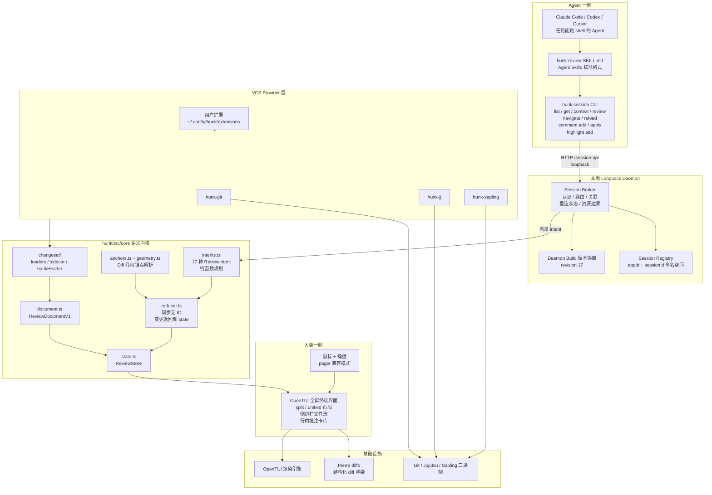
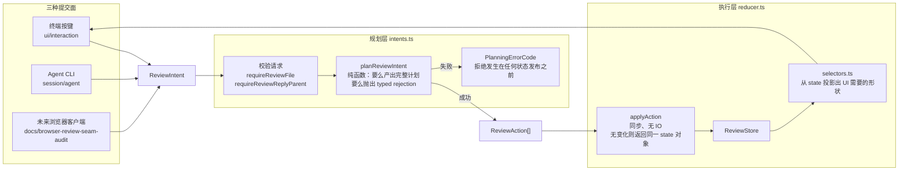
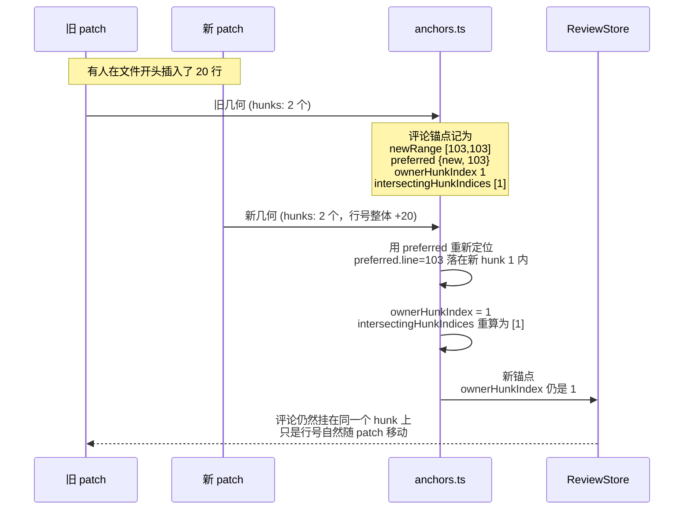
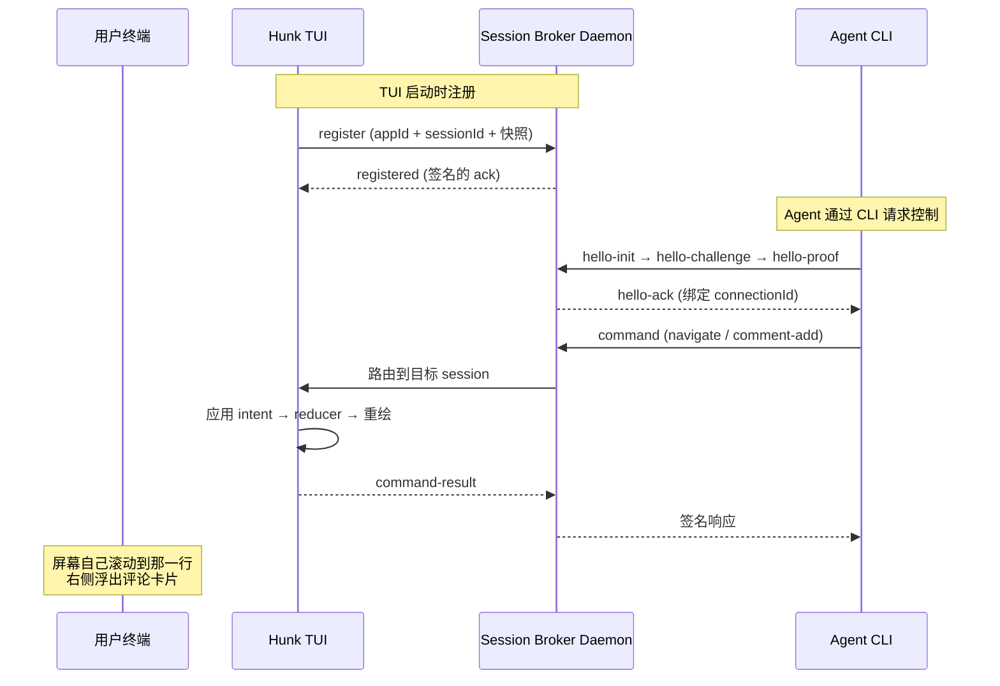
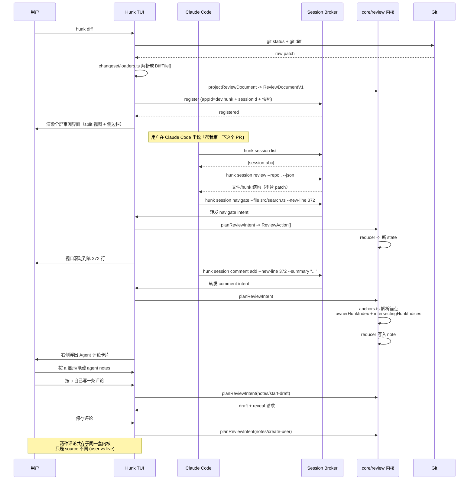

## 引子：一个被忽视的协作缺口

过去两年，AI 编程工具的重心全部压在一件事上：**让 Agent 写出更多代码**。

Claude Code、Cursor、Codex、Aider、Copilot Agent……每一个都在卷同一套指标：能自主完成多少任务、代码通过率多高、上下文窗口多大。我们写了 40 多篇关于 Agent 框架、Agent Runtime、Agent 沙箱、Agent 可观测性的深度解析，却很少有人停下来问一个更朴素的问题：

> **Agent 写完那 500 行 diff 之后，人是怎么审的？**

现状是这样的：Agent 在终端里刷完屏，输出一句「已完成 3 处修复」。人类打开 IDE，翻开 diff，开始人肉搜索哪几行是 Agent 刚改的、哪几行是自己原来的。如果 Agent 改错了，人类得自己在脑子里重建「改之前是什么样」——而这个「之前」可能已经被 Agent 自己覆盖掉了。

这就是 **Agent 产出审阅（Agent Output Review）** 这个子问题。它在 GitHub 上是个**几乎无人认领的空白赛道**：

| 已有覆盖 | 覆盖了什么 | 没覆盖什么 |
|---|---|---|
| Coding Agent Harness（hermes / codex / goose 等 7+ 篇） | Agent 怎么干活 | 人怎么审 Agent 的产出 |
| Agent 评测（harbor 等） | 怎么量化 Agent 好坏 | 怎么让人看懂 Agent 干了啥 |
| Diff 工具（delta / difftastic / diff-so-fancy） | 怎么展示变更 | 怎么承载人和 Agent 的双向对话 |
| Agent 浏览器控制（browser-use 等 9+ 篇） | Agent 怎么操作 UI | Agent 怎么在 UI 上留痕 |

2026 年 3 月，`modem-dev/hunk` 出现在 GitHub 上。它没有自称 Agent 框架，没有大模型，没有 MCP Server，甚至没有 `agent` 这个词出现在它的产品定位里——它的描述只有七个词：

> **Review-first terminal diff viewer for agentic coders**

7 个月，⭐ 9,728，MIT 协议，83 次提交仅在 2026 年 10 月这一个月内。

这篇文章要拆开的是：**一个终端 Diff 审阅器，是怎么在架构层面重新定义「人与 Coding Agent 共享同一块屏幕」的**。它有三个我认为极有价值的答案：

1. **锚点算法（Anchor）**——让一条评论在 diff 被后续提交改写之后，还能挂回原处
2. **Session Broker**——用密码学签名握手，让 Agent 在**不劫持用户终端**的前提下远程操控那个正在显示的审阅窗口
3. **Intent → Action → Reducer**——把「审阅」建模成一个纯函数状态机，让终端、Agent CLI、未来浏览器客户端不可能对「保存这条评论」产生分歧

---

## 一、项目定位与核心价值

### 1.1 它到底是什么

Hunk 是一个**交互式终端 Diff 审阅器**，构建在 [OpenTUI](https://github.com/anomalyco/opentui)（React 风格的终端 UI 库）和 Pierre diffs（结构化 diff 渲染库）之上。

| 维度 | 数据 |
|---|---|
| 仓库 | `modem-dev/hunk` |
| Stars | ⭐ 9,728 |
| Forks | 324 |
| 贡献者 | 100+（核心作者 benvinegar 贡献 791 次） |
| 语言 | TypeScript / Bun |
| 协议 | MIT |
| 创建时间 | 2026-03-17 |
| 最后推送 | 2026-10-29 |
| 官网 | https://hunk.dev |
| Topics | `agents` `cli` `code-review` `diff` `git` `jj` `jujutsu` `sapling` `terminal` `tui` |
| 仓库规模 | 1,641 个文件（其中 945 个在 `packages/`），39 MB |

7.5 个月从 0 冲到 9.7k ⭐，而且**发布节奏非常健康**——2026 年 10 月一个月内就有 83 次提交、两个正式版（v0.23.0 → v0.24.0 → v0.24.1），每次都带独立的 changelog。

### 1.2 它解决的到底是什么问题

Hunk 的 README 里有一句话点破了整个产品的定位：

> The TUI is for the user -- do NOT run `hunk diff`, `hunk show`, or other interactive commands directly.

**终端界面是给人的，不是给 Agent 的。**

这是与传统「让 Agent 自己操作终端」范式的根本分歧。传统做法是：Agent 拿到终端，用 `cat` / `grep` / `sed` 去读文件、用 shell 拼装 diff 输出，结果是一坨纯文本刷进 Agent 的上下文窗口——既费 token，又不可交互。

Hunk 的做法是把终端**劈成两半**：

- **人这一侧**：一个全屏 TUI，可以切分视图、鼠标点选、折叠大段上下文、在行内挂评论
- **Agent 那一侧**：一条 `hunk session ...` CLI 命令线，通过本地 daemon 远程操控**那个正在显示的窗口**

所以当你让 Claude Code 审阅代码时，Agent 不会去 `cat` 文件。它会说：

```bash
hunk session list                                              # 找到活着的审阅窗口
hunk session review --repo . --json                            # 拿到文件/hunk 结构（不含原始 patch）
hunk session navigate --repo . --file src/App.tsx --new-line 372  # 把用户的视口挪到那一行
hunk session comment add --repo . --file src/App.tsx --new-line 372 \
  --summary "这里的错误处理吞掉了异常"                            # 留下一条带锚点的评论
```

而用户那边——**屏幕上会自己滚到那一行，右侧浮出 Agent 写的那条评论**。

这不是「Agent 在终端里操作浏览器」那一类。本文开头那张对比表里，浏览器控制赛道已经有 9+ 篇了。Hunk 的范式是全新的：

> **Agent 不接管终端，Agent 接入终端。**

### 1.3 能力矩阵

Hunk README 自带一张竞品对比表，我把关键行摘出来（这些对比是**它自己写的**，不是我推断的）：

| 能力 | hunk | lumen | difftastic | delta | diff-so-fancy | GNU diff |
|---|---|---|---|---|---|---|
| Review-first 交互式 UI | ✅ | ✅ | ❌ | ❌ | ❌ | ❌ |
| 多文件审阅流 + 侧边栏 | ✅ | ✅ | ❌ | ❌ | ❌ | ❌ |
| **行内 Agent / AI 批注** | ✅ | ❌ | ❌ | ❌ | ❌ | ❌ |
| 响应式自动 split/unified 布局 | ✅ | ❌ | ❌ | ❌ | ❌ | ❌ |
| 审阅器内鼠标支持 | ✅ | ✅ | ❌ | ❌ | ❌ | ❌ |
| 结构化 diff（语法树级） | ❌ | ❌ | ✅ | ❌ | ❌ | ❌ |
| Pager 兼容模式 | ✅ | ❌ | ✅ | ✅ | ✅ | ✅ |

注意「行内 Agent 批注」这一行——**只有 hunk 有**。而且注意最后一行：hunk 明确**不做**结构化 diff。这是一个很清醒的取舍，下文会详细讲。

### 1.4 三条工作流

```bash
# 1. 本地仓库
hunk diff                  # 审阅工作区改动（含未跟踪文件）
hunk diff --watch          # 工作树一变就自动重载
hunk show                  # 审阅最新一次提交
hunk log                   # 终端里的交互式历史浏览器

# 2. GitHub
hunk gh pr                 # 直接推断当前分支的 PR
hunk gh pr 123
hunk gh compare main...feature --repo modem-dev/hunk

# 3. Jujutsu / Sapling（原生 revset）
hunk diff [revset]         # 自动检测 jj / sl 工作区
hunk log --vcs jj
```

顺带一提，Hunk 还支持把自己注册为 Git / Jujutsu / Sapling 的 pager：

```bash
git config --global core.pager "hunk pager"
```

这一点决定了它的产品定位——**它不是一个「另一个 Agent 工具」，它是一个想替换 `delta` / `diff-so-fancy` 的日常工具**。任何用 Git 的人都能用上它，而其中恰好在用 Coding Agent 的人会额外获得那层协作能力。这种「先做好一个通用工具，再叠加 Agent 能力」的产品路径，是它 7.5 个月能到 9.7k ⭐ 的重要原因。

---

## 二、整体架构：10 层分层与依赖方向

Hunk 是一个 **10 个 workspace 的 monorepo**，用 `dependency-cruiser` 在 CI 里强制执行导入方向。它的 `docs/module-boundaries.md` 明确写了这个分层栈（自底向上）：

```text
packages/hunk/src/extension-api   已发布契约；不 import 任何东西
packages/hunk-vcs/                私有底层 VCS helper；只暴露显式叶子导出
packages/hunk/src/lib             小型兼容 helper
packages/hunk/src/core            产品模型、非渲染运行时原语、策略
packages/hunk/src/extensions      扩展宿主 + 内置注册适配器
packages/hunk/src/session         daemon / broker 传输与协议
packages/hunk/src/app             CLI / 启动 / session 组装；不负责渲染
packages/hunk/src/ui              终端界面 + 具名的 app/session 适配器
packages/hunk/src/opentui         已发布门面，重导出部分 ui/core
packages/hunk/src/main.tsx        最终 CLI 组装与入口
```

顶层架构图如下：



几个关键点：

**① `core` 是纯语义层，不碰终端。** `docs/source-architecture.md` 里有一条很硬的规定：

> `core` must not import `ui`, `app`, `session`, `extensions`, or `opentui`.

这条约束带来的是**可测试性**和**多端一致性**：终端 UI、Agent CLI、HTTP/SSE 消费者、未来的浏览器客户端，全部复用同一条语义路径：

```text
DiffFile[] -> projectReviewDocument -> ReviewDocumentV1 -> ReviewStore
ReviewIntent + caller facts -> planReviewIntent -> ReviewAction[] -> reducer -> projection
```

**② `app` 可以组合 `core`/`extensions`/`session`，但不能 import `ui`。** 渲染是终端层的事，组装逻辑不该知道终端的存在。

**③ `extension-api` 是 import-free 的。** 它是唯一对外发布的契约层（`hunkdiff/extension` 和 `hunkdiff/opentui` 两个入口）。

**④ VCS Provider 是插件，不是特例。** Git / Jujutsu / Sapling 三个后端是**独立的私有 workspace**，通过公开扩展契约注册，**不 import Hunk 的任何内部模块**。这意味着加一个新的版本控制系统（比如 Mercurial）不需要动核心代码。

### 2.1 Monorepo 的 workspace 拓扑

| workspace | 职责 | 发布状态 |
|---|---|---|
| `packages/hunk` | CLI、应用本体、`hunkdiff/extension` + `hunkdiff/opentui` 入口 | ✅ 公开（npm `hunkdiff`） |
| `packages/hunk-vcs` | 底层 VCS helper，通过 `@hunk/vcs/*` 叶子暴露 | 私有 |
| `packages/hunk-{git,jj,sapling}` | 三个 VCS provider，各自定义命令、源码解释、测试 | 私有 |
| `packages/session-broker-core` | 底层信封、解析、限额、内存状态 | 私有 |
| `packages/session-broker` | 运行时无关的 broker / daemon / 认证 / 连接生命周期 | 私有（计划发 `@hunk/session-broker`） |
| `packages/session-broker-{bun,node}` | 两个运行时的 listener 适配器 | 私有 |
| `packages/term-video` | 终端录制与视频合成 | 私有 |
| `packages/hunk-gh` | `hunk gh` 子命令 | 私有 |
| `website` | Astro/Starlight 文档站 | 私有 |

`packages/hunk` 一个包要同时跑在 Node 22+ 和 Bun 1.3.14+ 上，所以它的导出映射按 `types → bun → node → default` 排序，**优先选 Bun 的条件导出**。这个细节说明作者是认真考虑过「一个人维护多个运行时」的代价的。

---

## 三、核心引擎一：审阅语义内核（Intent → Action → Reducer）

这是整个项目最值得学的部分。

### 3.1 为什么需要一层「Intent」

朴素的做法是：终端的按键处理函数直接改 state，Agent 的 CLI 命令直接改 state。问题是——**两条路径迟早会对同一件事产生分歧**。

Hunk 的 `intents.ts` 开头就写明了这一点：

> Every surface submits the same intents, so the terminal, the session runtime, and a future browser client cannot disagree about what "save this note" means.

所以架构是三段的：



### 3.2 Intent 词表：17 种，且强制全量登记

`REVIEW_INTENT_TYPES` 是一个 `as const satisfies readonly ReviewIntent["type"][]` 数组，并且用了一个**双向穷尽性断言**：

```typescript
// 来自 packages/hunk/src/core/review/intents.ts:146-175
export const REVIEW_INTENT_TYPES = [
  "selection/select",
  "selection/move",
  "selection/select-file",
  "selection/anchor",
  "filter/set",
  "notes/set-visibility",
  "notes/start-draft",
  "notes/start-edit",
  "notes/start-reply",
  "notes/update-draft",
  "notes/cancel-draft",
  "notes/create-user",
  "notes/update-user",
  "notes/remove-user",
  "notes/remove-live",
  "notes/clear",
  "expansion/toggle",
] as const satisfies readonly ReviewIntent["type"][];

export type ReviewIntentType = (typeof REVIEW_INTENT_TYPES)[number];

// Totality in the other direction: `satisfies` above proves every listed name is a real
// intent, and this proves every real intent is listed. A missing member resolves to a
// string literal here instead of `never`, which is not assignable to `never`.
const _everyReviewIntentIsListed: never = undefined as unknown as Exclude<
  ReviewIntent["type"],
  ReviewIntentType
>;
void _everyReviewIntentIsListed;
```

这是 TypeScript 里很漂亮的技巧：`satisfies` 保证「列出来的都是真的」，`Exclude<..., never>` 断言保证「真的都列出来了」。**给 `ReviewIntent` 加一个新成员但忘了登记，编译直接失败。**

而且注释里说明了为什么不能手写第二份 wire 词表：

> The wire vocabulary is derived from this list instead of restated beside it. The assertion below makes the list total — adding a member to `ReviewIntent` without naming it here fails to typecheck — and `packages/hunk/src/session/reviewProtocol.ts` subtracts a named exclusion list from it rather than writing its own.

### 3.3 关键设计：Intent 不携带身份和时间

`ReviewIntentFacts` 是一个很有讲究的设计：

```typescript
// 来自 packages/hunk/src/core/review/intents.ts:66-87
export interface ReviewIntentFacts {
  /** Caller-allocated identity for a newly persisted note. */
  noteId?: string;
  /**
   * Caller-allocated identity for a newly started draft.
   *
   * Separate from `noteId` because a draft outlives none of it: the draft is addressable
   * while it is being written — a renderer reveals it, an agent may report it — and the
   * note it becomes is allocated only when it is saved.
   */
  draftId?: string;
  /** Caller-owned ISO timestamp for note creation. */
  timestamp?: string;
  /**
   * Which files and hunks currently carry notes, for annotated navigation.
   *
   * A caller-owned fact like the two above: notes reach a review from sources the
   * semantic document does not carry, and only the consumer that merged them knows the
   * full set.
   */
  annotations?: ReviewAnnotationIndex;
}
```

注释里那句 `Identity, time, and the annotation index all depend on the runtime a review is hosted in, so planning reads them from here instead of reaching for a clock, a UUID source, or a note set the semantic document does not carry.` 是整个设计的钥匙：

- **规划层是纯函数**——没有 `Date.now()`、没有 `crypto.randomUUID()`、没有 `fs`
- 所以它可以被完整地单元测试，也可以在任何端上跑出**完全一致**的结果
- 「这条评论叫什么名字、什么时间创建的」是**运行时事实**，由调用方提供

### 3.4 Reducer 的两条铁律

`reducer.ts` 的文件头注释极其精简，但每一条都是硬约束：

> Applies one action to the review state and returns the next state.
>
> Runs synchronously with no I/O. An action that changes nothing returns the previous state object, so observers can skip work with an identity check.
>
> Timestamps and ids never originate here — callers put them on the action.

三条性质：

1. **纯函数**：`reducer(state, action) -> state'`
2. **恒等优化**：无变化时返回**同一个对象引用**（`if (index < 0) return notes;` 这种写法到处都是）
3. **不生成身份**：时间戳和 id 一律由 action 携带

恒等优化不是微优化——它让 React 的 `useSyncExternalStore` / `Object.is` 比较能真正跳过重渲染。在一个每帧都要重绘 diff 的 TUI 里，这个细节直接决定 60fps 和 30fps 的区别。

### 3.5 原子性：一个 Intent 要么全成，要么全败

```typescript
// 来自 packages/hunk/src/core/review/intents.ts:936-941
// Plan one intent against the store's current state and commit its actions.
//
// Planning happens against one snapshot and either throws before anything is published
// or produces the whole batch, so a rejected intent leaves no partial change behind.
```

这个性质对 Agent 场景尤其重要。Agent 一次 `comment apply` 批量提交 10 条评论，如果第 7 条的锚点解析失败：

- ❌ 朴素实现：前 6 条已经写进 store，用户屏幕上出现 6 条评论，Agent 收到报错
- ✅ Hunk：整批拒绝，状态**零变更**，Agent 收到结构化错误，可以修正后重试

`comment apply` 的 SKILL 文档里也印证了这一点：

> `comment apply` reads a JSON batch from stdin and validates the full batch before mutating the live session.

---

## 四、核心引擎二：Diff 几何锚点——让评论在 diff 改写后仍能挂回原处

这是我认为 Hunk **技术含量最高、也最值得单独拿出来讲**的一块。

### 4.1 问题陈述

假设 Agent 在第 103 行留了一条评论：「这里的措辞太啰嗦，建议改成 X」。

然后 Agent 又提交了一次修订——**在文件前面插入了 20 行**。现在同一条评论应该挂在第 123 行，但它记录的是第 103 行。

如果按「行号」存锚点，评论就**漂移**了——它会指向完全无关的代码。如果按「内容」存锚点，又会面临内容重复、格式微改的问题。

GitHub 的 PR review 有同样的问题，GitHub 的解法是**行号 + 上下文匹配**，失败了就标成 "outdated"。

Hunk 的解法更彻底，也更优雅。

### 4.2 三个概念：Ownership vs Membership

`anchors.ts` 的文件头把这个问题的结构说得很清楚：

> Where a note hangs: one owner hunk plus every hunk it genuinely intersects.
>
> Placement and membership are different questions and are answered here together, once.
> Ownership is recorded on the anchor rather than re-derived by containment, so a note this resolver placed through its fallback is not silently dropped by a consumer that re-derives placement.

两个概念：

- **Ownership（归属）**：这条评论**挂在哪个 hunk 上**（唯一）
- **Membership（成员资格）**：这条评论**和哪些 hunk 有交集**（可能是多个）

关键在于：**归属被记录下来，而不是每次重新推导**。否则一个通过 fallback 安置的评论，会被某个「自己重新推导归属」的消费者悄悄丢掉。

### 4.3 Gap Owner：折叠区的归属规则

diff 里的 hunk 之间是「折叠区」（gap）——那些没变化的行。一个落在折叠区的行属于哪个 hunk？`reviewGapOwnerHunkIndex` 给出了确定性答案：

```typescript
// 来自 packages/hunk/src/core/review/anchors.ts:32-43
export function reviewGapOwnerHunkIndex(
  hunks: readonly ReviewHunkSpan[],
  side: ReviewSide,
  line: number,
): number | undefined {
  if (hunks.length === 0) {
    return undefined;
  }

  const following = hunks.findIndex((hunk) => reviewHunkRange(hunk, side)[0] > line);
  return following >= 0 ? following : hunks.length - 1;
}
```

规则是：**找第一个起始行大于目标行的 hunk；如果没有，就挂到最后一个 hunk 上**。

翻译成人话：*折叠区里的行归属于它「流向后」的那个 hunk*。这符合人的直觉——你在读一个 hunk 之前，眼睛扫过的是它上面的上下文。

### 4.4 主算法：resolveReviewNoteAnchor

```typescript
// 来自 packages/hunk/src/core/review/anchors.ts:61-97
export function resolveReviewNoteAnchor(
  hunks: readonly ReviewHunkSpan[],
  { oldRange, newRange, preferred, fallbackOwnerHunkIndex }: ReviewNoteAnchorInput,
): ReviewRangeAnchorV1 {
  const intersectingHunkIndices = hunks.flatMap((hunk, index) => {
    const intersects =
      (oldRange !== undefined && reviewRangesOverlap(oldRange, reviewHunkRange(hunk, "old"))) ||
      (newRange !== undefined && reviewRangesOverlap(newRange, reviewHunkRange(hunk, "new")));
    return intersects ? [index] : [];
  });

  // The preferred line decides ownership when it lands in a hunk, so a note the reviewer
  // placed on the new side is not re-homed by an old-side range that reaches further.
  const preferredOwner =
    preferred === undefined
      ? -1
      : hunks.findIndex((hunk) => {
          const [start, end] = reviewHunkRange(hunk, preferred.side);
          return preferred.line >= start && preferred.line <= end;
        });
  const validatedFallback =
    fallbackOwnerHunkIndex !== undefined && hunks[fallbackOwnerHunkIndex] !== undefined
      ? fallbackOwnerHunkIndex
      : undefined;
  const ownerHunkIndex =
    preferredOwner >= 0
      ? preferredOwner
      : (intersectingHunkIndices[0] ?? validatedFallback ?? (hunks.length > 0 ? 0 : undefined));

  return {
    ...(oldRange ? { oldRange: [...oldRange] as ReviewLineRange } : {}),
    ...(newRange ? { newRange: [...newRange] as ReviewLineRange } : {}),
    ...(preferred ? { preferred: { ...preferred } } : {}),
    intersectingHunkIndices,
    ...(ownerHunkIndex !== undefined ? { ownerHunkIndex } : {}),
  };
}
```

**归属决策的优先级**（从高到低）：

1. `preferredOwner`——用户**明确点的那个行**落在哪个 hunk 里
2. `intersectingHunkIndices[0]`——范围相交的第一个 hunk
3. `validatedFallback`——调用方声明的 fallback hunk（需校验存在）
4. `0`——兜底挂到第一个 hunk

为什么 `preferred` 优先级最高？注释说得很清楚：

> The preferred line decides ownership when it lands in a hunk, so a note the reviewer placed on the new side is not re-homed by an old-side range that reaches further.

考虑这个场景：用户在新文件（new side）的第 50 行点了一下，评论；但这条评论的 `oldRange` 恰好覆盖了 old side 的一大片区域。如果按范围相交优先，评论会被挂到一个远处的 hunk 上——用户明明点在第 50 行，它却跑到第 200 行去了。

**「人点的位置」永远优先于「算法算出的范围」**。这是把人类意图放在第一位的具体体现。

### 4.5 关键：解析是宽容的，校验是严格的

`anchors.ts` 的设计哲学我认为是全项目最值得学的一段：

> Resolution is permissive: an imported note may name a line the current patch no longer shows, and losing it entirely would be worse than hanging it from the nearest real hunk.
> Callers that must reject an unbacked target validate before anchoring rather than reading a verdict out of the anchor.

拆开说：

- **解析（resolve）要宽容**：如果一条导入的评论指向的行在当前 patch 里已经不存在了，**不要丢弃它**，把它挂到最近的真实 hunk 上
- **校验（validate）要严格**：如果业务上必须拒绝一个无依据的目标，**在锚定之前**就拒绝，而不是指望从锚点结果里读出一个「无效」标记

这是两种完全不同的失败哲学的分工：

| | 解析层 | 校验层 |
|---|---|---|
| 失败时 | 尽力安置 | 明确拒绝 |
| 适合场景 | 已存在的评论在 diff 变动后重新定位 | Agent 试图在不存在的位置创建新评论 |
| 结果 | 评论还在，只是位置变了 | 操作失败，Agent 收到结构化错误 |

**为什么不把「严格」和「宽容」混在一个函数里？** 因为它们的调用场景根本不同。解析函数是纯几何计算，它没有业务上下文，无从判断「这条评论指向的消失行是正常的漂移，还是 Agent 幻觉出来的位置」。把判断权交还调用方，各自用合适的策略。

### 4.6 几何原语

`geometry.ts` 把所有关于「一个 hunk 占哪些行」的问题集中在一处：

```typescript
// 来自 packages/hunk/src/core/review/geometry.ts:48-56
export function reviewHunkRange(hunk: ReviewHunkSpan, side: ReviewSide): [number, number] {
  const start = side === "new" ? hunk.additionStart : hunk.deletionStart;
  const count = side === "new" ? hunk.additionCount : hunk.deletionCount;
  return [start, start + Math.max(count, 1) - 1];
}
```

注意 `Math.max(count, 1)`——注释解释了原因：

> A side with no rows still reports one line: a pure insertion has an old-side position even though it deletes nothing, and callers testing containment need a non-empty range.

**纯插入（只有 `+` 没有 `-`）在 old side 也有一个位置**。如果返回空区间，「这条评论是否在这个 hunk 内」的判断就会全部失效。

`geometry.ts` 的文件头把整个设计意图讲得很清楚：

> Each answer lives here once, because a renderer that re-derives one silently disagrees with the state store that validates against it.

这和 `intents.ts` 的意图是同一个：**同一份语义只能有一个权威实现**。渲染器自己重算一遍 hunk 范围，就会和校验用的 store 产生静默分歧——这类 bug 极难发现，因为两边都「看起来对」。

### 4.7 锚点如何抵抗 diff 改写

现在把上面的机制串起来，回答最初的问题：*文件前面插入 20 行后，原来第 103 行的评论去哪了？*



关键在于：**`ownerHunkIndex`（归属 hunk 的序号）比行号稳定得多**。在文件开头插入 20 行，hunk 的**顺序和序号不变**，变的只是每个 hunk 内部的行号。

所以 Hunk 的锚点模型是：

> **锚点 = hunk 序号（稳定）+ 行范围（会漂移）+ preferred 行（优先归属依据）**

只要 patch 没有把整个 hunk 删掉，评论就会一直挂在正确的位置上。这就是为什么 `anchors.ts` 里那句「Ownership is recorded on the anchor rather than re-derived by containment」如此重要——**归属一旦确定就记录下来，不在每次渲染时重新推导**。

---

## 五、核心引擎三：Session Broker——让 Agent 远程操控「活着的」窗口

### 5.1 为什么需要 Broker

朴素的做法是：Agent 直接往 Hunk 的 stdin 写控制序列。但 TUI 全屏运行时，stdin 被 Hunk 占着，Agent 根本没法写。

Hunk 的方案是引入一个**本地 loopback daemon**：



注意 `docs/agent-workflows.md` 里的这段警告：

> Do not probe `/session-api` with raw `curl`: session controls require an automatically discovered, owner-private caller credential and signed responses, and Hunk intentionally exposes no credential flags.

**故意不提供 credential flag**。调用方凭证是「自动发现的、owner-private」的。

### 5.2 身份模型：appId 是不可变根

```text
appId:  |[a-z0-9](?:[a-z0-9._-]{0,126}[a-z0-9])?|
sessionId: |[A-Za-z0-9](?:[A-Za-z0-9._~-]{0,126}[A-Za-z0-9])?|
```

`session-broker-sdk.md` 对 `appId` 的规定非常严格：

> `appId` is immutable at daemon startup, namespaces runtime state, credentials, principals, logs, negotiation, and sessions, and is never inferred from package, executable, port, path, cwd, or label.

**`appId` 绝不从包名、可执行文件名、端口、路径、cwd 或标签推断**。这是安全上的关键——如果 `appId` 从可执行文件名推断，攻击者只要把二进制改个名就能冒充。

而 `sessionId`：

> It is never an index, PID, path, or connection ID.

### 5.3 重连轮换：六步状态机

这是 Broker 里最硬核的部分。当 TUI 的 socket 断了需要重连时，**不是简单地重新连上去**，而是一套带密码学轮换的状态机：

```text
1. The producer proves the same app/session authority, creating a new `connectionId`; this atomically
   supersedes the old socket, invalidates its later messages, and resolves old work by the delivery
   matrix unless already terminal.
2. Before register or reconnect, the producer generates and durably stores a replacement private
   key, then sends only its public key and a rotation ID.
3. Signed `registered` commits the transport and records the candidate verifier as pending while the
   previous verifier remains valid.
4. Candidate-signed `registration-ack` promotes it and starts a 60-second dual-key overlap. Signed
   `registration-committed` binds the rotation ID and both verifier IDs.
5. After durably recording that response, the producer sends candidate-signed
   `registration-confirmed`; the daemon then revokes the prior verifier.
6. If confirmation never arrives, overlap expiry revokes the old verifier. Recovery tries candidate,
   then old while valid, then audited producer-bootstrap recovery. Bootstrap creates a new transport,
   rejects uncertain work, and cannot silently replay it.
```

翻译成中文的流程：

1. 生产者证明自己拥有同一个 app/session 权限，创建新的 `connectionId`；旧 socket 立即失效，它后续发来的消息全部作废
2. 生产者**先生成并持久化**新的私钥，只发送公钥 + 一个 rotation ID
3. 签名后的 `registered` 把传输层状态提交，候选 verifier 记为 pending，**旧 verifier 此刻仍然有效**
4. 候选者签名的 `registration-ack` 提升候选者，并启动 **60 秒双密钥重叠期**
5. 生产者**先持久化记录响应**，再发送 `registration-confirmed`，daemon 这才吊销旧 verifier
6. 如果确认消息没到，重叠期过期后旧 verifier 自动吊销

这里有两个精妙的设计：

**① 60 秒双密钥重叠期。** 步骤 3→5 之间有一个窗口：新密钥已经能用，但旧密钥还没被撤销。这段时间里**两个密钥都能工作**，保证了「持久化记录」和「发送确认」之间如果进程被杀，重连仍然能恢复。

**② 顺序：先持久化，后确认。** 步骤 5 明确写「After durably recording that response」。如果反过来的话——先发确认再持久化——崩溃后新密钥生效但本地没记录，重连就找不回私钥了。

**③ 幂等性贯穿全程。**

> All messages are idempotent for one rotation ID; during overlap, either key returns the same signed commit state. Only one pending rotation per session is allowed, and an ID can never name a different candidate.

### 5.4 序列号与重放窗口

Broker 用一个 64 位位图追踪已接受的序列号：

> Caller sessions initialize `highest = 0` with a zero bitmap, start allocation at `"1"`, and support 32 concurrent out-of-order requests. A 64-bit bitmap bit `d` records whether `highest - d` was accepted for `0 <= d <= 63`. For a sequence at or below `highest`, require that range and an unset bit, then set it. For a sequence above `highest`, require a delta of at most 64, shift the bitmap by that delta (clearing it at 64), discard expired history, set the new `highest`, and mark bit 0. Thus accepted candidates span `highest - 63` through `highest + 64`, while the bitmap stores only the 64 replay-relevant accepted values.

具体规则：

- 序列号 `"0"` 保留并拒绝
- 序列号用 **uint64 十进制字符串**（`/^(?:0|[1-9][0-9]{0,19})/`），用 BigInt 解析而不是 JSON number
- 接受窗口是 `[highest - 63, highest + 64]`
- 64 位位图只存「重放相关的」64 个值
- 拒绝重复、过旧、跳跃过大的

> Compare before subtracting rather than computing an overflowing `highest + 64`; clear rather than shift by 64.

这两句是**溢出防护的实现细节**——先比较再相减（避免 `highest + 64` 溢出），位移 64 时清零而不是移位（避免位图错位）。这是分布式系统里典型的 uint64 边界处理。

### 5.5 密钥材料永不出现在明文位置

> No reusable private capability is transmitted. Private keys or signatures may not appear in URLs, fragments, argv, health/capability responses, logs, or errors.

**禁止**出现在 URL、fragment、argv、健康检查响应、日志、错误信息里。这条规则堵死了大量常见的密钥泄露路径（尤其是 argv——`ps aux` 就能看到）。

而 `Raw list/get/dispatch remains disabled by default and requires both authentication and authorization; exposeHttpApi: true alone is insufficient.` —— 光开 HTTP API 是不够的，必须同时通过认证**和**授权。

### 5.6 版本协商：范围而不是版本号

> Peers advertise inclusive integer `{min, max}` broker and application ranges. The daemon selects the highest overlap; invalid/no overlap returns structured `incompatible-protocol` and a non-retrying policy close without secrets or stacks.

**不是「我是什么版本」，而是「我支持 [min, max] 这个区间」**。Daemon 取交集里最高的那个。

这和 ACP 协议（我写过一篇）的「能力协商」是同一个思路，但更彻底：ACP 用「省略即不支持」的 capability 列表，Broker 用显式的版本区间。

一个 daemon 可以同时托管不同应用协议的 session：

> One daemon may host different compatible session revisions.

### 5.7 Broker 的包边界

`packages/session-broker-core`（纯协议/状态）→ `packages/session-broker`（运行时无关的 daemon）→ `packages/session-broker-{bun,node}`（listener 适配器）。

规则：

> Hunk composes the package; the package never imports `packages/hunk/src/*`.

**Broker 包不认识 Hunk**。它是一个通用组件，Hunk 只是它的一个消费者。这让它未来可以独立发布成 `@hunk/session-broker`，被别的应用复用。

---

## 六、Agent 接入层：Sidecar 与实时 Session 两条路

### 6.1 两条路径

`docs/agent-workflows.md` 明确列了两种用法：

- **推荐**：用 `hunk session ...` 操控一个活着的 Hunk 窗口
- **备选**：用 `--agent-context` 加载预先写好的 Agent 笔记文件

```bash
# 路径 A：实时操控
hunk session review --repo . --json
hunk session navigate --repo . --file src/App.tsx --new-line 372
hunk session comment add --repo . --file src/App.tsx --new-line 372 \
  --summary "这里的错误处理吞掉了异常"

# 路径 B：sidecar 文件
hunk diff --agent-context notes.json
```

### 6.2 Sidecar 的真实结构

`examples/3-agent-review-demo/agent-context.json` 是一份可直接运行的实例：

```json
{
  "version": 1,
  "summary": "Improves command-palette matching by normalizing query text and ranking stronger matches ahead of loose substring hits.",
  "files": [
    {
      "path": "src/search.ts",
      "summary": "Scores and sorts matches instead of returning the first loose substring list.",
      "annotations": [
        {
          "newRange": [15, 35],
          "summary": "Prefix and exact keyword matches now outrank weaker substring hits before the result list is sorted.",
          "rationale": "The old behavior made every match look equally good, which was fine for filtering but weak for command-palette ranking where the top result should usually be the most obvious intent.",
          "author": "sonnet"
        },
        {
          "newRange": [20, 27],
          "summary": "Worth checking the score floor — could mask edge cases.",
          "rationale": "The scoring thresholds (4, 3, 2, 1) look good but validate that zero-score items are properly filtered out.",
          "author": "prism"
        }
      ]
    }
  ]
}
```

三个设计细节值得注意：

**① `summary` 和 `rationale` 分开。** `summary` 是一句话结论（渲染成标题 + `comment list` 的文本），`rationale` 是详细理由（展开显示）。这让 Agent 可以写「简短结论 + 详细论证」，而人类在快速浏览时只看到结论。

**② `author` 字段区分笔记来源。** `sonnet` / `prism` 是不同 Agent 模型。Hunk 的 `comment list --type` 支持 `live | all | ai | agent | user` 多种过滤。

**③ `confidence` 字段。** `sidecar.ts` 里定义了 `low | medium | high` 三档：

```typescript
// 来自 packages/hunk/src/core/changeset/sidecar.ts:19-23
const annotationConfidenceValues = [
  "low",
  "medium",
  "high",
] as const satisfies readonly AnnotationConfidence[];
```

Agent 可以对自己的判断标注置信度。

### 6.3 Sidecar 加载的严格校验

`normalizeRange` 对行号区间的校验非常严格：

```typescript
// 来自 packages/hunk/src/core/changeset/sidecar.ts:42-67
function normalizeRange(range: unknown): [number, number] | undefined {
  if (!Array.isArray(range) || range.length !== 2) {
    return undefined;
  }

  const [start, end] = range;

  if (
    typeof start !== "number" ||
    typeof end !== "number" ||
    !Number.isInteger(start) ||
    !Number.isInteger(end)
  ) {
    throw new Error("Annotation ranges must be integer tuples.");
  }

  if (start < 1 || end < 1) {
    throw new Error("Annotation ranges must use positive 1-based line numbers.");
  }

  if (end < start) {
    throw new Error("Annotation ranges must be ordered start..end tuples.");
  }

  return [start, end];
}
```

四条硬约束：**必须是长度为 2 的数组 → 必须是整数 → 必须 1-based 正数 → 必须 start ≤ end**。

注意它对 `start < 1` 的处理：直接抛错，而不是 clamp 到 1。**Agent 传入 0-based 行号会立刻收到明确报错**，而不是静默偏移一行。这对 Agent 场景太重要了——静默偏移会让 Agent 以为自己的批注挂对了位置。

对比 `normalizeAnnotation` 里对 `summary` 的处理：

```typescript
const summary = optionalNonEmptyString(item.summary);
if (summary === undefined) {
  throw new Error("Each agent annotation requires a summary.");
}
```

`summary` 是**必填**——一条没有结论的批注没有意义。

### 6.4 SKILL.md：把协议写成 Agent 能读懂的手册

Hunk 提供了一个标准的 Agent Skill：

```bash
npx skills add modem-dev/hunk -g --skill hunk-review
```

这份 `SKILL.md`（14KB）写得极为克制。开头第一句就是给 Agent 的**硬性禁令**：

> The TUI is for the user -- do NOT run `hunk diff`, `hunk show`, or other interactive commands directly.

然后是一份带编号的工作流：

```text
1. hunk session list                                    # find live sessions
2. hunk session get --repo .                            # inspect path / repo / source
3. hunk session review --repo . --json                  # inspect file/hunk structure first
4. hunk session review --repo . --include-patch --json  # opt into raw diff text only when needed
5. hunk session context --repo .                        # check current focus when needed
6. hunk session navigate ...                            # move to the right place
7. hunk session reload -- <command>                     # swap contents if needed
8. hunk session comment add ...                         # leave one review note
9. hunk session comment apply ...                       # apply many agent notes in one stdin batch
10. hunk session highlight add ...                      # light up the exact range you are explaining
```

第 3 步和第 4 步的对比很关键：**默认只给结构和摘要，`--include-patch` 才给原始 diff**。这直接对应 SKILL 里的一句策略：

> Start with `hunk session review --json` to understand the file/hunk structure without inflating agent context, then use `--include-patch` only for the files you truly need to read in raw diff form.

**这是在给 Agent 省 token。** 一个 5000 行的 patch 全量塞进上下文是几千 token，而文件/hunk 结构只有几百 token。

最后还有一节 `Guiding a review`，定义了 Agent 在人机协作中的角色边界：

> Your role is to narrate: steer the user's view to what matters and leave comments that explain what they're looking at.
>
> - Work in the order that tells the clearest story, not necessarily file order
> - Navigate before commenting so the user sees the code you're discussing
> - Don't comment on every hunk -- highlight what the user wouldn't spot themselves

**「不要在每个 hunk 上都评论——只highlight用户自己不会注意到的地方。」**

这是一条很有意思的 Agent 行为约束。它承认了人和 Agent 的分工：**Agent 不该重复人眼能看到的表面差异，它该负责指出那些需要思考才能发现的问题**。

### 6.5 Highlight：字符级的高亮

除了整行评论，Hunk 还有更细粒度的能力：

```bash
hunk session highlight add --repo . --file src/App.tsx --new-line 42 --start 6 --end 19 --tone warning --focus
```

语义：

- `--start` / `--end` 是 **0-based 左闭右开**的字符偏移，按 **UTF-16 code unit** 计
- `--tone` 有 `match`（默认）/ `info` / `warning` / `error` / `dim` / `current`（反色）
- `--focus` 让视口跳到被标记的行

> Marks survive scrolling, navigation, and reloads that leave the marked file's content unchanged; a reload that changes that file drops its marks.

高亮标记能跨滚动、导航、以及「不改动该文件内容」的 reload 存活。

这一条特别有意思——**高亮的存活条件是「该文件内容没变」**，这正是 `contentIdentity` 的语义。我在 `reducer.ts` 里看到了对应的实现：

```typescript
// 来自 packages/hunk/src/core/review/reducer.ts:58-60
const previousFile = state.document.files.find((file) => file.key === draft.fileKey);
const file = document.files.find((candidate) => candidate.key === draft.fileKey);
if (!previousFile || !file || previousFile.contentIdentity !== file.contentIdentity) return null;
```

**用内容身份（contentIdentity）而不是行号来判断「这个东西还在不在」**。这和锚点算法是同一个思路的延伸——**行的位置会变，内容的身份不会**。

---

## 七、扩展系统：把「VCS 后端」和「自定义审阅视图」都变成插件

### 7.1 扩展 API 的能力面

`HunkExtensionAPI`（来自 `packages/hunk/src/extension-api/types.ts`，该文件 112KB / 2657 行）提供这些注册能力：

```typescript
// 来自 packages/hunk/src/extension-api/types.ts:2583-2657（节选）
export interface HunkExtensionAPI {
  readonly apiVersion: HunkExtensionApiVersion;
  /** Configure host-level behavior for the review session loading this extension. */
  configureSession(options: ExtensionSessionOptions): void;
  /** Contribute one selectable theme. */
  registerTheme(theme: ExtensionThemeConfig): void;
  /** Map a file extension, exact filename, or glob to a syntax-highlighting language. */
  registerFileLanguage(matcher: string | ExtensionFileLanguageMatcher, language: string): void;
  /** Contribute one additional VCS backend. */
  registerVcsAdapter(adapter: ExtensionVcsAdapter): void;
  /** Register a docked pane on any terminal edge. */
  registerPane(pane: ExtensionPane): void;
  /** Register a host-rendered alternative presentation for matching files. */
  registerFileView(view: ExtensionFileView): void;
  /** Register a contributor of character-range marks painted onto diff lines. */
  registerLineHighlighter(highlighter: ExtensionLineHighlighter): void;
  /** Register one session-scoped keyboard interpretation. */
  registerKeyboardMode(mode: ExtensionKeyboardMode): void;
  /** Register one generic top-level CLI command subtree. */
  registerCliCommand(command: ExtensionCliCommand, handler: ExtensionCliCommandHandler): void;
  /** Register one named command, optionally bound to a key. */
  registerCommand(command: ExtensionCommand, handler: ExtensionCommandHandler): void;
  /** Rewrite every loaded changeset before review. */
  transformChangeset(fn: ChangesetTransform): void;
  /** Subscribe to one Hunk lifecycle or UI event. */
  on<Event extends ExtensionEventName>(event: Event, handler: ExtensionEventHandler<Event>): void;
  /** Publish or subscribe to a namespaced event shared with other loaded extensions. */
  readonly events: ExtensionEventBus;
  /** This extension's own [extension.<id>] config table. */
  readonly config: Record<string, unknown>;
  /** Record a diagnostic line; collected per extension instead of written to the terminal. */
  log(message: string): void;
}
```

**14 个注册点**，覆盖了从主题、语法映射、VCS 后端、停靠面板、文件视图、行高亮、键盘模式、CLI 命令、changeset 变换、事件订阅到配置的全套。

### 7.2 一个真实可跑的扩展

README 里给的例子——过滤掉 lockfile：

```typescript
// ~/.config/hunk/extensions/collapse-lockfiles.ts
import type { HunkExtensionAPI } from "hunkdiff/extension";

export default function (hunk: HunkExtensionAPI) {
  hunk.transformChangeset((changeset, ctx) => {
    const files = changeset.files.filter((file) => !file.path.endsWith(".lock"));
    ctx.notify(`Collapsed ${changeset.files.length - files.length} lockfiles`);
    return { ...changeset, files };
  });
}
```

这 8 行代码做的事情，用 Hunk 自己的话说就是「让 Claude Code 直接当制片人」那种级别的抽象收敛——**一个 changeset 变换钩子**。

扩展可以来自三个位置：

- `~/.config/hunk/extensions/`（用户级）
- 仓库的 `.hunk/extensions/`（**需要显式信任该仓库**）
- `--extension <path>`（开发用）

社区扩展通过 GitHub topic `hunk-extension` 分发：

```bash
hunk extension install acme/hunk-word-diff@v1.2.0
hunk extension list
```

### 7.3 信任模型：仓库级扩展需要显式信任

从 `docs/extension-architecture.md`：

> Hunk loads plain TypeScript extensions from `~/.config/hunk/extensions/`, from a repository's `.hunk/extensions/` (after you explicitly trust that repository), and from `--extension <path>` for development.

**仓库里的扩展需要显式信任才会加载**。这条规则的意义很清楚：仓库是潜在的恶意来源，一个 `.hunk/extensions/evil.ts` 如果自动加载，任何 clone 下来的仓库都能在用户机器上执行任意代码。

而用户级扩展 `~/.config/hunk/extensions/` 是**默认加载**的——那是用户自己放的。

### 7.4 扩展 id 的命名空间纪律

> An extension id is a file stem the user chose, and it is the namespace that id owns for commands (`<extensionId>.<commandId>`), panes (`<extensionId>:<viewId>`), and config (`[extension.<id>]`). `host.ts` is the one place those ids are vetted — discovery stays a pure filesystem walk, and every way an id can be derived arrives there as `candidate.id`. It refuses reserved ids (`hunk`, plus the base catalog's bundled backend ids), ids outside `/^[A-Za-z0-9][A-Za-z0-9_-]*$/` (a dot或冒号会让组合出来的 id 没法拆分), and the later of two sources claiming one id; each refusal is a load issue and costs only that extension.

四条 id 规则：

1. 拒绝保留 id（`hunk` + 内置后端 id）
2. 拒绝不符合 `/^[A-Za-z0-9][A-Za-z0-9_-]*$/` 的 id（**点号或冒号会让组合 id 不可拆分**）
3. 拒绝两个来源争抢同一个 id，**后者胜**
4. 每次拒绝**只影响那一个扩展**——不会连带其他扩展加载失败

第 4 条是重要的隔离性原则：**一个坏扩展不应该让整个 Hunk 起不来**。

### 7.5 npm 安装的沙箱纪律

从 `docs/extension-architecture.md` 讲 npm 安装的部分，有几个细节相当讲究：

> `manage/npm.ts` invokes npm with scripts and automatic peer installation disabled, leaving registry, authentication, integrity checks, and dependency resolution to the package manager.

**调用 npm 时禁用 scripts 和自动安装 peer 依赖**。npm 的 `postinstall` script 是经典的供应链攻击入口。

> A randomized, non-existent script-shell path fails closed if npm attempts a hook anyway; this covers Git `prepare` behavior in npm versions that ignore suppression.

**如果 npm 还是试图跑 hook，就用一个随机的不存在的 script-shell 路径让它 fail closed。** 这是「纵深防御」——第一道防线是 npm flag，第二道是环境层面的强制失败。

> The copy is removed before validation or promotion, including failed acquisitions, so project credentials are not persisted in the workspace.

**临时 `.npmrc` 在验证/提升之前就被删除**（包括安装失败的情况），所以项目凭据不会留在工作区里。

### 7.6 依赖方向的强制执行

Hunk 用 `dependency-cruiser` 在 CI 里守住分层：

> `bun run deps:check` — fails CI on any boundary violation not in the baseline.
> `bun run deps:baseline` — regenerates `.dependency-cruiser-known-violations.json` after fixing a violation. The baseline is **shrink-only**: entries leave when the underlying edge is fixed, and nothing is ever added.

**baseline 只减不增**。修好一条违规，baseline 就少一条；新的违规永远不会被加进 baseline 豁免。这是一个非常好的工程纪律——很多项目的 `eslint-disable` 列表只会越滚越长。

---

## 八、端到端数据流：一个完整场景

把上面所有部分串起来，走一遍最典型的场景：**Claude Code 审阅一个 PR，评论显示在用户的终端上。**



注意最后那行——**人类评论和 Agent 评论走的是完全相同的那条路径**，只是 `source` 字段不同。这正是 Intent 架构的回报：多一个提交面（Agent），核心代码**一行都不用改**。

---

## 九、与同类项目的设计差异对比

我把 Hunk 和四个相关但不同类的项目放在一起对比。选它们的时候刻意覆盖了四个不同的维度：**传统 diff 工具**（delta / difftastic）、**Agent 工具**（Claude Code）、**Agent 审阅/plan 审阅**（plannotator）。

### 9.1 五维对比表

| 维度 | **hunk** | delta | difftastic | Claude Code | plannotator |
|---|---|---|---|---|---|
| 形态 | 交互式 TUI | pager 过滤器 | 结构化 diff 工具 | 终端 Agent | 浏览器 plan 审阅 |
| 主角 | 人 + Agent 协作 | 人 | 人 | Agent | 人 + Agent |
| 变更来源 | Git / JJ / SL / patch / 文件对 | stdin patch | 文件对 | Agent 自身产出 | Agent 生成的 plan |
| 审阅对象 | 代码变更 | 代码变更 | 代码变更 | 任务执行过程 | **计划** |
| 交互载体 | 终端全屏 TUI | 终端 pager | 终端 | 终端对话 | 浏览器 |
| 人机通信 | **双向**：人写评论、Agent 写评论 | 单向 | 单向 | Agent 输出文本 | 双向（浏览器） |
| 变更后锚点存活 | ✅ 几何锚点 | ❌ | ❌ | ❌ | ❌（plan 无 diff 几何） |
| Agent 是否接管终端 | ❌ 明确禁止 | — | — | ✅ 就是它的本职 | — |
| 结构化（AST）diff | ❌ 明确不做 | ❌ | ✅ | — | — |
| 协议层 | 签名 Session Broker | 无 | 无 | 无 | 无 |
| 语言 / 运行时 | TypeScript / Bun | Rust | Rust | TypeScript / Node | TypeScript |

### 9.2 三个真正的设计分歧

**分歧一：Agent 是「操作者」还是「参与者」？**

Claude Code 的范式是 **Agent 是操作者**：它拿到终端，自己敲命令、自己读输出、自己判断。人类是「发起任务然后走开」的角色。

Hunk 的范式是 **Agent 是参与者**：终端是人的，Agent 通过一条**受限的、带签名的控制通道**接入，做三件事——

1. 把人的视口挪到相关代码（navigate）
2. 在代码旁留下一条评论（comment add）
3. 高亮一小段字符（highlight）

Agent **不能**做的是：接管屏幕、滚动页面、模拟按键。SKILL.md 第一条禁令就是这个意思。

**这个分歧的实质是「谁拥有注意力」。** Claude Code 模式下 Agent 拥有终端（输出刷屏，人只能等）；Hunk 模式下人拥有注意力（Agent 把人「引导」到该看的地方）。

**分歧二：审阅的是「结果」还是「计划」？**

plannotator 这类项目让 Agent 生成一个 plan，人类在浏览器里审 plan。这是**事前审阅**——在 Agent 动手之前拦住它。

Hunk 审的是**事后 diff**——Agent 已经改完了，人来验收。

两者不冲突，但解决的是不同阶段的问题。Hunk 的 `reload` 命令还允许中途换内容（`hunk session reload --repo . -- diff main...feature`），所以实际上也能做「审一半、换一批」的循环。

**分歧三：为什么明确不做结构化 diff？**

README 的对比表里，hunk 在「Structural diffing」这一行是唯一一个 ❌（difftastic 是唯一的 ✅）。

这是有意的取舍。结构化 diff（AST 级）能告诉你「这个函数签名变了」，但**它不告诉你该在第几行写评论**。人读代码是按行的——「第 372 行这里有个问题」。结构化 diff 给的是另一种坐标系。

Hunk 的整个锚点体系建立在**行坐标系**上。做成结构化 diff，锚点模型就要重写。**它选择了让自己的核心模型（几何锚点）足够强，而不是让自己的 diff 更聪明。**

这是一个「深度优先」而非「广度优先」的产品决策——**做深一个窄的场景，而不是做宽一个浅的场景**。

---

## 十、优缺点分析

### 10.1 左侧：架构简洁性 / 扩展性 / 易用性

| 维度 | 评价 | 具体依据 |
|---|---|---|
| **架构简洁性** | ⭐⭐⭐⭐⭐ | 10 层单向依赖栈，`dependency-cruiser` CI 强制；`core` 零渲染依赖；语义只有一个权威实现 |
| **扩展性** | ⭐⭐⭐⭐⭐ | 14 个扩展注册点；VCS 后端是插件不是特例；社区扩展可 GitHub topic 分发；公开 `hunkdiff/opentui` 组件可嵌入他人应用 |
| **易用性** | ⭐⭐⭐⭐ | 可直接当 `delta` 替代品用（`git config core.pager`）；5 种安装方式；CLI / JSON 双输出；`--json` 让 Agent 用结构化数据 |
| **多端一致性** | ⭐⭐⭐⭐⭐ | Intent 词表强制全量登记；17 种 intent 同一套语义；规划层纯函数无 IO |
| **安全默认值** | ⭐⭐⭐⭐⭐ | 仓库级扩展需显式信任；npm scripts 禁用 + fail closed 兜底；临时凭据文件提前删除；密钥不入 argv/URL/日志 |
| **Agent 友好度** | ⭐⭐⭐⭐⭐ | 结构优先于 patch；`--include-patch` opt-in；批量 `comment apply` 原子提交；SKILL.md 明确角色边界 |

### 10.2 右侧：性能 / 复杂度 / 维护性

| 维度 | 评价 | 具体依据 |
|---|---|---|
| **性能** | ⭐⭐⭐⭐ | 65 个 benchmark 脚本（内存、几何、渲染、交互延迟、流式解析）；恒等优化让 React 跳过无谓重渲染；`contentIdentity` 做存活判断避免全量重算 |
| **复杂度** | ⭐⭐⭐ | `extension-api/types.ts` 单文件 112KB / 2657 行；Session Broker 的密码学状态机（6 步重连轮换 + 64 位位图重放窗口）**门槛很高**；daemon 版本协商 / build skew 处理 |
| **维护性** | ⭐⭐⭐ | 单人主导（核心作者 791/971 次贡献）；`0.x` 阶段扩展 API 明确「可能在小版本间破坏」；大量依赖注入测试钩子；文档密度极高（22 个 docs/ 文件） |
| **依赖负担** | ⭐⭐⭐⭐ | Bun 优先 + Node 22 fallback；要同时维护两套 listener 适配器；OpenTUI + Pierre 两个渲染依赖 |
| **学习曲线** | ⭐⭐⭐ | 17 种 intent、约 20 个 CLI 子命令、10 层架构——对只想「换个好看 diff 工具」的用户门槛偏高 |
| **平台覆盖** | ⭐⭐⭐⭐ | macOS/Linux 全架构 + Windows x64；**Windows arm64 和 musl Linux（如 Alpine）无预编译二进制** |

### 10.3 我的整体判断

**这是一家「把 95% 的复杂度藏在 5% 的接口后面」的项目。**

证据是：用户日常只碰 `hunk diff` / `hunk show` / `hunk log` 三条命令，和一个可选的 `git config core.pager "hunk pager"`。但内部有 17 种 intent、6 步密码学重连轮换、64 位重放位图、3 个 VCS provider、2 套运行时适配器、14 个扩展注册点。

这些复杂度**不是炫技**，每一个都有对应的真实痛点：

| 复杂度 | 对应的真实问题 |
|---|---|
| 锚点算法 | diff 一改，评论就漂移 |
| 解析宽容 / 校验严格 | Agent 幻觉位置 vs 评论合理漂移，需要区别对待 |
| contentIdentity | 判断「这个标记还在不在」不能靠行号 |
| 6 步重连轮换 | TUI 崩溃重启后，Agent 的连接要能安全恢复 |
| 64 位重放窗口 | Agent 可能并发发 32 个请求，还可能乱序到达 |
| 意图词表全量断言 | 三种提交面不能对同一件事有分歧 |
| npm fail closed | 供应链攻击是 Agent 生态的头号风险 |

**真正的代价是维护性**：这个代码库的复杂度远超它的功能表面。一个人的项目在单人主导 + 971 次贡献的模式下，写出了这种复杂度——**这既是个人能力的体现，也是项目风险的来源**。

---

## 十一、实践：把 Hunk 接进你的 Coding Agent 工作流

### 11.1 安装

```bash
# macOS / Linux：独立二进制（不需要 Node）
curl -fsSL https://hunk.dev/install.sh | sh

# 或者
brew install hunk
mise use -g hunk

# npm（Windows / 需要 Node 22+）
npm i -g hunkdiff
```

### 11.2 三步接进现有工作流

**第一步：装上审阅 Skill**

```bash
npx skills add modem-dev/hunk -g --skill hunk-review
```

这一步会写入 `~/.claude/skills/hunk-review/SKILL.md`（或对应 Agent 的 skill 目录）。

**第二步：在一个终端打开 Hunk**

```bash
hunk diff
```

**第三步：在另一个终端跟 Agent 说**

```text
Load the Hunk skill and use it for this review. Run `hunk skill path` to get the skill path.
```

如果你用的 Agent 没有 skill 系统（不读 `SKILL.md`），退路是：

```bash
hunk skill show    # 打印出同样的操作说明
```

然后把输出粘给 Agent。

### 11.3 手动驱动 Session API（不用 Skill）

```bash
# 找到活着的窗口
hunk session list

# 看结构（省 token）
hunk session review --repo . --json

# 把视口挪过去
hunk session navigate --repo . --file src/App.tsx --new-line 372

# 留一条评论
hunk session comment add --repo . --file src/App.tsx --new-line 372 \
  --summary "这里的错误处理吞掉了异常" \
  --rationale "catch 块里只有 console.log，上层拿不到失败信息"

# 高亮具体片段
hunk session highlight add --repo . --file src/App.tsx --new-line 372 \
  --start 15 --end 34 --tone warning --focus

# 批量提交（原子，stdin JSON）
printf '%s\n' '{"comments":[
  {"filePath":"src/a.ts","newLine":10,"summary":"未处理的 Promise"},
  {"filePath":"src/b.ts","newLine":20,"summary":"拼写错误"}
]}' | hunk session comment apply --repo . --stdin
```

### 11.4 一个可运行的扩展：折叠 lockfile

```bash
mkdir -p ~/.config/hunk/extensions
cat > ~/.config/hunk/extensions/collapse-lockfiles.ts <<'TS'
import type { HunkExtensionAPI } from "hunkdiff/extension";

export default function (hunk: HunkExtensionAPI) {
  hunk.transformChangeset((changeset, ctx) => {
    const files = changeset.files.filter((file) => !file.path.endsWith(".lock"));
    ctx.notify(`Collapsed ${changeset.files.length - files.length} lockfiles`);
    return { ...changeset, files };
  });
}
TS
```

然后 `hunk diff` 就会自动过滤掉 `.lock` 文件。

### 11.5 配置

`~/.config/hunk/config.toml`（或仓库里的 `.hunk/config.toml`）：

```toml
theme = "github-dark-default"
mode = "auto"               # auto, split, unified
auto_split_min_width = 160  # auto 模式下切分视图所需的最小列宽
line_numbers = true
wrap_lines = false

[keybindings]
# 自定义按键
```

### 11.6 写一个自己的 Sidecar（给 CI 用）

假设你想在 CI 里让 Agent 审阅 PR，然后把评论写进 PR。产出这样一份 JSON：

```json
{
  "version": 1,
  "summary": "本次变更引入了两个未处理的 Promise 和一处拼写错误。",
  "files": [
    {
      "path": "src/api/client.ts",
      "summary": "新增的 fetch 调用没有处理非 2xx 响应。",
      "annotations": [
        {
          "newRange": [88, 96],
          "summary": "缺少响应状态检查。",
          "rationale": "服务端返回 500 时这里会静默进入 JSON 解析分支，导致错误信息被吞掉。",
          "confidence": "high",
          "author": "review-agent"
        }
      ]
    }
  ]
}
```

然后：

```bash
hunk diff --agent-context review.json
```

注意 `newRange` 必须是 **1-based 的 [start, end] 闭区间**，`end >= start >= 1`。这一点在 `normalizeRange` 里被严格校验。

---

## 十二、趋势判断

### 12.1 「Agent 产出审阅」是 2026 H2 才打开的甜区

从本文开头的对比表可以看出：**过去两年所有 AI 编程工具的创新都集中在「产出端」，几乎没有人在「验收端」下功夫。**

这个缺口会在 2026 H2 快速闭合，理由有三：

1. **Agent 产出的体量在暴涨。** Claude Code 一轮能改几百上千行。人眼审阅已经跟不上了——这和 2010 年后代码 review 从「逐行读」转向「看 diff」是同构的，只是这次更快。
2. **协议层已经就位。** MCP、A2A、ACP 都在成熟，「Agent ↔ 工具」有了标准通道。Hunk 这样的「Agent ↔ 人类界面」通道会是下一个。
3. **Agent Skills 让能力可移植。** Hunk 的 `hunk-review` skill 用的是标准的 `SKILL.md` 格式，任何支持 skills 的 Agent 都能装。

### 12.2 「人拥有注意力，Agent 拥有操作权」会成为一个范式

Hunk 最值得推广的不是 diff 视图，而是**「Agent 不接管界面，Agent 接入界面」**这个设计原则。

它可以推广到：

- **终端**（Hunk 已做）
- **浏览器**（Hunk 的 `docs/browser-review-seam-audit.md` 里已经在规划；plannotator 已经在这个方向）
- **IDE**（Cursor 的 inline diff 是一种粗糙版本）
- **移动端**（Orca 的手机接管是一种）

共同点是：**Agent 的输出不应该以「刷屏文本」的形式出现，而应该以「引导注意力 + 留下结构化痕迹」的形式出现。**

### 12.3 几何锚点会成为代码审阅基础设施的标配

Hunk 的锚点模型（**hunk 序号 + 行范围 + preferred 行 + 宽松解析/严格校验分离**）解决的是一个所有 diff 审阅工具都面对的问题。

GitHub 现在用「行号 + 上下文匹配 + outdated 标记」来对付 diff 变动，效果一般。Hunk 的模型在这个问题上明显更优雅：**hunk 序号比行号稳定得多，而 preferred 行的优先级设计让「人点的位置」永远说了算。**

我预期这个模型会被其他 diff 工具借鉴——包括浏览器端的 PR 审阅产品。

### 12.4 安全默认值会成为 Agent 生态的准入门槛

Broker 那套「密钥不入 argv/URL/日志」「npm scripts 禁用 + fail closed」「仓库扩展需显式信任」的设计，代表了 **Agent 生态的信任模型正在从「用户信任工具」转向「工具自我约束」**。

随着 Agent 能执行任意 shell、加载任意扩展、访问任意网络，这个方向的门槛只会越来越高。**Hunk 在这一点上做得比大多数 Agent 框架更早，也更严。**

### 12.5 一个值得警惕的信号

Hunk 的 README 里有一行：

> The extension API is experimental and may change in breaking ways between minor releases while it stabilizes; breaking changes are called out in release notes.

扩展 API 在 `0.x` 阶段仍可能破坏性变更。加上核心作者单人主导 791/971 次贡献——**这个项目的长期可持续性是一个真实风险**。

不过反过来说，`session-broker-sdk.md` 里写满了 release gate：

> It starts at `0.1.0` and reaches `1.0.0` only after all release gates and use by Hunk plus one clean external reference consumer.

**必须有一个外部参考消费者干净地用一遍才允许 1.0.0** ——这种自我约束在个人主导项目里不多见。

---

## 十三、总结

回到开头那个问题：*Agent 写完 500 行 diff 之后，人是怎么审的？*

Hunk 的答案是：**人和 Agent 在同一块屏幕上，共用同一套语义。**

这个答案由三个具体的技术决策支撑：

**① 用「Diff 几何」而不是「行号」来锚定评论。**
归属 hunk 序号 + 行范围 + preferred 行 三元组，让评论在 patch 改写后仍能挂回原处；解析层宽容、校验层严格，让「合理的漂移」和「Agent 幻觉」被区别对待。

**② 用「签名 Broker」而不是「共享 stdin」来连接 Agent。**
appId 不可变根 + sessionId 随机不透明 + 6 步重连轮换 + 64 位重放窗口 + 密钥永不出现在 argv/URL/日志——Agent 能远程操控那个活着的窗口，但拿不到屏幕的所有权。

**③ 用「Intent → Action → Reducer」而不是「按键处理器」来建模审阅。**
17 种 intent 强制全量登记，三种提交面（终端 / Agent CLI / 未来浏览器）共用同一套语义，规划层纯函数、原子提交、恒等优化。

**Hunk 的真正贡献，可能不是它做的那几个功能，而是它证明了一件事：**

> **在 Coding Agent 的世界里，「界面」不是给 Agent 用的操作台，而是人机共享的协作空间。**

Agent 不需要接管你的终端。它需要的是——把你的视口挪到该看的地方，在旁边写清楚为什么，以及在你问的时候，把这个文件现在的状态准确地讲给你听。

---

## 附录：关键资源

| 资源 | 地址 |
|---|---|
| 仓库 | https://github.com/modem-dev/hunk |
| 官网 / 文档 | https://hunk.dev · https://hunk.dev/docs/ |
| npm 包 | `hunkdiff`（npm） / `hunk`（Homebrew / mise / Nix） |
| 扩展市场 | https://github.com/topics/hunk-extension |
| 配套扩展 | https://github.com/modem-dev/hunk-lens |
| Review Skill | `npx skills add modem-dev/hunk -g --skill hunk-review` |
| 源码架构文档 | `docs/source-architecture.md` |
| 模块边界文档 | `docs/module-boundaries.md` |
| 扩展架构文档 | `docs/extension-architecture.md` |
| Agent 工作流文档 | `docs/agent-workflows.md` |
| Session Broker 契约 | `docs/session-broker-sdk.md` |
| 渲染底座 | OpenTUI（React 风格终端 UI）· Pierre diffs（结构化 diff） |
| 协议 | MIT License |
| 版本 | v0.24.1（2026-10-25） |
