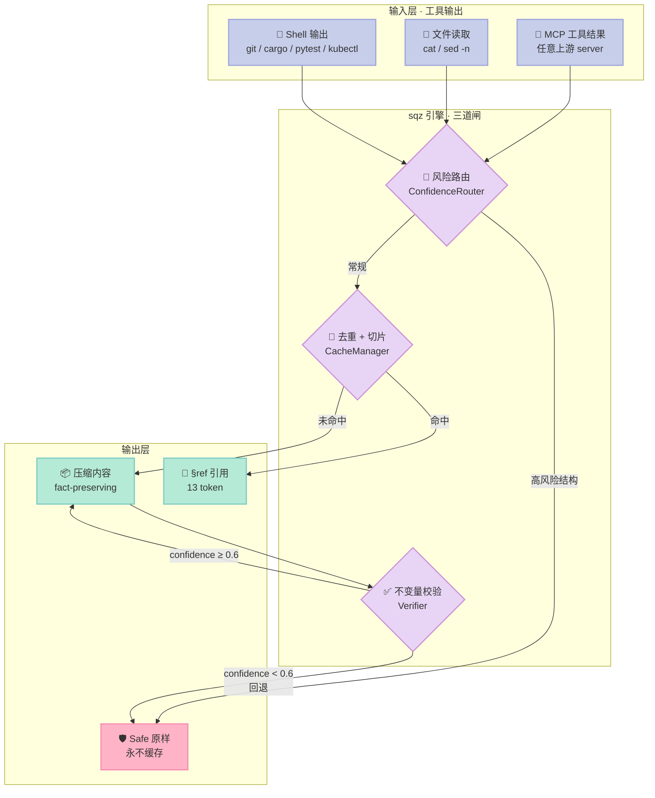
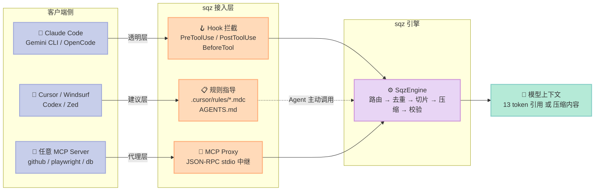
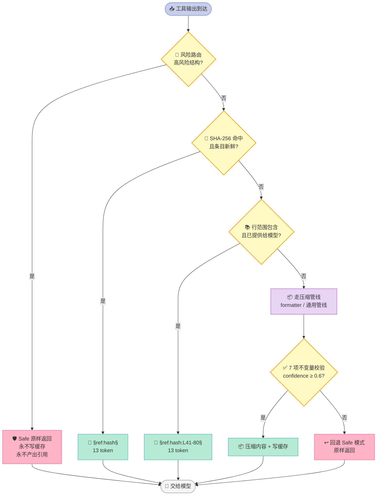

> **一句话核心结论**：sqz 把「上下文压缩」从一件**依赖模型智能的模糊任务**，做成了**一件可用正则测试证明对错的确定性工程**——它的全部价值不在于省了多少 token，而在于它敢用一个**双指标质量基准**（压缩率 51.6% **且** 事实保留 359/359）把自己钉在回归测试里，任何一次「省得更多但丢了一行报错」都会被 CI 直接拦下。

---

## 一、引子：一个 200 行文件被读了三遍

想象一个真实的 Coding Agent 会话：

```text
Agent: 我先看一下 auth.py
  → cat auth.py                    (200 行, 1300 token)

Agent: 我看看第 41 到 80 行
  → sed -n '41,80p' auth.py        (40 行,  260 token)

Agent: 我改一下, 再看看
  → cat auth.py                    (200 行, 1300 token)   ← 完全一样的内容

Agent: 跑一下测试
  → cargo test                     (1 个失败, 366 token)
```

四次工具调用，**2900 个 token 进入了上下文窗口**，而且从第二轮开始全部是**纯重复**。更麻烦的是，这些 token 不只是「进了一次」——在后续每一轮对话里，模型都要**重新把它们发一遍**。一个跑 30 轮的会话，光这四次调用就是 87000 token 的输入账单。

市面上的解决方案大多在同一个方向上使劲：把内容压得更小。**但压缩率从来不是真正的瓶颈**。真正的瓶颈是：**你压掉的那一行，是不是 Agent 接下来要用的那一行？**

sqz 是我最近读到的、把这个问题回答得最干脆的一个项目。它 673⭐、Rust、Apache-2.0，做的事情用一句话就能说清：

> **压缩发生在工具输出进入模型之前；模型已经看过的东西，回来时只剩一个 13 token 的引用。**

本文会拆开它的六个关键原语，看它是怎么做到「省 token」和「不丢信息」这两件互相矛盾的事的。

---

## 二、项目定位：它解决的不是「压缩」，是「重复」

### 2.1 一句话定义

**sqz 是一个装在 Agent 与工具之间的确定性压缩层**（Rust 单二进制，零 LLM 调用，可离线运行），提供三条接入路径：

| 接入层级 | 机制 | 覆盖范围 |
|---|---|---|
| **透明层**（transparent） | Claude Code / Gemini CLI / OpenCode / Copilot CLI 的 Hook | shell 命令输出**全部**经过压缩 |
| **建议层**（advisory） | Cursor / Windsurf / Cline / Codex / Zed 的规则文件 | Agent 需要**主动**调用 `sqz compress` 或 MCP 工具 |
| **代理层**（proxy） | `sqz-mcp proxy -- <任意 MCP server>` | 任意 MCP server 的 `tools/call` 结果 |

「透明 vs 建议」这个分层是 sqz 最诚实的一个设计——它不假装所有 Agent 都能被拦截。README 里的表格把 15 个客户端逐一标注了层级，`sqz doctor` 会告诉你「哪些客户端被检测到了、哪些真的走了 sqz」。

### 2.2 它的 6 件套位置

| Harness 组件 | sqz 的位置 | 说明 |
|---|---|---|
| **MCP** | 🟢 **主战场** | `sqz-mcp` 同时是 server（给 Agent 提供 `sqz_read_file` 等工具）和 proxy（包住任意上游 MCP server） |
| **Hook** | 🟢 主战场 | PreToolUse / PostToolUse / BeforeTool 三种 Hook 协议适配 |
| **Script** | 🟡 支撑 | 每命令一个 formatter（Rust state machine），不是 LLM 判断 |
| **Rule** | 🟡 支撑 | 给 advisory 客户端写 `.cursor/rules/sqz.mdc` 指导文件 |
| **Sub-Agent** | ⚪ 不涉及 | 无角色分工、无 Context 隔离 |
| **Workflow** | ⚪ 不涉及 | 无多 Agent 编排 |

**这是典型的「单点做深」型 Harness**：不做编排，只做「数据进入模型之前的那一道闸」。

### 2.3 真实数据

README 给的是**真实会话统计**，不是实验室数据：

```text
$ sqz gain
sqz token savings (last 7 days)
──────────────────────────────────────────────────
  04-15 │███                           │   12,954 saved
  04-18 │██████████████████████████████│  105,569 saved
  ...
──────────────────────────────────────────────────
  Total: 3,003 compressions, 178,442 tokens saved (24.7% avg reduction)
```

**3003 次压缩，178442 token 节省，24.7% 平均降幅，峰值 92%**。

而单命令维度的数据更能说明「什么值得压、什么不值得压」：

| 内容 | Before | After | 节省 |
|---|---:|---:|---:|
| 重复日志行 | 148 | 39 | **74%** |
| 大 JSON 数组 | 259 | 111 | **57%** |
| JSON API 响应 | 64 | 53 | **17%** |
| Git diff | 61 | 54 | **11%** |
| 散文/文档 | 124 | 122 | **2%** |
| **栈追踪（safe 模式）** | 82 | 82 | **0%** |

注意最后一行：**栈追踪一点都压不动，而且这是刻意的**。下面会讲为什么。

### 2.4 更狠的一招：反事实回放

sqz 有个我觉得设计得很漂亮的功能——`sqz discover --replay`。它扫描你机器上已有的 Agent transcript（`~/.claude/projects`、`~/.kiro/sessions`），把里面的工具输出**重新过一遍** sqz 引擎，算出「如果当初装了 sqz，能省多少」。

作者自己 Kiro IDE 的最近一周：

```text
  Kiro IDE: 35 sessions, 155 sub-agent runs, advisory

                            outputs    tokens in    avoidable
    shell                     6,297    1,917,662      454,028  23.7%
    file reads                4,880    7,854,071      188,239   2.4%
    other MCP servers         1,547    6,717,440    4,234,128  63.0%
    already through sqz         260    1,393,517            -
    out of reach              4,172    1,282,285            -
```

注意 `out of reach` 这一行：4172 个输出是 sqz **够不着**的（web fetch、edit、sub-agent 结果）。它没有把这些藏起来，而是**明确标成「够不着」**。

一个诚实的工具会告诉你自己的边界在哪。

---

## 三、整体架构：三个决策点，一条主链路

sqz 的核心流程其实是三段式判断，每一段都可能改变结果：



### 3.2 三条接入路径：透明 / 建议 / 代理



### 3.1 Less is More 检查：哪些是「模型自己能学会的」？

这条标准必须问，因为压缩本质上就是在替模型做判断。

| 组件 | 能不能让模型自己学？ | sqz 的选择 |
|---|---|---|
| 「这个 JSON 里的 null 字段没意义」 | ✅ 模型完全能学会 | ✅ 做了 |
| 「这段日志和上面三行一模一样」 | ⚠️ 模型能，但每次都要花 token 去比对 | ✅ 做了 |
| 「这个报错是哪一行、哪个断言」 | ⚠️ 模型能，但很容易漏掉 | ✅ 做了 |
| 「这段文本压缩后还能不能还原」 | ❌ 模型**根本不知道**自己丢了什么 | ✅ **必须做** |
| 「这行 `password=xxx` 是不是密钥」 | ❌ 模型**会**误判（commit message 里也有 password） | ✅ **必须做** |
| 「这个压缩比够不够划算」 | ❌ 模型看不到 token 账单 | ✅ **必须做** |

**分界线很清楚**：凡是「压缩后模型就再也看不到的信息」，必须由外部机制保证；凡是「模型看一眼就能自己判断的」，压缩只是帮它省力。

sqz 的 `Verifier` 就是这条线的代码化。

---

## 四、核心机制一：三档风险路由（高熵 ≠ 高风险）

### 4.1 三个模式

`ConfidenceRouter::route()` 把内容分到三档：

| 模式 | 触发条件 | 行为 |
|---|---|---|
| **Safe** | 命中高风险结构模式 | 原样返回，**永不写缓存**，任何大小都不截断 |
| **Aggressive** | 平均熵 < 2.5（低熵 = 样板/重复） | 最大力度压缩 |
| **Default** | 其余 | 平衡压缩 |

有意思的是，sqz 的注释里有一段**自我纠正**：

```rust
// High entropy = information-dense content (code, git log, varied text).
// This is NOT the same as high-risk. Route to Default, not Safe.
// Safe mode is only for content that is_high_risk() explicitly identifies.
```

**高熵 ≠ 高风险**。代码、git log 的熵都很高，但它们恰恰是最不该乱压的。这条纠正的价值在于：它把「安全模式」从一个**模糊的强度档位**变成了一个**由明确规则触发的特例**。

### 4.2 Safe 模式的判定：结构上下文，不是关键词

这是 sqz 最见功力的部分。朴素实现会写成：

```python
# ❌ 朴素版：关键词出现即高风险
if "password" in text or "traceback" in text:
    return SAFE
```

sqz 的实际实现（`confidence_router.rs`）是这样的：

```rust
fn starts_trace(line: &str, next: &str, after: &str) -> bool {
    (line.eq_ignore_ascii_case("stack backtrace:") && next.starts_with("0: "))
        || (line.starts_with("Traceback (most recent call last)") && next.starts_with("File \""))
        || (is_frame(next) && ["Error", "Exception", "Throwable"].iter().any(|w| line.contains(w)))
        || (is_goroutine_header(line) && next.ends_with(')') && after.contains(".go:"))
}
```

**看行三元组**（`line`, `next`, `after`），而不是看单个词：

- Python 栈追踪 = `"Traceback (most recent call last)"` **且下一行**以 `File "` 开头
- Rust 栈追踪 = `"stack backtrace:"` **且下一行**以 `"0: "` 开头
- JVM 栈追踪 = 下一行是 `at com.acme.Queue.pop(Queue.java:88)` **且本行**含 `Error`/`Exception`/`Throwable`
- Go panic = `"goroutine N [state]:"` **且下一行**以 `)` 结尾 **且再下一行**含 `.go:`

**为什么必须看上下文**？因为 commit message 里天天写着 `"fix: password reset"`。sqz 为此专门写了一个 `looks_like_commit_log()` 启发式：

```rust
/// Heuristic: does this content look like a git commit log?
/// Commit logs have lines starting with short hashes (7+ hex chars)
/// or conventional commit prefixes (feat:, fix:, chore:, etc.).
fn looks_like_commit_log(&self, lower: &str) -> bool {
```

它数两种信号：**短 hash 前缀行**（`abc1234 feat: ...`）+ **约定式提交前缀行**（`feat:` / `fix:` / `chore:` ...），两者加起来 ≥ 2 行才算 commit log。

### 4.3 一个真实踩坑：多字节字符 panic

这段注释值得单独拎出来：

```rust
// Short hash prefix: "abc1234 feat: ...". Take chars (not a
// byte slice) — byte 7 can land inside a multi-byte character
// and panic (issue #34: Cyrillic output + a password marker).
if trimmed.len() > 8
    && trimmed.chars().take(7).all(|c| c.is_ascii_hexdigit())
    && trimmed.chars().count() > 7
```

Rust 里 `&str[0..7]` 是**字节切片**。对西里尔字母（每字符 2 字节）做字节切片，切口可能落在字符中间，直接 panic。这不是理论风险——是 issue #34 的真实 bug。

**一个压缩工具因为自己切错字符串而崩溃，是很讽刺的失败模式。** 这也提醒我们：处理 Agent 输出的工具，永远要面对任意字节序列。

### 4.4 密钥判定的排除项

`is_secret_line()` 里有一组精妙的排除规则：

```rust
const NAMES: &[&str] = &[
    "password", "passwd", "passphrase", "secret", "apikey",
    "privatekey", "secretkey", "accesskey", "token", "authorization",
];
const NOT_SECRET: &[&str] = &["nexttoken", "pagetoken", "continuationtoken"];
const WORDS: &[&str] = &["null", "none", "nil", "true", "false", "read", "write", "str", "string"];
```

- **键名要「以 secret 类词结尾」**：`mySecretKey` ✅，`monkey` ❌（"key" 不在列表里，因为它太容易误伤）
- **排除游标字段**：`nextToken` / `pageToken` / `continuationToken` **不是**密钥——它们是 API 分页游标，天天出现在日志里
- **排除占位值**：`token=null` / `token=""` / `token=true` 不是密钥

`nextToken` 这条尤其值得学：AWS / GCP / Azure 的所有分页 API 都用这类字段做游标，如果按「token 结尾 = 密钥」来判，**整个云厂商的 SDK 日志都会被误判成高风险**，safe 模式会全量直通，压缩直接失效。

---

## 五、核心机制二：内容寻址去重 + 行范围包含匹配

### 5.1 三态缓存结果

`CacheResult` 枚举把缓存查询表达成三态：

```rust
pub enum CacheResult {
    /// Previously seen content — returns a short inline reference (~13 tokens).
    Dedup { inline_ref: String, token_cost: u32 },
    /// Near-duplicate of cached content — returns a compact delta.
    Delta { delta_text: String, token_cost: u32, similarity: f64 },
    /// Content not seen before — full compression result.
    Fresh { output: CompressedContent },
}
```

引用 token 的格式：`§ref:<hash前16位>§`，成本恒定 13 token。

### 5.2 「新鲜度」必须是持久的——一个差点废掉整个特性的 bug

这是 sqz 源码里我读到最有价值的一段注释：

```rust
/// # Freshness model
///
/// A dedup ref is considered fresh (safe to serve instead of the full
/// content) when the cache entry's `accessed_at` timestamp in SQLite is
/// within `max_ref_age` of now. When sqz is invoked from shell hooks each
/// invocation is a short-lived process, so the freshness check must be
/// persistent — in-memory state is gone the moment the process exits.
///
/// The previous turn-counter heuristic was in-memory only and therefore
/// never registered freshness across hook invocations, which silently
/// disabled the dedup feature in production. Issue found April 18 2026.
```

**翻译一下这个 bug**：sqz 最初用「进程内的 turn 计数器」判断一个引用是否还新鲜。但 sqz 是被 shell hook 调用的——**每次调用都是一个全新的短命进程**。进程内的计数器每次都从 0 开始，于是「这个引用是不是新鲜的」永远算错，去重功能**在生产环境里静默失效了**。

作者在 **2026 年 4 月 18 日**才发现。修复方式是改用 SQLite 里的 `accessed_at` 时间戳，TTL 默认 30 分钟。

> **这个 bug 值得单独拿出来讲，因为它是一个通用教训**：任何基于「内存计数器」的设计，在跨进程调用的架构里都会静默失效——**不报错、不崩溃，只是功能不见了**。而且这类 bug 在开发环境（长命进程）永远复现不出来。

还有一个顺序上的细节：

```rust
/// Unlike [`get_or_compress`](Self::get_or_compress), this method does not
/// touch `accessed_at` until after the freshness check; otherwise
/// every read would make itself "fresh."
```

**先检查新鲜度，再更新 `accessed_at`**。反过来写的话，每次读取都会让自己「变新鲜」，那新鲜度检查就永远通过了。

### 5.3 行范围包含匹配：sqz 最被低估的设计

现在讲 sqz 最有洞察力的部分。

**问题**：Agent 先 `cat auth.py` 读了整个文件（200 行），后来又 `sed -n '41,80p' auth.py` 读了其中 40 行。这 40 行**模型已经看过了**。

**为什么常规方案抓不到**：

| 方案 | 为什么失效 |
|---|---|
| 精确 hash 去重 | 内容不完全相同，hash 不同 |
| 近重复 / 相似度匹配 | 500 行文件里的 40 行切片，Jaccard 相似度约 **0.1** |

**sqz 的解法：做包含判断，不做相似度判断。**

```rust
/// Exact-hash dedup misses the common case: the agent read a file in
/// full, then re-reads lines 40-80 of it. Near-duplicate matching
/// misses it too (a 40-line slice of a 500-line file has a Jaccard
/// similarity near 0.1). This checks containment instead: the slice
/// must appear verbatim, on line boundaries, in a recent cached
/// original that is still fresh, and the same bytes must also appear
/// in what was actually served for that original, so a ref never
/// points at lines a lossy stage dropped.
```

拆成三个条件：

1. **切片必须逐字节、逐行边界命中**某个近期缓存的原始内容（`find_line_range`）
2. **该条目必须仍然新鲜**（TTL 内）
3. **同样的字节必须也出现在「实际提供给模型的内容」里** —— ← 这条最关键

第三条为什么关键？因为 sqz 的压缩管线是**有损的**。如果原始文件 200 行，但压缩时把第 50 行删了（熵截断器觉得它「低信息量」），那么当 Agent 之后读第 50 行时，如果只查原始缓存，就会返回一个引用——**而模型从来没收到过第 50 行**。

**这个引用会指向模型上下文里不存在的内容。** 第三个条件就是为了堵住这个洞。

命中后的引用格式：

```text
§ref:7af95091537fb0f2:L4-23§
```

行范围信息也编码在里面，模型知道这是「第 4 到 23 行」。

还有个细节——**切片太小就不值得做引用**：

```rust
/// Smallest slice worth referencing. Below this the ref token costs
/// about as much as the text, and short multi-line snippets are common
/// enough to match by coincidence.
const MIN_SLICE_BYTES: usize = 160;
```

160 字节以下不做匹配。两个理由：引用本身要 13 token，太短的内容省不下来；而且**短片段偶然命中的概率很高**——一个 20 字节的代码片段可能在很多文件里都出现，误命中比省下的 token 更糟糕。

---

### 5.4 一次工具输出的完整判定流程



## 六、核心机制三：7 项不变量校验 + 置信度回退

### 6.1 校验器在做什么

压缩完不是直接给模型。`Verifier::verify()` 检查 7 类不变量，输出一个置信度：

```rust
/// Confidence threshold below which fallback is triggered.
const FALLBACK_THRESHOLD: f64 = 0.6;
```

| # | 检查项 | 判定逻辑 |
|---|---|---|
| 1 | `min_retention` | 输出至少是输入的 10% 长度 |
| 2 | `error_lines` | 所有含 `error:` / `warning:` / `fatal:` / `panic:` / `exception:` 的行必须**逐字**出现在输出里 |
| 3 | `file_paths` | 含 `/` 或 `\` 且有扩展名的路径 token 必须保留（最多检查 20 行） |
| 4 | `json_keys` | JSON 顶层 key 保留率 ≥ 50% |
| 5 | `diff_hunks` | 所有 `@@` 开头的 diff hunk 头必须保留 |
| 6 | `identifiers` | 反引号标识符 / 路径 / URL / 环境变量名 / 版本号逐 token 扫描保留 |
| 7 | `source_verbatim` | 源码文件必须**原样**返回 |

置信度 = 通过数 / 总数。< 0.6 就**回退到 safe 模式重新压一遍**。

### 6.2 为什么「回退」比「报错」好

```rust
// Step 5: If verifier signals low confidence, re-compress with safe settings
if fallback && result.data != input {
    eprintln!("[sqz] fallback: verifier confidence {:.2} below threshold — re-compressing in safe mode",
        result.verify.as_ref().map(|v| v.confidence).unwrap_or(0.0));
    let safe_result = self.compress_safe(input, &pipeline, &ctx, false)?;
    return Ok(safe_result);
}
```

校验失败**不是抛异常**，而是自动降级成「原样返回」。这个选择是对的：

- 抛异常 → Agent 的这一轮工具调用直接失败 → Agent 可能整个任务失败
- 降级 → Agent 拿到完整内容，只是多花了 token

**Harness 的降级路径永远应该是「变慢但正确」，而不是「失败」。**

### 6.3 第 7 项检查的由来：一次真实事故

`source_verbatim` 这条检查，来自 sqz 质量基准第一次运行时抓到的 bug：

| 命令 | 丢了什么 | 怎么修 |
|---|---|---|
| `npm install` | `3 vulnerabilities (1 moderate, 2 high)` 那行和 `npm audit fix` 提示 | 早期在 "added N packages" 行就 `return` 了，把后面全跳过 → 改成收集所有摘要行 |
| `docker ps` | COMMAND / CREATED 列含空格时（`"uvicorn app:app"`、`2 hours ago`）列错位 | 改成按表头列偏移切分，不再按空白 split |
| `git status` | 分支名和 ahead/behind 行 | 保留开头的 branch 和 tracking 行，只丢 "up to date" |
| `pytest` | `file:line`、失败源码行、`1 failed, 41 passed` 统计 | 专门的 pytest formatter，保留 totals、`>` 行、`E` 行和位置 |
| `tsc --pretty` | 全部 | formatter 只认管道格式，fallback 到通用管线后丢了 `Found 2 errors` → 两种格式都解析 |
| **`cat file.py`** | **import 行和 class 声明** | **熵截断器把它们评为「低信息量」直接删了** |

最后一条是本文最想让你记住的：

> **Agent 跑 `cat` 一个文件，几乎一定是为了改它。** 熵截断器看到 `import os` 和 `class RefundProcessor:` 这两行，觉得「信息量低」就删了——**可这两行恰恰是模型马上要改的东西**。

修复方式不是「给 import 行加权」，而是**检测源码 → 直接跳过所有丢行阶段**。

---

## 七、核心机制四：质量基准——把「压缩率」和「不丢信息」一起钉进 CI

这是我认为 sqz **最值得学的部分**，也是其他压缩项目普遍没做到的事。

### 7.1 双指标

```text
Token reduction is easy to inflate. Drop the one line the agent needed
and the headline number goes up while the agent re-runs the command,
retries in circles, or ships a worse answer. This benchmark measures
both sides of that trade for sqz, on the exact code path the shell hook
uses, and it runs as a regression test on every change.
```

**「压缩率很容易被灌水」**——丢掉 Agent 真正需要的那一行，头条数字就好看了，而 Agent 会重跑命令、绕圈重试、或者交付一个更差的答案。

所以 sqz 的基准同时测两件事：

| 指标 | 怎么测 | 是否门禁 |
|---|---|---|
| **Token 缩减率** | `ceil(bytes/4)`，输入 vs 模型看到的全部内容（含 sqz 自己的 stderr 行） | 聚合 ≥ 40% |
| **关键事实召回** | 每条 fact 必须**逐字**出现在压缩输出里，**漏一条就 fail** | ✅ 每个 fixture 都必须 100% |
| 噪声丢弃 | 进度点、deprecation 提示、通过的测试 | 只报告，不门禁 |
| 逐字保留 | `git show rev:path` / traceback / secrets 三个 fixture 必须与输入**完全一致** | ✅ |
| **字节级还原** | 第二次跑必须返回 `§ref:HASH§`，且 `sqz expand HASH` 必须还原原始字节 | ✅ |
| **敏感内容不落盘** | traceback 和 secrets 必须**永不**被持久化 | ✅ |

### 7.2 实测结果

| Fixture | Tokens in | Tokens out | 缩减 | Facts | 还原 |
|---|---:|---:|---:|---:|---|
| `kubectl get pods -o json` | 1671 | 627 | 62.5% | 13/13 | byte-exact |
| `aws ec2 describe-instances` | 4693 | 1412 | 69.9% | 80/80 | byte-exact |
| `pytest`（失败） | 311 | 71 | **77.2%** | 5/5 | byte-exact |
| `npm install` | 161 | 39 | **75.8%** | 4/4 | byte-exact |
| `app log with repeats` | 1025 | 135 | **86.8%** | 3/3 | byte-exact |
| `docker ps` | 193 | 79 | 59.1% | 6/6 | byte-exact |
| `cargo test`（失败） | 303 | 154 | 49.2% | 5/5 | byte-exact |
| `git status` | 155 | 82 | 47.1% | 6/6 | byte-exact |
| `source file read` | 221 | 221 | **0.0%** | 5/5 | byte-exact |
| `python traceback` | 82 | 82 | **0.0%** | 4/4 | **passthrough, never cached** |
| `dotenv with secrets` | 78 | 78 | **0.0%** | 4/4 | **passthrough, never cached** |
| **聚合** | **12,264** | **5,932** | **51.6%** | **359/359** | |

**聚合：51.6% 缩减，359/359 事实保留。** 两个数字同时成立。

### 7.3 那些 0.0% 的行才是重点

sqz 专门写了一节「Reading the zeros」解释为什么有些 fixture 压缩率是 0：

- **`source file read`（读源码）**：0% 是**故意的**。源码要原样给，省 token 的活儿交给去重（第二次读才是 13 token）
- **`python traceback`**：0%，走 safe 模式原样通过，**且永不缓存**
- **`dotenv`**：0%，同上
- **`git diff`**：0%，**每一行改动都是事实**，没有安全可丢的东西
- **`kubectl get pods` / `gh pr view --json`**：0%，它们的 formatter 因为「用摘要替换了原始数据」被**移除**了
- **`JSON API response`**：**−0.8%**——这是唯一一个模型看到的比原始输出还多的场景

最后这条特别有意思：JSON 剥离 + TOON 编码把 payload 从 165 压到 138 token，但 sqz 自己那行 `[sqz] N/M tokens` 头部**重复了整个 curl URL**，比省下的还多，最终**倒贴 1 个 token**。

> 这就是「净收益门槛」的价值：**压缩了但说不清楚有没有赚，就不压缩。**

### 7.4 Regret：在真实使用中抓过度压缩

fixture 只能测「有人想到过」的场景。sqz 在真实运行中追踪两个信号：

```text
- Quick re-runs. The agent produced byte-identical output within 120 seconds
  of last seeing it. The repeat bought no new information, which usually
  means the compressed first serving was missing something.
- Ref expands. A §ref:HASH§ token was expanded back to its original bytes.
```

**「重复执行」是最灵敏的过度压缩探测器**——如果 Agent 拿到压缩输出后立刻重跑了同一个命令，说明压缩把该给的东西藏起来了。

而 sqz 明确说：**这两个指标只作为比率报告，不从节省额里扣减**。理由也很实在：

> The real cost is the wasted agent turn, which sqz cannot see from tool output alone. Any dollar figure for it would be an invented multiplier.

浪费的是一整个 Agent 回合，而 sqz 从工具输出里看不到这个。**编一个乘数出来假装能量化，是不诚实的。**

---

## 八、核心机制五：MCP 代理——把压缩做成协议层

### 8.1 `sqz-mcp proxy` 做什么

```rust
//! MCP compression proxy: wrap any upstream MCP server and compress its
//! tool responses through the sqz engine.
//!
//! `sqz-mcp proxy -- <upstream command...>` spawns the upstream server and
//! relays newline-delimited JSON-RPC over stdio in both directions. On the
//! way back to the client it:
//!
//! - compresses `tools/call` text results (dedup `§ref` on repeats, the
//!   full pipeline on first pass, net-win gated, Safe-routed content left
//!   verbatim). Unless `--no-cache`, originals are persisted, so every
//!   compression is recoverable via the injected `sqz_expand` tool.
//! - compacts `tools/list` tool descriptions (whitespace + length cap,
//!   schemas untouched) unless `--no-desc`. With `--lazy-tools` the cap
//!   drops to one sentence and an injected `sqz_tool_help` tool serves
//!   the full original documentation on demand.
```

**注入两个工具**：

| 注入工具 | 作用 |
|---|---|
| `sqz_expand` | 还原任何 `§ref:HASH§` 背后的原始字节 |
| `sqz_tool_help` | `--lazy-tools` 模式下按需返回完整工具文档 |

配置方式极简——给 MCP 配置加个前缀：

```json
{
  "mcpServers": {
    "github": {
      "command": "sqz-mcp",
      "args": ["proxy", "--", "npx", "-y", "@modelcontextprotocol/server-github"]
    }
  }
}
```

### 8.2 `--lazy-tools` 解决了「工具描述通胀」

MCP 生态的一个老大难：`tools/list` 返回的工具描述动辄几百上千 token，几十个工具加起来就把上下文占满了。

sqz 的做法是**压缩描述但不碰 schema**：

```rust
const MAX_DESCRIPTION_CHARS: usize = 400;
/// `--lazy-tools` cap: roughly one sentence per tool.
const LAZY_DESCRIPTION_CHARS: usize = 160;
```

并且在 `initialize` 的 instructions 里追加一段协议说明，让模型知道 `§ref:HASH§` 是什么意思：

```rust
const INSTRUCTIONS_NOTE: &str = "\n\nTool results pass through the sqz \
compression proxy; sqz_expand returns the original behind any §ref:HASH§ \
token.";
```

**这是一件很小但很关键的事**：模型看到 `§ref:abc123§` 如果不知道那是什么，可能会反复重跑命令去确认。**协议语义必须通过协议本身告诉对端**——这正是 MCP 协议设计的精神。

### 8.3 代理层的边界：哪些一律原样透传

```rust
// Error results, non-text content, notifications, and every client→server
// message (except `sqz_expand` calls) pass through verbatim.
```

**错误结果不压缩**。这一点和 Headroom 之类的项目不同——错误信息往往是最短但最重要的（`Error from server (NotFound)` 就几个 token，压缩它没有任何收益，还有丢失的风险）。

---

## 九、可运行复刻：200 行 Python MVP

上面讲的所有机制，我用 Python 复刻了一个最小可用版本。这个 MVP 只保留四个原语：

1. `ConfidenceRouter` —— 三档风险路由 + 结构化风险判定
2. `CacheManager.check_dedup` —— SHA-256 去重引用
3. `CacheManager.check_slice` —— 行范围包含匹配
4. `Verifier.verify` —— 7 项不变量校验 + 置信度回退

```python
"""
sqz_mvp.py — 从 ojjuschugh1/sqz 抽离的核心机制复刻

抽离自 sqz 仓库的四个关键原语（均为未混淆的公开源码）：
  1. ConfidenceRouter.route()      → sqz_engine/src/confidence_router.rs
  2. CacheManager.check_dedup()    → sqz_engine/src/cache_manager.rs
  3. CacheManager.check_slice()    → sqz_engine/src/cache_manager.rs
  4. Verifier.verify()             → sqz_engine/src/verifier.rs
"""

import hashlib
import json
import math
import re
import time
from collections import Counter
from dataclasses import dataclass, field
from enum import Enum
from typing import Optional


class CompressionMode(str, Enum):
    """压缩强度三档。sqz 用 ConfidenceRouter 决定。"""
    SAFE = "safe"              # 高风险内容：最小压缩，且永不缓存
    DEFAULT = "default"        # 常规内容：平衡压缩
    AGGRESSIVE = "aggressive"  # 低熵样板内容：激进压缩


@dataclass
class CompressionResult:
    data: str
    mode: CompressionMode
    token_cost: int
    confidence: float = 1.0
    verified: bool = False
    fallback_triggered: bool = False
    stored: bool = False
    notes: list[str] = field(default_factory=list)


@dataclass
class CacheEntry:
    hash: str
    original: bytes
    served: str          # 真正给模型看的（有损压缩后的）
    accessed_at: float


# ── 风险模式判定（对应 sqz 的 starts_trace / is_secret_line）──────────────

def starts_trace(line: str, nxt: str, after: str) -> bool:
    """栈追踪起点判定 —— 看行三元组，不看单个关键词。"""
    if line.lower() == "stack backtrace:" and nxt.startswith("0: "):
        return True
    if line.startswith("Traceback (most recent call last)") and nxt.startswith('File "'):
        return True
    if is_frame(nxt) and any(w in line for w in ("Error", "Exception", "Throwable")):
        return True
    if (line.startswith("goroutine ") and " [" in line and line.rstrip().endswith("]:")
            and nxt.rstrip().endswith(")") and ".go:" in after):
        return True
    return False


def is_frame(line: str) -> bool:
    """JVM / JS 栈帧：`at com.acme.Queue.pop(Queue.java:88)`。"""
    if not line.startswith("at "):
        return False
    call = line[3:]
    if "(" in call and ")" in call:
        return True
    parts = call.rsplit(":", 2)
    return len(parts) == 3 and all(p and p.isdigit() for p in parts[1:])


def is_secret_line(line: str) -> bool:
    """密钥赋值行。键名要以 secret 类词结尾，并排除游标字段与占位值。"""
    names = ("password", "passwd", "passphrase", "secret", "apikey",
             "privatekey", "secretkey", "accesskey", "token", "authorization")
    not_secret = ("nexttoken", "pagetoken", "continuationtoken")
    words = ("null", "none", "nil", "true", "false", "read", "write", "str", "string")

    line = line.removeprefix("export ")
    at = next((i for i, ch in enumerate(line) if ch in "=:"), None)
    if at is None:
        return False
    key = line[:at].strip().strip("\"'")
    if not key or len(key) > 64 or not all(c.isalnum() or c in "_-." for c in key):
        return False
    norm = "".join(c.lower() for c in key if c.isalnum())
    if not any(norm.endswith(n) for n in names):
        return False
    if any(norm.endswith(n) for n in not_secret):
        return False
    value = line[at + 1:].strip().rstrip(",").strip("\"'")
    return value.lower() not in words


def is_risk_line(lines: list[str], i: int) -> bool:
    line = lines[i]
    nxt = lines[i + 1] if i + 1 < len(lines) else ""
    after = lines[i + 2] if i + 2 < len(lines) else ""
    return (starts_trace(line, nxt, after)
            or line.lower().startswith(("create table ", "alter table ", "drop table "))
            or (line.startswith("-----BEGIN ") and line.rstrip().endswith("-----"))
            or is_secret_line(line))


# ── 置信度路由 ───────────────────────────────────────────────────────────

class ConfidenceRouter:
    MIN_SLICE_BYTES = 160
    SLICE_CANDIDATES = 32

    def route(self, content: str) -> CompressionMode:
        content = without_ansi(content)
        if len(content) < 100:
            return CompressionMode.DEFAULT
        if self.is_high_risk(content):
            return CompressionMode.SAFE
        blocks = [shannon_entropy(content[i:i + 256])
                  for i in range(0, len(content), 256)]
        if not blocks:
            return CompressionMode.DEFAULT
        if sum(blocks) / len(blocks) < 2.5:
            return CompressionMode.AGGRESSIVE
        # 高熵 ≠ 高风险：代码 / git log 走 DEFAULT，不走 SAFE
        return CompressionMode.DEFAULT

    def never_store(self, content: str) -> bool:
        content = without_ansi(content)
        return len(content) >= 100 and (
            self.mentions_high_risk(content) or self.is_high_risk(content))

    def is_high_risk(self, content: str) -> bool:
        lines = [l.strip() for l in content.splitlines()]
        return any(is_risk_line(lines, i) for i in range(len(lines)))

    def mentions_high_risk(self, content: str) -> bool:
        lower = content.lower()
        if (("panicked at" in lower or "traceback" in lower)
                and ("stack backtrace" in lower or "  0:" in lower)):
            return True
        if (("alter table" in lower or "create table" in lower or "drop table" in lower)
                and ("column" in lower or "index" in lower or "primary key" in lower)):
            return True
        if "-----begin" in lower:
            return True
        if (("private_key" in lower or "secret_key" in lower or "api_key" in lower)
                and ("=" in lower or ":" in lower)
                and not self.looks_like_commit_log(lower)):
            return True
        if ("password" in lower
                and ("password:" in lower or "password=" in lower)
                and not self.looks_like_commit_log(lower)):
            return True
        return False

    def looks_like_commit_log(self, lower: str) -> bool:
        """避免把 "fix: password reset" 误判成密钥泄漏。"""
        commit_lines = 0
        for line in lower.splitlines()[:10]:
            t = line.strip()
            # 必须用 chars() 而不是字节切片——字节切片会切进多字节字符里 panic
            if len(t) > 8 and all(c in "0123456789abcdef" for c in t[:7]):
                commit_lines += 1
            if t.startswith(("feat:", "fix:", "chore:", "docs:", "refactor:",
                             "test:", "ci:", "style:")):
                commit_lines += 1
        return commit_lines >= 2


def shannon_entropy(text: str) -> float:
    if not text:
        return 0.0
    counts = Counter(text)
    total = len(text)
    return -sum((c / total) * math.log2(c / total) for c in counts.values())


def without_ansi(text: str) -> str:
    return re.sub(r"\x1b\[[0-9;]*[A-Za-z]", "", text)


# ── 内容寻址缓存 + 行范围包含匹配 ────────────────────────────────────────

class CacheManager:
    def __init__(self, ref_ttl_secs: int = 1800):
        self.entries: dict[str, CacheEntry] = {}
        self.ref_ttl_secs = ref_ttl_secs
        self.hits = 0
        self.slice_hits = 0

    def is_ref_fresh(self, h: str) -> bool:
        e = self.entries.get(h)
        return e is not None and (time.time() - e.accessed_at) <= self.ref_ttl_secs

    def check_dedup(self, content: bytes) -> Optional[str]:
        """完全命中：§ref:<hash16>§。先检查新鲜度再更新 accessed_at。"""
        h = hashlib.sha256(content).hexdigest()
        if not self.is_ref_fresh(h):
            return None
        self.entries[h].accessed_at = time.time()
        self.hits += 1
        return f"§ref:{h[:16]}§"

    def check_slice(self, content: bytes) -> Optional[str]:
        """行范围包含匹配（不是相似度匹配）。

        三个条件：
          1. 切片逐字节、逐行边界命中某个近期缓存的原始内容
          2. 该条目仍然新鲜
          3. 同样的字节也出现在**实际提供给模型的内容**里——
             否则引用会指向被有损 stage 丢掉的行
        """
        if len(content) < ConfidenceRouter.MIN_SLICE_BYTES or b"\n" not in content:
            return None
        for entry in sorted(self.entries.values(), key=lambda e: -len(e.original))[
                :ConfidenceRouter.SLICE_CANDIDATES]:
            if not self.is_ref_fresh(entry.hash):
                continue
            rng = find_line_range(entry.original, content)
            if rng is None:
                continue
            if entry.served.encode().find(content) < 0:
                continue    # ← 关键不变量
            start, end = rng
            total = count_lines(entry.original)
            ref = (f"§ref:{entry.hash[:16]}§" if (start == 1 and end == total)
                   else f"§ref:{entry.hash[:16]}:L{start}-{end}§")
            entry.accessed_at = time.time()
            self.slice_hits += 1
            return ref
        return None

    def store(self, original: bytes, served: str) -> str:
        h = hashlib.sha256(original).hexdigest()
        self.entries[h] = CacheEntry(h, original, served, time.time())
        return h

    def expand(self, ref: str) -> Optional[bytes]:
        m = re.match(r"§ref:([0-9a-f]{16})", ref)
        if not m:
            return None
        for h, e in self.entries.items():
            if h.startswith(m.group(1)):
                return e.original
        return None


def find_line_range(original: bytes, slice_bytes: bytes) -> Optional[tuple]:
    orig_lines = original.split(b"\n")
    sl = slice_bytes.split(b"\n")
    n = len(sl)
    for i in range(len(orig_lines) - n + 1):
        if orig_lines[i:i + n] == sl:
            return (i + 1, i + n)
    return None


def count_lines(data: bytes) -> int:
    return len(data.rstrip(b"\n").split(b"\n")) if data else 0


# ── 不变量校验器 ─────────────────────────────────────────────────────────

class Verifier:
    FALLBACK_THRESHOLD = 0.6

    @staticmethod
    def verify(original: str, compressed: str) -> tuple:
        passed, failed = [], []

        # 1. 最小留存率
        retention = 1.0 if not original else len(compressed) / len(original)
        (passed if retention >= 0.10 else failed).append(
            "min_retention" if retention >= 0.10
            else f"min_retention: output only {retention*100:.1f}%")

        # 2. 错误行逐字保留
        errs = [l.strip() for l in original.splitlines()
                if any(k in l.lower() for k in
                       ("error:", "warning:", "fatal:", "panic:", "exception:"))]
        if not errs:
            passed.append("error_lines")
        else:
            missing = [l for l in errs if l not in compressed]
            (passed if not missing else failed).append(
                "error_lines" if not missing
                else f"error_lines: {len(missing)} error line(s) missing")

        # 3. 文件路径保留
        paths = [l for l in original.splitlines()
                 if ("/" in l or "\\" in l) and "." in l and len(l) < 200][:20]
        if not paths:
            passed.append("file_paths")
        else:
            miss = sum(1 for l in paths
                       if next((t for t in l.split() if "/" in t or "\\" in t), "")
                       not in compressed)
            (passed if miss == 0 else failed).append(
                "file_paths" if miss == 0 else f"file_paths: {miss} path(s) missing")

        # 4. JSON 顶层 key ≥ 50%
        t = original.strip()
        if t.startswith("{") or t.startswith("["):
            try:
                val = json.loads(t)
                keys = (list(val.keys()) if isinstance(val, dict)
                        else list(val[0].keys()) if val and isinstance(val[0], dict) else [])
            except json.JSONDecodeError:
                keys = []
            if not keys:
                passed.append("json_keys")
            else:
                present = sum(1 for k in keys if k in compressed)
                (passed if present / len(keys) >= 0.5 else failed).append(
                    "json_keys" if present / len(keys) >= 0.5
                    else f"json_keys: only {present}/{len(keys)} kept")
        else:
            passed.append("json_keys")

        # 5. diff hunk 头
        hunks = [l.strip() for l in original.splitlines() if l.startswith("@@")]
        if not hunks:
            passed.append("diff_hunks")
        else:
            miss = [h for h in hunks if h not in compressed]
            (passed if not miss else failed).append(
                "diff_hunks" if not miss
                else f"diff_hunks: {len(miss)} hunk header(s) missing")

        # 6. 标识符 / 路径 / URL 逐 token 扫描
        tokens = extract_identifiers(original)
        if not tokens:
            passed.append("identifiers")
        else:
            miss = [t for t in tokens if t not in compressed]
            (passed if not miss else failed).append(
                "identifiers" if not miss
                else f"identifiers: {len(miss)}/{len(tokens)} missing")

        # 7. 源码必须逐字保留
        if looks_like_source(original):
            ok = original.strip() == compressed.strip()
            (passed if ok else failed).append(
                "source_verbatim" if ok else "source_verbatim: source file was modified")
        else:
            passed.append("source_verbatim")

        total = len(passed) + len(failed)
        return (len(passed) / total if total else 1.0), passed, failed


def extract_identifiers(text: str) -> list:
    found = set()
    for m in re.finditer(r"`([^`]{1,60})`", text):
        found.add(m.group(1))
    for m in re.finditer(r"(?<![\w/])([A-Za-z0-9_.-]+/[A-Za-z0-9_./-]+\.[A-Za-z0-9]+)", text):
        found.add(m.group(1))
    for m in re.finditer(r"https?://[^\s\"')]+", text):
        found.add(m.group(0))
    for m in re.finditer(r"\b([A-Z][A-Z0-9_]{3,})\b", text):
        found.add(m.group(1))
    for m in re.finditer(r"\bv?\d+\.\d+\.\d+\b", text):
        found.add(m.group(0))
    return sorted(found)


SOURCE_MARKERS = ("def ", "class ", "import ", "from ", "function ", "pub fn ", "fn ",
                  "#include", "package ", "impl ", "struct ", "const ", "let ")


def looks_like_source(text: str) -> bool:
    """源码检测。来自一次真实事故：熵截断器把 import / class 行删了。"""
    lines = text.splitlines()
    if not lines:
        return False
    hits = sum(1 for l in lines if any(l.strip().startswith(m) for m in SOURCE_MARKERS))
    return hits >= 2 and hits / max(len(lines), 1) > 0.05


# ── 引擎：把四个原语粘起来 ──────────────────────────────────────────────

class SqzEngine:
    NET_WIN_MIN_TOKENS = 16  # 净收益门槛：省不到 16 token 就不压

    def __init__(self, ref_ttl_secs: int = 1800):
        self.router = ConfidenceRouter()
        self.cache = CacheManager(ref_ttl_secs)

    def compress(self, raw: bytes, command: str = "") -> CompressionResult:
        text = raw.decode("utf-8", errors="replace")
        notes: list[str] = []

        # Step 1: 风险路由
        mode = self.router.route(text)
        if mode == CompressionMode.SAFE:
            return CompressionResult(
                text, mode, estimate_tokens(text), stored=False,
                notes=["safe mode: high-risk content passed through unchanged, never cached"])

        # Step 2: 完全去重
        ref = self.cache.check_dedup(raw)
        if ref:
            return CompressionResult(ref, mode, 13, stored=False,
                                    notes=["dedup hit: exact content already served"])

        # Step 3: 行范围包含匹配
        slice_ref = self.cache.check_slice(raw)
        if slice_ref:
            return CompressionResult(slice_ref, mode, 13, stored=False,
                                    notes=["slice hit: line range of an already-served original"])

        # Step 4: 实际压缩
        compressed = self._compress(text, mode)
        if looks_like_source(text):
            compressed = text
            notes.append("source code detected: skipping line-dropping stages")
        if estimate_tokens(text) - estimate_tokens(compressed) < self.NET_WIN_MIN_TOKENS:
            compressed = text
            notes.append("net-win gate: saving below 16 tokens, passing through")

        # Step 5: 不变量校验
        confidence, passed, failed = Verifier.verify(text, compressed)

        # Step 6: 置信度过低 → 回退 safe 模式（变慢但正确，而不是失败）
        if confidence < Verifier.FALLBACK_THRESHOLD:
            notes.append(f"fallback: verifier confidence {confidence:.2f} below threshold "
                         f"{Verifier.FALLBACK_THRESHOLD} — re-compressing in safe mode")
            return CompressionResult(text, CompressionMode.SAFE, estimate_tokens(text),
                                    confidence=confidence, verified=False,
                                    fallback_triggered=True, stored=False,
                                    notes=notes + [f"failed checks: {failed}"])

        # Step 7: 写入缓存（safe 内容永不入库）
        stored = not self.router.never_store(text)
        if stored:
            self.cache.store(raw, compressed)
        return CompressionResult(compressed, mode, estimate_tokens(compressed),
                                confidence=confidence, verified=True,
                                stored=stored, notes=notes)

    @staticmethod
    def _compress(text: str, mode: CompressionMode) -> str:
        if mode == CompressionMode.AGGRESSIVE:
            seen, out = set(), []
            for l in text.splitlines():
                s = l.strip()
                if not s or s in seen:
                    continue
                seen.add(s)
                out.append(l)
            return "\n".join(out)
        out, prev, run = [], None, 0
        for l in text.splitlines():
            if l == prev:
                run += 1
                continue
            if run > 1:
                out.append(f"... ({run} more identical lines)")
            out.append(l)
            prev, run = l, 1
        if run > 1:
            out.append(f"... ({run} more identical lines)")
        return "\n".join(out)


def estimate_tokens(text: str) -> int:
    return (len(text.encode("utf-8")) + 3) // 4
```

### 9.1 实际运行结果

```
==============================================================================
sqz MVP — SHA-256 去重 + 行范围切片 + 风险路由 + 不变量校验
==============================================================================

--- 场景 1：首次读取源文件（Fresh）---
mode=default  tokens=187  verified=True  stored=True
  note: source code detected: skipping line-dropping stages
  note: net-win gate: saving below 16 tokens, passing through

--- 场景 2：完全相同内容再跑一次（Dedup）---
mode=default  tokens=13
输出: §ref:7af95091537fb0f2§
  note: dedup hit: exact content already served

--- 场景 3：读已读文件的行区间（Slice）---
mode=default  tokens=13
输出: §ref:7af95091537fb0f2:L4-23§
  note: slice hit: content is a line range of an already-served original

--- 场景 4：栈追踪（Safe 模式）---
mode=safe  tokens=31  stored=False
输出: 'Traceback (most recent call last):\n  File "/srv/app/main.py", line 42, in <module>\n    main()\nValueError: bad refund amount'
  note: safe mode: high-risk content passed through unchanged, never cached
再次运行 -> mode=safe tokens=31 stored=False  (必须还是完整内容)

--- 场景 5：commit log 提到 password（不应判为 Safe）---
mode=default  tokens=116  stored=True
  (必须是 default 而非 safe —— 'fix: password reset' 不是密钥)

--- 场景 6：.env 密钥（必须是 Safe，且不缓存）---
mode=safe  tokens=27  stored=False

--- 场景 7：§ref 还原（byte-exact）---
引用: §ref:7af95091537fb0f2§
还原 == 原始: True  (还原 747 字节)

--- 场景 8：汇总 ---
dedup hits    : 1
slice hits    : 1
cache entries : 2
原始 tokens   : 187
二次读取 tokens: 13  (节省 94%)
切片读取 tokens: 13  (节省 94%)

--- 场景 9：校验器抓过度压缩 ---
confidence=0.57 (阈值 0.6)
passed : ['min_retention', 'json_keys', 'diff_hunks', 'source_verbatim']
failed : ['error_lines: 1 error line(s) missing', 'file_paths: 2 path(s) missing', 'identifiers: 3/3 missing']
会触发 safe 回退: True

--- 场景 10：nextToken 不是密钥（排除游标字段）---
mode=default  stored=True  (应为 default)
```

**10 个场景全部符合预期**：去重 187→13 token，切片 187→13 token，栈追踪原样通过且不缓存，commit log 不误判，`.env` 判为 safe，引用可字节级还原，校验器抓出过度压缩并触发回退，`nextToken` 不被误判为密钥。

### 9.2 从零搭建的必 / 可省清单

| 组件 | 必做？ | 理由 |
|---|---|---|
| **内容寻址去重** | ✅ 必做 | 收益最大、实现最简单（一个 hash + 一个 dict） |
| **引用可还原** | ✅ 必做 | 没有它，去重就是「删数据」，Agent 拿不回来 |
| **风险路由 + 永不缓存** | ✅ 必做 | 泄密一次就足以让用户卸载 |
| **不变量校验 + 回退** | ✅ 必做 | 没有它，压缩就是赌博 |
| **行范围包含匹配** | 🟡 强烈建议 | 实现略复杂，但覆盖了最高频的重复模式 |
| **源码检测** | 🟡 强烈建议 | 一次事故就会让你知道它必需 |
| **净收益门槛** | 🟢 可选但推荐 | 避免「压了半天还倒贴」 |
| **每命令 formatter** | 🟢 可选 | sqz 有 20 多个 Rust state machine；MVP 可以先不做 |
| **熵分析 / Aggressive 模式** | 🔵 可省 | 高熵区分对 MVP 价值不大 |
| **MCP proxy** | 🔵 可省 | 先用 shell hook 验证价值 |

**最小可行路径**：先做「去重 + 引用可还原 + 风险路由 + 校验器」四件套（不到 200 行），接进 Claude Code 的 PreToolUse hook，跑一周看 `sqz gain` 式的统计，再决定要不要做切片匹配和 formatter。

---

## 十、横向对比：三种「压缩」的哲学分歧

| 维度 | **sqz** | **Headroom** | **Paritok** | **rtk** |
|---|---|---|---|---|
| **压缩引擎** | 确定性规则 + 状态机，**零 LLM 调用** | 6 种算法（含自研 Kompress 模型）+ ContentRouter | **4B 神经压缩模型**（45K agent 轨迹蒸馏） | TOML 声明式 8 阶段过滤管道 |
| **介入位置** | 工具输出进入模型**之前** | 同左 | Agent 与 LLM API **之间**（BASE_URL 代理） | bash 命令**执行后** |
| **核心能力** | 重复内容 → 13 token 引用 | 按内容类型路由到不同压缩器 | 剥离工具 schema 膨胀 + 压缩结果 + 摘要陈旧历史 | bash 输出按命令类型过滤 |
| **可还原性** | ✅ `sqz expand` 字节级还原 | ✅ CCR 压缩-缓存-检索三元组 | ✅ `read_original` API | ✅ Tee/Recall 双轨 |
| **质量保障** | ✅ **双指标基准进 CI**（51.6% + 359/359） | 有 benchmark 但非双指标门禁 | SWE-bench Lite 端到端评测 | never_worse 哲学 |
| **是否依赖模型** | ❌ 完全不依赖 | ⚠️ 部分算法用模型 | ✅ 完全依赖 | ❌ 不依赖 |
| **离线可用** | ✅ | ⚠️ | ❌ | ✅ |
| **接入方式** | Hook + MCP server + MCP proxy | MCP + SDK | HTTP 代理（改 BASE_URL） | CLI 包装 + Hook |
| **主要短板** | 高频命令要写 formatter | 复杂度高、依赖多 | 需要 GPU、无法离线、压缩不可完全预测 | 只管 bash，管不到 MCP |

### 10.1 三个关键的设计分歧

**分歧一：压缩靠规则还是靠模型？**

Paritok 用一个专门训练的 4B 模型压缩 agent 轨迹，宣称在长会话里能省 85%+。这条路线的好处是**能处理任意语义内容**，坏处是：

- 需要 GPU，不能离线
- **压缩结果不可预测**——同样的输入两次压缩结果可能不同
- 万一模型压掉了关键信息，你无从检测

sqz 的选择是相反的：**完全确定性、零 LLM、离线可用**。代价是它只能压「有结构可循」的东西（日志、JSON、测试输出），压不动散文——所以它的质量基准里「散文/文档」那行只有 2% 的节省。

**如果你的工作流主要是读代码、跑测试、看日志，sqz 的路线更合适；如果你的上下文主要是长文档对话，Paritok 更有优势。**

**分歧二：引用是「不可还原的摘要」还是「可还原的引用」？**

Headroom 的 CCR 走的是「压缩-缓存-检索」三元组，压缩结果本身是不可逆的摘要，需要通过检索找回原文。sqz 的 `§ref:HASH§` 走的是**另一种思路**：压缩时不破坏原始字节，只是把「你已经看过的东西」替换成一个指向原始字节的指针。

**sqz 的引用模型更简单也更可靠**——因为它根本没有做「有损压缩后再还原」这件事。`sqz expand` 拿到的是**原始字节**，不是「近似还原」。

**分歧三：质量怎么保证？**

这是差距最大的一项。sqz 的质量基准把「压缩率」和「事实保留率」**同时**作为 CI 门禁，而且明确记录了基准**第一次运行时抓到的 7 个 bug**。它还诚实地列出了「这个基准不测什么」：

```text
- Agent task success. Whether a model given the compressed output completes
  the task as often as with the raw output. This needs a live model, a task
  set and many runs, and it is the number that matters most. Fact recall
  is the proxy used here because it is deterministic and cheap enough to run
  on every commit.
```

**它承认「事实保留率」只是代理指标，真正的指标是「任务成功率」，但那太贵了跑不进每次 commit。** 这段话比任何 benchmark 数字都更能说明这个项目的工程态度。

---

## 十一、优缺点分析

### 左侧维度

| 维度 | 评价 | 说明 |
|---|---|---|
| **架构简洁性** | ✅ 优秀 | 单 Rust 二进制，零 LLM 依赖，核心就 4 个原语 |
| **扩展性** | ✅ 优秀 | Hook / MCP server / MCP proxy 三条路径；formatter 是插件式的；`sqz-mcp proxy` 能包任意 MCP server |
| **易用性** | ✅ 良好 | `sqz init` 一条命令装好 15 个客户端；`sqz doctor` 自检；`sqz discover --replay` 装之前就能看效果 |
| **可审计性** | ✅ 优秀 | 全部确定性算法，任何一次压缩都能解释；`sqz expand` 字节级还原 |

### 右侧维度

| 维度 | 评价 | 说明 |
|---|---|---|
| **性能** | ✅ 优秀 | Rust 单二进制，压缩在微秒级；无网络往返 |
| **复杂度** | ⚠️ 中等偏高 | 120 个 Rust 文件 / 2.87MB 代码；20+ 命令 formatter 各自是状态机；多客户端适配层 |
| **维护性** | ⚠️ 有风险 | 3 个月内 673⭐ 但 issue 密度不低；客户端 API 变动频繁（README 里专门有一节讲 OpenCode 1/2 插件不兼容）；每个 formatter 都是一个需要跟着上游演进维护的 parser |
| **依赖风险** | ⚠️ 中等 | 依赖 SQLite（持久化新鲜度）、多个客户端的配置格式 |

**最需要担心的是维护性。** sqz 的价值建立在「精确知道每个工具的输出格式」之上——`docker ps` 的列解析、`pytest` 的失败摘要、`tsc` 的两种输出格式。**上游一改格式，formatter 就静默失效**。质量基准能挡住「失效到丢关键信息」，但挡不住「失效到压缩率下降」。

好在 sqz 对此有准备：formatter 找不到匹配时会**回退到通用管线**（而不是瞎猜），通用管线的行为是「保留所有行」。**失效的后果是「不压缩」，而不是「压错」。** 这个失效方向的选择是对的。

---

## 十二、从零搭建启示

如果你要给自己的 Agent 加一层上下文压缩，sqz 给了五条可直接照抄的原则：

### 原则一：先做去重，再做压缩

去重的收益（重复输出 78%-89%）远高于压缩（17%-69%），而且去重的实现复杂度低一个数量级。**先把 SHA-256 去重做对，再考虑要不要写 formatter。**

### 原则二：引用必须可还原，且必须能字节级还原

`§ref:HASH§` + `expand` 是整套机制的地基。**没有还原能力，去重就是删数据。** 而且要还原的是**原始字节**，不是「近似原文」。

### 原则三：风险判定看结构，不看关键词

「`password` 出现了 → 判为密钥」是错的。「`Traceback (most recent call last)` 后面紧跟 `File "` → 判为栈追踪」是对的。**多看一行，比多写十个关键词有效。**

### 原则四：把「压缩率」和「不丢信息」同时钉进 CI

单看压缩率，压缩器会走向「把 Agent 需要的信息删掉换高分」。**必须有一个客观的「Agent 需要什么」清单**（sqz 叫 facts），漏一条就 fail。

**这个清单需要人来定义**——sqz 的 fixture 里，facts 是「失败测试名、断言、`file:line`、diff 改动行、`CrashLoopBackOff` 的 pod、漏洞数量」。这些全是「Agent 下一步要行动的对象」。

### 原则五：降级路径应该是「变慢但正确」

校验不过就原样返回，不要抛异常。**多花 token 远好过让 Agent 的这一轮失败。**

### 原则六：诚实地报告自己的边界

sqz 的 `discover --replay` 里有一行叫 `out of reach`——4172 个输出它够不着。它不藏。

同样地，sqz 的质量基准明确写「本基准不测任务成功率」「不用真实 tokenizer 计数（用 bytes/4，可能高估 10 个百分点）」「不测会话级效应」「缩写会有损失」。

**一个诚实的工具会告诉你它的数字是怎么算的。**

---

## 十三、总结

回到开头那个场景：200 行文件被读了三遍。

sqz 的答案是：
- 第一次读 → **原样返回**（源码不能压）
- 第二次读同样的部分 → `§ref:7af95091537fb0f2:L41-80§`（**13 token**）
- 第三次读整个文件 → `§ref:7af95091537fb0f2§`（**13 token**）

**2900 token 变成 26 token。** 而这一切不需要模型参与、不需要 GPU、不需要联网，每一步都可解释、可还原、可测试。

但 sqz 真正的贡献不是这 2900 token，而是它证明了一件事：

> **上下文压缩不需要是一个「让模型判断什么重要」的智能问题，它可以是一个「用正则测试证明对错」的工程问题。**

只要你能写清楚「Agent 下一步需要什么」，剩下的就是把它变成一条 CI 门禁。

**行动建议**：

1. 如果你每天用 Claude Code / Cursor / Codex，先跑 `sqz discover --replay` 看看自己的真实会话能省多少——**不要凭感觉估算**，sqz 自己就把「够不着的部分」标出来了
2. 如果你要自己做，**先只做去重 + 可还原**（200 行以内），接进 PreToolUse hook，跑一周
3. **把你自己工作流里「Agent 下一步一定要拿到的那几行」写成清单**——这是整个方案里最值钱、也最需要人来做的部分
4. 警惕一切「压缩率 XX%」却不告诉你「怎么保证不丢信息」的产品

---

## 参考资料

- **项目仓库**：https://github.com/ojuschugh1/sqz （673⭐，Apache-2.0，Rust，2026-10-22 最近提交）
- **质量基准**：[docs/quality-benchmark.md](https://github.com/ojuschugh1/sqz/blob/main/docs/quality-benchmark.md)
- **关键源码**：
  - `sqz_engine/src/confidence_router.rs` —— 三档风险路由
  - `sqz_engine/src/cache_manager.rs` —— SHA-256 去重 + 行范围包含匹配
  - `sqz_engine/src/verifier.rs` —— 7 项不变量校验
  - `sqz-mcp/src/proxy.rs` —— MCP 代理与 `sqz_expand` 注入
- **对比项目**：
  - Headroom —— https://github.com/headroomlabs-ai/headroom
  - Paritok —— https://github.com/Paritok-official/paritok-4b-v1 （arXiv 2608.24188）
  - rtk —— https://github.com/rtk-ai/rtk
  - Ratel —— https://github.com/ratel-ai/ratel
