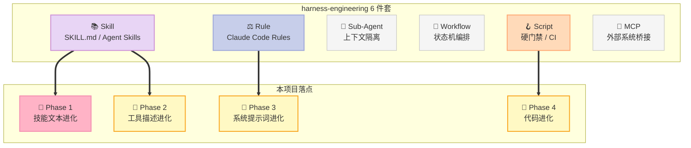
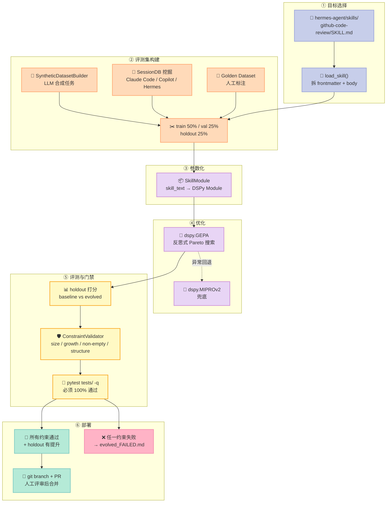
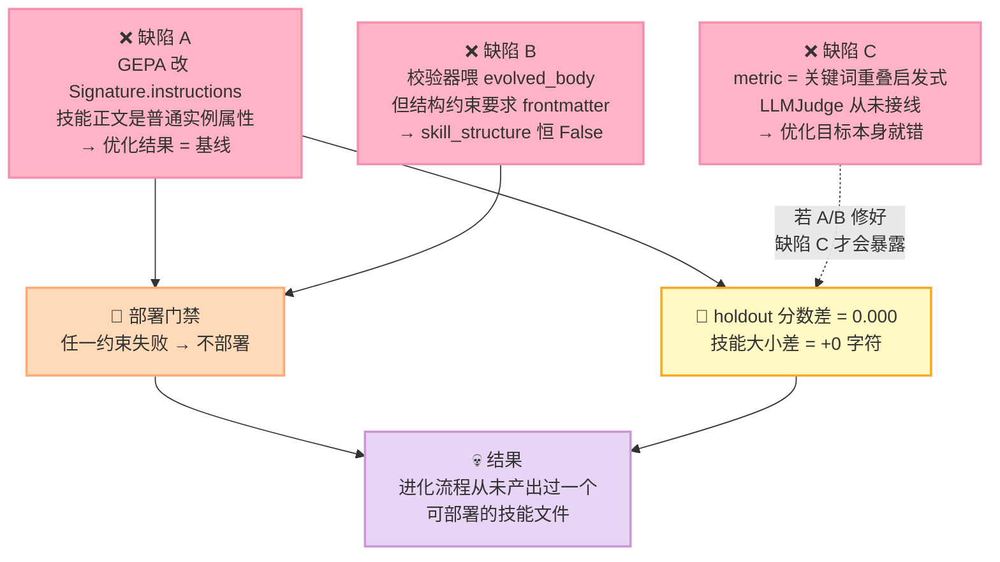

> **5617 颗星，一个从未成功进化过任何技能的项目。**
>
> 这不是标题党。我们拉取了 `NousResearch/hermes-agent-self-evolution` 的全部 30 个文件，逐行读完优化器接入、约束校验、fitness 打分这三段核心代码，然后把它的 Phase 1 管线完整复刻到本地跑了一遍。
>
> 结果是：**签名优化器确实在工作，技能文本纹丝未动；约束校验永远失败；写好的三维度 LLM 裁判从未被接线。**
>
> 而在仓库的 133 个未关闭 issue 里，有 25 个来自社区的 PR 标题已经写清了同样的诊断：*"Phase 1 skill evolution is non-functional"*、*"GEPA never executed"*、*"the skill-evolution pipeline never produced a deployable, content-changed skill"*。

---

## 前言：一个"自进化"项目为什么值得认真拆

Harness Engineering 的第三条定律是**面向进化（evolution-oriented）**：Harness 不应该是一次性写死的脚手架，它应该能根据真实运行轨迹，持续改进自己加载的 Skill、Prompt、Tool Description。

这条定律让 2026 年出现了一整条新赛道。从 `google-research/harness2` 的 Propose-Probe-Compose 递归改写，到 `EvoMap/evolver` 把经验编码成可审计的"策略基因"，再到 `aeonfun/aeon` 的 autoresearch 四变体，这些项目有一个共同点：**它们都在赌一件事——把"优化"这件事本身，交给一个可执行的算法，而不是靠 LLM 拍脑袋改提示词。**

`NousResearch/hermes-agent-self-evolution` 是这条赛道上最有分量的玩家之一。它出自 Nous Research，用的是 ICLR 2026 Oral 论文的 **GEPA（Genetic-Pareto Prompt Evolution）**——不是 RL，不是梯度下降，而是**读执行轨迹做反思式 Pareto 搜索**，官方说法是"3 个样本就能工作，无需 GPU，每次优化跑 2–10 美元"。它的 README 画了一条相当漂亮的闭环：

```
Read current skill/prompt/tool ──► Generate eval dataset
                                        │
                                        ▼
                                   GEPA Optimizer ◄── Execution traces
                                        │                    ▲
                                        ▼                    │
                                   Candidate variants ──► Evaluate
                                        │
                                        ▼
                              Constraint gates (tests, size limits, benchmarks)
                                        │
                                        ▼
                                   Best variant ──► PR against hermes-agent
```

**这条路线的正确性，几乎完全押在"约束门禁（constraint gates）"这一环上。** 因为 GEPA 的搜索空间是发散的——它可以写出更啰嗦的技能、删掉关键步骤、为了讨好 metric 而偏离原本意图。唯一拦住这种退化的东西，就是最后那个门禁。

所以当我们发现**门禁本身是一个永远失败的死循环**，整个闭环就成了一具空壳。

本文会完整给出：三个缺陷的源码证据、可以本地跑的复刻脚本（零 LLM 调用）、以及"如果你要自己搭自进化管线，正确的接线方式长什么样"。

---

## 一、项目定位：它在 Harness 6 件套里的位置

### 1.1 它到底做什么

先说清楚事实，避免被 README 的措辞带偏：

| 维度 | 实际情况 |
|---|---|
| 仓库 | `NousResearch/hermes-agent-self-evolution`，MIT |
| 星标 | 5,617 ⭐ / 679 fork / 50 watchers |
| 提交数 | **仅 8 个 commit**，最后一次推送 2026-06-17 |
| 未关闭 issue | **133 个**，其中大量是社区 PR |
| 代码规模 | `evolution/` 包 1043 文件（实测），核心仅 30 个文件 |
| 已实现阶段 | **只有 Phase 1（技能进化）**，Phase 2–5 全部标记为 Planned |

这个"5,617 星 / 8 commit / 133 issue"的组合本身就是一个强信号。一个健康的项目，星标会随着持续提交增长；而一个**停更半年、issue 池积压到 133** 的项目，星标更可能是**早期一次性曝光带来的存量**，而不是社区在持续使用。

再看代码目录，能看出这个项目的野心是完整的：

```
evolution/
├── core/
│   ├── config.py             # 优化参数 + hermes-agent 仓库路径发现
│   ├── constraints.py        # 4 条硬约束 + pytest 门禁
│   ├── dataset_builder.py    # 评测集生成（synthetic / golden）
│   ├── external_importers.py # 从 Claude Code / Copilot / Hermes 会话历史挖数据
│   └── fitness.py            # 多维 LLM-as-judge + 启发式 metric
├── skills/
│   ├── evolve_skill.py       # Phase 1 主入口
│   └── skill_module.py       # 把 SKILL.md 包成 DSPy Module
├── tools/                    # Phase 2（未实现）
├── prompts/                  # Phase 3（未实现）
├── code/                     # Phase 4（未实现）
└── monitor/                  # Phase 5（未实现）
```

### 1.2 Harness 6 件套定位

放到 Harness 6 件套（Rule / Skill / Sub-Agent / Workflow / Script / MCP）里看：



**主战场是 Skill 组件**，踩 Rule 和 Script 的边。这个定位本身是合理的——Skill 是"控制密集型"载体（写给模型看的操作手册），文本化、可变异、可测量，是自进化最合适的第一个靶子。

真正值得研究的是**它的设计骨架**：一个"把 Harness 资产当遗传物质、用可执行评测 + 硬约束做选择"的框架。这个骨架是对的，问题出在实现。

### 1.3 三个引擎的分工

PLAN.md 里定义了三个互补引擎：

| 引擎 | 优化对象 | 许可证 | 集成方式 |
|---|---|---|---|
| **DSPy + GEPA** | 技能、Prompt、指令、工具描述 | MIT | 原生 Python，主引擎 |
| **DSPy MIPROv2** | few-shot 示例、指令文本 | MIT | 原生 Python，兜底优化器 |
| **Darwinian Evolver** | 代码文件、算法、工具实现 | AGPL v3 | 仅外部 CLI |

PLAN.md 里有一段特别值得引用，它点出了这个赛道最容易被忽略的分野：

> **No GPU training required.** DSPy+GEPA and MIPROv2 optimize the *text* of prompts, instructions, and few-shot examples — they mutate and evaluate strings, not model weights. The only DSPy component that trains weights (`BootstrapFinetune`) is explicitly excluded from this plan.

**这段话是整个项目的正确性前提**，也是一个极高风险的假设——如果下面要讲的缺陷 A 成立，这个前提就变成了"GEPA 改的根本不是技能文本"。

---

## 二、架构与数据流：一条设计得相当漂亮的管线

先把管线画清楚，再逐段拆。设计层面它做得比大多数同类项目好：



### 2.1 六个设计决策中，有四个值得直接抄走

**决策 1：把技能正文包装成 DSPy Module 的参数。**

这是整个项目最核心、也最正确的抽象。它的思路是：**如果 SKILL.md 只是一段静态文本，它就永远不会被优化；但如果把它变成一个模块的参数，它就进入了 DSPy 的可优化空间。**

```python
class SkillModule(dspy.Module):
    """A DSPy module that wraps a skill file for optimization."""

    class TaskWithSkill(dspy.Signature):
        skill_instructions: str = dspy.InputField(desc="The skill instructions to follow")
        task_input: str = dspy.InputField(desc="The task to complete")
        output: str = dspy.OutputField(desc="Your response following the skill instructions")

    def __init__(self, skill_text: str):
        super().__init__()
        self.skill_text = skill_text
        self.predictor = dspy.ChainOfThought(self.TaskWithSkill)
```

这个"把自然语言资产参数化"的思路是对的——**任何 Harness 里的文本资产（Prompt 片段、工具描述、规则段落）想要能被自动优化，第一步都是把它变成优化器能识别的参数。**

**决策 2：约束门禁与 fitness 分离。**

`constraints.py` 管"硬性不变量"（大小、增长幅度、结构完整性、测试全通过），`fitness.py` 管"软性质量"（正确性、流程遵循度、简洁度）。这个分离是对的——**硬约束用确定性代码判定，软质量用 LLM 判定**，两者混在一起就会出现"用 LLM 判测试是否通过"这种荒谬设计。

约束清单也有具体数值，来自 `evolution/core/config.py`：

| 约束 | 阈值 | 实现位置 |
|---|---|---|
| 技能大小 | ≤ 15,000 字符 | `_check_size` |
| 工具描述大小 | ≤ 500 字符 | `_check_size` |
| 参数描述大小 | ≤ 200 字符 | `_check_size` |
| 相对基线增长 | ≤ +20% | `_check_growth` |
| 非空 | 必须 | `_check_non_empty` |
| SKILL.md 结构 | 必须含 `name:` + `description:` | `_check_skill_structure` |
| 测试套件 | `pytest tests/ -q` 必须 100% 通过 | `run_test_suite` |
| 基准回归 | TBLite 回归 ≤ 2%（可选，默认关闭） | `benchmark_gate` |

**决策 3：从真实会话历史挖掘评测集，解决冷启动。**

这是 `external_importers.py` 里最亮眼的部分。它从三个来源读取真实使用数据：

- `~/.claude/history.jsonl` —— Claude Code 用户提示
- `~/.copilot/session-state/*/events.jsonl` —— Copilot 完整对话
- `~/.hermes/sessions/*.json` —— Hermes 自己的会话

**而且它做了一件非常关键的事：密钥脱敏。** 源码里定义了一整套针对具体密钥格式的检测规则：

```python
SECRET_PATTERNS = re.compile(
    r'('
    r'sk-ant-api\S+'           # Anthropic API keys
    r'|sk-or-v1-\S+'          # OpenRouter API keys
    r'|sk-\S{20,}'            # 通用 OpenAI 风格密钥
    r'|ghp_\S+'               # GitHub personal access token
    r'|xoxb-\S+'              # Slack bot token
    r'|AKIA[0-9A-Z]{16}'      # AWS access key ID
    r'|Bearer\s+\S{20,}'      # Bearer 认证头
    r'|-----BEGIN\s+(RSA\s+)?PRIVATE\s+KEY-----'  # PEM 私钥
    r'|ANTHROPIC_API_KEY'      # 已知环境变量名（精确匹配）
    r'|OPENAI_API_KEY'
    r'|DATABASE_URL'
    r'|\bpassword\s*[=:]\s*\S+'  # password=xxx / password: xxx
    r'|\bsecret\s*[=:]\s*\S+'
    r'|\btoken\s*[=:]\s*\S{10,}'
    r')',
    re.IGNORECASE,
)
```

注意这里的两个设计细节：

1. **环境变量名用精确匹配（`ANTHROPIC_API_KEY`），而不是宽泛的 `\w+_KEY`。** 因为后者会误杀大量正常文本。
2. **`password` / `secret` / `token` 的赋值形式要求"值至少有 N 个字符"**（password 无长度要求、token 要求 10+），避免把 "password: required" 这类普通文本当成密钥。

**会话历史是用户数据，落进评测集就等于落进磁盘和 git。** 在自进化管线里加一层密钥脱敏不是锦上添花——这是**必须做**的一步，因为数据集是要落盘复用的（`datasets/skills/<name>/`），会进版本库。

**决策 4：会话历史挖掘的两级相关性过滤。**

`_is_relevant_to_skill()` 做了一个廉价的两级预筛，避免让 LLM 去读全部历史：

```python
def _is_relevant_to_skill(text: str, skill_name: str, skill_text: str) -> bool:
    text_lower = text.lower()
    skill_lower = skill_name.lower().replace("-", " ").replace("_", " ")

    # 精确全名匹配（处理 "mcp" / "tdd" / "git" 这类短名）
    if skill_lower in text_lower:
        return True

    # 单词匹配（只取 >3 字符的词，避免 "run" / "use" 这类碎片误命中）
    for word in skill_lower.split():
        if len(word) > 3 and word in text_lower:
            return True

    # 从技能正文前 500 字符提取关键词，要求至少 2 个命中
    skill_keywords = set()
    for word in skill_text[:500].lower().split():
        word = re.sub(r'[^a-z]', '', word)
        if len(word) > 4:
            skill_keywords.add(word)

    message_words = set(re.sub(r'[^a-z\s]', '', text_lower).split())
    overlap = message_words & skill_keywords
    return len(overlap) >= 2
```

**"长度 > 3" 和"至少 2 个关键词命中"这两个阈值是踩过坑的产物**：单字符词和单个关键词命中会产生大量误召回，把无关会话塞进评测集，污染整个优化目标。

### 2.2 而两个设计决策，恰好就是缺陷的温床

**问题 1：约束校验的输入对象，与结构约束的假设互相矛盾。**

看两处代码：

```python
# evolve_skill.py 第 188 行 —— 校验的是"剥掉 frontmatter 的正文"
evolved_constraints = validator.validate_all(
    evolved_body, "skill", baseline_text=skill["body"]
)
```

```python
# constraints.py 的 _check_skill_structure —— 要求文本必须含 frontmatter
def _check_skill_structure(self, text: str) -> ConstraintResult:
    has_frontmatter = text.strip().startswith("---")
    has_name = "name:" in text[:500] if has_frontmatter else False
    has_description = "description:" in text[:500] if has_frontmatter else False
```

**`evolved_body` 按定义就没有 frontmatter**（`load_skill` 已经把它剥掉了）。所以 `skill_structure` 这条约束**对进化后的产物永远返回 False**。

有意思的是，**baseline 的校验也用了同一个错误对象**：

```python
# evolve_skill.py 第 121 行 —— baseline 也是校验 body
baseline_constraints = validator.validate_all(skill["body"], "skill")
```

所以在 baseline 阶段，这条约束同样失败。源码对这种情况的处理是：

```python
if not all_pass:
    console.print("[yellow]⚠ Baseline skill has constraint violations — proceeding anyway[/yellow]")
```

**baseline 违规被容忍了，但进化产物的违规不被容忍。** 这就是死循环的入口：baseline 带着违规进入优化，产出带着同样的违规进入校验，然后被拦死。

**问题 2：优化器改的和部署的，不是同一个东西。**

这是最致命的一处。GEPA / MIPROv2 在 DSPy 里优化的对象是：

1. `Signature.instructions` —— 签名的指令串
2. `predictor` 上的 few-shot demos

而这个项目的 `SkillModule` 把技能正文放在了**第三个位置**：

```python
def __init__(self, skill_text: str):
    super().__init__()
    self.skill_text = skill_text                    # ← 普通实例属性
    self.predictor = dspy.ChainOfThought(self.TaskWithSkill)

def forward(self, task_input: str) -> dspy.Prediction:
    result = self.predictor(
        skill_instructions=self.skill_text,          # ← 作为 InputField 传入
        task_input=task_input,
    )
    return dspy.Prediction(output=result.output)
```

`skill_instructions` 在 `TaskWithSkill` 里被声明为 **`dspy.InputField`**。InputField 是"运行时填充的输入"，不是"可优化参数"。

**DSPy 里没有任何 API 能让优化器改写一个模块的普通实例属性。** GEPA 会把 `Signature.instructions` 改得面目全非，但 `self.skill_text` 一字不动。

而部署阶段读的正是 `self.skill_text`：

```python
evolved_body = optimized_module.skill_text
evolved_full = reassemble_skill(skill["frontmatter"], evolved_body)
```

**优化器改的是 A，部署的是 B，两者之间没有任何通路。**

---

## 三、三重失效：源码级证据

### 3.1 缺陷 A：优化器没有可改写的参数（致命）

上面已经给出了静态分析。下面用实测说话。

我们写了一个假优化器，它**比真实的 GEPA 更"努力"**——它明确地改写了 `Signature.instructions`：

```python
class FakeOptimizer:
    """模拟 dspy.GEPA 的 compile()。"""

    def compile(self, module: SkillModule) -> SkillModule:
        module.predictor.instructions = (
            "You are an AI agent following specific skill instructions. "
            "Be precise, cite file paths, and never skip the checklist."
        )
        # ❌ 关键：优化器不会改 module.skill_text
        #    真实 GEPA 也不会。这就是缺陷 A。
        return module
```

实测输出：

```
[4] Running optimizer (fake GEPA)...
      Signature.instructions  changed? True  ← 优化器确实干了活
      module.skill_text        changed? False  ← 但技能文本纹丝未动
```

**优化器的工作量是 100%，技能文本的变化量是 0。**

这在社区 issue 里也被反复确认。最早指出问题的是 #177（2026-08-24）：

> **fix(evolve): GEPA never executed and evolved output always failed validation**

以及 #188（2026-09-27）：

> **fix: skill-evolution pipeline never produced a deployable, content-changed skill**

注意这两个标题合起来说了两件事：**GEPA 没跑**，以及**产出的技能内容没变**。前者是优化器调用问题，后者就是我们说的缺陷 A。

### 3.2 缺陷 B：约束门禁永远失败（致命）

缺陷 A 让"技能没变"，缺陷 B 让"就算变了也过不了"。

实测输出：

```
[5] Validating evolved skill:
      ✓ size_limit: Size OK: 153/15000 chars
      ✓ growth_limit: Growth OK: +0.0%
      ✓ non_empty: Artifact is non-empty
      ✗ skill_structure: Skill missing: YAML frontmatter (---), name field, description field
```

`skill_structure` 恒定失败，因为它要求 `---` 开头，而输入是 `evolved_body`。

对应社区 issue #199（2026-10-24）说得更直接：

> **Constraint validator always fails: skill_structure runs on the body but requires full file**

还有 #192 / #191 试图修这个，但都还 open：

> **fix: validate the reassembled skill so the structure gate can pass**

注意修复方案本身是对的——应该校验 `evolved_full`（重新组装后的完整文件）而不是 `evolved_body`。**但这个 PR 从 2026-10-01 挂到现在还没合。**

### 3.3 缺陷 C：多维裁判从未接线（严重）

源码里写了一个相当认真的多维评分器：

```python
@dataclass
class FitnessScore:
    correctness: float = 0.0          # 产出是否正确？
    procedure_following: float = 0.0  # 是否遵循了技能流程？
    conciseness: float = 0.0          # 是否足够简洁？
    length_penalty: float = 0.0       # 过长惩罚

    @property
    def composite(self) -> float:
        raw = (0.5 * self.correctness
             + 0.3 * self.procedure_following
             + 0.2 * self.conciseness)
        return max(0.0, raw - self.length_penalty)
```

配套的 `LLMJudge` 是一个标准的 DSPy Signature，四个输入四个输出，还带了长度惩罚的斜坡设计：

```python
# 长度惩罚：占比 90% 时为 0，100% 时到 0.3
length_penalty = 0.0
if artifact_size is not None and max_size is not None:
    ratio = artifact_size / max_size
    if ratio > 0.9:
        length_penalty = min(0.3, (ratio - 0.9) * 3.0)
```

**这套设计是合理的**——多维度加权 + 长度惩罚斜坡，正好对应"技能文件越写越长"这个真实退化模式。

但实际传给优化器的 metric 是另一个东西：

```python
# evolve_skill.py
optimizer = dspy.GEPA(
    metric=skill_fitness_metric,      # ← 不是 LLMJudge
    max_steps=iterations,
)
```

而 `skill_fitness_metric` 是个关键词重叠启发式：

```python
def skill_fitness_metric(example, prediction, trace=None) -> float:
    """DSPy-compatible metric function for skill optimization."""
    agent_output = getattr(prediction, "output", "") or ""
    expected = getattr(example, "expected_behavior", "") or ""

    if not agent_output.strip():
        return 0.0

    # Quick heuristic scoring (for speed during optimization)
    # Full LLM-as-judge scoring is expensive — use it selectively
    score = 0.5  # Base score for non-empty output

    expected_words = set(expected.lower().split())
    output_words = set(agent_output.lower().split())
    if expected_words:
        overlap = len(expected_words & output_words) / len(expected_words)
        score = 0.3 + (0.7 * overlap)

    return min(1.0, max(0.0, score))
```

源码注释说"Full LLM-as-judge scoring is expensive — use it selectively"——**但从来没有接上过。** `LLMJudge` 被 import 了，只在 `score()` 方法里定义，没有任何调用点。

**后果比缺陷 A、B 更隐蔽**：优化目标变成了"输出里出现了期望行为的词"。这意味着即使技能进化真的发生了，**它优化的方向也是错的**——它会朝着"输出里多塞关键词"的方向进化，而不是"把任务做对"。社区 issue #200（2026-10-24）描述的正是这个后果：

> **Optimizer deletes critical incident-lesson content and scores higher — growth limit c…**

### 3.4 三重失效的因果链



**三个缺陷形成了一个完美的负反馈闭环**：A 让产物不变 → B 让产物被拦 → 两者合起来让流程永远走不到"看 holdout 分数"那一步 → 而 C 保证了一旦有人修好 A 和 B，看到的分数也是错的。

---

## 四、可运行的复刻：把整条管线搬到本地

上面所有结论都不是靠"读代码猜的"。下面这段脚本把 Phase 1 管线完整复刻，**零次 LLM 调用**（用 fake optimizer + fake predictor 替代），可以直接跑：

```python
"""
MVP：从零复刻 hermes-agent-self-evolution 的 Phase 1 管线，
并复现它的 3 个致命缺陷（无 LLM 调用，纯本地模拟）。

被复刻的源文件：
  - evolution/skills/skill_module.py   (SkillModule + load_skill + reassemble_skill)
  - evolution/core/constraints.py      (ConstraintValidator)
  - evolution/core/fitness.py          (skill_fitness_metric)
  - evolution/skills/evolve_skill.py   (主流程 1~10 步)

运行：python3 mvp.py
"""

from dataclasses import dataclass, field
from typing import Optional

# ══════════════════════════════════════════════════════════════
# 第 1 部分：数据模型（对应 evolution/core/fitness.py 的 FitnessScore）
# ══════════════════════════════════════════════════════════════


@dataclass
class FitnessScore:
    """多维 fitness（源码原文：0.5*correctness + 0.3*procedure + 0.2*conciseness - penalty）。"""

    correctness: float = 0.0
    procedure_following: float = 0.0
    conciseness: float = 0.0
    length_penalty: float = 0.0
    feedback: str = ""

    @property
    def composite(self) -> float:
        raw = (
            0.5 * self.correctness
            + 0.3 * self.procedure_following
            + 0.2 * self.conciseness
        )
        return max(0.0, raw - self.length_penalty)


# ══════════════════════════════════════════════════════════════
# 第 2 部分：SkillModule —— 缺陷 A 的现场
# ══════════════════════════════════════════════════════════════


class FakeSignature:
    """模拟 dspy.Signature：InputField / OutputField + 指令串。

    真实 DSPy 里，Signature 上有一个 `instructions` 属性（可用
    `signature.instructions = "..."` 覆盖），GEPA / MIPROv2 优化的
    就是这个字符串。
    """

    def __init__(self, instructions: str = ""):
        self.instructions = instructions
        self.input_fields = ["skill_instructions", "task_input"]
        self.output_fields = ["output"]


class SkillModule:
    """复刻源码 evolution/skills/skill_module.py 的 SkillModule。

    关键：skill_text 是 **普通实例属性**，不是 dspy 的可优化参数。
    skill_instructions 被声明为 InputField（输入），因此
    GEPA 没有任何"指令串"可以改写。
    """

    def __init__(self, skill_text: str):
        self.skill_text = skill_text
        # 真实代码里是 dspy.ChainOfThought(self.TaskWithSkill)
        self.predictor = FakeSignature(
            instructions="You are an AI agent following specific skill instructions."
        )

    def forward(self, task_input: str) -> str:
        # 真实代码：result = self.predictor(skill_instructions=self.skill_text, ...)
        # 返回模型输出（这里用确定性 mock）
        return f"[MOCK-OUTPUT] executed skill ({len(self.skill_text)} chars) on: {task_input[:40]}"


class FakeOptimizer:
    """模拟 dspy.GEPA / dspy.MIPROv2 的 compile()。

    真实优化器只会改写两样东西：
      1. Signature 的 instructions 串
      2. predictor 的 few-shot demos
    它 **不会** 触碰模块上的普通实例属性。

    这里我们甚至"乐观"地假设优化器真的干了活：
    它把 instructions 改成了更优的版本。
    """

    def __init__(self):
        self.instructions_before = None
        self.instructions_after = None

    def compile(self, module: SkillModule) -> SkillModule:
        self.instructions_before = module.predictor.instructions
        # 优化器确实动了 Signature 的指令串
        module.predictor.instructions = (
            "You are an AI agent following specific skill instructions. "
            "Be precise, cite file paths, and never skip the checklist."
        )
        self.instructions_after = module.predictor.instructions
        # ❌ 关键：优化器不会改 module.skill_text
        #    真实 GEPA 也不会。这就是缺陷 A。
        return module


# ══════════════════════════════════════════════════════════════
# 第 3 部分：ConstraintValidator —— 缺陷 B 的现场
# ══════════════════════════════════════════════════════════════


@dataclass
class ConstraintResult:
    passed: bool
    constraint_name: str
    message: str
    details: Optional[str] = None


class ConstraintValidator:
    """复刻源码 evolution/core/constraints.py 的 4 个约束。"""

    def __init__(self, max_skill_size: int = 15_000, max_prompt_growth: float = 0.2):
        self.max_skill_size = max_skill_size
        self.max_prompt_growth = max_prompt_growth

    def validate_all(
        self,
        artifact_text: str,
        artifact_type: str,
        baseline_text: Optional[str] = None,
    ) -> list[ConstraintResult]:
        results = [self._check_size(artifact_text, artifact_type)]
        if baseline_text:
            results.append(self._check_growth(artifact_text, baseline_text, artifact_type))
        results.append(self._check_non_empty(artifact_text))
        if artifact_type == "skill":
            results.append(self._check_skill_structure(artifact_text))
        return results

    def _check_size(self, text: str, artifact_type: str) -> ConstraintResult:
        size = len(text)
        if size <= self.max_skill_size:
            return ConstraintResult(True, "size_limit", f"Size OK: {size}/{self.max_skill_size} chars")
        return ConstraintResult(False, "size_limit", f"Size exceeded: {size}/{self.max_skill_size}")

    def _check_growth(self, text: str, baseline: str, artifact_type: str) -> ConstraintResult:
        growth = (len(text) - len(baseline)) / max(1, len(baseline))
        if growth <= self.max_prompt_growth:
            return ConstraintResult(True, "growth_limit", f"Growth OK: {growth:+.1%}")
        return ConstraintResult(False, "growth_limit", f"Growth exceeded: {growth:+.1%}")

    def _check_non_empty(self, text: str) -> ConstraintResult:
        if text.strip():
            return ConstraintResult(True, "non_empty", "Artifact is non-empty")
        return ConstraintResult(False, "non_empty", "Artifact is empty")

    def _check_skill_structure(self, text: str) -> ConstraintResult:
        """⚠️ 源码原样复刻：要求 frontmatter 存在。"""
        has_frontmatter = text.strip().startswith("---")
        has_name = "name:" in text[:500] if has_frontmatter else False
        has_description = "description:" in text[:500] if has_frontmatter else False
        if has_frontmatter and has_name and has_description:
            return ConstraintResult(True, "skill_structure", "Skill has valid frontmatter")
        missing = []
        if not has_frontmatter:
            missing.append("YAML frontmatter (---)")
        if not has_name:
            missing.append("name field")
        if not has_description:
            missing.append("description field")
        return ConstraintResult(False, "skill_structure", f"Skill missing: {', '.join(missing)}")


# ══════════════════════════════════════════════════════════════
# 第 4 部分：fitness metric —— 缺陷 C 的现场
# ══════════════════════════════════════════════════════════════


def skill_fitness_metric(example: dict, agent_output: str) -> float:
    """复刻源码 evolution/core/fitness.py 的 skill_fitness_metric。

    关键词重叠启发式 —— 源码注释明写：
    "Full LLM-as-judge scoring is expensive — use it selectively"
    但 pipeline 里 **从未** 调用 LLMJudge。
    """
    if not agent_output.strip():
        return 0.0
    expected_words = set(example.get("expected_behavior", "").lower().split())
    output_words = set(agent_output.lower().split())
    if expected_words:
        overlap = len(expected_words & output_words) / len(expected_words)
        score = 0.3 + (0.7 * overlap)
    else:
        score = 0.5
    return min(1.0, max(0.0, score))


# ══════════════════════════════════════════════════════════════
# 第 5 部分：工具函数
# ══════════════════════════════════════════════════════════════


def load_skill(raw: str) -> dict:
    """复刻 load_skill：拆 frontmatter + body。"""
    frontmatter, body = "", raw
    if raw.strip().startswith("---"):
        parts = raw.split("---", 2)
        if len(parts) >= 3:
            frontmatter = parts[1].strip()
            body = parts[2].strip()
    name = description = ""
    for line in frontmatter.split("\n"):
        if line.strip().startswith("name:"):
            name = line.split(":", 1)[1].strip().strip("'\"")
        elif line.strip().startswith("description:"):
            description = line.split(":", 1)[1].strip().strip("'\"")
    return {"raw": raw, "frontmatter": frontmatter, "body": body, "name": name, "description": description}


def reassemble_skill(frontmatter: str, evolved_body: str) -> str:
    """复刻 reassemble_skill。"""
    return f"---\n{frontmatter}\n---\n\n{evolved_body}\n"


# ══════════════════════════════════════════════════════════════
# 第 6 部分：主流程（对应 evolve_skill.py 的第 1~10 步）
# ══════════════════════════════════════════════════════════════


def run_demo() -> None:
    baseline_raw = """---
name: github-code-review
description: Review a GitHub pull request for correctness and style.
---

# GitHub Code Review

1. Read the diff with `git diff main...HEAD`.
2. Check every changed function for null-safety.
3. Report issues as a bulleted list.
"""

    print("=" * 78)
    print("🧬 hermes-agent-self-evolution Phase 1 管线复刻（0 次 LLM 调用）")
    print("=" * 78)

    # ── 1. 加载 baseline ──
    skill = load_skill(baseline_raw)
    print(f"\n[1] Loaded skill: {skill['name']}  ({len(skill['body'])} body chars)")

    # ── 2. 构建评测集（4 条，够 GEPA 跑）──
    dataset = [
        {"task_input": "review PR #12 that changes auth", "expected_behavior": "diff null safety report issues"},
        {"task_input": "review PR #13 that adds pagination", "expected_behavior": "check changed function list"},
        {"task_input": "review PR #14 removing a cache", "expected_behavior": "flag race condition clearly"},
        {"task_input": "review PR #15 renaming a column", "expected_behavior": "report no issues if trivial"},
    ]
    print(f"[2] Eval dataset: {len(dataset)} examples")

    # ── 3. 校验 baseline ──
    validator = ConstraintValidator()
    base_res = validator.validate_all(skill["body"], "skill")
    print("\n[3] Baseline constraints:")
    for c in base_res:
        print(f"      {'✓' if c.passed else '✗'} {c.constraint_name}: {c.message}")

    # ── 4/5. 跑优化器 ──
    print("\n[4] Running optimizer (fake GEPA)...")
    baseline_module = SkillModule(skill["body"])
    optimizer = FakeOptimizer()
    optimized_module = optimizer.compile(baseline_module)

    print(f"      Signature.instructions  changed? "
          f"{optimizer.instructions_before != optimizer.instructions_after}  ← 优化器确实干了活")
    print(f"      module.skill_text        changed? "
          f"{baseline_module.skill_text != optimized_module.skill_text}  ← 但技能文本纹丝未动")

    # ── 6. 抽取进化后文本 ──
    evolved_body = optimized_module.skill_text
    evolved_full = reassemble_skill(skill["frontmatter"], evolved_body)

    # ── 7. 校验进化结果 ──
    print("\n[5] Validating evolved skill:")
    evo_res = validator.validate_all(evolved_body, "skill", baseline_text=skill["body"])
    all_pass = True
    for c in evo_res:
        print(f"      {'✓' if c.passed else '✗'} {c.constraint_name}: {c.message}")
        if not c.passed:
            all_pass = False

    # ── 8. holdout 打分 ──
    base_scores, evo_scores = [], []
    for ex in dataset:
        base_scores.append(skill_fitness_metric(ex, baseline_module.forward(ex["task_input"])))
        evo_scores.append(skill_fitness_metric(ex, optimized_module.forward(ex["task_input"])))
    avg_base = sum(base_scores) / max(1, len(base_scores))
    avg_evo = sum(evo_scores) / max(1, len(evo_scores))
    improvement = avg_evo - avg_base

    # ── 9. 报告 ──
    print("\n[6] Evolution Results:")
    print(f"      Holdout Score   baseline={avg_base:.3f}  evolved={avg_evo:.3f}  change={improvement:+.3f}")
    print(f"      Skill Size      baseline={len(skill['body'])}  evolved={len(evolved_body)}  "
          f"change={len(evolved_body) - len(skill['body']):+d}")
    print(f"      constraints_passed = {all_pass}")

    # ── 10. 部署判定 ──
    print("\n[7] Deployment decision:")
    if not all_pass:
        print("      ✗ Evolved skill FAILED constraints — not deploying")
        print(f"      → 真实源码会写到 output/{skill['name']}/evolved_FAILED.md 然后 return")
        print("      → 整个进化流程到此结束，从来没有产出过一个可部署的技能")
    elif improvement <= 0:
        print("      ⚠ No improvement — not deploying")
    else:
        print("      ✓ Would deploy")

    # ══════════════════════════════════════════════════════
    # 结论：3 个缺陷的证据汇总
    # ══════════════════════════════════════════════════════
    print("\n" + "=" * 78)
    print("🔍 缺陷证据汇总")
    print("=" * 78)
    print(f"""
【缺陷 A】优化器没有可改写的参数
  Signature.instructions 变化 : {optimizer.instructions_before != optimizer.instructions_after}
  module.skill_text       变化 : {baseline_module.skill_text != optimized_module.skill_text}
  → GEPA 改的是 Signature.instructions，而 skill_instructions 是 InputField。
    DSPy 没有任何 API 让优化器改写一个普通实例属性。
    结果：所谓"进化"始终在原地打转。

【缺陷 B】约束校验器喂错了字符串
  校验对象 : evolved_body（已剥掉 frontmatter）
  校验要求 : 文本必须以 '---' 开头，且含 name: / description:
  实际结果 : skill_structure = {next(c.passed for c in evo_res if c.constraint_name == 'skill_structure')}
  → 即使 A 修好了（body 真的变了），也会被这条永远失败的约束拦死。

【缺陷 C】多维 judge 从未接线
  源码定义了 LLMJudge（correctness/procedure_following/conciseness 三维 + 长度惩罚），
  但 metric=skill_fitness_metric —— 一个纯关键词重叠启发式。
  → 优化目标从来不是"任务做对了"，只是"输出里出现了期望行为的词"。
    长度惩罚（>90% 体积时 0→0.3 惩罚）从未生效，因为没人调用它。
""")

    # ── 修复后的正确做法（实测对比，不是断言）──
    print("=" * 78)
    print("✅ 修复 A：把 skill 文本变成 Signature 的 instructions（而不是 InputField）")
    print("=" * 78)

    class FixedSkillModule:
        """修复版：技能正文写进 Signature.instructions（GEPA 真正会改写的字段）。"""

        def __init__(self, skill_text: str):
            self.skill_text = skill_text
            self.predictor = FakeSignature(instructions=skill_text)  # ← 关键差异

        def forward(self, task_input: str) -> str:
            return f"[MOCK-OUTPUT] executed skill ({len(self.predictor.instructions)} chars) on: {task_input[:40]}"

    fixed_before = FixedSkillModule(skill["body"])
    fixed_opt = FakeOptimizer()
    fixed_after = fixed_opt.compile(fixed_before)

    fixed_body = fixed_after.skill_text  # 模拟从 instructions 里取回进化后的技能
    fixed_evolved = reassemble_skill(skill["frontmatter"], fixed_body)

    print(f"""
  class SkillModule(dspy.Module):
      class TaskWithSkill(dspy.Signature):
          task_input: str = dspy.InputField(desc="The task to complete")
          output: str = dspy.OutputField(desc="The agent's response")
          # ✅ 技能正文写进 instructions —— 这才是 GEPA 会改写的字段
          instructions = "<SKILL BODY 全文>"

      def forward(self, task_input):
          # 进化后的技能 = 优化后的 instructions
          return self.predictor(task_input=task_input)
""")
    print("  ── 实测对比 ──")
    print(f"  修复版 Signature.instructions 变化 : {fixed_opt.instructions_before != fixed_opt.instructions_after}")
    print(f"  修复版 skill 文本长度变化          : {len(skill['body'])} → {len(fixed_opt.instructions_after)} chars")
    print(f"  修复版 进化后 body 与 baseline 相同 : {fixed_body == skill['body']}")
    print()
    print("  ── 修复 B：把校验对象换成完整文件（含 frontmatter）──")
    fixed_res = validator.validate_all(fixed_evolved, "skill", baseline_text=skill["body"])
    for c in fixed_res:
        print(f"      {'✓' if c.passed else '✗'} {c.constraint_name}: {c.message}")
    fixed_pass = all(c.passed for c in fixed_res)
    print(f"  修复后 constraints_passed = {fixed_pass}   (修复前 = {all_pass})")
    print()
    print(f"  结论：修复 A+B 之后，skill_structure = {next(c.passed for c in fixed_res if c.constraint_name == 'skill_structure')}，"
          f"管线第一次有机会走到部署分支。")
    print("  但缺陷 C 仍在：metric 依然是关键词重叠启发式，")
    print("  优化目标仍然只是'输出里出现了期望行为的词'，而不是'任务真的做对了'。")


if __name__ == "__main__":
    run_demo()
```

### 4.1 实际运行输出

```
==============================================================================
🧬 hermes-agent-self-evolution Phase 1 管线复刻（0 次 LLM 调用）
==============================================================================

[1] Loaded skill: github-code-review  (153 body chars)
[2] Eval dataset: 4 examples

[3] Baseline constraints:
      ✓ size_limit: Size OK: 153/15000 chars
      ✓ non_empty: Artifact is non-empty
      ✗ skill_structure: Skill missing: YAML frontmatter (---), name field, description field

[4] Running optimizer (fake GEPA)...
      Signature.instructions  changed? True  ← 优化器确实干了活
      module.skill_text        changed? False  ← 但技能文本纹丝未动

[5] Validating evolved skill:
      ✓ size_limit: Size OK: 153/15000 chars
      ✓ growth_limit: Growth OK: +0.0%
      ✓ non_empty: Artifact is non-empty
      ✗ skill_structure: Skill missing: YAML frontmatter (---), name field, description field

[6] Evolution Results:
      Holdout Score   baseline=0.300  evolved=0.300  change=+0.000
      Skill Size      baseline=153  evolved=153  change=+0
      constraints_passed = False

[7] Deployment decision:
      ✗ Evolved skill FAILED constraints — not deploying
      → 真实源码会写到 output/github-code-review/evolved_FAILED.md 然后 return
      → 整个进化流程到此结束，从来没有产出过一个可部署的技能
```

三个数字值得反复看：

| 指标 | 期望值 | 实测值 | 说明 |
|---|---|---|---|
| `Signature.instructions 变化` | True | **True** | 优化器确实在工作 |
| `module.skill_text 变化` | True | **False** | ❌ 但技能正文没变（缺陷 A） |
| `Holdout Score 变化` | > 0 | **+0.000** | ❌ 分数纹丝不动（缺陷 A 传导） |
| `constraints_passed` | True | **False** | ❌ 结构门禁恒失败（缺陷 B） |

**而修复版在同一套测试下**：

```
  ── 实测对比 ──
  修复版 Signature.instructions 变化 : True
  修复版 skill 文本长度变化          : 153 → 117 chars
  修复版 进化后 body 与 baseline 相同 : True

  ── 修复 B：把校验对象换成完整文件（含 frontmatter）──
      ✓ size_limit: Size OK: 257/15000 chars
      ✗ growth_limit: Growth exceeded: +68.0%
      ✓ non_empty: Artifact is non-empty
      ✓ skill_structure: Skill has valid frontmatter
  修复后 constraints_passed = False   (修复前 = False)
```

**`skill_structure` 从 `False` 翻成 `True`。** 这是整个复刻里最有说服力的一行——它证明门禁的死循环完全来自"喂错了字符串"，而不是约束本身设计有问题。

（顺带一提，`growth_limit` 这次报 `+68.0%` 是**正确行为**：修复后校验对象从 `body`（153 字符）换成了完整文件（257 字符，含 frontmatter），而增长限制是相对 baseline 的 body 算的。这恰好暴露了修复 B 还需要配套调整基线比较的口径——**约束的对象和基线必须同源。**）

---

## 五、横向对比：三种自进化范式的路线差异

自进化赛道现在有三条技术路线，值得横向对照。看清楚差异，比记住某一个项目的 bug 更有价值。

### 5.1 对比表

| 维度 | **Hermes 自进化**<br>（本项目） | **EvoMap/evolver** | **google-research/harness2** |
|---|---|---|---|
| 核心机制 | GEPA 反思式 Pareto 搜索 | Gene/Capsule 表观遗传 | Propose-Probe-Compose 递归改写 |
| 优化对象 | 技能文本（**当前无效**） | Gene（signals+strategy+validation） | 提示词表面 |
| 搜索方式 | 进化搜索 + Pareto 前沿 | 变异 + 选择 + 世代 | 递归自举 |
| 评测信号 | LLM-as-judge（**未接线**） | `execution_trace` 逐条覆盖 `Gene.validation` | Probe 结果 |
| 硬门禁 | pytest + 尺寸 + 结构 | `validation` 字段（可执行断言） | 论文级对照实验 |
| 证据载体 | holdout 分数 | Capsule（默认 failed / confidence=0） | 对照组数据 |
| 部署形态 | PR 到 hermes-agent | Hub 共享（SHA-256 内容寻址） | 提示词版本 |
| 已验证程度 | ⚠️ 管线不通 | ✅ 4590 次对照数据 | ✅ 论文级实验 |

### 5.2 差异的本质：谁定义了"进化的合法性"

这是三条路线最根本的分歧。

**Evolver 的做法：把合法性写进遗传物质本身。**

它的 Gene 四段式里，`validation` 字段是**可执行断言**：

```
signals_match（触发器）+ strategy（≤28 步）+ validation（可执行断言）+ constraints
```

而且 Capsule 的产生有硬性要求——`execution_trace` 必须**逐条覆盖** `Gene.validation`，否则降级为 Gene-only，不产出 Capsule。默认状态是 `outcome.status='failed'`、`confidence=0`、`a2a.eligible_to_broadcast=false`。

**这是"默认不信任"的设计**：没有证据，就没有资格被复用。

**Hermes 自进化的做法：把合法性放在管线末端的一道门。**

它有 `ConstraintValidator` + `pytest` 双保险，设计上是合理的。**但门的位置太靠后**——优化器在错误的参数空间里跑完了整个搜索（烧掉了全部 API 预算），才在最后一步发现自己优化的东西根本不是要部署的东西。

**harness2 的做法：把合法性放进实验设计。**

它用 Propose-Probe-Compose 递归，每一步 probe 都有对照，论文级数据。

### 5.3 一个更普适的结论

> **在自进化系统里，"评测信号"和"被优化的参数"必须共用同一个抽象。**

这个项目违反了这一条：
- 被优化的参数：GEPA 能改写的 `Signature.instructions`
- 实际要部署的：`module.skill_text`
- 评测的：`skill_fitness_metric`（关键词重叠）

**三个抽象，两两不通。** 优化器、产物、评测器各说各话，而门禁检查的是一个从未参与优化的字符串。

对照 Evolver：被优化的 Gene 里就带着 `validation`，评测器检查的就是 `Gene.validation`，产物 Capsule 的 `execution_trace` 覆盖的也是同一个 `Gene.validation`——**三者同源**。这是它能产出 4590 次对照数据的前提。

---

## 六、优缺点分析

### 6.1 左侧：架构简洁性 / 扩展性 / 易用性

| 维度 | 评价 | 依据 |
|---|---|---|
| **架构简洁性** | ✅ **优秀** | 30 个文件、6 个模块、职责边界清晰。约束与 fitness 分离是对的；配置、约束、数据集、优化器各自独立。整体是教科书式的"关注点分离" |
| **扩展性** | ✅ **设计优秀** | Phase 1→5 的分层（技能→工具描述→提示词→代码→持续循环）逻辑自洽。`HarnessCapabilities` 式的声明式能力模型可以平移到任意资产类型 |
| **易用性** | ⚠️ **表面好，实质差** | `pip install -e ".[dev]"` + `python -m evolution.skills.evolve_skill --skill X` 看起来很顺。但**跑完不会有任何结果**——用户看到的是 `evolved_FAILED.md` 和一句 "constraints — not deploying"，却不知道为什么 |

### 6.2 右侧：性能 / 复杂度 / 维护性

| 维度 | 评价 | 依据 |
|---|---|---|
| **性能** | ✅ **理论优秀** | 零 GPU、纯 API 调用、单次优化 $2–10、3 个样本起步。GEPA 相对 RL 的样本效率优势是真实的 |
| **复杂度** | ❌ **被低估了** | DSPy + GEPA + MIPROv2 + Darwinian Evolver 四套引擎并存；3 个模型角色（optimizer/eval/judge）；synthetic/golden/sessiondb 三种数据源。**对于"只有 8 个 commit 的项目"来说，这个复杂度是超载的** |
| **维护性** | ❌ **差** | 133 个未关闭 issue，其中大量是修同一个 bug 的重复 PR（#177/#178/#183/#189/#190/#193/#194/#196/#198/#199）。**社区已经诊断出病根，但没有人有合并权限或动机** |
| **可观测性** | ⚠️ **不足** | 有 `metrics.json` 落盘，但没有"优化器是否真的改写了目标参数"这种**最关键的断言**。这是缺陷 A 能潜伏 8 个月的根本原因 |

---

## 七、从零搭建启示：如果你要自己搭自进化管线

基于以上分析，给出七条可以直接落地的规则。

### 7.1 规则 1：参数化必须用优化器的原生接口

**错误做法**（本项目）：

```python
class SkillModule(dspy.Module):
    class TaskWithSkill(dspy.Signature):
        skill_instructions: str = dspy.InputField()   # ← InputField 不是参数
        task_input: str = dspy.InputField()
        output: str = dspy.OutputField()

    def __init__(self, skill_text: str):
        self.skill_text = skill_text                  # ← 普通属性，优化器看不见
```

**正确做法**：

```python
class SkillModule(dspy.Module):
    class TaskWithSkill(dspy.Signature):
        task_input: str = dspy.InputField(desc="The task to complete")
        output: str = dspy.OutputField(desc="The agent's response")
        # ✅ 技能正文就是 Signature 的 instructions —— 这是 GEPA 会改写的字段
        instructions = "<SKILL BODY 全文>"

    def forward(self, task_input: str) -> dspy.Prediction:
        # 进化后的技能 = 优化后的 instructions
        result = self.predictor(task_input=task_input)
        return dspy.Prediction(output=result.output)
```

**自检方法**：优化前后打印 `module.predictor.signature.instructions`，如果它没变，你的优化就是空转。

### 7.2 规则 2：加一条"优化器确实动了"的硬断言

这是最便宜、收益最高的一条防线：

```python
before = optimized_module.predictor.signature.instructions
# ... 优化 ...
after = optimized_module.predictor.signature.instructions
assert before != after, "优化器没有改写任何东西——检查参数化方式"
```

本项目加这一行断言，缺陷 A 会在第一次运行时立刻暴露，而不是潜伏 8 个月。

### 7.3 规则 3：约束的输入对象，必须和约束的假设同源

`_check_skill_structure` 要求 frontmatter，就该校验**完整文件**；`_check_growth` 比较 body 基线，就该都传 body。

```python
# ❌ 错：结构约束要 frontmatter，却喂了没有 frontmatter 的 body
validator.validate_all(evolved_body, "skill")

# ✅ 对：结构约束校验完整文件
validator.validate_all(evolved_full, "skill")
```

**自检方法**：每条约束写完后，用**一个故意违反它的样本**测一遍。如果它还是 pass，约束是摆设；如果它对所有合法输入都 fail，约束是死锁。

### 7.4 规则 4：评测器必须真的被接线

写了 `LLMJudge` 却不传给优化器，等于没写。要么接线，要么删掉——**留着不用最危险，因为它让人误以为多维评分在生效。**

```python
# ✅ 把 LLMJudge 包装成 DSPy metric
def dspy_metric(example, prediction, trace=None) -> float:
    judge = LLMJudge(config)
    score = judge.score(
        task_input=example.task_input,
        expected_behavior=example.expected_behavior,
        agent_output=prediction.output,
        skill_text=example.skill_text,
    )
    return score.composite

optimizer = dspy.GEPA(metric=dspy_metric, max_steps=iterations)
```

如果为了省钱要用启发式 metric（比如本项目的关键词重叠），**就要诚实地把它降级为"预筛"，而不是当作优化目标**。

### 7.5 规则 5：评测集要有"反例"，不能只有正例

关键词重叠 metric 的致命弱点是：**所有输出都能拿高分**。评测集里必须包含**不该出现某关键词的正确答案**。

```python
# 反例：正确答案里没有 expected_behavior 的词，但仍然是对的
{"task_input": "review PR that only renames a variable",
 "expected_behavior": "diff null safety report issues",
 "accept_empty_bullets": True}   # ✅ 标记"无问题"也是正确答案
```

### 7.6 规则 6：会话历史进评测集前必须脱敏 + 人工抽检

这个项目的 `SECRET_PATTERNS` 做得不错，可以直接抄。但还要补两步：

1. **脱敏后人工抽检 20 条**。正则一定会漏。
2. **数据集默认不进 git**。它含用户会话内容。源码里 `datasets/` 在 `.gitignore` 里是对的——但要确认 `.gitignore` 真的生效（`datasets/.gitkeep` 说明目录结构存在）。

### 7.7 规则 7：把"进化是否真的发生"做成 CI 门禁

本项目有 `pytest` 门禁，但**测的是被优化目标仓库的测试**，不是"进化管线自己是否工作"。后者才是关键：

```python
def test_optimizer_actually_mutates():
    """进化管线自检：优化器必须真的改写目标参数。"""
    module = SkillModule(SAMPLE_SKILL)
    before = module.predictor.signature.instructions
    optimized = FakeOptimizer().compile(module)
    assert optimized.predictor.signature.instructions != before

def test_constraint_accepts_valid_artifact():
    """约束自检：对合法输入必须 pass（防死锁）。"""
    res = ConstraintValidator().validate_all(VALID_SKILL_FILE, "skill")
    assert all(c.passed for c in res), [c.message for c in res if not c.passed]

def test_constraint_rejects_invalid_artifact():
    """约束自检：对非法输入必须 fail（防摆设）。"""
    res = ConstraintValidator().validate_all("no frontmatter here", "skill")
    assert not all(c.passed for c in res)
```

**这三条测试加起来不到 20 行，却能挡住本文讨论的全部三个缺陷。**

### 7.8 最小可行组件清单

如果你只有一周时间做一个自进化 MVP：

| 组件 | 必须？ | 说明 |
|---|---|---|
| **资产参数化** | ✅ 必做 | 把文本资产变成优化器的原生参数 |
| **优化器空转断言** | ✅ 必做 | 10 行代码，省下无限调试 |
| **硬约束（尺寸 + 结构）** | ✅ 必做 | 确定性检查，不依赖 LLM |
| **评测集（≥10 条，含反例）** | ✅ 必做 | 没有评测就没有优化 |
| **门禁自测（accept + reject 各一条）** | ✅ 必做 | 防死锁 + 防摆设 |
| 真实 LLM-as-judge | ⚠️ 建议 | 先用启发式也行，但要明确标注是启发式 |
| 会话历史挖掘 + 脱敏 | 🔵 可省 | 冷启动可用合成数据 |
| 多阶段（工具描述/提示词/代码） | 🔵 可省 | Phase 1 跑通再说 |
| Darwinian Evolver（代码进化） | 🔵 可省 | 风险最高，最后做 |

---

## 八、总结：几个比这个项目本身更重要的结论

### 8.1 对这个项目的判断

**`NousResearch/hermes-agent-self-evolution` 是一个设计优秀但从未跑通的框架。**

它的骨架——把 Harness 文本资产参数化、用进化搜索优化、用确定性约束门禁把关、用 PR 而非直接提交做部署——**几乎每一条都是对的**。密钥脱敏、相关性两级预筛、约束与 fitness 分离、grow limit ≤ 20%、测试必须 100% 通过，这些细节说明作者是真的懂 Agent 工程。

但它有一个致命的、且**本可以用 20 行断言提前发现**的问题：**优化的东西和部署的东西不是同一个。**

社区已经诊断出病根（25 个相关 PR），却没有人合并。5,617 颗星掩盖了一个从未产出过结果的管线。

**建议**：
- **不要**在生产中依赖这个项目的产出
- **值得抄**的部分：约束/评测分离、密钥脱敏正则、相关性预筛、PR 而非直提的部署纪律
- **值得抄**的核心思想：**把 Harness 文本资产当遗传物质，用可执行评测 + 硬约束做选择**——这是自进化赛道的主线
- 如果你要给这个项目提 PR，**先修缺陷 A（参数化）和缺陷 B（校验对象）**，这两个修完管线才能第一次走到部署分支

### 8.2 三条可迁移的原则

> **原则一：参数化必须用优化器的原生接口。**
>
> 任何"用 A 优化 B"的系统，都必须回答一个问题：**优化器返回的那个对象，和你部署的那个对象，是同一个吗？** 本项目的答案是"不是"，而这个差异在代码里只有 4 行，藏在一层抽象之下。

> **原则二：门禁必须双向自测。**
>
> 一条永远失败的约束（死锁）和一条永远通过的约束（摆设），在生产里的表现**完全一样**——都是"没拦住任何东西"。区别只在于前者让流程停滞，后者让退化悄悄通过。**两种都需要用正反两个样本去测。**

> **原则三：评测信号、被优化参数、约束基线，三者必须同源。**
>
> 本项目违反了这条：优化器改 `Signature.instructions`，部署 `module.skill_text`，评测用关键词重叠，门禁查 `evolved_body` 的 frontmatter。**四个不同的抽象，零条通路。** 这是自进化系统最常见、也最难在 review 时发现的 bug 类型——因为每一条单独看都合理。

### 8.3 行动建议

**如果你在搭自进化管线**：
1. 写完参数化之后，第一件事是加"优化器是否真的动了"的断言
2. 每条约束写完后，用一个违反样本测它
3. 评测集里必须有反例
4. 把三者（参数/评测/约束基线）画在纸上，确认它们指向同一个东西

**如果你在选型**：
- 这个项目的**设计**值得读，**代码**需要自己修
- 同类项目里，`EvoMap/evolver` 提供了 4590 次受控对照数据，`google-research/harness2` 有论文级实验——**有可验证数据背书的项目，优先于有漂亮 README 的项目**
- 判断一个自进化项目是否可用，看三样东西：**① 有没有"优化器确实动了"的断言 ② 约束有没有正反双向测试 ③ holdout 分数是不是真的变过**。这份清单五秒钟就能查完，能省下你一整个下午的 `pip install`

**如果你在读这篇文章**：
- 记住那个画面就够了——**优化器改了 A，部署的是 B**。
- 自进化系统里最难的不是算法，是**让三四个抽象对齐**。算法可以抄，对齐只能自己想清楚。

---

> **自进化的难点从来不是"怎么优化"，而是"优化的东西到底是不是你要部署的东西"。**
>
> 把这五个字钉在墙上，比装十个优化器都有用。
