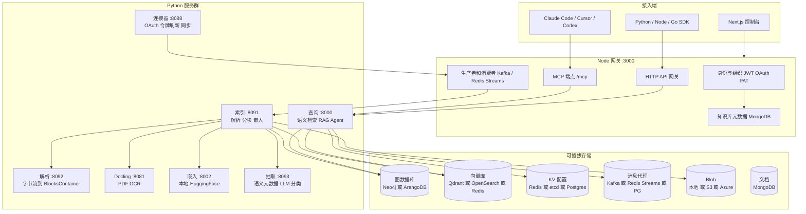
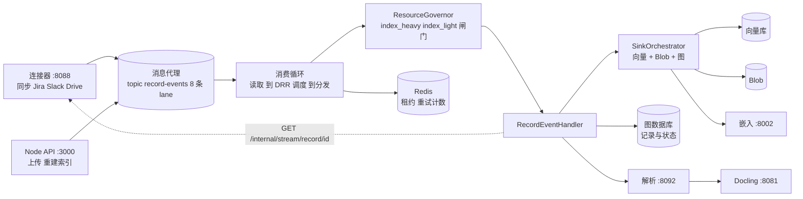
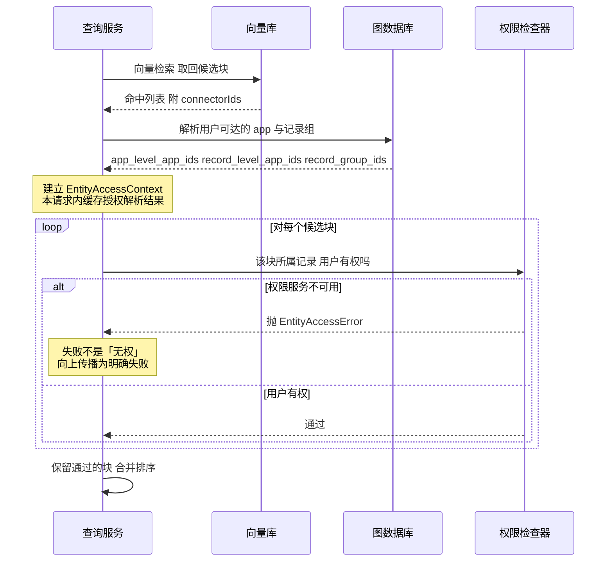
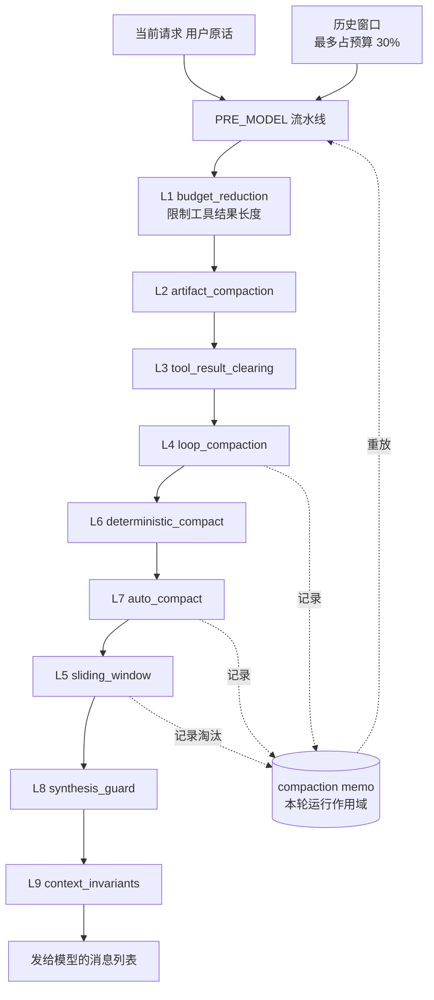
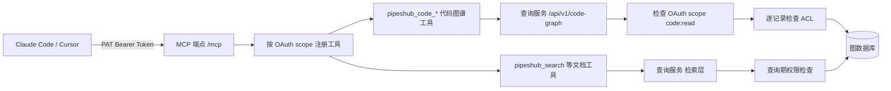
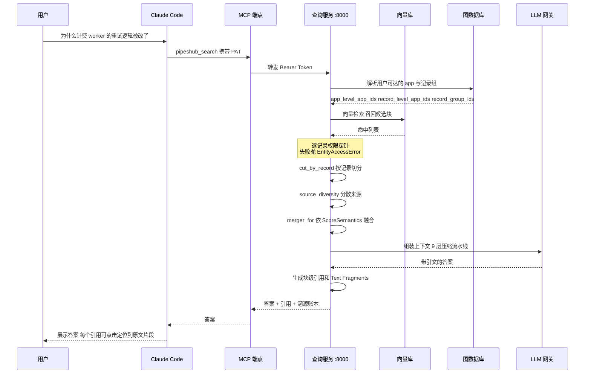

## 一、引子：RAG 领域里最被低估的一个问题

过去两年，几乎所有 RAG 框架都在优化同一件事：**把相关的内容捞出来**。

于是我们有了各种精妙的技术：混合检索、RRF 融合、查询改写、多路召回、GraphRAG、智能重排。它们的共同假设是：**索引里的东西，用户都能看**。

这个假设在个人项目里成立，在企业里崩塌。

想象一家 500 人的公司。Jira 里有 12 万条工单，Slack 有 80 万条消息，Confluence 有 4 万篇文档，SharePoint 上散落着各部门的会议纪要。现在你让 Claude Code 回答一个问题：

> 「为什么计费 worker 的重试逻辑被改了？」

一个诚实的系统应该给出这样一条完整的证据链：

1. 事故复盘文档（`postmortem.md`）—— 公开可见
2. 那个 PR（`billing#4821`）—— 提交者是**另一个部门的同事**
3. Slack 里的讨论串 —— 里面有**客户经理的名字和内部定价**
4. 设计文档 —— 放在**只有财务部可见的 Space** 里

现在问题的关键来了：**Claude Code 应该看到哪几条？**

一个普通的向量库无法回答这个问题。因为向量库的权限模型是「谁有 API key，谁就能搜全部」。权限不是检索的一部分，权限是**部署时候的一个开关**——要么全开，要么全关。

这就是 PipesHub（`pipeshub-ai/pipeshub-ai`）要解决的问题。它的自我定位非常精确：

> The open-source context layer for AI agents. PipesHub turns your company's knowledge (Slack, Drive, Jira, GitHub, Microsoft 365 and 40+ connectors) into a **permission-aware workspace** that agents can search, grep, navigate and cite.

「permission-aware」这个词是整个项目的题眼。

本系列此前写过 [Airweave](/2026/09/25/2026-09-25-airweave-context-retrieval-layer-agent-infrastructure-deep-dive/)（上下文检索层）、[OpenConnector](/2026/08/16/2026-08-16-openconnector-connector-gateway-1000-saas-agent-integration-deep-dive/)（连接器网关）、[WeKnora](/2026/08/13/2026-08-13-weknora-rag-react-agent-wiki-knowledge-platform-deep-dive/)（ReAct × RAG 知识中台）。它们和 PipesHub 在「连接 SaaS」「检索」「RAG」上都有重叠，但**信任边界画在不同的地方**：

- Airweave 关心的是「怎么把 50 个 SaaS 的数据拉进来做混合检索」，权限不在它的模型里
- OpenConnector 关心的是「凭证留在网关，Agent 只碰动作描述」—— 它保护的是**调用权限**，不是**数据可见性**
- WeKnora 关心的是「ReAct Agent 怎么组织知识库」，Wiki 模式是它自己维护的，不继承外部系统的 ACL
- **PipesHub 关心的是「一个已经存在于 Jira/Slack/Confluence 里的权限体系，如何在检索期被逐条继承下来」**

本文就从这个角度切入，逐层拆解 PipesHub 的架构。

---

## 二、项目定位与核心价值

### 2.1 一句话定义

**PipesHub 是一个自托管的「企业上下文层」：把散落在 50+ 企业系统里的知识，变成 Agent 可以搜索、grep、导航、并且能带引文引用的一份统一上下文，同时严格继承每个源系统原有的访问控制。**

### 2.2 仓库统计

| 指标 | 值 |
|---|---|
| GitHub | `pipeshub-ai/pipeshub-ai` |
| Stars | 3,899 |
| Forks | 631 |
| Open Issues | 207 |
| License | Apache-2.0 |
| 主要语言 | Python（后端核心）+ TypeScript（Node 网关 / Next.js 前端） |
| 仓库体积 | ~184 MB |
| 创建时间 | 2025-03-06 |
| 最近推送 | 2026-10-31（活跃） |
| 树节点数 | 11,497 |
| 主要贡献者 | shekharkadyan（2,121）、abhishekgml1991（605）、vishwjeet-pawar03（476） |
| 官方 SDK | Python SDK、Node SDK、Go SDK、MCP 包 `@pipeshub-ai/mcp` |

### 2.3 核心价值矩阵

| 能力 | 具体做法 | 与普通 RAG 的差异 |
|---|---|---|
| 权限感知检索 | 查询期逐记录调权限检查，**失败时报错而非当成「无权访问」** | 普通做法是索引期过滤（会漏、会过期） |
| 引文溯源 | 块级引用 + `#:~:text=` 文本片段锚点（WICG 规范） | 多数 RAG 只给文档级链接 |
| 多存储可插拔 | 图 / 向量 / KV / 消息 / Blob 全部走工厂抽象 | 绑死 Qdrant + Kafka 的项目换不掉 |
| 上下文压缩 | 9 层流水线 + compaction memo + 低水位批量触发 | 只做「截断到 N token」 |
| Agent 一等公民 | MCP 端点挂在同一 origin，Bearer Token 直通 | 需要 Agent 自己写胶水代码 |
| 代码图谱 | `pipeshub_code_*` 一组 MCP 工具，调用图 / 影响面分析 | 代码检索通常要另接一套 |

### 2.4 部署形态

```bash
# 交互式安装器：拉取部署文件 + 生成 .env + 启动 Compose
curl -fsSL https://get.pipeshub.com/install | bash
# 打开 http://localhost:3000
```

这是当前（2026-11-01）最省事的路径。生产环境也可以直接用 Helm 部署到 Kubernetes。

---

## 三、整体架构：8 个微服务 + 6 类可插拔存储

PipesHub 的架构不是「一个 Python 包 + 一个向量库」，而是**一组职责清晰的服务**，每个服务有独立的端口和扩缩容边界。这是它和大多数 RAG 项目最大的形态差异。

### 3.1 顶层架构图



### 3.2 存储可插拔：为什么这件事比听起来重要

`AGENTS.md` 里有一条硬性规则：

> Do not open a Neo4j, Arango, Qdrant, or Kafka client from indexing/query/connector feature code. Call `IGraphDBProvider`, `IVectorDBService`, or `MessagingFactory`.

| 角色 | 环境变量 | 可选后端 | 工厂 |
|---|---|---|---|
| 图 | `DATA_STORE` | `neo4j`（默认）、`arangodb` | `GraphDBProviderFactory` |
| 向量 | `VECTOR_DB_TYPE` | `qdrant`（默认）、`opensearch`、`redis` | `VectorDBProviderFactory` |
| KV / 配置 | `KV_STORE_TYPE` | `redis`（默认）、`etcd`、`postgres` | `KeyValueStoreFactory` |
| 消息 | `MESSAGE_BROKER` | `kafka`、`redis`（streams）、`postgres`（队列表） | `MessagingFactory` |
| Blob | storage config | 本地、S3、Azure Blob | `StorageServiceInterface` |
| 文档 | — | MongoDB | Node API 侧的 Mongoose |

值得注意的是，Redis 可以同时充当 KV、向量库和消息代理——但**它不会因此变成图数据库或文档库**。这条注释看似琐碎，实际避免了部署时最常见的一类事故：某个组件误以为 Redis 提供了图查询能力。

### 3.3 索引链路：一条记录要走过的路



这里有几个不那么常见但非常关键的设计：

**（1）DRR（Deficit Round Robin）调度。** 消费循环不是简单 FIFO，而是按「亏欠量」调度，防止大文档长时间霸占 worker。

**（2）ResourceGovernor 双闸门。** `index_heavy` / `index_light` / `heavy_parse` / `light_parse` 四类闸门限制并发，让重活不饿死轻活。

**（3）重活放独立进程，不放线程。** 文档里写得很直白：

> Parsing a large text, code or CSV file is seconds of CPU, and on the worker loop that is seconds in which no other record's graph, vector or embedding call can make progress. Those parses run in separate worker processes owned by `app/modules/parsers/parse_pool.py`; section 4.7 says which step runs where and why a thread is not enough.

CPU 密集型解析必须用进程池，因为 Python 的 GIL 让线程帮不上忙。

**（4）索引吞吐崩塌的根因分析。** `docs/indexing-service.md` 第 5 节专门分析了「索引一开始很快，然后掉到每分钟 2-3 条」这个现象，并给出根因。一份 187KB 的架构文档愿意留出整节做 RCA，这是成熟工程团队的标志。

---

## 四、核心抽象一：权限感知检索——把 ACL 放进查询期

这是 PipesHub 最核心、也最值得单独一节的部分。

### 4.1 为什么权限不能靠「索引期过滤」

传统做法是：索引的时候按 ACL 打标签，检索的时候带 filter。

这个做法有三个无法回避的问题：

1. **回填空洞**：老数据没有标签，新标签只加不减
2. **权限会变**：某人离职、文档换组、Space 权限调整——索引是快照，权限是活的
3. **过滤器失效**：向量库的 filter 在某些配置下会静默失效（这个坑我在 FastGPT 那篇里写过，PipesHub 专门做了纵深防御）

PipesHub 的选择是：**检索时逐条问权限**。

### 4.2 核心数据结构：EntityAccessContext

```python
# 来自 backend/python/app/modules/retrieval/entity_permissions.py

@dataclass(frozen=True)
class EntityAccessContext:
    org_id: str
    user_key: str
    app_level_app_ids: frozenset[str]
    record_level_app_ids: frozenset[str]
    record_group_ids: frozenset[str]
    app_names: Mapping[str, str]
    # The turn's limit (a selection below app level, a saved agent's or a
    # project's sources): a record is used only when every scope admits it.
    # Empty when the turn reaches whole apps.
    row_scopes: tuple[SelectionScope, ...] = ()
    # The user's grants as the access check resolves them, read once for the
    # request this context lives in and reused by every check of it.
    _resolved_access: dict[str, Any] = field(default_factory=dict, compare=False, repr=False)

    @property
    def app_ids(self) -> frozenset[str]:
        return self.app_level_app_ids | self.record_level_app_ids

    def connector_scope(self, entity_type: str, entity_id: str) -> list[str]:
        """Connectors whose records may be listed for this entity. A record
        group the user cannot reach only lists records from app-level
        connectors, where app access alone grants them."""
        if entity_type == RECORD_GROUP_ENTITY_TYPE and entity_id not in self.record_group_ids:
            return sorted(self.app_level_app_ids)
        return sorted(self.app_ids)
```

注意几个细节：

- **两级权限模型**：`app_level` 的连接器（整个应用可见）和 `record_level` 的连接器（逐记录判断）被分开处理。即使用户能到达某个记录组，`RECORD_LEVEL` 连接器**依然要逐条检查**——因为在 Jira 里，能看到某个项目不代表能看到项目里每张工单的评论。
- **`row_scopes`**：这一轮对话的范围限制。一个 Agent 绑定了 3 个源，那这轮检索就只在这 3 个源里找。一个记录必须**被所有 scope 同时接纳**才可用。
- **`_resolved_access`**：用户的授权解析结果在这个请求内缓存一次，后续所有检查复用。避免每条记录都重新解析一遍权限。

### 4.3 最关键的设计：失败不等于无权

这是整个文件里最重要的一段，也是最容易被初学者忽略的：

```python
# 来自 backend/python/app/modules/retrieval/entity_permissions.py

class EntityAccessError(Exception):
    """Entity access could not be resolved. Callers report a failure; they
    must never treat this as the user having no access."""


class EntitySearchTimedOut(EntityAccessError):
    """The deadline passed before any match was confirmed reachable. Not an
    empty result: reported as "no entities matched", it reads as a fact."""
```

为什么这个区分如此重要？

考虑一个场景：用户的授权服务临时挂了。图数据库查询超时了。

- **错误做法**：把「查询失败」当成「用户无权访问」→ 返回空结果 → Agent 告诉用户「我没找到相关信息」→ **用户以为公司里没有这条信息**。这是一个事实性错误，而且完全不可察觉。
- **正确做法**：抛 `EntityAccessError`，向上传播成一次明确的失败。Agent 知道自己没查到，而不是知道「不存在」。

同理，`EntitySearchTimedOut` 也继承自 `EntityAccessError`——超时不是「没找到」，超时是「不知道」。文档里的注释说得很直白：

> Not an empty result: reported as "no entities matched", it reads as a fact.

**这个「失败即报错」的原则，和我之前写过的 microsoft/agent-governance-toolkit 的 fail-closed 是同一个家族**，但 PipesHub 的实现更细：它区分了「确定无权」和「不知道」，而 fail-closed 通常只区分「允许」和「拒绝」。

### 4.4 权限探针的时间预算

```python
# 来自 backend/python/app/modules/retrieval/entity_permissions.py

# Redis TAG queries get too long past this; the connector pass still covers
# these users, just with lower precision.
MAX_RG_FILTER_IDS = 2000
OVERFETCH_FACTOR = 3
OVERFETCH_CAP = 50
MAX_EVALUATED_HITS = 40
SEARCH_DEADLINE_SECONDS = 4.0
# On a large entity collection under load the vector search alone can use the
# whole deadline, leaving no time for a single permission probe.
PROBE_MIN_SECONDS = 1.5
# Probes may use the whole deadline; the spellings of the records they found
# are still looked up, as one keyed query.
NAME_LOOKUP_MIN_SECONDS = 1.0
# Candidates each probe round walks per entity, newest first: a small first
# window keeps the common case cheap, later ones reach users whose readable
# records are older (KG-11). Bounded together by PROBE_ROUND_BUDGET.
PROBE_WINDOWS = (20, 180, 800)
# Candidates one probe round may walk across all its entities; every walked
# row is asked of the round's access check, so this bounds its batch.
PROBE_ROUND_BUDGET = 1500
```

这里有一套完整的**时间预算分配**机制：

- 整个检索有 4 秒总预算
- 至少给权限探针留 1.5 秒——因为「向量搜索吃掉了全部时间导致一次权限探针都没做」是个真实故障
- 探针按窗口逐轮扩大（20 → 180 → 800），先用小窗口覆盖常见情况，用户可读记录较旧时才走大窗口
- 单轮总行走量有 1500 的硬上限

`PROBE_WINDOWS = (20, 180, 800)` 这个三段式尤其值得玩味：注释里的 `KG-11` 看起来是一个 issue 编号，说明**先小后大**的策略是被某个具体 bug 逼出来的。

### 4.5 一轮权限检查的完整流程



---

## 五、核心抽象二：ScoreSemantics——分数能不能跨集合比较

### 5.1 一个被普遍搞错的问题

多集合检索的标准做法是 RRF（Reciprocal Rank Fusion）：把每个集合的排名列表按 `1/(k+rank)` 加权求和，取前 K。

**但这个做法有个隐藏前提**：各个检索器是**独立地**为同一个文档背书。

PipesHub 的场景不满足这个前提。看它的注释：

```python
# 来自 backend/python/app/modules/retrieval/result_merging.py

class ReciprocalRankFusionMerger(ResultMerger):
    """Fuse the rank lists, ignoring the score magnitudes.

    The right merge when the providers already fused internally: their scores
    encode position, so this re-fuses positions rather than pretending the
    numbers are commensurable.

    A hit appearing in several collections takes its **best** rank rather than
    the sum of its contributions. Summing is the textbook formulation and is
    right when several *retrievers* independently vouch for one document — but
    here the lists are disjoint shards of one corpus, and a hit appears twice
    only because deduplication indexed the same content under two connectors.
    Rewarding it for that would promote duplicates over better unique matches.
    """
```

关键在最后三句：

1. 这里的多个集合是**同一个语料的互斥分片**（disjoint shards），不是多个独立检索器
2. 同一个命中出现两次，只是因为去重逻辑把同一内容在两个连接器下都索引了一遍
3. 用求和奖励它，**等于奖励重复，惩罚独特匹配**

所以 PipesHub 用的是 **best-rank 而非 sum**：

```python
    def fuse(self, per_collection: Sequence[CollectionResults]) -> list[tuple[Any, float]]:
        """Every distinct hit with its fused score, best first."""
        best: dict[Hashable, Any] = {}
        fused: dict[Hashable, float] = {}
        # Ties are broken by first appearance so the output is stable across
        # runs; dict preserves insertion order and collections arrive in a
        # deterministic order from the fan-out.
        for collection in per_collection:
            for rank, result in enumerate(collection.results):
                key = self._identity(result)
                contribution = 1.0 / (self._k + rank + 1)
                if key not in fused or contribution > fused[key]:
                    fused[key] = contribution
                    best[key] = result
        ranked = sorted(best, key=lambda key: fused[key], reverse=True)
        return [(best[key], fused[key]) for key in ranked]
```

注意 `if key not in fused or contribution > fused[key]`——**取最大值而不是累加**，并且注释说明了平局如何稳定打破（依赖 dict 的插入顺序 + fan-out 的确定性顺序）。

### 5.2 ScoreSemantics 抽象

问题在于：什么时候能用「按分数排序」，什么时候必须用 RRF？答案取决于**分数的含义**，而这是**提供方（provider）的属性，不是检索策略的属性**。

```python
# 来自 backend/python/app/modules/retrieval/result_merging.py

class ScoreOrderedMerger(ResultMerger):
    """Sort by score. Correct only when scores are comparable across collections.

    Keeps the highest-scoring copy of a duplicated hit, which under
    ``SIMILARITY`` is the same value either way — the tie-break exists so the
    result is deterministic, not because the copies differ.
    """


def merger_for(
    semantics: ScoreSemantics, rank_constant: int = DEFAULT_RRF_RANK_CONSTANT
) -> ResultMerger:
    """The merge a provider's score semantics permit."""
    if semantics is ScoreSemantics.SIMILARITY:
        ...
```

**这是我认为 PipesHub 最值得学的一个设计。**

大多数 RAG 项目把「融合策略」当成检索层的参数：用户选 RRF 还是加权平均。但 PipesHub 把「分数是什么」提升成了一个**一等抽象**，由 provider 声明：

| `ScoreSemantics` | 含义 | 允许的合并方式 |
|---|---|---|
| `SIMILARITY` | 分数是相似度，跨集合可比 | 按分数排序（`ScoreOrderedMerger`） |
| `POSITION` | 分数编码的是排名位置，不可比 | RRF 位置融合（`ReciprocalRankFusionMerger`） |

而模块顶部的注释把整个设计意图说得很清楚：

> The whole difficulty is that *how* they may be combined depends on what the scores mean, and that is a property of the provider, not of the strategy.

**一个可以在别的项目里直接照搬的原则**：当「怎么合并」取决于「被合并的东西是什么」时，把后者建模成接口，让前者去查询它，而不是让调用方去猜。

### 5.3 命中身份的精确定义

融合的前提是能判断「两个命中是不是同一个」。这里踩过一个很典型的坑：

```python
# 来自 backend/python/app/modules/retrieval/result_merging.py

def result_identity(result: Any) -> tuple:
    """What makes two hits the same hit.

    A search returns *chunks*, not documents: one record legitimately
    contributes several blocks and the caller reassembles them. So identity is
    ``(virtualRecordId, blockId)`` — the same block found in two collections,
    which the deduplication matrix allows by design.

    Point ids cannot serve: they are freshly minted uuid4s per write, so the
    same block indexed under two connectors carries two different ids. And
    ``virtualRecordId`` alone must not serve either — collapsing on it would
    keep one chunk per document and quietly gut recall.

    A hit missing either half falls back to its point id, so it is passed
    through rather than collapsed against unrelated hits.
    """
    payload = getattr(result, "payload", None) or {}
    metadata = payload.get("metadata") or {}
    vrid = metadata.get("virtualRecordId")
    block_id = metadata.get("blockId")
    if vrid and block_id:
        return ("block", vrid, block_id)
    return ("point", getattr(result, "id", None))
```

三个「不能」：

1. **不能用 point id**：point id 是每次写入现生成的 uuid4，同一个块在两个连接器下有两个 id
2. **不能用 virtualRecordId 单独**：一个文档本来就贡献多个块，只按文档去重会「悄悄地把召回率砍掉」——**quietly gut recall** 这个措辞很到位
3. **缺一半就退回 point id**，宁可不过度合并，也不要错并

### 5.4 RRF 常数的选择

```python
# 来自 backend/python/app/modules/retrieval/result_merging.py

# Standard RRF damping constant. 60 is the value from the original Cormack et
# al. paper and what Qdrant, OpenSearch, and Redis all default to internally —
# matching it keeps a cross-collection fusion on the same footing as the
# per-collection fusion the providers already did.
DEFAULT_RRF_RANK_CONSTANT = 60
```

选 60 不是拍脑袋——这是 Cormack 等人原论文的值，也是 Qdrant / OpenSearch / Redis 的内部默认值。**理由是让「跨集合融合」和「提供方内部已经做过的融合」站在同一起跑线上**。

这是一个只有真正理解了 RRF 两层语义的人才会做的选择。

---

## 六、核心抽象三：记录级切分与来源多样性

### 6.1 FUSION_RECORD_CUT：一份长文档不该霸占整页结果

向量库返回的是**块（chunk）**，不是文档。一个 200 页的 PDF 会贡献几百个块，默认按块切分的话，前 10 条结果可能全部来自同一份文档。

```python
# 来自 backend/python/app/modules/retrieval/record_cut.py

def cut_by_record(
    results: Sequence[Any],
    limit: int,
    *,
    per_record: int,
    reserve: int,
    record_of: Callable[[Any], Hashable | None],
) -> list:
    """Keep ``limit`` of ``results`` (best first), spread across records.

    The best ``limit - reserve`` results come first, at most ``per_record``
    from any one record. The reserve then goes to the best result of each
    record not yet represented, and anything left is filled in rank order, so
    a search confined to a few records still returns ``limit``. The kept
    results stay in their original order.

    A result whose record is unknown counts as a record of its own. A
    ``limit`` below 1 keeps everything, as ``merge_collection_results`` does.
    """
    if limit < 1 or len(results) <= limit:
        return list(results)
    per_record = max(per_record, 1)
    reserve = min(max(reserve, 0), limit)
    keys: list[Hashable] = [
        key if key is not None else ("unkeyed", index)
        for index, key in enumerate(record_of(result) for result in results)
    ]
    chosen: set[int] = set()
    per_key: dict[Hashable, int] = {}

    def _take(index: int) -> None:
        chosen.add(index)
        per_key[keys[index]] = per_key.get(keys[index], 0) + 1

    head = limit - reserve
    for index, key in enumerate(keys):
        if len(chosen) >= head:
            break
        if per_key.get(key, 0) < per_record:
            _take(index)
    for index, key in enumerate(keys):
        if len(chosen) >= limit:
            break
        if key not in per_key:
            _take(index)
    for index in range(len(results)):
        if len(chosen) >= limit:
            break
        if index not in chosen:
            _take(index)
    return [results[index] for index in sorted(chosen)]
```

**三段式配额**：

1. **主体段**（`limit - reserve`）：按原始排名取，但每条记录最多 `per_record` 个
2. **保底段**（`reserve`）：给还没被代表过的记录各一个最佳块——**保证多样性**
3. **填充段**：剩下的按排名补齐，保证数量不缩水

关键在第 2 步。如果没有这一步，一个只涉及 3 个记录的问题会返回 3 条记录的全量块，浪费了 7 个名额。

### 6.2 SEARCH_SOURCE_DIVERSITY：一个来源不能霸占第一页

块级切分解决了「文档内部垄断」，但没解决「连接器之间垄断」。

```python
# 来自 backend/python/app/modules/retrieval/source_diversity.py

@dataclass(frozen=True)
class SourceDiversity:
    """How many records the first page holds, and how many of them one source may hold."""

    window: int = 10
    per_source: int = 4
    pool: int = 50

    def order(
        self,
        records: Sequence[R],
        *,
        plain: Collection[R],
        source_of: Callable[[R], Hashable | None],
    ) -> list[R]:
        """The records to return, first page first.

        ``records`` are the pool's records, best first; ``plain`` are the ones
        the plain search returns. The first page holds as many records as
        that (at most ``window``): the best of ``plain``, at most
        ``per_source`` from any one source, and when a source had more, the
        next best records of other sources in their place. The other records
        of ``plain`` follow, best first. A record of the pool that is neither
        in ``plain`` nor on the first page is left out, as the plain search
        leaves it out. With no source over its share, this is ``plain`` in
        rank order.
        """
        size = min(self.window, len(plain))
        per_source: dict[Hashable, int] = {}
        chosen: set[R] = set()

        def take(candidates: Sequence[R]) -> None:
            for candidate in candidates:
                if len(chosen) >= size:
                    return
                if candidate in chosen:
                    continue
                source = source_of(candidate)
                if source is not None:
                    if per_source.get(source, 0) >= self.per_source:
                        continue
                    per_source[source] = per_source.get(source, 0) + 1
                chosen.add(candidate)

        take([record for record in records if record in plain])
        take([record for record in records if record not in plain])
        page = [record for record in records if record in chosen]
        return page + [record for record in records if record in plain and record not in chosen]
```

模块顶部的场景描述非常具体：

> One source can fill the top of a search: a run of near-identical records from one connector (pull requests written from one template, say) takes most of the first ten places and pushes the one message or page that answers the question to place 20 or lower, past what a caller reads.

「用同一个模板写的 20 个 PR」——这是一个只有真实用过企业搜索的人才会想到的场景。

**两个重要细节**：

1. **降级的记录不丢弃**：`page + [被降级的记录]`，响应里依然包含普通搜索的全部记录，只是顺序变了
2. **默认关闭**：`Off unless set to `true`; `HIGH_ACCURACY_MODE` does not turn it on. It changes ranking for every search, so it stays off until measured.`

最后那句是工程师的诚实——**它改变每一次搜索的排名，所以要等到实测之后再开**。

---

## 七、核心抽象四：块级引文与 Text Fragments 规范

### 7.1 为什么要做块级引文

「答案来自哪个文档」是最低要求。「答案来自哪个文档的哪一段」才是企业真正需要的——因为用户要能**自己验证**。

PipesHub 实现了完整的块级引用 + 文本片段锚点。

### 7.2 WICG Text Fragments 规范实现

`#:~:text=` 是 WICG Text Fragments 提案的 URL 语法，可以在浏览器里高亮网页的某一段。PipesHub 完整实现了它：

```python
# 来自 backend/python/app/utils/text_fragments/codec.py

def encode_term(term: str) -> str:
    """Percent-encode one directive term as UTF-8.

    `quote` leaves `-` alone, but an unencoded `-` is a prefix/suffix marker in
    the directive grammar and invalidates the whole directive, so it is encoded
    explicitly. `,` and `&` are already encoded by `quote(safe="")`. Every other
    non-alphanumeric character (including parentheses and spaces) is encoded too,
    which keeps the URL ASCII-only and safe inside markdown links.
    """
    return quote(term, safe="").replace("-", "%2D")


def serialize(directive: TextDirective) -> str:
    """Render a directive as `text=[prefix-,]start[,end][,-suffix]`."""
    parts: list[str] = []
    if directive.prefix:
        parts.append(f"{encode_term(directive.prefix)}-")
    parts.append(encode_term(directive.start))
    if directive.end:
        parts.append(encode_term(directive.end))
    if directive.suffix:
        parts.append(f"-{encode_term(directive.suffix)}")
    return DIRECTIVE_PARAM + ",".join(parts)


def parse_text_directive(value: str) -> TextDirective | None:
    """Parse the part after `text=`. Returns None when invalid, as the spec does."""
    tokens = value.split(",")
    if not 1 <= len(tokens) <= 4:
        return None

    prefix = suffix = end = None

    if tokens[0].endswith("-"):
        prefix = tokens[0][:-1]
        tokens = tokens[1:]
        if not prefix or "-" in prefix or not tokens:
            return None

    if tokens and tokens[-1].startswith("-"):
        suffix = tokens[-1][1:]
        tokens = tokens[:-1]
        if not suffix or "-" in suffix or not tokens:
            return None

    if not 1 <= len(tokens) <= 2:
        return None

    start = tokens[0]
    if not start or "-" in start:
        return None
    if len(tokens) == 2:
        end = tokens[1]
        if not end or "-" in end:
            return None

    return TextDirective(
        start=decode_term(start),
        end=decode_term(end) if end is not None else None,
        prefix=decode_term(prefix) if prefix is not None else None,
        suffix=decode_term(suffix) if suffix is not None else None,
    )
```

这里有个容易被忽略的坑：**Python 的 `quote()` 默认不转义 `-`，但 `-` 在 Text Fragments 语法里是前缀/后缀标记符**，不转义会导致整条指令失效。`.replace("-", "%2D")` 这一行就是在补这个洞。

而且 `AGENTS.md` 专门立了一条规矩：

> **Text fragments** (`#:~:text=` citation links) — built only by `app/utils/text_fragments/`; do not hand-roll a fragment or strip one with a regex.

这个模块有 12 个文件（`cache` / `codec` / `extractors` / `facade` / `generator` / `models` / `normalize` / `segmentation` / `strategies` / `url` 等），还有一套「golden corpus」和浏览器验证——**说明作者知道这个功能容易写错，所以用测试把它钉住**。

### 7.3 检索溯源账本

```python
# 来自 backend/python/app/modules/retrieval/provenance.py

RetrievalLayer = Literal["vector", "pattern_match", "entity", "person", "fetch", "prefetch"]


@dataclass
class RecordProvenance:
    layers: list[RetrievalLayer] = field(default_factory=list)
    record_id: str | None = None
    record_name: str | None = None


def note_retrieved_by(
    state: MutableMapping[str, Any] | None,
    layer: RetrievalLayer,
    records: Iterable[tuple[str | None, str | None, str | None]],
) -> None:
    """Record that ``layer`` surfaced each ``(virtual_record_id, record_id, record_name)``.

    Kept only when the request opted into ``retrieval_context``, the one reader.
    """
    if not state or not state.get("include_retrieval_context"):
        return
    store = state.setdefault(RETRIEVED_BY_KEY, {})
    for virtual_record_id, record_id, record_name in records:
        if not virtual_record_id:
            continue
        entry = store.setdefault(str(virtual_record_id), RecordProvenance())
        entry.record_id = entry.record_id or record_id
        entry.record_name = entry.record_name or record_name
        if layer not in entry.layers:
            entry.layers.append(layer)
```

**6 个检索层**：`vector`（向量）、`pattern_match`（模式匹配）、`entity`（实体图检索）、`person`（人员图检索）、`fetch`（按记录 ID 直取）、`prefetch`（预取）。

一个记录可能被多个层找到。溯源账本记录「每条记录是被哪几层找到的」，这让「为什么这条被召回」可解释。

**注意最后一句**：这个账本只在请求显式开启 `include_retrieval_context` 时才维护。溯源是**调试工具**，不是默认开销——这是个正确的取舍。

---

## 八、核心抽象五：9 层上下文压缩流水线

这是 PipesHub 面向 Agent 的另一半。前七节讲的是「怎么找到」，这一节讲「找到之后怎么塞进 context window」。

`docs/context-engineering.md` 描述了一个 9 层的 `PRE_MODEL` 流水线：

| 层 | 触发条件 | 做什么 |
|---|---|---|
| image injectors | 当前轮有附件 | 把图片放到**当前请求的副本**上 |
| L1 `budget_reduction` | 总是 | 限制每个工具结果的长度（`fetch_record` 有自己的上限） |
| L2 `artifact_compaction` | 超过 trigger(0.5) | 旧的 artifact 变成引用 |
| L3 `tool_result_clearing` | 超过 trigger(0.5) | 超过 3 轮的工具结果变成引用 |
| L4 `loop_compaction` | 超过 trigger(0.6) | 每段未保护消息变成一份确定性摘要 |
| L6 `deterministic_compact` | 超过 trigger(0.85) | 未保护消息的抽取式缩短 |
| L7 `auto_compact` | 超过 trigger(0.85) | 每段未保护消息的 LLM 摘要 |
| L5 `sliding_window` | 超过预算 | 从最旧的未保护组开始淘汰，降到低水位；受保护工具组最后淘汰（带 WARNING） |
| L8 `synthesis_guard` | 超过预算 | 最后手段清理；超出窗口则抛 `ContextBudgetExceeded` |
| L9 `context_invariants` | 总是 | 配对修复、当前请求检查、窗口检查 |

### 8.1 预算与触发公式

```
B = 窗口 - system prompt - 工具 schema - 回复预留
trigger(r) = max(B·r, B - (1-r)·120K)
hard_limit_tokens = B + 回复预留
```

`trigger(r)` 的第二项让触发点在超大窗口（120K 以上）时**保持固定的头部余量**，而不是线性放大——因为在 200K 窗口里，85% 意味着要压缩 30K token，太晚了。

### 8.2 compaction memo：让已发送的前缀保持稳定

这是整个设计里最精妙的一环：

> **The run's memo** (`context/compaction_memo.py`). It lives in `RunScope`, is never written to history and is not inherited by sub-agents. Each layer replays its earlier compactions from it on every call, over its trigger or not, so a prefix that was sent is sent the same way again. The sliding window records its evictions there too, so an evicted group stays evicted. A layer never rewrites a message another layer already compacted in that exact form, or that layer's replay would stop matching. The LLM summariser runs at most once per new run of messages.

三层含义：

1. **可重放**：每次调用都从 memo 重放历史压缩，哪怕当前没过触发线
2. **幂等**：某一层不会重写别的层已经压缩成那个形态的消息，否则重放就匹配不上了
3. **粘性淘汰**：滑窗淘汰过的组永久淘汰，不会因为新内容进来又回来

这直接服务于一个刚需：**KV cache 命中率**。文档里给了实测数据：

| 场景 | 前缀断裂数 变化前 → 后 | 平均缓存前缀占比 变化前 → 后 |
|---|---|---|
| 8K 窗口，2K 字符搜索结果 | 28 → 9 / 29 | 0.33 → 0.65 |
| 8K 窗口，4K 字符搜索结果 | 29 → 15 | 0.31 → 0.38 |
| 32K 窗口，8K 字符搜索结果 | 27 → 9 | 0.27 → 0.59 |
| 200K 窗口，60K 字符 `fetch_record`（受保护） | 21 → 5 | 0.22 → 0.71 |
| 200K 窗口，40K 字符搜索结果 | 3 → 3 | 0.75 → 0.75 |

**缓存前缀占比从 0.22 提升到 0.71**，意味着一轮对话里 71% 的 token 可以命中前缀缓存。这是省钱的直接抓手。

### 8.3 低水位：压缩要成批进行

> **Batches with a low-water mark** (`context/watermark.py`). Each layer has a low-water mark `LOW_WATER_FRACTION = 0.3` of the budget below its trigger. Over the trigger, a layer compacts only when that frees at least the band between the two; a smaller pass waits until enough has aged past its floor (keep-last-N, the tail, protected messages). A pass that runs compacts everything its floor allows, which reaches the mark whenever the floor permits.

**问题是这样的**：如果你在 8K 窗口、每条工具结果 4K 的场景下，每轮都触发压缩，那么压缩掉的那条结果马上会因为下一轮 4K 工具结果到来而再次过期，于是**每一轮都重写整个请求的尾部**——既费钱又破坏缓存。

低水位机制让压缩「攒够一批再动手」。

### 8.4 不变量 I1-I9

文档第 3 节给了 9 条契约（The contract）：

| | 规则 |
|---|---|
| I1 | **当前请求**（用户本人的话）必须逐字到达每一次模型调用，并且锚定在 system prompt 的「Current request (verbatim)」段里 |
| I2 | 更早的轮次是历史。循环注入的文本（摘要、提示、计划）标记为 `UserMessage(injected=True)`，每个 transport 都包成 `<context_note source="agent">…</context_note>` |
| I3 | 每个工具结果紧跟在发起它的那次调用后面 |
| I4 | Shaper 和 injector 永不修改已存储的消息（写时复制） |
| I5 | Shaping 是确定性的；已发送的前缀保持稳定，除非预算压力迫使改变，且改变成批发生 |
| I6 | 请求要么放得进窗口，要么以 `ContextBudgetExceeded` 终止，`Agent.step` 结束本次运行且不发模型调用 |
| I7 | 受保护内容永不摘要或缩短：当前请求、`pinned` 消息、系统消息、profile 的 `protected_tools` 的工具组 |
| I8 | 重放的历史有界且忠实：失败和中断的轮次被标记，附件有预算 |
| I9 | 每个动作的层打一行 INFO：层、动作、token 前后、低水位、run_id、turn、预算 |

其中 **I7**（保护）按**角色**而非**位置**判定：

> The current request is the last user message the loop did not inject. History is seeded oldest-first ahead of it. Protecting "the first message" therefore protected the conversation's *first* question, and let the current one be summarised away (the 2026-10 multi-turn drift incident, §8).

这是一个**真实事故**驱动的修复：按位置保护会保护到第一句话，却让当前问题被摘要掉——多轮对话会「跑偏」。文档里直接写了事故时间和编号。

**I9** 也值得注意：日志里只有元数据，**永远不带内容**。这对一个要处理企业机密数据的系统是基本要求。

### 8.5 上下文流水线结构图



---

## 九、连接器体系：50+ 企业系统怎么接进来

### 9.1 ConnectorFactory：统一工厂

所有连接器都继承自 `BaseConnector`，通过 `ConnectorFactory` 注册：

```python
# 来自 backend/python/app/connectors/core/factory/connector_factory.py

from app.connectors.sources.atlassian.confluence_cloud.connector import (
    ConfluenceConnector,
)
from app.connectors.sources.atlassian.jira_cloud.connector import JiraConnector
from app.connectors.sources.atlassian.jira_data_center.connector import (
    JiraDataCenterConnector,
)
from app.connectors.sources.github.connector import GithubConnector
from app.connectors.sources.gitlab.connector import GitLabConnector
from app.connectors.sources.google.drive.individual.connector import (
    GoogleDriveIndividualConnector,
)
from app.connectors.sources.google.drive.team.connector import GoogleDriveTeamConnector
from app.connectors.sources.microsoft.onedrive.connector import OneDriveConnector
from app.connectors.sources.microsoft.sharepoint_online.connector import SharePointConnector
from app.connectors.sources.notion.connector import NotionConnector
from app.connectors.sources.salesforce.connector import SalesforceConnector
from app.connectors.sources.servicenow.servicenow.connector import ServiceNowConnector
from app.connectors.sources.slack.individual.connector import SlackIndividualConnector
from app.connectors.sources.slack.team.connector import SlackConnector
from app.connectors.sources.zendesk.connector import ZendeskConnector
```

粗略一数就超过 50 个：**Atlassian 全家桶（Confluence Cloud / Data Center / 个人版 + Jira Cloud / Data Center / 个人版）**、Google 全家桶（Drive 个人/团队、Gmail 个人/团队、Calendar、Docs、Forms、Meet、Slides）、Microsoft（OneDrive、Outlook、SharePoint）、GitHub / GitLab / GitHub Teams、Notion、Linear、Salesforce、ServiceNow、Zendesk、Box、Dropbox、Nextcloud、Drupal、BookStack、Zammad、Zoom、Azure Blob / Files、GCS、S3、MinIO、RSS、Web、Docker、Postgres、MariaDB、Confluence...

`CONNECTOR.md` 和 `CONNECTOR_CHECKLIST.md` 定义了「做完一个连接器的标准」。

### 9.2 权限继承的关键：源系统自己的 ACL 检查

```python
# 来自 backend/python/app/connectors/sources/atlassian/core/jira_issue_security.py
```

这个文件名本身就说明了问题：**Jira 的工单可见性规则不是简单的「能不能访问这个项目」**，它有自己的 issue security scheme（权限方案）。PipesHub 为 Jira 专门写了一个模块来处理这个。

对比一下 OpenConnector——它保护的是「调用哪个动作」，凭证留在网关。PipesHub 要保护的是「这条内容本来谁看得到」。

这两者是**正交的**：

- OpenConnector 的问题：Agent 会不会误用高权限凭证去调危险 API
- PipesHub 的问题：Agent 会不会看到本来不该看的内容

企业同时需要这两层。

### 9.3 同步模型：实时 + 定时 + 事件驱动

`connector_off_events.py`（连接器关闭时的事件处理）、`connector_sweep.py`（定期扫描）、`sync_point`（同步点）、`rate_limit_deferral.py`（限流延迟）、`token_refresh_service.py`（令牌刷新）——这些模块名直接勾勒出同步引擎的复杂度。

同步是分布式系统的经典难题：如何知道「上次同步到哪了」「这次拉取失败了要不要重试」「令牌过期了怎么办」「源系统限流了怎么退避」。PipesHub 用 `sync_point` + 事件 + 扫描三者结合来处理。

---

## 十、MCP 接入：把受权限约束的检索交给 Coding Agent

PipesHub 最有产品感的一面，是它把 MCP 端点直接挂在同一个 origin 上：

> **MCP is always `{that origin}/mcp`.**

Claude Code 的配置只要一条命令，Cursor 和 Codex 只要一个配置文件。PAT（个人访问令牌）直接带着 `userId` + `orgId`，所以**权限是按人生效的**，不是按服务生效的。

### 10.1 代码图谱工具组

```typescript
// 来自 backend/nodejs/apps/src/modules/mcp/code-graph.tools.ts

export const CODE_GRAPH_INSTRUCTIONS = `

## Code repositories

This caller has indexed code repositories. For a question about code in one
of them (where a feature or behaviour is implemented, what calls what, how A
reaches B, what a change breaks) use the \`pipeshub_code_*\` tools rather
than \`pipeshub_search\` or reading files one by one:

1. \`pipeshub_code_repos\` lists the repositories; pass one as \`repo\`.
2. Find the code: \`pipeshub_code_semantic_search\` when you know what it
   does but not its name, \`pipeshub_code_search\` for a name or a string.
3. Follow it: \`pipeshub_code_neighbours\` (callers, callees),
   \`pipeshub_code_path\` (A to B), \`pipeshub_code_impact\` (what a change
   breaks), \`pipeshub_code_outline\` and \`pipeshub_code_read\` to read.
`;
```

这些工具与 `@pipeshub-ai/mcp` 包自带的文档类工具**注册在同一个 per-request server 上**。

### 10.2 一个非常克制的设计：工具名重写

```typescript
// 来自 backend/nodejs/apps/src/modules/mcp/code-graph.tools.ts

// The query service writes its guidance with the in-product agent's tool
// names; over MCP those tools have other names, which an agent cannot call.
// Only guidance is rewritten: returned source can hold the same words.
const GUIDANCE_FIELDS = ['note', 'hint', 'error', 'next'] as const;
const MCP_TOOL_NAMES: Record<string, string> = {
  get_neighbour: 'pipeshub_code_neighbours',
  read_code: 'pipeshub_code_read',
  search_code: 'pipeshub_code_search',
  find_symbol_path: 'pipeshub_code_path',
  query_code_graph: 'pipeshub_code_symbols',
  search_semantic: 'pipeshub_code_semantic_search',
};
const INTERNAL_TOOL_NAMES = new RegExp(
  `\\b(${Object.keys(MCP_TOOL_NAMES).join('|')})\\b`,
  'g',
);
```

问题：查询服务返回的 hint 里写着「用 `read_code` 读代码」，但在 MCP 里这个工具叫 `pipeshub_code_read`——**Agent 照着提示去调一个不存在的工具名**。

解决办法是只重写「指导性字段」（`note` / `hint` / `error` / `next`），**不改返回的源码内容**。这个边界划得很准：源码里出现 `read_code` 字样是正常的（可能真是变量名），但指导性字段里的工具名必须能直接调用。

### 10.3 输入校验：正则放宽的理由

```typescript
// 来自 backend/nodejs/apps/src/modules/mcp/code-graph.tools.ts

// "40-80", and the "[40, 80]" models often send instead: a turn lost to a
// validation error costs more than accepting it.
const LINE_RANGE = /^\[?\s*\d+\s*[-,]\s*\d+\s*\]?$/;

// A non-empty list can be incomplete too: agents took a short caller list as the whole answer.
const COVERAGE =
  "Calls are edges only when the receiver's type is known from the code, so a " +
  'caller list, impact set or path can be incomplete where values are untyped, ' +
  'passed in, or dispatched dynamically. For every-caller, impact or ' +
  'does-A-reach-B questions, also search the call text (pipeshub_code_search, ' +
  '`mode: "text"`, e.g. `.name(`) at each level before answering.';
```

两处都体现了一种**对 LLM 行为的实证理解**：

1. 行号范围正则允许 `"40-80"` 和 `"[40, 80]"` 两种写法——因为「因为一个格式错误损失一整轮，比多接受一种格式更贵」
2. `COVERAGE` 这段说明主动告诉 Agent「调用者列表可能不完整」，并给出补救方法——**这是在给 LLM 打补丁**，因为纯靠工具返回的数据 Agent 容易过度自信

### 10.4 MCP 接入链路



注意代码图谱工具的注释：

> Each forwards the caller's own bearer token to the query service's `/api/v1/code-graph` routes, which check the OAuth scope (`code:read`) and every record's ACL.

**调用者自己的令牌被透传下去**，而不是用服务账号代查。这是「权限感知」在架构上的必然要求：服务账号无法代表具体的人。

---

## 十一、端到端数据流：从 Slack 一条消息到带引文的答案

把所有部分串起来看一遍：



注意几个关键点：

1. **权限解析在检索之前**，召回之后立即逐条检查
2. **切分和分散在权限过滤之后**——避免为无权内容浪费配额
3. **融合策略由 provider 的 `ScoreSemantics` 决定**
4. **压缩流水线在最后**，把已授权的内容压进窗口
5. **溯源账本是 opt-in 的**，不进入模型上下文

---

## 十二、与同类项目对比

### 12.1 五维横向对比

| 维度 | **PipesHub** | Airweave | OpenConnector | WeKnora | Glean |
|---|---|---|---|---|---|
| 形态 | 自托管平台（8 服务） | 自托管库 / 云 | 连接器网关 | 自托管知识中台 | 商业 SaaS |
| 数据源 | 50+ 企业系统 | 50+ SaaS | 1000+ Action | 上传 / Wiki 自维护 | 100+ SaaS |
| **ACL 继承** | **查询期逐记录** | 无 | 动作级策略 | 无 | 索引期过滤 |
| 溯源粒度 | 块级 + Text Fragments | 文档级 | 不适用 | 文档级 | 文档级 |
| 存储可插拔 | 图/向量/KV/消息/Blob 全可换 | 有限 | — | 固定 | — |
| Agent 接入 | MCP 端点 + 4 语言 SDK | SDK | MCP | MCP | — |
| 代码图谱 | `pipeshub_code_*` | 无 | 无 | 无 | 无 |
| License | Apache-2.0 | Apache-2.0 | Apache-2.0 | Apache-2.0 | 商业闭源 |

### 12.2 设计差异的核心：信任边界画在哪

这是最值得说的部分。

**Airweave 的模型**：连接器 → 统一存储 → 检索。它的信任边界画在「数据是否被成功拉进来」，不涉及「谁可以看」。

**OpenConnector 的模型**：Agent → 动作描述（不含凭证）→ 网关执行。它的信任边界画在「凭证与执行权」，Agent 永远拿不到高权限凭证。

**WeKnora 的模型**：文档 → 分块 → 索引 → ReAct 检索。知识库是它自己维护的，ACL 天然是「全有」或「全无」。

**PipesHub 的模型**：

```
用户身份 ──→ 图数据库里的权限图 ──→ 查询期逐记录检查 ──→ 答案
                    ↑
         源系统（Slack/Jira/Confluence）原有的权限体系
```

**信任边界画在「每一行内容上」**，而不是画在「应用」上或「动作」上。

这就是为什么 PipesHub 必须把权限检查放进检索内核，而不是加一个「按用户过滤」的前置步骤——因为过滤发生在记录粒度，而向量召回发生在块粒度，两者的粒度根本对不齐。

### 12.3 失败语义：三者最本质的分野

| 场景 | Airweave | WeKnora | **PipesHub** |
|---|---|---|---|
| 权限服务挂了 | 返回全部（无权限概念） | 返回全部 | **抛 `EntityAccessError`，明确失败** |
| 检索超时 | 返回空列表 | 返回空列表 | **抛 `EntitySearchTimedOut`**，不是「没找到」 |
| 用户无权 | — | — | 静默过滤掉该条 |

**「超时」和「无权」的区别，是 PipesHub 和所有同类项目最大的分野。**

前者是「我不知道」，后者是「我知道，且答案是没有」。把它们混为一谈，会让 Agent 对用户做出**事实性错误断言**——「我在公司里找不到相关记录」可能是因为权限服务挂了，而真相是记录就在那里。

---

## 十三、优缺点分析

### 13.1 左侧：架构简洁性 / 扩展性 / 易用性

| 维度 | 评价 | 说明 |
|---|---|---|
| 架构简洁性 | ★★★☆☆ | 8 个微服务 + 6 类存储，运维复杂度明显高于单体 RAG |
| 扩展性 | ★★★★★ | 存储全可插拔、连接器工厂化、Agent 侧 MCP 化 |
| 易用性 | ★★★★☆ | 一条命令安装，PAT 接入；但需要理解「context layer」这个概念 |
| 概念清晰度 | ★★★★★ | 「权限感知的上下文层」是一个能一句话讲清楚的价值主张 |
| 失败可解释性 | ★★★★★ | 失败码、溯源账本、9 条不变量、日志不含内容 |

### 13.2 右侧：性能 / 复杂度 / 维护性

| 维度 | 评价 | 说明 |
|---|---|---|
| 检索性能 | ★★★☆☆ | 逐记录权限检查必然比纯向量检索慢，靠时间预算和窗口策略兜底 |
| 系统复杂度 | ★★☆☆☆ | 8 服务 + 消息代理 + 租约 + 恢复循环，是一套完整的分布式系统 |
| 维护成本 | ★★☆☆☆ | 50+ 连接器 × 50+ 源系统的权限语义变化，是长期负担 |
| 部署成本 | ★★★☆☆ | 单机 Compose 可以跑，生产建议 Helm + Kafka |
| 上手门槛 | ★★★☆☆ | 自托管企业平台，不是「pip install 就能跑」 |

### 13.3 真实成本

必须说清楚：PipesHub 的能力不是免费的。

- **每条记录一次权限检查**——即使做了缓存和批量合并，在 12 万条工单规模上，相比裸向量检索的延迟增加是数量级的
- **5 个可换的存储后端**意味着 5 组配置、5 组兼容性问题
- **50+ 连接器**意味着 50+ 套 OAuth 流程、50+ 套增量同步策略、50+ 套权限语义

它的目标用户是**有合规要求、需要自托管、不打算买 Glean 的中型以上企业**。个人开发者用它是给自己增加负担。

---

## 十四、实践：三种典型用法

### 14.1 用法一：给 Claude Code 接入公司知识

```bash
# 1. 启动 PipesHub
curl -fsSL https://get.pipeshub.com/install | bash

# 2. 在控制台创建 PAT（Personal Access Token，不需要管理员权限）
#    PAT 携带 userId + orgId，权限按人生效

# 3. 接入 Claude Code
claude mcp add pipeshub --transport http https://<your-host>/mcp \
  --header "Authorization: Bearer phpat_xxx"

# 4. 直接问
claude
> 为什么计费 worker 的重试逻辑被改了？
```

回答会带块级引用，每个引用可点击定位到原文的具体片段。**看不到的记录不会出现在答案里，即使它就在索引中。**

### 14.2 用法二：用 Python SDK 做检索

```python
# 来自 pipeshub-ai/examples 的 SDK 用法（pip install pipeshub-sdk）
from pipeshub import PipesHub

client = PipesHub(base_url="http://localhost:3000", token="phpat_xxx")

# 语义检索，自动继承 token 对应用户的权限
result = client.search(
    query="billing worker retry logic",
    limit=10,
)

for hit in result.hits:
    print(f"[{hit.source}] {hit.record_name}")
    print(f"  {hit.snippet}")
    print(f"  {hit.citation_url}")   # 带 #:~:text= 的块级引用
```

### 14.3 用法三：直接调 MCP

```bash
# 列出一个 MCP 服务器提供的工具
curl -sS http://localhost:3000/mcp \
  -H "Authorization: Bearer phpat_xxx" \
  -H "Content-Type: application/json" \
  -H "Accept: application/json, text/event-stream" \
  -d '{"jsonrpc":"2.0","id":1,"method":"tools/list"}'

# 调用搜索工具
curl -sS http://localhost:3000/mcp \
  -H "Authorization: Bearer phpat_xxx" \
  -H "Content-Type: application/json" \
  -H "Accept: application/json, text/event-stream" \
  -d '{"jsonrpc":"2.0","id":2,"method":"tools/call","params":{
        "name":"pipeshub_search",
        "arguments":{"query":"billing worker retry logic","limit":10}}}'
```

### 14.4 生产部署要点

| 项 | 建议 |
|---|---|
| 图数据库 | 默认 Neo4j；已有 ArangoDB 集群可以换，零代码改动 |
| 向量库 | 默认 Qdrant；已有 OpenSearch 可以换（词法索引是内置的） |
| 消息代理 | 生产用 Kafka；单实例可以用 Redis Streams |
| TLS | 云端部署必须 HTTPS（Cloudflare / Nginx / Traefik 终结），否则浏览器白屏 |
| 溯源账本 | 默认关闭，按需开 `include_retrieval_context` |
| 来源多样性 | `SEARCH_SOURCE_DIVERSITY=true` 前先跑基准测试，它会改变每次搜索的排名 |

---

## 十五、趋势判断与总结

### 15.1 三个趋势

**趋势一：「上下文层」正在成为 Agent 基础设施的一个独立品类。**

Airweave（2026-09-25 写过）、PipesHub、Airbyte、以及各大厂的「企业搜索 + AI」产品，都在往同一个位置收敛：这个位置**不在模型层，也不在 Agent 框架层，而在两者之间**。它的职责是回答「这次调用该带什么上下文进去」。

PipesHub 的贡献是给这个品类加上了**权限维度**——这恰好是企业落地时最硬的约束。

**趋势二：失败语义正在成为基础设施的核心质量指标。**

PipesHub 区分「无权」和「不知道」，区分「空结果」和「超时」。这和我在 [nono](/2026/10/08/2026-10-08-nono-agent-runtime-security-zero-latency-kernel-sandbox-sigstore-supply-chain-architecture-deep-dive/) 和 [microsoft/agent-governance-toolkit](/2026/10/13/) 里看到的 fail-closed 是同一条脉络，但 PipesHub 更进一步——它不仅拒绝放行，还拒绝**用错误的理由拒绝**。

**趋势三：上下文压缩正在从「技巧」变成「有契约的工程」。**

9 层流水线 + compaction memo + 低水位成批 + 9 条不变量 + 缓存命中率实测表——这套东西的复杂度已经超过很多 Agent 框架的调度层。而它解决的是一个非常具体的问题：**在有限的窗口里，怎么让 Agent 反复看到同样的前缀**。

### 15.2 三条可复用的工程经验

**经验一：把「分数是什么」建模成接口，而不是当成参数。**

`ScoreSemantics` 这个抽象可以直接搬走。任何做多路召回融合的项目，都应该先回答一个问题：我的各路分数可比吗？如果答案依赖具体 provider，就该让 provider 声明，而不是让调用方猜。

**经验二：区分「三种否定」——没有、无权、不知道。**

`EntityAccessError` / `EntitySearchTimedOut` / 空结果，三者必须可区分。混为一谈会让 Agent 对用户做出事实性错误断言——而且这种错误**完全不可察觉**，因为从对话表面看不出区别。

**经验三：上下文压缩要「成批」，不要「每轮」。**

低水位机制解决的是「压缩 → 马上又过期 → 每轮重写整个尾部」的抖动。判断标准很简单：**如果压缩后紧接着又有新内容进来让压缩失效，那这个压缩设计就是错的**，它既没省成本，又毁掉了缓存。

### 15.3 适合谁，不适合谁

**适合**：

- 有合规要求、需要自托管、不打算买商业产品的中型以上企业
- 想让 Claude Code / Cursor 真正用上公司内部知识的团队
- 需要「答案带可验证引文」的场景（法务、审计、研究）

**不适合**：

- 个人开发者或小团队（运维 8 个服务的成本远超收益）
- 数据源单一的场景（直接用一个向量库更快）
- 已经买了 Glean / Elastic / Confluence 生态的企业

### 15.4 总结

PipesHub 的技术深度来自一个正确的判断：**企业 AI 落地的主要障碍不是「检索不准」，而是「检索到了不该看的内容」**。

在这个前提下，很多「看起来是 RAG 细节」的设计忽然变得理所当然：

- 权限检查必须在查询期，因为权限是活的而索引是快照
- 分数语义必须由 provider 声明，因为「怎么融合」取决于「分数是什么」
- 溯源必须到块级，因为用户要能自己验证
- 压缩必须成批，因为缓存前缀是省钱的主要抓手
- 失败必须可区分，因为 Agent 会把你的沉默当作事实

这些都不是「过度设计」。它们是把「上下文层」这个词落到实处所必需的。

---

## 附录：关键资源

| 资源 | 地址 |
|---|---|
| GitHub | https://github.com/pipeshub-ai/pipeshub-ai |
| 官网 | https://www.pipeshub.com |
| 文档 | https://docs.pipeshub.com |
| MCP 接入文档 | https://docs.pipeshub.com/for-agents |
| Python SDK | https://pypi.org/project/pipeshub-sdk/ |
| Node SDK | https://www.npmjs.com/package/@pipeshub-ai/sdk |
| Go SDK | https://github.com/pipeshub-ai/pipeshub-sdk-go |
| MCP 包 | https://www.npmjs.com/package/@pipeshub-ai/mcp |
| 示例仓库 | https://github.com/pipeshub-ai/examples |
| Docker Hub | https://hub.docker.com/r/pipeshubai/pipeshub-ai |
| License | Apache-2.0 |

### 关键源码位置

| 模块 | 路径 |
|---|---|
| 权限感知检索 | `backend/python/app/modules/retrieval/entity_permissions.py` |
| 跨集合融合 | `backend/python/app/modules/retrieval/result_merging.py` |
| 记录级切分 | `backend/python/app/modules/retrieval/record_cut.py` |
| 来源多样性 | `backend/python/app/modules/retrieval/source_diversity.py` |
| 溯源账本 | `backend/python/app/modules/retrieval/provenance.py` |
| 词法检索 | `backend/python/app/modules/retrieval/lexical_search.py` |
| 上下文压缩 | `backend/python/app/agent_loop_lib/context/` |
| Text Fragments | `backend/python/app/utils/text_fragments/` |
| 连接器工厂 | `backend/python/app/connectors/core/factory/connector_factory.py` |
| MCP 代码图谱工具 | `backend/nodejs/apps/src/modules/mcp/code-graph.tools.ts` |
| 索引架构文档 | `docs/indexing-service.md`（187KB） |
| 上下文工程文档 | `docs/context-engineering.md` |
