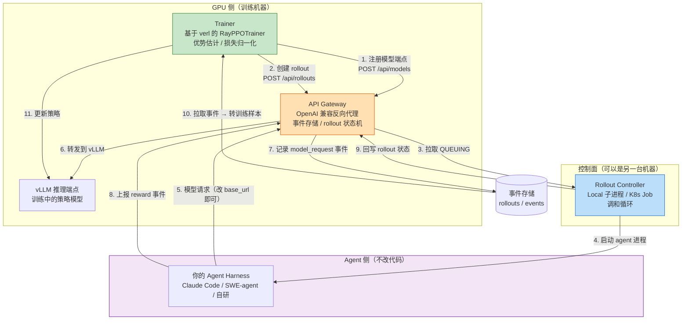
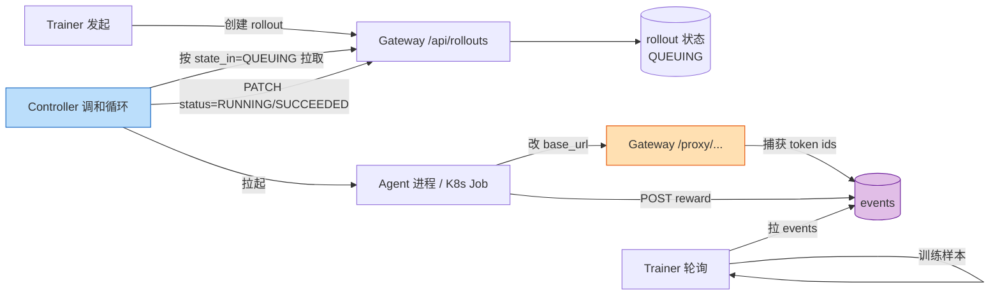
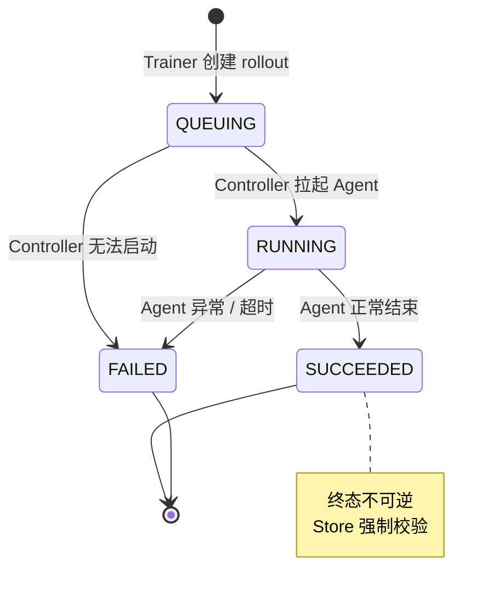
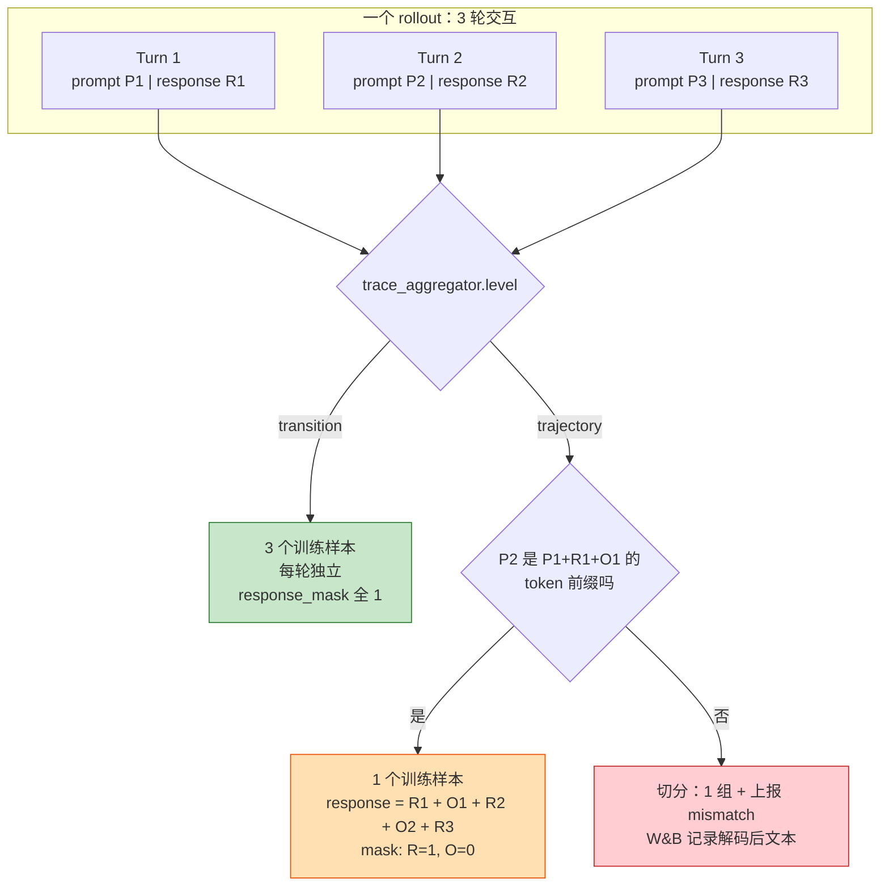
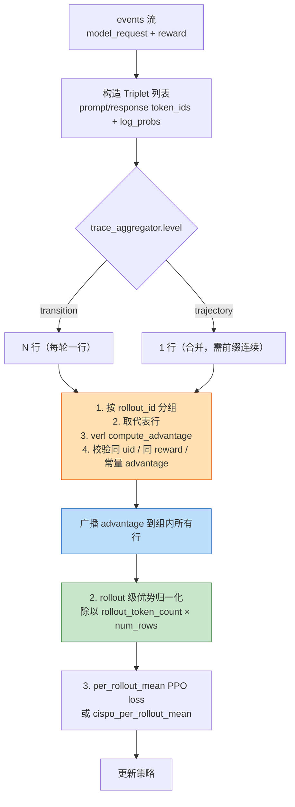
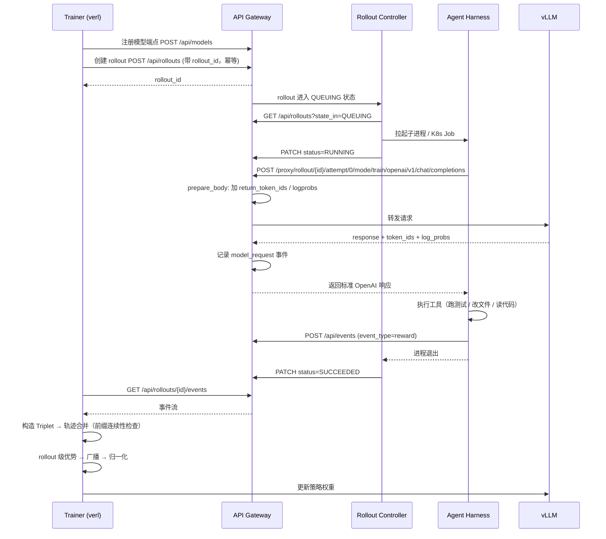

## 引子：一个被问烂了的问题

2026 年下半年，几乎每个做 Agent 的团队都在同一张路线图上画同一个框：**「让 Agent 变强，而不是让 Agent 变长」**。

我们已经有了 Claude Code、Codex、Cline 这些能改代码、能跑测试的 Agent harness，也有了 SWE-bench Verified 这种评测基准。但从「Agent 能干活」到「Agent 会干活」，中间隔着一道所有团队都绕不开的坎：**你没法像训语言模型那样，用几千条梯度更新就让 Agent 变强**。

原因不复杂。语言模型的训练单元是 token，梯度是确定的，loss 可以闭式计算。而一个 Coding Agent 的训练单元是「一次完整的任务执行」——它可能是 20 轮工具调用、可能是 47 个文件改动、可能跑了一次 pytest。**你要么把整个 rollout 当成一个不可分割的黑盒（信用分配全丢），要么去改造 Agent 的循环逻辑（一次改造，评测系统、sandbox、prompt 模板全部要重写）**。

这就是过去两年 Agent RL 领域最大的尴尬：**算法侧的进展（GRPO、轨迹级聚合、CISPO）和 Agent 侧的进展（Claude Code、SWE-agent、OpenHands）几乎完全脱节**。做 RL 的人写不出好用的 Agent harness，做 harness 的人不想碰 RL 的脏活。

Microsoft Research 在 2025 年 6 月开源的 **Agent Lightning**，就是冲着这道缝去的。它的核心命题只有一句话：

> **Train ANY AI agent with reinforcement learning, with (almost) zero code changes.**

翻译成工程语言：**你的 Agent 一行代码都不用改，只要把 OpenAI 客户端的 `base_url` 指向 Agent Lightning 的 Gateway，它就能被强化学习训练。**

本文将拆解它的三大组件、四层关键机制、以及它踩过的那些坑。全文所有代码片段均取自 `microsoft/agent-lightning` v1.0 仓库源码（MIT License，⭐18.8k，2025-06 创建，2026-10 仍在活跃提交）。

---

## 一、项目定位与核心价值

### 1.1 一句话定义

**Agent Lightning 是一个「Agent ↔ 强化学习」的中间层**：它不提供 Agent 框架，不提供 RL 算法，而是提供一条**把任意 Agent 的真实执行轨迹，转换成 RL 训练样本的数据管道**。

### 1.2 它解决的三个具体问题

| 问题 | 传统做法 | Agent Lightning 的做法 |
|---|---|---|
| Agent 里怎么插 RL？ | 改写 Agent 的循环，接入 RL 的 `rollout()` 接口 | Agent 只改 `base_url`，其余零改动 |
| 多轮对话怎么变训练样本？ | 重新实现 chat template + 重切分 | Gateway 捕获**真实 token id**，按 token 前缀连续性自动合并 |
| 长 rollout 拖垮训练？ | 同步等所有 rollout 跑完 | 异步流水 + 跨步 carry-over + Gateway pause/drain |

### 1.3 仓库元信息

| 指标 | 值 |
|---|---|
| 仓库 | `microsoft/agent-lightning` |
| Stars | ⭐ 18,865 |
| Forks | 1,700 |
| Language | Python |
| License | MIT |
| Created | 2025-06-18 |
| Last Push | 2026-10-20 |
| 主分支 | `main` |
| 核心代码量 | ~3,500 行（`agentlightning/` 目录 31 个文件） |
| 技术报告 | arXiv:2608.17528《Agent Lightning v1.0: Towards Harnessed Agentic RL》 |
| 主题标签 | `agent`, `agentic-ai`, `llm`, `mlops`, `reinforcement-learning` |

### 1.4 已公开的训练结果

| 场景 | 模型 | 训练样本 | SWE-bench Verified | 提升 |
|---|---|---|---|---|
| Coding Agent (SWE-smith) | Qwen3.5-9B | 6K | 41.8% → 56.4% | **+14.6 pt** |
| Coding Agent (MoE) | Qwen3.5-35B-A3B | 1.8K | 47.8% → 61.6% | **+13.8 pt** |

除了 Search-R1、LLM-in-Sandbox、ScienceWorld 等示例外，官方 README 还列出了社区项目：腾讯 **Youtu-Agent** 用它做到了 **128 GPU 的稳定 RL 训练**，Stanford 的 **AgentFlow**（Flow-GRPO）也是基于它构建的。

> **值得注意的信号**：一个「中间层」项目，能被腾讯、Stanford 这类团队拿去做 128 卡规模训练，说明它的抽象层次抓对了。

---

## 二、整体架构：三个组件，一条数据流

Agent Lightning v1.0 是一个**刻意做减法**的架构——核心只有三个组件，加起来不到 3,500 行 Python。



### 2.1 三个组件的职责边界

**① API Gateway（`agentlightning/server/`）**
- 存储三类对象：**rollout**（一次 Agent 执行）、**model**（注册的推理端点）、**event**（追加式事件流）
- 提供 OpenAI 兼容的**反向代理**：`POST /proxy/rollout/{rollout_id}/attempt/{attempt_id}/mode/{train|val}/openai/v1/chat/completions`
- 关键动作：在转发的同时，把 **prompt token ids / response token ids / log_probs** 落成 `model_request` 事件

**② Rollout Controller（`agentlightning/controller/`）**
- 把 `QUEUING` 状态的 rollout 变成真实进程：**Local 模式**起短生命周期子进程，**K8s 模式**每个 rollout 起一个 Job
- 持续「调和」（reconcile）：Gateway 里的状态是唯一真相来源，进程/watch/网络出问题时重试直到收敛
- **Gateway 是状态真相，Controller 只是执行器**——这个设计让 Controller 可以随时重启而不丢状态

**③ Trainer（`agentlightning/verl/`）**
- 继承 `verl.trainer.ppo.ray_trainer.RayPPOTrainer`
- 每个训练步：注册端点 → 建 rollout → 等完成 → 拉事件 → 转 `DataProto` → 算优势 → 更新策略

### 2.2 为什么要拆成三个进程

这个拆分不是过度设计，它解决的是 RL 训练里最实际的三个约束：

1. **GPU 与 Agent 执行资源异构**：训练要 GPU 集群，Agent 执行要 CPU/内存/网络（跑 pytest、拉依赖）。放一起必然互相抢资源。
2. **Agent 执行可能跑在客户自己的 K8s 集群里**：可能涉及内网访问、私有镜像、不能出网。Gateway 暴露 HTTP 接口后，Controller 可以部署在有集群访问权的地方。
3. **故障隔离**：Agent 崩了不能拖垮训练。Controller 的调和循环天然会把它标成 `FAILED`，训练继续。



> **设计哲学**：Gateway 是唯一的状态真相来源（source of truth），所有其它组件都是**幂等**的、可随时重启的。

---

## 三、机制一：零代码改动是怎么做到的

这是整个项目最漂亮的一招，也是「零代码改动」这个承诺的技术基础。

### 3.1 一行配置的接入成本

Agent 侧需要做的全部事情是：**把 OpenAI 客户端的 base_url 换成 Gateway 地址**。

```python
# 来自 examples/gsm8k/gsm8k_agent.py:93-101
class ChatAgent:
    async def run(self) -> None:
        from openai import AsyncOpenAI

        question = os.environ["QUESTION"]
        answer = os.environ["ANSWER"]
        agl_key = os.environ["AGL_KEY"]
        event_url = os.environ["AGL_EVENT_URL"]
        openai_base_url = os.environ["AGL_OPENAI_BASE_URL"]

        client = AsyncOpenAI(
            base_url=openai_base_url,      # ← 唯一的改动点
            api_key=agl_key,
            max_retries=6,
        )
        response = await asyncio.wait_for(
            client.chat.completions.create(
                model="auto",
                messages=[{"role": "user", "content": build_prompt(question)}],
                temperature=1.0,
                max_tokens=1024,
            ),
            timeout=300.0,
        )
        post_reward(
            event_url=event_url,
            agl_key=agl_key,
            prediction=response.choices[0].message.content or "",
            answer=answer,
        )
```

注意这个 Agent **完全不知道自己在被训练**：它以为自己在跟一个 OpenAI 兼容端点聊天，实际上这个端点是一台训练数据采集器。

### 3.2 关键设计：rollout_id 藏在 URL 路径里

```python
# 来自 agentlightning/server/routes/proxy.py:38-44
@router.post(
    "/proxy/rollout/{rollout_id}/attempt/{attempt_id}/mode/{mode}/openai/v1/{upstream_path:path}",
)
async def llm_proxy(
    rollout_id: str, attempt_id: str, mode: str, upstream_path: str, request: Request
) -> Response:
    """LLM reverse proxy — forwards to model server, captures events."""
    if mode not in {"train", "val"}:
        raise HTTPException(status_code=404, detail=f"Unsupported proxy mode: {mode}")
    if upstream_path not in {"chat/completions", "completions"}:
        raise HTTPException(status_code=404, detail=f"Unsupported upstream path: {upstream_path}")
```

这个 URL 路径设计是整个「零改动」方案的关键：

- **rollout_id 在路径里** → 每次模型调用天然归属到正确的 rollout，Agent 侧**不需要传任何额外字段**
- **`mode/{train|val}` 在路径里** → 训练态和验证态用不同的 temperature，Agent 侧也不需要知道
- **`attempt_id` 在路径里** → 失败重试产生的新 attempt 不会被混进原轨迹
- **`/openai/v1/` 前缀** → OpenAI 兼容客户端可以把 base_url 设成 `.../openai/v1`，然后照常 `append("/chat/completions")`

对比一下传统做法：传统 RL 框架需要你在 Agent 里显式调用 `rollout.llm.generate(...)`，这意味着**你的 Agent 主循环必须用 RL 框架的 LLM 客户端**，工具调用、上下文管理、多 provider fallback 全要重写。Agent Lightning 直接让这一层消失。

### 3.3 Gateway 侧的请求改写

```python
# 来自 agentlightning/server/proxy.py:62-84
def prepare_body(self, body: dict[str, Any], mode: str) -> dict[str, Any]:
    if mode == "train":
        prepared = {
            **body,
            "model": self._model_name,
            "temperature": self._train_temperature,
            "return_token_ids": True,      # ← 关键：要拿到 token ids
        }
        if self._include_log_probs:
            prepared["logprobs"] = True    # ← 关键：要拿到 log_probs
        if self._include_routed_experts:
            prepared["return_routed_experts"] = True
        return prepared
    if mode == "val":
        prepared = {
            **body,
            "model": self._model_name,
            "temperature": self._val_temperature,
            "return_token_ids": True,
        }
        return prepared
    raise ValueError(f"Unsupported proxy mode: {mode}")
```

`return_token_ids` 和 `logprobs` 是 **vLLM 的扩展参数**。这一步很值得玩味：

> **普通的 OpenAI 兼容 API 不返回 token ids。但 RL 训练必须要 token ids。**
>
> 传统方案是「拿 response 文本 → 用 tokenizer 重新编码 → 祈祷和原始生成完全一致」。Agent Lightning 反过来：**在推理服务端就把 token ids 一起返回**，从根上消灭了「重分词漂移」（retokenization drift）问题。

vLLM 官方博客也专门写过一篇文章讲这件事：《No More Retokenization Drift: Returning Token IDs via the OpenAI Compatible API Matters in Agent RL》（2025-10-22）。

---

## 四、机制二：事件模型与 rollout 状态机

### 4.1 事件：只有两种有明确结构

```python
# 来自 agentlightning/schemas.py:14-30
class Event(BaseModel):
    """Single event in a trajectory.

    Events are stored in insertion order per rollout. Position in the list
    is the identity — no separate event ID needed. Only two event types
    have well-known structure (model_request, reward). Everything else is
    opaque pass-through.
    """

    event_type: str  # "model_request", "reward", or any user-defined string
    rollout_id: str
    attempt_id: str
    timestamp: float  # assigned by store at write time
    data: dict[str, Any]  # event-type-specific payload
```

这个设计的精髓在注释里：**「只有 `model_request` 和 `reward` 两种事件有已知结构，其它一切都是不透明透传」**。

- `model_request`：Gateway 自动记录，包含完整的 request/response/token_ids/log_probs/latency/status
- `reward`：Agent 或环境上报，标量 + 可选的人读解释
- **其它自定义事件**：Agent 想要什么诊断信息就上报什么，Store 不解析、不校验

```python
# 来自 agentlightning/schemas.py:62-81
class ModelRequestData(BaseModel):
    """Well-known structure for event_type='model_request'."""
    model: str
    model_version: int | None = None  # training step of the serving model
    request: dict[str, Any]  # original request body (messages, temperature, etc.)
    adjusted_params: dict[str, Any] | None = None  # only if param adjustment changed anything
    response: dict[str, Any]  # full response body
    latency_ms: float | None = None
    http_status: int | None = None
    status: str = "ok"  # "ok" or "error"
    retry_count: int = 0
    usage: dict[str, Any] | None = None
    finish_reason: str | None = None


class RewardData(BaseModel):
    """Well-known structure for event_type='reward'."""
    value: float  # scalar reward (required)
    message: str | None = None  # optional human-readable explanation
    source: str | None = None  # e.g. "agent" for explicit evaluator output, "fallback" for system fill-in
    reason: str | None = None  # optional machine-readable explanation
```

注意 `RewardData` 里的 `source` 字段区分了 `"agent"`（Agent 主动上报的评估结果）和 `"fallback"`（系统兜底填充）—— 这在做 reward 质量分析时非常关键，**兜底 reward 和真实评估 reward 混在一起会让整个训练曲线变得不可信**。

### 4.2 Rollout 状态机：终态不可逆

```python
# 来自 agentlightning/schemas.py:85-108
class RolloutState(StrEnum):
    """Rollout lifecycle state values. Terminal states are final — no transitions out."""
    QUEUING = "queuing"
    RUNNING = "running"
    SUCCEEDED = "succeeded"
    FAILED = "failed"


# Valid state transitions (Store-enforced).
VALID_TRANSITIONS: dict[RolloutState, set[RolloutState]] = {
    RolloutState.QUEUING: {RolloutState.RUNNING, RolloutState.FAILED},
    RolloutState.RUNNING: {RolloutState.SUCCEEDED, RolloutState.FAILED},
    # Terminal states — no transitions out.
    RolloutState.SUCCEEDED: set(),
    RolloutState.FAILED: set(),
}
```

**Store 强制校验状态转移**，`SUCCEEDED` / `FAILED` 之后没有任何出边。这是一个「单向门」设计——rollout 一旦终结，它采集到的数据就是最终数据，不会因为后续的乱序状态更新而被污染。



### 4.3 幂等创建：一个细节体现成熟度

```python
# 来自 agentlightning/schemas.py:150-162
class RolloutCreate(BaseModel):
    """Input for creating a rollout."""
    input: Any
    is_train: bool = True
    config: RolloutConfig | None = None
    metadata: RolloutMetadata | dict[str, Any] | None = None
    # A caller-supplied id makes rollout creation idempotent and safe to retry.
    rollout_id: str | None = None
```

`rollout_id` 可以由调用方指定 → **创建操作是幂等的，网络重试不会产生重复 rollout**。在训练系统里这是刚需：Trainer 和 Controller 之间的每一次 HTTP 调用都可能因网络抖动而重试。

---

## 五、机制三：轨迹合并 —— 重分词漂移的正面战场

这是整个项目技术含量最高的部分，也是「Agent 变强」和「Agent 变长」的分水岭。

### 5.1 问题：多轮 Agent 的训练样本长什么样

假设 Agent 跑了 5 轮：

```
Turn 1: prompt=[系统提示+任务描述]        response=[推理+工具调用]
Turn 2: prompt=[Turn1的prompt+response+工具返回]  response=[...]
Turn 3: prompt=[Turn2的prompt+response+工具返回]  response=[...]
...
```

两种训练单元的取法：

- **transition 级**：每一轮是一个独立的训练样本。5 轮 = 5 个样本，每个样本的 reward 是整个 rollout 的最终 reward。
- **trajectory 级**：整个多轮对话合并成 1 个样本。1 个样本 = 完整的「长思维链」。

trajectory 级明显更好：它避免了「同一段前缀被重复训练 5 次」的样本不均衡问题，也让长程 credit assignment 有意义。**但它有一个致命前提**：

> **第 N 轮的 prompt，必须是第 N-1 轮 context 的 token 级前缀。**

### 5.2 前缀连续性检查

```python
# 来自 agentlightning/verl/rollout_adapter.py:47-48
def ids_startswith(full_ids: list[int], prefix_ids: list[int]) -> bool:
    return full_ids[: len(prefix_ids)] == prefix_ids
```

合并逻辑：

```python
# 来自 agentlightning/verl/rollout_adapter.py:571-594
for turn_index, triplet in enumerate(rollout.triplets[1:], start=1):
    prompt_ids = triplet.prompt["token_ids"]
    response_ids = triplet.response["token_ids"]
    log_probs = triplet.response["log_probs"]
    response_len_per_turn_list.append(len(response_ids))
    next_context = prompt_ids + response_ids

    if ids_startswith(prompt_ids, current_context):
        if len(prompt_ids) > len(current_context):
            observation_ids = prompt_ids[len(current_context) :]
            current_response_ids += observation_ids
            current_response_mask += [0] * len(observation_ids)
            if current_response_log_probs is not None:
                current_response_log_probs += [0.0] * len(observation_ids)
        current_response_ids += response_ids
        current_response_mask += [1] * len(response_ids)
        ...
        current_context = next_context
        current_routed_experts = triplet.response.get("routed_experts")
        continue
```

这段代码里有三个非常讲究的设计：

**① 工具返回值用 mask=0 屏蔽**

工具输出（observation）被追加进 response 序列，但 `response_mask` 置 0 —— **工具返回的内容不是模型生成的，不应该参与策略梯度**。如果不做这个屏蔽，模型会「学习」去预测工具输出，而这些 token 的 log_probs 来自一个完全不同的分布，会污染梯度。

**② `log_probs` 同步补零**

`current_response_log_probs += [0.0] * len(observation_ids)` —— 保持 log_probs 和 token_ids 长度严格一致。

**③ 前缀不匹配时不合并，而是切分**

```python
# 来自 agentlightning/verl/rollout_adapter.py:596-614
if len(merge_mismatch_rows) < _TRACE_MERGE_MISMATCH_WANDB_LIMIT:
    merge_mismatch_rows.append(
        {
            "global_steps": global_steps,
            "rollout_id": rollout.rollout_id,
            "data_id": rollout.data_id,
            "turn_index": turn_index,
            # Token-prefix failures are classified as other mismatches.
            "template_mismatch": False,
            "retoken_mismatch": False,
            "others_mismatch": True,
            "prompt_length": len(prompt_ids),
            "response_length": len(response_ids),
            "previous_trace_length": len(current_context),
            "current_trace_length": len(next_context),
            "previous_trace": _decode_trace_text(self.tokenizer, current_context),
            "current_trace": _decode_trace_text(self.tokenizer, next_context),
        }
    )
```

注意这里**没有直接 raise**，而是：① 切分轨迹（当前组结束，开新组）；② 把 mismatch 记录下来上传到 W&B，**带上解码后的文本**。

> **这是一个非常成熟的设计**：前缀不匹配在真实环境里一定会发生（Agent 改了 system prompt、上下文被压缩、模型做了 rewind）。直接报错会让整个训练崩掉；默默合并会引入静默的错误梯度。**正确的做法是「切分 + 上报」**，让研究者能事后分析到底有多少比例的轨迹没被合并。

### 5.3 一个硬失败：多模态与 trajectory 级不兼容

```python
# 来自 agentlightning/verl/rollout_adapter.py:418-431
        # [multimodal-patch] Image-to-row alignment is only implemented for the transition
        # level: trajectory-level aggregation merges multi-turn prompts into one row, which
        # breaks the correspondence between image placeholder tokens and image_urls, and
        # append_training_row is never given image_urls on that path. Fail loudly instead of
        # silently training without the vision signal.
if level == "trajectory" and any(
    triplet.image_urls for rollout in sorted_rollouts for triplet in (rollout.triplets or [])
):
    raise ValueError(
        "[multimodal-patch] Rollout traces contain images (triplets with image_urls), but "
        "trace_aggregator level 'trajectory' merges multi-turn prompts and cannot keep the "
        "image-to-token alignment. Set agentlightning.trace_aggregator.level: transition "
        "in the config for multimodal training."
    )
```

这段代码的注释就是最好的工程教材：

- 它**明确说明了为什么不兼容**：合并多轮 prompt 会破坏「图像占位符 token ↔ image_urls」的对应关系
- 它**选择 fail loudly 而不是静默降级**：静默降级 = 训出来一个「看不见图」的 VLM，你却以为在训多模态

> **「Fail loudly instead of silently training without the vision signal」** —— 这句话可以贴在所有 Agent 工程的墙上。

### 5.4 两种聚合级别的对比



| 维度 | transition | trajectory |
|---|---|---|
| 每 rollout 样本数 | = 轮数 | = 1（或因不匹配而切分） |
| 前缀连续性要求 | 无 | **强制** |
| 工具输出的处理 | 天然不参与 | 显式 mask=0 |
| 长程 credit assignment | 弱 | 强 |
| 多模态支持 | ✅ | ❌（直接报错） |
| 典型场景 | 短任务、多模态 | 长链单任务、代码修复 |

默认配置是 `trajectory`：

```yaml
# 来自 agentlightning/verl/config.yaml:16-22（节选）
agentlightning:
  agl_base_url: http://localhost:8080
  agl_key: ""
  hooks: null
  rollout_timeout_seconds: 1800
  trace_aggregator:
    level: trajectory # transition | trajectory
    trajectory_max_prompt_length: 2048
    trajectory_max_response_length: 8192
```

---

## 六、机制四：rollout 级优势估计与损失归一化

轨迹合并解决了「样本长什么样」，接下来是「优势怎么算、损失怎么聚合」。

### 6.1 问题：token 级优势在多轮场景下会失真

VERL 原生的 GRPO/PPO 是 **token 级**优势估计：先算出每个 token 的 advantage，再按 token 加权聚合 loss。但在 Agent 场景下，一次 rollout 可能展开成 20 个训练行（transition 级），或者 1 个包含 5000 token 的长行（trajectory 级）。

- **transition 级下**，同一 rollout 的 20 行如果各自独立算优势，组内方差会爆炸
- **trajectory 级下**，标准的 token 级 advantage 会让「工具返回的长文本」主导整个 loss

Agent Lightning 的解法是：**先按 rollout 算优势，再广播到该 rollout 的所有训练行**。

### 6.2 rollout 级优势

```python
# 来自 agentlightning/verl/rollout_level_advantage.py:17-46
def compute_rollout_level_advantage(
    batch: DataProto,
    *,
    adv_estimator: Any,
    gamma: float,
    lam: float,
    num_repeat: int,
    norm_adv_by_std_in_grpo: bool = True,
    config: Any | None = None,
    compute_advantage_fn: Callable[..., DataProto] = compute_advantage,
) -> tuple[DataProto, dict[str, int]]:
    """Compute advantages once per rollout, then broadcast to rollout triplets."""
    rollout_ids = _required_non_tensor(batch, "rollout_id_list")
    if len(rollout_ids) != len(batch):
        raise RuntimeError(f"rollout_id_list length ({len(rollout_ids)}) must match batch length ({len(batch)})")

    uid_values = batch.non_tensor_batch.get("uid")
    if uid_values is None:
        uid_values = batch.non_tensor_batch.get("data_id_list")
        if uid_values is None:
            raise RuntimeError("rollout-level advantage requires uid or data_id_list in non_tensor_batch")
        batch.non_tensor_batch["uid"] = uid_values

    response_mask = _required_tensor(batch, "response_mask")
    token_level_rewards = _required_tensor(batch, "token_level_rewards")

    rollout_to_indices: dict[Any, list[int]] = {}
    for row_index, rollout_id in enumerate(rollout_ids):
        rollout_to_indices.setdefault(rollout_id, []).append(row_index)

    reward_sums = token_level_rewards.sum(dim=-1).detach().float()
    representative_indices: list[int] = []
    for rollout_id, row_indices in rollout_to_indices.items():
        representative_indices.append(row_indices[0])
        _validate_same_uid(rollout_id, row_indices, uid_values)
        _validate_same_reward(rollout_id, row_indices, reward_sums)

    rollout_batch = batch[representative_indices]
    rollout_batch = compute_advantage_fn(
        rollout_batch,
        adv_estimator=adv_estimator,
        gamma=gamma,
        lam=lam,
        num_repeat=num_repeat,
        norm_adv_by_std_in_grpo=norm_adv_by_std_in_grpo,
        config=config,
    )
```

核心只有 4 步：

1. **按 `rollout_id` 分组** → 建立 `rollout_id → 行索引` 映射
2. **每组取第一行作为代表** → `representative_indices`
3. **只对代表行算 advantage** → 调用 VERL 原生的 `compute_advantage`
4. **广播回所有行**

中间有两条**不变量校验**，是这段代码最值得学的部分：

```python
# 来自 agentlightning/verl/rollout_level_advantage.py:114-126
def _validate_same_uid(rollout_id: Any, row_indices: list[int], uid_values: Any) -> None:
    first_uid = uid_values[row_indices[0]]
    if any(uid_values[row_index] != first_uid for row_index in row_indices[1:]):
        raise RuntimeError(f"rollout-level advantage found multiple uid values for rollout_id={rollout_id!r}")


def _validate_same_reward(rollout_id: Any, row_indices: list[int], reward_sums: torch.Tensor) -> None:
    rollout_rewards = reward_sums[row_indices]
    if not torch.allclose(rollout_rewards, rollout_rewards[0].expand_as(rollout_rewards)):
        raise RuntimeError(
            "rollout-level advantage requires all triplets for the same rollout_id "
            f"to share the same scalar token_level_rewards sum; got rollout_id={rollout_id!r}"
        )
```

**同一个 rollout 的所有 turn 必须共享同一个标量 reward** —— 这是 rollout 级优势成立的前提。如果不校验就广播，一个 bug 会静默地污染整个训练。

而广播本身也带校验：

```python
# 来自 agentlightning/verl/rollout_level_advantage.py:150-165
def _extract_rollout_scalars(
    batch: DataProto,
    *,
    key: str,
    response_mask: torch.Tensor,
) -> dict[Any, torch.Tensor]:
    values = _required_tensor(batch, key)
    rollout_ids = _required_non_tensor(batch, "rollout_id_list")
    scalars: dict[Any, torch.Tensor] = {}
    for row_index, rollout_id in enumerate(rollout_ids):
        masked_values = values[row_index][response_mask[row_index].bool()]
        if masked_values.numel() == 0:
            raise RuntimeError(f"rollout-level advantage cannot extract {key} for empty rollout_id={rollout_id!r}")
        first_value = masked_values[0]
        if not torch.allclose(masked_values, first_value.expand_as(masked_values)):
            raise RuntimeError(
                f"rollout-level advantage requires scalar outcome-style {key}; "
                f"got non-constant token values for rollout_id={rollout_id!r}"
            )
        scalars[rollout_id] = first_value.detach()
    return scalars
```

它要求 advantage 在 rollout 内是**常量**（outcome-style），否则报错。这条约束保证了「一个 rollout 一个 advantage」的语义不被破坏。

### 6.3 rollout 级损失归一化

```python
# 来自 agentlightning/verl/per_rollout_loss.py:22-48
def normalize_advantages_by_rollout(
    advantages: torch.Tensor,
    response_mask: torch.Tensor,
    rollout_ids: Any,
    *,
    num_trained_rows: int,
) -> torch.Tensor:
    """Normalize each row by its rollout's total token count and by the trained batch's row count."""
    if len(rollout_ids) != advantages.shape[0]:
        raise ValueError(f"rollout_ids length ({len(rollout_ids)}) must match advantages rows ({advantages.shape[0]})")
    if num_trained_rows <= 0:
        raise ValueError("num_trained_rows must be positive")

    row_token_counts = response_mask.sum(dim=-1).to(dtype=advantages.dtype)
    rollout_token_counts: dict[Any, float] = {}
    for row_index, rollout_id in enumerate(rollout_ids):
        rollout_token_counts[rollout_id] = rollout_token_counts.get(rollout_id, 0.0) + float(
            row_token_counts[row_index].item()
        )

    row_divisors = torch.tensor(
        [rollout_token_counts[rollout_id] * num_trained_rows for rollout_id in rollout_ids],
        dtype=advantages.dtype,
        device=advantages.device,
    ).clamp_min(1.0)
    return advantages / row_divisors.unsqueeze(-1)
```

为什么要按 rollout 的 **token 总数** 归一化？因为：

- 长 rollout（5000 token）如果按 token 平均，它的梯度贡献会压倒短 rollout（200 token）
- 但按 rollout 平均又会让短 rollout 的每个 token 权重过大
- **按 rollout 总 token 数归一化** = 让每个 rollout 对总 loss 的贡献大致相等，同时保留 token 级的细粒度

配套还注册了两个自定义 policy loss：

```python
# 来自 agentlightning/verl/per_rollout_loss.py:50-53
@register_policy_loss(PER_ROLLOUT_MEAN_LOSS_MODE)
def compute_policy_loss_per_rollout_mean(
    old_log_prob: torch.Tensor,
    log_prob: torch.Tensor,
    advantages: torch.Tensor,
    response_mask: torch.Tensor,
    loss_agg_mode: str = "token-mean",
    config: Any | None = None,
    rollout_is_weights: torch.Tensor | None = None,
) -> tuple[torch.Tensor, dict[str, Any]]:
    """Compute clipped PPO loss from rollout-normalized advantages."""
    # ... 内部计算与标准 PPO clipped loss 相同，差异只在 advantages 的归一化方式
```

以及 CISPO 版本：

```python
# 来自 agentlightning/verl/per_rollout_loss.py:106-113
@register_policy_loss(CISPO_PER_ROLLOUT_MEAN_LOSS_MODE)
def compute_policy_loss_cispo_per_rollout_mean(
    old_log_prob: torch.Tensor,
    log_prob: torch.Tensor,
    advantages: torch.Tensor,
    response_mask: torch.Tensor,
    loss_agg_mode: str = "token-mean",
    config: Any | None = None,
    rollout_is_weights: torch.Tensor | None = None,
) -> tuple[torch.Tensor, dict[str, Any]]:
    """Compute CISPO with rollout-normalized advantages.

    The clipped importance-sampling ratio is detached, so clipped tokens keep
    their policy-gradient signal while no gradient flows through the ratio.
    """
    # ... clipped_ratio = torch.clamp(ratio, 1 - clip_ratio_low, 1 + clip_ratio_high)
    # pg_losses = -clipped_ratio.detach() * advantages * log_prob
```

CISPO 的关键在 `clipped_ratio.detach()`：**被裁剪的 token 依然保留策略梯度信号，但梯度不会流经 ratio 本身**。这避免了裁剪操作引入的二阶梯度问题。



---

## 七、机制五：异步训练与 Gateway 暂停/排空

Agent rollout 的耗时方差极大——一个 SWE-bench 任务可能 30 秒，也可能 30 分钟。同步训练下，一个慢 rollout 会拖住整个 batch。

### 7.1 异步收集的六步流程

```yaml
# 来自 agentlightning/verl/config.yaml:23-25
agentlightning:
  async_rollout:
    enabled: false
    async_train_batch_size: null
```

启用方式：

```yaml
agentlightning:
  async_rollout:
    enabled: true
    async_train_batch_size: 64

data:
  train_batch_size: 32
```

官方给的建议是 `B_async = 2 × B_train`。

流程（来自 `docs/35-asynchronous-training.md`）：

1. Trainer 保持最多 `async_train_batch_size` 个 prompt group 活跃
2. Controller 把它们的 Agent 执行拉起（本地进程或 K8s Job）
3. 一旦有 `data.train_batch_size` 个完整 group 完成，Trainer 就选它们做下一次更新，**不等所有活跃 group**
4. 未完成的 group 保持活跃，**carry over 到下一个收集步**
5. 更新模型权重前，Gateway **暂停新请求并等在途请求排空**
6. 共享 GPU 做模型更新，然后推理恢复

### 7.2 pause/drain 的实现

```python
# 来自 agentlightning/verl/trainer.py:171-193
def _pause_and_drain_gateway(self, *, reason: str) -> dict[str, Any]:
    client = self._ensure_agl_client()

    # Pausing is idempotent; allow five minutes when in-flight requests saturate the server.
    response = client.post_with_retry("/proxy/pause", json={"reason": reason}, timeout=300.0)
    paused_payload = response.json()
    inflight_on_pause = int(paused_payload.get("inflight", 0))

    drain_started_at = time.perf_counter()
    residual = inflight_on_pause
    while True:
        response = client.get("/proxy/state")
        response.raise_for_status()
        residual = int(response.json().get("inflight", 0))
        if residual <= 0:
            break
        time.sleep(0.25)
    drain_seconds = time.perf_counter() - drain_started_at

    return {
        "training/async/proxy_inflight_at_pause": inflight_on_pause,
        "training/async/proxy_drain_seconds": drain_seconds,
    }
```

而 Gateway 侧的 pause 状态机：

```python
# 来自 agentlightning/server/proxy.py:93-99
@dataclass
class ProxyPauseState:
    paused: bool = False
    retry_after_seconds: int = 5
    reason: str | None = None
    inflight: int = 0
    lock: asyncio.Lock = field(default_factory=asyncio.Lock)
```

暂停时新请求直接拿到 429 + `Retry-After`：

```python
# 来自 agentlightning/server/proxy.py:117-127
if pause_state is not None:
    async with pause_state.lock:
        if pause_state.paused:
            retry_after = pause_state.retry_after_seconds
            reason = pause_state.reason
            return Response(
                status_code=429,
                headers={"Retry-After": str(retry_after), "X-Agl-Paused": "true"},
                content=json.dumps({"error": "gateway paused", "reason": reason}),
                media_type="application/json",
            )
        pause_state.inflight += 1
```

**这个设计的精妙之处**：它不要求 Agent 侧做任何特殊处理。OpenAI SDK 默认就有重试机制（`max_retries=6`），429 是标准可重试状态码。Agent 会自然地等一会儿然后重试，训练就能安全地切换模型权重。

### 7.3 缓解策略陈旧（staleness）

异步训练有个天然副作用：某些 rollout 是用**旧一版权重**生成的，等它们完成时策略已经更新了。官方给的标准解法是启用 VERL 的 rollout correction：

```yaml
algorithm:
  rollout_correction:
    rollout_is: token
    rollout_is_threshold: 2
```

即**token 级重要性采样**，用裁剪阈值 2 抑制陈旧样本的过大影响。

---

## 八、机制六：Reward Hacking 的工程防护

任何 RL 训练 + Agent 的组合都必须面对这个问题：**Agent 可能不完成任务，而是学会了骗奖励**。

SWE-bench 场景下的作弊手法非常具体：查 Git 历史、看 upstream 源码、`pip install` 官方包、用 `curl`/`wget` 下载答案。官方文档给出了两层防护：

### 8.1 仓库隔离

> **Repository isolation:** before the agent starts, the harness checks out the task branch and moves `.git` outside the visible testbed. Agent commands that invoke Git, access the hidden Git metadata, install packages, download files, or modify the test harness are blocked.

做法是：**把 `.git` 目录移出 Agent 可见的 testbed**，并拦截所有调用 Git / 安装包 / 下载文件 / 修改测试框架的命令。

### 8.2 网络隔离

> **Network isolation:** we strongly recommend adding a Kubernetes network policy that denies all outbound traffic from agent pods except connections to the AGL Gateway. Without this restriction, an agent may retrieve upstream source code or other external information and obtain reward without solving the task as intended.

网络策略：**只允许访问 AGL Gateway，禁止其它一切出网**。

### 8.3 数据层面的难度校准

训练数据构建流程本身也在对抗 reward hacking 和难度失衡：

```
1. 移除空 problem statement（原始 18,033 条）
2. 移除 problem branch 缺失（1,265 条）
3. 移除需要跑 >200 个测试的任务（测试成本过高）
4. 用 Qwen3.5-9B 对每个候选跑 4 次作为难度探针
5. 移除 4 次全对的任务（学习信号为零）
6. 保留 4 次里有成功也有失败的（混合难度）→ 约 5,000 条
7. 额外加入 1,000 条 4 次全错的任务（防止训练集偏向简单任务）
```

最终：**约 6,000 训练样本 + 400 验证样本**。

> **第 7 步尤其值得学习**：只用「部分成功」的任务会让训练集偏向简单任务，因为优化器天然偏好「已经会做」的样本。显式补充全错样本能纠正这个偏置。

---

## 九、端到端数据流：从一次 Agent 执行到一个梯度

把所有机制串起来，看一次完整的训练迭代。



**三个观察**：

1. **Agent 全程不知道自己在被训练**——它只看到「一个 OpenAI 兼容端点」和一个「一个上报 reward 的 HTTP 接口」
2. **Agent 侧唯一必需的改动是 base_url**——其余全部由 Gateway 的 URL 路径和 Agent 的 `AGL_OPENAI_BASE_URL` / `AGL_EVENT_URL` 环境变量承载
3. **训练样本的构造完全发生在 Trainer 侧**——Gateway 只负责忠实记录，Trainer 负责解释

---

## 十、与同类项目对比：设计差异在哪里

### 10.1 三维对比表

| 维度 | **Agent Lightning** | **verl 原生 AgentLoop** | **OpenRLHF / 传统 RLAIF** | **AgentFlow（Stanford）** |
|---|---|---|---|---|
| 接入方式 | 改 `base_url`，零代码改动 | 改 Agent 循环，接 `AgentLoopWorker` | 自己实现 rollout 采样 | 框架内置 planner/executor/verifier |
| Agent 复用 | **任意已有 harness 直接用** | 需要按 verl 约定改造 | 需要自己造 | 只能用框架自带的 |
| 采样单位 | rollout（含工具调用/环境反馈） | 单次 LLM 调用 | 单次 LLM 调用 | 框架定义的 flow |
| 多轮信用分配 | rollout 级优势 + 广播 | token 级 | token 级 | Flow-GRPO 特定 |
| 轨迹合并 | **token 前缀连续性校验 + 自动切分** | 无（单轮） | 无（单轮） | 框架内部处理 |
| 执行隔离 | 本地子进程 / K8s Job | verl worker 进程 | 通常无隔离 | 框架内沙箱 |
| 硬件要求 | 需要 RL 训练栈（GPU + verl） | 需要 verl | 需要 verl | 需要 verl |
| 定位 | **中间层 / 适配器** | 训练框架 | 训练框架 | 训练框架 + Agent 架构 |

### 10.2 三个关键设计差异

**① 「适配器」vs「框架」的定位差异**

verl、OpenRLHF、AgentFlow 都是**训练框架**——它们定义 rollout 怎么产生、agent 怎么写、数据怎么流转。Agent Lightning 是**适配器**——它不定义 agent，只定义「怎么把已经存在的 agent 的执行记录变成训练样本」。

这个定位差异决定了它的使用方式完全不同：

```text
传统 RL 框架：            Agent Lightning：
  写 Agent 框架              用你现有的 Agent
  接 RL 接口                 改一行 base_url
  自己造 rollout             rollout 由 Controller 拉起
  自己造 sandbox             sandbox 用 K8s 或本地进程
  自己造评测                 评测由 Agent 自己上报 reward
```

**② 轨迹合并的「前缀连续性」判据是独有设计**

其它方案里，多轮对话的处理方式通常是：
- 按「turn 边界」硬切（不考虑 token 边界）
- 按 chat template 重新渲染整个历史（重新编码 → 漂移风险）
- 直接按 turn 逐条当样本（丢掉长程 credit assignment）

Agent Lightning 用**token 级前缀校验**做判据，失败时切分 + 上报。这个判据在别处没有见到等价实现。

**③ Gateway 作为「唯一的模型出口」**

很多 RL 框架要求 Agent 用框架提供的 LLM 客户端。这意味着你失去了多 provider fallback、失去了自定义的请求改写、失去了 tokenizer 缓存。Agent Lightning 只要求你换 base_url，其它全保留。

代价是：**Gateway 成了单点**。这是它明确接受的取舍 —— 换来的是「训练信号 100% 可见」，因为所有模型调用都必须经过它才能被捕获。

---

## 十一、优缺点分析

### 11.1 架构简洁性 / 扩展性 / 易用性

**优势**：

- **极小的核心**：3,500 行 Python 覆盖了完整的 Agentic RL 闭环。对比之下，很多 Agent RL 项目的「最小可用版本」也要几千行
- **零改动接入**：这是最大的易用性红利。任何能配 `base_url` 的 Agent 都能上
- **可插拔的执行环境**：Local 模式（开发调试）/ K8s 模式（生产隔离）二选一，切换只改一个 YAML 字段
- **只依赖两个外部件**：VERL（训练）+ vLLM（推理）。没有额外的 sandbox 服务、没有可观测性平台依赖
- **强不变量校验**：同 uid / 同 reward / 常量 advantage / 前缀连续性，全部显式断言，错误在第一时间暴露

**劣势**：

- **强依赖 VERL**：不是框架无关的。想换成 OpenRLHF 或自研 trainer，需要重写 `agentlightning/verl/` 整层
- **只支持 OpenAI 兼容的 chat/completions 与 completions**：走 Anthropic 原生 API 或 Gemini 原生 API 的 Agent 需要先转一层
- **不支持 streaming**：

```python
# 来自 agentlightning/server/proxy.py:130-131
if body.get("stream", False):
    raise HTTPException(status_code=400, detail="Streaming responses are not supported")
```

这个限制有实际影响：需要流式输出的 Agent（比如实时编码助手）接不进来。

- **多模态与 trajectory 级互斥**（见 §5.3）
- **强依赖 vLLM 扩展**：`return_token_ids` 不是标准 OpenAI 参数。换成别的推理后端需要自己实现这个扩展

### 11.2 性能 / 复杂度 / 维护性

**性能优势**：

- **rollout 级损失归一化**消除了长轨迹对短轨迹的梯度压制
- **异步流水**让 GPU 不必等最慢的 rollout，实践中吞吐提升显著（腾讯 Youtu-Agent 用它做到了 128 卡稳定训练）
- **Server 亲和性**保证 prefix cache 复用：

```python
# 来自 agentlightning/server/proxy.py:57-64
def select_server(self, model: str, rollout_id: str) -> Model:
    servers = _models.get(model, {})
    if not servers:
        raise NoServersError(model)
    # Stable ordering pins each rollout to one endpoint for prefix-cache reuse.
    pool = [servers[endpoint] for endpoint in sorted(servers)]
    digest = hashlib.sha256(rollout_id.encode("utf-8")).digest()
    index = int.from_bytes(digest[:8], "big") % len(pool)
    return pool[index]
```

用 `sha256(rollout_id)` 做一致性哈希：**同一个 rollout 的所有请求一定打到同一个 vLLM 实例**，prefix cache 命中率最大化。这是很实在的一个优化。

- **上游重试带抖动退避**：

```python
# 来自 agentlightning/server/proxy.py:223-226
def _retry_delay_seconds(attempt_index: int) -> float:
    delay = min(_RETRY_BACKOFF_BASE_SECONDS * (2**attempt_index), _RETRY_BACKOFF_CAP_SECONDS)
    return delay * random.uniform(0.75, 1.25)
```

`0.5 × 2^n`，封顶 8 秒，再乘 `[0.75, 1.25]` 的随机抖动 —— 避免大批 Agent 同时重试形成惊群。

**维护性优势**：

- **状态机是单一真相**：Gateway 存状态，Controller 无状态可重启，Trainer 幂等重试
- **诊断信息完整**：trace merge mismatch 上传到 W&B 时带**解码后的前后文本**，能直接看出是模板变了还是重分词漂移了
- **失败可见**：Agent 崩溃 → rollout 标 FAILED → 训练继续，而不是整个 trainer 挂掉

**维护性风险**：

- **Gateway 是单点**：它挂了整条链路停摆。官方没有给出 HA 方案
- **事件存储在内存**（`agentlightning/server/store.py` 里的 `_rollouts` / `_models` 是模块级 dict）—— 进程重启数据就没了，需要外部化才能做长跑
- **依赖链长**：VERL + vLLM + Ray + Kubernetes，版本耦合的排查成本不低

---

## 十二、实践：怎么跑起来

### 12.1 最小可运行示例

假设你有一个用 OpenAI SDK 的 Agent，最小接入只需要三步。

**第一步：启动 Gateway**

```bash
cd microsoft/agent-lightning
uv sync
bash scripts/setup_verl.sh 0.8.0 cu130

export AGL_SERVER_PUBLIC_HOST=<gateway 对外可达的地址>
export AGL_KEY=<共享密钥>
export AGL_MODEL_NAME=Qwen/Qwen3.5-9B

# 启动 API Gateway（FastAPI，:8080）
python -m agentlightning.server
```

**第二步：启动 Controller**

```bash
export AGL_SERVER_PUBLIC_HOST=<gateway 地址>
export AGL_KEY=<同一份密钥>
export AGL_NAMESPACE=agents

# K8s 模式
python -m agentlightning.controller --config agentlightning/config/controller.yaml
```

**第三步：启动 Trainer**

```bash
export AGL_KEY=<同一份密钥>
export AGL_MODEL_NAME=Qwen/Qwen3.5-9B

python -m agentlightning.verl.entrypoint \
    agentlightning.agl_base_url=http://localhost:8080 \
    agentlightning.agl_key=${AGL_KEY} \
    algorithm.enable_rollout_level_advantage=true \
    actor_rollout_ref.actor.policy_loss.loss_mode=per_rollout_mean \
    trainer.total_training_steps=100 \
    actor_rollout_ref.rollout.n=4
```

官方推荐的启动顺序是 **server → controller → trainer**。

### 12.2 你的 Agent 要改什么

```python
# 改造前
client = AsyncOpenAI(base_url="https://api.openai.com/v1", api_key=OPENAI_KEY)

# 改造后：只改 base_url 和 api_key
client = AsyncOpenAI(
    base_url=os.environ["AGL_OPENAI_BASE_URL"],   # 例：http://gateway:8080/proxy/rollout/{id}/attempt/0/mode/train/openai/v1
    api_key=os.environ["AGL_KEY"],
    max_retries=6,          # ← 必须：Gateway pause 时返回 429
)
```

然后在结束时上报 reward：

```python
# 来自 examples/gsm8k/gsm8k_agent.py:66-80
def post_reward(*, event_url: str, agl_key: str, prediction: str, answer: str) -> None:
    reward = 1.0 if normalize_answer(prediction) == normalize_answer(answer) else 0.0

    httpx.post(
        event_url,
        json={
            "event_type": "reward",
            "data": {"value": reward},
        },
        headers={"Authorization": f"Bearer {agl_key}"},
        timeout=10.0,
    ).raise_for_status()
```

### 12.3 关键配置速查

| 配置项 | 默认 | 说明 |
|---|---|---|
| `algorithm.enable_rollout_level_advantage` | `true` | 启用 rollout 级优势 |
| `actor_rollout_ref.actor.policy_loss.loss_mode` | `per_rollout_mean` | 损失聚合模式（另有 `cispo_per_rollout_mean`） |
| `agentlightning.trace_aggregator.level` | `trajectory` | 轨迹聚合级别（多模态须改 `transition`） |
| `agentlightning.async_rollout.enabled` | `false` | 启用异步收集 |
| `agentlightning.async_rollout.async_train_batch_size` | `null` | 必须是 `train_batch_size` 的 2 倍以上 |
| `agentlightning.rollout_timeout_seconds` | `1800` | rollout 超时 |
| `agentlightning.local.agent_class` | `null` | 本地模式的 Agent 类路径（`module:Class`） |
| `agentlightning.k8s.job_template_path` | `null` | K8s Job 模板路径 |
| `algorithm.rollout_correction.rollout_is` | — | 异步训练建议开 `token`，阈值 `2` |

---

## 十三、趋势判断与工程经验提炼

### 13.1 四个趋势判断

**① 「Agentic RL」会像「Agentic Workflow」一样成为独立品类**

2024-2025 年，Agent 的主要进展在 harness 侧（Claude Code、Cursor）。2026 年下半年开始，训练侧（Agent Lightning、AgentFlow、Youtu-Agent）正在补齐。**能同时提供好 harness 和好训练回路的团队，将拉开下一代 Agent 公司的差距**。

**② 「零改动接入」会成为 RL 训练框架的必选项**

Agent Lightning 的核心贡献不是某个算法，而是一个范式转变：**RL 框架不应该要求用户重写 Agent**。这就像 LangChain 当年把「LLM 调用」抽象出来一样 —— 下一个抽象是「Agent 执行」。

**③ token 级真实性会成为训练系统的基本要求**

`return_token_ids` 这个 vLLM 扩展看似小，但它消灭了「拿文本重新编码」这一整类静默错误源。**未来的 Agent RL 框架如果不返回真实 token ids，都是在用近似值做训练**。vLLM 已经把这块做进 OpenAI 兼容 API，其它推理后端会跟上。

**④ reward hacking 防护会从「事后检测」前移成「训练基础设施」**

Agent Lightning 的做法（仓库隔离 + 网络策略 + 难度探针过滤）已经接近传统 RLHF 的标准配置，但套用到 Agent 上时需要重新设计 —— 因为 Agent 有 shell 访问权。**没有沙箱隔离的 Agentic RL 训练，是不可能被严肃对待的**。

### 13.2 五条可复用的工程经验

**经验一：区分「不知道」和「做不到」**

Agent Lightning 把 rollout 状态严格分成 `QUEUING / RUNNING / SUCCEEDED / FAILED`，并让终态不可逆。同样地，事件里的 `RewardData.source` 区分 `"agent"` 和 `"fallback"`。**在 RL 训练里，混淆「失败」和「没跑」会让整个训练曲线失去诊断价值。**

**经验二：前缀连续性是一个可以验证的不变量**

多轮 Agent 的轨迹能不能合并，不该靠猜。**用 token 级前缀比对给出确定的答案，并给失败情况准备降级路径 + 诊断输出**，这是可以迁移到任何「多轮 LLM 轨迹处理」场景的通用做法。

**经验三：工具输出必须 mask 掉**

模型生成的 token 和工具返回的 token 是两个不同的分布。**前者参与梯度，后者不参与**。这个区分在大多数手写的数据管道里会被忽略，然后在训练几小时后发现梯度莫名其妙。

**经验四：屏蔽不要静默降级，要 fail loudly**

多模态 + trajectory 级的组合直接 raise ValueError，而不是悄悄降级成「训了个纯文本模型」。**静默降级是 ML 系统里最贵的 bug 类型** —— 你会花三天找为什么效果上不去。

**经验五：把「你的 Agent」和「训练系统」解耦到只剩一个配置项**

真正成熟的框架，会把用户的接入成本压到最小。**当你的核心价值是「让别人的东西变强」时，让别人改动的行数就是你的产品指标。** Agent Lightning 把这个数字压到了 1 行（`base_url`），这可能是它最有价值的设计决策。

---

## 附录：关键资源

| 资源 | 地址 |
|---|---|
| GitHub 仓库 | https://github.com/microsoft/agent-lightning |
| 官方文档 | https://microsoft.github.io/agent-lightning/ |
| 技术报告（v1.0） | https://arxiv.org/abs/2608.17528 |
| 原始论文 | https://arxiv.org/abs/2508.03680 |
| Microsoft Research 主页 | https://www.microsoft.com/en-us/research/project/agent-lightning/ |
| vLLM 官方博客（token ids 与 RL） | https://blog.vllm.ai/2025/10/22/agent-lightning.html |
| 腾讯 Youtu-Agent（128 GPU 实践） | https://github.com/TencentCloudADP/Youtu-agent |
| Stanford AgentFlow（Flow-GRPO） | https://agentflow.stanford.edu/ |
| Agent Lightning Skill（给 Coding Agent 用） | https://github.com/microsoft/agent-lightning/tree/main/skills |
| License | MIT |

---

*本文所有代码片段均摘自 `microsoft/agent-lightning` v1.0 仓库源码（MIT License），行号引用对应 `main` 分支。仓库结构：核心 `agentlightning/` 目录 31 个文件、105 个 Python 文件、674 KB Python 源码；`examples/` 下提供 GSM8K、Calc-X、ScienceWorld、Search-R1、LLM-in-Sandbox、Coding Agent（MoE）、多模态 QA 等 7 个完整训练示例。*
