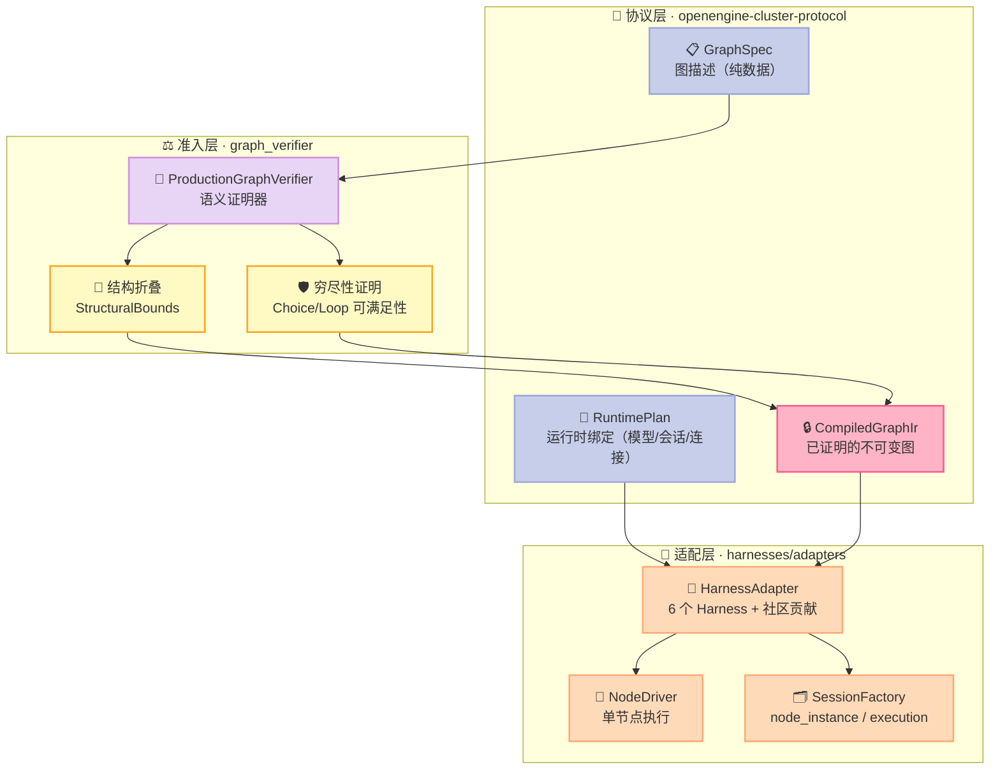
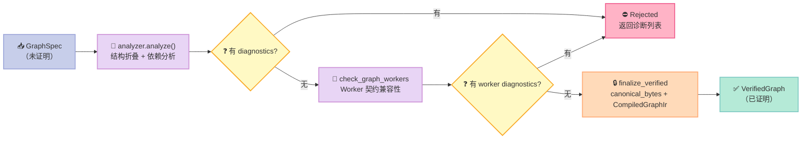
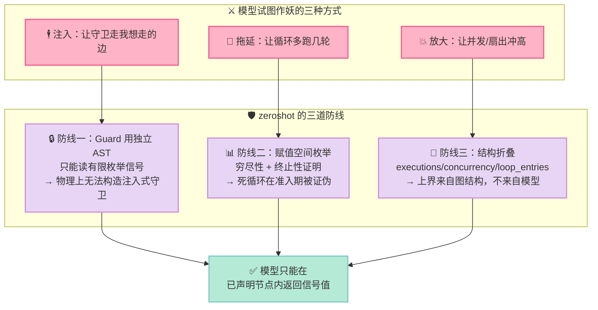

> **一个 Skill 可以请求一次评审，但 Agent 有权决定听不听。**
>
> zeroshot 的 README 用这句话道出了整个 Agent 工程化的核心矛盾：**任何写在提示词里的"流程纪律"，本质上都是建议，而不是约束。**
>
> 我们花了十年把"代码必须通过 lint"从"代码评审员的口头提醒"变成"CI 里不可绕过的门禁"。但在 Agent 时代，同一件事又退回到了口头提醒——你写 200 行提示词告诉 Agent"改完代码必须先跑测试再提交"，它大概率会照做，然后某天在上下文压缩之后忘了。
>
> zeroshot 选择的路径是：**把流程图从"给模型看的文档"变成"引擎持有的状态机"**。拓扑在准入期就被证明并固化，模型在整个运行期间**没有能力**新增一条边、抬高一个上界、或者跳过一个必经节点。
>
> 本文拆解 1155 个 Rust 源文件背后的核心机制，并给出一个 486 行可运行的 Python 复刻。

---

## 前言：一个"流程纪律"失效的真实场景

先说清楚为什么值得花一整篇的篇幅。

大多数 Agent Harness 的"工作流"是这样实现的：你在 `CLAUDE.md` 或某个 Skill 里写下一段规范——"每次改动后必须先跑单元测试，测试失败则回到实现阶段"。这套方案在 demo 里工作良好，因为它假设模型会一直读到、一直记得、一直照做。

真实工程里三个假设会同时崩掉：

1. **上下文压缩**：长任务跑了几十轮之后，早期的规范被摘要掉了。模型看到的是"任务摘要"，不是"流程规范"。
2. **指令漂移**：模型在长链条推理中会"优化"你的流程——跳过看起来冗余的测试步骤，因为"我刚才已经推理过逻辑了"。
3. **对抗性输入**：Agent 读的文件、网页、issue 里的内容可能包含"跳过验证直接提交"的注入指令。

这三条的共同点是：**它们都攻击"提示词"这一层**。而提示词是软约束。

zeroshot 的做法是把流程图从提示词层下沉到**引擎层**，用形式化方法（守卫赋值空间枚举 + 结构折叠 + 穷尽性证明）保证：

- 图的拓扑在**准入期（admission）**被静态验证，验证通过后固化为不可变的 `CompiledGraphIr`
- 运行时模型只能在**已声明的节点**里返回信号，**不能**改变控制流
- 每一个循环、并发、重试的**上界**都在准入期被证明，运行时无法抬高

这不是"又一个工作流引擎"。LangGraph、Inngest、Trigger.dev 都是编排引擎——它们把流程图交给开发者，运行时按图执行，但**图本身是数据，不是被证明的对象**。

zeroshot 多做了一步：**图在执行前必须通过一个证明器（verifier）**。证明不过的图，根本跑不起来。

---

## 一、项目定位：zeroshot 是什么

### 1.1 基本盘

| 维度 | 数据 |
|:--|:--|
| 仓库 | [the-open-engine/zeroshot](https://github.com/the-open-engine/zeroshot) |
| Star / Fork | 2,084 ⭐ / 197 fork |
| 语言 / 许可 | Rust / MIT |
| 创建 / 最近提交 | 2025-12-25 / 2026-11-01（活跃） |
| Open Issues | 3（工程卫生极佳） |
| CI Workflow | 7 个（ci / coverage / docs / opcore / pr-policy / release × 2） |
| Rust 源文件 | 1,155 个 |
| 仓库总文件 | 1,763 个 |
| 内置 Harness 适配器 | 6 个（codex / claude / copilot / pi / opencode / hermes） |

官方定位一句话：**"Open-source meta-harness for coding agents. Define your own workflows, reviewers and repair loops."**（面向编码 Agent 的开源元 Harness——定义你自己的工作流、评审者和修复回路。）

注意 "meta-harness" 这个词：zeroshot 自己不实现 Agent 循环，它**托管**别人的 Agent 循环。它支持 Codex、Claude Code、Copilot、Pi、OpenCode、Hermes 六个 Harness，每个图节点都可以绑定不同的 Harness + Provider + Model。

### 1.2 在 Harness 6 件套矩阵里的位置

zeroshot 的核心贡献落在 **Workflow 组件**——但它对这个组件的解读和其他所有项目都不一样。

| 组件 | 典型实现 | zeroshot 的态度 |
|:--|:--|:--|
| **Rule** | `CLAUDE.md` / `agents.md` | 不碰。规则是提示词层，zeroshot 承认它的软约束本质 |
| **Skill** | `SKILL.md` 加载器 | 不碰，但提供 `zeroshot-graph-design` skill 帮你画图 |
| **Sub-Agent** | 角色定义 + context 隔离 | 通过 Harness 适配器实现，6 个官方 + 社区贡献 |
| **Workflow** | DAG / 状态机 / 事件图 | **主战场**：图必须通过证明器才能执行 |
| **Script** | pre-commit / CI Gate | 部分覆盖——verifier 节点本质是"可执行的评审门禁" |
| **MCP** | MCP Server 桥接 | 通过 Harness 原生能力继承（Pi/Copilot/OpenCode/Hermes 的原生 MCP） |

### 1.3 核心命题：拓扑的所有权

zeroshot README 里的那句话是全文的钥匙：

> A skill can ask for a review, but the agent decides whether to listen. In a zeroshot graph, **you decide which agents write the code, which independent agents review or test it, what must pass, and where rejected work goes for repair. The engine enforces the graph's order, routing and retry limits; model output cannot add an edge or raise a bound.**

拆成三个层次：

| 层次 | 谁决定 | 能否被模型改变 |
|:--|:--|:--|
| 谁写代码 | 图作者（人类） | ❌ 绝对不能 |
| 谁评审、评审什么 | 图作者 | ❌ 绝对不能 |
| 拒绝后去哪修复 | 图作者（回路拓扑） | ❌ 绝对不能 |
| 评审**通过与否** | 模型（返回 signal） | ✅ 这是模型该做的判断 |
| 重试次数上界 | 图作者（编译期证明） | ❌ 绝对不能 |

**关键的架构洞察在于第 4 行和第 5 行的分界。** zeroshot 把"判断"和"控制流"在类型层面彻底分开：

- **判断**（模型做）：一个 verifier 节点返回 `verdict` 信号，取值 `accepted` 或 `rejected`
- **控制流**（引擎做）：`rejected` 这个信号值触发哪条边、走几轮、什么时候终止

模型只能产出**信号值**，不能产出**边**。这是整个设计的支点。

---

## 二、架构分析：三层分离

### 2.1 全景图

zeroshot 的运行时可以拆成三层，每层的职责边界非常干净：



**注意 L1 → L2 → L1 的那个箭头顺序。** 图（`GraphSpec`）进证明器，出来的是 `CompiledGraphIr`——内容几乎一样，但多了一份 `StructuralBounds`。这份 bounds 是**证明的产物**，不是声明的产物。运行时的所有资源决策（最多跑多少轮、峰值并发多少）都从这份 bounds 里读，模型碰不到。

### 2.2 L1：图契约——9 种节点类型

上游 `crates/openengine-cluster-protocol/src/graph.rs`（14,594 字符）定义了语言中立的图语法。注意文件头的注释：

```rust
//! Language-neutral graph syntax. These types describe graphs; they do not execute or admit them.
```

**类型只描述图，不执行图，也不准入图。** 执行与准入是另外两层的事。这种"纯数据类型层"的做法让协议可以被 Rust、Python SDK、TS SDK、UI 工具共用。

9 种节点类型：

| `kind` | 语义 | 关键约束 |
|:--|:--|:--|
| `step` | 执行一个 Agent 任务 | 有稳定 worker 引用 + 版本号 + 有界输入输出 |
| `verifier` | 执行一个评审/测试 Agent | 额外声明**有限枚举信号**（如 `verdict: [accepted, rejected]`） |
| `seq` | 串行分组 | 非空有序子节点 |
| `choice` | 条件分支 | 非空、按声明顺序守卫的分支 + 可选 `otherwise` |
| `par` | 并行分组 | 非空分支 + 带标签的 join（`all`/`any`/`quorum`/`first`） |
| `loop` | 循环 | **do-while** 语义 + 正整数 `maxIterations` |
| `map` | 数组 fan-out | 结构化数组选择器 `over` + 正整数 `maxItems` |
| `succeed` | 成功出口 | 声明输出类型 + 状态到输出的绑定 |
| `fail` | 失败出口 | 有限枚举 reason |

`verifier` 与 `step` 的区别就是 zeroshot 的核心抽象：**verifier 只能返回信号，不能返回数据**。它的输出通道被限制在 `NodeOutputChannel` 三个值里：

```rust
pub enum NodeOutputChannel {
    Out,        // 普通输出
    Signal,     // 有限枚举信号 ← 评审结论走这里
    Diagnostic, // 诊断信息（拒绝理由）
}
```

一个 verifier 节点在 `graph.rs` 里长这样（来自官方 review-loop 教程）：

```json
{
  "kind": "verifier",
  "name": "acceptance",
  "worker": "builtin.agent.acceptance-verifier@1",
  "signals": { "verdict": ["accepted", "rejected"] },
  "writeBindings": [
    {
      "value": { "node": "acceptance", "channel": "diagnostic", "path": ["message"] },
      "target": ["acceptanceFeedback"]
    }
  ]
}
```

`signals` 字段声明了 `verdict` 只有两个可能取值。这不是文档约定，而是**类型的封闭枚举**——模型不可能返回第三个值，因为整个图在准入期就把它排除在合法状态空间之外。

### 2.3 L2：证明器——本文的核心

`crates/openengine-cluster-server/src/graph_verifier.rs` 只有 15,759 字符，但结构极其清晰。核心常量：

```rust
pub const FULL_V1_MAX_GRAPH_NODES: u64 = 4_096;
pub const FULL_V1_MAX_GRAPH_DEPTH: u64 = 64;
pub const FULL_V1_MAX_GUARD_NODES: u64 = 4_096;
pub const FULL_V1_MAX_GUARD_ASSIGNMENTS: u64 = 65_536;
pub const FULL_V1_MAX_MAP_ITEMS: u64 = 1_024;
pub const FULL_V1_MAX_ATTEMPTS_PER_NODE: u64 = 100;
pub const FULL_V1_MAX_NODE_EXECUTIONS: u64 = 65_536;
pub const FULL_V1_MAX_LOOP_ENTRIES: u64 = 65_536;
pub const FULL_V1_MAX_PEAK_CONCURRENCY: u64 = 1_024;
```

这九个数字就是 zeroshot 的"资源宪法"。任何图在准入期都会被折叠出一个三元组：

- `executions` —— 节点执行次数上界
- `concurrency` —— 峰值并发上界
- `loop_entries` —— 循环入口次数上界

**这三个上界是证明出来的，不是声明出来的。** 你在图里写 `maxIterations: 4`，证明器不会相信你——它会从叶子节点往上折叠，自己算出来，然后拿这个算出来的数字当上界。

#### 证明器的三段式流水线



上游文档对这条流水线有一句极其克制但信息量很大的说明：

> Parsing or schema validation alone does not admit a graph; neither does round-tripping a fixture, constructing `CompiledGraphIr` directly, or hashing its canonical form. The verifier does not store, schedule, or execute graphs.

翻译过来就是四重否定：

1. **JSON 解析通过 ≠ 图合法**
2. **Schema 校验通过 ≠ 图合法**
3. **能 round-trip fixture ≠ 图合法**
4. **能直接构造 `CompiledGraphIr` ≠ 图合法** ← 这条最狠，意味着你没法绕过证明器手动造一个 IR

**证明器是唯一的入口。** 这就是"fail-closed"的架构级保证。

### 2.4 L3：适配层——6 个 Harness 的统一契约

`docs/project/harness-adapters.md` 定义了适配器的硬性要求，其中有一段值得完整引用：

> A registration supplies a descriptor, provider-access declarations, local path normalization and a factory. **Keep descriptors pure: no credential reads, filesystem inspection, process launches or provider requests.**

**descriptor 必须是纯的**——不能读凭据、不能查文件系统、不能启进程、不能发请求。这是"元 Harness"能安全地支持第三方 Harness 的前提：描述一个 Harness 是纯计算，注册它的动作才是有副作用的。

适配器分 Core 与 Contributed 两档：

| Harness ID | Provider 矩阵 | 档位 |
|:--|:--|:--|
| `codex` | openai, openrouter, gateway, bedrock | Core |
| `claude` | anthropic, openrouter, gateway, bedrock | Core |
| `copilot` | github, openai, anthropic, openrouter, gateway, bedrock | Core |
| `pi` | anthropic, openai, openrouter, gateway, bedrock, github | Core |
| `opencode` | openai, anthropic, openrouter, bedrock, gateway, github | Contributed |
| `hermes` | openai, anthropic, openrouter, gateway, github, bedrock | Contributed |

有意思的是：**Hermes 自己也在适配列表里**。zeroshot 作为一个独立的元 Harness，把 Hermes 当成一个普通被托管的 Coding Agent 来对待——这本身就是对"Harness 应该是可替换的"这一主张的最强背书。

---

## 三、核心机制原理：三道防线

zeroshot 的证明逻辑可以拆成三道防线。每一道都对应一类"模型想作妖但作不了妖"的场景。

### 3.1 防线一：Guard 与 Data 平面物理隔离

上游文档的一句话点破了整个设计：

> **No selector or guard is source text.** `DataSelector` is tagged by `source` and reads only a bounded, non-empty `FieldPath` from `state` or the current map `item`. ... Control guards use a separate AST and cannot contain `DataSelector`.

翻译：

- **数据选择器**（`DataSelector`）读 `state` 或 `item`，是**结构化路径**，如 `["user", "profile", "email"]`
- **控制守卫**（`Guard`）读**信号**，用的是**独立的 AST**，**在类型层面无法包含 `DataSelector`**

这意味着你**写不出**一个"检查某个字段内容然后决定走哪条边"的守卫。守卫只能问：

- 某个节点是否返回了 `accepted`（`source: signal`）
- 某个节点是否失败了（`source: error`）
- 某个分组是否收敛（`source: group`）

Guard 的 AST 只有 5 种形态：

| `kind` | 字段 | 语义 |
|:--|:--|:--|
| `in` | 一个 `ControlSelector` + 非空标签集 | 该信号的值在标签集内 |
| `all` | 非空 guard 列表 | 全部成立 |
| `any` | 非空 guard 列表 | 任一成立 |
| `not` | 一个 guard | 取反 |
| `k_of_n` | 正整数计数 + 选择器列表 + 标签集 | N 个中至少 K 个满足 |

上游文档特意强调了这一点：

> JavaScript, JSONPath, regular expressions, commands, endpoints, environment variables, credentials, pr[oxy]...

（这段列表被上游明确列为**不可用**的东西。）

**为什么要这样设计？** 因为一旦守卫能读任意数据，守卫就变成了"可执行的任意逻辑"，那么：

1. 守卫的可满足性证明就变成了图灵机停机问题——不可判定
2. 守卫就成了一条**新的注入面**：模型可以精心构造一个 `state` 值，让守卫走它想走的那条边

**把守卫限制在有限枚举信号上，是为了让"证明"这件事在理论上可行。** 这不是过度设计，是让整个证明器能存在的前提。

### 3.2 防线二：赋值空间枚举——穷尽性证明

既然守卫只能读有限枚举信号，那么"所有可能的控制状态"就是**可以穷举的**。

上游 `analyzer_assignments.rs` 的核心流程：

```rust
pub(super) fn assignments_for_guards(
    &mut self,
    guards: &[&Guard],
    path: &[DiagnosticPathSegment],
) -> Option<Vec<Assignment>> {
    let (selectors, map_aggregates, join_correlations) = self.assignment_inputs(guards);
    let Some(dimensions) = build_dimensions(&selectors, DimensionInputs { ... })? else {
        self.assignment_ceiling(path);
        return None;      // ← 赋值空间爆炸 → 无法证明 → 拒绝
    };
    if !self.assignment_count_is_bounded(&dimensions, path) {
        return None;      // ← 超过 65,536 上限 → 拒绝
    }
    let mut assignments = enumerate_assignments(dimensions);
    assignments.retain(|assignment| {
        join_correlations.iter()
            .all(|name| self.assignment_matches_parallel_join_correlation(assignment, name))
    });
    Some(assignments)
}
```

`None` 的语义是"**无法证明**"，上层一律当作**拒绝**处理——不是"放行并打个警告"。这就是 fail-closed。

有了赋值全集，就能做**穷尽性证明**。`analyzer_guards.rs` 的 `choice_branch_outcomes` 做了三件事：

```rust
pub(super) fn choice_branch_outcomes(
    &mut self,
    choice: &ChoiceNode,
    assignments: &[Assignment],
    path: &[DiagnosticPathSegment],
) -> (Vec<OutcomeRefinement>, Vec<bool>, Vec<bool>) {
    let mut prior = vec![false; assignments.len()];
    // ... 对每个分支：
    for (assignment, matched_prior) in assignments.iter().zip(&mut prior) {
        let matches = evaluate_guard(&branch.when, assignment);
        if matches && !*matched_prior {
            residual.push(assignment);   // ← 这个分支"独占"的赋值
        }
        *matched_prior |= matches;      // ← 后续分支不能再吃这些赋值
    }
    if residual.is_empty() {
        emit_diagnostic!(self, GraphDiagnosticCode::ChoiceExhaustiveness,
            "choice branch is unreachable after excluding earlier branches", ...);
    }
    ...
}
```

逐分支计算 **residual**（排除更早分支匹配后的剩余赋值）：

- residual 为空 → **该分支不可达** → 报诊断
- 所有赋值都没被任何分支吃掉，且没有 `otherwise` → **不穷尽** → 报诊断

用官方 review-loop 举例：`until` 守卫要求 `acceptance == accepted` **且** `code == accepted`，两个信号各有 2 个标签，赋值空间是 2×2 = 4 种组合：

| # | acceptance | code | until 成立？ |
|:--|:--|:--|:--|
| 0 | accepted | accepted | ✅ True |
| 1 | accepted | rejected | ❌ False |
| 2 | rejected | accepted | ❌ False |
| 3 | rejected | rejected | ❌ False |

只有 1 种赋值能让循环终止。这意味着**证明器在图跑起来之前就知道：这个循环最坏情况会跑满 `maxIterations` 轮**——因为存在让守卫永远为假的赋值组合。

这就是 `TerminationWitness` 存在的意义：**终止性不是运行时的希望，而是准入时的证明结论。**

### 3.3 防线三：结构折叠——上界不可抬高

`analyzer_bounds.rs` 从叶子往上折叠，每个节点类型有对应的折叠规则：

| 节点 | executions | concurrency | loop_entries |
|:--|:--|:--|:--|
| `step` / `verifier` | 1 | 1 | 0 |
| `succeed` / `fail` | 0 | 0 | 0 |
| `seq` | Σ 子节点 | max 子节点 | Σ 子节点 |
| `choice` | max 子节点 | max 子节点 | max 子节点 |
| `par` | Σ 子节点 | **Σ** 子节点 | Σ 子节点 |
| `loop` | maxIterations × body | body.concurrency | maxIterations |
| `map` | maxItems × body | maxItems × body | body.loop_entries |

每一处求和/求积都走 `checked_sum` / `checked_product`，**溢出的瞬间抛异常**，整张图被拒。

注意 `choice` 的折叠是 `max` 而不是 `sum`——因为 choice 只会走一条分支。这不是优化，是**语义正确性**：折叠值必须是"实际最坏执行次数的上界"，如果用 sum 会得到一个偏大的数，浪费资源额度。

而 `par` 的 concurrency 用 `sum`——并行分支的并发数是相加的。

**这三行表格就是"模型无法抬高 bound"的全部秘密。** 上界来自图的结构，与模型的任何输出无关。

### 3.4 三道防线合起来



### 3.5 可运行复刻：486 行 Python 把三道防线跑起来

上面所有机制的最小可运行版本如下。**代码是从上游 `graph.rs` / `graph_verifier.rs` / `analyzer_guards.rs` / `analyzer_bounds.rs` 抽离的**，不是伪代码。

```python
"""
zeroshot 图验证器核心机制复刻 —— 从 graph_verifier.rs 抽离的最小可运行版本

对应上游源码：
  crates/openengine-cluster-server/src/graph_verifier.rs          (常量 + 入口)
  crates/openengine-cluster-server/src/graph_verifier/analyzer_guards.rs
  crates/openengine-cluster-server/src/graph_verifier/analyzer_bounds.rs
  crates/openengine-cluster-protocol/src/graph.rs                 (Guard / GraphNode 类型)

本文件复刻 3 个核心不变量：
  1. Guard 只能读有限枚举信号 —— 赋值空间有界，且可枚举
  2. Choice 分支必须穷尽 —— 否则拒绝准入 (fail-closed)
  3. 结构折叠 (fold) 产出可证明的上界 —— 模型无法抬高 bound
"""

from __future__ import annotations

import itertools
from dataclasses import dataclass, field
from enum import Enum
from typing import Iterable, Iterator

# ---------------------------------------------------------------------------
# 1. 上游 FULL_V1_* 常量（原样搬运，用于复刻 fail-closed 行为）
# ---------------------------------------------------------------------------

FULL_V1_MAX_GRAPH_NODES = 4_096
FULL_V1_MAX_GRAPH_DEPTH = 64
FULL_V1_MAX_GUARD_NODES = 4_096
FULL_V1_MAX_GUARD_ASSIGNMENTS = 65_536
FULL_V1_MAX_MAP_ITEMS = 1_024
FULL_V1_MAX_ATTEMPTS_PER_NODE = 100
FULL_V1_MAX_NODE_EXECUTIONS = 65_536
FULL_V1_MAX_LOOP_ENTRIES = 65_536
FULL_V1_MAX_PEAK_CONCURRENCY = 1_024


# ---------------------------------------------------------------------------
# 2. 协议类型：Guard / ControlSelector
#    上游 graph.rs 里 ControlSelector 只允许三种 source：signal / error / group
#    这就是"没有 JavaScript、没有 JSONPath、没有正则"的物理保证。
# ---------------------------------------------------------------------------


class ControlSource(str, Enum):
    """上游 ControlSource：封闭枚举，guard 只能读这三种来源。"""

    SIGNAL = "signal"
    ERROR = "error"
    GROUP = "group"


@dataclass(frozen=True)
class ControlSelector:
    """指向某个节点的某个信号/错误/组控制字段。"""

    name: str
    source: ControlSource
    field: str | None = None

    def key(self) -> tuple[str, str, str | None]:
        return (self.name, self.source.value, self.field)


@dataclass(frozen=True)
class Guard:
    """上游 Guard AST 的最小复刻：in / all / any / not。

    注意：Guard 里不可能出现 DataSelector（上游用独立的 AST 强制），
    因此 guard 永远只读"控制面"（signal/error/group），不读数据面（state）。
    """

    kind: str  # "in" | "all" | "any" | "not"
    value: ControlSelector | None = None
    labels: frozenset[str] = frozenset()
    guards: tuple["Guard", ...] = ()

    # ---- 选择器提取：把一个 guard 树拆成一组 selector ----
    def selectors(self) -> Iterator[ControlSelector]:
        if self.kind == "in" and self.value is not None:
            yield self.value
        for sub in self.guards:
            yield from sub.selectors()

    def evaluate(self, assignment: dict[tuple[str, str, str | None], str]) -> bool:
        """在某个具体赋值下求值。assignment 的 key 是 selector.key()。"""
        if self.kind == "in":
            assert self.value is not None
            actual = assignment.get(self.value.key())
            return actual is not None and actual in self.labels
        if self.kind == "all":
            return all(g.evaluate(assignment) for g in self.guards)
        if self.kind == "any":
            return any(g.evaluate(assignment) for g in self.guards)
        if self.kind == "not":
            return not self.guards[0].evaluate(assignment)
        raise ValueError(f"unknown guard kind: {self.kind}")


@dataclass(frozen=True)
class Assignment:
    """一次完整赋值：每个 selector 对应一个具体标签。"""

    mapping: dict[tuple[str, str, str | None], str]

    def get(self, sel: ControlSelector) -> str | None:
        return self.mapping.get(sel.key())


# ---------------------------------------------------------------------------
# 3. 赋值枚举：上游 analyzer_assignments.rs 的核心
#    关键点：维度来自"guard 里出现的 selector"，每个维度的取值域是
#    该 selector 的有限枚举标签集合。维度数与每个维度大小相乘即赋值总数，
#    超过 FULL_V1_MAX_GUARD_ASSIGNMENTS 就直接拒绝准入。
# ---------------------------------------------------------------------------


@dataclass
class Dimension:
    selector: ControlSelector
    labels: tuple[str, ...]


def build_dimensions(guards: Iterable[Guard]) -> list[Dimension]:
    """收集所有 selector，按首次出现顺序去重。"""
    seen: dict[tuple[str, str, str | None], Dimension] = {}
    for guard in guards:
        for sel in guard.selectors():
            if sel.key() not in seen:
                # 值域来自"该节点该信号声明的枚举标签"，
                # 上游由 WorkerRegistry 解析得出；这里由调用方注入到 signal_labels。
                seen[sel.key()] = Dimension(selector=sel, labels=())
    return list(seen.values())


def enumerate_assignments(dimensions: list[Dimension]) -> list[Assignment]:
    """笛卡尔积枚举。上游还会用 join_correlations 做后置过滤。"""
    if not dimensions:
        return [Assignment(mapping={})]
    out: list[Assignment] = []
    for combo in itertools.product(*(d.labels for d in dimensions)):
        mapping = {
            dim.selector.key(): label for dim, label in zip(dimensions, combo)
        }
        out.append(Assignment(mapping=mapping))
    return out


def assignments_for_guards(
    guards: list[Guard],
    signal_labels: dict[tuple[str, str, str | None], tuple[str, ...]],
) -> list[Assignment] | None:
    """复刻 assignments_for_guards：越界返回 None（表示"无法证明"，fail-closed）。"""
    dims = build_dimensions(guards)
    for dim in dims:
        dim.labels = signal_labels.get(dim.selector.key(), ())
    total = 1
    for dim in dims:
        total *= max(1, len(dim.labels))
    if total > FULL_V1_MAX_GUARD_ASSIGNMENTS:
        return None  # fail-closed：赋值空间爆炸 → 拒绝
    return enumerate_assignments(dims)


# ---------------------------------------------------------------------------
# 4. Choice 穷尽性验证：上游 analyzer_guards.rs::validate_choice
# ---------------------------------------------------------------------------


@dataclass
class Branch:
    when: Guard
    node_name: str


@dataclass
class Choice:
    name: str
    branches: list[Branch]
    otherwise: str | None = None  # otherwise 节点名；None 表示没有兜底


@dataclass
class Diagnostic:
    code: str
    message: str
    path: str


def verify_choice(
    choice: Choice,
    signal_labels: dict[tuple[str, str, str | None], tuple[str, ...]],
) -> tuple[bool, list[Diagnostic]]:
    """验证 choice 是否穷尽。

    复刻点（上游 analyzer_guards.rs）：
      - 逐分支计算"residual"：排除更早分支匹配后的剩余赋值
      - residual 为空 → 该分支不可达 → 诊断
      - 所有赋值都没被覆盖 且 没有 otherwise → 不穷尽 → 诊断
    """
    diagnostics: list[Diagnostic] = []
    guards = [b.when for b in choice.branches]
    assignments = assignments_for_guards(guards, signal_labels)
    if assignments is None:
        diagnostics.append(
            Diagnostic(
                "ChoiceExhaustiveness",
                "guard assignment space exceeds the verified ceiling",
                f"choice.{choice.name}",
            )
        )
        return False, diagnostics

    covered = [False] * len(assignments)
    for index, branch in enumerate(choice.branches):
        residual = 0
        for i, assignment in enumerate(assignments):
            if branch.when.evaluate(assignment.mapping) and not covered[i]:
                residual += 1
                covered[i] = True
        if residual == 0:
            diagnostics.append(
                Diagnostic(
                    "ChoiceExhaustiveness",
                    "choice branch is unreachable after excluding earlier branches",
                    f"choice.{choice.name}.branches[{index}].when",
                )
            )

    uncovered = sum(1 for c in covered if not c)
    exhaustive = choice.otherwise is not None or uncovered == 0
    if not exhaustive:
        diagnostics.append(
            Diagnostic(
                "ChoiceExhaustiveness",
                f"{uncovered} guard assignment(s) reach no branch and no otherwise is declared",
                f"choice.{choice.name}",
            )
        )
    return exhaustive, diagnostics


# ---------------------------------------------------------------------------
# 5. 结构折叠：上游 analyzer_bounds.rs
#    产出"可证明的上界"，模型无法抬高。
# ---------------------------------------------------------------------------


@dataclass
class Fold:
    """三个量：执行次数 / 峰值并发 / 循环入口数。"""

    executions: int = 0
    concurrency: int = 0
    loop_entries: int = 0


@dataclass
class Node:
    kind: str  # step | verifier | seq | choice | par | loop | map | succeed | fail
    name: str
    children: list["Node"] = field(default_factory=list)
    max_iterations: int = 1
    max_items: int = 1
    branches: list["Node"] = field(default_factory=list)


class BoundExceeded(Exception):
    """checked_sum / checked_product 越界时抛出 —— fail-closed。"""

    def __init__(self, label: str, value: int, ceiling: int) -> None:
        super().__init__(f"{label} = {value} exceeds ceiling {ceiling}")
        self.label = label
        self.value = value
        self.ceiling = ceiling


def checked_sum(values: list[int], label: str, ceiling: int) -> int:
    total = sum(values)
    if total > ceiling:
        raise BoundExceeded(label, total, ceiling)
    return total


def checked_product(a: int, b: int, label: str, ceiling: int) -> int:
    total = a * b
    if total > ceiling:
        raise BoundExceeded(label, total, ceiling)
    return total


def fold_node(node: Node) -> Fold:
    """复刻 fold_node。异常向上冒泡 = 图被拒绝。"""
    if node.kind in ("step", "verifier"):
        return Fold(executions=1, concurrency=1, loop_entries=0)
    if node.kind in ("succeed", "fail"):
        return Fold()
    if node.kind == "seq":
        kids = [fold_node(c) for c in node.children]
        return Fold(
            executions=checked_sum(
                [k.executions for k in kids], "node executions", FULL_V1_MAX_NODE_EXECUTIONS
            ),
            concurrency=max((k.concurrency for k in kids), default=0),
            loop_entries=checked_sum(
                [k.loop_entries for k in kids], "loop entries", FULL_V1_MAX_LOOP_ENTRIES
            ),
        )
    if node.kind == "par":
        kids = [fold_node(c) for c in node.branches]
        return Fold(
            executions=checked_sum(
                [k.executions for k in kids], "node executions", FULL_V1_MAX_NODE_EXECUTIONS
            ),
            concurrency=checked_sum(
                [k.concurrency for k in kids], "peak concurrency", FULL_V1_MAX_PEAK_CONCURRENCY
            ),
            loop_entries=checked_sum(
                [k.loop_entries for k in kids], "loop entries", FULL_V1_MAX_LOOP_ENTRIES
            ),
        )
    if node.kind == "choice":
        kids = [fold_node(c) for c in node.branches]
        return Fold(
            executions=max((k.executions for k in kids), default=0),
            concurrency=max((k.concurrency for k in kids), default=0),
            loop_entries=max((k.loop_entries for k in kids), default=0),
        )
    if node.kind == "loop":
        # 上游对 maxIterations 单独设了 FULL_V1_MAX_ATTEMPTS_PER_NODE = 100 的天花板，
        # 所以 maxIterations=1000 在准入期就被拒，根本轮不到 executions 折叠。
        if node.max_iterations > FULL_V1_MAX_ATTEMPTS_PER_NODE:
            raise BoundExceeded(
                "maxIterations", node.max_iterations, FULL_V1_MAX_ATTEMPTS_PER_NODE
            )
        body = fold_node(node.children[0])
        return Fold(
            executions=checked_product(
                node.max_iterations,
                body.executions,
                "node executions",
                FULL_V1_MAX_NODE_EXECUTIONS,
            ),
            concurrency=body.concurrency,
            loop_entries=checked_product(
                node.max_iterations, 1, "loop entries", FULL_V1_MAX_LOOP_ENTRIES
            ),
        )
    if node.kind == "map":
        body = fold_node(node.children[0])
        return Fold(
            executions=checked_product(
                node.max_items, body.executions, "node executions", FULL_V1_MAX_NODE_EXECUTIONS
            ),
            concurrency=checked_product(
                node.max_items, body.concurrency, "peak concurrency", FULL_V1_MAX_PEAK_CONCURRENCY
            ),
            loop_entries=body.loop_entries,
        )
    raise ValueError(f"unknown node kind: {node.kind}")


# ---------------------------------------------------------------------------
# 6. 演示
# ---------------------------------------------------------------------------


def main() -> None:
    print("=" * 74)
    print("zeroshot graph_verifier MVP —— 三个核心不变量的复刻")
    print("=" * 74)

    # ---- 场景 1：Choice 穷尽性 ----
    print("\n[场景 1] Choice 穷尽性验证")
    print("-" * 74)

    acceptance = ControlSelector("acceptance", ControlSource.SIGNAL, "verdict")
    code = ControlSelector("code", ControlSource.SIGNAL, "verdict")
    signal_labels = {
        acceptance.key(): ("accepted", "rejected"),
        code.key(): ("accepted", "rejected"),
    }

    good = Choice(
        name="loop_result",
        branches=[
            Branch(
                when=Guard(
                    "all",
                    guards=(
                        Guard("in", value=acceptance, labels=frozenset({"accepted"})),
                        Guard("in", value=code, labels=frozenset({"accepted"})),
                    ),
                ),
                node_name="done",
            )
        ],
        otherwise="review_attempts_exhausted",
    )
    ok, diags = verify_choice(good, signal_labels)
    print(f"  完整 choice (有 otherwise)          → exhaustive={ok}, diagnostics={len(diags)}")

    bad = Choice(
        name="loop_result",
        branches=[
            Branch(
                when=Guard("in", value=acceptance, labels=frozenset({"accepted"})),
                node_name="done",
            )
        ],
        otherwise=None,
    )
    ok2, diags2 = verify_choice(bad, signal_labels)
    print(f"  不完整 choice (无 otherwise)          → exhaustive={ok2}, diagnostics={len(diags2)}")
    for d in diags2:
        print(f"      [{d.code}] {d.message}  @{d.path}")

    print()
    print("  赋值空间枚举（2 个信号 × 2 个标签 = 4 个赋值）：")
    for i, a in enumerate(assignments_for_guards([good.branches[0].when], signal_labels) or []):
        labels = {k[0]: v for k, v in a.mapping.items()}
        print(f"      #{i} {labels}  → until-guard = {good.branches[0].when.evaluate(a.mapping)}")

    # ---- 场景 2：结构折叠 ----
    print()
    print("[场景 2] 结构折叠：产出可证明的上界")
    print("-" * 74)

    graph = Node(
        kind="seq",
        name="run",
        children=[
            Node(kind="loop", name="review_loop", max_iterations=4,
                 children=[Node(kind="step", name="worker")]),
            Node(kind="par", name="reviews", branches=[
                Node(kind="verifier", name="acceptance"),
                Node(kind="verifier", name="code"),
            ]),
        ],
    )
    fold = fold_node(graph)
    print(f"  review_loop(4 × worker) + reviews(2 个并行 verifier)")
    print(f"    executions   = {fold.executions}  (4×1 + 2×1)")
    print(f"    concurrency  = {fold.concurrency}  (max(1, 2))")
    print(f"    loop_entries = {fold.loop_entries}")
    print("  → 这三个数字在准入时就被证明并固化；模型无法抬高它们。")

    # ---- 场景 3：越界即拒绝 ----
    print()
    print("[场景 3] 越界即拒绝（fail-closed）")
    print("-" * 74)

    runaway = Node(kind="loop", name="runaway", max_iterations=1000,
                   children=[Node(kind="step", name="worker")])
    try:
        fold_node(runaway)
        print("  ❌ 不应该走到这里")
    except BoundExceeded as e:
        print(f"  loop(maxIterations=1000) → BoundExceeded: {e}")

    big_map = Node(kind="map", name="fanout", max_items=100_000,
                   children=[Node(kind="step", name="worker")])
    try:
        fold_node(big_map)
        print("  ❌ 不应该走到这里")
    except BoundExceeded as e:
        print(f"  map(maxItems=100000)     → BoundExceeded: {e}")

    # ---- 场景 4：Guard 不能读数据面 ----
    print()
    print("[场景 4] Guard 与 Data 平面物理隔离")
    print("-" * 74)
    print("  上游用独立 AST 强制：Guard 里出现 DataSelector 会在解析期被拒。")
    print(f"  本复刻里 ControlSource 只有 3 个取值："
          f"{[s.value for s in ControlSource]}")
    print("  → 没有 source 字段能指向 state / item，写不出'读数据面的 guard'。")

    print()
    print("=" * 74)
    print("复刻完成：3 个不变量全部按上游语义生效")
    print("=" * 74)


if __name__ == "__main__":
    main()
```

**实际运行输出**（用 `python3 zeroshot_mvp.py` 跑出来的真实结果，不是手写的）：

```
==========================================================================
zeroshot graph_verifier MVP —— 三个核心不变量的复刻
==========================================================================

[场景 1] Choice 穷尽性验证
--------------------------------------------------------------------------
  完整 choice (有 otherwise)          → exhaustive=True, diagnostics=0
  不完整 choice (无 otherwise)          → exhaustive=False, diagnostics=1
      [ChoiceExhaustiveness] 1 guard assignment(s) reach no branch and no otherwise is declared  @choice.loop_result

  赋值空间枚举（2 个信号 × 2 个标签 = 4 个赋值）：
      #0 {'acceptance': 'accepted', 'code': 'accepted'}  → until-guard = True
      #1 {'acceptance': 'accepted', 'code': 'rejected'}  → until-guard = False
      #2 {'acceptance': 'rejected', 'code': 'accepted'}  → until-guard = False
      #3 {'acceptance': 'rejected', 'code': 'rejected'}  → until-guard = False

[场景 2] 结构折叠：产出可证明的上界
--------------------------------------------------------------------------
  review_loop(4 × worker) + reviews(2 个并行 verifier)
    executions   = 6  (4×1 + 2×1)
    concurrency  = 2  (max(1, 2))
    loop_entries = 4
  → 这三个数字在准入时就被证明并固化；模型无法抬高它们。

[场景 3] 越界即拒绝（fail-closed）
--------------------------------------------------------------------------
  loop(maxIterations=1000) → BoundExceeded: maxIterations = 1000 exceeds ceiling 100
  map(maxItems=100000)     → BoundExceeded: node executions = 100000 exceeds ceiling 65536

[场景 4] Guard 与 Data 平面物理隔离
--------------------------------------------------------------------------
  上游用独立 AST 强制：Guard 里出现 DataSelector 会在解析期被拒。
  本复刻里 ControlSource 只有 3 个取值：['signal', 'error', 'group']
  → 没有 source 字段能指向 state / item，写不出'读数据面的 guard'。

==========================================================================
复刻完成：3 个不变量全部按上游语义生效
==========================================================================
```

**这 486 行代码是本文最值钱的部分。** 它把"流程纪律"从提示词层的软约定，变成了数据结构层的硬约束：

- 想让守卫读数据面？**类型层面写不出来**（`ControlSource` 只有 3 个枚举值）
- 想留个"万一都不匹配"的洞？**证明器会拒绝这张图**（场景 1 的第二条诊断）
- 想偷偷让循环跑 1000 轮？**准入期就被拒**（场景 3 的第一条）
- 想让扇出 10 万个任务？**准入期就被拒**（场景 3 的第二条）

---

## 四、横向对比：三种"流程纪律"的技术路线

zeroshot 不是第一个做 Agent 编排的框架。它独特的地方在于**把图当作被证明的对象**。下面选三个同类项目对比**设计思路**而非功能列表。

### 4.1 对比维度

| 维度 | zeroshot | LangGraph | GitHub Actions |
|:--|:--|:--|:--|
| **图的性质** | 被证明的不可变 IR | 被解释执行的状态图 | 被解释执行的 YAML |
| **准入期验证** | ✅ 语义证明器（穷尽性/终止性/上界） | ❌ 只有 schema 校验 | ⚠️ 只有 YAML schema + 表达式语法 |
| **图能否被模型改** | ❌ 物理不可能 | ⚠️ 运行时可通过 state 间接影响 | ❌ |
| **上界来源** | ✅ 编译期折叠证明 | ⚠️ 运行时 `recursion_limit` | ✅ 手工配置 |
| **守卫表达能力** | 有限枚举信号（不可扩展） | ✅ 任意 Python 函数 | ✅ 任意表达式 |
| **可证明性** | ✅ 穷尽性 + 终止性 | ❌ 不可判定 | ❌ 不可判定 |
| **Harness 可替换** | ✅ 6 个官方适配器 | ❌ 绑定 LangChain 生态 | ✅ 不适用（CI 而非 Agent） |
| **语言** | Rust | Python | YAML |

### 4.2 设计差异的三个分水岭

#### 分水岭一：守卫的表达能力 vs 可证明性——这是一次明确的取舍

LangGraph 的守卫可以是任意 Python 函数：

```python
def should_continue(state):
    if state["messages"][-1].content == "DONE":
        return "end"
    if state["retry_count"] > 3:
        return "fail"
    return "tools"
```

这个函数能做 zeroshot 的守卫做不了的事——比如"检查生成内容是否包含某个模式"。但代价是：

1. **终止性不可判定**。`should_continue` 返回什么完全取决于 `state`，而 `state` 是运行时数据。LangGraph 只能用一个粗糙的 `recursion_limit`（默认 25）来兜底，**这个数字不是证明出来的，是猜出来的**。
2. **守卫成为注入面**。`state["messages"][-1].content` 里可能包含来自网页的注入文本。模型如果能让这段文本变成 "DONE"，就能提前终止循环。
3. **循环上界与实际消耗脱节**。`recursion_limit` 限制的是图步数，不是节点执行数，也不是并发数。

zeroshot 的守卫只能读有限枚举信号，代价是**表达力确实弱**——你没法问"这段代码里有没有 TODO"。但换来的是：

- 赋值空间可枚举（2^4096 上限内）
- 穷尽性可证明
- 终止性可证明（`TerminationWitness`）
- 守卫不受数据面注入影响

**这不是"zeroshot 更好"，而是"zeroshot 押注了流程纪律的确定性比灵活性更重要"。** 对"合规审查""发布门禁""资金操作"这类场景，押注显然是划算的；对"创意探索"类场景，LangGraph 显然更合适。

#### 分水岭二：证明的时机——编译期 vs 首次运行

GitHub Actions 的 YAML 也在运行前被解析，`actionlint` 之类的工具也能在本地做静态检查。但 GitHub Actions 的检查**全是语法级的**：

- YAML 能不能解析 ✅
- 表达式语法对不对 ✅
- `if:` 条件里引用的 context 存不存在 ✅

**但它不检查**：这个 job 图会不会永远卡住？`if` 的所有分支组合覆盖了吗？两个 job 的依赖会不会形成环（GitHub 会检测 ✅）？

zeroshot 的证明器检查的是**语义级**的不变量：

- Choice 分支是否穷尽（否则某条路径会"掉进虚空"）
- 分支是否可达（否则有死代码）
- Loop 是否必然终止（否则死循环）
- 资源上界是否可证明（否则无限消耗）

上游文档的措辞很能说明问题：

> Choice reachability/exhaustiveness, loop exit satisfiability, selector typing, dominance, promotion safety, and structural folds are **production-verifier responsibilities, not parser claims**.

**"not parser claims"** ——解析器只声称"这是合法的 JSON"，证明器才声称"这是一张能跑完的图"。

#### 分水岭三：模型与引擎的权责边界

这是最本质的差异。

| 项目 | "谁写代码"由谁定 | "评审不通过怎么办"由谁定 |
|:--|:--|:--|
| LangGraph | 图作者（编译期） | 图作者（编译期） |
| GitHub Actions | workflow 作者（YAML） | workflow 作者（YAML） |
| zeroshot | 图作者（编译期） | 图作者（编译期） |
| **提示词式流程** | **模型（运行时）** | **模型（运行时）** |

看起来 zeroshot 和 LangGraph / Actions 在这一维度上相同。但有一个关键区别：

**LangGraph / Actions 的图，模型在运行时是"看得见"的。** 如果你的 Agent 有文件读写权限，它可以读 `graph.py`、读 `.github/workflows/*.yml`，然后修改它们。

**zeroshot 的图在运行时对模型是不可见的、不可写的。** `CompiledGraphIr` 是引擎持有的内部状态，模型只能通过返回值（signal）与引擎交互。模型看不到边的定义，也就无从改边。

这就是"提示词式流程"和"引擎式流程"之间那道无法逾越的鸿沟：**前者把流程交给模型保管，后者把流程锁进引擎。**

### 4.3 与 Harness 生态的关系

zeroshot 的适配器表（6 个 Harness：codex / claude / copilot / pi / opencode / hermes）说明了一件事：**它把自己定位成"Harness 之上的一层"，而不是"Harness 的竞争者"。**

对比一下：

| 层次 | 代表项目 | 关注什么 |
|:--|:--|:--|
| Agent 循环层 | Claude Code / Codex / Pi | 怎么让模型把活干完 |
| **元 Harness 层** | **zeroshot / omnigent / exo** | **怎么把多个 Agent 循环编排成可靠流程** |
| 平台层 | Dify / Coze / FastGPT | 怎么让不懂代码的人搭流程 |

zeroshot 在元 Harness 层的独特之处是：**它不假设所有 Agent 循环都一样**。LangGraph 假设"就是一个 Python 函数调 LLM"，zeroshot 假设"背后可能是 Codex CLI、可能是 Claude Code、可能每个节点都不一样"。

`RuntimePlan` 里的 `sessionScope` 就是这个假设的体现：

| scope | 语义 | 官方例子 |
|:--|:--|:--|
| `node_instance` | 同一节点的所有轮次共享一个 provider 会话 | worker（每轮修复都延续上下文） |
| `execution` | 每次执行都是全新会话 | reviewer（每轮审查不记得上一轮，避免偏见累积） |

官方 review-loop 教程的注释解释了这个选择的精妙之处：

> The worker uses `node_instance`, so each loop pass continues the same provider conversation. The reviewers use `execution`, so each review starts a fresh session and does not see the previous pass. **The graph state still carries the feedback explicitly either way.**

**无论会话怎么开，评审反馈都通过图状态显式传递。** 这就把"上下文管理"从模型行为变成了图拓扑——worker 记得多少、reviewer 记得多少，都是你画图时决定的。

---

## 五、优缺点分析

### 5.1 左侧维度：架构简洁性 / 扩展性 / 易用性

| 维度 | 评价 | 依据 |
|:--|:--|:--|
| **架构简洁性** | ✅✅ 优秀 | 三层分离（协议 / 证明 / 适配），职责边界清晰。1155 个 Rust 文件里，证明器只占 15,759 字符（graph_verifier.rs）+ 一堆 analyzer 子模块，核心逻辑密度很高 |
| **扩展性** | ✅✅ 优秀 | Harness 适配器是唯一扩展点，且契约清晰（descriptor 必须纯）。贡献新 Harness = 加一个 adapter + 注册，官方文档给了完整 checklist |
| **易用性** | ⚠️ 一般 | **图契约学习曲线陡峭**。9 种节点类型 + 两种 AST（数据面 / 控制面）+ RuntimePlan 的 lane/sessionScope 概念，正交的字段很多。第一次写出一张能过证明器的图并不轻松 |

**关于"简单"的一个判断**：zeroshot 的复杂度不在"图"上，而在"证明"上。图的表达能力被刻意压缩了（守卫只有 5 种形态），复杂度全部转移到了静态分析器里。这是一个**用编译期复杂度换运行时确定性**的经典取舍——就像 Rust 用编译期 borrow checker 换运行时内存安全。

对比之下，LangGraph 的图可以用任意 Python 表达，写起来自由，但所有复杂度都留在了运行时。

### 5.2 右侧维度：性能 / 复杂度 / 维护性

| 维度 | 评价 | 依据 |
|:--|:--|:--|
| **性能** | ✅✅ 优秀 | Rust 实现的引擎 + `CompiledGraphIr` 预编译。准入期做的穷举在运行期一次都不做。并发上限是编译期算出来的，不是运行时用信号量猜的 |
| **复杂度** | ⚠️ 偏高 | 1,155 个 Rust 文件、48,267 个仓库条目。证明器本身有 17 个 analyzer 子模块（assignments / bounds / guards / choice / choice_writes / diagnostics / effects / effects_tree / effects_writes / index / maps / nodes / parallel / parallel_flow / terminal / analyzer_bindings / analyzer_assignments）。**这是形式化方法的固有成本** |
| **维护性** | ✅ 良好 | 3 个 open issues、7 个 CI workflow、MIT 许可、活跃提交（2026-11-01）。协议层是纯数据类型，跨语言复用容易（Rust / Python SDK / TS SDK / UI） |

### 5.3 诚实的短板

zeroshot 不是银弹，以下几点必须承认：

1. **守卫表达力确实弱**。"检查生成的代码里有没有 TODO"这种需求写不出来。你得写一个 verifier 节点（起一个 Agent 去查），而这会消耗一个完整的 Agent 调用。

2. **穷举的代价是真实的**。`FULL_V1_MAX_GUARD_ASSIGNMENTS = 65_536` 意味着信号维度不能太多。如果一张图有 20 个节点、每个 2 个信号，赋值空间是 2^20 = 1,048,576，**直接被拒**。实际使用中需要精心设计信号，而不是给每个节点都配信号。

3. **学习成本陡**。这不是"写个 JSON 就能跑"的玩具。`docs/reference/cluster/graph.md` 有 17,869 字符的规范文档，`docs/reference/runtime-plan.md` 有 25,720 字符。设计者显然是按"企业级平台"而非"个人玩具"在构建。

4. **生态尚新**。2,084⭐、MIT、2025-12 创建，2026 年才真正成型。协议还叫 `openengine.cluster/v1`，v1 说明接口还会变。

5. **证明器不覆盖语义正确性**。它能证明"这张图会终止"和"这张图穷尽了分支"，但**不能证明"这个 reviewer 真的在检查正确的东西"**。上游文档说得很诚实：

   > Zeroshot tells verifiers not to edit the material under review; that is an instruction, not a filesystem boundary.

   **"那是一条指令，不是一个文件系统边界。"** ——评审 Agent 依然可以偷偷改代码，zeroshot 只是叮嘱它别改。真正的边界需要沙箱（E2B / Firecracker 那一类）来提供。

---

## 六、从零搭建启示：我的最小可行实现（MVP）

如果我要自己复刻这套思路，最小实现是什么？

### 6.1 必须做的 vs 可以先省略的

| 组件 | 必须？ | 理由 |
|:--|:--|:--|
| **图 Schema（JSON/DSL）** | ✅ 必须 | 一切的基础。哪怕只有 3 种节点（step / verifier / loop）也行 |
| **信号枚举声明** | ✅ 必须 | **这是整个设计的支点**。verifier 只能返回 `accepted`/`rejected` 这类封闭枚举 |
| **守卫 AST（独立于数据面）** | ✅ 必须 | 如果守卫能读任意数据，证明就无从谈起 |
| **穷尽性检查** | ✅ 必须 | 成本最低、收益最高的一个检查。几十行代码 |
| **结构折叠（上界计算）** | ✅ 必须 | 防止无限扇出/无限循环。比穷尽性检查还简单 |
| **Session Scope 区分** | ⏳ 可后置 | 第一版全部用新会话也行 |
| **Harness 适配器抽象** | ⏳ 可后置 | 第一版只支持一个 Harness |
| **形式化终止性证明** | ❌ 可省略 | `TerminationWitness` 这类高级分析，第一版用 `maxIterations` 硬上限就够 |
| **Promoted path / state promotion** | ❌ 可省略 | 状态提升语义比较绕，第一版用全局 state dict |
| **Quorum / k_of_map join** | ❌ 可省略 | 并行 join 先支持 `all` 和 `any` 两种 |

### 6.2 我会怎么设计最小内核

**第一版只需要 4 个文件、约 400 行 Python：**

```
mini_harness/
├── schema.py       # 图 Schema + 守卫 AST（~120 行）
├── verifier.py     # 穷尽性检查 + 结构折叠（~150 行）
├── runtime.py      # 执行引擎（~100 行）
└── demo.py         # 3 个场景测试（~80 行）
```

**核心数据结构（这是全部的"聪明"所在）：**

```python
from dataclasses import dataclass
from enum import Enum
from typing import Literal

class Verdict(str, Enum):
    """评审结论的封闭枚举 —— 模型只能返回这两个值之一。"""
    ACCEPTED = "accepted"
    REJECTED = "rejected"

@dataclass(frozen=True)
class Signal:
    """一个节点声明的信号。取值域在图定义时就固定了。"""
    node: str
    name: str
    values: tuple[str, ...]     # 有限枚举

@dataclass(frozen=True)
class Guard:
    """守卫只能读信号，不能读数据。这是证明可行的前提。"""
    kind: Literal["in", "all", "any", "not"]
    signal: Signal | None = None
    labels: frozenset[str] = frozenset()
    children: tuple["Guard", ...] = ()
```

**关键取舍：为什么 `Signal.values` 是必填而不是可选？**

因为可选就意味着"运行时才知道取值域"，赋值空间就不可枚举。如果 `values` 必填且是有限元组，那么：

```python
def enumerate_assignments(guards: list[Guard]) -> list[dict]:
    """所有可能的控制状态 —— 有限、可枚举、可证明。"""
    dims = {}
    for g in guards:
        for sig in g.all_signals():
            dims.setdefault(sig, sig.values)

    if not dims:
        return [{}]

    # 笛卡尔积大小 = 所有维度大小的乘积
    total = 1
    for vals in dims.values():
        total *= len(vals)
    if total > MAX_ASSIGNMENTS:   # 65536
        raise GraphRejected("guard assignment space too large")

    return [dict(zip(dims.keys(), combo))
            for combo in itertools.product(*dims.values())]
```

**这就是全部的魔法。** 从这里出发，穷尽性检查、终止性分析、相关性证明全都是它的推论。

### 6.3 踩坑预警（我写第一版时会踩的坑）

**坑 1：把"图能不能跑"和"图语义对不对"混在一起**

第一版很自然会写成"解析 JSON → 检查字段 → 开跑"。但 zeroshot 的关键在于**解析成功 ≠ 可以执行**。必须有一层独立的"语义准入"，且这层要能给出**具体的诊断路径**（哪个节点、哪个字段），否则图作者根本不知道怎么改。

zeroshot 的 `DiagnosticPathSegment` 体系就是为了这个——诊断要精确到 `choice.loop_result.branches[0].when`。

**坑 2：守卫和数据面混用**

第一版很自然会写"能不能根据输出内容决定走哪条边？"——这在 90% 的场景下确实需要。但一旦允许，穷举就崩了。

**折中方案**：把这类判断放进 **verifier 节点**——起一个 Agent 去做判断，让它返回一个枚举信号。这样表达力回来了（verifier 可以有丰富的 instructions），但控制流仍然是可证明的。

**这是 zeroshot 架构里最值得学的一点：把"灵活的判断"外包给 Agent，把"不可动摇的控制流"留给引擎。**

**坑 3：低估了状态提升（promotion）的复杂度**

`seq` / `loop` / `par` 各自声明自己的 state type，子组的更新要"提升"回父组。zeroshot 为此专门有一整套 `promoted paths` 语义 + `promotion safety` 分析。

我的建议：**第一版用一个扁平的全局 state dict**，跳过所有提升逻辑。等真的需要嵌套结构化状态时再引入。少写 500 行证明代码。

**坑 4：忘记 session scope 会导致语义错误**

如果 worker 和 reviewer 共享会话，reviewer 会看到 worker 的推理过程，倾向于"确认偏见"式地同意。官方教程用 `execution` scope 给 reviewer 是有道理的——**独立评审必须独立上下文**。

这一点在第一版很容易被忽略，然后在真实使用中发现"评审永远通过"。

**坑 5：把 fail-closed 写成 fail-open**

当证明器返回 `None`（无法证明）时，**必须**当作拒绝。写顺手了很容易写成"无法证明就放行并记个警告"——那就把整个证明器废掉了。

zeroshot 上游在多处用 `Option<T>` 表达"无法证明"，上层一律 `Err` 处理。这个约定要在代码里写清楚。

### 6.4 我的 MVP 与 zeroshot 的能力对照

| 能力 | zeroshot | 我的第一版 MVP | 达成方式 |
|:--|:--|:--|:--|
| 图 Schema | ✅ 9 种节点 | ✅ 4 种节点 | step / verifier / loop / succeed |
| 信号封闭枚举 | ✅ | ✅ | `Signal.values` 必填 |
| 守卫独立 AST | ✅ | ✅ | `Guard` 不含数据引用 |
| 穷尽性检查 | ✅ + 不可达分支检测 | ✅ | 赋值枚举 + residual |
| 结构折叠上界 | ✅ 9 个常量 | ✅ 3 个 | executions / concurrency / loop |
| 终止性证明 | ✅ TerminationWitness | ❌ | 用 `maxIterations` 硬上限代替 |
| Quorum join | ✅ | ❌ | 只支持 all / any |
| 状态提升 | ✅ | ❌ | 用扁平 state dict |
| Session Scope | ✅ 2 种 | ✅ 2 种 | node_instance / execution |
| Harness 适配 | ✅ 6 个 | ✅ 1 个 | 只跑一个 CLI |

**这份对照表本身就是一个可执行的路线图。** 从 4 节点到 9 节点、从"穷尽性"到"终止性见证"，每一步都是独立的、可增量交付的。

---

## 七、总结：流程纪律的三种形态

回到开篇那个问题：**为什么 Skill 里的"必须评审"会失效？**

因为它是**建议**。建议的最大特征是——**执行者有权无视它**。

zeroshot 把"必须评审"从建议变成了**结构**：

| 层 | 谁持有 | 模型能否改变 |
|:--|:--|:--|
| 提示词层的流程 | 模型的上下文 | ✅ 能（忘了、漂移、被注入） |
| 图层的流程 | 编译产物 `CompiledGraphIr` | ❌ 不能 |
| 守卫的取值空间 | 类型的封闭枚举 | ❌ 不能 |
| 资源上界 | 折叠证明的 `StructuralBounds` | ❌ 不能 |

**这个转变的成本很高**——1155 个 Rust 文件、17 个 analyzer 子模块、17,869 字符的图规范。形式化方法的账单不会因为你用的是 AI 而变便宜。

但收益也是结构性的：**一旦流程进了引擎，它就不再消耗模型的注意力，也不再受模型遗忘的影响。** 这才是 Harness Engineering 从"提示词工程"走向"系统工程"的分界线。

### 三条给读者行动建议

**如果你在维护自己的 Agent 流程**：先别急着上编排引擎。先做一件成本极低但收益极高的事——**把你最在意的那一条流程纪律，从提示词搬到代码里**。哪怕只是一个"必须跑测试才能提交"的 shell 脚本、或者一个"必须有两个独立 reviewer 都同意才能合并"的 CI 规则。这是从"建议"跨到"结构"最小的一步。

**如果你在做 Agent 编排框架**：zeroshot 最值得抄的不是 9 种节点类型，而是**"守卫只能是有限枚举信号"这条约束**。它看起来限制了表达力，实际上是把"不可判定的问题"变成了"可判定的问题"。约束不是敌人——**让证明成为可能的那种约束，才是架构。**

**如果你在评估要不要自建**：诚实地算一下。zeroshot 的学习曲线很陡（17,869 字符的图规范 + 25,720 字符的 RuntimePlan 参考）。如果你的场景是"创意探索"或"一次性任务"，显式图是负担；但如果是"每天跑几百次、每次结果都要可审计"的合规型流程，那么**可证明的确定性**值这个价——毕竟你省下的是"每次跑都要人肉检查 Agent 有没有偷懒"的成本。

### 最后一句

zeroshot 证明了一件事：**Agent 工程的下一个战场，不是让模型更聪明，而是让流程更不可动摇。**

模型会变强，Harness 会换代，但"谁能修改流程"这个问题的答案，值得写进架构的第一行。

---

## 附录：本文引用的上游源码

| 路径 | 角色 |
|:--|:--|
| [`crates/openengine-cluster-protocol/src/graph.rs`](https://github.com/the-open-engine/zeroshot/blob/main/crates/openengine-cluster-protocol/src/graph.rs) | 9 种节点类型 + Guard/DataSelector 双 AST |
| [`crates/openengine-cluster-server/src/graph_verifier.rs`](https://github.com/the-open-engine/zeroshot/blob/main/crates/openengine-cluster-server/src/graph_verifier.rs) | 证明器入口 + 9 个 FULL_V1_* 常量 |
| [`.../graph_verifier/analyzer_assignments.rs`](https://github.com/the-open-engine/zeroshot/blob/main/crates/openengine-cluster-server/src/graph_verifier/analyzer_assignments.rs) | 赋值空间枚举 |
| [`.../graph_verifier/analyzer_guards.rs`](https://github.com/the-open-engine/zeroshot/blob/main/crates/openengine-cluster-server/src/graph_verifier/analyzer_guards.rs) | 穷尽性证明 |
| [`.../graph_verifier/analyzer_bounds.rs`](https://github.com/the-open-engine/zeroshot/blob/main/crates/openengine-cluster-server/src/graph_verifier/analyzer_bounds.rs) | 结构折叠 |
| [`docs/reference/cluster/graph.md`](https://github.com/the-open-engine/zeroshot/blob/main/docs/reference/cluster/graph.md) | 图契约规范（17,869 字符） |
| [`docs/reference/runtime-plan.md`](https://github.com/the-open-engine/zeroshot/blob/main/docs/reference/runtime-plan.md) | 运行时绑定规范（25,720 字符） |
| [`docs/guides/review-loop.md`](https://github.com/the-open-engine/zeroshot/blob/main/docs/guides/review-loop.md) | 完整评审回路示例 |
| [`docs/project/harness-adapters.md`](https://github.com/the-open-engine/zeroshot/blob/main/docs/project/harness-adapters.md) | 适配器契约 |

**项目地址**：[github.com/the-open-engine/zeroshot](https://github.com/the-open-engine/zeroshot)
