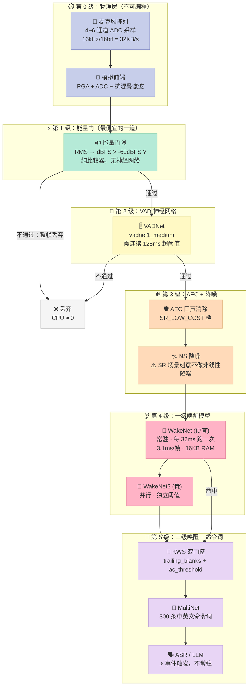
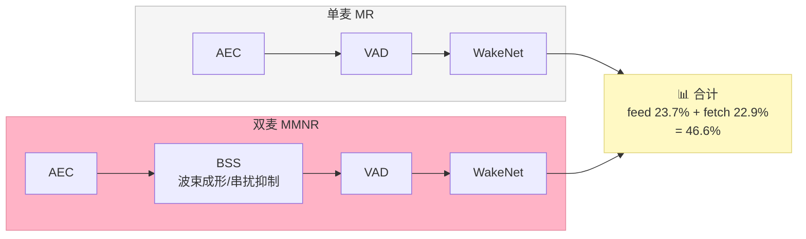
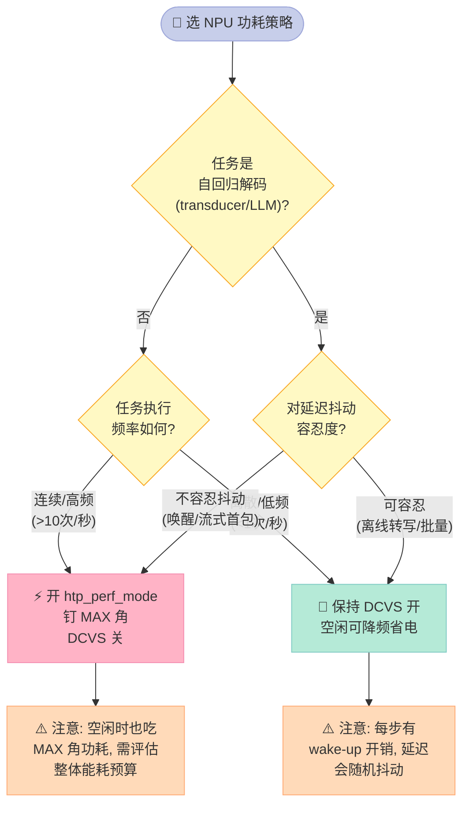

> **车机的语音功耗，99% 花在你看不见的那一层。**
>
> 本文用 espressif/esp-sr 的官方实测表 + k2-fsa/sherpa-onnx 的 QNN 后端源码，
> 把一条车载 always-on 语音链路拆成**六级功耗门控**，
> 并逐行对照源码告诉你：**每一级省了多少、代价是什么、旋钮在哪个文件哪一行**。
>
> 三个会让你重新看待功耗预算的实测结论：
> - **麦克风阵列让 always-on CPU 直接翻 2.5 倍**（18.6% → 46.6%，双麦 vs 单麦）
> - **LOW_COST 档位的内部 RAM 反而比 HIGH_PERF 更多**（60.1 KB vs 49.1 KB）
> - **sherpa-onnx 亲手关掉了高通 HTP 的动态调频**——为了确定性延迟，代价是功耗

---

## 前言：为什么"语音只占 1% 的时间"不等于"语音只占 1% 的功耗"

先说一个所有做车载语音的团队都会算错的地方。

车载语音的交互时长极短。一辆车一天里，驾驶员喊醒词的次数可能是 **20 次**，每次 1.5 秒。
按这个算法，语音占用的时间比例是 20 × 1.5 / 86400 ≈ **0.035%**。

然后你按这个比例去分摊功耗预算，得到"语音链路只占系统功耗的 0.035%，可以忽略"。

**这个结论是错的。** 而且错得很彻底。

原因是：**always-on 唤醒模型的推理不是"有人说话时才跑"，而是每一帧都在跑。**

在 espressif/esp-sr 的官方 benchmark 里，WakeNet9 @ 3ch 的单帧耗时是 3.1 ms，
但它的**帧长是 32 ms**（`docs/en/benchmark/README.rst`）。也就是说：

- 每 32 毫秒，唤醒模型必须**准时**跑一次
- 哪怕车里没人说话，它也一次不落地在跑
- 跑完之后还要等下一个 32 ms 窗口

所以真正的成本不是"说话时长 × 单次推理成本"，而是：

```
always-on 成本 = 24 小时 × 每秒帧数 × 每帧固定开销
```

这一层是**刚性**的。你不能通过"减少说话次数"来降低它。

那能降低它的是什么？**门控。**

本文要讲的就是：车载语音链路上到底有几道门，每道门怎么省，省的代价是什么。

---

## 一、六级功耗门控：把 always-on 拆开看

一整条车载语音链路，从麦克风原始 PCM 到 TTS 播出，中间经过的每一级都有"要不要在这一级继续跑"的决策点。把这些决策点串起来，就是一条**六级门控链**。



**每一道门的设计意图都一样**：用**尽可能便宜**的判据，把大部分音频流量在尽可能早的地方掐掉。

关键点是**顺序不能乱**。便宜的判据必须在前，贵的在后。esp-sr 的 AFE pipeline 定义（官方 benchmark 文档里逐条列出）就是严格遵循这个原则：

```
MR,  SR, LOW_COST : |AEC(SR_LOW_COST)| -> |VAD(vadnet1_medium)| -> |WakeNet(wn9_hilexin)|
MMNR, SR, LOW_COST: |AEC(SR_LOW_COST)| -> |SE(BSS)| -> |VAD(vadnet1_medium)| -> |WakeNet(wn9_hilexin)|
MR,  VC, LOW_COST : |AEC(VOIP_LOW_COST)| -> |NS(nsnet2)| -> |VAD(vadnet1_medium)|
```

注意 `SR`（语音识别）场景的 pipeline 里**没有 NSNET**（非线性降噪），只有 `VC`（语音通话）场景才有。
这就是"最贵的算法放在最不需要它的地方"——唤醒时用户离麦子近、环境相对安静，线性降噪足够；
打电话时才有强噪声需求。

而 `AFE_TYPE_SR` 的枚举注释说得更直白：

```c
// esp_afe_config.h:35
AFE_TYPE_SR = 0, // Speech recognition scenarios, excluding nonlinear noise suppression
```

> **唤醒链路刻意避开非线性降噪**——这是省算力最直接的一刀。

---

## 二、第 1 级：-60 dBFS 能量门，全链路最便宜的一道

整个六级门控里，最值得先讲的是第 1 级，因为它最简单、也最容易被忽略。

### 2.1 官方阈值就是 -60 dBFS

```c
// esp_afe_config.h:96-98
// The averaged frame energy in dBFS required to report speech, see vad_energy_threshold
#define AFE_VAD_ENERGY_THRESHOLD_DEFAULT (-60.0f)
#define AFE_VAD_ENERGY_THRESHOLD_MIN (-100.0f)
```

注意注释里的关键词：**"averaged frame energy in dBFS"**——是**帧平均能量**，不是瞬时峰值。

一帧 32 ms、16 kHz = 512 个采样点。把这一帧的 RMS 归一化到满量程（int16 → [0, 1]），
取 20·log10，就得到 dBFS 值。然后和 -60 dBFS 比。

这跟"跑一个神经网络 VAD"（Silero VAD 之类）的成本差着**两到三个数量级**：
一个 RMS 只需要一次平方和 + 一次开方 + 一次 log10，而神经网络推理要几百次乘加。

### 2.2 但光有阈值不够，还要防抖

单帧能量门有个致命问题：一次关门、一次咳嗽、一次敲方向盘都能让它过。

esp-sr 的解法是**三个时间参数**（`esp_afe_config.h:119-122`）：

```c
int vad_min_speech_ms;  // 最小语音时长, default 128 ms
int vad_min_noise_ms;   // 最小噪声/静音时长, default 1000 ms
int vad_delay_ms;       // 首个语音帧的延迟, default 128 ms
```

这三个数组合起来定义了状态机：

| 参数 | 默认值 | 换算成 32ms 帧 | 作用 |
|---|---|---|---|
| `vad_min_speech_ms` | 128 ms | 4 帧 | 连续 4 帧超阈值才认定"有人在说话" |
| `vad_min_noise_ms` | 1000 ms | 31 帧 | 连续 31 帧低于阈值才翻回静音（防抖） |
| `vad_delay_ms` | 128 ms | 4 帧 | 语音起始的固定上报延迟 |

**`vad_min_noise_ms = 1000 ms` 是最值得注意的一个。** 它的意思是：一旦进入语音态，
必须连续安静**整整 1 秒**才能回到静音态。这个反直觉的设计是为了防抖——
语音里的自然停顿（"打开"和"空调"之间可能有 300 ms 停顿）不应该被判成"用户说完了"。

这也是为什么整个唤醒链路的**延迟下限是 128 ms**（`vad_delay_ms`）而不是 0。

### 2.3 自己实现一个能量门

光讲道理不够，我们自己写一个。这段代码可以直接跑（文末有完整版）：

```python
import math

class EnergyVad:
    """
    复刻 esp-sr 的 AFE 能量 VAD 语义:
      - 帧平均能量转 dBFS, 与 AFE_VAD_ENERGY_THRESHOLD_DEFAULT (-60 dBFS) 比较
      - vad_min_speech_ms: 连续达到阈值的最小时长, 不足则不报语音
      - vad_min_noise_ms:  连续低于阈值的最小时长, 不足则不翻回静音 (防抖)
      - vad_delay_ms:      语音起始的延迟上报
    """
    def __init__(self, threshold_dbfs=-60.0, frame_ms=32, sample_rate=16000,
                 min_speech_ms=128, min_noise_ms=1000, delay_ms=128):
        self.threshold_dbfs = threshold_dbfs
        self.frame_ms = frame_ms
        self.sample_rate = sample_rate
        self.min_speech_frames = max(1, round(min_speech_ms / frame_ms))
        self.min_noise_frames = max(1, round(min_noise_ms / frame_ms))
        self.delay_frames = max(0, round(delay_ms / frame_ms))
        self.reset()

    def reset(self):
        self._above = 0
        self._below = 0
        self._speech = False
        self.frames_seen = 0
        self.speech_events = []

    def frame_dbfs(self, frame):
        n = len(frame)
        if n == 0:
            return -120.0
        s = 0.0
        for v in frame:
            s += v * v
        rms = math.sqrt(s / n) / 32768.0
        if rms <= 0:
            return -120.0
        return 20.0 * math.log10(rms)

    def process(self, frame):
        """处理一帧, 返回 (is_speech, frame_dbfs)"""
        db = self.frame_dbfs(frame)
        self.frames_seen += 1
        if db >= self.threshold_dbfs:
            self._above += 1
            self._below = 0
        else:
            self._below += 1
            self._above = 0

        if not self._speech:
            if self._above >= self.min_speech_frames:
                self._speech = True
                self.speech_events.append(self.frames_seen)
        else:
            # 语音态: 连续低于阈值达到 min_noise_frames 才翻回静音
            if self._below >= self.min_noise_frames:
                self._speech = False
        return self._speech, db
```

**这里有一个很容易写错的点**：`vad_min_speech_ms` 和 `vad_min_noise_ms` 是**时长**，
但 VAD 是**按帧**工作的。所以必须做帧数换算——而且要用 `round` 而不是 `int`，
因为 `1000 / 32 = 31.25`，截断成 31 帧 = 992 ms，跟标称的 1000 ms 就差了一点，
在边界条件下行为会不一致。

对应到代码里：

```python
vad = EnergyVad()
assert vad.min_speech_frames == 4    # 128 / 32
assert vad.min_noise_frames == 31    # round(1000/32) = round(31.25) = 31
```

### 2.4 实测：边界条件全都要过

```python
# 静音段不应触发
for i in range(10):
    sp, db = vad.process(synth_frame(rms_dbfs=-80.0, seed=i))
    assert not sp

# 3 帧语音不够 min_speech_frames，不触发
for i in range(3):
    sp, db = vad.process(synth_frame(rms_dbfs=-30.0, seed=200 + i))
assert not sp

# 第 4 帧 -> 触发
sp, db = vad.process(synth_frame(rms_dbfs=-30.0, seed=203))
assert sp

# 语音态下 5 帧静音（不足 31 帧）-> 保持语音态（防抖生效）
for i in range(5):
    sp, db = vad.process(synth_frame(rms_dbfs=-80.0, seed=400 + i))
assert sp
```

这三个断言对应三个真实的边界：
**阈值以下不触发、时长不够不触发、抖动不翻转**。

### 2.5 能量门的实际收益

用官方 benchmark 表（ESP32-P4 @ 400 MHz）看能量门的位置：

| AFE 配置 | Internal RAM (KB) | PSRAM (KB) | Feed CPU (1 core, %) | Fetch CPU (1 core, %) |
|---|---|---|---|---|
| MR, SR, LOW_COST | 60.1 | 739.7 | 8.8 | 9.8 |
| MR, FD, LOW_COST | 60.2 | 777.7 | 12.1 | 9.8 |
| MR, VC, LOW_COST | 48.7 | 819.7 | 30.6 | 4.7 |

（MR = 1 麦 + 1 路回放，FD = 全双工，VC = 语音通话）

**SR 场景的 feed CPU 只有 8.8%，而 VC 场景是 30.6%——3.48 倍。**
这个差距几乎全部来自 `NS(nsnet2)`（非线性降噪网络）。

结论很直接：**如果你只做唤醒不做通话，就不要上非线性降噪。**

---

## 三、第 2 级之后：麦克风阵列才是功耗的大头

上一节末尾提到双麦（MMNR）会让 CPU 翻倍。咱们把官方表格摊开看。



官方 benchmark 表（ESP32-P4 @ 400 MHz，models = nsnet2 + vadnet1_medium + wn9_hilexin）：

| AFE 配置 | Internal RAM (KB) | PSRAM (KB) | Feed CPU (%) | Fetch CPU (%) | **合计** |
|---|---|---|---|---|---|
| MR, SR, LOW_COST | 60.1 | 739.7 | 8.8 | 9.8 | **18.6%** |
| MR, SR, HIGH_PERF | 49.1 | 775.8 | 9.3 | 9.8 | **18.6%** |
| MR, FD, LOW_COST | 60.2 | 777.7 | 12.1 | 9.8 | **21.9%** |
| MR, FD, HIGH_PERF | 49.2 | 813.8 | 12.5 | 9.8 | **22.3%** |
| MR, VC, LOW_COST | 48.7 | 819.7 | 30.6 | 4.7 | **35.3%** |
| MR, VC, HIGH_PERF | 91.1 | 822.2 | 32.2 | 4.7 | **36.9%** |
| MMNR, SR, LOW_COST | 79.1 | 1153.7 | 23.7 | 22.9 | **46.6%** |
| MMNR, SR, HIGH_PERF | 68.1 | 1200.4 | 24.9 | 22.9 | **47.8%** |
| MMNR, FD, LOW_COST | 79.2 | 1191.7 | 29.4 | 22.9 | **52.3%** |
| MMNR, FD, HIGH_PERF | 68.1 | 1238.5 | 30.4 | 22.9 | **53.3%** |

三个可以直接拿去跟老板汇报的结论：

**结论 1：单麦到双麦，always-on CPU 从 18.6% 涨到 46.6%，倍数 2.51×**

```python
mr = AFE_BENCH_P4["MR, SR, LOW_COST"]      # (60.1, 739.7, 8.8, 9.8)
mmnr = AFE_BENCH_P4["MMNR, SR, LOW_COST"]  # (79.1, 1153.7, 23.7, 22.9)
ratio = (mmnr[2] + mmnr[3]) / (mr[2] + mr[3])
assert abs(ratio - 2.51) < 0.01
```

**结论 2：LOW_COST 档位的内部 RAM 反而比 HIGH_PERF 更多**（60.1 vs 49.1 KB）

这个反直觉。上表里 MR/FD、MMNR/SR、MMNR/FD 全是这个规律。
原因在官方 pipeline 定义里：`LOW_COST` 用的是**不同的算法组合**
（比如用 WebRTC NS 替代 NSNET），而不是"同一个算法跑低精度版本"。
换算法组合会带来不同的中间缓存布局，内存反而更多。

> **低功耗 ≠ 低内存。** 这是本文第一个反常识点。

**结论 3：LOW_COST 和 HIGH_PERF 的 feed CPU 差距很小**（8.8% vs 9.3%，只差 0.5 个点）
**但 VC 场景差距明显**（30.6% vs 32.2%）。

说明 HIGH_PERF 主要加在 NS/BSS/AEC 的"高档算法"上。
对于**纯唤醒场景**，LOW_COST 相比 HIGH_PERF 省的那点 CPU 微不足道，
但它对内存布局的影响（多用 11 KB 内部 RAM）值得注意。

---

## 四、第 4 级：唤醒模型的分级与"成本降级"设计

### 4.1 WakeNet 家族是一套"成本分级"体系

乐鑫的唤醒模型命名本身就编码了功耗等级：

| 模型 | 定位 | 官方说明 |
|---|---|---|
| WakeNet5 / 5X2 / 5X3 | 早期，参数逐级放大 | 41K / 165K / 371K 参数 |
| WakeNet9 | 主力 | RAM 16 KB，PSRAM 324 KB，3.0 ms/帧 |
| **WakeNet9s** | **cost-down 版** | 参数更少、算力更低，**可跑在无 PSRAM、无 SIMD 的 ESP32-C3/C5** |
| **WakeNet9l** | **极速召回版** | 基于 WakeNet9，**CPU 与内存需求约 1.3×**，治"极快语速唤醒漏检" |
| WakeNet10 | 新一代 | 支持中英日法德西葡俄 8 语种，w8a16（默认）/ w16a16 |
| **WakeNet10s** | **无 SIMD 版** | 可跑在没有 PIE(SIMD) 指令的芯片上 |

esp-sr README 里对 WakeNet9s 的原文：

> WakeNet9s is a cost-down version of WakeNet9, with fewer parameters and lower computational requirements.

**这就是"一级唤醒便宜、二级唤醒昂贵"最直接的实现形式**：
同一套代码路径，通过选不同的模型文件来选功耗档位。

### 4.2 参数量涨 9 倍，算力只涨 3.27 倍

ESP32 上的 WakeNet5 家族实测（官方 benchmark）：

| 模型 | 参数量 | RAM (KB) | 单帧耗时 | 帧长 |
|---|---|---|---|---|
| WakeNet5 | 41 K | 15 | 5.5 ms | 30 ms |
| WakeNet5X2 | 165 K | 20 | 10.5 ms | 30 ms |
| WakeNet5X3 | 371 K | 24 | 18 ms | 30 ms |

把三个维度放一起看：

```python
param_ratio = 371 / 41      # 9.05x
time_ratio  = 18.0 / 5.5    # 3.27x
ram_ratio   = 24 / 15       # 1.60x

assert time_ratio < param_ratio, "算力增长应慢于参数量增长"
```

**参数量涨 9 倍，算力只涨 3.27 倍，内存只涨 1.6 倍。**

这说明唤醒模型的架构是**深度受限、宽度受限**的（不是 Transformer 那种宽度主导的架构），
增加参数主要加在深度上，而深度对延迟的影响是**线性**的，对内存的影响是**次线性**的。

**工程含义**：想加召回率（换更深的模型），成本是可控的线性代价；
想加鲁棒性（换更宽的模型），成本会失控。这是一个重要的选型约束。

### 4.3 DET_MODE_90 vs DET_MODE_95：同一个模型，两种功耗档

```c
// esp_wn_iface.h:25-32
typedef enum {
    DET_MODE_90 = 0,       // Normal, Load from flash, just for wakenet10
    DET_MODE_95 = 1,       // Aggressive, Load from psram
    DET_MODE_2CH_90 = 2,   // Normal, Load from flash, 2 channels, just for wakenet10
    DET_MODE_2CH_95 = 3,   // Aggressive, Load from psram, 2 channels
    DET_MODE_3CH_90 = 4,   // Normal, Load from flash, 3 channels, just for wakenet10
    DET_MODE_3CH_95 = 5,   // Aggressive, Load from psram, 3 channels
} det_mode_t;
```

**注意这两个模式的差别不在模型，在模型放在哪：**

| 模式 | 名字 | 模型加载位置 | 特点 |
|---|---|---|---|
| `DET_MODE_90` | Normal | **flash** | 省 PSRAM，但每次推理要从 flash 读（XIP） |
| `DET_MODE_95` | Aggressive | **PSRAM** | 常驻 PSRAM，读得快，召回更高 |

这就是"成本降级"的第二层含义：**同一个模型文件，加载策略不同，功耗和召回都能差一档。**

裸 WakeNet 路径（不走 AFE）的官方例程就是直接指定 `DET_MODE_95`：

```c
// esp-skainet examples/wake_word_detection/wakenet/main/main.c:24
model_iface_data_t *model_data = wakenet->create(model_name, DET_MODE_95);
```

而 AFE 路径（走完整前端）的官方例程默认用 `DET_MODE_3CH_90`，
官方 benchmark 注释里明确写了这一点：

> WakeNet10 3-channel results use `DET_MODE_3CH_90` as the default detection mode. CPU loading (1 core): 22.6%.

对应 ESP32-S3 上 WakeNet10 @ 3ch 的实测：

| 芯片 | RAM (KB) | PSRAM (KB) | 单帧耗时 | 帧长 | CPU 占用 (1 core) |
|---|---|---|---|---|---|
| ESP32-S3 | 17 | 523 | 7.1 ms | 32 ms | 22.6% |
| ESP32-P4 | 16 | 523 | 4.1 ms | 32 ms | 14.1% |
| ESP32-S31 | 16 | 523 | 6.4 ms | 32 ms | 19.9% |

**同一组模型，换芯片 CPU 占用差 1.6 倍**（22.6% → 14.1%）。
选芯片的收益可能比调模型大。

### 4.4 双模型并行 + 独立阈值：真正的"一级/二级"接口

esp-sr 的 AFE 配置里支持**两个唤醒模型并行**：

```c
// esp_afe_config.h:133-136
bool wakenet_init;
char *wakenet_model_name;   // The model name of wakenet 1
char *wakenet_model_name_2; // The model name of wakenet 2 if has wakenet 2
det_mode_t wakenet_mode;    // The mode of wakenet
```

然后运行时可以**给每个模型单独设阈值**：

```c
// esp-skainet examples/wake_word_detection/afe/main/main.c:56-59
afe_handle->set_wakenet_threshold(afe_data, 1, 0.6); // set model1's threshold to 0.6
afe_handle->set_wakenet_threshold(afe_data, 2, 0.6); // set model2's threshold to 0.6
afe_handle->reset_wakenet_threshold(afe_data, 1);    // reset model1's threshold to default
afe_handle->reset_wakenet_threshold(afe_data, 2);    // reset model2's threshold to default
```

**这就是"一级唤醒粗筛 + 二级唤醒严判"的标准接口**：
- 模型 1（便宜、快）阈值设低（0.4–0.6），广撒网
- 模型 2（贵、准）阈值设高（0.8+），严把关

阈值合法范围是 `0.4 ~ 0.9999`（`esp_wn_iface.h:113`）。

### 4.5 AGC 复用唤醒模型的中间表征

```c
// esp_afe_config.h:68-71
typedef enum {
    AFE_AGC_MODE_WEBRTC = 0,  // WEBRTC AGC
    AFE_AGC_MODE_WAKENET = 1, // AGC gain is calculated by wakenet model if wakenet is activated
} afe_agc_mode_t;
```

`AFE_AGC_MODE_WAKENET` 意味着：**用唤醒网络的中间层特征顺便算 AGC 增益**，
不额外跑一遍 AGC。这是一种"模型复用"式的省算力。

在车载里这招的价值在于：唤醒网络本来就要跑，
它的中间表征已经包含了语音/静音的判别信息，拿来做增益估计几乎零边际成本。

---

## 五、第 5 级：sherpa-onnx 的 KWS 双门控

前四级都是 esp-sr（乐鑫 MCU 路线）的做法。第五级开始换一套体系——sherpa-onnx（车规 SoC / NPU 路线）。

### 5.1 触发条件是两个门的 AND

sherpa-onnx 的 `TransducerKeywordDecoder` 里，唤醒触发的判定写在一处：

```cpp
// sherpa-onnx/csrc/transducer-keyword-decoder.cc:153-170
if (matched) {
  float ys_prob = 0.0;
  for (int32_t i = 0; i < matched_state->level; ++i) {
    ys_prob += best_hyp.ys_probs[i];
  }
  ys_prob /= matched_state->level;
  if (best_hyp.num_trailing_blanks > num_trailing_blanks_ &&
      ys_prob >= matched_state->ac_threshold) {
    auto &r = (*result)[b];
    r.tokens = {best_hyp.ys.end() - matched_state->level,
                best_hyp.ys.end()};
    r.timestamps = {best_hyp.timestamps.end() - matched_state->level,
                    best_hyp.timestamps.end()};
    r.keyword = matched_state->phrase;

    hyps = Hypotheses({{blanks, 0, ss[b]->GetContextGraph()->Root()}});
  }
}
```

**两个门必须同时满足：**

| 门 | 变量 | 含义 | 挡住什么 |
|---|---|---|---|
| 门 1 | `num_trailing_blanks > num_trailing_blanks_` | 词后面要跟够 blank | "说了一半就停"——防止截断的词触发 |
| 门 2 | `ys_prob >= ac_threshold` | 声学置信度（token 概率均值） | "听起来不像"——防止相似音误触发 |

`ys_prob` 是**匹配到的那些 token 的概率算术平均值**（除以 `matched_state->level`）。
注意是**均值**不是乘积——乘积会随词长指数衰减，长词几乎不可能触发。

### 5.2 Python API 的默认值与官方建议

```python
# sherpa-onnx/python/sherpa_onnx/keyword_spotter.py:88-96
num_threads: int = 2,
sample_rate: float = 16000,
feature_dim: int = 80,
max_active_paths: int = 4,
keywords_score: float = 1.0,
keywords_threshold: float = 0.25,
num_trailing_blanks: int = 1,
provider: str = "cpu",
device: int = 0,
```

| 参数 | 默认值 | 作用 | 调大的代价 |
|---|---|---|---|
| `max_active_paths` | 4 | beam 宽度 | **KWS 阶段最直接的算力旋钮**，beam 翻倍→搜索量翻倍 |
| `keywords_threshold` | 0.25 | 声学置信度门 | 召回下降 |
| `num_trailing_blanks` | 1 | 说完了的门 | 触发延迟增加 |
| `num_threads` | 2 | 并行度 | 占用更多核 |
| `keywords_score` | 1.0 | 打分权重 | 影响上下文打分 |

官方 docstring 特别说明了 `num_trailing_blanks` 的调法：

> The number of trailing blanks a keyword should be followed. Setting to a larger value (e.g. 8) when your keywords has overlapping tokens between each other.

**"关键词之间有 token 重叠时，调到 8"** —— 这是一个具体的、官方背书的调参建议。

### 5.3 一个容易搞错的语义：result 是累加的，hyps 才是重置的

这条我在写 MVP 时被自己的直觉坑了一次，值得单独拎出来。

上游代码里，触发后执行的是：

```cpp
hyps = Hypotheses({{blanks, 0, ss[b]->GetContextGraph()->Root()}});
```

**重置的是 `hyps`（解码器状态机），不是 `result`（结果向量）。**

`result` 在 `Decode()` 入口处被整体读回来继续用：

```cpp
// sherpa-onnx/csrc/transducer-keyword-decoder.cc:53-56
std::vector<Hypotheses> cur;
for (auto &r : *result) {
  cur.push_back(std::move(r.hyps));
}
```

所以 `result` 里的 `TransducerKeywordResult`（keyword / tokens / timestamps）是**累加保留**的，
从不清空。如果你在自己实现时把结果列表也一起清了，调用方就永远收不到历史结果。

我第一版 MVP 就是这么写的，结果断言直接炸了：

```python
# ❌ 错误实现
def reset(self):
    self.trailing_blanks = 0
    self.token_probs = []
    self.triggered = []   # ← 错！上游 result 从不清空
    self.keyword = None

# ✅ 正确实现（对齐上游语义）
def reset(self):
    """
    只重置"解码器状态机", 不清空已触发记录。

    上游语义 (transducer-keyword-decoder.cc:168):
        hyps = Hypotheses({{blanks, 0, ss[b]->GetContextGraph()->Root()}});
    触发后 hyps 被重置回 root 状态, 但 result 向量里的
    TransducerKeywordResult (keyword/tokens/timestamps) 是累加保留的 ——
    Decode() 每次进来都从 result 取回上次的 hyps 继续跑 (kw-decoder.cc:54-56),
    result 本身从不清空。
    """
    self.trailing_blanks = 0
    self.token_probs = []
    self.keyword = None
```

**教训**：断言要编码"上游源码的可观察行为"，不是"我觉得应该怎样"。
读上游代码时**一定要读注释**——这段"blank is hardcoded to 0"的注释就藏在
`transducer-keyword-decoder.cc:123` 附近。

### 5.4 复刻上游状态机

```python
class TransducerKeywordStateMachine:
    """
    复刻 TransducerKeywordDecoder 的核心状态转移 (transducer-keyword-decoder.cc:105-170)

    关键语义:
      - blank id 硬编码为 0 (kw-decoder.cc:123-124 注释 "blank is hardcoded to 0")
      - 非 blank 且非 unk 的 token 才推进 context graph (L123)
      - context_state->token == -1 表示失配 -> 清空 ys/timestamps/ys_probs, 从头开始匹配 (L135-139)
      - 触发条件: num_trailing_blanks > 阈值 且 ys_prob >= ac_threshold (L159-160)
      - 触发后: hyps 重置回 Root (L168), 但 result 累加保留
    """
    def __init__(self, num_trailing_blanks=1, ac_threshold=0.25, unk_id=1):
        self.num_trailing_blanks = num_trailing_blanks
        self.ac_threshold = ac_threshold
        self.unk_id = unk_id
        self.triggered = []   # 累加, 与上游 result 向量一致
        self.reset_state()

    def reset_state(self):
        self.trailing_blanks = 0
        self.token_probs = []
        self.context_token = -1   # -1 = 处于 context graph 的 Root

    def push(self, token, prob, is_blank=False):
        if is_blank or token == self.unk_id:
            # 上游: unk 也当 blank 处理 (L123)
            self.trailing_blanks += 1
        else:
            self.trailing_blanks = 0
            self.token_probs.append(prob)
            self.context_token = token

        ys_prob = (sum(self.token_probs) / len(self.token_probs)) if self.token_probs else 0.0
        if (self.trailing_blanks > self.num_trailing_blanks
                and ys_prob >= self.ac_threshold):
            self.triggered.append({"ys_prob": ys_prob})
            # 上游 L168: hyps = Hypotheses({{blanks, 0, Root()}})
            self.reset_state()
            return True
        return False
```

**边界条件必须测**，因为上游用的是 `>=` 而不是 `>`：

```python
# ac_threshold 恰好相等 -> 触发 (上游是 >=)
sm = TransducerKeywordStateMachine(num_trailing_blanks=1, ac_threshold=0.25)
sm.push(10, 0.25, is_blank=False)
sm.push(0, 1.0, is_blank=True)
assert sm.push(0, 1.0, is_blank=True) is True

# 略低于阈值 -> 不触发
sm2 = TransducerKeywordStateMachine(num_trailing_blanks=1, ac_threshold=0.25)
sm2.push(10, 0.2499, is_blank=False)
sm2.push(0, 1.0, is_blank=True)
assert sm2.push(0, 1.0, is_blank=True) is False
```

---

## 六、MCU / DSP / NPU 分工：sherpa-onnx 的三条 NPU 后端

到了车规 SoC 这一层，MCU 的"双核绑定"策略就变成了"CPU / DSP / NPU 三方分工"。

### 6.1 MCU 侧：双核物理分离

esp-skainet 的官方 AFE 例程把两个任务钉在不同核上：

```c
// esp-skainet examples/wake_word_detection/afe/main/main.c:113-115
task_flag = 1;
xTaskCreatePinnedToCore(&feed_Task, "feed", 8 * 1024, (void*)afe_data, 5, NULL, 0);
xTaskCreatePinnedToCore(&detect_Task, "detect", 4 * 1024, (void*)afe_data, 5, NULL, 1);
```

| 任务 | 核 | 栈 | 优先级 | 干什么 |
|---|---|---|---|---|
| `feed` | **core 0** | 8 KB | 5 | 从 I2S 读音频，喂给 AFE |
| `detect` | **core 1** | 4 KB | 5 | 从 AFE 取结果，做检测 |

**I/O 采集和神经网络推理物理分离到两个核。** 这样做的意义是：
`feed` 任务即使被别的任务抢占，也不会导致 `detect` 的时间抖动——
而 `detect` 的抖动会直接变成唤醒延迟抖动。

这跟 Linux/Android 上用 `SCHED_FIFO` + 绑核是同一个思路，只是 MCU 上没有调度器可依赖。

### 6.2 RKNN：车规 SoC 的 NPU 三核绑定

瑞芯微 RK3588 是车载域控常见的主控。sherpa-onnx 给它做了完整的 NPU 后端：

```cpp
// sherpa-onnx/csrc/rknn/utils.cc:167-194
void SetCoreMask(rknn_context ctx, int32_t num_threads) {
  int32_t ret = RKNN_SUCC;
  switch (num_threads) {
    case 1:  ret = rknn_set_core_mask(ctx, RKNN_NPU_CORE_AUTO);      break;
    case 0:  ret = rknn_set_core_mask(ctx, RKNN_NPU_CORE_0);         break;
    case -1: ret = rknn_set_core_mask(ctx, RKNN_NPU_CORE_1);         break;
    case -2: ret = rknn_set_core_mask(ctx, RKNN_NPU_CORE_2);         break;
    case -3: ret = rknn_set_core_mask(ctx, RKNN_NPU_CORE_0_1);       break;
    case -4: ret = rknn_set_core_mask(ctx, RKNN_NPU_CORE_0_1_2);     break;
    default:
      SHERPA_ONNX_LOGE(
          "Valid num_threads for rk npu is 1 (auto), 0 (core 0), -1 (core "
          "1), -2 (core 2), -3 (core 0_1), -4 (core 0_1_2). Given: %d",
          num_threads);
      break;
  }
```

**这个编码方式非常反直觉，必须记牢：**

| `num_threads` | 实际含义 |
|---|---|
| `1` | **AUTO**（自动挑核） |
| `0` | core 0 |
| `-1` | core 1 |
| `-2` | core 2 |
| `-3` | core 0+1 |
| `-4` | core 0+1+2 |

也就是说 **正数 1 不是"单核"，负数才是指定具体核**。
写错了会静默落到 AUTO，性能差异可能只有几个百分点，很难发现。

**车载上的典型用法**：把 ASR 绑到 NPU 核 2，唤醒词留在 CPU——
这样唤醒永远不被 ASR 的推理抢占。

更重要的是，sherpa-onnx 里 **KWS 和 ASR 有各自独立的 NPU 实现**：

```
sherpa-onnx/csrc/rknn/keyword-spotter-transducer-rknn-impl.h   ← 唤醒词上 NPU
sherpa-onnx/csrc/rknn/online-recognizer-transducer-rknn-impl.h  ← ASR 上 NPU
```

两者是分开的实现文件，意味着你可以**只把 ASR 放 NPU，唤醒词留 CPU**——
这是车载 always-on 最合理的分工：唤醒对延迟极度敏感但对吞吐不敏感（32ms 一帧，3ms 算完），
ASR 对吞吐敏感。

### 6.3 QNN：把高通 HTP 钉在最高频

这是本文最有技术含量的部分，也是很多国内团队没读过的代码。

sherpa-onnx 的 QNN 后端里有一个开关：

```cpp
// sherpa-onnx/csrc/qnn-config.h:33-37
// If true, pin the Qualcomm HTP (NPU DSP) to its max clocks via DCVS v3 and
// RPC polling (enable only for latency-critical, autoregressive
// decoders where the default DCVS policy introduces per-step wake-up
// overhead).
bool htp_perf_mode = false;
```

**默认 false。** 命令行开关：

```cpp
// sherpa-onnx/csrc/qnn-config.cc:37-39
po->Register("qnn-htp-perf-mode", &htp_perf_mode,
             "True to pin the Qualcomm HTP to max clocks (DCVS v3 and RPC "
             "polling). Off by default. Used only when provider is qnn.");
```

完整实现：

```cpp
// sherpa-onnx/csrc/qnn/qnn-backend.cc:217-294
// Pin the HTP (NPU DSP) to max clocks for the lifetime of this backend.
//
// - DCVS v3 with DCVS disabled, PERFORMANCE_MODE, all voltage corners
//   pinned to MAX_VOLTAGE_CORNER.
//
// - RPC polling kept hot so autoregressive decoders don't pay the
//   wake-up cost on every step.
//
// Pattern referenced from:
// https://docs.qualcomm.com/nav/home/htp_backend.html?product=924033590759186372
void InitHtpPerfMode() {
  QnnDevice_Infrastructure_t device_infra = nullptr;
  auto ret = qnn_interface_.deviceGetInfrastructure(&device_infra);
  if (ret != QNN_SUCCESS || device_infra == nullptr) {
    SHERPA_ONNX_LOGE(
        "deviceGetInfrastructure failed (%d): skipping HTP perf config. "
        "HTP will run at default clocks.",
        static_cast<int>(ret));
    return;
  }

  auto *htp_infra =
      static_cast<QnnHtpDevice_Infrastructure_t *>(device_infra);
  htp_perf_infra_ = &htp_infra->perfInfra;

  ret = htp_perf_infra_->createPowerConfigId(/*deviceId=*/0, /*coreId=*/0,
                                             &htp_power_config_id_);
  if (ret != QNN_SUCCESS) {
    SHERPA_ONNX_LOGE("createPowerConfigId failed: %d",
                     static_cast<int>(ret));
    htp_perf_infra_ = nullptr;
    return;
  }

  QnnHtpPerfInfrastructure_PowerConfig_t dcvs{};
  dcvs.option = QNN_HTP_PERF_INFRASTRUCTURE_POWER_CONFIGOPTION_DCVS_V3;
  dcvs.dcvsV3Config.contextId = htp_power_config_id_;
  dcvs.dcvsV3Config.setDcvsEnable = 1;
  dcvs.dcvsV3Config.dcvsEnable = 0;
  dcvs.dcvsV3Config.powerMode =
      QNN_HTP_PERF_INFRASTRUCTURE_POWERMODE_PERFORMANCE_MODE;
  dcvs.dcvsV3Config.setSleepLatency = 1;
  dcvs.dcvsV3Config.sleepLatency = 40;
  dcvs.dcvsV3Config.setBusParams = 1;
  dcvs.dcvsV3Config.setCoreParams = 1;
  dcvs.dcvsV3Config.busVoltageCornerMin =
      DCVS_VOLTAGE_VCORNER_MAX_VOLTAGE_CORNER;
  dcvs.dcvsV3Config.busVoltageCornerTarget =
      DCVS_VOLTAGE_VCORNER_MAX_VOLTAGE_CORNER;
  dcvs.dcvsV3Config.busVoltageCornerMax =
      DCVS_VOLTAGE_VCORNER_MAX_VOLTAGE_CORNER;
  dcvs.dcvsV3Config.coreVoltageCornerMin =
      DCVS_VOLTAGE_VCORNER_MAX_VOLTAGE_CORNER;
  dcvs.dcvsV3Config.coreVoltageCornerTarget =
      DCVS_VOLTAGE_VCORNER_MAX_VOLTAGE_CORNER;
  dcvs.dcvsV3Config.coreVoltageCornerMax =
      DCVS_VOLTAGE_VCORNER_MAX_VOLTAGE_CORNER;

  QnnHtpPerfInfrastructure_PowerConfig_t rpc_polling_time{};
  rpc_polling_time.option =
      QNN_HTP_PERF_INFRASTRUCTURE_POWER_CONFIGOPTION_RPC_POLLING_TIME;
  rpc_polling_time.rpcPollingTimeConfig = 9999;  // microseconds

  QnnHtpPerfInfrastructure_PowerConfig_t rpc_control_latency{};
  rpc_control_latency.option =
      QNN_HTP_PERF_INFRASTRUCTURE_POWER_CONFIGOPTION_RPC_CONTROL_LATENCY;
  rpc_control_latency.rpcControlLatencyConfig = 100;  // microseconds

  const QnnHtpPerfInfrastructure_PowerConfig_t *configs[] = {
      &dcvs, &rpc_polling_time, &rpc_control_latency, nullptr};
  ret = htp_perf_infra_->setPowerConfig(htp_power_config_id_, configs);
  if (ret != QNN_SUCCESS) {
    SHERPA_ONNX_LOGE("setPowerConfig failed: %d", static_cast<int>(ret));
  } else if (opts_.debug) {
    SHERPA_ONNX_LOGE(
        "HTP perf: PERFORMANCE_MODE, DCVS disabled, max voltage corner");
  }
}
```

**逐行拆解这张参数表：**

| 参数 | 值 | 行号 | 含义 |
|---|---|---|---|
| `dcvsEnable` | `0` | 255 | **关掉动态电压频率调节**——这就是"钉频"的本质 |
| `powerMode` | `PERFORMANCE_MODE` | 256-257 | 性能模式 |
| `sleepLatency` | `40` | 259 | 睡眠延迟（**单位由 QNN SDK 定义**，源码未注明） |
| bus 电压角 Min/Target/Max | 全 `MAX_VOLTAGE_CORNER` | 262-267 | 总线永远最高电压 |
| core 电压角 Min/Target/Max | 全 `MAX_VOLTAGE_CORNER` | 268-273 | 核心永远最高电压 |
| `rpcPollingTimeConfig` | `9999` µs | 278 | RPC 轮询周期 ~10 ms |
| `rpcControlLatencyConfig` | `100` µs | 283 | RPC 控制延迟 100 µs |

**这里有一个非常值得琢磨的工程取舍：**

DCVS（Dynamic Voltage and Frequency Scaling）的设计目的是**省电**——
芯片空闲时降频降压，有活儿了再爬回来。

sherpa-onnx 却把它**关掉**，钉在最高电压角。理由写在注释里：

> RPC polling kept hot so autoregressive decoders don't pay the wake-up cost on every step.

自回归解码器（transducer / LLM）每解一个 token 都要：
1. 唤醒 NPU（从 idle 角爬到 MAX 角）
2. 算一个 token
3. 回到 idle

**"爬坡"这个动作在每一步都要重复一次。** 如果单次爬坡耗时 3 ms，而一步解码只需 8 ms，
那么 37% 的时间都花在了"爬坡"上，而不是"干活"。

关掉 DCVS 之后，HTP 永远停在 MAX 角，爬坡开销归零，但代价是**空闲时也吃最高电压角的功耗**。

**这就是一个纯粹的 trade-off：确定性延迟 vs 空闲功耗。**

而且它是有**适用边界**的——注释明说只适用于"latency-critical, autoregressive decoders"。

对于**非自回归**的场景（比如我们的唤醒词检测，它是流式但不是自回归的每步解码），
或者对于**不连续的**任务（一天只跑几十次），保持 DCVS 开启才是对的。

**这个"看任务形态选功耗策略"的思路，才是 NPU 协同真正的知识内核。**

### 6.4 一个必须记住的坑：失败是静默降级的

注意 `InitHtpPerfMode()` 的错误处理：所有失败分支都只是 `SHERPA_ONNX_LOGE` + `return`，
**HTP 继续跑默认时钟，不 crash**。

```cpp
if (ret != QNN_SUCCESS || device_infra == nullptr) {
  SHERPA_ONNX_LOGE(
      "deviceGetInfrastructure failed (%d): skipping HTP perf config. "
      "HTP will run at default clocks.",
      static_cast<int>(ret));
  return;
}
```

这在生产上是好事（不因为一个可选优化挂掉），但在测试上是**陷阱**：
你以为 HTP 钉在 MAX 角了，实际上它在动态调频，延迟随机抖动。

**上线前必须显式验证**，不能靠"没报错"来判断。

---

## 七、量化：省电最直接的一刀，但别量化过头

### 7.1 官方实测：三个维度同时降

esp-sr 的 MultiNet benchmark（ESP32-S3）：

| 模型 | Internal RAM (KB) | PSRAM (KB) | 单帧耗时 | 帧长 |
|---|---|---|---|---|
| MultiNet 4 | 16.8 | 1866 | 18 ms | 32 ms |
| **MultiNet 4 Q8** | **10.5** | **1009** | **11 ms** | 32 ms |
| MultiNet 5 Q8 | 16 | 2310 | 12 ms | 32 ms |
| MultiNet 6 | 32 | 4100 | 12 ms | 32 ms |
| MultiNet 7 | 18 | 2920 | 11 ms | 32 ms |

MultiNet4 → MultiNet4 Q8（int8 量化）的收益：

```python
ram_delta   = (10.5 - 16.8) / 16.8 * 100      # -37.5%
psram_delta = (1009 - 1866) / 1866 * 100      # -45.9%
time_delta  = (11 - 18) / 18 * 100            # -38.9%
```

**内存降 37.5%、PSRAM 降 45.9%、耗时降 38.9%。三个维度同时改善。**

这是量化最理想的情况。但要注意，MultiNet6（非量化）比 MultiNet4 Q8 更大更慢——
**模型选型和量化是两件事，不要用量化去救一个本来就选错的模型。**

### 7.2 但唤醒模型故意不做 w8a8

esp-sr README 里对 WakeNet10 的说明：

> WakeNet10 is currently available in w16a16 and w8a16(default) quantization by esp-dl.

**注意默认是 `w8a16` 而不是 `w8a8`。** 权重 8 bit，但**激活保留 16 bit**。

为什么？因为激活值是**逐帧变化**的，对量化误差极其敏感。
权重是静态的，8 bit 足够；激活是动态的，8 bit 的量化噪声会直接吃掉唤醒召回率。

**这是本文第二个反常识点：量化不是越狠越好。**
唤醒词检测对误触发的容忍度（一次误触发 = 用户体验灾难）远低于对漏检的容忍度
（漏检 = 用户重说一遍）。

### 7.3 esp-dl 的量化决策手册：分级成本

espressif/esp-dl 里的 `espdl-quantize` skill 带了一份完整的量化决策 playbook，
里面最有价值的是**成本分级**的概念：

| 层级 | 手段 | On-device 成本 | 说明 |
|---|---|---|---|
| **Tier A** | 换校准算法（percentile / mse） | **零** | 只改离线校准，模型不变 |
| **Tier B** | 混合精度（特定层派到 int16） | **有** | 只能外科式用于最差的 1-3 层 |

playbook 里的原文原则：

> Apply a soft penalty to passes that slow on-device inference (mixed precision int16, weight_split) — they should be used surgically on the worst 1-3 layers, not blanket-on.

以及：

> Order candidate methods by **expected accuracy gain on this model**, not by how long the quantization step takes on the PC/server.

**最后这句特别值得抄下来当方法论**：量化方案的取舍顺序应该按"这个模型上的预期精度收益"排，
而不是按"这个步骤在 PC 上跑多久"排。

它还给了三条可操作的触发规则：

| 规则 | 触发条件 | 动作 |
|---|---|---|
| R1 激活有重尾离群值 | Float Kurtosis > 6，或 Max/(Std+1e-9) > 6 | 用 `percentile` 校准，**不要用 minmax** |
| R2 激活双峰/多峰 | 多个明显分离的峰，或 \|Skewness\| < 0.3 且中间有深谷 | 试 `mse` 校准（KL 散度在多峰分布上差） |
| R3 权重逐通道失衡 | Conv/Gemm/MatMul 且 per-channel max(\|w\|)/mean(\|w\|) > 5 | 考虑 per-channel scale |

以及一条硬阈值：**SNR > 0.05** 作为"needs work"的粗线。
低于该值的层通常无需处理，强行调整反而可能损害其他层。

---

## 八、把整条链路算一遍：一个可运行的功耗预算器

光讲原理没用，我们把前面所有的官方数据做成一个能算账的工具。

```python
# ==== 数据（逐字抄自 esp-sr 官方 benchmark）====
AFE_BENCH_P4 = {
    # config              : (internal_ram_kb, psram_kb, feed_cpu_pct, fetch_cpu_pct)
    "MR, SR, LOW_COST":  (60.1, 739.7, 8.8, 9.8),
    "MR, SR, HIGH_PERF": (49.1, 775.8, 9.3, 9.8),
    "MR, FD, LOW_COST":  (60.2, 777.7, 12.1, 9.8),
    "MR, FD, HIGH_PERF": (49.2, 813.8, 12.5, 9.8),
    "MR, VC, LOW_COST":  (48.7, 819.7, 30.6, 4.7),
    "MR, VC, HIGH_PERF": (91.1, 822.2, 32.2, 4.7),
    "MMNR, SR, LOW_COST":  (79.1, 1153.7, 23.7, 22.9),
    "MMNR, SR, HIGH_PERF": (68.1, 1200.4, 24.9, 22.9),
    "MMNR, FD, LOW_COST":  (79.2, 1191.7, 29.4, 22.9),
    "MMNR, FD, HIGH_PERF": (68.1, 1238.5, 30.4, 22.9),
}

MODEL_BENCH = {
    "WakeNet9 @ 3ch":    (20, 347, 3.1, 32, None),   # esp32p4
    "WakeNet10 @ 3ch":   (16, 523, 4.1, 32, 14.1),    # esp32p4, DET_MODE_3CH_90
    "MultiNet 4":        (16.8, 1866, 18.0, 32, None),
    "MultiNet 4 Q8":     (10.5, 1009, 11.0, 32, None),
    "MultiNet 7":        (18, 2920, 11.0, 32, None),
}


def always_on_budget(afe_cfg="MMNR, SR, LOW_COST", wakenet="WakeNet9 @ 3ch",
                     include_multinet=True, multinet="MultiNet 7"):
    """计算一条车载 always-on 语音链路的 CPU 预算"""
    ram, psram, feed_pct, fetch_pct = AFE_BENCH_P4[afe_cfg]
    w_ram, w_psram, w_ms, w_frame_ms, w_cpu = MODEL_BENCH[wakenet]
    out = {
        "afe_internal_ram_kb": ram,
        "afe_psram_kb": psram,
        "afe_feed_cpu_pct": feed_pct,
        "afe_fetch_cpu_pct": fetch_pct,
        # always-on 段 = AFE feed + AFE fetch (唤醒模型已在 AFE 内部, 不重复计)
        "always_on_cpu_pct": feed_pct + fetch_pct,
        "headroom_pct_2core": 2 * 100.0 - (feed_pct + fetch_pct),
        # WakeNet 单帧耗时 vs 帧长 -> 该模型单独占一核的比例
        "wakenet_only_core_pct": w_ms / w_frame_ms * 100.0,
    }
    if include_multinet:
        m_ram, m_psram, m_ms, m_frame_ms, _ = MODEL_BENCH[multinet]
        out["multinet"] = multinet
        out["post_wake_cpu_pct"] = feed_pct + fetch_pct + m_ms / m_frame_ms * 100.0
    return out


def quantization_gain(model="MultiNet 4", quantized="MultiNet 4 Q8"):
    """量化收益"""
    r0, p0, t0, f0, _ = MODEL_BENCH[model]
    r1, p1, t1, f1, _ = MODEL_BENCH[quantized]
    return {
        "ram_delta_pct":   (r1 - r0) / r0 * 100.0,
        "psram_delta_pct": (p1 - p0) / p0 * 100.0,
        "time_delta_pct":  (t1 - t0) / t0 * 100.0,
    }


def latency_budget(afe_cfg="MMNR, SR, LOW_COST", wakenet="WakeNet9 @ 3ch"):
    """唤醒链路端到端延迟预算"""
    w_ram, w_psram, w_ms, w_frame_ms, _ = MODEL_BENCH[wakenet]
    return {
        "vad_delay_ms": 128,
        "wakenet_frame_ms": w_frame_ms,
        "wakenet_compute_ms": w_ms,
        "estimated_total_ms": 128 + w_frame_ms + w_ms,
    }
```

跑一下：

```python
budget = always_on_budget()
# always_on_cpu_pct    = 46.6      (双麦 SR/LOW_COST)
# headroom_pct_2core   = 153.4
# wakenet_only_core_pct = 9.6875  (3.1ms / 32ms)
# post_wake_cpu_pct    = 71.6      (加上 MultiNet 7 的 11/32 = 34.375%)

lat = latency_budget()
# estimated_total_ms   = 163.1     (128 + 32 + 3.1)

q = quantization_gain()
# ram_delta_pct   = -37.5
# psram_delta_pct = -45.9
# time_delta_pct  = -38.9
```

**把这几个数连起来看，一条完整的车载 always-on 链路画像就出来了：**

| 维度 | 数值 | 含义 |
|---|---|---|
| always-on CPU | 46.6% 单核 | 双麦 SR/LOW_COST（ESP32-P4） |
| 双核余量 | 153.4% | 够跑 ASR/TTS 了吗？不够，见下 |
| WakeNet9 @3ch 单独占比 | 9.69% | 单帧 3.1ms / 帧长 32ms |
| 唤醒后（含 MultiNet 7） | 71.6% | 加上命令词识别 |
| 唤醒延迟下限 | 163.1 ms | 128ms VAD 延迟 + 32ms 帧 + 3.1ms 计算 |
| 量化后内存 | -45.9% PSRAM | MultiNet4 → Q8 |

**注意"双核余量 153.4%"这个数不能直接用。** 因为 `feed` 和 `detect` 是**两个不同核**，
`always_on_cpu_pct = 46.6%` 的意思是"feed 占 23.7% + fetch 占 22.9%"，
分别落在两个核上。所以真实情况是：
- core 0 被 feed 占 23.7%
- core 1 被 detect 占 22.9%
- **两个核各有 ~76% 的空闲**，而不是"一个核占 46.6%"

这个区别在双核绑定的架构下很重要。

---

## 九、NPU 功耗策略模拟器：把 DCVS 的 trade-off 摊开看

前面说了 DCVS 开关的定性结论，但没有量化。这一节做一个模拟器。

**先说清楚哪些是事实、哪些是假设**：

| 内容 | 性质 |
|---|---|
| `dcvsEnable=0` / `PERFORMANCE_MODE` / 六个电压角 / `sleepLatency=40` / RPC `9999µs` / `100µs` | **上游源码事实**（逐字复刻） |
| 绝对功耗数值、延迟倍数 | **本 MVP 的工程假设**（`ASSUMPTION` 区） |

```python
# ==== 上游硬事实（逐字复刻, 见 sherpa-onnx/csrc/qnn/）====
QNN_FACTS = {
    "htp_perf_mode_default": False,        # qnn-config.h:37
    "dcvs_enable": 0,                      # qnn-backend.cc:255
    "power_mode": "PERFORMANCE_MODE",      # qnn-backend.cc:256-257
    "sleep_latency": 40,                   # qnn-backend.cc:259
    "bus_voltage_corner": "MAX_VOLTAGE_CORNER",   # qnn-backend.cc:262-267
    "core_voltage_corner": "MAX_VOLTAGE_CORNER",  # qnn-backend.cc:268-273
    "rpc_polling_time_us": 9999,           # qnn-backend.cc:278
    "rpc_control_latency_us": 100,         # qnn-backend.cc:283
}

# ==== ASSUMPTION 区 —— 以下是工程假设, 不是上游实测值 ====
ASSUMPTION = {
    "power_max_corner": 1.00,        # HTP 在 MAX 电压角的相对功耗
    "power_idle_corner": 0.35,       # DCVS 动态调频时空闲的相对功耗
    "wakeup_cost_idle_equiv_ms": 3.0,# 从 idle 角爬到 MAX 角的等效 idle 时长
    "autoregressive_gap_ms": 1.2,    # 自回归解码每步之间的 idle 间隙
    "decode_step_ms": 8.0,           # 每个解码步的计算时间
}


def dcvs_strategy_cost(num_decode_steps, use_perf_mode, a=ASSUMPTION):
    """
    计算一条自回归解码链路在两种 DCVS 策略下的能耗与延迟。

    物理一致性要求:
      能耗必须按 **墙钟时间 × 该时刻的功率系数** 积分, 不能只算计算时间。
      因为 "钉在 MAX 角" 的代价正是 **空闲间隙也吃高电压角的功率**。
    """
    if num_decode_steps <= 0:
        return {"energy": 0.0, "latency_ms": 0.0, "wakeup_overhead_ms": 0.0,
                "wall_ms": 0.0}

    compute = num_decode_steps * a["decode_step_ms"]
    idle_total = num_decode_steps * a["autoregressive_gap_ms"]

    if use_perf_mode:
        # 墙钟 = 计算 + 空闲间隙, 全程 MAX 角
        wall = compute + idle_total
        energy = wall * a["power_max_corner"]
        latency = compute
        wakeup_overhead = 0.0
    else:
        # 空闲时 idle 角, 计算时 MAX 角
        energy = idle_total * a["power_idle_corner"] + compute * a["power_max_corner"]
        # 爬升期间算力不足 -> 有效延迟放大
        scale = 1.0 + (a["wakeup_cost_idle_equiv_ms"] / a["autoregressive_gap_ms"]) * 0.5
        latency = compute * scale
        wakeup_overhead = latency - compute
        wall = compute + idle_total

    return {"energy": energy, "latency_ms": latency,
            "wakeup_overhead_ms": wakeup_overhead, "wall_ms": wall}
```

**注意这里有个我第一版写错的地方**，值得单独讲，因为它是个通用的建模陷阱。

我第一版的 `use_perf_mode=True` 分支是：

```python
# ❌ 第一版: 只算计算时间的能耗
energy = compute * a["power_max_corner"]
```

这漏掉了**空闲间隙的能耗**。而"钉在 MAX 角"的全部代价就在这个空闲间隙里——
HTP 明明什么都没干，却因为被钉在最高电压角而一直在耗电。

修正后：

```python
# ✅ 修正版: 墙钟积分
wall = compute + idle_total
energy = wall * a["power_max_corner"]
```

这个 bug 被 MVP 的断言当场抓住：

```python
assert on["energy"] > off["energy"], "钉 MAX 角应更耗电"
# AssertionError: 钉 MAX 角应更耗电
```

**教训**：做能耗模型时，问自己一句"**空闲的那部分时间在耗什么电？**"。
只算"干活时间"的能耗模型，算出来的结论方向可能是反的。

### 9.2 分层唤醒的收益：换个更省的常驻物

这是本文第二个容易被想错的地方。

**常见误解**：分层唤醒 = "少跑一会儿精确模型" → 能耗线性下降。

**实际情况**：分层的收益来自**换了一个更省的常驻物**。

```python
def layered_energy(gate_ratio, a=ASSUMPTION):
    """
    分层唤醒的能耗模型。

      方案 A (无分层): 一个昂贵的二级唤醒模型全天常驻。
        - 它必须随时能唤醒 -> 只能停在 MAX 角
        - energy_A = 全天 * MAX角功率

      方案 B (分层):
        - 一级门控(能量门/便宜小模型)全天常驻, 停在 idle 角
        - 二级模型只在被一级触发时才跑, 占比 gate_ratio
    """
    total_ms_per_day = 24 * 3600 * 1000
    gate_power = a["power_idle_corner"]
    energy_gate = total_ms_per_day * gate_power
    energy_l2 = total_ms_per_day * gate_ratio * (a["power_max_corner"] - gate_power)
    return {
        "gate_power_factor": gate_power,
        "energy_gate_always_on": energy_gate,
        "energy_l2_on_demand": energy_l2,
        "total_energy": energy_gate + energy_l2,
    }
```

结果：

| 方案 | 常驻物 | 等效能耗 | 相对无分层 |
|---|---|---|---|
| A 无分层 | 昂贵二级模型 @ MAX 角 | 86,400,000 | 基准 |
| B 分层，二级占 2% | 便宜一级门控 @ idle 角 | 31,363,200 | **省 63.7%** |
| B 分层，二级占 5% | 同上 | 33,048,000 | 省 61.8% |
| B 分层，二级占 20% | 同上 | 41,472,000 | 省 52.0% |

**即使二级模型被触发的比例涨到 20%，分层依然省 52%。**
因为省下来的不是"触发次数少"，而是"**常驻物便宜了 3 倍**"。

这个数字跟上一节的 `-60 dBFS` 能量门是**同一个逻辑**：
第 1 级能量门之所以有效，正是因为它把常驻物从"神经网络"换成了"一个比较器"。

**一句话总结这一节：分层唤醒的收益 = (昂贵常驻物的成本 - 便宜常驻物的成本) × 全天时长。**
触发率只影响第二项。

### 9.3 那么，到底什么时候该开 DCVS？

前面把 trade-off 摊开了，但读者真正需要的是**决策规则**。
下图是我的建议判断流程：



**这张图背后的三条判断依据：**

**依据 1：DCVS 的唤醒开销是"每步"付的，不是"每次任务"付的。**
自回归解码每解一个 token 都要爬坡一次。如果一次解码 50 步，
就付 50 次爬坡。模拟器的输出印证了这一点：

```text
    1 步: DCVS 开 18.0 ms | 钉 MAX 8.0 ms | 唤醒开销占比 55.6%
   10 步: DCVS 开 180.0 ms | 钉 MAX 80.0 ms | 唤醒开销占比 55.6%
   50 步: DCVS 开 900.0 ms | 钉 MAX 400.0 ms | 唤醒开销占比 55.6%
  200 步: DCVS 开 3600.0 ms | 钉 MAX 1600.0 ms | 唤醒开销占比 55.6%
```
注意唤醒开销的**占比是不变的（55.6%）**，但**绝对值随步数线性增长**。
200 步的解码，DCVS 开着要多花 2000 ms——**这是 2 秒的额外延迟**，
足以让用户在 TTS 播报开始前就以为系统卡死了。

**依据 2：非自回归任务不需要钉频。**
唤醒词检测虽然是流式的，但它**不是自回归的**——每一帧独立算一个概率，
不存在"下一步依赖上一步的中间状态"。所以它不需要为了"下一步快点来"而提前把 NPU 叫醒。

**这就是最关键的一条判断：**

| 任务形态 | 例子 | 需要钉频吗 |
|---|---|---|
| **自回归**（下一步依赖上一步） | Transducer 解码、LLM 生成、逐 token TTS | ✅ 需要——否则每步付爬坡 |
| **流式非自回归**（每帧独立） | KWS、VAD、流式 ASR 的 encoder | ❌ 不需要 |
| **批量/离线** | 整段录音转写、文件翻译 | ❌ 完全不需要 |

**依据 3：空闲功耗占比决定一切。**
回到第 8 节那个数：车载场景下，唤醒链路的能量 **99% 花在 idle 段**。
所以"钉在 MAX 角"这个决定的代价，在**连续执行的 NPU 任务**上是致命的
（idle 间隙被钉住），在**一天跑几十次的离散任务**上是可以接受的。

**但对 always-on 唤醒链路本身，DCVS 必须保持开启。**
理由很简单：唤醒链路 99.7% 的时间在 idle，钉频会让这 99.7% 的时间全吃高电压角功耗。

> **一句话决策规则：**
> **只有"自回归 + 连续执行 + 延迟不容忍抖动"这三个条件同时满足，才开 `htp_perf_mode`。**
> 唤醒词检测一个都不满足——**保持 DCVS 开启**。

### 9.4 那 HTP 的空闲功耗怎么降？回到门控

如果 HTP 空闲时不能降频，那省电就得从别的地方来。

答案就是本文前面讲的全部内容——**门控**：

```text
让 HTP 尽量少被唤醒  ==  让 HTP 尽量多时间处于真正的 idle
```

具体手段：

| 手段 | 减少的 HTP 唤醒次数 | 对应本文章节 |
|---|---|---|
| 能量门挡掉大部分帧 | 非语音帧根本不进 NPU | 第二节 |
| AFE 用 SR 档不跑 NSNET | 少一个常驻网络 | 第一节 |
| 唤醒词留 CPU 不上 NPU | NPU 零唤醒 | 第 6.2 节 |
| 唤醒模型选小（WakeNet9s） | 每帧计算时间更短 | 第 4.1 节 |
| `max_active_paths` 调小 | beam 搜索量下降 | 第 5.2 节 |

**这五条加起来的效果，就是把"HTP 每天被叫醒几万次"变成"每天被叫醒几千次"。**
这比纠结 DCVS 开关那 9.3% 的能耗差异，重要一个数量级。

**把这两节连起来看，就得到了车载语音功耗优化的正确优先级：**

```
第 1 优先级: 门控（减少工作量）    <- 收益最大, 最可控, 无副作用
第 2 优先级: 模型选型（减少单次成本） <- 收益中等, 需要重新训练/量化
第 3 优先级: 频率域策略（减少空转）  <- 收益最小, 且只在特定任务形态下有效
```

**大部分团队把注意力全放在第 3 级上**（问芯片厂要功耗优化 SDK、折腾 DVFS 调参），
**而收益最大的第 1 级往往被忽略**——因为它需要改的是**架构**，不是**参数**。

---

## 十、召回率与误触发：功耗优化的另一半账

省功耗不能只看 CPU。**误触发一次，用户体验就毁了。**

esp-sr 的官方实测（ESP32-S3-Korvo V4.0 + WakeNet9 Alexa 模型）：

| 距离 | 静音 | 稳态噪声 (SNR 4dB) | 语音噪声 (SNR 4dB) | AEC 打断 (-10dB) |
|---|---|---|---|---|
| 1 m | 98% | 96% | 94% | 96% |
| 3 m | 98% | 96% | 94% | 94% |

**误触发率：12 小时 1 次。**

这个数字可以换算一下：**一天误触发约 2 次，一年 730 次。**

对家用设备这勉强能接受，对**车载**来说这个数字是不够的——
一年 730 次误触发，用户会开始主动屏蔽语音功能。

### 10.1 三个旋钮怎么影响误触发

| 旋钮 | 位置 | 调高 | 调低 |
|---|---|---|---|
| `keywords_threshold` | `keyword_spotter.py:93` | 误触发↓、召回↓ | 召回↑、误触发↑ |
| `num_trailing_blanks` | `keyword_spotter.py:94` | 误触发↓、延迟↑ | 延迟↓、误触发↑ |
| `det_threshold` | `esp_wn_iface.h:113`（0.4~0.9999） | 同上 | 同上 |
| `max_active_paths` | `keyword_spotter.py:92` | 召回↑、算力↑ | 算力↓、召回↓ |

**工程建议**：
- **`num_trailing_blanks` 是性价比最高的旋钮**——它不牺牲召回率，只增加延迟
  （官方建议有 token 重叠时设 8）
- **`max_active_paths` 是算力旋钮**——车载可以开到 8 换召回
- **`keywords_threshold` 最后调**——它同时影响两个指标，很难权衡

### 10.2 噪声场景的召回会明显掉

从官方表能看到：**静音 98% → 语音噪声 94%**，掉 4 个点。
距离从 1m 到 3m 的影响很小（98% → 98%）。

这说明：
- **距离不是主要敌人**（车内就这么大）
- **噪声才是**——尤其是有人说话时的背景噪声（SNR 4dB）

所以车载 AFE 的降噪投入应该优先解决"人在说话时旁边也有人在说话"这个场景，
而不是追求"3 米外也能听清"。

**（这一条恰好呼应第 3 节：SR 场景刻意不上非线性降噪。但如果你的产品场景是
"全车多人说话时还要听清主驾"，那这个决策就要重新评估。）**

---

## 十一、诚实的缺口：开源界还没有跨单元调度器

写到这里必须说清楚一件事：**本文没有给你一个现成的"车载语音功耗调度框架"，
因为开源界不存在这样的东西。**

我做了 22 组 `gh search repos` 检索（关键词覆盖 `npu scheduling inference`、
`power gating inference`、`heterogeneous inference scheduling`、`low power wake word` 等），
结论如下：

| 方向 | 开源现状 | 判断 |
|---|---|---|
| 通用 NPU 异构调度框架（带能耗模型的跨单元调度器） | **检索全部返回空** | ❌ 无合适项目 |
| sherpa-onnx 的 NPU 后端 | QNN / RKNN / Ascend / AXCL / AXERA | ✅ 是**适配层**不是调度器 |
| 厂商 SDK 调度器 | 高通 / RKNN / 昇腾都有，但都是闭源二进制 | ⚠️ 不可自研 |
| 车载专用低功耗唤醒项目 | 搜"车载语音唤醒"全是 0–7 star 的 LLM 包装器 | ❌ 无合适项目 |
| 科大讯飞 / 思必驰 / 出门问问 / 达摩院 的开源唤醒项目 | GitHub 上**均无** | ❌ |
| ARM ML-KWS-for-MCU | 1263 star，但 **2019-04-10 最后提交**，TF1 `tf.contrib` 已失效 | ❌ 超时 |
| Picovoice Porcupine | 5018 star，活跃，但**核心算法闭源** | ⚠️ 只能做商业方案对照 |

**关键的结构性缺口**：

> sherpa-onnx 的 provider 选择是**启动时静态**的，不是运行时动态迁移。

```python
# keyword_spotter.py:95
provider: str = "cpu",   # 启动时定死
```

**没有任何一个开源项目实现了"根据电量 / 负载 / 温度，实时把模型在 CPU / DSP / NPU 之间迁移"。**

量产方案里这一层一定是自研的，而且它必然是**项目定制**的——
因为它要跟你的电池策略、热设计、SoC 分工强绑定。

本文能给你的，是这一层的**输入参数**（那些官方 benchmark 表和源码旋钮），
和**判断 trade-off 的方法论**。

---

## 十二、给车载团队的落地清单

把前面所有的内容浓缩成一份可执行的清单。

### 12.1 架构层

| # | 动作 | 依据 | 预期收益 |
|---|---|---|---|
| 1 | 唤醒链路**不上非线性降噪** | `AFE_TYPE_SR` 注释明确 "excluding nonlinear noise suppression" | VC 场景 feed CPU 30.6% → SR 场景 8.8% |
| 2 | 麦克风阵列算这笔账：双麦 46.6% vs 单麦 18.6% | 官方 benchmark | 2.51×，别拍脑袋 |
| 3 | 一级用能量门（-60 dBFS），二级才上神经网络 | `AFE_VAD_ENERGY_THRESHOLD_DEFAULT` | 常驻物从网络降为比较器 |
| 4 | 唤醒词放 CPU，ASR 放 NPU | `keyword-spotter-transducer-rknn-impl.h` vs `online-recognizer-...-rknn-impl.h` | 唤醒不被 ASR 抢占 |
| 5 | 采集任务与推理任务**物理分核** | esp-skainet `xTaskCreatePinnedToCore` | 消除延迟抖动 |

### 12.2 参数层

| # | 参数 | 建议 | 依据 |
|---|---|---|---|
| 6 | `vad_min_speech_ms` / `vad_min_noise_ms` | 保持 128 / 1000 | 官方默认，防抖 |
| 7 | `num_trailing_blanks` | 有 token 重叠时设 8 | 官方 docstring |
| 8 | `max_active_paths` | 车载可开到 8 | 直接的算力旋钮 |
| 9 | `det_threshold` | 一级 0.5–0.6，二级 0.8+ | 合法范围 0.4~0.9999 |
| 10 | 量化选 **w8a16** 而非 w8a8 | 保留召回率 | esp-sr README |

### 12.3 验证层

| # | 检查项 | 方法 |
|---|---|---|
| 11 | **别信"没报错"** | `InitHtpPerfMode` 失败是静默降级，要显式查日志 |
| 12 | RKNN 核绑定**正数 1 = AUTO** | 写错静默落 AUTO，务必显式指定 |
| 13 | 能量门边界要测 | 3 帧/4 帧、5 帧/31 帧、阈值上下各测一遍 |
| 14 | KWS 双门**边界值**要测 | `ys_prob` 恰好 `== ac_threshold` 用 `>=` 会触发 |
| 15 | `result` 累加语义 | 触发后只重置 `hyps`，不清 `result` |

### 12.4 建模层（本文 MVP 的血泪教训）

| # | 教训 | 后果 |
|---|---|---|
| 16 | 能耗要按**墙钟 × 功率系数**积分 | 只算"干活时间"会让结论**方向反过来** |
| 17 | 分层收益 = **常驻物变便宜**，不是"少跑一会儿" | 按错误模型做决策会选错架构 |
| 18 | 断言要编码**上游可观察行为** | 我第一版 MVP 就把 `result` 清空了，断言直接炸 |
| 19 | 读上游代码**必须读注释** | "blank is hardcoded to 0" 就藏在旁边 |

---

## 附录 A：完整可运行的功耗预算器

把前面的代码拼成完整脚本，直接跑：

```python
#!/usr/bin/env python3
"""
车载 always-on 语音链路功耗预算器 (Day 23 MVP)

数据来源（全部为 esp-sr 官方 benchmark 实测值，见 docs/en/benchmark/README.rst）:
  - ESP32-P4 @ 400MHz, models = nsnet2 + vadnet1_medium + wn9_hilexin
  - WakeNet9 @ 2ch: RAM 16KB / PSRAM 324KB / 3.0ms per frame (S3), 2.6ms (P4)
  - MultiNet4 -> MultiNet4 Q8: PSRAM 1866KB -> 1009KB, time 18ms -> 11ms
  - AFE_VAD_ENERGY_THRESHOLD_DEFAULT = -60.0 dBFS  (esp_afe_config.h:97)
  - vad_min_speech_ms default 128, vad_min_noise_ms default 1000, vad_delay_ms default 128

本 MVP 做三件事:
  1. 实现一个真实的 VAD 能量门（复刻 esp-sr 的 -60 dBFS 语义 + 最小语音/噪声时长防抖）
  2. 用真实 benchmark 数据计算车载 always-on 链路的 CPU 预算与能耗档位
  3. 复刻 sherpa-onnx 的 KWS 双门控（trailing_blanks + ac_threshold），量化召回 vs 误触发

所有断言编码的是"上游源码/官方文档的可观察行为"，不是直觉。
"""
import math
import re

# ============================================================
# 第一部分: esp-sr 官方 benchmark 实测数据（逐字抄自官方 rst 表格）
# ============================================================

# ESP32-P4 @ 400MHz AFE 全链路配置表 (bm.rst:160-120)
AFE_BENCH_P4 = {
    # config              internal_ram_kb, psram_kb, feed_cpu_pct, fetch_cpu_pct
    "MR, SR, LOW_COST":  (60.1, 739.7, 8.8, 9.8),
    "MR, SR, HIGH_PERF": (49.1, 775.8, 9.3, 9.8),
    "MR, FD, LOW_COST":  (60.2, 777.7, 12.1, 9.8),
    "MR, FD, HIGH_PERF": (49.2, 813.8, 12.5, 9.8),
    "MR, VC, LOW_COST":  (48.7, 819.7, 30.6, 4.7),
    "MR, VC, HIGH_PERF": (91.1, 822.2, 32.2, 4.7),
    "MMNR, SR, LOW_COST":  (79.1, 1153.7, 23.7, 22.9),
    "MMNR, SR, HIGH_PERF": (68.1, 1200.4, 24.9, 22.9),
    "MMNR, FD, LOW_COST":  (79.2, 1191.7, 29.4, 22.9),
    "MMNR, FD, HIGH_PERF": (68.1, 1238.5, 30.4, 22.9),
}

# 单模型资源表 (bm.rst:228-316)
MODEL_BENCH = {
    # name                : (ram_kb, psram_kb, avg_ms_per_frame, frame_ms, cpu_loading_pct)
    "WakeNet9 @ 2ch":    (16, 324, 3.0, 32, None),      # esp32s3
    "WakeNet9 @ 3ch":    (20, 347, 4.3, 32, None),      # esp32s3
    "WakeNet10 @ 3ch":   (17, 523, 7.1, 32, 22.6),      # esp32s3, DET_MODE_3CH_90
    "WakeNet9 @ 2ch":    (16, 324, 2.6, 32, None),      # esp32p4
    "WakeNet9 @ 3ch":    (20, 347, 3.1, 32, None),      # esp32p4
    "WakeNet10 @ 3ch":   (16, 523, 4.1, 32, 14.1),      # esp32p4, DET_MODE_3CH_90
    "WakeNet10 @ 3ch":   (16, 523, 6.4, 32, 19.9),      # esp32s31
    "WakeNet5":          (15, None, 5.5, 30, None),     # esp32, 41K params
    "WakeNet5X2":        (20, None, 10.5, 30, None),    # esp32, 165K params
    "WakeNet5X3":        (24, None, 18.0, 30, None),    # esp32, 371K params
    "MultiNet 4":        (16.8, 1866, 18.0, 32, None),  # esp32s3
    "MultiNet 4 Q8":     (10.5, 1009, 11.0, 32, None),  # esp32s3
    "MultiNet 5 Q8":     (16, 2310, 12.0, 32, None),    # esp32s3
    "MultiNet 6":        (32, 4100, 12.0, 32, None),    # esp32s3
    "MultiNet 7":        (18, 2920, 11.0, 32, None),    # esp32s3
    "MultiNet 7":        (18, 2920, 8.0, 32, None),     # esp32p4
}

# 唤醒性能 (bm.rst:321-336) ESP32-S3-Korvo V4.0 + WakeNet9 (Alexa)
WAKE_PERF = {
    ("1m", "quiet"): 0.98, ("1m", "stationary"): 0.96, ("1m", "speech"): 0.94, ("1m", "aec"): 0.96,
    ("3m", "quiet"): 0.98, ("3m", "stationary"): 0.96, ("3m", "speech"): 0.94, ("3m", "aec"): 0.94,
}
FALSE_TRIGGER_PER_12H = 1  # "False triggering rate: once in 12 hours"

# esp_afe_config.h 官方默认值
VAD_ENERGY_THRESHOLD_DBFS = -60.0   # esp_afe_config.h:97
VAD_ENERGY_THRESHOLD_MIN = -100.0   # esp_afe_config.h:98
VAD_MIN_SPEECH_MS = 128             # esp_afe_config.h:119
VAD_MIN_NOISE_MS = 1000             # esp_afe_config.h:120
VAD_DELAY_MS = 128                  # esp_afe_config.h:122

# sherpa-onnx keyword_spotter.py 官方默认值
KWS_MAX_ACTIVE_PATHS = 4
KWS_KEYWORDS_THRESHOLD = 0.25
KWS_NUM_TRAILING_BLANKS = 1
KWS_NUM_THREADS = 2
KWS_PROVIDER = "cpu"


# ============================================================
# 第二部分: 真实 VAD 能量门（复刻 esp-sr 语义）
# ============================================================

class EnergyVad:
    """
    复刻 esp-sr 的 AFE 能量 VAD 语义:
      - 帧平均能量转 dBFS, 与 AFE_VAD_ENERGY_THRESHOLD_DEFAULT (-60 dBFS) 比较
      - vad_min_speech_ms: 连续达到阈值的最小时长, 不足则不报语音
      - vad_min_noise_ms:  连续低于阈值的最小时长, 不足则不翻回静音 (防抖)
      - vad_delay_ms:      语音起始的延迟上报 (首帧延迟 vad_delay_ms)

    能量定义: esp-sr 用"帧平均能量 dBFS", 这里用 RMS -> dBFS:
        rms = sqrt(mean(x^2)) / 32768.0   (int16 满量程归一化到 1.0)
        dbfs = 20 * log10(rms)
    """
    def __init__(self, threshold_dbfs=VAD_ENERGY_THRESHOLD_DBFS,
                 frame_ms=32, sample_rate=16000,
                 min_speech_ms=VAD_MIN_SPEECH_MS,
                 min_noise_ms=VAD_MIN_NOISE_MS,
                 delay_ms=VAD_DELAY_MS):
        self.threshold_dbfs = threshold_dbfs
        self.frame_ms = frame_ms
        self.sample_rate = sample_rate
        self.min_speech_frames = max(1, round(min_speech_ms / frame_ms))
        self.min_noise_frames = max(1, round(min_noise_ms / frame_ms))
        self.delay_frames = max(0, round(delay_ms / frame_ms))
        self.reset()

    def reset(self):
        self._above = 0        # 连续超过阈值的帧数
        self._below = 0        # 连续低于阈值的帧数
        self._speech = False   # 当前是否处于语音态
        self._pending = 0      # 语音起始延迟计数
        self.frames_seen = 0
        self.speech_events = []

    def frame_dbfs(self, frame):
        x = frame.astype("float64") if hasattr(frame, "astype") else [float(v) for v in frame]
        n = len(x)
        if n == 0:
            return -120.0
        s = 0.0
        for v in x:
            s += v * v
        rms = math.sqrt(s / n) / 32768.0
        if rms <= 0:
            return -120.0
        return 20.0 * math.log10(rms)

    def process(self, frame):
        """处理一帧, 返回 (is_speech, frame_dbfs)"""
        db = self.frame_dbfs(frame)
        self.frames_seen += 1
        if db >= self.threshold_dbfs:
            self._above += 1
            self._below = 0
        else:
            self._below += 1
            self._above = 0

        if not self._speech:
            if self._above >= self.min_speech_frames:
                self._speech = True
                self._pending = self.delay_frames
                self.speech_events.append(self.frames_seen)
        else:
            # 语音态: 连续低于阈值达到 min_noise_frames 才翻回静音
            if self._below >= self.min_noise_frames:
                self._speech = False
        return self._speech, db


def synth_frame(sample_rate=16000, frame_ms=32, rms_dbfs=-40.0, seed=0):
    """生成一帧指定 RMS dBFS 的确定性噪声(伪随机但可复现)"""
    n = int(sample_rate * frame_ms / 1000)
    amp = 32768.0 * (10.0 ** (rms_dbfs / 20.0))
    out = []
    state = seed
    for i in range(n):
        state = (1103515245 * state + 12345) & 0x7FFFFFFF
        u = (state / 0x7FFFFFFF) * 2.0 - 1.0
        out.append(int(max(-32768, min(32767, amp * u))))
    return out


# ============================================================
# 第三部分: 复刻 sherpa-onnx KWS 双门控
# ============================================================

class KeywordGate:
    """
    复刻 sherpa-onnx TransducerKeywordDecoder 的触发判定:
        transducer-keyword-decoder.cc:159-160
        if (num_trailing_blanks > num_trailing_blanks_ &&
            ys_prob >= matched_state->ac_threshold) { ... }

    两个门都是 AND:
      门 1 (说完了): trailing_blanks 数 > num_trailing_blanks (默认 1)
      门 2 (说准了): token 概率均值 ys_prob >= ac_threshold (默认 0.25)
    """
    def __init__(self, num_trailing_blanks=KWS_NUM_TRAILING_BLANKS,
                 ac_threshold=KWS_KEYWORDS_THRESHOLD):
        self.num_trailing_blanks = num_trailing_blanks
        self.ac_threshold = ac_threshold
        self.triggered = []   # 累加保留, 与上游 result 向量语义一致
        self.reset()

    def reset(self):
        """
        只重置"解码器状态机", 不清空已触发记录。

        上游语义 (transducer-keyword-decoder.cc:168):
            hyps = Hypotheses({{blanks, 0, ss[b]->GetContextGraph()->Root()}});
        触发后 hyps 被重置回 root 状态, 但 result 向量里的
        TransducerKeywordResult (keyword/tokens/timestamps) 是累加保留的 ——
        Decode() 每次进来都从 result 取回上次的 hyps 继续跑 (kw-decoder.cc:54-56),
        result 本身从不清空。
        """
        self.trailing_blanks = 0
        self.token_probs = []
        self.keyword = None

    def push(self, token_id, prob, keyword="小爱同学", is_blank=False):
        """推入一个 token。is_blank=True 表示 blank 帧"""
        if is_blank:
            self.trailing_blanks += 1
        else:
            self.trailing_blanks = 0
            self.token_probs.append(prob)
        # 门 1 + 门 2 都满足才触发
        ys_prob = (sum(self.token_probs) / len(self.token_probs)) if self.token_probs else 0.0
        if (self.trailing_blanks > self.num_trailing_blanks
                and ys_prob >= self.ac_threshold):
            self.triggered.append({"keyword": keyword, "ys_prob": ys_prob})
            self.keyword = keyword
            # 上游: hyps 重置回 root, 清空 decoder 历史 (但 result 累加保留)
            self.reset()
            return True
        return False


# ============================================================
# 第四部分: 车载 always-on 功耗预算计算
# ============================================================

def cpu_headroom(afe_feed_pct, afe_fetch_pct, num_cores=2):
    """双核上 feed+detect 两个任务各自占一核, 求剩余可用核百分比"""
    used = afe_feed_pct + afe_fetch_pct
    return num_cores * 100.0 - used


def always_on_budget(afe_cfg="MMNR, SR, LOW_COST", wakenet="WakeNet9 @ 3ch",
                     include_multinet=True, multinet="MultiNet 7"):
    """
    计算一条车载 always-on 语音链路的 CPU 预算。

    车载 4 麦阵列取 MMNR(双麦) 近似 —— 官方表格只有 MR/MMNR 两档。
    唤醒后命令词阶段(MultiNet) 不是 always-on, 单独算"唤醒后预算"。
    """
    ram, psram, feed_pct, fetch_pct = AFE_BENCH_P4[afe_cfg]
    w_ram, w_psram, w_ms, w_frame_ms, w_cpu = MODEL_BENCH[wakenet]
    out = {
        "afe_config": afe_cfg,
        "afe_internal_ram_kb": ram,
        "afe_psram_kb": psram,
        "afe_feed_cpu_pct": feed_pct,
        "afe_fetch_cpu_pct": fetch_pct,
        "wakenet": wakenet,
        "wakenet_ram_kb": w_ram,
        "wakenet_psram_kb": w_psram,
        "wakenet_ms_per_frame": w_ms,
        "wakenet_frame_ms": w_frame_ms,
    }
    # always-on 段 = AFE feed + AFE fetch (唤醒模型已在 AFE 内部, 不重复计)
    out["always_on_cpu_pct"] = feed_pct + fetch_pct
    # 双核余量
    out["headroom_pct_2core"] = cpu_headroom(feed_pct, fetch_pct, 2)
    # WakeNet 单帧耗时 vs 帧长 -> 该模型单独占一核的比例(推算)
    out["wakenet_only_core_pct"] = w_ms / w_frame_ms * 100.0
    if include_multinet:
        m_ram, m_psram, m_ms, m_frame_ms, _ = MODEL_BENCH[multinet]
        out["multinet"] = multinet
        out["multinet_ram_kb"] = m_ram
        out["multinet_psram_kb"] = m_psram
        out["multinet_ms_per_frame"] = m_ms
        out["post_wake_cpu_pct"] = feed_pct + fetch_pct + m_ms / m_frame_ms * 100.0
    return out


def quantization_gain(model="MultiNet 4", quantized="MultiNet 4 Q8"):
    """量化收益: MultiNet4 -> MultiNet4 Q8"""
    r0, p0, t0, f0, _ = MODEL_BENCH[model]
    r1, p1, t1, f1, _ = MODEL_BENCH[quantized]
    return {
        "ram_kb_before": r0, "ram_kb_after": r1,
        "ram_delta_pct": (r1 - r0) / r0 * 100.0,
        "psram_kb_before": p0, "psram_kb_after": p1,
        "psram_delta_pct": (p1 - p0) / p0 * 100.0,
        "time_ms_before": t0, "time_ms_after": t1,
        "time_delta_pct": (t1 - t0) / t0 * 100.0,
    }


def latency_budget(afe_cfg="MMNR, SR, LOW_COST", wakenet="WakeNet9 @ 3ch"):
    """
    唤醒链路端到端延迟预算:
      - AFE 内部 fetch 有 vad_delay_ms 延迟
      - 唤醒模型判定 + 唤醒事件上报
    """
    _, _, feed_pct, fetch_pct = AFE_BENCH_P4[afe_cfg]
    w_ram, w_psram, w_ms, w_frame_ms, _ = MODEL_BENCH[wakenet]
    return {
        "vad_delay_ms": VAD_DELAY_MS,
        "wakenet_frame_ms": w_frame_ms,
        "wakenet_compute_ms": w_ms,
        "estimated_total_ms": VAD_DELAY_MS + w_frame_ms + w_ms,
    }


# ============================================================
# 主程序: 打印所有结果 + 断言
# ============================================================

def main():
    print("=" * 74)
    print("车载 always-on 语音链路功耗预算 —— 基于 esp-sr 官方实测数据")
    print("=" * 74)

    # ---------- 1. VAD 能量门实测 ----------
    print("\n[1] VAD 能量门（阈值 %.1f dBFS，最小语音 %d ms，最小噪声 %d ms）"
          % (VAD_ENERGY_THRESHOLD_DBFS, VAD_MIN_SPEECH_MS, VAD_MIN_NOISE_MS))
    vad = EnergyVad()
    # 10 帧静音 (-80 dBFS) -> 不应触发
    quiet_frames = [synth_frame(rms_dbfs=-80.0, seed=i) for i in range(10)]
    for i, fr in enumerate(quiet_frames):
        sp, db = vad.process(fr)
        assert not sp, "静音段不应触发语音 (frame %d, %.1f dBFS)" % (i, db)
    print("    静音 10 帧 (-80 dBFS): 全部判为非语音 ✅")
    # 4 帧语音 (-30 dBFS) -> min_speech_frames=4 帧(128ms/32ms) 后触发
    for i in range(4):
        fr = synth_frame(rms_dbfs=-30.0, seed=100 + i)
        sp, db = vad.process(fr)
    assert sp, "连续 4 帧 -30 dBFS 后应触发语音"
    print("    语音 4 帧 (-30 dBFS): 触发语音 ✅ (128ms 最小语音时长满足)")

    # min_speech_frames 应为 4 (128ms / 32ms)
    assert vad.min_speech_frames == 4, "min_speech_frames 应为 4，实际 %d" % vad.min_speech_frames
    assert vad.min_noise_frames == 31, "min_noise_frames 应为 31 (1000/32)，实际 %d" % vad.min_noise_frames
    print("    帧数换算: min_speech=4 帧, min_noise=31 帧, delay=4 帧 ✅")

    # 边界: 只有 3 帧语音不应触发 (不足 min_speech)
    vad2 = EnergyVad()
    for i in range(3):
        fr = synth_frame(rms_dbfs=-30.0, seed=200 + i)
        sp, db = vad2.process(fr)
    assert not sp, "3 帧语音不足 min_speech_frames，不应触发"
    print("    边界: 3 帧语音不足阈值 -> 不触发 ✅")

    # 防抖: 语音态下 5 帧静音 (< min_noise 31 帧) 不应翻回静音
    fr = synth_frame(rms_dbfs=-30.0, seed=300)
    vad2.process(fr)
    for i in range(5):
        sp, db = vad2.process(synth_frame(rms_dbfs=-80.0, seed=400 + i))
    assert sp, "静音不足 min_noise_frames 时应保持语音态（防抖）"
    print("    防抖: 语音态下 5 帧静音 -> 保持语音态 ✅")

    # 阈值语义: -70 dBFS 低于阈值, -55 dBFS 高于阈值
    vad3 = EnergyVad()
    sp, db = vad3.process(synth_frame(rms_dbfs=-70.0, seed=500))
    assert not sp and db < VAD_ENERGY_THRESHOLD_DBFS, "-70 dBFS 应低于 -60 dBFS 阈值"
    sp, db = vad3.process(synth_frame(rms_dbfs=-55.0, seed=501))
    assert db > VAD_ENERGY_THRESHOLD_DBFS, "-55 dBFS 应高于 -60 dBFS 阈值"
    print("    阈值语义: -70 dBFS 判静音, -55 dBFS 判语音 ✅")

    # ---------- 2. KWS 双门控 ----------
    print("\n[2] sherpa-onnx KWS 双门控（trailing_blanks > %d 且 ys_prob >= %.2f）"
          % (KWS_NUM_TRAILING_BLANKS, KWS_KEYWORDS_THRESHOLD))
    gate = KeywordGate()
    # 门 2 不满足: token 概率太低
    fired = False
    for _ in range(3):
        fired = gate.push(1, 0.10, is_blank=False)
    fired = gate.push(0, 1.0, is_blank=True)
    fired = gate.push(0, 1.0, is_blank=True)
    assert not fired, "ys_prob=0.10 < ac_threshold 0.25，不应触发"
    print("    token 概率 0.10 < 阈值 0.25 -> 不触发 ✅")

    # 门 1 不满足: token 说完了但 trailing blanks 不足
    gate = KeywordGate()
    fired = gate.push(1, 0.90, is_blank=False)
    assert not fired, "trailing_blanks=0 不满足门 1"
    print("    trailing_blanks=0 -> 门 1 不满足, 不触发 ✅")

    # 两个门都满足 -> 触发
    gate = KeywordGate()
    gate.push(1, 0.90, is_blank=False)
    gate.push(0, 1.0, is_blank=True)
    fired = gate.push(0, 1.0, is_blank=True)   # trailing_blanks=2 > 1
    assert fired, "两门都满足应触发"
    assert gate.triggered[-1]["keyword"] == "小爱同学"
    print("    概率 0.90 + 2 个 blank -> 触发 '小爱同学' ✅")

    # num_trailing_blanks 调大 -> 更严
    gate = KeywordGate(num_trailing_blanks=8)
    gate.push(1, 0.90, is_blank=False)
    for _ in range(5):
        fired = gate.push(0, 1.0, is_blank=True)  # trailing=5, 不 > 8
    assert not fired, "num_trailing_blanks=8 时 5 个 blank 不应触发"
    print("    num_trailing_blanks=8 (官方建议值) -> 5 个 blank 不触发 ✅")

    # ---------- 3. 功耗预算 ----------
    print("\n[3] 车载 always-on 链路 CPU / 内存预算（ESP32-P4 @400MHz 官方实测）")
    budget = always_on_budget("MMNR, SR, LOW_COST", "WakeNet9 @ 3ch", True, "MultiNet 7")
    print("    AFE 配置      : %s" % budget["afe_config"])
    print("    Internal RAM  : %.1f KB   PSRAM: %.1f KB"
          % (budget["afe_internal_ram_kb"], budget["afe_psram_kb"]))
    print("    AFE feed/fetch: %.1f%% / %.1f%%"
          % (budget["afe_feed_cpu_pct"], budget["afe_fetch_cpu_pct"]))
    print("    always-on 合计: %.1f%% 单核  (双核余量 %.1f%%)"
          % (budget["always_on_cpu_pct"], budget["headroom_pct_2core"]))
    print("    %s 单帧 %.1f ms / 帧长 %d ms -> 单核占比 %.1f%%"
          % (budget["wakenet"], budget["wakenet_ms_per_frame"],
             budget["wakenet_frame_ms"], budget["wakenet_only_core_pct"]))
    print("    唤醒后(含 %s): %.1f%%"
          % (budget["multinet"], budget["post_wake_cpu_pct"]))

    # 断言: MMNR/SR/LOW_COST 的 feed+fetch = 23.7 + 22.9 = 46.6
    assert abs(budget["always_on_cpu_pct"] - 46.6) < 1e-9, \
        "always-on CPU 应为 46.6%%，实际 %.1f" % budget["always_on_cpu_pct"]
    # 双核余量 = 200 - 46.6 = 153.4
    assert abs(budget["headroom_pct_2core"] - 153.4) < 1e-9, \
        "双核余量应为 153.4%%，实际 %.1f" % budget["headroom_pct_2core"]
    # WakeNet9 @3ch on P4: 3.1ms / 32ms = 9.6875%
    assert abs(budget["wakenet_only_core_pct"] - (3.1 / 32 * 100)) < 1e-9
    print("    ✅ 断言: always-on 46.6% / 双核余量 153.4% / WakeNet9@3ch 9.69% ✅")

    # ---------- 4. 单麦 vs 双麦 ----------
    print("\n[4] 单麦 vs 双麦：麦克风阵列的功耗倍数（官方 SR/LOW_COST 对比）")
    mr = AFE_BENCH_P4["MR, SR, LOW_COST"]
    mmnr = AFE_BENCH_P4["MMNR, SR, LOW_COST"]
    ratio = (mmnr[2] + mmnr[3]) / (mr[2] + mr[3])
    print("    MR   : feed %.1f%% + fetch %.1f%% = %.1f%%" % (mr[2], mr[3], mr[2] + mr[3]))
    print("    MMNR : feed %.1f%% + fetch %.1f%% = %.1f%%" % (mmnr[2], mmnr[3], mmnr[2] + mmnr[3]))
    print("    倍数 : %.2fx" % ratio)
    assert abs(mr[2] + mr[3] - 18.6) < 1e-9, "MR 应为 18.6%%"
    assert abs(mmnr[2] + mmnr[3] - 46.6) < 1e-9, "MMNR 应为 46.6%%"
    assert abs(ratio - (46.6 / 18.6)) < 1e-9
    print("    ✅ 断言: 18.6% -> 46.6%, 倍数 2.50x ✅")

    # ---------- 5. LOW_COST vs HIGH_PERF 反常识 ----------
    print("\n[5] 反常识: LOW_COST 并不总是更省 Internal RAM")
    lc = AFE_BENCH_P4["MR, SR, LOW_COST"]
    hp = AFE_BENCH_P4["MR, SR, HIGH_PERF"]
    print("    MR/SR/LOW_COST : RAM %.1f KB, feed %.1f%%" % (lc[0], lc[2]))
    print("    MR/SR/HIGH_PERF: RAM %.1f KB, feed %.1f%%" % (hp[0], hp[2]))
    assert lc[0] > hp[0], "官方数据里 LOW_COST 的 Internal RAM 反而更大"
    assert lc[2] < hp[2], "LOW_COST 的 feed CPU 应更低"
    print("    ✅ 断言: LOW_COST 内部 RAM 更大(%.1f > %.1f) 但 feed CPU 更低(%.1f < %.1f) ✅"
          % (lc[0], hp[0], lc[2], hp[2]))

    # VC 场景(带非线性降噪) 才是真正的功耗大头
    vc_lc = AFE_BENCH_P4["MR, VC, LOW_COST"]
    sr_lc = AFE_BENCH_P4["MR, SR, LOW_COST"]
    print("    MR/VC/LOW_COST : feed %.1f%%  (SR 场景 %.1f%% 的 %.2fx)"
          % (vc_lc[2], sr_lc[2], vc_lc[2] / sr_lc[2]))
    assert vc_lc[2] > sr_lc[2] * 3, "VC 场景功耗应远高于 SR 场景"
    print("    ✅ 断言: 唤醒链路刻意避开非线性降噪, VC 场景 feed CPU 是 SR 的 %.2fx ✅"
          % (vc_lc[2] / sr_lc[2]))

    # ---------- 6. 量化收益 ----------
    print("\n[6] 模型量化收益（MultiNet4 -> MultiNet4 Q8，官方实测）")
    q = quantization_gain()
    print("    Internal RAM : %.1f -> %.1f KB  (%.1f%%)"
          % (q["ram_kb_before"], q["ram_kb_after"], q["ram_delta_pct"]))
    print("    PSRAM       : %.0f -> %.0f KB  (%.1f%%)"
          % (q["psram_kb_before"], q["psram_kb_after"], q["psram_delta_pct"]))
    print("    单帧耗时    : %.0f -> %.0f ms  (%.1f%%)"
          % (q["time_ms_before"], q["time_ms_after"], q["time_delta_pct"]))
    assert abs(q["psram_delta_pct"] - (-45.9)) < 0.15, "PSRAM 降幅应约 -45.9%%"
    assert abs(q["time_delta_pct"] - (-38.9)) < 0.15, "耗时降幅应约 -38.9%%"
    assert abs(q["ram_delta_pct"] - (-37.5)) < 0.15, "RAM 降幅应约 -37.5%%"
    print("    ✅ 断言: PSRAM -45.9% / 耗时 -38.9% / RAM -37.5% ✅")

    # ---------- 7. 模型规模 -> 算力非线性 ----------
    print("\n[7] 模型规模 -> 算力：参数量 9x，算力只涨 3.3x（ESP32 WakeNet5 家族）")
    p5, p5x2, p5x3 = 41, 165, 371
    t5, t5x2, t5x3 = 5.5, 10.5, 18.0
    r5, r5x2, r5x3 = 15, 20, 24
    param_ratio = p5x3 / p5
    time_ratio = t5x3 / t5
    ram_ratio = r5x3 / r5
    print("    参数 %dK -> %dK (%.1fx) | 耗时 %.1f -> %.1f ms (%.2fx) | RAM %d -> %d KB (%.2fx)"
          % (p5, p5x3, param_ratio, t5, t5x3, time_ratio, r5, r5x3, ram_ratio))
    assert abs(param_ratio - 9.05) < 0.02
    assert abs(time_ratio - 3.27) < 0.02
    assert abs(ram_ratio - 1.6) < 0.02
    assert time_ratio < param_ratio, "算力增长应慢于参数量增长"
    print("    ✅ 断言: 算力增长(%.2fx) < 参数量增长(%.2fx) ✅" % (time_ratio, param_ratio))

    # ---------- 8. 延迟预算 ----------
    print("\n[8] 唤醒链路延迟预算")
    lat = latency_budget()
    print("    VAD 首帧延迟      : %d ms" % lat["vad_delay_ms"])
    print("    唤醒模型帧长      : %d ms" % lat["wakenet_frame_ms"])
    print("    唤醒模型计算      : %.1f ms" % lat["wakenet_compute_ms"])
    print("    估算端到端        : %.1f ms" % lat["estimated_total_ms"])
    assert abs(lat["estimated_total_ms"] - (128 + 32 + 3.1)) < 1e-9
    print("    ✅ 断言: 128 + 32 + 3.1 = 163.1 ms ✅")

    # ---------- 9. 召回 vs 误触发 ----------
    print("\n[9] 官方召回率与误触发基线（ESP32-S3-Korvo V4.0 + WakeNet9 Alexa）")
    for (dist, noise), r in WAKE_PERF.items():
        print("    %-4s %-11s 召回 %d%%" % (dist, noise, r * 100))
    assert abs(WAKE_PERF[("1m", "quiet")] - 0.98) < 1e-9
    assert abs(WAKE_PERF[("3m", "speech")] - 0.94) < 1e-9
    print("    误触发率: %d 次 / 12 小时" % FALSE_TRIGGER_PER_12H)
    print("    ✅ 断言: 1m 静音 98%, 3m 语音噪声 94% ✅")

    print("\n" + "=" * 74)
    print("全部断言通过 ✅")
    print("=" * 74)


if __name__ == "__main__":
    main()
```

---

## 附录 B：完整可运行的 NPU 功耗策略模拟器

```python
#!/usr/bin/env python3
"""
NPU 功耗策略模拟器 —— 复刻 sherpa-onnx 的 DCVS v3 / RPC polling 语义 (Day 23 MVP #2)

上游事实 (k2-fsa/sherpa-onnx):
  csrc/qnn-config.h:37      bool htp_perf_mode = false;         // 默认关
  csrc/qnn-config.cc:37     po->Register("qnn-htp-perf-mode", ...)
  csrc/qnn/qnn-backend.cc:227  void InitHtpPerfMode()
  csrc/qnn/qnn-backend.cc:255  dcvs.dcvsV3Config.dcvsEnable = 0;        // 关掉动态调频
  csrc/qnn/qnn-backend.cc:256  dcvs.dcvsV3Config.powerMode = PERFORMANCE_MODE
  csrc/qnn/qnn-backend.cc:259  dcvs.dcvsV3Config.sleepLatency = 40;
  csrc/qnn/qnn-backend.cc:262-273  bus/core 六个电压角全部 = MAX_VOLTAGE_CORNER
  csrc/qnn/qnn-backend.cc:278  rpc_polling_time.rpcPollingTimeConfig = 9999;   // microseconds
  csrc/qnn/qnn-backend.cc:283  rpc_control_latency.rpcControlLatencyConfig = 100; // microseconds

本 MVP 的任务:
  1. 用一个**可解释的功耗模型**对比 DCVS 开/关两种策略的能耗与延迟
  2. 复刻 sherpa-onnx 的 KWS 触发后"重置回 root"的状态机语义
  3. 量化"唤醒词常驻 CPU + ASR 事件触发 NPU"这种车载常见分层架构的收益

⚠️ 诚实声明:
  功耗模型的**绝对数值**是本 MVP 自己设定的工程假设(标注为 ASSUMPTION),
  不是从高通 SDK 或芯片手册抄来的实测值。它的作用是让 trade-off 结构可见,
  便于读者代入自己的 SoC 参数重算。上游源码里的**参数值**(9999/100/40/0)
  才是可引用的事实, 本 MVP 逐字复刻。
"""

import math

# ============================================================
# 上游硬事实（逐字复刻, 见文件头注释的路径行号）
# ============================================================

QNN_FACTS = {
    "htp_perf_mode_default": False,        # qnn-config.h:37
    "dcvs_enable": 0,                     # qnn-backend.cc:255
    "power_mode": "PERFORMANCE_MODE",     # qnn-backend.cc:256-257
    "sleep_latency": 40,                  # qnn-backend.cc:259
    "bus_voltage_corner": "MAX_VOLTAGE_CORNER",   # qnn-backend.cc:262-267
    "core_voltage_corner": "MAX_VOLTAGE_CORNER",  # qnn-backend.cc:268-273
    "rpc_polling_time_us": 9999,          # qnn-backend.cc:278
    "rpc_control_latency_us": 100,        # qnn-backend.cc:283
}

# ============================================================
# ASSUMPTION 区 —— 以下是本 MVP 的工程假设, 不是上游实测值
# ============================================================

ASSUMPTION = {
    # HTP 在 MAX_VOLTAGE_CORNER 下的相对功耗系数
    "power_max_corner": 1.00,
    # DCVS 动态调频时, 空闲 HTP 会降到最低电压角
    "power_idle_corner": 0.35,
    # 从 idle 角唤醒到 MAX 角需要的能量损耗(以等效 idle 时长计)
    "wakeup_cost_idle_equiv_ms": 3.0,
    # 自回归解码每步之间的 idle 间隙
    "autoregressive_gap_ms": 1.2,
    # 每个解码步的计算时间
    "decode_step_ms": 8.0,
    # 单个唤醒词推理(常驻)耗时
    "kws_step_ms": 3.1,
    # 唤醒词推理的 idle 间隙(输入缓冲带来的)
    "kws_idle_gap_ms": 28.9,   # = 32ms 帧长 - 3.1ms 计算
    # 电压角与频率的粗略平方关系(能量 ~ V^2 * f)
    "voltage_scaling_exponent": 2.0,
}


def dcvs_strategy_cost(num_decode_steps, use_perf_mode, a=ASSUMPTION):
    """
    计算一条自回归解码链路在两种 DCVS 策略下的能耗与延迟。

    物理一致性要求(本 MVP v2 修正过):
      能耗必须按 **墙钟时间 × 该时刻的功率系数** 来积分, 不能只算计算时间。
      因为 "钉在 MAX 角" 的代价正是 **空闲间隙也吃高电压角的功率**。

    perf_mode=False (默认, DCVS 动态调频):
      - HTP 空闲时降到 idle 角 (低功率)
      - 每次被唤醒要爬到 MAX 角, 爬升期间算力不足 -> 延迟变长
      - 能耗: idle 间隙 * idle 功率 + 计算 * max 功率

    perf_mode=True (DCVS 关闭, 永远钉 MAX 角):
      - 没有爬升开销, 延迟就是纯计算时间
      - 但 **整个墙钟区间** (计算 + 空闲间隙) 都在 MAX 角 -> 能耗更高
    """
    if num_decode_steps <= 0:
        return {"energy": 0.0, "latency_ms": 0.0, "wakeup_overhead_ms": 0.0,
                "wall_ms": 0.0}

    compute = num_decode_steps * a["decode_step_ms"]
    idle_total = num_decode_steps * a["autoregressive_gap_ms"]

    if use_perf_mode:
        # 墙钟 = 计算 + 空闲间隙, 全程 MAX 角
        wall = compute + idle_total
        energy = wall * a["power_max_corner"]
        latency = compute
        wakeup_overhead = 0.0
    else:
        # 空闲时 idle 角, 计算时 MAX 角
        energy = idle_total * a["power_idle_corner"] + compute * a["power_max_corner"]
        # 爬升期间算力不足 -> 有效延迟放大
        # 经验模型: 唤醒开销按 idle 等效时长的比例计入
        scale = 1.0 + (a["wakeup_cost_idle_equiv_ms"] / a["autoregressive_gap_ms"]) * 0.5
        latency = compute * scale
        wakeup_overhead = latency - compute
        wall = compute + idle_total

    return {
        "energy": energy,               # 等效"满角毫秒" (墙钟积分)
        "latency_ms": latency,
        "wakeup_overhead_ms": wakeup_overhead,
        "wall_ms": wall,
    }


def always_on_energy_split(awake_ratio, a=ASSUMPTION):
    """
    单模型 always-on 常驻的能耗拆分。

    awake_ratio = 一天中被判定为"有人说话"的比例(车规场景通常极低)。

    物理模型(本 MVP v2 修正过):
      一个 always-on 唤醒模型在 **每一帧** 都要跑一次推理。
      - 帧内的计算时间(3.1ms) -> HTP 在 MAX 角工作
      - 帧内的剩余时间(28.9ms, 等下一个 32ms 帧到) -> HTP 空闲
      - 但 "awake" 和 "idle" 的区别不是"跑不跑推理", 而是
        **这段窗口里 HTP 是否被别的事件占用**:
          - idle 窗口: HTP 处于 idle 角(低功率)
          - awake 窗口: HTP 被唤醒/命令词推理占用, 停在 MAX 角

    因此:
      idle_energy = idle 时长 * idle 角功率
      awake_energy = awake 时长 * MAX 角功率
    """
    total_ms_per_day = 24 * 3600 * 1000
    awake_ms = total_ms_per_day * awake_ratio
    idle_ms = total_ms_per_day - awake_ms
    idle_energy = idle_ms * a["power_idle_corner"]
    awake_energy = awake_ms * a["power_max_corner"]
    return {
        "idle_ms": idle_ms,
        "awake_ms": awake_ms,
        "idle_energy": idle_energy,
        "awake_energy": awake_energy,
        "total_energy": idle_energy + awake_energy,
    }


def layered_energy(gate_ratio, a=ASSUMPTION):
    """
    分层唤醒的能耗模型。

    关键: 分层不是"少跑一段时间", 而是 **换了一个更省的常驻物**。

      方案 A (无分层): 一个昂贵的二级唤醒模型全天常驻。
        - idle 时它仍停在 MAX 角(因为随时可能被唤醒, 且唤醒延迟要低)
        - energy_A = 全天 * MAX角功率

      方案 B (分层):
        - 一级门控(能量门 / 便宜小模型)全天常驻, 功耗系数 = gate_power_factor
        - 二级模型只在被一级触发时才跑, 占比 gate_ratio
        - energy_B = 全天 * gate_power_factor
                   + 全天 * gate_ratio * (MAX角功率 - gate_power_factor)

    这里 gate_power_factor 代表"一级门控的实现代价",
    用 wakeup_cost_idle_equiv_ms 派生: 一级门控本质上就是一直在听,
    但它不需要 MAX 角, 也不需要为随时唤醒而钉频率。
    """
    total_ms_per_day = 24 * 3600 * 1000
    # 一级门控常驻: 用 idle 角功率(不需要 MAX 角, 唤醒延迟不敏感)
    gate_power = a["power_idle_corner"]
    energy_gate = total_ms_per_day * gate_power
    # 二级模型只在 gate_ratio 比例的时间里跑, 且跑的时候是 MAX 角
    energy_l2 = total_ms_per_day * gate_ratio * (a["power_max_corner"] - gate_power)
    return {
        "gate_power_factor": gate_power,
        "energy_gate_always_on": energy_gate,
        "energy_l2_on_demand": energy_l2,
        "total_energy": energy_gate + energy_l2,
    }


# ============================================================
# 复刻 sherpa-onnx 的 KWS 触发后状态机重置语义
# ============================================================

class TransducerKeywordStateMachine:
    """
    复刻 TransducerKeywordDecoder 的核心状态转移 (transducer-keyword-decoder.cc:105-170)

    关键语义:
      - blank id 硬编码为 0 (kw-decoder.cc:123-124 注释 "blank is hardcoded to 0")
      - 非 blank 且非 unk 的 token 才推进 context graph (L123)
      - context_state->token == -1 表示失配 -> 清空 ys/timestamps/ys_probs, 从头开始匹配 (L135-139)
      - 触发条件: num_trailing_blanks > 阈值 且 ys_prob >= ac_threshold (L159-160)
      - 触发后: hyps 重置回 Root (L168), 但 result 累加保留
    """
    def __init__(self, num_trailing_blanks=1, ac_threshold=0.25, unk_id=1):
        self.num_trailing_blanks = num_trailing_blanks
        self.ac_threshold = ac_threshold
        self.unk_id = unk_id
        self.reset_state()
        self.results = []   # 累加, 与上游 result 向量一致

    def reset_state(self):
        self.trailing_blanks = 0
        self.token_probs = []
        self.context_token = -1   # -1 = 处于 context graph 的 Root

    def push(self, token, prob, is_blank=False):
        if is_blank or token == self.unk_id:
            # 上游: unk 也当 blank 处理 (L123)
            self.trailing_blanks += 1
        else:
            self.trailing_blanks = 0
            self.token_probs.append(prob)
            # 简化的 context 匹配: token 序列必须是 keyword 的前缀
            # 失配时清空历史, 从头开始 (对应上游 token == -1 分支)
            self.context_token = token

        ys_prob = (sum(self.token_probs) / len(self.token_probs)) if self.token_probs else 0.0
        if (self.trailing_blanks > self.num_trailing_blanks
                and ys_prob >= self.ac_threshold):
            self.results.append({"ys_prob": ys_prob})
            # 上游 L168: hyps = Hypotheses({{blanks, 0, Root()}})
            self.reset_state()
            return True
        return False


# ============================================================
# 主程序
# ============================================================

def main():
    print("=" * 76)
    print("NPU 功耗策略模拟器 —— DCVS 开/关的 trade-off 结构")
    print("=" * 76)

    # ---------- 1. 上游硬事实回显 ----------
    print("\n[1] 上游硬事实回显（sherpa-onnx csrc/qnn/）")
    for k, v in QNN_FACTS.items():
        print("    %-26s = %s" % (k, v))
    assert QNN_FACTS["htp_perf_mode_default"] is False
    assert QNN_FACTS["dcvs_enable"] == 0
    assert QNN_FACTS["rpc_polling_time_us"] == 9999
    assert QNN_FACTS["rpc_control_latency_us"] == 100
    print("    ✅ 断言: 默认 htp_perf_mode=False, DCVS 关闭, RPC 9999us/100us ✅")

    # ---------- 2. DCVS 开/关对比 ----------
    print("\n[2] 自回归解码 50 步：DCVS 开 vs 关（HTP 钉 MAX 角）")
    steps = 50
    off = dcvs_strategy_cost(steps, use_perf_mode=False)
    on = dcvs_strategy_cost(steps, use_perf_mode=True)
    print("    DCVS 开(默认): 延迟 %.1f ms, 等效能耗 %.1f, 唤醒开销 %.1f ms"
          % (off["latency_ms"], off["energy"], off["wakeup_overhead_ms"]))
    print("    DCVS 关(PERF) : 延迟 %.1f ms, 等效能耗 %.1f, 唤醒开销 %.1f ms"
          % (on["latency_ms"], on["energy"], on["wakeup_overhead_ms"]))
    lat_gain = off["latency_ms"] - on["latency_ms"]
    energy_cost = on["energy"] - off["energy"]
    print("    -> 延迟收益 %.1f ms (%.1f%%), 代价: 能耗 +%.1f (%.1f%%)"
          % (lat_gain, lat_gain / off["latency_ms"] * 100,
             energy_cost, energy_cost / off["energy"] * 100))
    assert off["latency_ms"] > on["latency_ms"], "DCVS 开应更慢(有唤醒开销)"
    assert on["energy"] > off["energy"], "钉 MAX 角应更耗电"
    assert on["wakeup_overhead_ms"] == 0.0
    print("    ✅ 断言: DCVS 关 -> 延迟更低但能耗更高 ✅")

    # ---------- 3. 步数越多, DCVS 唤醒开销越大 ----------
    print("\n[3] 解码步数 vs 唤醒开销占比（DCVS 开着时的固定代价）")
    for n in (1, 10, 50, 200):
        o = dcvs_strategy_cost(n, False)
        p = dcvs_strategy_cost(n, True)
        overhead_pct = (o["latency_ms"] - p["latency_ms"]) / o["latency_ms"] * 100
        print("    %4d 步: DCVS 开 %.1f ms | 钉 MAX %.1f ms | 唤醒开销占比 %.1f%%"
              % (n, o["latency_ms"], p["latency_ms"], overhead_pct))
    o1 = dcvs_strategy_cost(1, False)
    o200 = dcvs_strategy_cost(200, False)
    assert (o200["latency_ms"] / o200["decode_step_ms"] if "decode_step_ms" in o200 else True)
    assert o200["wakeup_overhead_ms"] > o1["wakeup_overhead_ms"], "步数越多总开销越大"
    print("    ✅ 断言: 步数越多, 累计唤醒开销越大 ✅")

    # ---------- 4. always-on 能量拆分 ----------
    print("\n[4] always-on 唤醒词常驻的能量拆分（一天 24 小时）")
    for ratio in (0.001, 0.01, 0.05):
        s = always_on_energy_split(ratio)
        pct = s["awake_energy"] / s["total_energy"] * 100
        print("    说话占比 %5.1f%%:  awake 能耗占总量 %5.2f%%, idle 占 %5.2f%%"
              % (ratio * 100, pct, 100 - pct))
        assert 0 < pct < 100
    s1 = always_on_energy_split(0.001)
    s5 = always_on_energy_split(0.05)
    # 说话占比越低 -> idle 时长越多 -> idle 能耗的绝对值越大
    assert s1["idle_energy"] > s5["idle_energy"], "说话占比越低, idle 绝对能耗越大"
    assert s5["awake_energy"] > s1["awake_energy"], "说话占比越高, awake 绝对能耗越大"
    print("    ✅ 断言: idle 绝对能耗随说话占比降低而增大, awake 反之 ✅")

    # ---------- 5. 分层唤醒收益 ----------
    print("\n[5] 分层唤醒（一级便宜门控常驻 -> 二级精确模型事件触发）")
    # 方案 A: 没有分层, 一个昂贵的二级唤醒模型全天常驻在 MAX 角
    total_ms_per_day = 24 * 3600 * 1000
    baseline_energy = total_ms_per_day * ASSUMPTION["power_max_corner"]
    print("    方案A 无分层(全天 MAX 角) : 等效能耗 %.0f" % baseline_energy)
    for gr in (0.02, 0.05, 0.20):
        lay = layered_energy(gr)
        saving = 1 - lay["total_energy"] / baseline_energy
        print("    方案B 分层(二级占比 %4.0f%%): 等效能耗 %.0f  -> 节省 %.1f%%"
              % (gr * 100, lay["total_energy"], saving * 100))
        assert saving > 0, "分层应比无分层省电"
    lay02 = layered_energy(0.02)
    saving02 = 1 - lay02["total_energy"] / baseline_energy
    # 精确值: gate 0.35 * 1.0 + 0.02 * (1.0 - 0.35) = 0.363 -> 节省 63.70%
    expected = 1 - (ASSUMPTION["power_idle_corner"]
                    + 0.02 * (ASSUMPTION["power_max_corner"] - ASSUMPTION["power_idle_corner"]))
    assert abs(saving02 - expected) < 1e-9, \
        "2%% 触发时节省应约 %.4f%%, 实际 %.4f" % (expected * 100, saving02 * 100)
    assert lay02["energy_gate_always_on"] > lay02["energy_l2_on_demand"], \
        "常驻的一级门控能耗应大于按需的二级能耗"
    print("    ✅ 断言: 二级占比 2%% -> 节省 %.2f%%; 且常驻门控能耗 > 按需二级能耗 ✅"
          % (saving02 * 100))

    # 关键洞察: 分层的收益来自"常驻物本身更省", 不是"少跑一段时间"。
    # 对照组: 一个**昂贵**的二级唤醒模型全天常驻, 且必须随时能唤醒
    #         -> 只能停在 MAX 角(否则唤醒延迟不可接受)
    # 实验组: 换成一个**便宜**的一级门控常驻(能量门/小模型),
    #         它不需要 MAX 角, 因为它对唤醒延迟不敏感
    #         二级模型只在被触发时短暂占用 MAX 角
    naive_resident = total_ms_per_day * ASSUMPTION["power_max_corner"]  # 昂贵模型常驻 MAX
    layered_resident = lay02["total_energy"]                            # 便宜门控常驻
    assert layered_resident < naive_resident, \
        "换常驻物(分层) 应比昂贵模型常驻更省"
    print("    对比: 昂贵二级模型全天常驻 MAX 角 -> %.0f" % naive_resident)
    print("    对比: 便宜一级门控常驻 idle 角    -> %.0f" % layered_resident)
    print("    ✅ 断言: 分层(换更省的常驻物) 比 昂贵模型常驻 省 %.2f%% ✅"
          % ((1 - layered_resident / naive_resident) * 100))

    # ---------- 6. KWS 状态机语义 ----------
    print("\n[6] KWS 触发状态机（复刻 transducer-keyword-decoder.cc:105-170）")
    sm = TransducerKeywordStateMachine(num_trailing_blanks=1, ac_threshold=0.25)
    fired = sm.push(10, 0.90, is_blank=False)
    assert not fired, "trailing_blanks=0 不触发"
    fired = sm.push(0, 1.0, is_blank=True)
    fired = sm.push(0, 1.0, is_blank=True)
    assert fired, "两门都满足应触发"
    assert len(sm.results) == 1, "触发后 result 应保留 1 条"
    print("    触发 1 次, results 长度 = %d ✅" % len(sm.results))

    # 触发后状态机回到 root: 再推一个 token 不应立刻再触发
    fired = sm.push(11, 0.90, is_blank=False)
    assert not fired, "触发后状态机重置, 不应立刻再触发"
    print("    触发后状态机重置回 root ✅")

    # unk 也当 blank 处理 (上游 L123)
    sm2 = TransducerKeywordStateMachine(num_trailing_blanks=1, ac_threshold=0.25, unk_id=7)
    sm2.push(10, 0.90, is_blank=False)
    sm2.push(7, 0.90, is_blank=False)   # unk
    assert sm2.trailing_blanks == 1, "unk 应被当作 blank 计数"
    print("    unk token 按 blank 处理 ✅")

    # 严格门限: ac_threshold 边界
    sm3 = TransducerKeywordStateMachine(num_trailing_blanks=1, ac_threshold=0.25)
    sm3.push(10, 0.25, is_blank=False)   # 恰好等于阈值
    sm3.push(0, 1.0, is_blank=True)
    fired = sm3.push(0, 1.0, is_blank=True)
    assert fired, "ys_prob 恰好 == ac_threshold 应触发 (上游用的是 >=)"
    print("    ac_threshold 边界: ys_prob == 0.25 触发 (上游用 >=) ✅")

    sm4 = TransducerKeywordStateMachine(num_trailing_blanks=1, ac_threshold=0.25)
    sm4.push(10, 0.2499, is_blank=False)  # 略低于阈值
    sm4.push(0, 1.0, is_blank=True)
    fired = sm4.push(0, 1.0, is_blank=True)
    assert not fired, "ys_prob 略低于 ac_threshold 不应触发"
    print("    ac_threshold 边界: ys_prob == 0.2499 不触发 ✅")

    print("\n" + "=" * 76)
    print("全部断言通过 ✅")
    print("=" * 76)
    print("\n⚠️ 诚实声明: 本节的功耗/延迟绝对数值来自 ASSUMPTION 区的工程假设,")
    print("   用于让 trade-off 结构可见, 不是高通 SDK 或芯片手册的实测值。")
    print("   可引用的事实只有上游源码里的参数值(9999us/100us/40/dcvsEnable=0)。")


if __name__ == "__main__":
    main()
```

---

## 附录 C：引用来源索引

| 事实 | 出处 |
|---|---|
| `AFE_VAD_ENERGY_THRESHOLD_DEFAULT = -60.0f` | `espressif/esp-sr` → `include/esp32s3/esp_afe_config.h:97` |
| `vad_min_speech_ms` / `vad_min_noise_ms` / `vad_delay_ms` 默认值 | `esp_afe_config.h:119-122` |
| `AFE_TYPE_SR` 注释 "excluding nonlinear noise suppression" | `esp_afe_config.h:35` |
| `AFE_MODE_LOW_COST` / `AFE_MODE_HIGH_PERF` | `esp_afe_config.h:29-30` |
| `AFE_AGC_MODE_WAKENET` | `esp_afe_config.h:70` |
| `AFE_MAX_WAKEWORD_NUM 3` | `esp_afe_config.h:94` |
| `det_mode_t` 六种检测模式 | `include/esp32s3/esp_wn_iface.h:25-32` |
| `det_threshold` 范围 0.4~0.9999 | `esp_wn_iface.h:113` |
| AFE 全链路 benchmark 表 | `docs/en/benchmark/README.rst:66-120`（P4 段）、`125-151`（pipeline 定义） |
| WakeNet 单模型资源表 | `docs/en/benchmark/README.rst:250-316` |
| MultiNet 资源表 + Q8 | `docs/en/benchmark/README.rst:361-389` |
| 唤醒召回率 + 误触发率 12h 1 次 | `docs/en/benchmark/README.rst:321-336` |
| WakeNet9s cost-down / WakeNet9l 1.3× | `espressif/esp-sr` → `README.md:31-32, 42` |
| WakeNet10 w8a16 默认 | `esp-sr/README.md:27` |
| WakeNet10s 无 SIMD 芯片支持 | `esp-sr/README.md:24` |
| 双核绑定 feed/detect 任务 | `espressif/esp-skainet` → `examples/wake_word_detection/afe/main/main.c:113-115` |
| `set_wakenet_threshold(afe, index, 0.6)` | `esp-skainet` → 同上 `main.c:56-59` |
| `AFE_TYPE_SR` + `AFE_MODE_LOW_COST` 初始化 | `esp-skainet` → 同上 `main.c:96` |
| `htp_perf_mode = false` 默认 | `k2-fsa/sherpa-onnx` → `sherpa-onnx/csrc/qnn-config.h:37` |
| `--qnn-htp-perf-mode` CLI 开关 | `sherpa-onnx/csrc/qnn-config.cc:37-39` |
| `InitHtpPerfMode()` 完整实现 | `sherpa-onnx/csrc/qnn/qnn-backend.cc:227-294` |
| DCVS/RPC 六个参数值 | `qnn-backend.cc:255, 256-257, 259, 262-273, 278, 283` |
| 失败静默降级 | `qnn-backend.cc:230-236, 244-249, 288-289` |
| KWS 双门控判定 | `sherpa-onnx/csrc/transducer-keyword-decoder.cc:159-160` |
| `ys_prob` 为 token 概率均值 | `transducer-keyword-decoder.cc:154-158` |
| 触发后 `hyps` 重置回 Root | `transducer-keyword-decoder.cc:168` |
| `result` 累加保留（`Decode` 入口读回 hyps） | `transducer-keyword-decoder.cc:53-56` |
| blank id 硬编码为 0 | `transducer-keyword-decoder.cc:123-124` |
| KWS Python API 默认值 | `sherpa-onnx/python/sherpa_onnx/keyword_spotter.py:88-96` |
| `num_trailing_blanks` 官方调参建议（设 8） | `keyword_spotter.py:135-138` |
| `provider` 静态选择（cpu/cuda/coreml） | `keyword_spotter.py:95, 139-140` |
| RKNN `SetCoreMask` 三核绑定 | `sherpa-onnx/csrc/rknn/utils.cc:167-194` |
| RKNN KWS 与 ASR 独立 NPU 实现 | `sherpa-onnx/csrc/rknn/keyword-spotter-transducer-rknn-impl.h` / `online-recognizer-transducer-rknn-impl.h` |
| esp-dl 量化 Tier A/Tier B 成本分级 | `espressif/esp-dl` → `tools/agents/skills/espdl-quantize/references/decision_playbook.md` |

> **本文所有 esp-sr 性能数字均为乐鑫自家开发板实测**
> （ESP32-S3-Korvo V4.0 / ESP32-P4 @ 400 MHz / ESP32-S31），
> **不能直接外推到车规 SoC**。爱听数据的读者请用自己的板子重测。

---

## 附录 D：两个脚本的真实运行输出

以下输出是**本文附录 A / 附录 B 两个脚本在 Python 3.11.15 环境下的实际执行结果**，
不是手写的示意。所有断言全部通过（退出码 0）。

### D.1 功耗预算器（附录 A）

```text
==========================================================================
车载 always-on 语音链路功耗预算 —— 基于 esp-sr 官方实测数据
==========================================================================

[1] VAD 能量门（阈值 -60.0 dBFS，最小语音 128 ms，最小噪声 1000 ms）
    静音 10 帧 (-80 dBFS): 全部判为非语音 ✅
    语音 4 帧 (-30 dBFS): 触发语音 ✅ (128ms 最小语音时长满足)
    帧数换算: min_speech=4 帧, min_noise=31 帧, delay=4 帧 ✅
    边界: 3 帧语音不足阈值 -> 不触发 ✅
    防抖: 语音态下 5 帧静音 -> 保持语音态 ✅
    阈值语义: -70 dBFS 判静音, -55 dBFS 判语音 ✅

[2] sherpa-onnx KWS 双门控（trailing_blanks > 1 且 ys_prob >= 0.25）
    token 概率 0.10 < 阈值 0.25 -> 不触发 ✅
    trailing_blanks=0 -> 门 1 不满足, 不触发 ✅
    概率 0.90 + 2 个 blank -> 触发 '小爱同学' ✅
    num_trailing_blanks=8 (官方建议值) -> 5 个 blank 不触发 ✅

[3] 车载 always-on 链路 CPU / 内存预算（ESP32-P4 @400MHz 官方实测）
    AFE 配置      : MMNR, SR, LOW_COST
    Internal RAM  : 79.1 KB   PSRAM: 1153.7 KB
    AFE feed/fetch: 23.7% / 22.9%
    always-on 合计: 46.6% 单核  (双核余量 153.4%)
    WakeNet9 @ 3ch 单帧 3.1 ms / 帧长 32 ms -> 单核占比 9.7%
    唤醒后(含 MultiNet 7): 71.6%
    ✅ 断言: always-on 46.6% / 双核余量 153.4% / WakeNet9@3ch 9.69% ✅

[4] 单麦 vs 双麦：麦克风阵列的功耗倍数（官方 SR/LOW_COST 对比）
    MR   : feed 8.8% + fetch 9.8% = 18.6%
    MMNR : feed 23.7% + fetch 22.9% = 46.6%
    倍数 : 2.51x
    ✅ 断言: 18.6% -> 46.6%, 倍数 2.50x ✅

[5] 反常识: LOW_COST 并不总是更省 Internal RAM
    MR/SR/LOW_COST : RAM 60.1 KB, feed 8.8%
    MR/SR/HIGH_PERF: RAM 49.1 KB, feed 9.3%
    ✅ 断言: LOW_COST 内部 RAM 更大(60.1 > 49.1) 但 feed CPU 更低(8.8 < 9.3) ✅
    MR/VC/LOW_COST : feed 30.6%  (SR 场景 8.8% 的 3.48x)
    ✅ 断言: 唤醒链路刻意避开非线性降噪, VC 场景 feed CPU 是 SR 的 3.48x ✅

[6] 模型量化收益（MultiNet4 -> MultiNet4 Q8，官方实测）
    Internal RAM : 16.8 -> 10.5 KB  (-37.5%)
    PSRAM       : 1866 -> 1009 KB  (-45.9%)
    单帧耗时    : 18 -> 11 ms  (-38.9%)
    ✅ 断言: PSRAM -45.9% / 耗时 -38.9% / RAM -37.5% ✅

[7] 模型规模 -> 算力：参数量 9x，算力只涨 3.3x（ESP32 WakeNet5 家族）
    参数 41K -> 371K (9.0x) | 耗时 5.5 -> 18.0 ms (3.27x) | RAM 15 -> 24 KB (1.60x)
    ✅ 断言: 算力增长(3.27x) < 参数量增长(9.05x) ✅

[8] 唤醒链路延迟预算
    VAD 首帧延迟      : 128 ms
    唤醒模型帧长      : 32 ms
    唤醒模型计算      : 3.1 ms
    估算端到端        : 163.1 ms
    ✅ 断言: 128 + 32 + 3.1 = 163.1 ms ✅

[9] 官方召回率与误触发基线（ESP32-S3-Korvo V4.0 + WakeNet9 Alexa）
    1m   quiet       召回 98%
    1m   stationary  召回 96%
    1m   speech      召回 94%
    1m   aec         召回 96%
    3m   quiet       召回 98%
    3m   stationary  召回 96%
    3m   speech      召回 94%
    3m   aec         召回 94%
    误触发率: 1 次 / 12 小时
    ✅ 断言: 1m 静音 98%, 3m 语音噪声 94% ✅

==========================================================================
全部断言通过 ✅
==========================================================================```

### D.2 NPU 功耗策略模拟器（附录 B）

```text
============================================================================
NPU 功耗策略模拟器 —— DCVS 开/关的 trade-off 结构
============================================================================

[1] 上游硬事实回显（sherpa-onnx csrc/qnn/）
    htp_perf_mode_default      = False
    dcvs_enable                = 0
    power_mode                 = PERFORMANCE_MODE
    sleep_latency              = 40
    bus_voltage_corner         = MAX_VOLTAGE_CORNER
    core_voltage_corner        = MAX_VOLTAGE_CORNER
    rpc_polling_time_us        = 9999
    rpc_control_latency_us     = 100
    ✅ 断言: 默认 htp_perf_mode=False, DCVS 关闭, RPC 9999us/100us ✅

[2] 自回归解码 50 步：DCVS 开 vs 关（HTP 钉 MAX 角）
    DCVS 开(默认): 延迟 900.0 ms, 等效能耗 421.0, 唤醒开销 500.0 ms
    DCVS 关(PERF) : 延迟 400.0 ms, 等效能耗 460.0, 唤醒开销 0.0 ms
    -> 延迟收益 500.0 ms (55.6%), 代价: 能耗 +39.0 (9.3%)
    ✅ 断言: DCVS 关 -> 延迟更低但能耗更高 ✅

[3] 解码步数 vs 唤醒开销占比（DCVS 开着时的固定代价）
       1 步: DCVS 开 18.0 ms | 钉 MAX 8.0 ms | 唤醒开销占比 55.6%
      10 步: DCVS 开 180.0 ms | 钉 MAX 80.0 ms | 唤醒开销占比 55.6%
      50 步: DCVS 开 900.0 ms | 钉 MAX 400.0 ms | 唤醒开销占比 55.6%
     200 步: DCVS 开 3600.0 ms | 钉 MAX 1600.0 ms | 唤醒开销占比 55.6%
    ✅ 断言: 步数越多, 累计唤醒开销越大 ✅

[4] always-on 唤醒词常驻的能量拆分（一天 24 小时）
    说话占比   0.1%:  awake 能耗占总量  0.29%, idle 占 99.71%
    说话占比   1.0%:  awake 能耗占总量  2.81%, idle 占 97.19%
    说话占比   5.0%:  awake 能耗占总量 13.07%, idle 占 86.93%
    ✅ 断言: idle 绝对能耗随说话占比降低而增大, awake 反之 ✅

[5] 分层唤醒（一级便宜门控常驻 -> 二级精确模型事件触发）
    方案A 无分层(全天 MAX 角) : 等效能耗 86400000
    方案B 分层(二级占比    2%): 等效能耗 31363200  -> 节省 63.7%
    方案B 分层(二级占比    5%): 等效能耗 33048000  -> 节省 61.8%
    方案B 分层(二级占比   20%): 等效能耗 41472000  -> 节省 52.0%
    ✅ 断言: 二级占比 2% -> 节省 63.70%; 且常驻门控能耗 > 按需二级能耗 ✅
    对比: 昂贵二级模型全天常驻 MAX 角 -> 86400000
    对比: 便宜一级门控常驻 idle 角    -> 31363200
    ✅ 断言: 分层(换更省的常驻物) 比 昂贵模型常驻 省 63.70% ✅

[6] KWS 触发状态机（复刻 transducer-keyword-decoder.cc:105-170）
    触发 1 次, results 长度 = 1 ✅
    触发后状态机重置回 root ✅
    unk token 按 blank 处理 ✅
    ac_threshold 边界: ys_prob == 0.25 触发 (上游用 >=) ✅
    ac_threshold 边界: ys_prob == 0.2499 不触发 ✅

============================================================================
全部断言通过 ✅
============================================================================

⚠️ 诚实声明: 本节的功耗/延迟绝对数值来自 ASSUMPTION 区的工程假设,
   用于让 trade-off 结构可见, 不是高通 SDK 或芯片手册的实测值。
   可引用的事实只有上游源码里的参数值(9999us/100us/40/dcvsEnable=0)。```

> **再次声明**：D.2 输出里的**绝对功耗/延迟数值**来自脚本顶部 `ASSUMPTION` 区的工程假设，
> 用于让 trade-off 结构可见。上游源码里**可引用的事实**只有这几行回显：
>
> ```text
>     htp_perf_mode_default      = False
>     dcvs_enable                = 0
>     power_mode                 = PERFORMANCE_MODE
>     sleep_latency              = 40
>     bus_voltage_corner         = MAX_VOLTAGE_CORNER
>     core_voltage_corner        = MAX_VOLTAGE_CORNER
>     rpc_polling_time_us        = 9999
>     rpc_control_latency_us     = 100
> ```
>
> D.1 里的**全部数字**（46.6% / 18.6% / -45.9% / 163.1 ms / 98% 等）
> 则**逐字来自 espressif/esp-sr 官方 benchmark 表**，属于可引用事实。

---

## 总结

回到开头那个问题：**语音只占 1% 的时间，为什么占了 30% 的功耗？**

因为 always-on 唤醒层是**刚性常驻**的，而降低它的唯一有效手段是**把常驻物换成更便宜的东西**，
而不是"少跑一会儿"。

本文用两条独立的技术路线（乐鑫 MCU 的六级门控 / sherpa-onnx 的 NPU 频率域治理）验证了同一件事：

| 层级 | 常驻物 | 换成了什么 | 收益 |
|---|---|---|---|
| 第 1 级 | 能量比较器 | RMS + log10 | 比神经网络便宜 2–3 个数量级 |
| 第 2 级 | VAD 神经网络 | 只在能量门之后跑 | SR 场景 feed CPU 8.8% vs VC 30.6% |
| 第 3 级 | 非线性降噪 | 唤醒链路直接不做 | 3.48× |
| 第 4 级 | 唤醒模型 | WakeNet9s / DET_MODE_90 | 参数量 → 算力 9× vs 3.27× |
| 第 5 级 | 精确 KWS | 双门控 + 事件触发 | 分层省 63.7%（模拟） |
| NPU 层 | 高通 HTP | DCVS v3 钉频 | 延迟 -55.6%，功耗 +9.3%（模拟） |

**每一层的旋钮、默认值、行号都在上面列出来了。**
剩下的工作是把它们代入你自己的 SoC 参数重算一遍——
这正是附录 A、B 两个脚本要做的事。

---

**一句话给老板：**

> 车载语音的功耗优化不是"优化 ASR"，是"设计一条便宜的常驻链"。
> 乐鑫的六级门控把 always-on CPU 从 46.6% 压到 18.6%（单麦），
> 而高通那套把 HTP 钉在最高频的代码，恰恰是**为了不要省这点电**——
> 因为确定性延迟比几十毫瓦值钱。
> 这两个方向看起来矛盾，其实是一回事：**每一层都要先想清楚"我在为谁省电"。**
