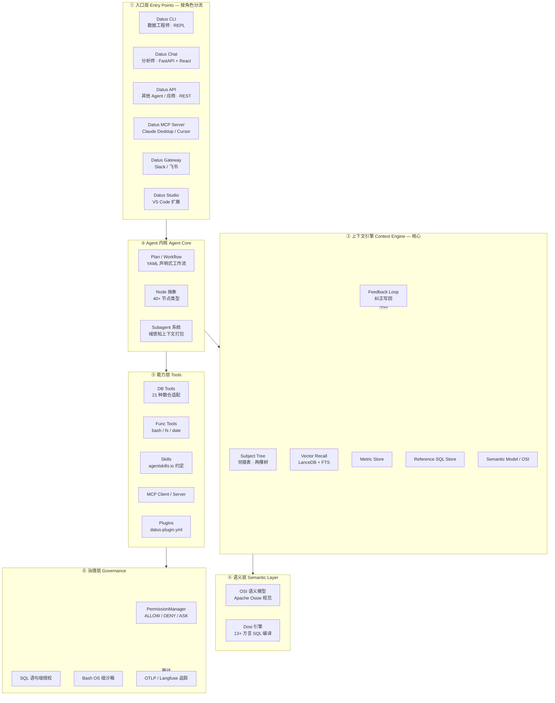
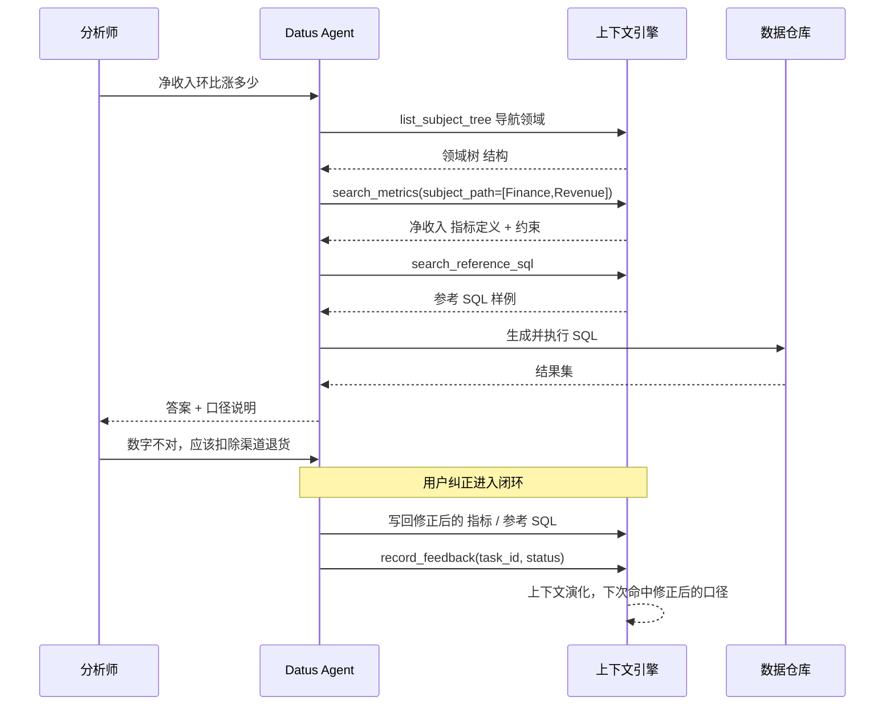
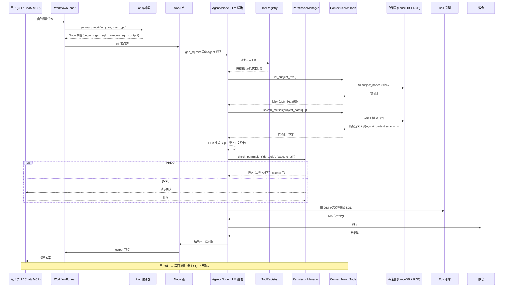

## 引子：分析师的「SQL 恐惧症」

想象一个再熟悉不过的场景。

周一早上，数据分析师被叫进会议室。老板问：「上个季度华东区的净收入环比涨了多少？剔���渠道退货。」

分析师打开数据仓库客户端，盯着 300 张表发愣。他知道 `orders`、`order_items`、`refunds`、`channels` 这几张表，但不知道「净收入」在这个公司里到底是 `SUM(amount)` 还是 `SUM(amount - refund_amount)`，也不知道哪个视图里的 `channel` 字段才是最新的口径。他花了 40 分钟拼出一条 SQL，跑出来的数字和财务对不上，又花了 20 分钟找同事确认。

**问题的本质不是 SQL 难写，而是「上下文」不在手边。**

而这套上下文——指标口径、参考 SQL、业务规则、表血缘——其实一直都在。只是它散落在几百个文档、几十个看板、无数个工程师的脑子里，**从来没有被组织成一个 Agent 可检索、可信、可演化的结构**。

现在 LLM 已经能写 SQL 了。但直接问 LLM「写个 SQL 算净收入」，它会给你一个语法完美、语义随意的答案。因为它不知道你们的口径。

Datus 就是来解决这件事的。

> **Datus** 是面向现代数据栈的开源**数据工程 Agent**：一个 Agent 同时连接你的数仓、目录（catalog）、语义层和 BI 工具，**依托于一个由你的团队自己拥有的、可演化的上下文引擎**。

本文将深入拆解它的架构设计与核心机制。

---

## 一、项目定位：为什么数据工程是 Agent 的下一个战场

### 1.1 传统数据工程的断点

传统数据工程的流水线终点是「**交付数据**」——建好表、跑好调度、对接看板就算完成。

但 LLM 时代暴露了一个致命问题：**数据在变，问题在变，而知识不沉淀**。

| 传统数据工程 | 数据工程 Agent |
|---|---|
| 终点是交付表和报表 | 终点是**沉淀可演化的上下文** |
| 口径写在文档里，Agent 读不到 | 口径存在上下文引擎里，Agent 直接检索 |
| 每个分析师重复写相似 SQL | 历史 SQL 被捕获、复用、修正 |
| 错误答案只能人工发现 | 每次纠正都写回上下文，形成闭环 |
| LLM 写 SQL 全靠猜 | LLM 用**你自己的指标定义**写 SQL |

Datus 官方文档把这个范式称为 **Contextual Data Engineering（上下文数据工程）**，一句话概括：

> 在传统数据工程中，流水线终点是数据交付；在上下文数据工程中，**流水线本身变成了数据系统的知识图谱**，持续从历史 SQL、反馈回路和人工修正中学习。

### 1.2 仓库档案

| 指标 | 值 |
|---|---|
| 仓库 | [Datus-ai/Datus-agent](https://github.com/Datus-ai/Datus-agent) |
| Stars | ⭐1,883（2025-07 创建，16 个月增长） |
| 主语言 | Python（22.6 MB）+ Jinja 模板（258 KB） |
| License | Apache-2.0 |
| 最近推送 | 2026-11-02（**近乎每日提交**） |
| 最新版本 | v0.4.4（2026-10-28），累计 20+ 个 release |
| 贡献者 | 24 人 |
| 仓库规模 | 2,266 个 tree 节点，含完整 `docs/`、`tests/`、`benchmark/` |
| 分发 | PyPI `datus-agent`，Python 3.12+ |

> **一个值得注意的信号**：它的核心语义层规范是 **Apache Ossie**（ASF 孵化项目）的 OSI（Open Semantic Interchange）规范——也就是说，这不是一个「自己定义一套私有格式」的封闭项目，而是主动把语义层推向**基金会级开放标准**。

---

## 二、整体架构：六层分工

Datus 的架构可以拆成六层。理解这个分层，是理解后面所有设计取舍的前提。



**这张图里最关键的一条线是 `Feedback -.写回.-> Context`。** 后面 §5 会专门讲这个闭环——它是 Datus 与所有「text2sql demo」的根本分水岭。

---

## 三、上下文引擎：两棵树 + 向量召回

这是整个项目最值得细看的部分。Datus 把「数据工程的长期记忆」建模成**两棵树**加**一个向量索引**。

### 3.1 Subject Tree：邻接表实现的领域分类树

Datus 用**邻接表（adjacency list）**模型实现业务主题树。与传统的路径字符串（如 `Finance/Revenue/Q1`）不同，它用 `parent_id` 指针显式建模父子关系。

```python
# 来自 datus/storage/subject_tree/store.py:33-79
SUBJECT_ID_COLUMN_NAME = "subject_node_id"
SUBJECT_PATH_COLUMN_NAME = "subject_path"
NAME_COLUMN_NAME = "name"
ROOT_PARENT_ID = -1  # 用 -1 代替 NULL，确保 UNIQUE 约束对根节点同样生效

# 名称中的无意义字符——只差这些字符（或大小写）的两个名字
# 指的是同一个业务领域，必须折叠成同一个节点，
# 而不是让主题区域碎裂成近乎重复的兄弟节点。
# 但真正不同的名字（营销 vs 营销分析）仍然保持独立——
# 合并它们需要一棵人工策划的树（bootstrap-kb --subject_tree）。
_NODE_NAME_NOISE_RE = re.compile(r"[\s_\-/\\.·、,，]+")


def normalize_subject_node_name(name: str) -> str:
    """Subject 节点名的比较键：折叠大小写并去掉分隔符/标点。"""
    return _NODE_NAME_NOISE_RE.sub("", str(name or "").strip()).casefold()


_SUBJECT_NODES_TABLE = TableDefinition(
    table_name="subject_nodes",
    columns=[
        ColumnDef(name="node_id", col_type="INTEGER", primary_key=True, autoincrement=True),
        ColumnDef(name="parent_id", col_type="INTEGER"),
        ColumnDef(name="name", col_type="TEXT", nullable=False),
        ColumnDef(name="description", col_type="TEXT", default=""),
        ColumnDef(name="created_at", col_type="TEXT", nullable=False),
        ColumnDef(name="updated_at", col_type="TEXT", nullable=False),
        ColumnDef(name="datasource_id", col_type="TEXT", default=""),
    ],
    indices=[
        IndexDef(name="idx_subject_parent_id", columns=["parent_id"]),
        IndexDef(name="idx_subject_parent_name_ds",
                 columns=["parent_id", "name", "datasource_id"], unique=True),
        IndexDef(name="idx_subject_datasource_id", columns=["datasource_id"]),
    ],
    constraints=["UNIQUE(parent_id, name, datasource_id)"],
)
```

**三个设计细节值得单独拎出来：**

**① `ROOT_PARENT_ID = -1` 而不是 `NULL`。**
这是数据库设计里一个非常老练的技巧。`UNIQUE(parent_id, name, datasource_id)` 约束在 `parent_id IS NULL` 时**不会生效**——SQL 标准规定 `NULL` 与 `NULL` 比较结果为 unknown，不构成冲突。换句话说，用 `NULL` 表示根节点，数据库就允许你插入任意多个同名根节点。用 `-1` 这个哨兵值，约束对根节点照样生效。

**② `UNIQUE(parent_id, name, datasource_id)` 三列唯一键。**
同名的业务领域在**不同的数据源**下可以并存，但同一个数据源下不能重复。同时 `datasource_id` 贯穿了几乎所有存储表，这是一个**贯穿式的租户隔离维度**。

**③ 名称归一化折叠噪声字符。**
`Marketing` / `marketing` / `market_ing` / `Marketing ` 全部折叠成同一个节点。注意注释里明确写了边界：**真正不同的名字（`营销` vs `营销分析`）仍然保持独立**——合并它们需要人工策划。这是「自动化优先，但不越权」的典型表达。

### 3.2 双召回机制：Tree + Vector

Datus 的上下文检索不是纯向量检索，而是**两棵树 + 向量**的组合。

```python
# 来自 datus/storage/base.py:583-610
def search(
    self,
    query_txt: str,
    select_fields: Optional[List[str]] = None,
    top_n: Optional[int] = None,
    where: WhereExpr = None,
    query_type: str = "vector",
    allow_hybrid_fallback: bool = True,
) -> pa.Table:
    table = self._open_existing_table_for_read()
    if table is None:
        return self._empty_result(select_fields)
    row_count = table.count_rows(where) if where else table.count_rows()
    if row_count == 0:
        return self._empty_result(select_fields)

    self._ensure_embedding_cache_ready_for_search()
    self._ensure_table_ready()

    if query_type == "hybrid":
        search_result = self._search_hybrid(
            query_txt, select_fields, top_n, where, allow_fallback=allow_hybrid_fallback
        )
    else:
        search_result = self._search_vector(query_txt, select_fields, top_n, where)
    if self.vector_column_name in search_result.column_names:
        search_result = search_result.drop([self.vector_column_name])
    return search_result
```

注意 `allow_hybrid_fallback` 这个参数——它让「混合检索失败时自动降级为纯向量检索」成为一个**显式可配置**的策略，而不是隐式行为：

```python
# 来自 datus/storage/base.py:612-645
def _search_hybrid(
    self,
    query_txt: str,
    select_fields: Optional[List[str]] = None,
    top_n: Optional[int] = None,
    where: WhereExpr = None,
    allow_fallback: bool = True,
) -> pa.Table:
    try:
        if not top_n:
            top_n = self.table.count_rows(where) if where else self.table.count_rows()
        results = self.table.search_hybrid(
            query_txt,
            self.vector_column_name,
            top_n,
            where=where,
            select_fields=select_fields,
        )
        if len(results) > top_n:
            results = results[:top_n]
        return results
    except Exception as e:
        if allow_fallback:
            logger.warning("Hybrid search failed for %s; falling back to vector search: %s", self.table_name, e)
            return self._search_vector(query_txt, select_fields, top_n, where)
        raise DatusException(
            ErrorCode.STORAGE_SEARCH_FAILED,
            message_args={
                "error_message": str(e),
                "query": query_txt,
                "where_clause": str(where) if where else "(none)",
                "top_n": str(top_n or "all"),
            },
        ) from e
```

**降级失败时的错误信息设计得很讲究**：`error_message` / `query` / `where_clause` / `top_n` 四个字段一起带上。这样一个 DatusException 抛出来，运维人员能立刻知道是哪个查询、在什么过滤条件下、想要多少条结果时挂的——不需要翻日志。

### 3.3 Subject Path 归一化：Agent 幻觉的防线

LLM 在调用 `search_metrics(subject_path=[...])` 时，很容易自己编一个路径。Datus 对此有一层专门的归一化：

```python
# 来自 datus/storage/metric/subject_path.py:13-53
GENERIC_METRIC_SUBJECT_ROOTS = {"metrics", "metric", "unknown"}


def default_metric_subject_path(datasource: str = "", table_name: str = "") -> list[str]:
    datasource = str(datasource or "").strip()
    table = str(table_name or "Unknown").strip() or "Unknown"
    if datasource:
        return [datasource, table]
    return ["Metrics", table]


def normalize_metric_subject_path(
    subject_path: Optional[Iterable[str]],
    *,
    datasource: str = "",
    table_name: str = "",
) -> list[str]:
    """归一化生成的 metric subject path，但不重写业务根节点。"""
    parts = [str(part).strip() for part in subject_path or [] if str(part).strip()]
    if not parts:
        return default_metric_subject_path(datasource, table_name)

    datasource = str(datasource or "").strip()
    if not datasource:
        return parts

    first = _normalize_part(parts[0])
    if first in GENERIC_METRIC_SUBJECT_ROOTS:
        tail = parts[1:]
    elif _same_part(parts[0], datasource):
        tail = parts[1:]
    else:
        return parts

    while tail and _same_part(tail[0], datasource):
        tail = tail[1:]

    if not tail:
        tail = [str(table_name or "Unknown").strip() or "Unknown"]
    return [datasource, *tail]
```

逻辑拆开看：
- LLM 传了 `["Metrics", "Revenue"]` → `Metrics` 是**泛化根名**（`GENERIC_METRIC_SUBJECT_ROOTS`），剥掉，换成真实 datasource
- LLM 传了 `["warehouse_a", "Revenue"]` 且 datasource 就是 `warehouse_a` → 剥掉重复的 datasource 前缀
- LLM 传了 `["Finance", "Revenue"]` 而 datasource 是 `warehouse_a` → **原样返回**（不重写业务根节点）

**最后一条是精髓**：归一化只做「机械安全的」清理，绝不猜测业务含义。把 `Finance` 改写成 `warehouse_a` 看起来更一致，但那是把正确的语义改错了。

### 3.4 上下文工具的暴露方式：按需装配

Datus 的上下文检索工具不是「全部一股脑塞给 LLM」，而是**按上下文动态装配**。这是它控制 prompt 膨胀的关键手段：

```python
# 来自 datus/tools/func_tool/context_search.py:100-125
def _has_tool_permission(self, tool_namespace: str, *tool_names: str) -> bool:
    if not self.sub_agent_config:
        return True

    tool_list = self.sub_agent_config.tool_list
    # 空的/未声明的 tool_list 意味着该 sub-agent 没有限制自己的
    # 工具集，因此它继承节点的默认值 —— 允许（与上面没有
    # sub_agent_config 的语义相同）。只有**非空**列表才作为显式
    # allowlist 起限制作用。否则一个具名节点如果它的
    # agentic_nodes.<name> 块省略了 tools:，就会得到 tool_list == []
    # 从而每一个 context-search 工具都被静默拒绝，
    # 尽管该节点的 DEFAULT_TOOLS 本来就启用了 context_search_tools.*。
    if not tool_list:
        return True

    return (
        tool_namespace in tool_list
        or f"{tool_namespace}.* " in tool_list
        or any(tool_name in tool_list for tool_name in tool_names)
    )
```

装配逻辑：

```python
# 来自 datus/tools/func_tool/context_search.py:176-208
def available_tools(self) -> List[Tool]:
    tools = []
    has_subject_tree = False

    if self._show_subject_tree():
        tools.append(trans_to_function_tool(self.list_subject_tree))
        has_subject_tree = True

    if self._show_metrics():
        if not has_subject_tree:
            tools.append(trans_to_function_tool(self.list_subject_tree))
            has_subject_tree = True
        tools.append(trans_to_function_tool(self.search_metrics))

    if self._show_sql():
        if not has_subject_tree:
            tools.append(trans_to_function_tool(self.list_subject_tree))
            has_subject_tree = True
        tools.append(trans_to_function_tool(self.search_reference_sql))
        tools.append(trans_to_function_tool(self.get_reference_sql))

    if self._show_semantic_objects():
        tools.append(trans_to_function_tool(self.search_semantic_objects))

    if self._show_template():
        if not has_subject_tree:
            tools.append(trans_to_function_tool(self.list_subject_tree))
        # 注意：reference_template 工具是通过 ReferenceTemplateTools 类注册的，
        # 但我们确保 list_subject_tree 可用于导航

    return tools
```

**「先取目录，再检索」的两步协议**在这里被强制化：`list_subject_tree` 永远排在 `search_metrics` / `search_reference_sql` 之前，而且工具的 docstring 里明确写了 `MUST call list_subject_tree first to get the subject path.`（必须先调用 `list_subject_tree` 获取 subject 路径）。

这解决了一个非常实际的 Agent 问题：让 LLM 在一个巨大的向量空间里盲搜，通常召回一堆语义漂移的东西；先给一棵**领域目录**导航，再限定路径检索，召回质量完全不同。

---

## 四、语义层：OSI 规范与 Dosi 引擎

### 4.1 OSI：一个开放标准的语义模型格式

Datus 的语义模型遵循 **OSI（Open Semantic Interchange）** 规范，即 Apache Ossie 的 Core Metadata Spec。这是一个 YAML 格式的声明式语义模型。

```yaml
# 来自 datus/tools/semantic_tools/dosi/schema/osi-core-0.2.0.dev0.spec.yaml:20-24
# Goals:
# - Standardization: Establish uniform language and structure for semantic model definitions
# - Extensibility: Support domain-specific extensions while maintaining core compatibility
# - Interoperability: Enable exchange and reuse across different AI and BI applications
```

它定义的顶层结构：

```yaml
# 来自 datus/tools/semantic_tools/dosi/schema/osi-core-0.2.0.dev0.spec.yaml:74-115
semantic_model:
  # Required: Unique identifier for the semantic model
  - name: string

    # Optional: Human-readable description of the semantic model
    description: string

    # Optional: Additional context for AI tools (e.g., custom prompts, instructions)
    # Can be either:
    #   - A free-form string, or
    #   - A structured object with optional keys:
    #       instructions: string  # how AI should use this entity
    #       synonyms:     []      # alternative names / terms
    #       examples:     []      # sample questions or use cases
    ai_context: {}

    # Required: Collection of logical datasets (fact and dimension tables)
    datasets: []

    # Optional: Defines how logical datasets are connected
    relationships: []

    # Optional: These metrics can span one or more logical datasets and use relationships
    metrics: []

    # Optional: Vendor-specific attributes for extensibility
    # Allows vendors to add custom metadata without breaking core compatibility
    custom_extensions:
      - vendor_name: string  # Free-form string identifying the vendor
        data: string
```

**`ai_context` 字段是整个设计的灵魂。** 传统语义层描述的是「这个字段是什么类型、怎么 join」，而 OSI 的 `ai_context` 额外描述了「**AI 应该怎么用这个实体**」——`instructions`（使用说明）、`synonyms`（同义词）、`examples`（示例问题）。

这直接解决了 text2sql 的一个核心难题：**同一个业务概念在不同人口中叫法不同**。`revenue` / `营收` / `销售额净额` / `GMV` 如果只靠 embedding 相似度，永远无法保证命中正确的指标。而 `synonyms` 是**确定性**的映射。

规范还定义了 **9 种表达式方言**：

```yaml
# 来自 datus/tools/semantic_tools/dosi/schema/osi-core-0.2.0.dev0.spec.yaml:36-48
dialects:
  - "ANSI_SQL"              # Standard SQL dialect
  - "SNOWFLAKE"             # Snowflake
  - "MDX"                   # Multi-Dimensional Expressions
  - "TABLEAU"               # Tableau
  - "DATABRICKS"            # Databricks SQL
  - "MAQL"                  # GoodData MAQL (Multi-Dimensional Analytical Query Language)
  - "BIGQUERY"              # Google BigQuery GoogleSQL
  - "SIGMA"                 # Sigma Computing spreadsheet-style formula language
  - "THOUGHTSPOT"           # ThoughtSpot formula language (not SQL)
```

注意 `MDX`（多维表达式）、`MAQL`（GoodData 的多维分析查询语言）、`SIGMA`（电子表格式公式语言）——**这三个不是 SQL**。这说明 OSI 瞄准的是「所有分析工具的通用语义交换层」，而不只是「SQL 的统一写法」。

### 4.2 Dosi：把一份语义模型编译成 13+ 种方言的 SQL

Dosi 是内嵌在 Datus 里的语义引擎。它**独立可运行**——可以当 CLI、REST server 或 MCP server 用。

它的核心能力是：**一份 OSI 语义模型 → 多方言可执行 SQL**。这意味着你可以用 Snowflake 语义模型定义指标，然后在 BigQuery / Databricks / MDX（Power BI）上跑同一套口径。

### 4.3 Fail-Closed：退役语义的拒绝执行

这是 Datus 代码里我最喜欢的一段设计。

```python
# 来自 datus/tools/semantic_tools/dosi/model.py:33-41
# 这些键属于已退役的 semantic execution profile。它们**不是**
# 原生的结构化窗口别名。让 Dosi 忽略它们会导致它静默执行
# 未加装饰的基础聚合，所以每个 Dosi 入口点都 fail closed。
LEGACY_WINDOW_KEYS = frozenset(
    {
        "grain_to_date",
        "window_aggregation",
        "offset_window",
        "period_over_period",
    }
)
```

配套的检测函数：

```python
# 来自 datus/tools/semantic_tools/dosi/model.py:163-180
def legacy_window_findings(document: dict[str, Any]) -> list[dict[str, Any]]:
    """返回在原生 Dosi 下不安全的退役执行提示。"""
    findings: list[dict[str, Any]] = []
    for carrier, name, node in iter_named_nodes(document):
        if carrier != "metric":
            continue
        payload = datus_payload(node)
        keys = sorted(LEGACY_WINDOW_KEYS.intersection(payload))
        if isinstance(payload.get("window"), str):
            keys = sorted({*keys, "window"})
        if keys:
            findings.append({"carrier": carrier, "name": name, "keys": keys})
    return findings
```

**为什么这是好设计？**

想象一下：一个老版本的语义模型用了 `period_over_period` 字段描述「环比」。新版本的 Dosi 原生引擎不认识这个键。如果**静默忽略**，引擎会照常编译出 SQL——但那条 SQL 算的是**普通聚合**，不是环比。用户拿到一个看起来正常、实则算错的数字。

这比报错糟糕得多：**报错用户会知道，错误的数字会被写进报表然后传播。**

「fail closed」这个原则在 Datus 里反复出现（权限系统、插件 transformer、SQL 授权都是），是这个项目的统一哲学。

### 4.4 供应商扩展的读取

```python
# 来自 datus/tools/semantic_tools/dosi/model.py:141-158
def datus_payload(node: dict[str, Any]) -> dict[str, Any]:
    """返回第一个 DATUS payload，与原生引擎保持一致。"""
    extensions = node.get("custom_extensions") or []
    if isinstance(extensions, dict):
        extensions = [extensions]
    for extension in extensions:
        if not isinstance(extension, dict):
            continue
        if str(extension.get("vendor_name") or "").upper() != DATUS_VENDOR:
            continue
        return decode_extension_data(extension.get("data"))
    return {}
```

`custom_extensions` 是一个**开放式的 vendor 扩展槽位**：任何厂商都可以在自己的语义模型里挂私有元数据，而核心规范保持不变。Datus 自己用的是 `DATUS` 这个 vendor name。

---

## 五、反馈闭环：Agent 越用越准的机制

这是我认为 Datus 最核心的创新点，也是它区别于所有 text2sql demo 的地方。

### 5.1 反馈存储

```python
# 来自 datus/storage/feedback/store.py:19-36
_FEEDBACK_TABLE = TableDefinition(
    table_name="feedback",
    columns=[
        ColumnDef(name="id", col_type="INTEGER", primary_key=True, autoincrement=True),
        ColumnDef(name="task_id", col_type="TEXT", nullable=False),
        ColumnDef(name="status", col_type="TEXT", nullable=False),
        ColumnDef(name="created_at", col_type="TEXT", nullable=False),
    ],
    indices=[
        IndexDef(name="idx_task_id", columns=["task_id"]),
    ],
    constraints=["UNIQUE(task_id)"],
)
```

注意 `UNIQUE(task_id)`——**一个任务只能有一条反馈**。写回用 upsert：

```python
# 来自 datus/storage/feedback/store.py:74-92
def record_feedback(self, task_id: str, status: str) -> Dict[str, Any]:
    """为某个任务记录用户反馈。"""
    try:
        recorded_at = datetime.now(timezone.utc).isoformat().replace("+00:00", "Z")

        self._table.upsert(
            FeedbackRecord(task_id=task_id, status=status, created_at=recorded_at),
            conflict_columns=["task_id"],
        )

        logger.info(f"Recorded feedback for task {task_id}: {status}")
        return {"task_id": task_id, "status": status, "recorded_at": recorded_at}

    except Exception as e:
        raise DatusException(
            ErrorCode.STORAGE_FAILED, message=f"Failed to record feedback for task {task_id}: {str(e)}"
        ) from e
```

### 5.2 完整闭环



**关键在于「写回」发生在哪一层。**

一个常见的错误设计是：把用户的纠正写进对话历史。这样下次提问时，如果上下文窗口里没有那段历史，Agent 就重新犯同样的错。

Datus 的做法是**把纠正写回结构化存储**——修正后的指标定义、参考 SQL、subject path 标签。一旦落库，它就是**持久的、可被向量检索到的、可被他人复用的**上下文。下一个分析师问类似问题，检索到的就是修正后的口径。

这就是「**Every run and every correction settles into context**」（每一次运行和每一次纠正都沉淀进上下文）的字面含义。

---

## 六、权限与治理：四级权限体系

Datus 在治理上的野心很大。它没有只做「让 Agent 能查数据」，而是想解决企业最担心的那个问题：**AI 直连生产数仓，怎么保证它不会删数据、不会看到不该看的、每一步都留痕**。

### 6.1 PermissionManager 的三层判定

```python
# 来自 datus/tools/permission/permission_manager.py:31-52
class PermissionManager:
    """
    所有工具、MCP 和 Skills 的统一权限管理器。

    负责权限检查、工具过滤和用户确认（ASK 权限）。

    权限系统：
    1. 按顺序求值规则（最后匹配者胜出）
    2. DENY 权限把工具从 system prompt 中隐藏（LLM 根本看不到它们）
    3. ASK 权限在执行前提示用户确认
    4. 节点级覆盖叠加在全局配置之上

    使用示例：
        manager = PermissionManager(
            global_config=agent_config.permissions_config,
            node_overrides={"chatbot": chatbot_permissions}
        )

        # 执行工具前检查权限
        perm = manager.check_permission("db_tools", "execute_sql", "chatbot")
        if perm == PermissionLevel.DENY:
            return error
        elif perm == PermissionLevel.ASK:
            approved = await manager.request_confirmation(...)
    """
```

**「DENY 的工具从 system prompt 中隐藏」这一句是整段代码里最重要的。**

绝大多数 Agent 权限系统只做「运行时拦截」——工具照样出现在 prompt 里，模型照样会调用，只是调用后被拒绝。这浪费 token，还会让模型反复重试同一个被禁的工具，甚至想办法绕过。

Datus 的做法是**在 prompt 层面就消失**。模型不知道有这个工具，所以不会调用它。

### 6.2 规则求值：最后匹配者胜出

「按顺序求值，最后匹配者胜出」是 Claude Code / OpenCode 都在用的模式。它的好处是**规则可以用 YAML 追加而不需要重排**——用户想在已有规则后面加一条例外，直接追加即可。

### 6.3 三种状态，四类运行时状态

Datus 的权限状态不是简单的 allow / deny 二元，而是：

| 状态 | 行为 |
|---|---|
| `ALLOW` | 直接执行 |
| `DENY` | 工具从 prompt 中隐藏（模型看不到） |
| `ASK` | 执行前弹确认，等待用户批准 |
| （未匹配） | 走 `default_permission` |

### 6.4 并发安全：RLock 与持久规则

```python
# 来自 datus/tools/permission/permission_manager.py:105-118
# 序列化对运行时权限状态（global_config、_session_approvals、
# _persistent_rules、_persistent_bash_allows）的修改，与权限检查
# 路径上的读取。Ctrl+P 快捷键在 TUI 事件循环（主线程）上运行
# switch_profile，而 check_permission / request_user_confirmation
# 跑在 Agent 的后台循环线程上，否则二者会竞态。
# 可重入，因为受保护的方法互相调用（例如 switch_profile ->
# _install_bash_allow）。绝不在 await 期间持有。
self._state_lock = threading.RLock()
```

这是一段**把并发问题写在注释里的代码**。它明确指出了三个事实：

1. TUI 事件循环在主线程
2. Agent 循环在后台线程
3. `switch_profile` 会重建 `global_config`

第三条尤其关键——这直接催生了下面这个设计：

```python
# 来自 datus/tools/permission/permission_manager.py:120-126
# 运行时注入、必须能跨 profile 切换存活的规则。
# 一次 /profile dangerous 切换会重建 global_config，
# 如果没有这个列表，运行时注入的规则会被静默丢弃。
self._persistent_rules: List[PermissionRule] = []

# 通过 "allow (project)" 在本次会话中授予的 Bash allow 模式。
# 与 _persistent_rules 镜像：/permission 切换后重新应用，
# 这样授权在切换 profile 后依然有效（磁盘上的 .datus/config.yml 副本覆盖重启场景）。
self._persistent_bash_allows: List[str] = []
```

**「切 profile 会丢规则」是一个非常容易漏掉的 bug。** 用户在 `normal` 模式下临时批准了一个 bash 命令，切到 `dangerous` 模式，这个批准就消失了——用户会觉得「莫名其妙又被拦了」。Datus 用一个专门的 `_persistent_rules` 列表解决它。

### 6.5 项目级授权：精确匹配 vs 通配

```python
# 来自 datus/tools/permission/permission_manager.py:137-146
# 项目范围授予的精确匹配集合（.datus/config.yml 的 bash_allow，
# 加上本次会话中通过 "allow (project)" 授予的）。
# 由 hook 查询以绕过 ask 规则命中——即项目明确允许的模式。
# 不受 profile 切换影响；不同于 bash grant，
# 它永不安装进 global_config —— SQL 门直接查询这个集合。
self._project_bash_grants: set = set(project_bash_allows or [])

# 项目范围授予的精确匹配 SQL 语句类型集合（.datus/config.yml 的
# sql_allow，加上本次会话中通过 "allow (project)" 提示选择的）。
# 与 bash grant 一样，不受 profile 切换影响；不同于 bash grant，
# 从不安装进 global_config —— SQL 门直接查询这个集合。
self._project_sql_grants: set = {
    k.strip().lower() for k in (project_sql_allows or []) if isinstance(k, str) and k.strip()
}
```

注意「**SQL 门直接查询这个集合，永不安装进 global_config**」这个设计。原因是：如果把项目授权装进 global_config，它就会参与「最后匹配者胜出」的规则链，可能**意外覆盖**一条 ask 规则或 deny 规则。而项目授权的语义是「精确豁免」，它不应该有规则链的能力。项目授权应该走**旁路**。

### 6.6 权限配置拷贝：防止单例污染

```python
# 来自 datus/tools/permission/permission_manager.py:88-96
# 拷贝传入的配置 —— get_profile 返回的是模块级共享对象，
# 而 add_persistent_rule 会通过 insert(0, ...) 修改 global_config.rules。
# 不拷贝的话，每个 manager 都会共享同一个 rules 列表，
# 把持久规则泄漏到无关的节点。
self.global_config = self._copy_config(global_config) if global_config else PermissionConfig()
```

`profiles.py` 里的 profile 是**模块级单例**（这样读取开销小）。但 `add_persistent_rule` 会 `insert(0, ...)` 修改它。如果不拷贝，**一个节点授予的持久规则会泄漏到所有其他节点**。这是共享可变状态最经典的坑。

---

## 七、插件系统：Manifest-as-Code

Datus 的插件系统和我之前分析过的 OpenMontage（Manifest-as-Code）思路高度同构，但实现得更严格。

### 7.1 插件契约

```python
# 来自 datus/plugins/base.py:8-20
"""
datus-plugin 契约：一个声明式 datus-plugin.yml 清单。

一个 *插件* 是一个可安装的包，它为 datus 扩展出一个
`datus <plugin> ...` CLI 子命令，外加可选的打包 skills、
system prompt 片段、bash 权限规则、tool transformer、
policy runtime 和 profile 配置 schema ——
全部在一个随可导入包一起分发的 datus-plugin.yml 里声明。
插件包**从不** import datus.*，也不分发任何插件类：
它提供的唯一 Python 就是清单里引用的普通函数。

发现方式
=========

包在 datus.plugins 组下注册**一个** entry point，其值是包名 ——
纯粹的 name → package 映射，而不是代码引用：

    [project.entry-points."datus.plugins"]
    hello = "datus_plugin_hello"

datus 用 importlib.util.find_spec 定位包目录（它**不会**执行
__init__.py），然后从中读取 datus-plugin.yml。
因此收集 skills、权限、prompt 片段和配置 schema 从不运行插件代码；
只有 cli 入口（在 `datus <name> ...` 分发时）和声明的
tool_transformers / policy_runtime 才会被惰性导入。
"""
```

**「收集元数据从不运行插件代码」是一个非常重要的安全属性。**

想象一下：你装了一个插件，它的 `datus-plugin.yml` 声明了一个 bash 权限规则。如果 Datus 为了读取这个 YAML 而 import 了插件的 `__init__.py`，那么**安装插件的那一刻就执行了第三方代码**。而 `importlib.util.find_spec` 不执行 `__init__.py`，所以元数据收集是零代码执行的。

只有真正需要时（跑 CLI 子命令、用 transformer、用 policy runtime）才惰性导入。

### 7.2 Tool Transformer：参数的 fail-closed 改写

```text
# 来自 datus/plugins/base.py:76-92（清单正文的缩进原样保留）
    tool_transformers:
      "db_tools.execute_sql": datus_plugin_hello.transformers:enforce_scope
      "execute_sql":
        - datus_plugin_hello.transformers:audit_args
    # 工具模式 -> 点分引用或引用列表。模式语法匹配 proxy 层：
    # 裸工具名（execute_sql）或 category.method 配 fnmatch 通配符
    # （db_tools.*）。每个引用解析为一个可调用对象
    # transformer(tool_name, args, context) -> dict（同步或异步）：
    # 返回可能被修改的参数字典以继续，或抛出异常以拒绝该调用 ——
    # 此时工具永不运行，模型收到异常消息作为普通工具失败
    # （fail closed）。context 是一个普通字典，含 node_name、
    # policy_context、project_root 和 agent_config。
    # Transformer 只覆盖 LLM 驱动的工具调用；直接 Python 调用绕过它们。
```

三个要点：

1. **返回修改后的参数** → 可以给 SQL 自动加 `LIMIT`、强制加租户过滤条件
2. **抛出异常即拒绝** → fail closed，工具不执行，模型收到错误消息
3. **「Transformer 只覆盖 LLM 驱动的工具调用；直接 Python 调用绕过它们」** → 这个边界写得很诚实。但也意味着这层防护**不能**当作安全边界来依赖——所以 Datus 另有 `policy_runtime` 钩子来覆盖直接执行路径。

### 7.3 Policy Runtime：覆盖直接执行路径

```text
# 来自 datus/plugins/base.py:93-100（清单正文的缩进原样保留）
    policy_runtime: datus_plugin_hello.runtime:create_runtime
    # 可选的工厂，为当前插件 profile 调用 create_runtime(profile: dict)。
    # 返回的对象可实现 validate_context(policy_context)、
    # before_sql_read(...) 和 after_read_result(...)。
    # 这些钩子保护直接 DB 执行路径以及 LLM 工具。
    # 无效的工厂和畸形的钩子决策 fail closed 而不是静默禁用已配置的数据保护。
```

**「无效的工厂和畸形的钩子决策 fail closed 而不是静默禁用已配置的数据保护」**——这是安全设计里的黄金准则。如果插件的 policy runtime 加载失败，正确的行为是**报错并拒绝执行**，而不是「保护没生效，继续跑」。

---

## 八、工作流引擎：YAML 声明式编排

Datus 的工作流定义在一个 YAML 文件里：

```yaml
# 来自 datus/agent/workflow.yml
workflow:

  fixed:
    - schema_linking
    - gen_sql
    - execute_sql
    - output

  empty: []

  # 使用 ChatAgenticNode 的 Agentic 工作流
  chat_agentic:
    - chat
    - execute_sql
    - output

  gen_sql_agentic:
    - gen_sql
    - execute_sql
    - output
```

从 YAML 到节点实例的编译过程：

```python
# 来自 datus/agent/plan.py:73-146
def create_nodes_from_config(
    workflow_config: list,
    sql_task: SqlTask,
    agent_config: Optional[AgentConfig] = None,
    tools: Optional[List[Tool]] = None,
) -> List[Node]:
    nodes = []

    start_node = Node.new_instance(
        node_id="node_0",
        description=NodeType.get_description(NodeType.TYPE_BEGIN),
        node_type=NodeType.TYPE_BEGIN,
        input_data=sql_task,
        agent_config=agent_config,
        tools=tools,
    )
    nodes.append(start_node)

    # 处理可能含嵌套结构的 workflow 配置
    processed_nodes = _process_workflow_config(workflow_config, sql_task, agent_config, tools=tools)
    nodes.extend(processed_nodes)

    logger.info(f"Generated workflow with {len(nodes)} nodes")

    return nodes


def _process_workflow_config(
    config: list,
    sql_task: SqlTask,
    agent_config: Optional[AgentConfig] = None,
    start_index: int = 1,
    node_id_prefix: str = "node",
    tools: Optional[List[Tool]] = None,
) -> List[Node]:
    """处理可能含嵌套并行结构的 workflow 配置。"""
    nodes = []
    current_index = start_index

    for item in config:
        if isinstance(item, str):
            # 简单节点类型
            node_id = f"{node_id_prefix}_{current_index}"
            node = _create_single_node(item, node_id, sql_task, agent_config)
            nodes.append(node)
            current_index += 1

        elif isinstance(item, dict):
            # 处理嵌套结构，比如 parallel
            for key, value in item.items():
                if key == "parallel" and isinstance(value, list):
                    # 创建并行节点
                    parallel_children = value
                    node_id = f"{node_id_prefix}_{current_index}"

                    from datus.schemas.parallel_node_models import ParallelInput

                    parallel_input = ParallelInput(
                        child_nodes=parallel_children,
                        shared_input=None,  # 执行时设置
                    )

                    parallel_node = Node.new_instance(
                        node_id=node_id,
                        description=NodeType.get_description(NodeType.TYPE_PARALLEL),
                        node_type=NodeType.TYPE_PARALLEL,
                        input_data=parallel_input,
                        agent_config=agent_config,
                        tools=tools,
                    )
                    nodes.append(parallel_node)
                    current_index += 1

                elif key == "selection":
                    # 创建选择节点（如果它被指定为带 criteria 的 dict）
                    node_id = f"{node_id_prefix}_{current_index}"

                    from datus.schemas.parallel_node_models import SelectionInput

                    selection_criteria = value if isinstance(value, str) else "best_quality"
                    selection_input = SelectionInput(
                        candidate_results={},  # 执行时填充
                        selection_criteria=selection_criteria,
                    )
                    ...
```

**「固定 pipeline」与「Agentic 节点」在同一套 YAML 里共存**，是这个设计的关键。`fixed` 工作流是确定性的 `schema_linking → gen_sql → execute_sql → output`；`gen_sql_agentic` 则把 gen_sql 换成一个能自主调工具的 Agent 节点。

而 YAML 里还支持 `parallel`（并行子节点）和 `selection`（从多个候选结果里选最优）两种嵌套结构——**selection 的默认准则是 `best_quality`**。

### 8.1 节点工厂：40+ 类型的分发

```python
# 来自 datus/agent/node/node.py:47-70
class Node(ABC):
    """
    表示 workflow 中的单个节点。
    """

    @classmethod
    def new_instance(
        cls,
        node_id: str,
        description: str,
        node_type: str,
        input_data: BaseInput = None,
        agent_config: Optional[AgentConfig] = None,
        tools: Optional[List[Tool]] = None,
        node_name: Optional[str] = None,
        is_subagent: bool = False,
        session_id: Optional[str] = None,
    ):
        validate_node_class(node_type, node_name or node_id)

        from datus.agent.node import (
            BeginNode,
            ChatAgenticNode,
            CompareNode,
            ExecuteSQLNode,
            FixNode,
            GenSQLAgenticNode,
            HitlNode,
            OutputNode,
            ParallelNode,
            SchemaLinkingNode,
            SelectionNode,
            SubworkflowNode,
        )

        if node_type == NodeType.TYPE_SCHEMA_LINKING:
            return SchemaLinkingNode(node_id, description, node_type, input_data, agent_config)
        elif node_type == NodeType.TYPE_EXECUTE_SQL:
            return ExecuteSQLNode(node_id, description, node_type, input_data, agent_config, tools)
        ...
```

节点类型覆盖：`begin` / `schema_linking` / `gen_sql` / `execute_sql` / `output` / `fix` / `hitl`（human-in-the-loop）/ `parallel` / `selection` / `subworkflow` / `compare` / `chat` / `semantic` / `ask_metrics` / `ontology_analyst` / `gen_visual_report` / `explore` / `gen_table` / `gen_job` / `gen_skill` / `feedback` / `scheduler` / `deliverable` / `compare`……

`hitl` 节点的存在说明它把「人在回路」当成**一等公民的工作流节点**，而不是一个可选的补丁。

### 8.2 节点注册表：单一事实来源

```python
# 来自 datus/tools/registry/tool_registry.py:19-30
# 进程级视图：任何节点注册过的 name -> category。
# 一个工具名在每个节点上都映射到同一个 category，所以共享是安全的；
# 它让那些只能看到父节点的代码（比如每轮调用统计）
# 也能对在 subagent 自己的注册表里跑过的工具做分类。
_known_categories: Dict[str, str] = {}


def known_tool_category(tool_name: str) -> Optional[str]:
    """任何节点注册过的 *tool_name* 的 category。"""
    return _known_categories.get(tool_name)


class ToolRegistry:
    """为节点上注册的所有工具维护 tool_name -> category 映射。"""

    def __init__(self, initial: Optional[Dict[str, str]] = None):
        self._registry: Dict[str, str] = dict(initial) if initial else {}
        _known_categories.update(self._registry)

    # --- mutation ---

    def register_tools(self, category: str, tools: List[Any]) -> None:
        """在一组工具对象下注册 *category*。"""
        for tool in tools:
            tool_name = getattr(tool, "name", str(tool))
            self._registry[tool_name] = category
            _known_categories[tool_name] = category
```

**「工具名 → category」的全局映射**，让权限系统、审计日志、每轮统计都能用同一套分类。这个单一事实来源避免了「权限系统认为是 db 工具，审计日志认为是 func 工具」这类分类漂移。

---

## 九、端到端数据流

把所有模块串起来看一次完整的运行：



---

## 十、与同类项目的设计差异

选三个最容易被拿来对比的项目。**关键不在功能列表，而在设计意图的根本分歧。**

### 10.1 与 vanna.ai / defog sqlcoder 类 Text2SQL 方案的差异

| 维度 | vanna / sqlcoder 类 | Datus |
|---|---|---|
| 知识载体 | RAG 检索的 few-shot 示例（向量库里的 DDL + SQL） | **结构化上下文引擎**：subject tree + 指标定义 + OSI 语义模型 + 参考 SQL |
| 知识来源 | 需要人手动准备训练样本 | **自动捕获**：每次运行和纠正都沉淀 |
| 业务口径 | 靠示例隐式表达 | **显式建模**：指标定义 + `ai_context.synonyms` + 约束条件 |
| 输出 | 一条 SQL | SQL + 口径说明 + 图表 + 报告 |
| 演进 | 示例库只增不改 | **写回闭环**：纠正直接修正指标定义本身 |
| 语义层 | 无（直接生成 SQL） | **OSI 开放标准 + Dosi 多方言编译** |

**设计差异的本质**：vanna 类方案把「知识」当作**检索的语料**——向量库里的文本片段。Datus 把「知识」当作**可执行、可版本化、可被编译器消费的结构化资产**。前者只能「给模型看」，后者能「让引擎执行」。

### 10.2 与 Dify / n8n / FastGPT 类低代码平台的差异

| 维度 | Dify / n8n / FastGPT | Datus |
|---|---|---|
| 抽象层 | 工作流图（节点 + 连线） | **领域模型 + 语义模型 + 上下文引擎** |
| 用户是谁 | 运营 / 应用开发者 | **数据工程师 + 分析师** |
| 核心资产 | 工作流定义 | **指标定义 + OSI 语义模型 + 上下文** |
| 交付物 | AI 应用（对话 / 表单 / 自动化） | **数据资产**（SQL / 语义模型 / 调度作业 / 看板 / 报告） |
| 知识演化 | 改工作流配置 | **纠正写回上下文，指标定义被修正** |

之前我分析 FastGPT 时说它代表了「Vibe Coding / 低代码 Agent 构建平台」这个赛道。Datus 走的是**完全正交**的方向：**它不是一个通用 Agent 构建平台，而是一个垂直领域的 Agent**。垂直的代价是要自己造语义层、方言编译器、权限体系；垂直的回报是能做出通用平台做不到的东西——比如「用 OSI 语义模型保证跨工具口径一致」。

### 10.3 与 dbMesh / dbt Semantic Layer / Looker Metrics Layer 的差异

| 维度 | dbt Semantic Layer | Looker Metrics Layer | Datus |
|---|---|---|---|
| 目标用户 | 数据工程师 | 数据分析师 | **两者兼有** |
| 交付形态 | 编译时（Jinja → SQL） | 运行时查询 API | **Agent 自主驱动** |
| 语义来源 | 人工手写 dbt YAML | 人工手写 LookML | **Agent 从历史 SQL + schema 自动起草，人工精修** |
| 扩展性 | 静态的指标定义 | 静态的 Explore | **上下文可演化 + Agent 可自建 skill** |
| 开放性 | dbt 生态 | Looker 生态 | **OSI 开放标准 + 插件机制** |

**最关键的一格是「语义来源」。**

dbt 和 Looker 都假设：**人来定义语义，机器来消费语义**。Datus 的假设是：**机器起草语义，人来精修语义，纠正直接改写语义**。

这是一个更激进的假设，它成立的前提是「反馈闭环的可靠性」——如果 Agent 的自动起草质量太差，人工精修的成本会高于手写。这也就是为什么 Datus 同时提供了 `bootstrap-kb`（批量冷启动知识库）和 benchmark 脚本（BIRD / Spider 2.0）来验证这个假设。

---

## 十一、优缺点分析

### 11.1 优势侧

| 维度 | 评价 | 依据 |
|---|---|---|
| **架构简洁性** | ★★★★★ | 六层分工清晰，Node 抽象统一了 40+ 种节点类型；上下文引擎与 Agent 内核解耦 |
| **扩展性** | ★★★★★ | 插件（manifest 声明式）+ Skills（agentskills.io 约定）+ Subagent（域感知打包）+ MCP 四条扩展通道并存 |
| **易用性** | ★★★★☆ | 六种入口（CLI / Web / API / MCP / IM / VS Code）覆盖从数据工程师到分析师的全部角色；`pip install datus-agent` 一条命令起步 |
| **正确性** | ★★★★★ | OSI 规范 + Dosi 编译器 + fail-closed 语义退役检测 + `ai_context.synonyms` 确定性映射，四重保障 |
| **治理完备度** | ★★★★★ | ALLOW/DENY/ASK 三态 + DENY 工具 prompt 级隐藏 + 语句级 SQL 授权 + OS 级 bash 沙箱 + OTLP 追踪 |

### 11.2 代价侧

| 维度 | 评价 | 代价来源 |
|---|---|---|
| **复杂度** | ★★★★☆（高） | 22.6 MB Python + 2,266 个 tree 节点 + 24 个贡献者 + 20+ release。语义层、方言编译器、权限体系、插件系统、IM 网关、VS Code 扩展……**这是一个公司级项目的体量，不是一个库的体量** |
| **性能** | ★★★☆☆ | 上下文检索要经过 `list_subject_tree` → 向量召回 → 嵌入式向量表，冷启动时 LanceDB 的 embedding cache 需要预热 |
| **维护性** | ★★★☆☆ | 大量 CI 基础设施（`ci/` 目录 40+ 个脚本，含 nightly harness、flaky registry、coverage map 校验）——**质量保障做得很重，但认知负担也上来了** |
| **成熟度** | ★★★☆☆ | v0.4.4，还在 0.x。核心 API 仍可能变动 |
| **依赖复杂度** | ★★★★☆（偏高） | Python 3.12+、LanceDB、SQLite、PostgreSQL、Airflow、Superset、多个数仓驱动，加上 `litellm` 做模型层 |

**一句总结**：Datus 用「**复杂度换正确性**」。它的每一个复杂设计——OSI 规范、Dosi 编译器、fail-closed 检测、三态权限、插件契约——都在解决同一个问题：**让 LLM 在一个它并不理解、但后果很严重的领域（企业数据）里可靠地工作**。

如果你只是想「让 LLM 帮我写个 SQL」，这个复杂度完全没必要。如果你真的要上线一个企业级数据 Agent，这个复杂度可能还不够。

---

## 十二、实践：五分钟跑起来

### 12.1 安装与初始化

```bash
# 安装（Linux x86_64/aarch64 glibc 2.28+ 或 Apple Silicon macOS）
curl -fsSL https://raw.githubusercontent.com/datus-ai/datus-agent/main/install.sh | sh

# 或者用 pip / uv
pip install datus-agent
# 官方建议：如果 pip 在 litellm 依赖上回溯很久，先装 uv
pip install uv && uv pip install datus-agent --system
```

首次运行会自动 bootstrap 出 `~/.datus/` 目录结构。进去之后：

```text
> /model          # 配置 LLM（供应商 / 套餐 / 自定义）
> /datasource     # 添加数据源
> /init           # 可选：扫描当前项目
```

### 12.2 三层配置

Datus 的配置分两层：

| 层级 | 路径 | 作用 |
|---|---|---|
| 全局 | `~/.datus/conf/agent.yml` | 主设置：模型、数据源、权限、上下文引擎 |
| 项目 | `./.datus/config.yml` | 覆盖：当前模型、默认数据源、项目级 bash / SQL 授权 |

项目级授权的示例（这些是**精确匹配**的豁免，不参与全局规则链）：

```yaml
# ./.datus/config.yml
sql_allow:
  - select
  - with
bash_allow:
  - "ls -la"
  - "cat *"
```

### 12.3 CLI 脚本化

Datus 支持 print 模式，把 JSON 流打到 stdout，适合接 CI：

```bash
# 流式 JSON 输出，可脚本化
datus -p "上季度华东区净收入环比" --datasource demo
```

### 12.4 作为 MCP Server 接入现有 Coding Agent

```bash
# 启动 MCP server，供 Claude Desktop / Cursor 等客户端连接
datus-mcp --datasource demo
```

这是 Datus 最容易被低估的能力：**你的 Claude Code / Cursor 可以直接连上公司的数据仓库，用公司自己的口径写 SQL**。前面分析过的 cc-haha、herdr、agent-orchestrator 等「Agent 编排」项目解决的是「让多个 Agent 同台」，Datus 解决的是「让 Agent 接上真实的业务语义」——两者正交，可以叠加。

### 12.5 全量接口一览

| 接口 | 命令 | 面向 |
|---|---|---|
| CLI（交互式 REPL） | `datus --datasource demo` | 数据工程师 |
| Web Chatbot | `datus --web --datasource demo` | 分析师（`localhost:8501`） |
| REST API | `datus-api --datasource demo` | 应用（`localhost:8000`） |
| MCP Server | `datus-mcp --datasource demo` | MCP 客户端 |
| IM Gateway | `datus-gateway` | Slack / 飞书 |
| VS Code | Datus Studio | IDE 内 |

---

## 十三、趋势判断

### 13.1 「语义层」正在从「人写给机器看」变成「人和 Agent 共写」

传统语义层（dbt Semantic Layer、Looker Metrics Layer）是**单向**的：人定义，机器消费。Datus 的模型是**双向**的：Agent 起草，人精修，纠正反哺。

这个转变的技术前提是：**Agent 的起草能力已经超过了「从零手写 YAML」的门槛**。手写 dbt YAML 要理解 metric、dimension、join 关系；Agent 读一遍 schema + 历史 SQL 就能起草个七八成，然后人在上面改。

我预计 2027 年会有更多工具走这条路——**因为语义层是人机协作里最「值得自动化」的部分**：它高度结构化、有大量历史样本、且错误代价高（所以值得让人来复核）。

### 13.2 OSI 开放标准 vs 厂商私有格式，是这个赛道最关键的分叉

Datus 选择把语义层规范做成 Apache Ossie 下的**开放标准**，而不是私有格式。这个选择意味着：

- **短期成本高**：要处理 9 种方言、要写规范的文档化、要兼容各种历史格式
- **长期收益大**：任何工具都能消费 OSI 模型，Datus 不需要一家独大也能成为事实标准的参与者

对比之下，如果每个 BI 工具都搞一套私有语义格式，数据团队会被迫在「口径漂移」和「厂商锁定」之间二选一。**Apache Ossie 是在押注「语义层应该有公共标准」这件事。**

### 13.3 Agent 权限的两条技术路线正在收敛

Datus 的权限系统（prompt 级隐藏 + 语句级授权 + OS 级沙箱）和我在 [Microsoft Agent Governance Toolkit](https://github.com/microsoft/agent-governance-toolkit) 里分析过的路线（deterministic pre-tool-call 拦截）代表了两种哲学：

| | Datus | AGT |
|---|---|---|
| 拦截点 | prompt 装配 + 执行前 | policy engine（pre-tool-call） |
| 强度 | 软（依赖模型不调用） | 硬（结构性不可能） |
| 易用性 | 高 | 中 |
| 适用 | 业务边界（谁能看哪些表） | 合规边界（写操作必须审批） |

**Datus 选软拦截不是偷懒**——它把 DENY 工具从 prompt 移除，已经消除了 90% 的误用风险；剩下的用 SQL 语句级授权 + 沙箱兜底。两条路线最终会收敛成「prompt 过滤 + 硬执行拦截」的双层结构。

### 13.4 「上下文写回」会成为下一代 Agent 的标准能力

Datus 的反馈闭环（纠正 → 写回结构化上下文 → 下次检索命中修正）目前还很少有同类项目做到。

这个模式的威力在于：**它把「Agent 犯的错」变成了「团队的资产」**。一个分析师纠正了口径，全团队（甚至全公司）下次都受益。这比「每次都重新 prompt 一遍」和「每次都手动改文档」都强得多。

我预计 2027 年，「**Agent 记忆的写回质量**」会成为比「Agent 记忆的召回质量」更重要的竞争维度。现在大家都在卷检索准不准，但真正拉开差距的是**写回去的东西对不对、能不能被下一次用上**。

### 13.5 「RL-ready」是 Datus 的隐藏野心

Datus 文档里提到 subagent 的 scoped context 天然构成一个 RL 环境（environment + question + SQL）。仓库里的 `benchmark/` 目录也确实有 BIRD / Spider 2.0 的评测脚本。

这意味着 Datus 的架构从一开始就不是只为「今天能跑」设计的——它在为**「用真实业务 SQL 训练专用模型」**留接口。企业最懂自己的数据，也只有企业的数据上下文能训出真正好用的 text2sql 模型。

---

## 附录：关键资源

| 资源 | 地址 |
|---|---|
| GitHub 仓库 | https://github.com/Datus-ai/Datus-agent |
| 官网 | https://datus.ai |
| 文档 | https://docs.datus.ai/ |
| OSI 语义引擎 Dosi | https://dosi.datus.ai/ |
| Apache Ossie（OSI 规范） | https://github.com/apache/ossie |
| PyPI | https://pypi.org/project/datus-agent/ |
| 示例数据集 | California Schools（随包附带，`/bootstrap` 一键冷启动） |
| 基准脚本 | `benchmark/scripts/`（BIRD / Spider 2.0） |

**核心源码导航**（便于读者追溯）：

| 主题 | 路径 |
|---|---|
| 工作流定义 | `datus/agent/workflow.yml` |
| Plan 编译器 | `datus/agent/plan.py` |
| 节点抽象与工厂 | `datus/agent/node/node.py` |
| Agentic 节点（LLM 循环） | `datus/agent/node/agentic_node.py` |
| 工作流运行器 | `datus/agent/workflow_runner.py` |
| 上下文检索工具 | `datus/tools/func_tool/context_search.py` |
| 向量/混合检索基类 | `datus/storage/base.py` |
| Subject Tree 邻接表 | `datus/storage/subject_tree/store.py` |
| Subject Path 归一化 | `datus/storage/metric/subject_path.py` |
| KB 检索存储 | `datus/storage/kb_retrieval/store.py` |
| 反馈存储 | `datus/storage/feedback/store.py` |
| OSI 规范 | `datus/tools/semantic_tools/dosi/schema/osi-core-0.2.0.dev0.spec.yaml` |
| Dosi 引擎 | `datus/tools/semantic_tools/dosi/engine.py` |
| OSI 模型读取与 fail-closed 检测 | `datus/tools/semantic_tools/dosi/model.py` |
| 权限管理器 | `datus/tools/permission/permission_manager.py` |
| 权限档位 | `datus/tools/permission/profiles.py` |
| 插件契约 | `datus/plugins/base.py` |
| 工具注册表 | `datus/tools/registry/tool_registry.py` |
| 上下文工程指南 | `docs/getting_started/contextual_data_engineering.md` |

---

## 总结

回到开头那个场景：老板问「华东区净收入环比」。

在 Datus 之前，这个问题的答案藏在某个工程师的脑子里，或者一份三年前的 Confluence 文档里。分析师要么去问人（打断别人），要么去猜（然后对不上数）。

在 Datus 之后：

1. Agent 先**列出领域目录**，知道「收入」属于 Finance 域下的 Revenue 子树
2. 再**检索指标定义**，拿到「净收入 = SUM(amount) - SUM(refund_amount)，按 order_date 归属」这个**你们公司自己的口径**，以及 `ai_context.synonyms` 里登记的十几个别名
3. 参照**历史参考 SQL** 的写法生成查询
4. 通过**语义模型编译**成目标数仓方言的 SQL
5. 执行前经过**权限检查**（这句话是 SELECT，不是 DELETE）
6. 返回答案 + 口径说明
7. 如果分析师说「不对，应该按渠道退款算」——**这个纠正被写回指标定义**，下次所有人拿到的都是修正后的口径

**第 7 步是分水岭。** 前六步任何 Agent 框架加 RAG 都能做到；第七步让 Agent 变成了一个**会成长的团队成员**，而不是一个需要每次都重新教一遍的工具。

这可能是 2026 年「垂直领域 Agent」最重要的范式：**通用能力由模型提供，领域智慧由上下文承载，而上下文的演化闭环——才是真正把「一次性 demo」变成「生产系统」的东西。**
