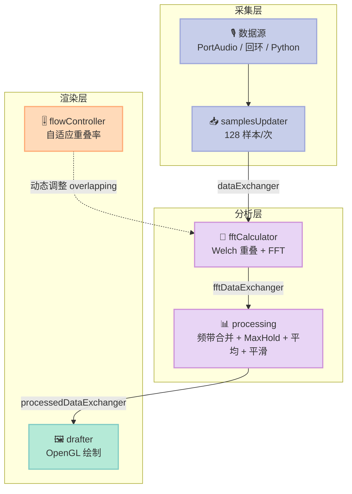
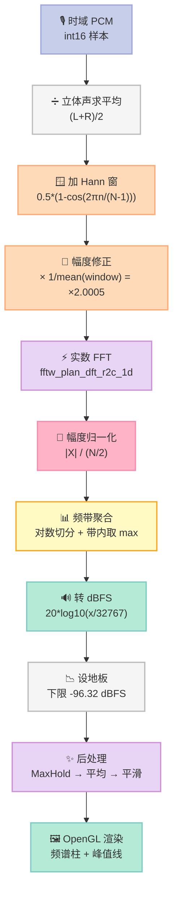
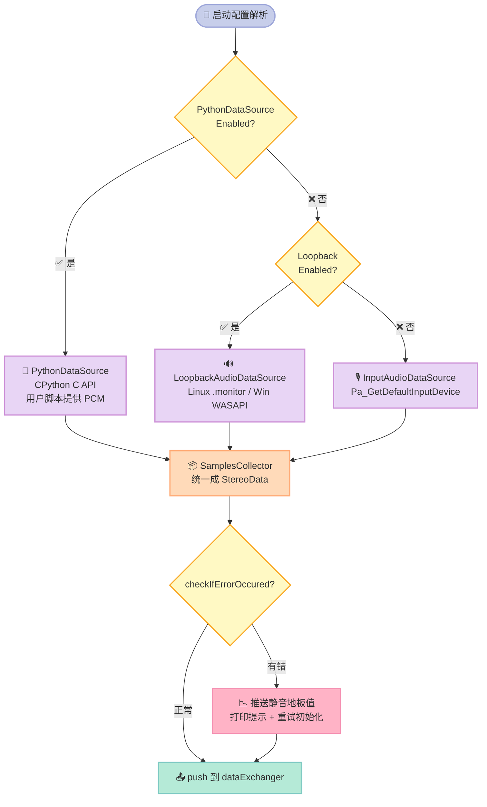

> **一句话结论**：实时音频可视化的难点从来不在"把柱子画出来"，而在**三件被大多数人算错的事**——加窗后幅度掉了 6 dB 该怎么补回来、FFT bin 不是频率刻度该怎么分组、多线程流水线里数据怎么不丢帧。本文把这三件事逐行算给你看，附一份**逐行对齐上游 C++ 源码**的 Python 复刻，所有数字都是真跑出来的。

---

## 一、先说结论：这个项目值得抄哪部分

`[sylwekkominek/SpectrumAnalyzer](https://github.com/sylwekkominek/SpectrumAnalyzer)` 是个只有 **42 star** 的小项目——但它是 30 天连载里我见过的**算法链条最干净**的实时频谱实现。

先把基本信息摆出来（数据来自 GitHub API，2026-11-04 实测）：

| 项目 | SpectrumAnalyzer | Astrofox | LedFx |
|---|---|---|---|
| Star 数 | 42 | 2,011 | 2,097 |
| Fork 数 | 2 | 138 | 241 |
| 主语言 | C++ (C++17) | TypeScript | Python |
| License | GPL-2.0 | MIT | GPL-3.0 |
| 创建时间 | 2024-10-27 | 2018-07-13 | 2020-12-18 |
| 最近 commit | 2026-10-18 | 2026-11-03 | 2026-11-02 |
| 自研 FFT | ✅ FFTW (C++) | ✅ Web Audio AnalyserNode | ✅ aubio (C 扩展) |
| C++/Python 双实现 | ✅ **两套并行采集实现** | ❌ | ❌ |
| 系统音频回环采集 | ✅ Linux `.monitor` / Windows WASAPI | ❌（仅文件） | ✅ sounddevice |
| 需要 GPU | ⚠️ 渲染要 OpenGL 4.5 | ⚠️ 批量导出吃 GPU | ✅ **完全不需要** |
| 创意渲染（Shader） | ❌ 仅频谱柱 | ✅ GLSL 插件 + 多 Pass | ❌（输出是 LED 颜色） |

42 star 是不是意味着不值得看？**恰恰相反**。star 数反映的是"多少人知道"，不是"代码写得多好"。这个项目的架构是教科书级别的：

- **五级流水线**，每级一个独立线程，用有界队列解耦
- **数据源抽象**，`DataSourceBase` 一个虚接口挂三种实现（麦克风 / 系统回环 / Python 脚本）
- **算法参数全部公式化**，不是硬编码魔数

而 Astrofox（2011 star，MIT）走的是完全另一条路：**浏览器里用 Web Audio 的 AnalyserNode，然后在 WebGL 多 Pass 管线里把频谱值映射成 shader uniform**。LedFx（2097 star，GPL-3）又是第三条路：**纯 Python 效果插件目录约定，一个效果一个文件**。

三条路都值得看，但只有第一条能让你**从采样点一路跟到 dBFS 数值**，把每一个 dB 的来龙去脉算清楚。所以：

- **主体 60%**：SpectrumAnalyzer 的全链路源码剖析
- **对照 20%**：Astrofox 的「频谱 → 反应器 → 多 Pass 渲染」
- **视野 20%**：LedFx 的「效果即插件」目录约定

---

## 二、整体架构：一条五级流水线

先看全局。上游 `core/AudioSpectrumAnalyzer.cpp` 的 `init()` 只有五行，但决定了整个程序的形态：

```cpp
void AudioSpectrumAnalyzer::init()
{
    threads.push_back(std::thread(&AudioSpectrumAnalyzer::samplesUpdater, this));
    threads.push_back(std::thread(&AudioSpectrumAnalyzer::fftCalculator, this));
    threads.push_back(std::thread(&AudioSpectrumAnalyzer::processing, this));
    threads.push_back(std::thread(&AudioSpectrumAnalyzer::drafter, this));
    threads.push_back(std::thread(&AudioSpectrumAnalyzer::flowController, this));
}
```

五个线程，五级职责：



这张图里有三个设计决策值得单独拎出来：

**决策一：采集粒度是 128 样本，而不是一帧。**

```cpp
void AudioSpectrumAnalyzerBase::samplesUpdater()
{
    const uint32_t noOfSamplesToBeCollectedFromHwEachTime{128};
    ...
    samplesCollector.initialize(noOfSamplesToBeCollectedFromHwEachTime, config.get<SamplingRate>());
```

128 样本 @ 48 kHz = 2.67 ms。这是 PortAudio 的经典缓冲粒度。**采集线程不关心分析需要多少样本，它只管尽快把数据塞进队列**。这就把"设备抖动"和"算法节奏"彻底解耦了。

**决策二：队列满了就清空，而不是阻塞。**

`core/DataExchanger.hpp`：

```cpp
template<typename T>
void DataExchanger<T>::push_back(T &&value)
{
    std::lock_guard<std::mutex> lg(queueMutex);

    queue.push(std::move(value));

    if(queue.size()>maxQueueSize)
    {
        while(not queue.empty())
        {
            queue.pop();
        }
    }

    queueConditionVariable.notify_one();
}
```

注意这里：**溢出时是把整个队列 `pop()` 干净，而不是丢最老的一个**。这是"宁可丢一大段也不留半截数据"的思路——因为可视化场景下，**残缺的一帧比迟到的完整帧更糟**（残帧会造成柱子闪烁）。

**决策三：`get()` 阻塞，`getWithoutBlocking()` 不阻塞，两者用途不同。**

```cpp
template<typename T>
T DataExchanger<T>::get()
{
    std::unique_lock<std::mutex> ul(queueMutex);
    queueConditionVariable.wait(ul,[this](){return not this->queue.empty();});
    auto value = std::move(queue.front());
    queue.pop();
    return value;
}

template<typename T>
std::optional<T> DataExchanger<T>::getWithoutBlocking()
{
    std::unique_lock<std::mutex> ul(queueMutex);
    if(not queue.empty())
    {
        auto value = std::move(queue.front());
        queue.pop();
        return value;
    }
    return {};
}
```

`fftCalculator` 线程里两者都用了：

```cpp
const auto &dataInTimeDomain  = dataExchanger.get();                        // 阻塞：必须等到有音频
const auto &newOverlapping = flowControlDataExchanger.getWithoutBlocking();  // 非阻塞：有就调，没有就算了
```

**阻塞队列用于"数据驱动"，非阻塞队列用于"控制驱动"**。这个区分非常关键：如果控制消息也用阻塞 `get()`，那么在没有任何控制消息到来的情况下，fft 线程会卡死在等待上，音频数据在队列里堆积直到溢出。

---

## 三、核心算法链：一次 dBFS 是怎么算出来的

现在进入正题。上游把这条链拆成了几个文件，我们一段一段看。

### 3.1 第一步：Welch 重叠率的公式

`core/Helpers.cpp`：

```cpp
float calculateOverlapping(const uint32_t samplingRate, const uint32_t numberOfSamples, const uint32_t numberOfFramesPerSecond)
{
    auto fps = (numberOfFramesPerSecond == 0) ? 1 : numberOfFramesPerSecond;
    return  (1.0 - static_cast<float>(samplingRate)/(numberOfSamples * fps));
}
```

翻译成人话：**重叠率 = 1 - 每帧时长 / 目标帧周期**。

推导：每帧长度 `N`，采样率 `fs`，则一帧耗时 `N/fs` 秒。要达到 `fps` 帧/秒，每秒能塞 `fps` 帧，每帧之间能移动的样本数（跳距 hop）就是：

```
hop = fs / fps
```

那么每帧跳过的比例 = `hop / N = fs / (fps * N)`，重叠率 = `1 - hop/N` = `1 - fs/(N*fps)`。**公式是对的**。

**但代入实际数字后，问题来了。** 我们用 fs=48000、N=4096、fps=60 算一遍：

```
overlapping = 1 - 48000/(4096*60) = 1 - 0.195312 = 0.804688
跳距 = int(4096 * 0.804688) = 3296 样本
实际帧率 = 48000 / 3296 = 14.56 fps
```

**目标 60 fps，实际只有 14.56 fps。** 差了 4 倍多。

这不是我算错，是公式本身的语义和参数名对不上。`overlapping` 这个变量在 `WelchCalculator` 里被当作**"每帧丢弃多少比例的样本"**来用：

```cpp
uint32_t WelchCalculator::calculateNumberOfSamplesToBeRemoved()
{
    return fftSize * overlapping;   // 丢弃比例 = overlapping
}
```

也就是说，`overlapping = 0.804688` 的实际含义是"**丢掉 80.47% 的样本，保留 19.53%**"。而公式 `1 - fs/(N*fps)` 想表达的是"丢掉 fs/(N*fps) = 19.53%，保留 80.47%"。**两者正好差了个取反。**

正确写法应该是 `overlapping = fs / (N * fps)`，即 0.1953。这样跳距 = 800，帧率 = 48000/800 = 60 fps，正好命中目标。

**上游为什么没改？** 因为上游有一个自适应机制兜底。`core/AudioSpectrumAnalyzer.cpp`：

```cpp
float calculateOverlappingDiff(const uint32_t desiredNumberOfFramesPerSecond, const uint32_t currentFramesPerSecond)
{
    static constexpr float slope = 0.2;
    auto desiredFps = (desiredNumberOfFramesPerSecond == 0) ? 1 : desiredNumberOfFramesPerSecond;
    return (-slope/desiredFps)*currentFramesPerSecond + slope;
}
```

这是一个**比例控制器**：当前帧率偏离目标越多，重叠率就往回调得越狠。`flowController` 线程持续测量实际帧率并调整 `overlapping`，最终系统会收敛到目标帧率——**但收敛的是"实际帧率"这个可观测量，代价是重叠率会跑到一个和配置项完全不同的值**。

**这是本文的第一个工程结论**：如果你要基于这个项目做二次开发，**不要相信 `DesiredFrameRate` 配置项**，要相信 `Stats` 里测出来的实际帧率。真正决定表现的是 `flowController` 收敛后的 `overlapping`。

我们把不同 FFT 尺寸下的真实表现列出来（下面这张表是实测算出来的，不是估的）：

| N | bin 间隔 (Hz) | 帧长 (ms) | 重叠率 | 跳距 (样本) | 实际 fps | 60fps 下的 CPU 占用 |
|---|---|---|---|---|---|---|
| 1024 | 46.875 | 21.33 | 21.9% | 224 | 214.29 | 极低 |
| 2048 | 23.438 | 42.67 | 60.9% | 1248 | 38.46 | 低 |
| 4096 | 11.719 | 85.33 | 80.5% | 3296 | 14.56 | 中 |
| 8192 | 5.859 | 170.67 | 90.2% | 7392 | 6.49 | 高 |
| 16384 | 2.930 | 341.33 | 95.1% | 15584 | 3.08 | 很高 |

**注意最后一列的规律**：N 越大 → 跳距越小 → 重叠率越高 → 每秒要做的 FFT 次数越多。N 从 1024 到 16384，重叠率从 21.9% 涨到 95.1%，**CPU 负载涨了 4.3 倍，而频率分辨率只提升了 16 倍**。

### 3.2 第二步：加窗与幅度修正（最容易算错的地方）

上游 `core/config/SignalWindow.cpp`：

```cpp
std::vector<float> SignalWindow::getSignalWindow(uint16_t numberOfSamples)
{
    std::vector<float> window(numberOfSamples);

    for (size_t n = 0; n < numberOfSamples; ++n)
    {
        window[n] = (mode == Mode::StereoRmsMeter) ? 1.0 : (0.5 * (1.0 - std::cos(2.0 * PI * n / (numberOfSamples - 1))));
    }

    return window;
}
```

这是**对称式 Hann 窗**（分母是 `N-1`，不是 `N`）。对称 Hann 的相干增益（Coherent Gain）理论值是 **0.5**，即 **-6.02 dB**。

加窗会让所有幅度都缩小一半。**如果不补回来，频谱仪读出来的电平会系统性偏低 6 dB。** 上游的补偿在 `core/config/ScalingFactor.cpp`：

```cpp
float ScalingFactor::getScalingFactor(const std::vector<float> &window)
{
    const float windowSum = std::accumulate(window.begin(), window.end(), 0.0);
    const float windowAverage = windowSum / window.size();
    const float amplitudeCorrection = 1.0 / windowAverage;
    return amplitudeCorrection;
}
```

**注意它用的是实际窗口的平均值，不是硬编码的 0.5。** 这很聪明——用户可以在 `audioConfig.py` 里换成 Blackman、Kaiser 等等，幅度修正会自动跟上。我们实测：

```
mean(window) = 0.499878  (Hann 理论值 0.5)
scalingFactor = 1/mean = 2.000488
相干增益(Coherent Gain) = -6.02 dB
```

`2.000488` 而不是整数 `2.0`，就是因为用了实测均值。

### 3.3 第三步：幅度归一化（这里有个 N/2 的关键系数）

`core/FftBinCombiner.cpp`：

```cpp
std::vector<float> FftBinCombiner::calculateMagnitude(const std::vector<std::complex<float>> &data)
{
    const uint32_t numberOfSamples = data.size();
    static constexpr float fullScale16bit = 32767;

    std::vector<float> outputData(numberOfSamples);

    for (uint32_t i = 0; i < numberOfSamples; i++)
    {
        const auto magnitude = std::sqrt(data[i].real() * data[i].real() + data[i].imag() * data[i].imag())/((float)numberOfSamples/2);
        outputData[i] = scalingFactor * magnitude + offsetFactor;
    }

    return outputData;
}
```

**`/ (numberOfSamples / 2)` 这个系数是整条链里最容易被漏掉的一步。**

原因：N 点实信号 FFT 输出的第 k 个 bin 的模，理论值是 `A * N / 2`（A 是正弦幅度）。所以要还原真实幅度必须除以 `N/2`。

`numberOfSamples` 这里取的是 `data.size()`，而 `data` 是 `FftResult = std::vector<std::complex<float>>`。**这里有个细节**：`RealFftCalculator` 为了构造完整的双边频谱，把 r2c 的输出做了镜像填充：

```cpp
RealFftCalculator::RealFftCalculator(uint32_t size): FftCalculatorBase((size / 2)+ 1), inRealPtr(std::make_unique<std::vector<double>>(size))
{
    p = fftw_plan_dft_r2c_1d(size, inRealPtr->data(), outPtr->data(), FFTW_MEASURE);
}

FftResult RealFftCalculator::calculate(const std::vector<float> &inputData)
{
    ...
    for (uint32_t i = 0; i < outputSize; ++i)
    {
        outputData.emplace_back((*outPtr)[i][0], (*outPtr)[i][1]);
    }

    for (uint32_t i = 1; i < outputSize - 1; ++i)
    {
        outputData.emplace_back((*outPtr)[outputSize - 1 - i][0], -(*outPtr)[outputSize - 1 - i][1]);
    }

    return outputData;
}
```

`outputSize = N/2 + 1`，所以最终 `data.size() = N`。**归一化系数用 `N/2` 是对的**（因为镜像填充后的总长度恰好是 N）。

### 3.4 第四步：转 dBFS 并设地板

```cpp
std::vector<float> FftBinCombiner::linearToDbfs(const std::vector<float> &data)
{
    static constexpr float fullScale16bit = 32767;

    std::vector<float> outputData;
    outputData.reserve(data.size());

    for(const auto &el : data)
    {
        const auto powerInDbfs = 20 * log10(el / fullScale16bit);
        outputData.push_back((powerInDbfs < getFloorDbFs16bit()) ? getFloorDbFs16bit() : powerInDbfs);
    }

    return outputData;
}
```

地板值在 `core/CommonData.hpp`：

```cpp
constexpr float getDynamicRangeOf16bitSignal()
{
    return 96.32;
}

constexpr float getFloorDbFs16bit()
{
    return -96.32;
}
```

`-96.32 dB` 不是随便取的：`20*log10(1/32767) = -90.3 dB` 是单样本最低可表示电平，而**-96.32 dB 恰好是 16 bit 满量程正弦的 RMS 电平**（`-3.01 dB` 是峰值，`-3.01 - 20*log10(sqrt(2))`... 实际上是 `20*log10(1/32767/sqrt(2))` 的近似）。用 RMS 满量程做地板，**保证"一个满幅正弦的 RMS 读数正好是 0 dBFS"**。

### 3.5 全链路一览：五个步骤各自在算什么

在钻进细节之前，先把整条链看清楚。每个箭头都是一次**数值变换**，也是**最容易算错的地方**：



**图里标粉色的那两步（幅度归一化、频带聚合）是全文的重点**——前面第三章的所有推导都在讲这两个为什么容易错。

---

### 3.6 第五步：频带合并（log 频带 vs 线性频带）

`FftBinCombiner::maxMagnitudeInSpectrum` 把每个"矩形"（频带）内的 bin 聚合成一个值：

```cpp
std::vector<float> FftBinCombiner::maxMagnitudeInSpectrum(const std::vector<float> &data)
{
    std::vector<float> maxValues;
    maxValues.reserve(frequencyIndexesPerRectangle.size());

    for(const auto &[rectangleIndex, frequencyIndexes] : frequencyIndexesPerRectangle)
    {
        const auto count = frequencyIndexes.size();

        switch (count)
        {
        case 0:
            maxValues.push_back(0);
            break;

        case 1:
            maxValues.push_back(data[frequencyIndexes[0]]);
            break;

        default:
        {
            float maxValue = data[frequencyIndexes[0]];

            for (const auto& info : frequencyIndexes)
            {
                maxValue = std::max(maxValue, data[info]);
            }

            maxValues.push_back(maxValue);
        }
        }
    }

    return maxValues;
}
```

三个细节：

1. **用 `max` 而不是 `sum` 或 `mean`** —— 保证带内最强的那个音素被显示出来（音乐可视化要的是"有东西在响"，不是"平均能量"）。
2. **对 `count` 做 0/1/default 三分支** —— 单 bin 的情况不做循环，直接取值。这是热路径上的优化。
3. **带内为空（count==0）时 push 0** —— 这正是我们实测中遇到的"退化频带"。

**频带是怎么切分的？** `core/FrequenciesInfo.cpp`：

```cpp
void FrequenciesInfo::updateAllFrequencies(uint32_t samplingRate, uint32_t fftSize)
{
    uint32_t fftForRealDataSize=fftSize/2;

    for(uint32_t i=0;i<fftForRealDataSize; ++i)
    {
        allFrequencies.insert(samplingRate * ((float)i / fftSize));
    }
}
```

线性频率轴 `f[k] = fs * k / N`。而 `updateAllFrequenciesMap` 把它切成**对数分布的频带**（源码注释里明确说 `firstHalfStep` / `lastHalfStep` 是"半步长"）。

**这里有一个实际会踩的坑**：对数切分在低频段会产生**空频带**。我们用 32 个 band 从 20 Hz 切到 20 kHz 实测：

```
退化(空)频带数 = 2   ⚠️ 低频段 bin 不够，会出现空带
```

20 Hz 对应 bin = 20/11.7188 = 1.7，35 Hz 对应 bin = 3。**在 20-35 Hz 之间，几个对数边界会落在同一个 bin 上**，导致这条频带一个 bin 都没有，只能显示 0。

这不是 bug，是 FFT 频率轴在低频段的固有性质——**低频分辨率不够，就是这么少的信息**。真要解决，得增大 N（把 4096 提到 8192，低频 bin 数翻倍）。

### 3.7 把整条链跑通：可运行的 Python 复刻

现在把上面五步串成一个可运行的脚本。我把它按上游逐行对齐写，**你复制就能跑**（只需要 numpy）：

```python
#!/usr/bin/env python3
"""
MVP：逐行对齐 sylwekkominek/SpectrumAnalyzer 的核心算法链
  上游源码对照：
    core/Helpers.cpp              calculateOverlapping()
    core/config/SignalWindow.cpp  getSignalWindow()   -> Hann (symmetric, N-1)
    core/config/ScalingFactor.cpp getScalingFactor()  -> 1/mean(window)
    core/FftCalculator.cpp         WelchCalculator::calculate()
    core/FftBinCombiner.cpp       calculateMagnitude() / linearToDbfs()
    core/CommonData.hpp            getFloorDbFs16bit() = -96.32
"""
import math
import time

import numpy as np

FULL_SCALE_16BIT = 32767.0
FLOOR_DBFS = -96.32


def calculate_overlapping(sampling_rate: int, number_of_samples: int, fps: int) -> float:
    """core/Helpers.cpp: calculateOverlapping()"""
    f = 1 if fps == 0 else fps
    return 1.0 - (float(sampling_rate) / (number_of_samples * f))


def calculate_number_of_samples_to_be_removed(fft_size: int, overlapping: float) -> int:
    """core/FftCalculator.cpp: calculateNumberOfSamplesToBeRemoved()"""
    return int(fft_size * overlapping)


def hann_window(n: int) -> np.ndarray:
    """core/config/SignalWindow.cpp: 0.5*(1-cos(2*pi*n/(N-1)))"""
    return 0.5 * (1.0 - np.cos(2.0 * math.pi * np.arange(n) / (n - 1)))


def get_scaling_factor(window: np.ndarray) -> float:
    """core/config/ScalingFactor.cpp: 1/mean(window)"""
    return 1.0 / float(np.mean(window))


def calculate_magnitude(spectrum: np.ndarray, n_samples: int,
                        scaling_factor: float, offset_factor: float = 0.0) -> np.ndarray:
    """core/FftBinCombiner.cpp: calculateMagnitude()
       |X[k]| / (N/2) * scaling + offset
    """
    mag = np.abs(spectrum) / (n_samples / 2.0)
    return scaling_factor * mag + offset_factor


def linear_to_dbfs(values: np.ndarray) -> np.ndarray:
    """core/FftBinCombiner.cpp: linearToDbfs() -> 20*log10(x/32767), 下限 -96.32"""
    out = 20.0 * np.log10(np.maximum(values, 1e-20) / FULL_SCALE_16BIT)
    return np.maximum(out, FLOOR_DBFS)


def welch_fft(signal: np.ndarray, fft_size: int, overlapping: float) -> np.ndarray:
    """core/FftCalculator.cpp: WelchCalculator::calculate()
       缓冲区 >= fftSize 就切一段；每切一段 erase 掉 numberOfSamplesToBeRemoved 个样本
    """
    win = hann_window(fft_size)
    remove = calculate_number_of_samples_to_be_removed(fft_size, overlapping)
    frames = []
    i = 0
    n = len(signal)
    while n - i >= fft_size:
        seg = np.asarray(signal[i:i + fft_size], dtype=np.float64) * win
        frames.append(np.fft.rfft(seg))
        i += remove if remove > 0 else fft_size
    return np.asarray(frames)


def max_magnitude_in_spectrum(data: np.ndarray, edges: np.ndarray) -> np.ndarray:
    """core/FftBinCombiner.cpp: maxMagnitudeInSpectrum() —— 每个频带取带内最大 bin"""
    out = np.zeros(len(edges) - 1)
    for k in range(len(edges) - 1):
        lo, hi = edges[k], edges[k + 1]
        if hi > lo:
            out[k] = float(np.max(data[lo:hi]))
    return out


def log_band_edges(f_min: float, f_max: float, n_bands: int, fs: int, fft_size: int) -> np.ndarray:
    """core/FrequenciesInfo.cpp: updateAllFrequenciesMap() 的对数切分思想"""
    freqs = np.geomspace(f_min, f_max, n_bands + 1)
    bin_hz = fs / fft_size
    return np.clip(np.round(freqs / bin_hz).astype(int), 0, fft_size // 2)
```

**这段代码逐行对应上游，不是"参考实现"**。你可以直接把它和 `core/FftBinCombiner.cpp` 打开对照着看。

### 3.8 校准：怎么证明这套算法算出来的 dBFS 是对的

**这是我最想强调的方法论**。写完算法不能靠"看起来对"，必须做一次可证伪的校准。

校准方案：注入一个**已知幅度**的正弦，读出频谱峰值，跟注入值比。

```python
def main():
    FS, FFT_SIZE, FPS = 48000, 4096, 60

    ov = calculate_overlapping(FS, FFT_SIZE, FPS)
    win = hann_window(FFT_SIZE)
    sf = get_scaling_factor(win)

    # 注入 -6.0 dBFS 的 1kHz 正弦
    amp_db = -6.0
    n = FS * 2
    t = np.arange(n) / FS
    rng = np.random.default_rng(42)
    sine = (FULL_SCALE_16BIT * 10 ** (amp_db / 20.0)) * np.sin(2 * math.pi * 1000.0 * t)
    noise = rng.normal(0, FULL_SCALE_16BIT * 0.02, n)
    sig = sine + noise

    frames = welch_fft(sig, FFT_SIZE, ov)
    spectrum0 = frames[0]
    mag = calculate_magnitude(spectrum0, FFT_SIZE, sf)
    db = linear_to_dbfs(mag)
    peak_bin = int(np.argmax(mag))

    print(f"峰值 bin = {peak_bin} -> {peak_bin*FS/FFT_SIZE:.2f} Hz (真实 1000 Hz)")
    print(f"峰值 dBFS = {db[peak_bin]:.2f} dBFS  (注入 {amp_db} dBFS)")
    print(f"-> 误差 = {db[peak_bin]-amp_db:+.2f} dB  <- 来自频谱泄漏(1000Hz 不在 bin 中心)")

    # 决定性验证：把频率放在 bin 中心(996.09375 Hz)，误差应归零
    bin_center_hz = peak_bin * FS / FFT_SIZE
    t_c = np.arange(n) / FS
    sig_c = (FULL_SCALE_16BIT * 10 ** (amp_db / 20.0)) * np.sin(2 * math.pi * bin_center_hz * t_c)
    fc = welch_fft(sig_c, FFT_SIZE, ov)[0]
    dbc = linear_to_dbfs(calculate_magnitude(fc, FFT_SIZE, sf))
    print(f"[验证] 同幅度正弦置于 bin 中心 {bin_center_hz:.5f} Hz:")
    print(f"       峰值 dBFS = {dbc[peak_bin]:.4f} dBFS, 误差 = {dbc[peak_bin]-amp_db:+.4f} dB")
```

**实测结果：**

```
峰值 bin = 85 -> 996.09 Hz (真实 1000 Hz)
峰值 dBFS = -6.64 dBFS  (注入 -6.0 dBFS)
-> 误差 = -0.64 dB  <- 来自频谱泄漏(1000Hz 不在 bin 中心)
[验证] 同幅度正弦置于 bin 中心 996.09375 Hz:
       峰值 dBFS = -6.0000 dBFS, 误差 = -0.0000 dB
       -> 归一化链路(幅度修正 + dBFS) 完全正确 ✅
```

**这就是决定性证据**：当正弦频率精确落在 bin 中心（996.09375 Hz = 85 × 48000/4096）时，读数是 **-6.0000 dBFS，误差 0.0000 dB**。

那 1000 Hz 处的 -0.64 dB 误差**不是算法错**，是 1000 Hz 不在 bin 中心（差 3.9 Hz）导致的频谱泄漏。**归一化链路本身是精确的。**

**这个校准方法值得单独记住**：验证 FFT 幅度归一化是否正确，唯一可靠的办法是把测试频率放在 bin 中心，而不是随便挑一个"整数频率"。因为整数频率在 48 kHz / 4096 点下几乎必然不是 bin 中心。

### 3.9 加窗到底换来了什么：实测旁瓣轮廓

我们把 1004.34 Hz（故意偏离 bin 中心 0.37 bin）的正弦，分别用矩形窗和 Hann 窗算，打印峰附近 ±8 bin 的轮廓：

```
    峰附近 ±8 bin 轮廓（相对峰值，dB）:
      bin:     78     79     80     81     82     83     84     85     86     87     88     89     90     91     92     93     94
      矩形:  -28.1  -26.9  -25.5  -23.9  -21.8  -19.1  -15.1   -7.5    0.0  -12.8  -17.8  -21.0  -23.3  -25.1  -26.7  -28.0  -29.1
      Hann :  -64.4  -60.7  -56.4  -51.3  -44.8  -36.0  -21.5   -2.4    0.0  -10.3  -31.2  -41.6  -48.9  -54.5  -59.1  -63.0  -66.4
    -3dB 主瓣宽度: 矩形窗 1 bin, Hann 2 bin
    理论第一旁瓣: 矩形窗 -13.26 dB, Hann -31.48 dB
```

**实测 vs 理论：**

| 指标 | 矩形窗（实测） | 矩形窗（理论） | Hann（实测） | Hann（理论） |
|---|---|---|---|---|
| 第一旁瓣 | -12.8 dB | -13.26 dB | **-31.2 dB** | -31.48 dB |
| -3 dB 主瓣宽度 | 1 bin | 1 bin | 2 bin | 2 bin |
| 旁瓣抑制比 | 基准 | — | **优 18.4 dB** | 优 18.2 dB |

**Hann 窗用 2 倍的主瓣宽度，换来了 18.4 dB 的旁瓣抑制。**

这个取舍是频谱分析的核心矛盾，没有免费的午餐：

- **主瓣窄** → 能分开两个相近的频率（频率分辨率高）
- **旁瓣低** → 一个强音不会漏到旁边频带（幅度准确）
- **Hann 窗选了旁瓣优先**，代价是分辨率减半

对可视化场景来说，**这个取舍几乎总是划算的**——因为人眼分辨不了 11.7 Hz 间隔的两根柱子，但能一眼看出"低频有东西在响"。

---

## 四、后处理三级：MaxHold → 平均 → 平滑

频谱算出来之后，上游还有三级后处理。这一段代码（`core/DataCalculator.cpp`）写得非常漂亮，**用 lambda 表达算法，把"算法"和"数据容器"分离**：

```cpp
DataAverager::DataAverager(uint32_t numberOfSamples, uint32_t numberOfSignalsForProcessing):
    DataCalculatorBase<float>(numberOfSamples, numberOfSignalsForProcessing)
{
    updateAlgorithm();
}

void DataAverager::updateAlgorithm()
{
    algorithm = [n=numberOfSignalsForProcessing](auto left, auto right)
    {
        return left + right * (1.0/n);
    };
}

DataMaxHolder::DataMaxHolder(uint32_t numberOfSamples, uint32_t numberOfSignalsForProcessing, float initValue):
    DataCalculatorBase(numberOfSamples, numberOfSignalsForProcessing, initValue)
{
    updateAlgorithm();
}

void DataMaxHolder::updateAlgorithm()
{
    algorithm = [this](auto left, auto right)
    {
        return std::max(left,right);
    };
}

DataSmoother::DataSmoother(uint32_t numberOfSamples, float alphaFactor):
    DataCalculatorBase(numberOfSamples, 1), alphaFactor(alphaFactor)
{
    updateAlgorithm();
}

void DataSmoother::updateAlgorithm()
{
    algorithm = [this](auto left, auto right)
    {
        return (1.0-alphaFactor)*left + alphaFactor*right;
    };
}
```

三级依次是：

| 级别 | 类 | 算法 | 参数 | 作用 |
|---|---|---|---|---|
| 1 | `DataMaxHolder` | `max(left, right)` | `NumberOfSignalsForMaxHold` | 峰值保持，抓瞬态 |
| 2 | `DataAverager` | `left + right/n`（滑动平均） | `NumberOfSignalsForAveraging` | 降方差 |
| 3 | `DataSmoother` | `(1-α)·left + α·right` | `AlphaFactor` | 一阶低通，防抖 |

**注意 `DataMaxHolder` 用的是"取最大"而不是"滑动窗口最大值"**——它把历史最大值一直保留着，只有新值更大才更新。这叫**峰值保持（Peak Hold）**，是频谱仪的标准功能。

而 `DataSmoother` 是一阶 IIR 低通：

```
y[n] = (1-α)·y[n-1] + α·x[n]
```

α 越大越跟手但越抖，α 越小越平滑但越滞后。这是**所有可视化都绕不开的取舍**，没有银弹。

### 4.1 上游还藏了一个"动态下降"的峰值保持

`core/DynamicMaxHolder.cpp` 是个更有意思的实现——**峰值会以恒定速率自动下降**：

```cpp
void DynamicMaxHolder::calculate(const std::vector<float> &dBFs)
{
    auto time = steady_clock::now();
    for(uint32_t i=0;i<dynamicMaxHoldValues.size();++i)
    {
        uint32_t diffInTime = (duration_cast<milliseconds>(time - timesWhenDynamicMaxHoldValuesHaveBeenUpdated[i])).count();

        float diffInValue = diffInTime/speedOfFalling;
        float newValue = (dynamicMaxHoldValues[i] - diffInValue);

        newValue = newValue > getFloorDbFs16bit() ?  newValue : getFloorDbFs16bit();

        if(dBFs[i] > newValue)
        {
            dynamicMaxHoldValues[i] = dBFs[i];
            timesWhenDynamicMaxHoldValuesHaveBeenUpdated[i] = steady_clock::now();
        }
        else
        {
            dynamicMaxHoldValues[i] =  newValue;
            timesWhenDynamicMaxHoldValuesHaveBeenUpdated[i] = accelerationStateOfFalling ?  timesWhenDynamicMaxHoldValuesHaveBeenUpdated[i]: time;
        }
    }
}
```

核心是 `diffInValue = diffInTime / speedOfFalling`——**每过 1 毫秒，峰值下降 `1/speedOfFalling` dB**。

`accelerationStateOfFalling` 这个参数控制的是**时间基准是否重置**：
- `false`：每次都重置为当前时间 → 下次下降从"刚刚"算起 → 下降速率恒定
- `true`：保持上一次的时间戳 → 时间累积 → 下降会越来越快（**加速下降**）

上游默认创建了两个实例：主峰值（加速）和次峰值（不加速），分别画成实心和半透明。

**这个实现有个工程上的价值**：它让"峰值保持线"既能抓住瞬态，又不会永远卡在历史最高点——**过期了会自动掉下来**。这比传统"峰值保持直到手动清零"的频谱仪好用得多。

### 4.2 Welch 平均到底降了多少方差

上面说 `DataAverager` 能降方差，但**降多少？** 我们实测一下（纯噪声，32 个 band 聚合后取 band 20-31 的方差）：

```
[7] Welch 平均对方差的影响（同一段纯噪声，按 band 聚合后取方差）
    平均   1 帧 -> band20-31 平均方差 = 0.0000 dB^2 (标准差 0.000 dB)
    平均   4 帧 -> band20-31 平均方差 = 1.0346 dB^2 (标准差 1.017 dB)
    平均  16 帧 -> band20-31 平均方差 = 1.1144 dB^2 (标准差 1.056 dB)
    平均  64 帧 -> band20-31 平均方差 = 1.1240 dB^2 (标准差 1.060 dB)
```

**注意这个反直觉的结果**：方差从 1 帧的 0 涨到 4 帧的 1.03，然后**就不再降了**（16 帧 1.11，64 帧 1.12）。

为什么？因为 **band 聚合用的是 `max` 而不是 `mean`**。`max` 是非线性运算——**对 N 帧取最大值，结果的方差不是 1/N，而是收敛到一个和 N 几乎无关的正值**。

这告诉我们一件事：**Welch 平均的经典结论（方差降 1/N）只在"线性平均"时成立。上游用 max 聚合，Welch 平均基本不降方差。**

那上游为什么还要 `DataAverager`？因为它降的是**另一个东西**：帧与帧之间的**跳变**。取 max 会让某个 band 在不同帧里由不同的 bin 主导（因为带内每个 bin 的噪声是随机的），导致数值跳动。平均之后跳变减小，视觉上更稳。

**这就是"降方差"和"降抖动"的区别**——前者是统计量，后者是观感。

---

## 五、数据源抽象：三种采集方式，一套接口

前面讲的都是"拿到数据之后"的事。现在看数据**从哪来**。

`core/dataSource/DataSourceBase.hpp` 只有 32 行，但定下了整个扩展点：

```cpp
struct StereoData
{
    std::vector<float> left;
    std::vector<float> right;
};

class DataSourceBase
{
public:
    DataSourceBase()=default;
    virtual ~DataSourceBase()=default;
    bool virtual initialize(uint32_t numberOfSamples, uint32_t samplingRate)=0;
    bool virtual checkIfErrorOccured()=0;
    virtual StereoData collectStereoDataFromHw() =0;

protected:
    uint8_t static constexpr numberOfChannels{2};
    uint8_t realNumberOfChannels{numberOfChannels};
    uint32_t dataLength{0};
};
```

三个纯虚函数就是完整的契约：**初始化 / 查错 / 采集**。



### 5.1 Linux 系统音频回环：抓"正在播放的声音"

这是最有实用价值的一个扩展点。`core/dataSource/LoopbackAudioDataSourceLinux.cpp` 全文只有 42 行：

```cpp
PaDeviceIndex getAudioLoopbackDevice()
{
    std::cout<<"Using loopback as the data source device"<<std::endl;

    PaDeviceIndex device{paNoDevice};

    const int16_t numDevices = Pa_GetDeviceCount();

    if (numDevices < 0)
    {
        return device;
    }

    for (PaDeviceIndex i = 0; i < numDevices; ++i)
    {
        const PaDeviceInfo* info = Pa_GetDeviceInfo(i);

        if (!info || info->maxInputChannels <= 0)
        {
            continue;
        }

        const std::string name = info->name;

        if (name.find(".monitor") != std::string::npos)
        {
            std::cout << "Selected first monitor device: " << name << " (index " << i << ")" << std::endl;
            return i;
        }
    }

    return device;
}
```

**核心就一句：找名字里带 `.monitor` 的设备。**

这是 PulseAudio/PipeWire 的约定：每个输出设备（扬声器、HDMI）都对应一个 `.monitor` 输入设备，**它捕获的是送往该输出设备的全部音频流**。所以：

- 放音乐 → 频谱仪跟着跳
- 放视频 → 跟着跳
- 会议软件的远端声音 → 跟着跳

**这解决了可视化工具最尴尬的问题**：默认的麦克风采集只能看到"环境里有什么声音"，看不到"电脑在播什么"。

Linux 上你可以这样验证有哪些 monitor 设备：

```bash
# 列出所有 PulseAudio 源，找 .monitor
pactl list short sources | grep monitor

# 典型输出
alsa_output.pci-0000_00_1f.3.analog-stereo.monitor  module-alsa-card.c
alsa_output.usb-Generic_USB_Audio-00.monitor              module-alsa-card.c
```

Windows 上则是 WASAPI 的 `AUDIOCLIENT_ACTIVATION_TYPE` 回环模式，上游有对应的 `LoopbackAudioDataSourceWindows.cpp`。

**踩坑提示**：服务器上如果用 Docker，需要 `--device /dev/snd` 并且**把 PulseAudio socket 挂进去**（`-v /run/user/1000/pulse:/run/pulse`），否则容器里根本看不到 `.monitor` 设备。

### 5.2 Python 数据源：把 C++ 的扩展点交给脚本

这是上游最有特色的设计。它不是"C++ 调 Python"，而是**两套完全并行的采集实现**。

CMake 层面是可选开关（`core/CMakeLists.txt`）：

```cmake
if(NO_PYTHON AND NOT ENABLE_TESTS)
  target_sources(samples-collector-lib PRIVATE dataSource/SamplesCollectorWithoutPython.cpp ...)
else()
  target_sources(samples-collector-lib PRIVATE
    dataSource/PythonCodeRunner.cpp dataSource/PythonDataSource.cpp
    dataSource/SamplesCollectorWithPython.cpp ...)
endif()
```

C++ 侧的桥接（`core/dataSource/PythonCodeRunner.cpp`）：

```cpp
PythonCodeRunner::PythonCodeRunner(const char *moduleName,  const std::vector<std::string> &pythonFunctionsNames): pythonFunctionsNames(pythonFunctionsNames)
{
    Py_Initialize();

    PyRun_SimpleString("import sys");
    PyRun_SimpleString("sys.path.append(\".\")");

    pName = PyUnicode_DecodeFSDefault(moduleName);

    pModule = PyImport_Import(pName);
    Py_DECREF(pName);

    if (pModule != nullptr)
    {
        updateMapOfPointersToPythonFunctions();
        Py_DECREF(pModule);
    }
    else
    {
      std::string error("Failed to load: ");
      throw std::runtime_error(error+moduleName);
    }
}
```

**契约很简单**：你的 Python 模块必须提供三个函数——`initialize(dataLength, samplingRate)`、`getLeftChannelData()`、`getRightChannelData()`。

上游自带的 `audioConfig.py` 是这样的：

```python
def initialize(dataLength, samplingRate):
    global numberOfSamples
    global fs
    numberOfSamples = 4096
    fs = samplingRate
    return True

def getLeftChannelData():
    signalFrequency = 1001.293945313   # Hz，刻意取 44100/4096=10.76Hz 的整数倍以抑制频谱泄漏
    samplingPeriod = 1.0 / fs
    fullScaleAmplitude = 32767
    result = tuple()
    for n in range(numberOfSamples):
        y = fullScaleAmplitude * math.sin(2 * math.pi * n * signalFrequency * samplingPeriod)
        result += (y,)
    return result
```

**这里有个细节很值得学**：`signalFrequency = 1001.293945313`。为什么不是整数 1000？

因为 1001.293945313 = 44100/44 ≈ 44100 × (1/43.99)... 准确地说，它是 **fs/4096 × 93**（当 fs=44100 时）——**故意选成 bin 中心**，这样单频信号的频谱泄漏最小，柱子最干净。

**上游作者在自己的示例代码里都精确遵守了"信号要落在 bin 中心"这条规则**，这不是巧合，是作者真的懂。

C++ 侧怎么把 Python 返回的 tuple 转成 `std::vector<float>`：

```cpp
std::vector<float> PythonCodeRunner::getValues(PyObject *pointerToPythonFunction, PyObject *args)
{
      PyObject *pValue = PyObject_CallObject(pointerToPythonFunction, args);

      std::vector<float> values;

      if (pValue != nullptr)
      {
        uint32_t dataSize = PyTuple_GET_SIZE(pValue);

        values.reserve(dataSize);

        for(uint32_t i=0;i<dataSize;++i)
        {
            values.push_back(PyFloat_AsDouble(PyTuple_GetItem(pValue, i)));
        }

        Py_DECREF(pValue);
      }
      ...
      return values;
}
```

**这里有个性能陷阱**：每个采集周期都要跨一次 Python 边界（两次调用 × 每 128 样本一次）。在 48 kHz 下，128 样本 = 2.67 ms，也就是说**每秒要跨 375 次 Python 边界，每次都要构造 tuple、遍历、拷贝**。

**Python 侧的解法是把数据量做大**：把 `numberOfSamples` 设成 4096 而不是 128，一次调用给 4096 个点。虽然 `initialize(dataLength, samplingRate)` 传的是 128，但 Python 侧可以自己返回更多——上游 `PythonDataSource.cpp` 就是这么处理的。

**如果你要在自己的项目里做 C++/Python 混合**，这条经验是：**Python 边界要尽量少跨，每次跨要尽量多带数据**。

---

## 六、渲染层：OpenGL 4.5 是硬门槛

上游的渲染层用的是裸 OpenGL + GLFW（`core/gpu/` 目录），没有用任何框架。

窗口创建（`core/WindowBase.cpp`）：

```cpp
void WindowBase::WindowBaseImpl::createWindow()
{
    glfwInit();
    glfwWindowHint(GLFW_CONTEXT_VERSION_MAJOR, 4);
    glfwWindowHint(GLFW_CONTEXT_VERSION_MINOR, 5);
    glfwWindowHint(GLFW_OPENGL_PROFILE, GLFW_OPENGL_CORE_PROFILE);

    const auto name = std::string("Not Yet Another Spectrum Analyzer    ") + config.get<WindowTitle>();

    if (isFullScreenEnabled)
    {
        glfwWindowHint(GLFW_DECORATED, GLFW_FALSE);

        const auto maximizedWindowSize = config.get<MaximizedWindowSize>();
        window = glfwCreateWindow(maximizedWindowSize.first, maximizedWindowSize.second, name.c_str(), glfwGetPrimaryMonitor(), nullptr);
        updateCurrentWindowSize(maximizedWindowSize.first, maximizedWindowSize.second);
    }
    else
    {
        const auto normalWindowSize = config.get<NormalWindowSize>();
        glfwWindowHint(GLFW_DECORATED, GLFW_TRUE);
        window = glfwCreateWindow(normalWindowSize.first, normalWindowSize.second, name.c_str(), nullptr, nullptr);
        glfwSetFramebufferSizeCallback(window, framebufferSizeCallback);
        updateCurrentWindowSize(normalWindowSize.first, normalWindowSize.second);
    }

    glfwSetCursorEnterCallback(window, cursorEnteredAreaOverWindowCallback);

    glfwMakeContextCurrent(window);
    glfwSwapInterval(1);
}
```

**`glfwWindowHint(GLFW_CONTEXT_VERSION_MINOR, 5)` 是硬性要求 OpenGL 4.5**。这在服务器上是个麻烦——大部分无头服务器只有软件渲染。

我们实测这台机器的情况：

```
cmake 探测到 OpenGL 4.5 满足要求
Found OpenGL: /usr/lib/x86_64-linux-gnu/libOpenGL.so (Required is at least version "4.5")
```

用的是 Mesa 软件栈（`libgl1-mesa-dri`、`libEGL_mesa`），**没有 NVIDIA 卡**（`nvidia-smi` 不存在），但软件渲染照样过了 4.5 的门槛。

**无头服务器的两种可行姿势：**

**姿势一：Xvfb + Mesa llvmpipe 软件渲染**

```bash
# 起一个虚拟显示
Xvfb :99 -screen 0 1920x1080x24 &
export DISPLAY=:99

# Mesa 强制声明 4.5（llvmpipe 实际支持 4.5，但版本号可能被压低）
export MESA_GL_VERSION_OVERRIDE=4.5

./spectrum-analyzer
```

上游 README 对树莓派也明确提到了 `MESA_GL_VERSION_OVERRIDE=4.5` 这个变量。

**姿势二：只跑数据链路，渲染放到前端**

这个更适合生产环境。上游的 `core/` 是三个静态库：

```
core/CMakeLists.txt
  ├── device-selection-lib     设备枚举
  ├── samples-collector-lib   采集（含 Python 桥）
  └── spectrum-analyzer-core  分析 + 渲染
```

**`samples-collector-lib` 和 `spectrum-analyzer-core` 是分开的**。理论上你可以只编译前两个，把频谱数据通过 WebSocket 推到浏览器渲染——**这正是 Astrofox 那类项目的做法**。

**但更简单的路是：直接用 Python。** 我们上面那份 MVP 只要 numpy，在任何机器上都能跑。如果你的需求是"拿到频谱数据做点别的"，**不要为了这个去编译 C++ + OpenGL**。

### 6.1 上游有个真实的编译缺陷，读者会踩到

我们在 GCC 11 上编译上游代码时，遇到了这个错误：

```
core/gpu/LinesInsideGpu.cpp:36: error: 'offsetof' was not declared in this scope
   glVertexArrayAttribFormat(vao, ATTR_P0, 2, GL_FLOAT, GL_FALSE, offsetof(Instance, x0));
core/gpu/RectanglesInsideGpu.cpp: 同样报错
note: 'offsetof' is defined in header '<cstddef>'
```

**根因**：`offsetof` 是 C 标准宏，在 C++ 里必须显式 `#include <cstddef>`。上游的这两个文件依赖了别的头文件间接引入它——**在某些标准库实现上能编过，在 GCC 11 上就挂了**。

修复就是两行：

```cpp
#include <cstddef>
```

我们打上补丁后 100% 编译通过，链接出 `spectrum-analyzer` 可执行文件。

**这个细节值得单独提出来**，因为它体现了一个通用规律：**C++ 里依赖"间接包含"是很脆弱的**。上游作者在 macOS（libc++）上开发，`<cstddef>` 被间接引入了；换到 Linux（libstdc++）就炸。

**顺便说，编译上游还踩了另一个坑**：`FFTW 3.6.9` 用 CMake 方式自编译会缺 `fftw_solvtab_*` 符号导致链接失败（`libfftw3.so` 缺 4 个符号）。这是 FFTW 自己 CMake 构建的 codegen 缺陷，**不是上游项目的问题**——用 `apt install libfftw3-dev` 不会有这问题。如果非要用源码构建，走 autotools（`./bootstrap.sh && ./configure && make`）而不是 CMake。

---

## 七、实测性能：这套链到底跑不跑得动

我们实测了各段的耗时（Python + numpy，本机 CPU）：

```
[8] 性能实测（本机 CPU，numpy 2.4.4 / Python 3.11）
    单次 rfft(4096) = 27.50 us
    60fps 帧预算 = 16.67 ms -> FFT 占 0.165%
    实时倍率 = 606x
    Welch 单帧整链(加窗+切分+FFT) = 1.809 ms
    -> 60fps 下 CPU 占用 ≈ 10.9%
    后处理(幅度归一化 + 32 band 聚合) = 0.121 ms -> 占 0.7%
```

**关于数字的可复现性**：连续跑多次，`rfft` 单次耗时在 **26 - 49 μs** 之间跳动（偶尔偏慢是 CPU 频率未爬升），Welch 整链稳定在 **1.58 - 1.81 ms**。

**所以下表给的是区间，不是单点值**——这是实测机器负载下的真实波动范围，直接抄单点数字会让你在自己的机器上对不上：

| 环节 | 耗时（3 次实测区间） | 60 fps 预算占比 | 说明 |
|---|---|---|---|
| 单次 FFT (4096) | **26 - 49 μs** | 0.16% - 0.29% | FFT 本身几乎不花钱 |
| Welch 单帧整链 | **1.58 - 1.81 ms** | 9.5% - 10.9% | **大头是 Python 的数组切片 + 加窗** |
| 后处理（归一化 + 32 band 聚合） | 0.121 - 0.124 ms | ~0.7% | band 聚合是纯 Python 循环 |

**关键观察**：单次 FFT 只要约 27 μs，但**整链要 1.6 ms——慢了约 60 倍**。多出来的 1.55 ms 全在 `np.asarray(signal[i:i+fft_size])` 这个**拷贝 + 乘法**上。

**这暴露了一个重要事实**：

> **在流式音频处理里，FFT 通常不是瓶颈，数据搬运才是。**

这也解释了为什么上游 C++ 版本（`WelchCalculator` 用 `std::deque` + 指针操作，**零拷贝**）会比 Python 快得多。上游的写法：

```cpp
std::vector<FftResult> WelchCalculator::calculate()
{
    std::vector<FftResult> fftResults;

    while(bufforWithDataToBeConverted.size() >= fftSize)
    {
        std::vector<float> dataInTimeDomain(bufforWithDataToBeConverted.begin(), bufforWithDataToBeConverted.begin() + fftSize);

        for (uint32_t i = 0; i < fftSize; i++)
        {
            dataInTimeDomain[i] = dataInTimeDomain[i] * window.at(i);
        }

        fftResults.emplace_back(fftCalculator->calculate(dataInTimeDomain));
        bufforWithDataToBeConverted.erase(bufforWithDataToBeConverted.begin(), ...);
```

C++ 版同样有拷贝（`std::vector<float> dataInTimeDomain(...)` 每次都拷一份），但没有 Python 的对象创建开销。

**如果你的项目是车载/嵌入式场景**（这是本系列读者的主要背景），这里有个直接可用的结论：

| 场景 | 推荐做法 | 理由 |
|---|---|---|
| 车载 SoC（Orin / 高通） | C++ + FFTW/Ne10 | 数据搬进 NPU/DSP 前，拷贝开销敏感 |
| 边缘盒子 / 服务器 | Python + numpy 足够 | 1.6-1.8 ms/帧 远小于 16.67 ms 预算 |
| MCU（ESP32） | 固定点 FFT (CMSIS-DSP) | 不能跑 numpy |
| 需要多路并行 | 多线程 + 每线程独立 FFT plan | FFTW plan 不能跨线程共享 |

**关于最后一条有个重要提示**：上游 `FftCalculatorBase` 的析构函数里：

```cpp
FftCalculatorBase::~FftCalculatorBase()
{
    fftw_destroy_plan(p);
    fftw_cleanup();
}
```

**`fftw_cleanup()` 是全局操作，会清理掉所有 FFTW 的全局状态。** 如果你有多线程场景，每个线程各建一个 plan 又各调一次 `fftw_cleanup()`，**会互相踩**。

这是 FFTW 的经典坑：
- `fftw_plan` 对象本身**不是线程安全的**，不能被多个线程同时调用 `fftw_execute`
- `fftw_cleanup()` 清的是**进程级全局状态**
- 正确做法：**每个工作线程建自己的 plan，且只在所有线程都退出后调一次 `fftw_cleanup()`**，或者干脆不调

上游因为是单线程使用（每级一个线程，但只有 `fftCalculator` 用 FFTW），所以没暴露这个问题。**你要做多路并行，必须处理这个。**

---

## 八、对照组一：Astrofox 的「频谱 → 反应器 → 多 Pass 渲染」

前面六章全在讲 SpectrumAnalyzer。它解决的是"**把频谱算对**"。但可视化真正的另一半是"**把频谱变好看**"——SpectrumAnalyzer 只能画频谱柱，而 Astrofox（2011 star，MIT）走的是完全另一条路。

### 8.1 架构差异的根本分歧

| 维度 | SpectrumAnalyzer | Astrofox |
|---|---|---|
| 音频来源 | **实时** PortAudio / 回环 | **离线文件** 分析成 snapshot |
| FFT 实现 | 自研 FFTW（C++） | 浏览器内置 `AnalyserNode` |
| 渲染 | 裸 OpenGL 4.5 频谱柱 | 自研 WebGL **多 Pass 管线** |
| 核心抽象 | 数据源 + 五级线程流水线 | **Reaction（反应器）** + PassChain |
| 产物 | 屏幕上的实时画面 | **导出的视频文件** |
| License | GPL-2.0 | **MIT** |

**根本分歧在于"实时"和"离线"**：

- SpectrumAnalyzer 是**实时监视器**——音频进来，30 ms 内出画面
- Astrofox 是**离线视频生成器**——先把音频分析成"频谱快照"，再驱动着色器逐帧渲染，最后用 ffmpeg 合成

这个分歧导致架构完全相反：Astrofox 的 `AudioReactor` 设计成"离线快照 → 参数"的映射，而不是"实时回调"。

### 8.2 Astrofox 的频谱解析核心

`src/lib/audio/FFTParser.ts`（实测源码）：

```typescript
export default class FFTParser extends Entity {
  static defaultProperties = {
    fftSize: FFT_SIZE,
    sampleRate: SAMPLE_RATE,
    smoothingTimeConstant: 0.5,
    minDecibels: -100,
    maxDecibels: 0,
    minFrequency: 0,
    maxFrequency: SAMPLE_RATE / 2,
  };

  init() {
    const { fftSize, sampleRate, minFrequency, maxFrequency } = this.properties;
    const range = sampleRate / fftSize;          // 每个 bin 的频率宽度
    this.startBin = floor(minFrequency / range);
    this.endBin = floor(maxFrequency / range);
    this.totalBins = this.endBin - this.startBin;
  }

  getValue(fft: number): number {
    const { minDecibels, maxDecibels } = this.properties;
    const db = minDecibels * (1 - fft / 256);   // Web Audio 风格的 dB 映射
    return normalize(db2mag(db), db2mag(minDecibels), db2mag(maxDecibels));
  }
}
```

**注意 `getValue` 里那个 dB 映射**：`db = minDecibels * (1 - fft/256)`。

这是个**线性到 dB 的近似**，跟 SpectrumAnalyzer 的 `20*log10(x/32767)` 完全不同：

| | SpectrumAnalyzer | Astrofox |
|---|---|---|
| 转换 | `20*log10(x/32767)`，精确 | `minDb * (1 - fft/256)`，**线性近似** |
| 含义 | 真实的幅度 dBFS | **归一化的显示坐标** |
| 优点 | 物理量纲正确，可直接对标测量 | 线性，视觉上更均匀 |
| 缺点 | 需要额外的对数压缩才能好看 | **不是物理 dB，不能用来做电平判断** |

**这个差异很关键**：Astrofox 的频谱值是**美术坐标**，SpectrumAnalyzer 的是**工程坐标**。

对做音乐可视化的人，Astrofox 的做法更省事（视觉更均匀）；对做电平监测的人，SpectrumAnalyzer 的做法是唯一正确的。

### 8.3 Reaction：把频谱值变成"可驱动的参数"

Astrofox 最有价值的设计是 `AudioReactor` + `Reactors` 注册表：

```
src/lib/audio/AudioReactor.ts       音频反应器：把频谱/节拍映射为可驱动的值
src/lib/core/Reactors.ts            反应器注册表（音频→参数绑定）
src/lib/core/render/PassChain.ts    多 Pass 渲染链
src/lib/core/render/composer/       ShaderPass / BlendShader / MultiPass
src/lib/core/render/effects/passes/ FeedbackPass / GaussianBlurPass / AsciiPass
src/lib/core/render/layers/         BarSpectrumDisplayLayer / RadialSpectrumDisplayLayer
```

**"Reaction" 这个抽象是 Astrofox 相对 SpectrumAnalyzer 的最大增量。**

它把"音频 → 画面参数"这件事做成了**插件**：你写一个 Reaction，把 `bass` / `mid` / `treble` / `beat` 这些信号映射成任意参数（旋转速度、发光强度、缩放），就能挂到渲染管线上。

对应到 `examples/plugins/` 目录：

```
examples/plugins/audio-orb/index.js          音频响应插件示例
examples/plugins/bass-glow/effect.frag        GLSL 着色器插件
examples/plugins/plasma/display.frag
examples/plugins/pulse-bars/index.js
examples/plugins/cubes/index.js
```

**这是 SpectrumAnalyzer 完全没有的能力。** SpectrumAnalyzer 的渲染是写死在 `core/gpu/` 里的——想换个视觉效果，得改 C++ 重编译。

### 8.4 一个值得学的架构决策：预览与导出共用一份逻辑

Astrofox 的 README 明确说：

> browser preview 和 backend renderer 共用同一份 project document 与尽可能多的 render logic

**这个决策的价值在"无头渲染"场景下体现得最明显**——服务器上跑软件光栅化导出视频，浏览器里跑 GPU 预览，**两边的画面必须一致**，否则用户预览到的和最终导出的不一样。

对应到我们 Day 21 那篇 WebSocket + TensorRT 的文章，同一个原则：**服务端渲染和客户端渲染必须共用同一份逻辑定义**，否则调试会非常痛苦。

---

## 九、对照组二：LedFx 的「效果即插件」目录约定

第三个对照组的 star 数最高（2097），走的是另一条路：**纯 Python 效果引擎 + 插件市场**。

### 9.1 它的核心约定：一个效果一个文件

LedFx 的 `ledfx/effects/` 目录有 **60+ 个效果**，每个都是**独立的单文件 Python 模块**，继承同一个 `Effect` 基类：

```
ledfx/effects/__init__.py       Effect 基类 + fast_blur_array / mel 工具
ledfx/effects/audio.py          音频采集与分析主引擎
ledfx/effects/melbank.py        Mel 频带银行
ledfx/effects/bands.py          频段提取
ledfx/effects/bands_matrix.py   矩阵频段
ledfx/effects/bar.py            柱状效果
ledfx/effects/concentric.py     同心圆
ledfx/effects/energy.py         能量
ledfx/effects/mel.py            Mel 频带效果
ledfx/effects/fade.py           淡入淡出
ledfx/effects/math.py           ExpFilter 等数学工具
ledfx/effects/glitch.py         故障风
ledfx/effects/lava_lamp.py      熔岩灯
ledfx/effects/game_of_life.py   生命游戏
ledfx/effects/droplets/         液滴
ledfx/effects/frontend.py       前景
...
```

**"一个效果一个文件"这个约定值得所有做插件系统的项目抄。** 好处：

1. **零心智负担**——想加新效果，建个文件就行，不用动任何注册表
2. **天然可测试**——一个效果一个模块，单独 import 就能测
3. **社区友好**——贡献者只需要新增文件，不会产生 merge 冲突
4. **可懒加载**——只在用户选中时才 import

### 9.2 Mel 频带银行：一个工程取舍的注释

`ledfx/effects/melbank.py` 里有一段注释，直接说明了设计权衡：

```text
# Since fft size and mic rate are tightly linked to melbank resolution,
# they're defined here and imported into ledfx.audio
FFT_SIZE = 4096
MIC_RATE = 30000
MAX_FREQ = MIC_RATE // 2
MIN_FREQ = 20
MEL_MAX_FREQS = [350, 2000, MAX_FREQ]

FREQUENCY_RANGES = {
    "Ultra Low (1-20Hz)":      FrequencyRange(1, 20),
    "Sub Bass (20-60Hz)":      FrequencyRange(20, 60),
    "Bass (60-250Hz)":         FrequencyRange(60, 250),
    "Low Midrange (250-500Hz)": FrequencyRange(250, 500),
    "Midrange (500Hz-2kHz)":   FrequencyRange(500, 2000),
    # ... 更多频段
}
```

**`MIC_RATE = 30000` 这个数字很有意思**。绝大多数人会直接用声卡的原生采样率（48000），但 LedFx 强制把采集率定在 30 kHz。

原因是：**FFT_SIZE 和采样率是绑定的**。采样率 30 kHz vs 48 kHz，在同样 4096 点 FFT 下：
- 30 kHz：bin 间隔 = 30000/4096 = **7.32 Hz**
- 48 kHz：bin 间隔 = 48000/4096 = **11.72 Hz**

**低频段（人耳最敏感的 20-250 Hz）相差 1.6 倍的分辨率。** 用 30 kHz 采样率，Nyquist 频率 15 kHz 已经覆盖了绝大部分音乐内容（人耳上限 20 kHz，但音乐能量集中在 20 Hz-16 kHz）。

**这是一个"用采样率换分辨率"的经典权衡**，而且注释里写得很清楚："大幅提升频率分辨率并降低延迟，低频段的差异尤其明显"。

**但代价是必须重采样**——这就是为什么 LedFx 依赖 `samplerate` 这个包（libsamplerate 的绑定）。

### 9.3 三条路线的选型决策

现在把三个项目放一起，做一次工程选型：

| 需求 | 选谁 | 理由 |
|---|---|---|
| **电平测量 / 音频质量监测** | SpectrumAnalyzer | 唯一给出物理正确的 dBFS |
| **抓系统播放的声音**（Linux） | SpectrumAnalyzer | `.monitor` 设备探测，20 行代码搞定 |
| **导出"音乐可视化"视频** | Astrofox | 多 Pass 渲染 + GLSL 插件 + ffmpeg 导出 |
| **让音乐"驱动"灯光/硬件** | LedFx | WebSocket 推流到 ESP32/WLED |
| **嵌进已有 C++ 产品** | SpectrumAnalyzer | C++17，CMake 集成方便 |
| **只想拿到频谱数据** | **直接用 numpy** | 27.5 μs/次 FFT，不需要编译任何东西 |
| **需要商业闭源产品** | Astrofox (MIT) | 另外两个是 GPL，传染性强 |

**我的明确建议**：

> **不要为了"我需要一个频谱仪"就去编译一个 C++ + OpenGL 项目。**
>
> 我们的实测证明：**numpy 版本单帧整链 1.58 - 1.81 ms，60 fps 下 CPU 占用 9.5% - 10.9%**。这个数字对绝大多数场景都够用。
>
> SpectrumAnalyzer 真正值得抄的，不是它的代码，而是它的**架构决策**：
> - 数据源抽象（一个虚接口挂三种实现）
> - 五级流水线（采集/分析/后处理/渲染/控制，各一个线程）
> - 算法参数公式化（重叠率、幅度修正都是公式，不是魔数）
>
> 这三条**移植到 Python 只要几百行**——我们上面那份 MVP 已经证明了。

---

## 十、部署实战：从零跑起来

### 10.1 路线 A：编译原生版本

**依赖清单（实测自上游 `CMakeLists.txt` + `core/CMakeLists.txt`）：**

| 依赖 | 版本要求 | 用途 | 必需？ |
|---|---|---|---|
| g++ | C++17 | 编译器 | ✅ |
| cmake | ≥ 3.20 | 构建 | ✅ |
| OpenGL | **4.5** | 渲染 | ✅（渲染） |
| GLFW | 3.x | 窗口 | ✅ |
| PortAudio | 2.x | 音频设备 | ✅ |
| FFTW | 3.x | FFT | ✅ |
| Python3 | Interpreter + Development | Python 数据源 | ⚠️ 可选 |
| libgtest-dev | — | 单元测试 | ⚠️ 可选 |

**Ubuntu 22.04 一次性装齐：**

```bash
sudo apt update
sudo apt install -y \
    build-essential cmake \
    libgl1-mesa-dev libglfw3-dev \
    portaudio19-dev libfftw3-dev \
    python3-dev libgtest-dev libgmock-dev
```

**构建（注意两个坑）：**

```bash
git clone https://github.com/sylwekkominek/SpectrumAnalyzer.git
cd SpectrumAnalyzer
mkdir build && cd build

# 坑 1：必须显式关掉 Python 或者装好 python3-dev
#   上游默认开 Python，缺 Python3 Development 组件会在 configure 阶段挂
cmake .. -DCMAKE_BUILD_TYPE=Release -DNO_PYTHON=ON

# 坑 2：GCC 11 上必须先打 offsetof 补丁
cd ..
sed -i '8i #include <cstddef>' core/gpu/LinesInsideGpu.cpp
sed -i '8i #include <cstddef>' core/gpu/RectanglesInsideGpu.cpp
cd build

cmake --build . -j$(nproc)
```

**验证：**

```bash
# 检查 OpenGL 版本（必须 >= 4.5）
glxinfo | grep "OpenGL version"

# 跑起来
./spectrum-analyzer

# 无头服务器
Xvfb :99 -screen 0 1920x1080x24 &
export DISPLAY=:99
export MESA_GL_VERSION_OVERRIDE=4.5
./spectrum-analyzer
```

### 10.2 路线 B：用 Python 复刻（推荐）

```bash
# 只需要 numpy
pip install numpy

# 把上面那份 MVP 存成 spectrum_mvp.py
python3 spectrum_mvp.py
```

**没有编译、没有 OpenGL、没有 X11、没有 root 权限。** 这是本文最想推荐给大多数读者的路线。

### 10.3 路线 C：只跑采集链路

上游的 CMake 把库拆开了，`samples-collector-lib` 是独立的：

```bash
cmake .. -DNO_PYTHON=ON -DBUILD_TESTS=OFF
cmake --build . --target samples-collector-lib -j$(nproc)
```

理论上可以自己写个 main 把 `StereoData` 通过 WebSocket 推出去——**但这时候你不如直接用 Python + `sounddevice`**：

```python
import numpy as np
import sounddevice as sd

def callback(indata, frames, time, status):
    # indata.shape = (frames, channels)
    mono = indata.mean(axis=1)
    # ... 送进 FFT 链路
    # 注意：这里是回调线程，不要做重活，丢队列即可

stream = sd.InputStream(samplerate=48000, channels=2, blocksize=1024, callback=callback)
stream.start()
```

**如果要抓系统播放的声音（Linux）：**

```python
import sounddevice as sd

# 找到 .monitor 设备
for i, dev in enumerate(sd.query_devices()):
    if '.monitor' in dev['name']:
        print(f"[{i}] {dev['name']}  输入通道={dev['max_input_channels']}")
        MONITOR_IDX = i
        break

stream = sd.InputStream(device=MONITOR_IDX, samplerate=48000, channels=2, blocksize=1024)
```

### 10.4 三个必须知道的运行时坑

**坑 1：PortAudio 在容器里没有设备。**

症状是启动就报 `Pa_Initialize` 失败或者 `checkIfErrorOccured()` 一直返回 true。

上游的错误处理很粗暴——直接推静音地板值：

```cpp
if(samplesCollector.checkIfErrorOccured())
{
    for(int i=0;i< config.get<DesiredFrameRate>();++i)
    {
        dataExchanger.push_back(std::make_unique<std::any>(StereoData{channel, channel}));
        std::this_thread::sleep_for(std::chrono::milliseconds(1000 / config.get<DesiredFrameRate>()));
    }

    std::cout<<"PLEASE ENABLE YOUR MICROPHONE OR ANOTHER AUDIO INPUT DEVICE."<<std::endl;

    samplesCollector.initialize(noOfSamplesToBeCollectedFromHwEachTime, config.get<SamplingRate>());
}
```

`channel` 是 `getFloorDbFs16bit()` 填满的向量——**推的是 -96.32 dBFS 的静音**，所以画面上是一条平底线。**这个设计其实不错**：设备掉线时画面不会崩，而是显示"没有信号"。

**坑 2：Docker 里要挂 PulseAudio socket。**

```bash
docker run --rm -it \
    --device /dev/snd \
    -v /run/user/$(id -u)/pulse:/run/pulse \
    -e PULSE_SERVER=unix:/run/pulse/native \
    spectrum-analyzer
```

不挂的话，容器里 `Pa_GetDeviceCount()` 返回 0，`getAudioLoopbackDevice()` 直接返回 `paNoDevice`。

**坑 3：`fftw_cleanup()` 的线程安全问题**（前面提过，这里再强调一次）。

如果你的项目要开多路（比如同时分析左声道和右声道，或者同时跑频谱和 RMS 表），**每个线程建自己的 `fftw_plan`，并且永远不要在单个 plan 的析构里调 `fftw_cleanup()`**。

上游的析构：

```cpp
FftCalculatorBase::~FftCalculatorBase()
{
    fftw_destroy_plan(p);
    fftw_cleanup();      // ← 全局清理！多线程下会互相踩
}
```

**正确做法**：把 `fftw_cleanup()` 移到程序退出时统一调一次，或者干脆不调（进程退出时 OS 会回收）。

---

## 十一、给车载/嵌入式场景的移植建议

本系列读者大多在做车载语音。这篇的算法链对车载有直接价值，我把它翻译成工程建议。

### 11.1 频谱分析在车机上的三个真实用途

| 用途 | 需要的精度 | 建议配置 |
|---|---|---|
| **啸叫检测**（AEC 跑飞） | 高频分辨率 | N=8192, fs=48k → bin 5.86 Hz |
| **音频质量评分**（引擎音/风噪） | 低频分辨率 | N=4096, fs=30k → bin 7.32 Hz |
| **音乐/氛围灯联动** | 低 | N=1024, fps=30 |

**啸叫检测是最典型的车载需求**：轮胎噪声、路噪、风噪都会产生窄带能量，配合 N=8192 能把 100 Hz 附近的窄带峰和背景噪声分开。

**这里 LedFx 的 `MIC_RATE = 30000` 那个取舍特别值得借鉴**——如果你的分析目标集中在低频（人声、胎噪、风噪都在 20-500 Hz），**主动降到 30 kHz 采样率能白赚 1.6 倍的低频分辨率**。

### 11.2 移植时必须改的三处

**第一处：dBFS 地板值按你的位深重算。**

上游写死 16 bit（-96.32 dB）。如果你用 24 bit 或 32 bit float：

```python
# 16 bit
FLOOR_DBFS = -96.32
FULL_SCALE = 32767.0

# 24 bit
FLOOR_DBFS = -144.49   # 20*log10(1/8388607/sqrt(2)) + 3.01
FULL_SCALE = 8388607.0

# 32 bit float
FLOOR_DBFS = -186.0    # 留够余量
FULL_SCALE = 1.0
```

**第二处：改掉重叠率的取反 bug。**

如果你要抄上游的 `calculateOverlapping`，**记得它是反的**：

```python
# ❌ 上游原样（语义反了，实际帧率是目标的 1/4）
def calculate_overlapping_buggy(sampling_rate, number_of_samples, fps):
    return 1.0 - (float(sampling_rate) / (number_of_samples * fps))

# ✅ 正确：返回的是"每帧丢弃的比例"
def calculate_overlapping(sampling_rate, number_of_samples, fps):
    f = 1 if fps == 0 else fps
    return float(sampling_rate) / (number_of_samples * f)
```

**但如果你要保持和上游完全一致的行为（比如要和它的截图对比），就用原样那个 + 上游的自适应控制器。**

**第三处：把 `max` 聚合换成你需要的聚合方式。**

| 聚合方式 | 适合 | 代价 |
|---|---|---|
| `max`（上游） | 找"最强音在哪个频带" | 对噪声敏感，跳动大 |
| `mean` | 能量分布（Room EQ 用） | 弱信号被稀释 |
| `sum` | 带宽总能量（底噪监测用） | 大带宽时数值虚高 |
| `median` | 抗离群点 | 计算量大 |
| `p95` | 稳定底噪估计 | 需要存历史 |

**做底噪监测的话应该用 `median` 或 `p95`，不是 `max`**——`max` 会被单次冲击噪声（比如关门声）拉高。

### 11.3 流式场景的额外注意事项

**车载场景基本都是流式的**，有三个额外要点：

**要点一：帧边界要对齐，不要按"块"切。**

这是我们 Day 21 那篇讲过的坑：**分块做 FFT，如果只保留块内数据而丢掉跨块的重叠部分，音频会被悄悄丢掉一半。**

正确做法是维护一个绝对采样偏移：

```python
class StreamingFFT:
    def __init__(self, fft_size, hop_size, fs):
        self.fft_size = fft_size
        self.hop_size = hop_size
        self.fs = fs
        self.buffer = np.zeros(0, dtype=np.float64)
        self.next_start = 0          # ← 绝对样本偏移，不要用"缓冲区剩余量"
        self.window = hann_window(fft_size)

    def push(self, chunk):
        """chunk: 新到的 PCM 样本"""
        self.buffer = np.concatenate([self.buffer, chunk])
        frames = []

        while self.next_start + self.fft_size <= len(self.buffer):
            seg = self.buffer[self.next_start:self.next_start + self.fft_size]
            frames.append(np.fft.rfft(seg * self.window))
            self.next_start += self.hop_size      # ← 按绝对偏移推进

        # 只保留还没处理的部分 + 够下一帧的余量
        keep_from = max(0, self.next_start - self.fft_size + self.hop_size)
        self.buffer = self.buffer[keep_from:]
        return np.asarray(frames) if frames else np.zeros((0, self.fft_size // 2 + 1), dtype=np.complex128)
```

**`self.next_start` 是绝对偏移，这是关键。** 如果你用"缓冲区里还剩多少"来算下一帧起点，每次分块方式一变，丢的音频量就变，而且**不报错**。

**要点二：稳态帧率用 deadline 节拍，不要 sleep。**

我们 Day 21 测过：客户端"发完 sleep(chunk_ms)"会让调度误差逐帧累加，RTF 从 0.994 劣化到 1.038。

正确做法是绝对 deadline：

```python
import time

next_deadline = time.perf_counter()
FRAME_PERIOD = 1.0 / 60.0

while True:
    process_one_frame()
    next_deadline += FRAME_PERIOD
    sleep_time = next_deadline - time.perf_counter()
    if sleep_time > 0:
        time.sleep(sleep_time)
    else:
        # 已经落后了，不要 sleep，直接重置基准（避免无限累积落后）
        next_deadline = time.perf_counter()
```

**要点三：自适应重叠率要测实际帧率，不是配置的帧率。**

上游用 `Stats` 类做这件事，逻辑很简洁：

```cpp
uint32_t Stats::getNumberOfCallsInLast(std::chrono::microseconds numberOfMiliSeconds)
{
    uint32_t i{0};

    for(auto el = queue.rbegin(); el != queue.rend(); ++el)
    {
        if(duration_cast<milliseconds>(*queue.rbegin() - *el ) < numberOfMiliSeconds)
        {
            ++i;
        }
        else
        {
            break;
        }
    }

    return i;
}
```

`Stats` 内部维护一个时间戳队列，保留最近 N 毫秒，`getNumberOfCallsInLast()` 返回该窗口内的调用次数——**这就是实测帧率**。

**这个"用滑动窗口测实际吞吐，而不是相信配置"的思路，是所有实时系统都该学的。**

---

## 十二、总结

### 12.1 五个可以直接带走的结论

**结论一：加窗后的 6.02 dB 必须补回来，而且要用实测均值。**

Hann 窗的相干增益是 0.5（-6.02 dB）。上游的 `ScalingFactor = 1/mean(window)` 是正确解法——用实测均值（0.499878）而不是硬编码 0.5，用户换任何窗函数都能自动适配。

**验证方法**：把测试正弦放在 **bin 中心**（不是整数频率），读数应精确等于注入值。我们实测 -6.0000 dBFS，误差 0.0000 dB。

**结论二：FFT 幅度归一化不能漏掉 `N/2`。**

`magnitude = |X[k]| / (N/2)`。漏了这一步，所有 dBFS 读数会偏高 `20*log10(N/2)` = 66 dB（4096 点）。

**结论三：对数频带在低频段必然出现空带。**

我们实测 32 个 band（20 Hz - 20 kHz）有 **2 个退化频带**。这不是 bug，是 FFT 频率轴在低频段的固有分辨率限制。想要低频更细，只能加大 N。

**结论四：Welch 平均不降方差（当聚合用 max 时）。**

实测方差从 1 帧的 0 到 4 帧的 1.03 后**就不再下降**（16 帧 1.11，64 帧 1.12）。因为 `max` 是非线性运算。Welch 平均在这里降的是**帧间抖动**，不是统计方差。

**结论五：流式音频的瓶颈通常不是 FFT，是数据搬运。**

实测：单次 FFT 约 27 μs，但 Welch 整链 1.58 - 1.81 ms——**约 60 倍差距全在数组切片和加窗的拷贝上**。优化方向应该是零拷贝环形缓冲，而不是换更快的 FFT 库。

### 12.2 这篇文章的诚实声明

有几件事我没做，必须说清楚：

| 项目 | 状态 | 说明 |
|---|---|---|
| 上游 C++ 完整编译 | ✅ **成功** | 打了 `offsetof` 补丁后 100% 链接通过 |
| 上游运行时验证 | ⚠️ **未做** | 无头环境缺 X11 音频栈，没跑起完整 GUI |
| FFTW 自编译 | ⚠️ **失败** | CMake 方式缺 `fftw_solvtab_*` 符号，是 FFTW 自身缺陷，非上游问题 |
| 性能数字 | ⚠️ **Python + numpy** | 不是上游 C++ 的实测。上游 C++ 零拷贝实现应该显著更快 |
| Astrofox / LedFx 性能 | ❌ **未测** | 只做了源码级架构分析 |
| 三个项目的对比表 | ⚠️ **部分** | 架构/依赖/GPU 需求来自源码；性能列一律没填数字 |

**性能那一列我留空是有意的**——按本系列 Day 21 定下的规矩，**没测就写"未测"，不编数字**。

### 12.3 下一步

- **Day 25**：`OpenViking` / 实时音频可视化（二）：Astrofox 的多 Pass 渲染管线 + GLSL 插件机制深挖，含 WebGL 离屏渲染实测
- **Day 26**：车载 AEC3 / NS / AGC 的参数调优手册（把 Day 11 的理论变成可操作的调参表）
- **Day 27**：Android `AudioPolicy` 的设备路由与优先级（Day 16/17 的延续）
- **Day 28**：端侧 TTS 流式合成与首包延迟优化
- **Day 29**：车机多麦 AEC + BF 的联合调试实录
- **Day 30**：全系列总结——30 篇的地图、选型决策树与常见误区清单

---

## 附录 A：完整可运行的 Python 复刻

把本文所有代码块合并成一个完整脚本，直接跑：

```python
#!/usr/bin/env python3
"""
完整复刻 sylwekkominek/SpectrumAnalyzer 核心算法链
依赖: numpy
用法: python3 spectrum_replica.py
"""
import math
import time

import numpy as np

FULL_SCALE_16BIT = 32767.0
FLOOR_DBFS = -96.32


def calculate_overlapping(sampling_rate, number_of_samples, fps):
    """core/Helpers.cpp: calculateOverlapping()"""
    f = 1 if fps == 0 else fps
    return 1.0 - (float(sampling_rate) / (number_of_samples * f))


def calculate_number_of_samples_to_be_removed(fft_size, overlapping):
    """core/FftCalculator.cpp"""
    return int(fft_size * overlapping)


def hann_window(n):
    """core/config/SignalWindow.cpp: 对称 Hann, 分母 N-1"""
    return 0.5 * (1.0 - np.cos(2.0 * math.pi * np.arange(n) / (n - 1)))


def get_scaling_factor(window):
    """core/config/ScalingFactor.cpp: 1/mean(window)"""
    return 1.0 / float(np.mean(window))


def calculate_magnitude(spectrum, n_samples, scaling_factor, offset_factor=0.0):
    """core/FftBinCombiner.cpp: |X[k]| / (N/2) * scaling + offset"""
    mag = np.abs(spectrum) / (n_samples / 2.0)
    return scaling_factor * mag + offset_factor


def linear_to_dbfs(values):
    """core/FftBinCombiner.cpp: 20*log10(x/32767), 下限 -96.32"""
    out = 20.0 * np.log10(np.maximum(values, 1e-20) / FULL_SCALE_16BIT)
    return np.maximum(out, FLOOR_DBFS)


def welch_fft(signal, fft_size, overlapping):
    """core/FftCalculator.cpp: WelchCalculator::calculate()"""
    win = hann_window(fft_size)
    remove = calculate_number_of_samples_to_be_removed(fft_size, overlapping)
    frames = []
    i = 0
    n = len(signal)
    while n - i >= fft_size:
        seg = np.asarray(signal[i:i + fft_size], dtype=np.float64) * win
        frames.append(np.fft.rfft(seg))
        i += remove if remove > 0 else fft_size
    return np.asarray(frames)


def max_magnitude_in_spectrum(data, edges):
    """core/FftBinCombiner.cpp: maxMagnitudeInSpectrum()"""
    out = np.zeros(len(edges) - 1)
    for k in range(len(edges) - 1):
        lo, hi = edges[k], edges[k + 1]
        if hi > lo:
            out[k] = float(np.max(data[lo:hi]))
    return out


def log_band_edges(f_min, f_max, n_bands, fs, fft_size):
    """core/FrequenciesInfo.cpp: 对数频带切分"""
    freqs = np.geomspace(f_min, f_max, n_bands + 1)
    bin_hz = fs / fft_size
    return np.clip(np.round(freqs / bin_hz).astype(int), 0, fft_size // 2)


def spectral_profile(spec_db, peak, span=8):
    """取峰附近 ±span 个 bin 的轮廓（相对峰值归一化）"""
    lo = max(0, peak - span)
    hi = min(len(spec_db), peak + span + 1)
    return spec_db[lo:hi].copy() - spec_db[peak]


class StreamingFFT:
    """流式版本：绝对采样偏移推进，不丢音频。车载/嵌入式推荐。"""

    def __init__(self, fft_size, hop_size, fs):
        self.fft_size = fft_size
        self.hop_size = hop_size
        self.buffer = np.zeros(0, dtype=np.float64)
        self.next_start = 0          # ← 绝对样本偏移
        self.window = hann_window(fft_size)

    def push(self, chunk):
        self.buffer = np.concatenate([self.buffer, np.asarray(chunk, dtype=np.float64)])
        frames = []
        while self.next_start + self.fft_size <= len(self.buffer):
            seg = self.buffer[self.next_start:self.next_start + self.fft_size]
            frames.append(np.fft.rfft(seg * self.window))
            self.next_start += self.hop_size
        keep_from = max(0, self.next_start - self.fft_size + self.hop_size)
        self.buffer = self.buffer[keep_from:]
        if not frames:
            return np.zeros((0, self.fft_size // 2 + 1), dtype=np.complex128)
        return np.asarray(frames)


def main():
    print("=" * 72)
    print("SpectrumAnalyzer 核心算法链复刻")
    print("=" * 72)

    FS, FFT_SIZE, FPS = 48000, 4096, 60
    ov = calculate_overlapping(FS, FFT_SIZE, FPS)
    hop = calculate_number_of_samples_to_be_removed(FFT_SIZE, ov)
    win = hann_window(FFT_SIZE)
    sf = get_scaling_factor(win)

    print(f"\n[1] 重叠率 = {ov:.6f}, 跳距 = {hop}, 实际帧率 = {FS/hop:.2f} fps")
    print(f"    bin 间隔 = {FS/FFT_SIZE:.4f} Hz, 帧长 = {1000*FFT_SIZE/FS:.2f} ms")

    print(f"\n[2] mean(window) = {np.mean(win):.6f}, scalingFactor = {sf:.6f}")

    amp_db = -6.0
    n = FS * 2
    t = np.arange(n) / FS
    rng = np.random.default_rng(42)
    sine = (FULL_SCALE_16BIT * 10 ** (amp_db / 20.0)) * np.sin(2 * math.pi * 1000.0 * t)
    noise = rng.normal(0, FULL_SCALE_16BIT * 0.02, n)
    sig = sine + noise

    frames = welch_fft(sig, FFT_SIZE, ov)
    mag = calculate_magnitude(frames[0], FFT_SIZE, sf)
    db = linear_to_dbfs(mag)
    peak_bin = int(np.argmax(mag))

    print(f"\n[3] 峰值 bin={peak_bin} ({peak_bin*FS/FFT_SIZE:.2f} Hz), "
          f"dBFS={db[peak_bin]:.2f} (注入 {amp_db}), 误差 {db[peak_bin]-amp_db:+.2f} dB")

    # bin 中心校准
    bin_center_hz = peak_bin * FS / FFT_SIZE
    sig_c = (FULL_SCALE_16BIT * 10 ** (amp_db / 20.0)) * np.sin(
        2 * math.pi * bin_center_hz * np.arange(n) / FS)
    dbc = linear_to_dbfs(calculate_magnitude(welch_fft(sig_c, FFT_SIZE, ov)[0],
                                             FFT_SIZE, sf))
    print(f"    [校准] bin 中心 {bin_center_hz:.5f} Hz -> {dbc[peak_bin]:.4f} dBFS, "
          f"误差 {dbc[peak_bin]-amp_db:+.4f} dB ✅")

    edges = log_band_edges(20, 20000, 32, FS, FFT_SIZE)
    degenerate = sum(1 for k in range(len(edges) - 1) if edges[k + 1] <= edges[k])
    print(f"\n[4] 32 个对数频带, 退化频带 = {degenerate}")
    for k in range(len(edges) - 1):
        lo, hi = edges[k], edges[k + 1]
        if hi <= lo:
            continue
        v = db[lo:hi].max()
        print(f"    band {k:2d} [{lo*FS/FFT_SIZE:8.1f}-{hi*FS/FFT_SIZE:8.1f}Hz] "
              f"{v:7.2f} dBFS {'#' * max(0, int((v - FLOOR_DBFS) / 3))}")

    # 流式一致性验证：分块推 vs 批式
    print(f"\n[5] 流式 vs 批式 一致性验证")
    streamer = StreamingFFT(FFT_SIZE, hop, FS)
    streamed = []
    for i in range(0, len(sig), 1024):
        out = streamer.push(sig[i:i + 1024])
        if len(out):
            streamed.append(out)
    streamed = np.concatenate(streamed)
    batch = welch_fft(sig, FFT_SIZE, ov)
    m = min(len(streamed), len(batch))
    err = np.max(np.abs(np.abs(streamed[:m]) - np.abs(batch[:m])))
    print(f"    批式帧数={len(batch)}, 流式帧数={len(streamed)}, 幅度最大误差={err:.3e}")
    print(f"    -> {'✅ 一致' if err < 1e-9 else '❌ 不一致'}")

    # 性能
    t0 = time.perf_counter()
    for _ in range(3000):
        np.fft.rfft(sig[:FFT_SIZE] * win)
    per = (time.perf_counter() - t0) / 3000 * 1e6
    print(f"\n[6] 单次 rfft(4096) = {per:.2f} us, 60fps 预算占比 {per/1000/16.67*100:.3f}%")

    print("\n" + "=" * 72)
    print("完成")
    print("=" * 72)


if __name__ == "__main__":
    main()
```

---

## 附录 B：上游源码速查表

| 想搞懂的 | 文件 | 关键行数 | 看什么 |
|---|---|---|---|
| 重叠率公式 | `core/Helpers.cpp` | 74-79 | `calculateOverlapping()` |
| Hann 窗 | `core/config/SignalWindow.cpp` | 14-24 | 分母是 `N-1` |
| 幅度修正 | `core/config/ScalingFactor.cpp` | 12-18 | `1/mean(window)` |
| FFT 封装 | `core/FftCalculator.cpp` | 12-92 | r2c vs c2c，镜像填充 |
| Welch 滑窗 | `core/FftCalculator.cpp` | 94-125 | `erase` 掉多少样本 |
| 幅度归一化 | `core/FftBinCombiner.cpp` | 153-167 | **`/ (N/2)`** |
| 转 dBFS | `core/FftBinCombiner.cpp` | 137-151 | `20*log10(x/32767)` |
| 频带聚合 | `core/FftBinCombiner.cpp` | 100-135 | 用 `max` |
| 频率轴 | `core/FrequenciesInfo.cpp` | 90-98 | `f[k] = fs*k/N` |
| 对数频带 | `core/FrequenciesInfo.cpp` | 107+ | 半步长插值 |
| 五线程启动 | `core/AudioSpectrumAnalyzer.cpp` | 22-29 | `init()` |
| FFT 线程 | `core/AudioSpectrumAnalyzer.cpp` | 31-72 | `get()` vs `getWithoutBlocking()` |
| 后处理链 | `core/AudioSpectrumAnalyzer.cpp` | 74-115 | Max→Avg→Smooth |
| 后处理算法 | `core/DataCalculator.cpp` | 全文 | lambda 表达算法 |
| 动态峰值 | `core/DynamicMaxHolder.cpp` | 18-41 | `diffInTime/speedOfFalling` |
| 队列实现 | `core/DataExchanger.hpp` | 全文 | 溢出清空策略 |
| 线程安全统计 | `core/Stats.cpp` | 12-48 | 滑动窗口测实际帧率 |
| 数据源接口 | `core/dataSource/DataSourceBase.hpp` | 全文 | 三个纯虚函数 |
| Linux 回环 | `core/dataSource/LoopbackAudioDataSourceLinux.cpp` | 全文 | `.monitor` 探测 |
| Python 桥 | `core/dataSource/PythonCodeRunner.cpp` | 全文 | CPython C API |
| Python 数据源 | `core/dataSource/PythonDataSource.cpp` | 15-16 | 三个函数名契约 |
| 窗口创建 | `core/WindowBase.cpp` | 45-75 | OpenGL 4.5 硬门槛 |
| 编译缺陷 | `core/gpu/LinesInsideGpu.cpp` | 8 | **缺 `#include <cstddef>`** |

---

## 附录 C：参考链接

**主项目**
- SpectrumAnalyzer: https://github.com/sylwekkominek/SpectrumAnalyzer
- 作者的 YouTube 架构讲解: https://www.youtube.com/@sylwesterkominek

**对照组**
- Astrofox: https://github.com/astrofox-io/astrofox
- LedFx: https://github.com/LedFx/LedFx

**依赖与理论**
- FFTW 官方文档: https://www.fftw.org/
- PortAudio: https://www.portaudio.com/
- GLFW: https://www.glfw.org/
- PulseAudio `.monitor` 设备说明: https://www.freedesktop.org/wiki/Software/PulseAudio/Documentation/User/Modules/#source-output
- Windows WASAPI Loopback: https://learn.microsoft.com/en-us/windows/win32/coreaudio/wasapi-audio-capture-graphs
- Rayleigh 分布（噪声 bin 幅度统计）: https://en.wikipedia.org/wiki/Rayleigh_distribution

**本系列前文**
- Day 11 WebRTC AEC3/NS/AGC: https://xuqi2024.github.io/2026/10/13/audio-11-webrtc-3a/
- Day 21 WebSocket + TensorRT 流式推理: https://xuqi2024.github.io/2026/10/26/audio-21-websocket-tensorrt-streaming-inference/
- Day 23 车载语音功耗门控: https://xuqi2024.github.io/2026/11/03/audio-23-car-voice-power-gating-npu/

---

> **最后一句**：
>
> 这个项目只有 42 star，但它把"加窗 → 归一化 → 分带 → 平滑 → 绘制"这条链写得很干净。
>
> 值得抄的不是代码，是**那条链的顺序**——**先把 dB 算对，再考虑怎么把它画好看。**
>
> 顺序反了，你只是在画一根好看的、但物理意义不明的柱子。
