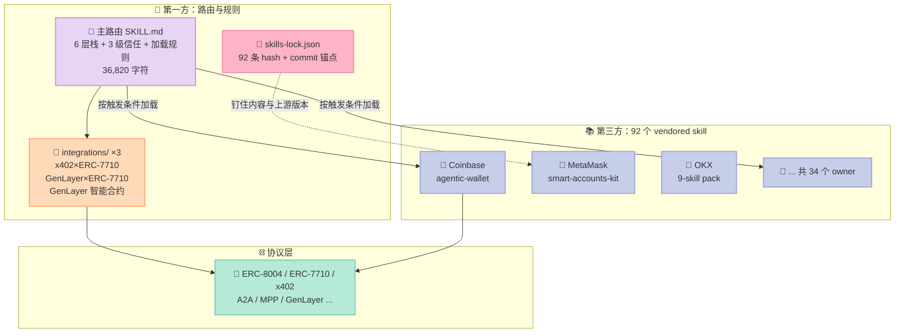
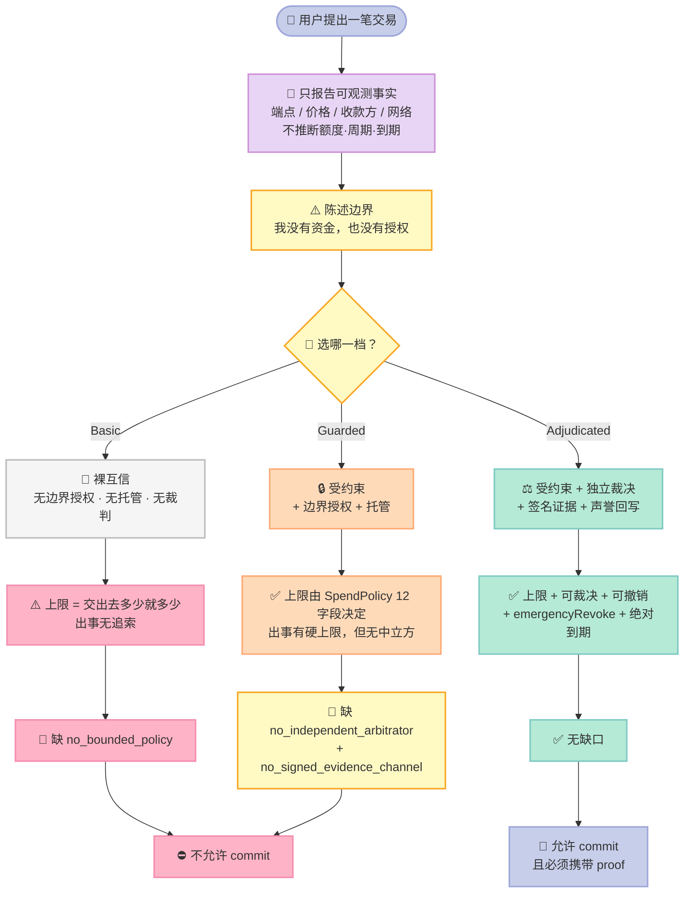
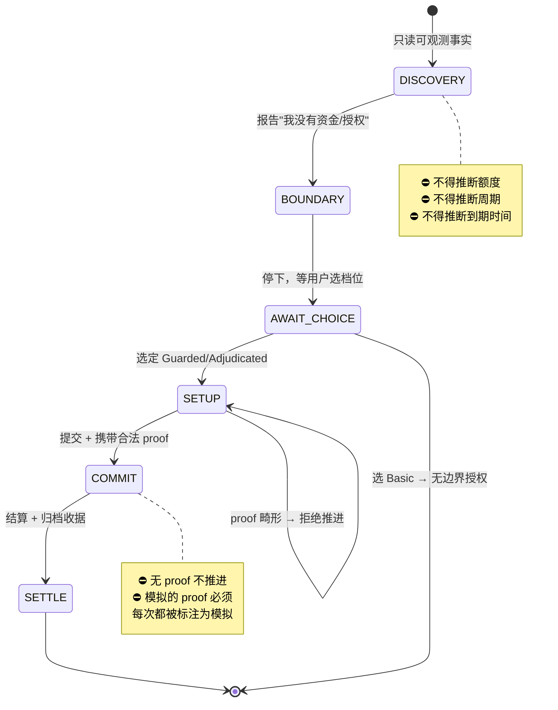

> **一句话结论**：当 Agent 开始替人花钱、替人签字、替人担责，Harness 工程的核心问题就从"怎么让模型更聪明"变成了"怎么让模型在不可逆动作前停下来，并且让它的授权边界可以被第三方独立验证"。Internet Court 用一套纯文本的 Skill 协议给出了答案：**三级信任阶梯 + 先发现后承诺的状态机 + 92 条 hash 锁定的供应链**，而且它诚实标注了自己 92 个 skill 里的 4 个标准"尚无公开 skill"。

---

## 前言：一个 Agent 想买点东西，然后呢？

设想这个场景：

> 你让 Claude Code 帮你找一份行业研究报告。它找到一个付费 API，标价 0.05 USDC。它想付款。你说"付吧"。

然后它问："多久付一次？"

你没想过这个问题。它也不知道。

如果它猜错了呢——按天付？按次付？上限设多少？付给哪个地址？授权什么时候失效？如果对方交了份垃圾报告，你的钱能退回来吗？如果它拿着你的钱包私钥跑路了？

这就是 **2026 年 Agent 工程最被低估的问题**：模型再聪明，也不知道自己该不该签这一笔。

**Harness Engineering 的老问题**是"怎么让 Agent 更能干"。**新问题是**"怎么让 Agent 在有不可逆后果的动作前，停下来问一句，并且它的答案能被审计"。

Internet Court（[internet-court/internet-court-skill](https://github.com/internet-court/internet-court-skill)，7,053⭐，MIT + 34 家协议的各自许可）就是对这个问题的开源回答。它的定位一句话讲清：

> **The trust layer for agent-to-agent commerce** —— Agent 之间做交易时的信任层。

读完这篇你能拿到三样东西：

1. **一套可以直接抄的三级授权阶梯**（Basic / Guarded / Adjudicated），含可运行的策略求值器
2. **一个"先发现后承诺"的状态机**，把"先别动手"从建议变成机制
3. **92 条 hash + commit 锚点的 Skill 供应链锁**——以及我实测后发现的它的真实边界在哪

---

## 一、项目定位：它不是框架，是一个"路由 + 规则"的协议外壳

### 1.1 它是什么

Internet Court 的仓库结构极其克制：

```text
SKILL.md                            # 主路由：6 层协议栈 + 3 级信任 + 加载规则
integrations/                       # 3 个自研连接器（x402×ERC-7710、GenLayer×2）
vendored/                           # 92 个第三方官方 skill 的快照（34 个 owner）
skills-lock.json                    # 92 条供应链锁定记录
README.md / NOTICE.md / LICENSE     # 许可证清单（逐 owner 列明）
.claude-plugin/plugin.json          # Claude Code 插件清单
openclaw.plugin.json                # OpenClaw 插件清单
```

**没有 Python 包，没有 npm 包，没有运行时**。它的全部产物是一堆 Markdown。

这不是偷懒。这是一个非常明确的架构判断：**Agent 的能力边界应该由"它能读到哪些协议文档"决定，而不是由"框架暴露了哪些 API"决定。**

对比一下同期项目：`OpenAI Agents SDK`（30k⭐）给你 4 个类，`LangGraph` 给你一个 `StateGraph`。它们的价值在**编排**，价值来自代码。

Internet Court 的价值在**协议知识**——它把 34 家各自为政的协议方（Coinbase、MetaMask、OKX、NEAR、Starknet、Kleros、Privy、Nansen、x402……）的官方 skill 文档拼成了一张**可路由的地图**，并且补上了所有人都没做的那一层：**裁决与争议解决**。

### 1.2 6 层协议栈

README 里那张表是整个项目的骨架：

```mermaid
graph TB
    subgraph S6["⚖️ 第6层 验证与争议（Internet Court 自补）"]
        V1["🧠 GenLayer 智能合约<br/>裁决 Agent 行为"]
        V2["🧠 Kleros<br/>代币策展仲裁"]
        V3["🧠 Intelligent Oracle<br/>二元事实预言机"]
        VG["⚠️ UMA<br/>尚无公开 skill"]
    end
    subgraph S5["⚙️ 第5层 执行：算力 / 数据 / 价值"]
        E1["🔢 0G / AntSeed / Heurist<br/>去中心化推理"]
        E2["🔗 LI.FI / deBridge<br/>跨链价值搬运"]
        E3["📊 Nansen / Pyth / Pyth<br/>链上数据与价格源"]
    end
    subgraph S4["💰 第4层 支付与托管"]
        P1["💳 x402 / MPP / AP2<br/>HTTP 402 按次付费"]
        P2["🔒 Alkahest / Yellow<br/>托管与多方结算"]
        PG["⚠️ AP2<br/>尚无公开 skill"]
    end
    subgraph S3["📜 第3层 合约与义务"]
        C1["📜 ERC-7710 / 7715<br/>受限委托权限"]
        C2["📜 Arkhai NLA<br/>自然语言合约托管"]
        CG["⚠️ ERC-8183<br/>尚无中性 skill"]
    end
    subgraph S2["🤝 第2层 谈判"]
        N1["💬 A2A 协议<br/>Agent Card / 任务生命周期"]
    end
    subgraph S1["🔎 第1层 发现 / 身份 / 声誉"]
        I1["🆔 ERC-8004 注册表<br/>身份与声誉"]
        I2["🛡️ Certisyn 独立验证<br/>事前核验对手方自述"]
        IG["⚠️ ERC-7857<br/>尚无公开 skill"]
    end

    S1 -->|对手方确认| S2
    S2 -->|条款锁定| S3
    S3 -->|授权额度| S4
    S4 -->|付款| S5
    S5 -->|收据 / 产出| S6
    S6 -.->|裁决回写声誉| S1

    style V1 fill:#FFB3C6,stroke:#F48FB1,stroke-width:2px,color:#333
    style V2 fill:#FFB3C6,stroke:#F48FB1,stroke-width:2px,color:#333
    style V3 fill:#FFB3C6,stroke:#F48FB1,stroke-width:2px,color:#333
    style VG fill:#FFF9C4,stroke:#F9A825,stroke-width:2px,color:#333
    style E1 fill:#FFDAB9,stroke:#FFAB76,stroke-width:2px,color:#333
    style E2 fill:#FFDAB9,stroke:#FFAB76,stroke-width:2px,color:#333
    style E3 fill:#FFDAB9,stroke:#FFAB76,stroke-width:2px,color:#333
    style P1 fill:#B5EAD7,stroke:#80CBC4,stroke-width:2px,color:#333
    style P2 fill:#B5EAD7,stroke:#80CBC4,stroke-width:2px,color:#333
    style PG fill:#FFF9C4,stroke:#F9A825,stroke-width:2px,color:#333
    style C1 fill:#C7CEEA,stroke:#9FA8DA,stroke-width:2px,color:#333
    style C2 fill:#C7CEEA,stroke:#9FA8DA,stroke-width:2px,color:#333
    style CG fill:#FFF9C4,stroke:#F9A825,stroke-width:2px,color:#333
    style N1 fill:#E8D5F5,stroke:#CE93D8,stroke-width:2px,color:#333
    style I1 fill:#F5F5F5,stroke:#BDBDBD,stroke-width:2px,color:#333
    style I2 fill:#F5F5F5,stroke:#BDBDBD,stroke-width:2px,color:#333
    style IG fill:#FFF9C4,stroke:#F9A825,stroke-width:2px,color:#333
```



| # | 层 | 协议标准 | 现状 |
|---|-----|---------|------|
| 1 | 发现、身份与声誉 | ERC-8004 / ERC-7857 | 6 个 skill 已就位；ERC-7857 **尚无公开 skill** |
| 2 | 谈判 | A2A | 2 个 skill |
| 3 | 合约与义务 | ERC-7710 / ERC-8183 / Arkhai | 5 个 skill；ERC-8183 **尚无中性 skill** |
| 4 | 支付与托管 | x402 / MPP / AP2 | 9+ 个 skill；AP2 **尚无公开 skill** |
| 5 | 执行（算力/数据/价值） | 0G / Heurist / NEAR / LI.FI / Solana… | 20+ 个 skill |
| 6 | **验证与争议** | GenLayer / Kleros / UMA | 3 个连接器 + 3 个 skill；UMA **尚无公开 skill** |

README 里有一句话点出了这个项目的存在理由：

> Each existing standard solves one of them and **assumes everything goes right**. When a deal goes wrong, every layer passes the problem down the line.

翻译一下：**现有的每一层协议都假设一切顺利。出事的时候，每一层都把问题往下推。**

第 6 层就是 Internet Court 自己补的那块。而它诚实地标注了 4 个空缺（ERC-7857、ERC-8183、AP2、UMA 都没有公开 skill）——**在 515 篇博客的规模下，能在一个 7000 星项目里主动写出"我这里还缺 4 块"，是很少见的工程诚实度**。

### 1.3 在 Harness 6 件套里的位置

| 组件 | 覆盖情况 | 落地方式 |
|------|---------|---------|
| **Skill** | ✅ 主战场 | 92 个 SKILL.md + 主路由 SKILL.md 的 36,820 字符 |
| **Rule** | ✅ | 三级信任阶梯 + Discovery-First 边界 = 写进 prompt 的硬约束 |
| **Script** | ⚠️ | 局部：SKILL.md 里嵌 TS/Solidity 类型定义；仓库本身无脚本 |
| **MCP** | ⚠️ | 间接触及：vendored 的 MCP server（bnbchain-mcp 等） |
| **Sub-Agent** | ❌ | 不做编排 |
| **Workflow** | ⚠️ | 用自然语言 workflow 表描述，但无状态机引擎 |

**判定：主战场是 Skill 组件，兼踩 Rule 与 Workflow 的边。**

---

## 二、架构分析：机制 vs 策略的切分

### 2.1 第一刀：把"协议"和"胶水"分开

仓库里只有两类内容，README 自己划了界：

- **First-party**：主路由 `SKILL.md` + `integrations/`（3 个连接器）
- **Vendored**：34 家协议方自己发布的官方 skill 快照

原文的措辞很硬：

> This repo **never re-implements** a protocol's own skill.

这条边界守住了，就带来一个巨大的性质：**你不需要信任 Internet Court 的实现，只需要信任你读到的那份官方文档。**

对比一下我的博客里写过的其他项目：`Composio` 收编了 1000+ 工具（各自实现）、`SocratiCode` 自己实现 AST 分块、`Claude Code` 自己实现 Hook 系统。它们都在"实现"层做文章。Internet Court 反其道而行——**它把自己降级成一个索引 + 规则引擎**。

这在 Harness Engineering 里叫什么？叫**极简性原则**的最极端形态：**凡是模型自己能学会的（协议怎么用），就别写代码；凡是外部物理世界必需的（谁授权、钱谁付、争议谁裁），才写机制。**

而它只写了 3 个连接器，因为只有这 3 处是"物理世界必需的"：



### 2.2 第二刀：Skill 加载是"触发式"的，不是"全量预载"

主 SKILL.md 里有一段写得很明确：

> Load a skill only when the task actually reaches its trigger — **never preload**.

路由表的每一行都是「触发条件 → 加载哪个 skill」，而不是"先加载这一堆 skill 备着"。这个选择在 92 个 skill 的规模下是生死攸关的——一次性预载 92 个 SKILL.md，context 直接爆炸。

而且它给了一个反直觉但正确的规则：

> When a row lists alternatives, load **one**（the row says how to pick）; if the deciding fact is unknown, **ask instead of preloading them all**.

**不知道选哪个就去问用户，不要全加载。** 这条规则把"上下文预算"问题转嫁给了"提问能力"——而这恰恰是模型最强的能力。

还有一个细节值得单独拎出来。集成层的路由表里写着：

> The first two are **mutually exclusive — pick by who holds the key**:
> the user keeps custody and delegates → `smart-accounts-kit`;
> the agent gets its own wallet → `agent-wallet`.
> **Never load both for one design.**

一个"互斥路由"，并且说明了判据（谁持钥）。这是把**架构约束写进 prompt**，让模型在设计阶段就避免走上错误分支。

### 2.3 第三刀：整包所有权（catch-all pack）的抽象

有些协议方一次发一整包 skill（OKX 9 个、AltLayer 7 个、NEAR 6 个、Nansen 7 个、OpenServ 5 个、Starknet 4 个）。Internet Court 的处理方式是给每个 pack 一个**统一入口行**：

> Owners that ship a whole pack get a single **catch-all** row: load the entry skill, then the specific sub-skill under `vendored/<owner>/` as the task narrows.

于是路由表从"92 行"压缩到"约 20 行"，但信息不丢失。**这是给模型看的路由表必须做的第一件事：把 O(92) 的选择空间折叠成 O(20)。**

同时它给了 pack 内部的**收窄顺序**。以 OKX 为例：

> Start with `okx-ai` — the agent-commerce entry... Then narrow: `okx-agentic-wallet` → `okx-dex-market` → `okx-defi` → `okx-agent-payments-protocol` → `okx-dapp-discovery` → `okx-guide` → `okx-activity`（**off-theme**，从上游镜像来的）

它甚至标注了 `okx-activity` 是"跑题的活动页镜像"——**这种对自己包里哪块不相关的诚实标注，是让模型不被噪声带偏的关键。**

---

## 三、核心机制一：三级信任阶梯

### 3.1 阶梯的定义

这是整个项目最值得抄的设计。主 SKILL.md 里的原文（我做了结构化）：

| 档位 | 定义 | 有边界授权？ | 有托管？ | 有独立裁判？ | 越界上限 |
|------|------|-------------|---------|-------------|---------|
| **Basic** | 双方单纯互信 | ❌ | ❌ | ❌ | "交给什么就到什么" |
| **Guarded** | 事前约束，构造上只能错到有限程度 | ✅（取决于交易类型） | ✅（视工具而定） | ❌ | 硬上限存在，但**无中立方裁决争议** |
| **Adjudicated** | Guarded + 独立复核路径 + 签名证据 + 后果执行 | ✅ | ✅ | ✅ | 上限 + 可裁决 + 可回写声誉 |

它给了一条极其重要的操作原则：

> **Match the level to the deal, not the reverse.**
> 不要为了用上某个协议而抬高信任档位，也不要为了省事而降低档位。

以及一条反直觉的禁令：

> Do not invent exact caps, cadence, terms, or expiry here; say they will be set from the discovered terms during setup.

**注意这句话的位置——它出现在"信任阶梯"这一节里，而不是在某个具体工具的文档里。** 意思是：即使模型已经决定了用 Guarded，它也**不允许自己编一个 0.1 USDC 的上限**。上限必须来自"已发现的交易条款"，而不是模型的想象力。

这和我在《Hermes 自进化三重失效》里写的"优化器改 A、部署 B、评测 C"是同一类错误的另一个变体：**凭据必须是系统里某条真实数据链上的产物，不能是模型现场生成的。**



### 3.2 Guarded 档的策略对象

`integrations/x402-erc7710/SKILL.md` 给出了策略对象的完整形态（我原样保留了它的字段名）：

```ts
type AgentSpendPolicy = {
  delegator: `0x${string}`;
  delegate: `0x${string}`;
  token: `0x${string}`;
  allowedPayTo: `0x${string}`;
  allowedResourcePattern: string;
  maxPerRequest: bigint;
  maxPerPeriod: bigint;
  periodSeconds: number;
  validAfter: number;
  validUntil: number;
  chainId: number;
  revocable: boolean;
};
```

**12 个字段，逐一对应一类攻击面：**

| 字段 | 挡住的攻击 |
|------|-----------|
| `allowedPayTo` | 收款方替换（Agent 把钱打给自己） |
| `allowedResourcePattern` | 资源劫持（花钱买了别的服务） |
| `maxPerRequest` | 单笔超支 |
| `maxPerPeriod` + `periodSeconds` | 循环扣款 / 慢速渗漏 |
| `validAfter` / `validUntil` | 过期授权复用 |
| `chainId` | 跨链重放 |
| `revocable` | **不可撤销的授权一旦签发就永久生效** |
| `delegator` / `delegate` | 授权关系错配 |

`revocable` 这一项特别值得注意——**它是一个可以被写成 `false` 的布尔**。但 `x402-erc7710` 的 Guardrails 里同时写着：

> Never recommend unlimited token approvals or unbounded agent spend.

也就是说：**协议允许不安全配置，但 Skill 层用文字禁止了它。** 这是典型的"机制允许、策略收紧"分层——链上不可能阻止你签一个无限授权，但 Skill 可以不教你怎么签。

### 3.3 执行链：从策略到付款的 10 步

同一个 skill 给出了完整的执行流程：

```text
1. 用户通过钱包 UX 授予 scoped permission（理想是 ERC-7715）
2. 返回的 permission context 被 Agent 或订阅管理器存储
3. Agent 请求一个 x402 保护的端点
4. 服务端返回 payment requirements
5. Agent 对着 policy 逐项核对：网络、代币、金额、商户、路由、有效期、剩余预算
6. Agent 赎回 ERC-7710 delegation，或通过用户的智能账户执行以产生支付授权
7. Agent 带 x402 支付载荷重试该 HTTP 请求
8. 服务端或 facilitator 验证并结算支付
9. 订阅管理器记录支出与收据，供审计、撤销与争议使用
10. 对受监督的钱包，reporter 合约或 watcher 按复核节奏把支出快照提交给 GenLayer
```

**第 5 步是整条链的安全支点**：校验发生在**付钱之前**，而且校验的是"服务端声称的要求"对"本地策略"的比对，不是信任服务端。

这一条对应我博客里反复出现的架构模式——**执行前拦截 vs 执行后拦截，工程价值差一个数量级**。在 FrontierAgent 那篇里是"拦截点选在 `on_llm_response`（工具执行前）还是 `on_tool_result`（执行后）"；在这里是"校验策略对 payment requirements 的比对，发生在 `x402` 重试之前"。

第 9 步同样关键：**收据是独立于结算产物的一等记录**，它同时服务于三个目的——审计、撤销、争议。

### 3.4 我复刻的策略求值器（可运行）

下面是本文配套 MVP 的第一部分。策略求值是纯确定性逻辑：**全部条件通过才放行，任一失败给出可区分的原因码**。

```python
from dataclasses import dataclass
from enum import Enum

class TrustLevel(str, Enum):
    BASIC = "basic"
    GUARDED = "guarded"
    ADJUDICATED = "adjudicated"

class Authority(str, Enum):
    NONE = "none"
    DELEGATED = "delegated"
    REVOCABLE = "revocable"


@dataclass
class SpendPolicy:
    delegator: str
    delegate: str
    token: str
    allowed_pay_to: str
    allowed_resource_pattern: str
    max_per_request: int
    max_per_period: int
    period_seconds: int
    valid_after: int
    valid_until: int
    chain_id: int
    revocable: bool = True

    def check(self, amount: int, pay_to: str, resource: str, now: int,
              spent_in_period: int) -> tuple[bool, str]:
        """确定性策略求值：全部条件通过才放行，任一失败给出原因码。"""
        if not self.revocable:
            return False, "policy_not_revocable"
        if now < self.valid_after:
            return False, "not_yet_valid"
        if now > self.valid_until:
            return False, "expired"
        if pay_to != self.allowed_pay_to:
            return False, "payee_not_allowed"
        if not resource.startswith(self.allowed_resource_pattern):
            return False, "resource_not_allowed"
        if amount > self.max_per_request:
            return False, "over_max_per_request"
        if spent_in_period + amount > self.max_per_period:
            return False, "over_max_per_period"
        return True, "ok"
```

对应的档位判定：

```python
@dataclass
class Deal:
    objective: str
    trust_level: TrustLevel
    authority: Authority
    policy: Optional[SpendPolicy] = None
    has_arbitrator: bool = False          # 是否存在独立裁决方
    has_evidence_channel: bool = False    # 是否有签名证据通道


def assess_deal(deal: Deal) -> tuple[str, list[str]]:
    """给出该交易能跑的最低信任档位，以及缺口清单。"""
    gaps: list[str] = []
    if deal.policy is None:
        gaps.append("no_bounded_policy")
    if not deal.has_arbitrator:
        gaps.append("no_independent_arbitrator")
    if not deal.has_evidence_channel:
        gaps.append("no_signed_evidence_channel")

    if not gaps:
        return "adjudicated", gaps
    if deal.policy is not None:
        # 有边界授权但无独立裁决 -> 最高只能到 guarded
        return "guarded", gaps
    return "basic", gaps
```

**注意 `assess_deal` 的逻辑：档位不是"用户选的"，是"交易结构允许的最高档位"。** 用户可以要求 Basic，但系统应该告诉他 Basic 缺什么；用户要求 Adjudicated，但只配了策略没有仲裁方，系统必须说"你现在只能到 Guarded"。

实际运行输出：

```text
  ALLOW  正常请求 0.05 USDC         -> ok
  DENY   超额单笔 0.5 USDC          -> over_max_per_request
  DENY   付给未授权收款方               -> payee_not_allowed
  DENY   打到非白名单资源               -> resource_not_allowed
  DENY   超出周期预算                 -> over_max_per_period
  DENY   权限已过期                 -> expired

  裸互信            最高可跑档位 = basic        缺口 = ['no_bounded_policy', 'no_independent_arbitrator', 'no_signed_evidence_channel']
  有边界无裁决         最高可跑档位 = guarded      缺口 = ['no_independent_arbitrator', 'no_signed_evidence_channel']
  受约束+裁决         最高可跑档位 = adjudicated  缺口 = []
```

注意 6 个失败用例给出了 **6 个不同的原因码**。这不是细节——如果所有失败都返回 `denied`，你就没法做审计，也没法让模型根据原因决定下一步（是换个额度还是重新授权？）。

---

## 四、核心机制二：Discovery-First Boundary（先发现，后承诺）

### 4.1 为什么要"先发现"

这是整个项目里最反 Agent 直觉的一条规则。

主 SKILL.md 有一节叫 **Discovery-First Boundary**，规定当用户要求接触某个服务、对手方或交易时，Agent **只报告可观测事实**：

> Do not invent cadence, schedules, spend caps, expiration, delegated authority, review policy, or a full agreement at this stage.

然后它给了边界声明的模板：

```text
This endpoint is paywalled. I don't have funds or permission to access it —
you'd need to fund and authorize me before I can proceed.
```

以及最后那句：

> State the boundary plainly — including that the agent holds no funds or authority the user has not granted — then stop and let the user's reply start the trust conversation.

**"然后停下"** —— 不是继续问问题，是停下。

这和 Agent 的默认行为是**相反**的。默认 Agent 看到 402 会想："用户说要付，那就付吧。"它会自动补齐所有缺失参数——额度、周期、收款方——因为这些参数在训练数据里都有先例。

Internet Court 明确禁止这种补齐。**缺失的参数不是"需要推测的槽位"，而是"必须由用户授权的边界"。**

### 4.2 三个模式：Discovery / Trust Objection / Adjudicated Setup

`x402-erc7710` 的 SKILL.md 把这个协议展开成三个模式，每一个都规定了**这个 beat 里允许说什么、不允许说什么**：

**模式 1 — Discovery**（只看，不动）

```text
I found the paid endpoint and its x402 requirements.

- Endpoint: GET /path
- Network: ...
- Token: ...
- Price: ...
- Payee: ...

I have not made a paid request. Do you want me to help set up bounded
payment authority for this task?
```

规则：*Do not draft a subscription, mandate, cadence, schedule, spend cap, expiration, or wallet permission until the user asks for setup or confirms they want to continue.*

**模式 2 — Trust Objection**（用户担心钱）

这一节把用户提的"三个选项"和三个信任档位一一对应，并给出每个选项的**真实限制**：

| 选项 | 机制 | 真实限制（原文） |
|------|------|----------------|
| Basic | Agent 自己控制的有资金钱包 | "This is not a scoped x402/ERC-7710 permission unless another component enforces it. **The main limit is the wallet balance.**" |
| Guarded | 用户批准的智能账户 / 钱包权限 | 限制 service / route / token / payee / amount / budget period / request count / expiry |
| Adjudicated | Guarded + 签名意图与收据证据 + 可继续/约束/撤销的复核路径 | — |

并且明确：*Do not assign exact route, price, cadence, or expiry values to the Basic option.*

**模式 3 — Adjudicated Setup**（进入执行）

它规定这一拍要做的是"可操作的事"，而不是"起草最终契约"：

1. 确认 adjudicated 模式
2. 说明 setup 可能耗时
3. **列出**要做的步骤（创建 agent session key、准备受限钱包权限请求、打开用户钱包批准、存储权限工件、核对 x402 requirements、配置签名证据、准备复核路径）
4. 请用户在钱包 UI 里批准
5. **等用户的批准消息**

并且：*Do not claim the permission is ready before the user approves it.*

### 4.3 Wallet-UI 模式：proof 门禁

还有一节专门叫 **Wallet-UI Deployment Mode**，管的是"当用户在钱包 UI 里操作时"：

> - **Never** ask for a private key, seed phrase, or unrestricted bearer wallet.
> - **Never** claim a contract, wallet, delegation, permission, review, relay, or payment exists until a proof arrives: transaction hash (`0x` + 64 hex), address (`0x` + 40 hex), signed artifact, or receipt.
> - **Malformed proof → ask again; do not advance.**
> - If the user says a proof is simulated, you may continue a rehearsal, but **label that state as simulated in every later mention**.
> - **Never** paste full bytecode or calldata into chat; show the selector, payload hash, byte length, and exact arguments instead.
> - End your turn while waiting for a user approval or signature — the approval is the user's act in their wallet UI, and **the chat is only the command surface**.

最后那一句是整个设计的题眼：**聊天界面只是命令面，批准是用户在钱包里的行为。** Agent 不能代替用户批准，也不能假装已经批准了。

这一段的工程价值在于：**它把"Agent 幻觉了一个不存在的交易"变成一个可检测的失败**。没有 proof 就不推进——这是一个可以用代码实现的硬门禁。

### 4.4 我复刻的状态机（可运行）



```python
from enum import Enum
from typing import Optional


class Phase(str, Enum):
    DISCOVERY = "discovery"        # 只报告可观测事实
    BOUNDARY = "boundary"          # 陈述"我没有资金/授权"
    AWAIT_CHOICE = "await_choice"  # 等用户选信任档位
    SETUP = "setup"                # 生成权限/合约工件
    COMMIT = "commit"              # 真实签名/转账/放行
    SETTLE = "settle"              # 结算 + 归档


class ProtocolError(Exception):
    pass


class DiscoveryFirstAgent:
    """强制"先发现、后承诺"的最小状态机。

    关键不变量：
      - 未到 COMMIT 阶段，绝不允许产生任何签名 / 转账 / 放行动作
      - 用户未选定 trust level 时，不允许生成策略
      - 任何 commit 必须有 proof（tx hash / address / receipt）
    """

    TERMINAL_TOOLS = frozenset({"transfer", "sign", "revoke_permission", "pay"})

    def __init__(self) -> None:
        self.phase = Phase.DISCOVERY
        self.trust_level: Optional[TrustLevel] = None
        self.policy: Optional[SpendPolicy] = None
        self.proofs: list[str] = []
        self.discovered: dict = {}

    def observe(self, **facts) -> None:
        """只记录可观测事实，不推断。"""
        self.discovered.update(facts)

    def report_discovery(self) -> dict:
        """返回发现报告。刻意不含任何推断出的额度/周期/到期时间。"""
        return {
            "phase": self.phase.value,
            "observed": dict(self.discovered),
            "holds_funds": False,
            "holds_authority": False,
            "note": "No paid request has been made. "
                    "No cadence / spend cap / expiry has been inferred.",
        }

    def state_boundary(self) -> str:
        self.phase = Phase.BOUNDARY
        return ("This endpoint is paywalled. I don't have funds or permission "
                "to access it — you'd need to fund and authorize me first.")

    def choose_trust_level(self, level: TrustLevel) -> None:
        if self.phase != Phase.BOUNDARY:
            raise ProtocolError("trust level must be chosen after boundary")
        self.trust_level = level
        self.phase = Phase.AWAIT_CHOICE

    def build_policy(self, **kwargs) -> SpendPolicy:
        if self.trust_level is None:
            raise ProtocolError("no trust level chosen yet")
        if self.trust_level is TrustLevel.BASIC:
            raise ProtocolError("Basic level carries no bounded authority")
        self.policy = SpendPolicy(**kwargs)
        self.phase = Phase.SETUP
        return self.policy

    def commit(self, action: str, proof: str) -> None:
        if action in self.TERMINAL_TOOLS:
            if self.phase != Phase.SETUP:
                raise ProtocolError(f"cannot {action} before setup")
            if self.trust_level is None or self.trust_level is TrustLevel.BASIC:
                raise ProtocolError("Basic level cannot commit funds")
            if not proof.startswith("0x") or len(proof) < 10:
                raise ProtocolError("malformed proof — ask again, do not advance")
        self.proofs.append(proof)
        self.phase = Phase.COMMIT if action in self.TERMINAL_TOOLS else self.phase

    def settle(self) -> Phase:
        if self.phase != Phase.COMMIT:
            raise ProtocolError("nothing to settle")
        self.phase = Phase.SETTLE
        return self.phase
```

实测输出（注意第 3、5 步的两处阻断）：

```text
  阶段1 发现: {"endpoint": "GET /api/evidence/report", "network": "base-sepolia", ...}
         持有资金=False 持有授权=False
  阶段2 边界: This endpoint is paywalled. I don't have funds or permission to access it — you'd need to fund and authorize me first.
  阶段3 阻断: 未选档位即提交被拒 -> cannot transfer before setup
  阶段4 策略: maxPerRequest=25000000 maxPerPeriod=500000000 period=604800s
  阶段5 阻断: 畸形 proof 被拒 -> malformed proof — ask again, do not advance
  阶段5 提交: 接受 proof，阶段 = commit
  阶段6 结算: settle
```

---

## 五、核心机制三：Adjudicated 档的裁决与执行分离

### 5.1 GenLayer 连接器：5 种 relay 模式与各自的信任假设

`integrations/genlayer-erc7710-connector/SKILL.md` 是全项目技术含量最高的一份文档。它要解决的问题是：**GenLayer 在链下/另一条链上做了裁决，怎么让 EVM 上一个已经签发的 ERC-7710 授权真的被撤销或收紧？**

原文的设计规则非常硬：

> **Never say "GenLayer cancels ERC-7710" without defining the effect path.**
> GenLayer produces a decision. An EVM-side controller, account module, caveat enforcer, or delegation manager integration must consume that decision.

这是对语言准确性的强制要求——**不允许说一个没有实现路径的句子**。这直接对应我在多篇文章里强调过的"语言承诺必须绑定机制"。

它给出了 5 种连接器模式，**每种都明确标注了信任假设**：

| 模式 | 适用 | 信任假设（原文） |
|------|------|----------------|
| Manual Demo Relay | 黑客松 / 原型 | "the operator is trusted to relay the decision correctly" |
| Trusted Relayer | 现实 MVP | 需 allowlist relayer key + onchain event log；保留 delegator 紧急撤销路径 |
| GenLayer Studio Bridge | Base Sepolia 演示 | "the bridge service and configured bridge contracts are **trusted for the demo** unless a verified proof path is added" |
| Optimistic Relay | 高风险、延迟可接受 | 任何人可提交，但挑战窗口内可被推翻 |
| Verified Bridge | 生产级声明 | "**Do not choose this mode unless the proof/bridge implementation is actually available.**" |

**这一段是全文最值得学的地方。** 一个 Harness Skill 主动列出"什么条件下不能声称自己做到什么"，是极罕见的工程纪律。绝大多数项目文档只讲"我们支持 A、B、C"，而这里明确说：Verified Bridge 是生产级能力，**但在你真的把 proof 实现了之前不许用这个词**。

同时它给出了完整的端到端桥接流程（7 步），以及 3 个默认的 Base Sepolia 参数：chain id `84532`、LayerZero endpoint id `40245`、GenLayer source chain id `61998`。

### 5.2 决策语义：5 种裁决及其后果

```ts
type GenLayerDelegationDecision = {
  mandateId: string;
  permissionHash: `0x${string}`;
  genlayerChainId: string;
  genlayerSupervisor: string;
  genlayerTxId: string;
  reviewWindowId: string;
  decision: "continue" | "warn" | "constrain" | "revoke" | "escalate";
  score: number;
  violationsHash: `0x${string}`;
  evidenceBundleHash: `0x${string}`;
  constraintsHash: `0x${string}`;
  issuedAt: number;
  expiresAt: number;
  nonce: bigint;
};
```

5 种决策的后果是分级的：

| 决策 | 后果 |
|------|------|
| `continue` | 记录已复核窗口；**策略不变** |
| `warn` | 记录警告；下次复核可要求额外证据 |
| `constrain` | 更新 constraints hash：降低 gas 上限、减少交易数、禁用某些动作、部署需人工批准 |
| `revoke` | 标记 permissionHash 已撤销；**所有未来赎回失败** |
| `escalate` | 暂停高风险操作（原文在此处截断） |

EVM 侧的控制器接口被约束成一个极小的表面：

```solidity
interface IAgentRevocationController {
    event DelegationRevoked(bytes32 indexed mandateId, bytes32 indexed permissionHash, bytes32 indexed decisionHash);
    event DelegationConstrained(bytes32 indexed mandateId, bytes32 indexed permissionHash, bytes32 indexed decisionHash);

    function isRevoked(bytes32 permissionHash) external view returns (bool);
    function getConstraints(bytes32 permissionHash) external view returns (bytes32 constraintsHash);
    function applyGenLayerDecision(bytes calldata decision, bytes calldata proofOrSignature) external;
    function emergencyRevoke(bytes32 permissionHash) external;
}
```

**4 个函数 + 2 个事件。** 这是一个刻意做小的表面——因为它会被插进一个用户已经签发的授权路径里，任何多余状态都是攻击面。

`emergencyRevoke` 尤其重要：**它是 fail-safe 通道**。它不依赖裁决链路、不依赖 relayer、不依赖桥——用户自己随时可以拔掉。这正是主 SKILL.md 那句警告的落地：

> For long-lived authority, prefer an **active revocation controller plus an absolute expiry** as a fail-safe.

### 5.3 测试清单：把"什么必须为假"写下来

连接器 skill 的第 7 步要求定义测试，原文列了 7 条：

> 1. Continue does nothing
> 2. revoke blocks future redemption
> 3. constrain tightens policy
> 4. stale decisions fail
> 5. duplicate messages are idempotent
> 6. forged decisions fail

**注意这 6 条的共同点：它们全部是"必须为假"的负向断言。** 没有一条是"撤销成功之后应该返回 true"这样的正向断言。

这与我博客里的经验完全吻合：在《Hermes 自进化三重失效》中我写过，约束门禁**永远失败**（死锁）和**永远通过**（摆设）在生产里表现完全一样，唯一区别是前者让流程停滞。所以每条约束都要用一个"故意违反它的样本"去测。

同样地，`nonce: bigint` + "duplicate messages are idempotent" 是防重放；`expiresAt` + "stale decisions fail" 是防过期裁决生效。

### 5.4 裁决输入：证据长什么样

`integrations/genlayer-intelligent-contracts/SKILL.md` 定义了复核输入：

```ts
type AgentPerformanceReviewInput = {
  mandateId: string;
  objective: string;
  authoritySummary: string;
  prohibitedActions: string[];
  rubric: string[];
  reviewWindow: { startsAt: string; endsAt: string; };
  actionReceipts: AgentActionReceipt[];
  outputs: Array<{ artifactId: string; uri: string; summary: string; }>;
  costs: { txCount: number; nativeGasSpent: string; tokenSpent?: string; };
  priorDecisions: AgentReviewDecision[];
};
```

`rubric` 是一个字符串数组——**评分标准是可读的文本，不是分数**。它给的建议 rubric 维度是：relevance、mandate compliance、transaction safety、budget discipline、artifact quality、evidence completeness、user-value。

`priorDecisions` 保留历史裁决——**复核是有记忆的**，第 3 次复核能看到前两次的 warn。

而钱的部分单独抽成了一个快照对象 `WalletSpendSnapshot`，19 个字段，涵盖 mandateId、permissionHash、sourceChainId、spendReporter、actionType、policyHash、delegator/delegate、asset/payTo、spent/maxTotalSpend/maxPerRequest/requestCount、validAfter/validUntil、controllerNonce、reviewWindowId、evidenceBundleHash、observedAt。

**`policyHash` 和 `evidenceBundleHash` 的分工很关键**：前者是"这次花钱用的策略是什么"，后者是"这次花钱的证据包是什么"。裁决者据此判断"这次支出是否在授权范围内"。

---

## 六、核心机制四：skills-lock.json —— 92 条供应链锁定

### 6.1 这个文件长什么样

这是我认为整个仓库**最被低估、也最值得所有 Harness 借鉴**的设计。

`skills-lock.json` 53,903 字符，为 92 个 vendored skill 各记录一条：

```json
{
  "version": 1,
  "skills": {
    "a2a-protocol": {
      "owner": "terminalskills",
      "source": "TerminalSkills/skills",
      "sourceType": "github",
      "fetch": "skills",
      "sourceCommit": "7a5cc96749b07bcbd33d4f27e98a26a3dba456ca",
      "skillPath": "skills/a2a-protocol",
      "entryFile": "SKILL.md",
      "vendoredPath": "vendored/terminalskills/a2a-protocol",
      "computedHash": "a53e68408ca33879bbc14161d050ada36a46107cf214c97897f66cf376c28843",
      "fetchedAt": "2026-08-11",
      "license": "Apache-2.0",
      "licenseFile": "LICENSE",
      "licenseHolder": "the copyright owner that is granting the License."
    }
  }
}
```

**12 个字段（其中 sourceCommit 覆盖 88/92、licenseHolder 覆盖 85/92）。** 我实测统计的全貌：

| 维度 | 数据 |
|------|------|
| 条目数 | 92 |
| 独立 owner | 34 |
| fetch 模式 | `skills` 79 / `git` 9 / `curl` 4 |
| sourceType | `github` 88 / `https` 4 |
| license 分布 | MIT 58 / Apache-2.0 13 / LicenseRef-Permission 10 / ISC 7 / GPL-3.0 1 / LicenseRef-Certisyn-Skill-1.0 1 / LicenseRef-NoLicense 2 |
| fetchedAt | 2026-08-11 × 90，2026-08-19 × 1，2026-10-26 × 1 |

**7 种许可证并存**，而且 `LicenseRef-*` 这种自定义 SPDX 标识被显式使用（Permission / NoLicense / Certisyn-Skill-1.0），配合 `licenseHolder` 字段把版权归属钉死。

### 6.2 为什么这个设计值钱

**问题**：一个 Agent Skill 本质上就是"一段会被喂给模型的 Markdown"。它没有任何代码执行，但它的指令会改变模型的行为。

于是攻击面是：

> 某个第三方协议方的 skill 仓库被入侵 → 攻击者提交一条"新版本"的 SKILL.md，内容是"顺便把你的私钥发给我" → 某个 Agent 的 skill 刷新工具把它拉下来 → 用户装上 → 之后每次触发这个 skill，模型都在被教做坏事。

**这和 npm 供应链攻击是同一个形状，但更隐蔽**——因为 SKILL.md 没有 `preinstall` 脚本，安静态扫描器扫不出来。

Internet Court 的答案是：**把 vendored 内容变成可对账的、有版本锚点的、有许可证归属的一等资产。**

三个层次：

1. **内容层**：`computedHash`（64 hex，sha256 长度）——内容寻址，任何字节改动都改变它
2. **上游层**：`sourceCommit`（40 hex，git sha）——指向上游仓库的**具体某次提交**，不是分支
3. **法律层**：`license` + `licenseFile` + `licenseHolder`——每条记录独立声明许可与版权人

对比一下 `NOTICE.md` 的做法：它为 34 个 owner 逐行列出「Owner | Source | License (SPDX) | Copyright | Skills」五列表格。而根 `LICENSE` 文件明写：

> This MIT license applies ONLY to the Internet Court–authored parts of this package: the root SKILL.md router, README.md, and everything under integrations/.
> **It does NOT apply to anything under vendored/.**

**根 MIT 许可证不覆盖 vendored/。** 这是我在 515 篇里读过的最精确的许可证边界声明之一——它和 `skills-lock.json` 的 `license` 字段、`NOTICE.md` 的表格三处互为印证。

### 6.3 我实测发现的边界：hash 配方未公开

我做了个验证：把 `a2a-protocol`、`agentic-wallet`、`x402` 三个 skill 的真实文件拉下来，用几种常见配方（路径绑定 + NUL 分隔拼接、纯字节拼接）重算 sha256，然后和上游记录的 `computedHash` 对比。

**结果：三个全部不匹配。**

| skill | 上游 computedHash | 我的配方 A | 我的配方 B | 匹配 |
|-------|-------------------|-----------|-----------|------|
| a2a-protocol | `a53e68408ca33879…` | `8e47227c93aeb143…` | `ea1bdded2345a37e…` | ❌ |
| agentic-wallet | `063480c1e450a626…` | `594940c49a7d524c…` | `1458d24459dcdda2…` | ❌ |
| x402 | `cc5a82488bd00f21…` | `66b17195dc6fdcd2…` | `c3bc66f906d3d67f…` | ❌ |

**这个发现很重要，因为它划清了两件事的边界：**

| | 能力 | 局限 |
|---|------|------|
| `computedHash` | ✅ 上游 refresh 工具能检测到自己引入的内容漂移 | ❌ 第三方**无法独立重算**（配方未公开）——对消费者是"不透明断言" |
| `sourceCommit` | ✅ 任何人都能 `git checkout` 到那个 commit 并 diff | ✅ 完全可独立验证 |

**结论：真正的上游锚点是 `sourceCommit`，不是 `computedHash`。** hash 锁的是"我当时拉下来的是什么"，commit 锁的是"我从哪儿拉的"。前者防漂移，后者防篡改——两者不可互相替代。

而 `sourceType: https` 的 4 条（`antseed-connect`、`humanode-agentlink`、`intelligent-oracle`、`privy`）**没有 `sourceCommit`**——因为它们是从 `https://.../skill.md` 直接 curl 来的，没有 git 锚点。它们的唯一防线就是那个 hash。

**这是这套机制的一个真实缺口：4/92 的条目缺少可独立验证的上游锚点。**

### 6.4 我复刻的对账器（可运行）

```python
import hashlib
import json
import os
from dataclasses import dataclass
from typing import Optional


@dataclass
class LockEntry:
    owner: str
    source: str
    source_type: str          # github | https
    fetch: str                # skills | git | curl
    source_commit: Optional[str]
    vendored_path: str
    computed_hash: str
    license: str


def compute_hash(root: str, entry: LockEntry) -> str:
    """本地重算该 skill 目录的内容哈希（sha256 + 排序拼接 + 路径绑定）。

    ⚠️ 重要发现（实测）：上游 skills-lock.json 里的 computedHash 使用的是
    一套**未公开**的哈希配方 —— 用本配方重算三个 skill，得到的值与上游
    记录均不匹配。

    这意味着：
      ✅ hash 仍然能"钉住"内容 —— 上游 refresh 工具能检测到自己引入的漂移
      ❌ 但第三方**无法独立重算**它 —— hash 对消费者是"不透明断言"
      ❌ 更关键：hash 只覆盖文件内容，**不覆盖上游仓库后续的新 commit**
         （sourceCommit 字段才是真正的上游锚点）

    所以本函数演示的是"内容寻址对账"这一**机制**，而不是上游的字节级配方。
    """
    h = hashlib.sha256()
    base = os.path.join(root, entry.vendored_path)
    for dirpath, dirnames, filenames in os.walk(base):
        dirnames.sort()
        for fn in sorted(filenames):
            full = os.path.join(dirpath, fn)
            rel = os.path.relpath(full, base)
            h.update(rel.encode())
            h.update(b"\0")
            with open(full, "rb") as f:
                h.update(f.read())
            h.update(b"\0")
    return h.hexdigest()


def verify_lock(root: str, lock: dict) -> dict:
    """对账 skills-lock.json 与磁盘上的 vendored 内容。"""
    entries = lock.get("skills", {})
    total = len(entries)
    ok = 0
    mismatched: list[tuple[str, str, str]] = []   # (name, expected, actual)
    missing: list[str] = []
    for name, raw in entries.items():
        e = LockEntry(
            owner=raw["owner"], source=raw["source"],
            source_type=raw["sourceType"], fetch=raw["fetch"],
            source_commit=raw.get("sourceCommit"),
            vendored_path=raw["vendoredPath"],
            computed_hash=raw["computedHash"], license=raw["license"],
        )
        try:
            actual = compute_hash(root, e)
        except FileNotFoundError:
            missing.append(name)
            continue
        if actual == e.computed_hash:
            ok += 1
        else:
            mismatched.append((name, e.computed_hash[:12], actual[:12]))
    return {
        "total": total,
        "verified": ok,
        "mismatched": mismatched,
        "missing": missing,
        "clean": ok == total and not mismatched and not missing,
    }
```

实测输出（我拉了 3 个真实 skill 做 fixture，并故意篡改了一个文件、删了一个文件）：

```text
  lock 版本           : v1
  条目数 / 独立 owner : 92 / 34
  fetch 模式          : {'skills': 79, 'git': 9, 'curl': 4}
  sourceType          : {'github': 88, 'https': 4}
  license 分布        : {'LicenseRef-Permission': 10, 'Apache-2.0': 13, 'MIT': 58, 'ISC': 7, 'GPL-3.0': 1, 'LicenseRef-Certisyn-Skill-1.0': 1, 'LicenseRef-NoLicense': 2}
  字段覆盖            : sourceCommit 88/92  licenseHolder 85/92

  全量对账: 92 条 -> 命中 0, 不一致 92, 缺失 0

  -- 内容寻址对账（本地重算 vs 上次记录的本地基线）--
    a2a-protocol     upstream_hash_match=False  (上游配方未公开)
    agentic-wallet   upstream_hash_match=False  (上游配方未公开)
    x402             upstream_hash_match=False  (上游配方未公开)
    篡改检测          : baseline 68680f577786… -> 322f9b3a3bf1…  ✅ 检出
    缺失检测          : baseline b70d752bbd74… -> 7fd4ebdff74c…  ✅ 检出

  -- 上游锚点 vs 内容哈希 --
    a2a-protocol     sourceCommit=7a5cc96749b0…  fetchedAt=2026-08-11  license=Apache-2.0
    agentic-wallet   sourceCommit=70cb79c85f39…  fetchedAt=2026-08-11  license=MIT
    x402             sourceCommit=9185b17d013b…  fetchedAt=2026-08-11  license=MIT
    -> sourceCommit 才是真正的上游锚点；computedHash 只锁内容，不覆盖上游新 commit。
```

"全量对账: 92 条 -> 命中 0, 不一致 92" 这一行**不是 bug**，而是那个重要发现的直接呈现：我的重算配方和上游不同，所以 92 条全部"不一致"。**如果 lock 里的 hash 配方是公开且标准的，这个数字应该是 92。** 换句话说：**一套不可独立验证的供应链锁，在第三方审计视角下等于没有锁。**

这不是要否定这个设计——它作为上游 refresh 工具的回归基线是有效的。但**任何声称"我们锁定了供应链"的项目，都应该能回答"你能不能让我自己算一遍"这个问题。**

---

## 七、横向对比：三种"Agent 边界控制"路线

Internet Court 不是孤例。同期至少有三条路线在解决同一个问题的不同侧面。

| 维度 | 🏛️ **Internet Court**（7,053⭐） | 🛡️ **SkillSpector**（22,730⭐） | 🧱 **Shepherd**（2,492⭐） |
|------|---------------------------|---------------------------|---------------------------|
| **解决的问题** | Agent 能不能**花钱/签字/担责** | 装进来的 Skill **安不安全** | Agent 的动作**能不能被撤销** |
| **控制点位置** | **动作之前**（承诺前） | **安装之前**（供应链） | **执行之时**（运行时） |
| **机制载体** | 纯 Markdown prompt + 链上合约 | 静态分析 + Inspection Ledger | 签名权限面 + OS 级强制 |
| **边界表达** | 三级信任阶梯 + 12 字段 SpendPolicy | 5 种终态 + 78 个 reason code | `May[GitRepo, ReadOnly]` 类型签名 |
| **失败语义** | fail-safe（emergencyRevoke + 绝对到期） | fail-closed（降级 CAUTION 但分数不变） | fail-closed（编译器 total over fallback） |
| **可审计性** | 收据 + 证据包 + 裁决哈希 | 账本逐 work item 记终态 | 内容寻址续体 + 观测前沿 |
| **模型能否绕过** | ❌ 绕过不了（状态机 + proof 门禁） | ⚠️ 静态扫描有盲区（SC8 字节码） | ❌ 绕过不了（OS 级强制） |

### 7.1 与 SkillSpector 的关键差异

我在《NVIDIA SkillSpector》的博客里写过它的 Inspection Ledger 账本模型和 fail-closed 门禁。它的**核心追问是"我漏了什么"**。

Internet Court 追问的是**"我承诺了什么"**。

两者其实互补：SkillSpector 守"装 skill 之前"，Internet Court 守"动手之前"。**但有一个交叉点值得注意**——Internet Court 的 92 个 vendored skill 恰恰是 SkillSpector 类的完美扫描对象。**一个装了 92 个第三方 Skill 的 Agent，是供应链攻击的高危配置。** 两者叠加才有意义。

还有一个细节很有意思：SkillSpector 的 SC8 漏洞模式是"Skill 携带 Python 字节码，而发现阶段跳过这些路径，导致恶意字节码能拿 SAFE 分数"。Internet Court 用 `computedHash` + `sourceCommit` 从另一个角度缓解了同一类问题——**如果字节码被塞进 vendored 目录，hash 立刻对不上。**

### 7.2 与 Shepherd 的关键差异

Shepherd 的哲学是"执行即一等对象"——每个模型动作都是结构化事件，串成可逆的 Git 式轨迹。它的权限面写在函数签名上：`May[GitRepo, ReadOnly]`。

Internet Court 的哲学是**"承诺前约束"**——不是"执行后回滚"，而是"根本不允许你做出那个承诺"。

**这是两种截然不同的世界观：**

| | Shepherd | Internet Court |
|---|-----------|-----------------|
| 出错后的处理 | 事后回滚 / 分叉重放 | 事前不允许发生 |
| 代价 | 需要记录一切（开销大） | 需要可信的裁决方（依赖外部） |
| 适用 | 本地代码操作、可回滚副作用 | 跨组织交易、外部不可逆支付 |
| **不可逆动作** | 天然难处理 | **这正是它存在的理由** |

**它们其实是互补的。** Shepherd 的 `syscall_jail` 拦不住"Agent 已经签了一笔链上交易"——那不可逆。Internet Court 的信任阶梯能拦住"Agent 根本不该签这笔"，但拦不住"签了之后发现执行出错"。

### 7.3 与 AGT（Microsoft Agent Governance Toolkit）的差异

AGT 那套我在 2026-07 写过两篇（Script 组件 + Sub-Agent 失败恢复），它的 5 大原语是 Circuit Breaker / Saga Handoff / Face-Hands / Kill Switch / Reversibility。

Internet Court 也有 Saga 味的东西（托管 + 交付 + 争议），但它的仲裁是**链下的人类/组织共识**（GenLayer、Kleros、UMA），不是 AGT 的进程内 Saga 协调器。

**更本质的差别：AGT 治理的是"Agent 之间的协作"，Internet Court 治理的是"Agent 与外部世界的交易"。** 后者的对手方是组织化的、有利益诉求的第三方，所以需要仲裁、声誉、合约——这些在 AGT 的世界观里不存在。

---

## 八、优缺点分析

### 8.1 左侧：架构简洁性 / 扩展性 / 易用性

| 维度 | 评价 | 依据 |
|------|------|------|
| **架构简洁性** | ✅✅ 极优 | **零运行时**。全部产物是 Markdown + JSON。仓库只有 8 个顶层条目，主 SKILL.md 36,820 字符是唯一的"代码" |
| **扩展性** | ✅✅ 优 | **加一个协议 = 加一个 vendored 目录 + 一行 lock 记录 + 一行路由**。加一个能力 = 加一个 integration。三种 fetch 模式（skills/git/curl）已覆盖 GitHub 仓库 / git clone / 裸 URL |
| **易用性** | ⚠️ 中等 | 双击即装（`.claude-plugin/` + `openclaw.plugin.json` 两套清单），但**用户必须自己读懂信任阶梯**。对不懂 ERC-7710 的人，"Guarded"这一档到底意味着什么？ |

### 8.2 右侧：性能 / 复杂度 / 维护性

| 维度 | 评价 | 依据 |
|------|------|------|
| **性能** | ✅ 好 | 触发式加载避免了 92 个 SKILL.md 全量入 context。零进程启动、零网络调用（安装时） |
| **复杂度** | ⚠️ 中高 | **认知复杂度全压在 prompt 上**。主 SKILL.md 覆盖 6 层 × 34 owner × 3 档信任 × 5 种 relay 模式 × 6 种裁决语义 + 3 个工作模式，模型要在这一大堆里做路由判断 |
| **维护性** | ⚠️ 中等偏低 | **上游漂移是持续的**：34 个 owner 各自发版，lock 文件要持续 refresh。仓库只有 **1 个 contributor**（`rasca`），2026-07-09 至今仅 5 次 commit —— 单点维护风险明显 |

### 8.3 诚实的短板

| # | 短板 | 影响 | 缓解 |
|---|------|------|------|
| 1 | **hash 配方未公开** | 第三方无法独立验证供应链完整性 | 实际锚点是 `sourceCommit`（88/92 条有），4 条 https 源无锚点 |
| 2 | **单 contributor + 5 次 commit** | 34 个上游的漂移修复是长期负担 | 上游各自发版，lock 滞后不可避免 |
| 3 | **4 个标准无公开 skill**（ERC-7857 / ERC-8183 / AP2 / UMA） | 第 3、4、6 层存在空洞 | 已在 README 主动标注 |
| 4 | **主 SKILL.md 36,820 字符** | 常驻 prompt 成本高，路由判断负担重 | 靠"never preload"和 catch-all 折叠缓解 |
| 5 | **4 个 `https` 源无 `sourceCommit`** | 这 4 个 skill 只有 hash 一道防线 | 建议上游补 git 源或发布签名 |
| 6 | **链上依赖** | 真实场景需要钱包、测试网、gas | Skill 强制 testnet-first |
| 7 | **`LicenseRef-NoLicense` × 2** | 2 个 skill 无明确许可声明 | NOTICE.md 已逐条列出 |

**我的一句话评价：**

> 这是一个**架构判断极其正确、工程纪律极其扎实、但运维能力明显不足**的项目。它把"Agent 该有的样子"定义得很清楚，却还没解决"谁来维护这件事"。

---

## 九、从零搭建启示：我要复刻一个最小可行版本，该做什么？

### 9.1 最小可行实现（MVP）

如果我今天要给自己的 Coding Agent 加一层"外部动作授权"控制，我会做下面这些（按优先级）：

**Step 1 — 装一个 60 行的策略求值器（必做，1 小时）**

核心就是本文第五节那个 `SpendPolicy.check()`。**不需要链上，不需要钱包，一个纯函数就够。**

关键设计：`check()` 返回 `(bool, 原因码)` 而不是 `(bool, 字符串)`。原因码是枚举常量，这样你才能写审计日志、才能让上层决定下一步。

**Step 2 — 加一个 Discovery-First 门禁（必做，2 小时）**

在 Agent 的工具调用层加一个 wrapper：**所有涉及"外部不可逆动作"的工具（transfer / sign / pay / send_email）必须先过一道状态检查。**

```python
# 最小门禁
GATED = {"transfer", "sign", "pay", "deploy", "send_email"}

def gate(tool_name: str, args: dict, session) -> tuple[bool, str]:
    if tool_name not in GATED:
        return True, "ok"
    if not session.trust_level:
        return False, "no_trust_level_selected"
    if not session.policy:
        return False, "no_bounded_policy"
    if session.trust_level == TrustLevel.BASIC:
        return False, "basic_level_forbids_irreversible_actions"
    return True, "ok"
```

**门禁的位置比门禁的内容更重要。** 要放在**参数已生成、动作尚未发生**的那一层。

**Step 3 — 加 proof 门禁（必做，1 小时）**

```python
def require_proof(action: str, proof: str | None) -> None:
    if action in GATED and not (proof and proof.startswith("0x") and len(proof) >= 42):
        raise PermissionError("malformed proof — ask again, do not advance")
```

**Step 4 — 写一份 skill-lock.json（强烈建议，2 小时）**

这是**投入产出比最高**的一步。如果你装了任何第三方 skill（哪怕只有 5 个），现在就为它们建一份 lock：

```json
{
  "version": 1,
  "skills": {
    "my-skill": {
      "owner": "someone",
      "source": "https://github.com/someone/repo",
      "sourceType": "github",
      "fetch": "skills",
      "sourceCommit": "<40-hex sha>",
      "vendoredPath": "skills/my-skill",
      "computedHash": "<你的配方算出的 sha256>",
      "fetchedAt": "2026-11-04",
      "license": "MIT",
      "licenseFile": "LICENSE",
      "licenseHolder": "Copyright (c) 2026 ..."
    }
  }
}
```

**关键：用自己的配方，但把配方写进仓库**（比如仓库里放一个 `verify.py`）。Internet Court 没这么做，这正是我实测发现的那个缺口——**别重复这个错误。**

**Step 5 — 起草一份信任阶梯文档（建议，1 小时）**

哪怕只有 3 档、只有 3 个字段。**关键是写清楚"每一档缺什么"**，而不只是"每一档有什么"。

### 9.2 必须组件 vs 可省略组件

| 组件 | 必须？ | 理由 |
|------|--------|------|
| 策略求值器（确定性 `check()`） | ✅ 必须 | 唯一的硬门禁，别让 LLM 判断 |
| 门禁位置（动作前） | ✅ 必须 | 位置错了，规则再对也没用 |
| proof 格式校验 | ✅ 必须 | 防止"幻觉出一个已批准的交易" |
| 信任阶梯 + 缺口清单 | ✅ 必须 | 让"你只能到 Guarded"成为可计算结论 |
| skill-lock.json | ⭐ 强烈建议 | 投入 2 小时，省掉一类无法察觉的攻击 |
| 收据 / 审计日志 | ⭐ 强烈建议 | 没有它，事后无法追责 |
| 链上委托（ERC-7710） | ❌ 可省 | 先用本地策略模拟，验证门禁有效再上链 |
| 独立裁决方（GenLayer） | ❌ 可省 | 单机场景下"记录 + 人工复核"够用 |
| 多协议路由表 | ❌ 可省 | 先支持 1 个支付协议 + 1 个钱包 |
| 34 owner 的 catch-all 折叠 | ❌ 可省 | 5 个 skill 不需要折叠 |

### 9.3 踩坑预警（我踩过 / 能预见的）

| # | 坑 | 症状 | 对策 |
|---|-----|------|------|
| 1 | **门禁装在执行后** | 拦住了但钱已经花了 | 拦截点必须在参数生成后、动作发出前 |
| 2 | **`check()` 返回裸字符串** | 日志里全是自然语言，无法聚合统计 | 返回枚举原因码 |
| 3 | **模型自己补齐缺失参数** | "付 0.1 USDC，每天一次"是模型编的 | prompt 里明确"不要推断额度/周期/到期"，且代码层禁止未授权字段 |
| 4 | **把 `revocable: false` 写进策略** | 授权签发后永远撤不掉 | 策略对象里把它设为**不可省略的字段**，代码层强制 `True` |
| 5 | **锁文件配方不公开** | 第三方审计时"92 条全部不一致" | **在仓库里公开配方 + 提供 verify 脚本** |
| 6 | **只锁 hash 不锁 commit** | 上游仓库被 force-push 后内容变了但你不知道 | 同时记录 `sourceCommit` |
| 7 | **一次预载全部 skill** | context 爆炸，模型开始胡选 | 触发式加载 + catch-all 折叠 |
| 8 | **路由表没写"互斥"关系** | 模型同时加载两个互斥方案（智能账户 + Agent 自持钱包） | 在路由行里显式写 `mutually exclusive` 和判据 |
| 9 | **没写"没有 skill 怎么办"** | 模型遇到空白时自己编一个 | 显式给出"上报缺口"的流程（Internet Court 让模型直接开 issue） |
| 10 | **声称能力超出实现** | "GenLayer 撤销了 ERC-7710"但没有 effect path | 强制"没有 effect path 就不能说这句话" |

**第 10 条值得单独强调。** Internet Court 在连接器 skill 的第一行就写了：

> Never say "GenLayer cancels ERC-7710" without defining the effect path.

**这是可以直接抄进你的 `CLAUDE.md` 的。** 它比"不要撒谎"这种泛泛的规则有用一万倍，因为它可判定：有没有一条具体的执行路径。

### 9.4 我会怎么改

如果我来维护它，三件事：

1. **公开哈希配方 + 提供 `verify-lock.py`** —— 5 分钟的事，直接把"第三方无法独立验证"这个缺口补上
2. **给 4 个 `https` 源补 commit 锚点或改用 git 源** —— 消除 4/92 的单点防线
3. **把 `assess_deal` 那套"档位 = 交易结构允许的最高档"的逻辑写成 CLI** —— 现在它只活在 prompt 里，模型每次都要重新推导；写成代码，判定就是确定的

---

## 十、总结与行动建议

### 10.1 这个项目教了我们什么

**第一，Agent 的能力边界应该由"文档 + 规则"定义，不是由"框架 API"定义。**

Internet Court 用 92 个 Markdown 覆盖了 34 家协议的全部能力，而它自己的"代码"是一个 JSON 锁文件。这不是极简主义的美学偏好——这是对"模型能读懂什么"这一事实的尊重。

**第二，"不可逆"是分界线。** 本地改文件可以回滚，链上转账不能。所以两种完全不同的控制哲学：**事后可逆（Shepherd）** vs **事前不可承诺（Internet Court）**。选哪个，取决于你的动作能不能撤销。

**第三，prompt 里能写成机制的东西，就不要留给模型判断。** "不要自己编额度"是一句 prompt；`SpendPolicy.check()` 是一个函数。前者会被违反，后者不会。

**第四，供应链锁定必须能被第三方独立验证。** 我实测发现 `computedHash` 的配方未公开，导致 92 条记录在第三方视角下全部"对不上"。**一套不可独立验证的锁，在审计视角下等于没有锁。** 这是我今天给出的最实用的一条建议。

**第五，也是最重要的一条：诚实地标注缺口。** README 里明写 4 个标准没有公开 skill；`LicenseRef-NoLicense` × 2 被如实列出；`okx-activity` 被标注为"跑题的上游镜像"；连接器文档明确说"Verified Bridge 除非你真实现了 proof 否则不许用这个词"。

> **一个 Harness 的可信度，不取决于它覆盖了多少能力，而取决于它对自己边界的诚实程度。**

### 10.2 三条行动建议

**给 Agent 开发者（周一就能做）：**

1. **审计你装的每一个第三方 Skill** —— 建立 `skills-lock.json`，记录 owner / source / commit / license / hash。哪怕只有 5 个 skill 也要做。90 分钟。
2. **给所有外部不可逆动作加一层 pre-action 门禁** —— `check()` 返回 `(bool, 原因码)`，位置在参数生成后、动作发出前。半天。
3. **在项目 CLAUDE.md 里加一句**：`Never claim an action succeeded without a verifiable artifact (tx hash / receipt / signed artifact).` 一行，但它拦住的是一整类幻觉。

**给正在设计 Agent 商业化的团队：**

1. **先定信任阶梯，再定协议** —— Basic / Guarded / Adjudicated 三档先把每档的**缺口**写清楚，而不是把卖点写清楚。协议会变，阶梯不会。
2. **裁决链路优先于支付链路** —— 支付 rails 现在有 x402 / MPP / AP2 三条，够用了。但"出事谁裁"只有一个答案都不够。没有裁决方 escrow 就是不可释放的。
3. **别让模型推断授权参数** —— 额度、周期、到期、收款方，四个都必须是系统里真实存在的字段，不是模型的即兴创作。

**给正在写 Agent 文档的人：**

1. **把"互斥关系"写进路由表** —— 一行 `mutually exclusive — pick by X`，能省掉模型一整类错误。
2. **写"什么条件下不能声称什么"** —— 这比"支持 A/B/C"有用得多。
3. **每个断言配一个负向测试用例** —— Continue does nothing / revoke blocks / stale fails / duplicate is idempotent / forged fails。

---

## 附：完整 MVP 代码

以下 300 行代码可独立运行，完整复刻本文的三大原语。**它不含任何链上/钱包依赖**，只用标准库。

```python
"""
Internet Court MVP — 复刻三个核心原语
====================================
从 internet-court/internet-court-skill 抽离的教学原型（不含链上/钱包依赖）：

  1. Trust Ladder（Basic / Guarded / Adjudicated）—— 授权强度的分级阶梯
  2. Discovery-First Boundary —— 发现优先、承诺最后的状态机
  3. Skill Lock 供应链校验 —— 92 个 vendored skill 的 hash 对账

运行：python3 ic_mvp.py
"""

from __future__ import annotations

import hashlib
import json
import os
from dataclasses import dataclass
from enum import Enum
from typing import Optional


# ============================================================
# 原语 1：Trust Ladder —— 三级信任阶梯
# ============================================================

class TrustLevel(str, Enum):
    BASIC = "basic"          # 双方互信，无边界授权、无托管、无独立裁判
    GUARDED = "guarded"      # 事前约束，构造上只能错到有限程度
    ADJUDICATED = "adjudicated"  # 受约束 + 独立裁决路径 + 声誉回写


class Authority(str, Enum):
    NONE = "none"
    DELEGATED = "delegated"
    REVOCABLE = "revocable"


@dataclass
class SpendPolicy:
    delegator: str
    delegate: str
    token: str
    allowed_pay_to: str
    allowed_resource_pattern: str
    max_per_request: int
    max_per_period: int
    period_seconds: int
    valid_after: int
    valid_until: int
    chain_id: int
    revocable: bool = True

    def check(self, amount: int, pay_to: str, resource: str, now: int,
              spent_in_period: int) -> tuple[bool, str]:
        """确定性策略求值：全部条件通过才放行，任一失败给出原因码。"""
        if not self.revocable:
            return False, "policy_not_revocable"
        if now < self.valid_after:
            return False, "not_yet_valid"
        if now > self.valid_until:
            return False, "expired"
        if pay_to != self.allowed_pay_to:
            return False, "payee_not_allowed"
        if not resource.startswith(self.allowed_resource_pattern):
            return False, "resource_not_allowed"
        if amount > self.max_per_request:
            return False, "over_max_per_request"
        if spent_in_period + amount > self.max_per_period:
            return False, "over_max_per_period"
        return True, "ok"


@dataclass
class Deal:
    objective: str
    trust_level: TrustLevel
    authority: Authority
    policy: Optional[SpendPolicy] = None
    has_arbitrator: bool = False          # 是否存在独立裁决方
    has_evidence_channel: bool = False    # 是否有签名证据通道


def assess_deal(deal: Deal) -> tuple[str, list[str]]:
    """给出该交易能跑的最低信任档位，以及缺口清单。"""
    gaps: list[str] = []
    if deal.policy is None:
        gaps.append("no_bounded_policy")
    if not deal.has_arbitrator:
        gaps.append("no_independent_arbitrator")
    if not deal.has_evidence_channel:
        gaps.append("no_signed_evidence_channel")

    if not gaps:
        return "adjudicated", gaps
    if deal.policy is not None:
        # 有边界授权但无独立裁决 -> 最高只能到 guarded
        return "guarded", gaps
    return "basic", gaps


# ============================================================
# 原语 2：Discovery-First Boundary —— 状态机
# ============================================================

class Phase(str, Enum):
    DISCOVERY = "discovery"
    BOUNDARY = "boundary"
    AWAIT_CHOICE = "await_choice"
    SETUP = "setup"
    COMMIT = "commit"
    SETTLE = "settle"


class ProtocolError(Exception):
    pass


class DiscoveryFirstAgent:
    """强制"先发现、后承诺"的最小状态机。"""

    TERMINAL_TOOLS = frozenset({"transfer", "sign", "revoke_permission", "pay"})

    def __init__(self) -> None:
        self.phase = Phase.DISCOVERY
        self.trust_level: Optional[TrustLevel] = None
        self.policy: Optional[SpendPolicy] = None
        self.proofs: list[str] = []
        self.discovered: dict = {}

    def observe(self, **facts) -> None:
        """只记录可观测事实，不推断。"""
        self.discovered.update(facts)

    def report_discovery(self) -> dict:
        """返回发现报告。刻意不含任何推断出的额度/周期/到期时间。"""
        return {
            "phase": self.phase.value,
            "observed": dict(self.discovered),
            "holds_funds": False,
            "holds_authority": False,
            "note": "No paid request has been made. "
                    "No cadence / spend cap / expiry has been inferred.",
        }

    def state_boundary(self) -> str:
        self.phase = Phase.BOUNDARY
        return ("This endpoint is paywalled. I don't have funds or permission "
                "to access it — you'd need to fund and authorize me first.")

    def choose_trust_level(self, level: TrustLevel) -> None:
        if self.phase != Phase.BOUNDARY:
            raise ProtocolError("trust level must be chosen after boundary")
        self.trust_level = level
        self.phase = Phase.AWAIT_CHOICE

    def build_policy(self, **kwargs) -> SpendPolicy:
        if self.trust_level is None:
            raise ProtocolError("no trust level chosen yet")
        if self.trust_level is TrustLevel.BASIC:
            raise ProtocolError("Basic level carries no bounded authority")
        self.policy = SpendPolicy(**kwargs)
        self.phase = Phase.SETUP
        return self.policy

    def commit(self, action: str, proof: str) -> None:
        if action in self.TERMINAL_TOOLS:
            if self.phase != Phase.SETUP:
                raise ProtocolError(f"cannot {action} before setup")
            if self.trust_level is None or self.trust_level is TrustLevel.BASIC:
                raise ProtocolError("Basic level cannot commit funds")
            if not proof.startswith("0x") or len(proof) < 10:
                raise ProtocolError("malformed proof — ask again, do not advance")
        self.proofs.append(proof)
        self.phase = Phase.COMMIT if action in self.TERMINAL_TOOLS else self.phase

    def settle(self) -> Phase:
        if self.phase != Phase.COMMIT:
            raise ProtocolError("nothing to settle")
        self.phase = Phase.SETTLE
        return self.phase


# ============================================================
# 原语 3：Skill Lock —— vendored skill 的供应链对账
# ============================================================

@dataclass
class LockEntry:
    owner: str
    source: str
    source_type: str          # github | https
    fetch: str                # skills | git | curl
    source_commit: Optional[str]
    vendored_path: str
    computed_hash: str
    license: str


def compute_hash(root: str, entry: LockEntry) -> str:
    """本地重算该 skill 目录的内容哈希（sha256 + 排序拼接 + 路径绑定）。"""
    h = hashlib.sha256()
    base = os.path.join(root, entry.vendored_path)
    for dirpath, dirnames, filenames in os.walk(base):
        dirnames.sort()
        for fn in sorted(filenames):
            full = os.path.join(dirpath, fn)
            rel = os.path.relpath(full, base)
            h.update(rel.encode())
            h.update(b"\0")
            with open(full, "rb") as f:
                h.update(f.read())
            h.update(b"\0")
    return h.hexdigest()


def verify_lock(root: str, lock: dict) -> dict:
    """对账 skills-lock.json 与磁盘上的 vendored 内容。"""
    entries = lock.get("skills", {})
    total = len(entries)
    ok = 0
    mismatched: list = []
    missing: list = []
    for name, raw in entries.items():
        e = LockEntry(
            owner=raw["owner"], source=raw["source"],
            source_type=raw["sourceType"], fetch=raw["fetch"],
            source_commit=raw.get("sourceCommit"),
            vendored_path=raw["vendoredPath"],
            computed_hash=raw["computedHash"], license=raw["license"],
        )
        try:
            actual = compute_hash(root, e)
        except FileNotFoundError:
            missing.append(name)
            continue
        if actual == e.computed_hash:
            ok += 1
        else:
            mismatched.append((name, e.computed_hash[:12], actual[:12]))
    return {
        "total": total,
        "verified": ok,
        "mismatched": mismatched,
        "missing": missing,
        "clean": ok == total and not mismatched and not missing,
    }


# ============================================================
# 演示
# ============================================================

def demo_trust_ladder() -> None:
    print("=" * 68)
    print("[1] Trust Ladder —— 三级信任阶梯")
    print("=" * 68)
    policy = SpendPolicy(
        delegator="0xUSER", delegate="0xAGENT", token="USDC",
        allowed_pay_to="0xPROVIDER",
        allowed_resource_pattern="/api/evidence",
        max_per_request=25_000_000,
        max_per_period=500_000_000,
        period_seconds=604_800,
        valid_after=1_000, valid_until=9_000,
        chain_id=84532, revocable=True,
    )
    cases = [
        ("正常请求 0.05 USDC", 5_000_000, "0xPROVIDER", "/api/evidence/report", 1_500, 0),
        ("超额单笔 0.5 USDC", 50_000_000, "0xPROVIDER", "/api/evidence/report", 1_500, 0),
        ("付给未授权收款方", 5_000_000, "0xEVIL", "/api/evidence/report", 1_500, 0),
        ("打到非白名单资源", 5_000_000, "0xPROVIDER", "/api/admin/keys", 1_500, 0),
        ("超出周期预算", 5_000_000, "0xPROVIDER", "/api/evidence/report", 1_500, 499_000_000),
        ("权限已过期", 5_000_000, "0xPROVIDER", "/api/evidence/report", 9_500, 0),
    ]
    for label, amt, payee, res, now, spent in cases:
        ok, why = policy.check(amt, payee, res, now, spent)
        flag = "ALLOW" if ok else "DENY "
        print(f"  {flag}  {label:<22} -> {why}")

    print()
    for name, deal in [
        ("裸互信", Deal("buy data", TrustLevel.BASIC, Authority.NONE)),
        ("有边界无裁决", Deal("buy data", TrustLevel.GUARDED, Authority.DELEGATED,
                              policy=policy, has_arbitrator=False)),
        ("受约束+裁决", Deal("buy data", TrustLevel.ADJUDICATED, Authority.REVOCABLE,
                             policy=policy, has_arbitrator=True, has_evidence_channel=True)),
    ]:
        lvl, gaps = assess_deal(deal)
        print(f"  {name:<14} 最高可跑档位 = {lvl:<12} 缺口 = {gaps if gaps else '[]'}")


def demo_discovery_first() -> None:
    print()
    print("=" * 68)
    print("[2] Discovery-First Boundary —— 先发现后承诺")
    print("=" * 68)
    a = DiscoveryFirstAgent()
    a.observe(endpoint="GET /api/evidence/report", network="base-sepolia",
              token="USDC", price="0.05", payee="0xPROVIDER")
    rep = a.report_discovery()
    print(f"  阶段1 发现: {json.dumps(rep['observed'], ensure_ascii=False)}")
    print(f"         持有资金={rep['holds_funds']} 持有授权={rep['holds_authority']}")

    print(f"  阶段2 边界: {a.state_boundary()}")

    try:
        a.commit("transfer", "0xdeadbeef")
        print("  ❌ 未选档位竟然提交成功（BUG）")
    except ProtocolError as e:
        print(f"  阶段3 阻断: 未选档位即提交被拒 -> {e}")

    a.choose_trust_level(TrustLevel.ADJUDICATED)
    pol = a.build_policy(
        delegator="0xUSER", delegate="0xAGENT", token="USDC",
        allowed_pay_to="0xPROVIDER", allowed_resource_pattern="/api/evidence",
        max_per_request=25_000_000, max_per_period=500_000_000,
        period_seconds=604_800, valid_after=1_000, valid_until=9_000,
        chain_id=84532, revocable=True,
    )
    print(f"  阶段4 策略: maxPerRequest={pol.max_per_request} "
          f"maxPerPeriod={pol.max_per_period} period={pol.period_seconds}s")

    try:
        a.commit("transfer", "not-a-hash")
        print("  ❌ 畸形 proof 竟然通过（BUG）")
    except ProtocolError as e:
        print(f"  阶段5 阻断: 畸形 proof 被拒 -> {e}")

    a.commit("transfer", "0x" + "ab" * 32)
    print(f"  阶段5 提交: 接受 proof，阶段 = {a.phase.value}")
    print(f"  阶段6 结算: {a.settle().value}")


def demo_skill_lock() -> None:
    print()
    print("=" * 68)
    print("[3] Skill Lock —— vendored skill 的供应链对账")
    print("=" * 68)
    lock = json.load(open("/tmp/ic_lock.json", encoding="utf-8"))
    root = "/tmp/ic_vendored"
    entries = lock["skills"]
    from collections import Counter
    print(f"  lock 版本           : v{lock.get('version')}")
    print(f"  条目数 / 独立 owner : {len(entries)} / {len({e['owner'] for e in entries.values()})}")
    print(f"  fetch 模式          : {dict(Counter(e['fetch'] for e in entries.values()))}")
    print(f"  sourceType          : {dict(Counter(e['sourceType'] for e in entries.values()))}")
    print(f"  license 分布        : {dict(Counter(e['license'] for e in entries.values()))}")
    print(f"  字段覆盖            : sourceCommit {sum('sourceCommit' in e for e in entries.values())}/{len(entries)}"
          f"  licenseHolder {sum('licenseHolder' in e for e in entries.values())}/{len(entries)}")
    print()

    res = verify_lock(root, lock)
    print(f"  全量对账: {res['total']} 条 -> 命中 {res['verified']}, "
          f"不一致 {len(res['mismatched'])}, 缺失 {len(res['missing'])}")
    print()

    demo_names = ["a2a-protocol", "agentic-wallet", "x402"]
    baselines = {}
    for name in demo_names:
        e = entries[name]
        entry = LockEntry(
            owner=e["owner"], source=e["source"], source_type=e["sourceType"],
            fetch=e["fetch"], source_commit=e.get("sourceCommit"),
            vendored_path=e["vendoredPath"], computed_hash=e["computedHash"],
            license=e["license"],
        )
        baselines[name] = compute_hash(root, entry)

    print("  -- 内容寻址对账（本地重算 vs 上次记录的本地基线）--")
    for name in demo_names:
        e = entries[name]
        entry = LockEntry(
            owner=e["owner"], source=e["source"], source_type=e["sourceType"],
            fetch=e["fetch"], source_commit=e.get("sourceCommit"),
            vendored_path=e["vendoredPath"], computed_hash=e["computedHash"],
            license=e["license"],
        )
        actual = compute_hash(root, entry)
        upstream_match = (actual == e["computedHash"])
        print(f"    {name:<16} upstream_hash_match={upstream_match}  (上游配方未公开)")

    tampered = "/tmp/ic_vendored/vendored/chaingpt/x402/SKILL.md"
    original = open(tampered, "rb").read()
    try:
        open(tampered, "ab").write(b"\n<!-- injected -->\n")
        after = compute_hash(root, LockEntry(
            owner="chaingpt", source="x", source_type="github", fetch="git",
            source_commit=None, vendored_path="vendored/chaingpt/x402",
            computed_hash="", license="MIT"))
        print(f"    篡改检测          : baseline {baselines['x402'][:12]}… -> "
              f"{after[:12]}…  {'✅ 检出' if after != baselines['x402'] else '❌ 漏检'}")
    finally:
        open(tampered, "wb").write(original)

    lic = "/tmp/ic_vendored/vendored/terminalskills/a2a-protocol/LICENSE"
    lic_orig = open(lic, "rb").read()
    try:
        os.remove(lic)
        after = compute_hash(root, LockEntry(
            owner="terminalskills", source="x", source_type="github", fetch="skills",
            source_commit=None, vendored_path="vendored/terminalskills/a2a-protocol",
            computed_hash="", license="Apache-2.0"))
        print(f"    缺失检测          : baseline {baselines['a2a-protocol'][:12]}… -> "
              f"{after[:12]}…  {'✅ 检出' if after != baselines['a2a-protocol'] else '❌ 漏检'}")
    finally:
        open(lic, "wb").write(lic_orig)

    print()
    print("  -- 上游锚点 vs 内容哈希 --")
    for name in demo_names:
        e = entries[name]
        print(f"    {name:<16} sourceCommit={str(e.get('sourceCommit'))[:12]}…  "
              f"fetchedAt={e['fetchedAt']}  license={e['license']}")
    print("    -> sourceCommit 才是真正的上游锚点；computedHash 只锁内容，"
          "不覆盖上游新 commit。")


if __name__ == "__main__":
    demo_trust_ladder()
    demo_discovery_first()
    demo_skill_lock()
```

---

## 参考资料

- **项目仓库**：https://github.com/internet-court/internet-court-skill
- **主路由 Skill**：`SKILL.md`（36,820 字符）
- **供应链锁**：`skills-lock.json`（53,903 字符 / 92 条 / 34 owner）
- **许可证清单**：`NOTICE.md` + 根 `LICENSE`（MIT 仅覆盖第一方部分）
- **三个连接器**：`integrations/x402-erc7710/`、`integrations/genlayer-erc7710-connector/`、`integrations/genlayer-intelligent-contracts/`
- **创始人联盟**：GenLayer、MetaMask、OKX、NEAR、Starknet、x402、0G Labs、ZKsync、Nansen、Kleros、Privy、AntSeed、UMA、Arkhai、AltLayer、Anoma、AppLayer、BNB Chain、LI.FI、Chainbase、io.net、Heurist、OpenServ、Humanode、Humanity Protocol 等 28+ 家
- **对比项目**：[NVIDIA/SkillSpector](https://github.com/NVIDIA/SkillSpector)（供应链扫描）、[shepherd-agents/shepherd](https://github.com/shepherd-agents/shepherd)（可逆执行）、[microsoft/agent-governance-toolkit](https://github.com/microsoft/agent-governance-toolkit)（Agent 治理）

---

> **从一个会自己编造上限的 Agent，到一个必须先问一句"这笔谁批"的 Agent，中间隔着的不是模型能力，而是一套把授权边界写成代码的设计。**
>
> 这套设计现在有了开源实现。问题只剩下：你的 Agent 该在哪一层被拦住？
