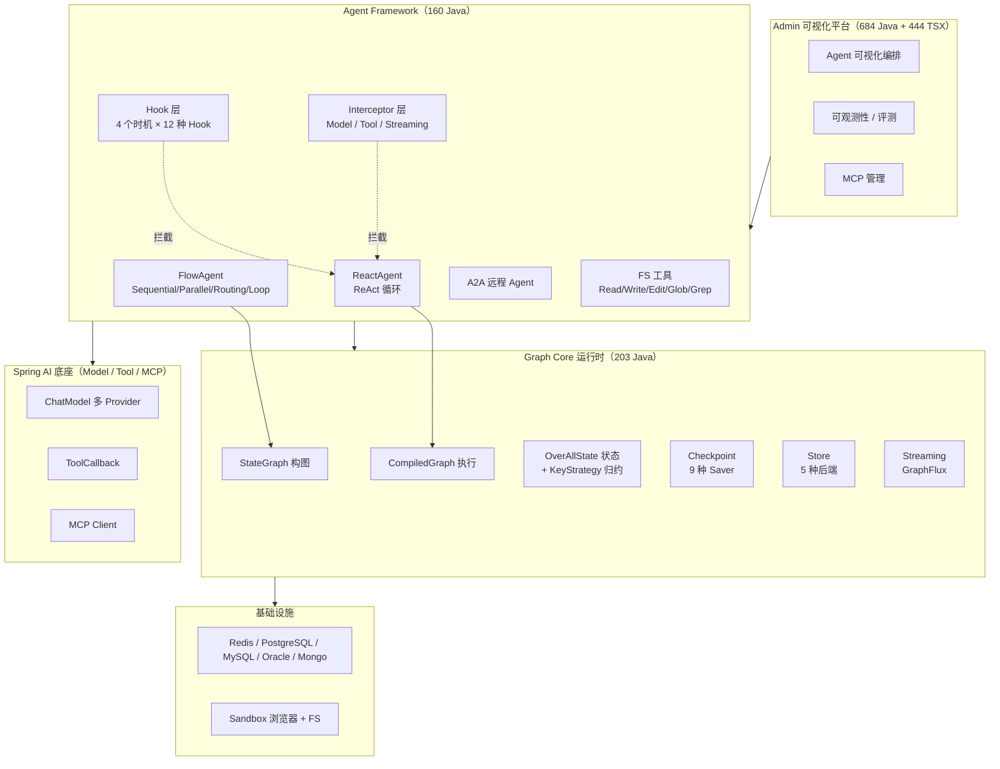
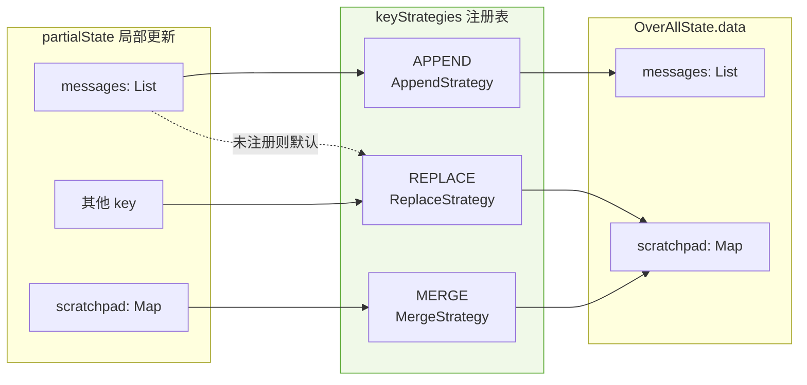
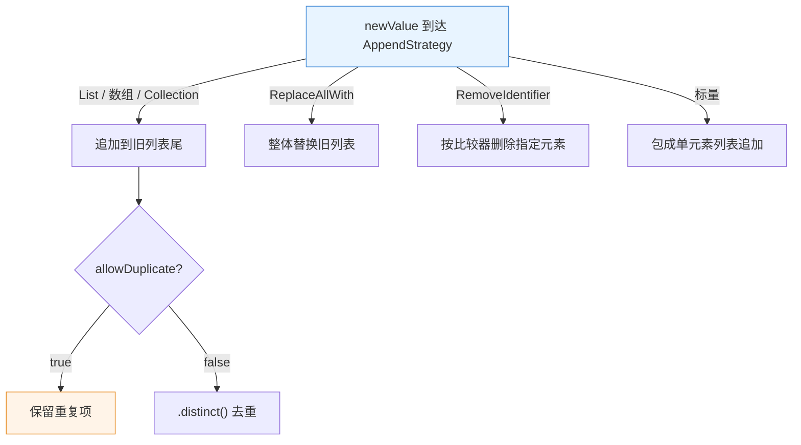
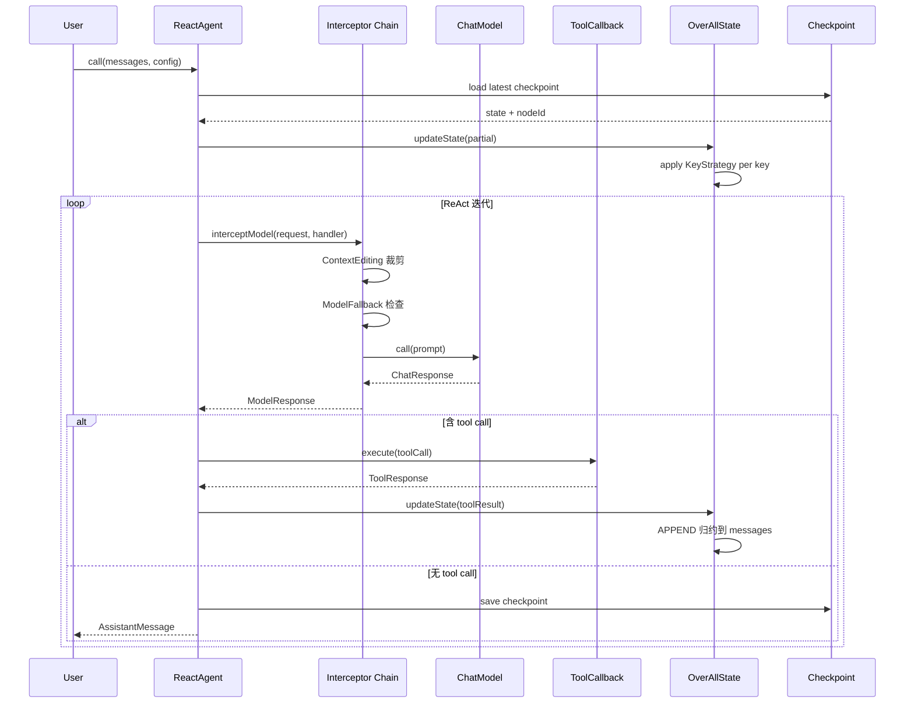
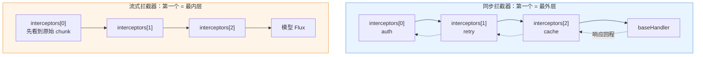
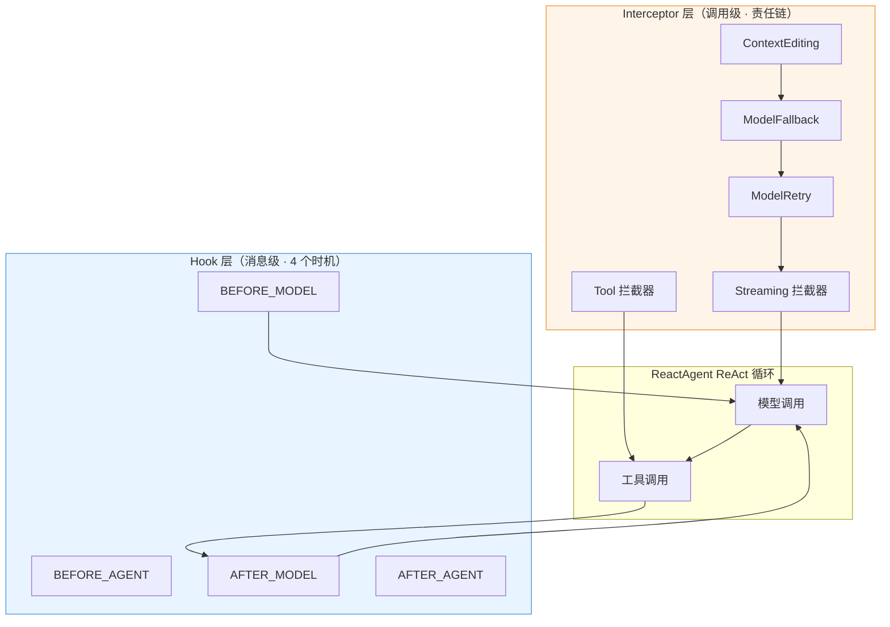
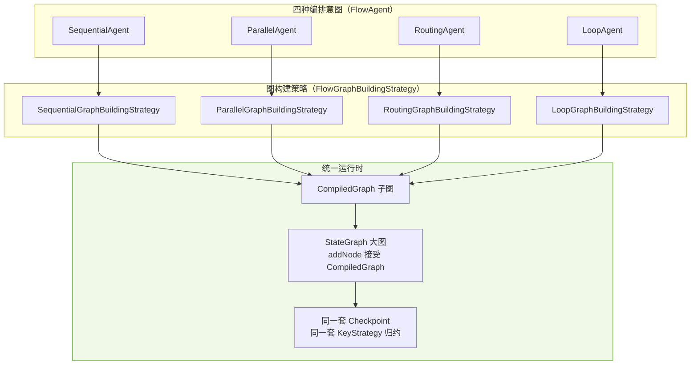

> **核心观点**：过去两年几乎所有 Agent 框架的创新都发生在 Python 和 TypeScript 世界里。但真实的企业级 Agent 系统——跑在 Spring Boot 上、有事务、有连接池、有 Oracle 数据库、要做 PII 合规审计的那个——多半是 Java 写的。**Spring AI Alibaba** 是阿里开源的 Java 原生 Agent 框架，它在 2026 年给出了这个生态最完整的一份答案：**一个把「状态图运行时」和「双层拦截器」都做到生产级的 Java 实现**。
>
> 本文拆解它的源码，讲清楚三件事：Graph 运行时如何用 `KeyStrategy` 三态归约管理可变状态；Hook 与 Interceptor 两套扩展机制为什么**必须**并存，以及流式拦截器为什么**刻意**反转了包裹顺序；以及为什么这套设计比 LangGraph 的「Python 化」更适合 Spring 生态。

---

## 一、引子：Java 生态的 Agent 困境

2026 年 11 月，我们打开 GitHub 看 Agent 框架，会看到一个几乎刺眼的不均衡：

- Python 侧：LangGraph（⭐20k+）、AutoGen、CrewAI、Smolagents、Agno、Pydantic AI……多 Agent、Memory、Guardrail、Eval 各自成军。
- TypeScript 侧：Mastra（⭐29k）、Vercel AI SDK、DeepAgents……新范式层出不穷。
- **Java 侧：几乎是空白。**

这个空白不是没人想做，而是**做起来太难**。原因是 Java 生态的约束跟 Python 完全不同：

1. **类型系统是强约束**。Python 框架可以到处用 `dict` 传状态，Java 不行——你得设计 `OverAllState` 这样的类型化状态容器，而且要允许节点用不同的方式合并（追加 vs 覆盖 vs 深合并）。
2. **并发模型是第一公民**。Java 的 `CompletableFuture` / Reactor `Flux` 不是 Python 的 asyncio 能直接翻译的东西，一个「流式响应 + 拦截器 + 重试」的组合在 Java 里必须重新设计包裹语义。
3. **企业合规是硬需求**。PII 脱敏、模型降级、调用次数上限——这些在 Python 框架里多是「你得自己装」，在 Java 企业里往往是「上线前必须有」。

`alibaba/spring-ai-alibaba`（⭐11,101，Apache-2.0，2024-09 创建，2026-10 仍在推送）就是阿里给出的答案。它的定位写得非常直白：**Agentic AI Framework for Java Developers**。

本文会用源码说话，拆解它的三层架构、六大设计决策，以及它和 LangGraph / OpenAI Agents SDK 的根本范式差异。

---

## 二、整体架构：一个仓库，四个 Maven 模块

Spring AI Alibaba 是一个 monorepo，Java 源文件 1,607 个（其中 `admin` 模块占 684 个，含 TSX 前端），整个仓库 4,327 个 tree 节点。

| 模块 | Java 文件数 | 职责 |
|------|-----------|------|
| `spring-ai-alibaba-graph-core` | 203 | **图运行时内核**：StateGraph / CompiledGraph / OverAllState / Checkpoint / Store / Streaming |
| `spring-ai-alibaba-agent-framework` | 160 | **Agent 抽象层**：ReactAgent / Hook / Interceptor / FlowAgent / A2A / 文件系统工具 |
| `spring-ai-alibaba-admin` | 684 | 可视化 Agent 平台（前后端一体，444 个 TSX） |
| `spring-ai-alibaba-sandbox` | 41 | 沙箱工具集（浏览器 20 个 / 文件系统 11 个 / Python / Shell / MCP） |

核心的分层是这样的：



**关键观察**：Spring AI Alibaba **没有重造模型抽象层**——它直接站在 Spring AI 之上，用 `ChatModel` / `ToolCallback` / `Message`。这意味着任何 Spring AI 支持的模型（DashScope、OpenAI、DeepSeek、Ollama……）开箱即用，而它自己只专注在「Agent 该怎么组织」这一个问题上。

这跟 LangGraph 从零实现一切、或 Spring AI 官方只提供模型抽象而不管 Agent 编排，是两条不同的路线。

---

## 三、核心引擎一：Graph 运行时与三态归约

### 3.1 StateGraph：图是怎么构出来的

Spring AI Alibaba 的图 API 几乎就是 LangGraph 的 Java 转写，但**状态模型的设计更细**。先看构图 API：

```java
// 来自 spring-ai-alibaba-graph-core/.../graph/StateGraph.java:244-549
public StateGraph addNode(String id, AsyncNodeAction action) throws GraphStateException {
    return addNode(id, AsyncNodeActionWithConfig.of(action));
}

public StateGraph addNode(String id, CompiledGraph subGraph) throws GraphStateException { ... }  // 子图作为节点

public StateGraph addEdge(String sourceId, String targetId) throws GraphStateException { ... }

public StateGraph addEdge(List<String> sourceIds, String targetId) throws GraphStateException { ... } // 多源汇合

public StateGraph addConditionalEdges(String sourceId, AsyncCommandAction condition,
                                     Map<String, String> mappings) throws GraphStateException { ... }

public StateGraph addParallelConditionalEdges(String sourceId, AsyncMultiCommandAction condition,
                                              Map<String, String> mappings) throws GraphStateException { ... }

public CompiledGraph compile(CompileConfig config) throws GraphStateException { ... }
```

这里有一个 LangGraph 没有的 API：**`addParallelConditionalEdges`**。它允许一个节点同时激活多条条件分支——这正是 `ParallelAgent` 能用「图构建策略」而不是硬编码实现的原因（见 §5.4）。

### 3.2 OverAllState：状态容器与 KeyStrategy 三态归约

这是 Spring AI Alibaba 相对 LangGraph **最有价值的设计增量**。

LangGraph 的状态更新靠 `Annotated[list, operator.add]` 这类注解，Python 里靠 `typing.Annotated` 表达「这个 key 用什么 reducer 合并」。Java 没有注解式元数据，于是 Spring AI Alibaba 把它显式化成了 **`KeyStrategy`** 接口：

```java
// 来自 spring-ai-alibaba-graph-core/.../graph/KeyStrategy.java:34-40
public interface KeyStrategy extends BiFunction<Object, Object, Object> {

    KeyStrategy REPLACE = new ReplaceStrategy();

    KeyStrategy APPEND = new AppendStrategy();

    KeyStrategy MERGE = new MergeStrategy();

    static KeyStrategyFactoryBuilder builder() {
        return new KeyStrategyFactoryBuilder();
    }
}
```

三个内置策略：**REPLACE（覆盖）/ APPEND（追加）/ MERGE（深合并）**。

状态更新入口在 `OverAllState.updateState`：

```java
// 来自 spring-ai-alibaba-graph-core/.../graph/OverAllState.java:269-284
public Map<String, Object> updateState(Map<String, Object> partialState) {
    Map<String, KeyStrategy> keyStrategies = keyStrategies();
    partialState.keySet().forEach(key -> {
        KeyStrategy strategy = keyStrategies != null ? keyStrategies.get(key) : null;
        // If no specific strategy is found, use the default REPLACE strategy
        if (strategy == null) {
            strategy = KeyStrategy.REPLACE;
        }
        if (partialState.get(key) == MARK_FOR_REMOVAL) {
            this.data.remove(key);
        } else {
            this.data.put(key, strategy.apply(value(key, null), partialState.get(key)));
        }
    });
    return data();
}
```

三个设计细节值得单独说：

1. **未注册的 key 默认 REPLACE，而不是抛异常**。这跟 Python 版「必须给每个 key 声明 reducer，否则运行时报错」是相反的哲学——**Java 侧选择「宽进严出」**：漏声明不会导致运行时崩溃，只是行为退化为覆盖。
2. **`MARK_FOR_REMOVAL` 哨兵对象实现删除**。Java 里 `Map.remove` 需要 key，但状态是一个 `Map<String, Object>`，你没法表达「把这个 key 删掉」——除非引入一个特殊值。这个 `public static final Object MARK_FOR_REMOVAL = new Object();` 就是一个身份哨兵（identity sentinel）。
3. **`registerKeyAndStrategy` 支持运行时注册策略**，不只编译期。



### 3.3 AppendStrategy：唯一值得逐行读的策略

APPEND 策略的实现比看上去复杂——它要处理 4 种「新值」形态：

```java
// 来自 spring-ai-alibaba-graph-core/.../graph/state/strategy/AppendStrategy.java:42-113
@Override
public Object apply(Object oldValue, Object newValue) {
    if (newValue == null) {
        return oldValue;
    }

    if (newValue instanceof ReplaceAllWith<?> replaceAll) {
        return new ArrayList<>(replaceAll.newValues());
    }

    if (oldValue instanceof Optional<?> oldValueOptional) {
        oldValue = oldValueOptional.orElse(null);
    }

    boolean oldValueIsList = oldValue instanceof List<?>;

    if (oldValueIsList && newValue instanceof AppenderChannel.RemoveIdentifier<?>) {
        var result = new ArrayList<>((List<Object>) oldValue);
        removeFromList(result, (AppenderChannel.RemoveIdentifier) newValue);
        return new ArrayList<>(result);
    }

    List<Object> list = null;
    if (newValue instanceof List) {
        list = new ArrayList<>((List<?>) newValue);
    }
    else if (newValue.getClass().isArray()) {
        list = Arrays.asList((Object[]) newValue);
    }
    else if (newValue instanceof Collection) {
        list = new ArrayList<>((Collection<?>) newValue);
    }

    if (oldValueIsList) {
        List<Object> oldList = (List<Object>) oldValue;
        if (list != null) {
            if (list.isEmpty()) {
                return oldValue;
            }
            var result = evaluateRemoval((List<Object>) oldValue, list);
            if (allowDuplicate) {
                return Stream.concat(result.oldValues().stream(), result.newValues().stream())
                        .collect(Collectors.toList());
            } else {
                return Stream.concat(result.oldValues().stream(), result.newValues().stream())
                        .distinct()
                        .collect(Collectors.toList());
            }
        }
        oldList.addAll(list);
    }
    else {
        ArrayList<Object> arrayResult = new ArrayList<>();
        if (list != null) {
            arrayResult.addAll(list);
        }
        else {
            arrayResult.add(newValue);
        }
        return arrayResult;
    }
}
```

**这是整篇文章里最值得抄的一段代码。** 它揭示了「append」在真实 Agent 场景里的四种语义：

| 新值形态 | 语义 | 场景 |
|---------|------|------|
| `List` / 数组 / `Collection` | 追加到旧列表尾 | 消息历史累积 |
| `ReplaceAllWith` | **整体替换**旧列表 | 「清空并重设」工具结果 |
| `AppenderChannel.RemoveIdentifier` | **按标识删除**指定元素 | 撤销某次工具调用的结果 |
| 标量 | 包成单元素列表追加 | 首次写入 |

配合 `allowDuplicate` 开关（默认 `true`，可设为 `false` 走 `.distinct()`），**APPEND 一个 key 同时承担了「追加 / 去重追加 / 整体替换 / 按条件删除」四种操作**。

这解决了一个 LangGraph 里很别扭的问题：在 Python 里你要用 `operator.add` 追加消息，但想「撤销一条消息」就无能为力了。Spring AI Alibaba 通过给新值引入**携带语义的类型**（`ReplaceAllWith` / `RemoveIdentifier`）而不是裸值，让 reducer 本身具备了表达复杂操作的能力。



### 3.4 Channel：把「状态写入意图」独立出来

上面那个设计能成立，是因为「写什么」和「怎么合并」被拆开了。`Channel` 就是这个拆分的载体：

```java
// 来自 spring-ai-alibaba-graph-core/.../graph/state/Channel.java
// AppenderChannel 内部定义了 RemoveIdentifier 与 RemoveData
// RemoveIdentifier 通过 compareTo(element, index) 定位要删除的元素
```

`AppenderChannel.RemoveIdentifier` 不是「按值删除」，而是「**按比较器删除**」——`removeIdentifier.compareTo(result.get(i), i) == 0` 命中即删。这意味着你可以按「时间戳」「序号」「消息 ID」等任意语义删除，而不必依赖 `equals`。

### 3.5 Checkpoint：9 种 Saver，持久化是可选的

Spring AI Alibaba 的 checkpoint 体系按「存储介质」分了两层：

```text
checkpoint/
├── BaseCheckpointSaver.java          抽象基类
├── Checkpoint.java                   检查点数据模型
├── HasVersions.java                  版本语义
├── savers/
│   ├── MemorySaver.java              内存（开发/测试）
│   ├── VersionedMemorySaver.java     内存 + 版本链
│   ├── FileSystemSaver.java          本地文件系统
│   ├── H2Saver.java                  H2（嵌入式，测试友好）
│   ├── RedisSaver.java               Redis
│   ├── MongoSaver.java               MongoDB
│   ├── savers/jdbc/AbstractJdbcCheckpointSaver.java   JDBC 抽象基类
│   │   ├── MysqlSaver.java
│   │   ├── PostgresSaver.java
│   │   └── OracleSaver.java          ← 企业数据库全覆盖
│   └── common/LatestCheckpointCache.java               最新检查点缓存
```

**`AbstractJdbcCheckpointSaver` + 三个方言实现（MySQL / PostgreSQL / Oracle）** 是这套设计最接地气的地方——它明确面向的是「企业已有 Oracle 数据库」的真实场景，而不是「我先起个 Postgres 试试」。

`Store`（跨会话长期记忆）走了完全相同的分法：

```text
store/stores/
├── BaseStore.java
├── MemoryStore.java
├── FileSystemStore.java
├── RedisStore.java
├── MongoStore.java
└── DatabaseStore.java     ← 通用 JDBC
```

Checkpoint 解决的是「**这一轮**跑到哪了」，Store 解决的是「**这个用户**知道什么」。两者接口刻意不耦合，但后端可以复用同一套数据库。

### 3.6 端到端：一条消息如何在图里流动



---

## 四、核心引擎二：Hook 与 Interceptor——为什么必须是两套

这是 Spring AI Alibaba **最有洞察、也最容易被误解**的设计。

初看之下会觉得重复：Hook 有 4 个执行时机，Interceptor 也有拦截能力，为什么不合并成一套？

读完源码你会发现：**它们管的根本不是同一层**。

### 4.1 Hook：Agent 生命周期级的「消息级」干预

Hook 的抽象是：

```java
// 来自 spring-ai-alibaba-agent-framework/.../agent/hook/AgentHook.java:25-63
public abstract class AgentHook implements Hook {

    private String agentName;

    private ReactAgent reactAgent;

    public CompletableFuture<Map<String, Object>> beforeAgent(OverAllState state, RunnableConfig config) {
        return CompletableFuture.completedFuture(Map.of());
    }

    public CompletableFuture<Map<String, Object>> afterAgent(OverAllState state, RunnableConfig config) {
        return CompletableFuture.completedFuture(Map.of());
    }

    public void setAgentName(String agentName) { this.agentName = agentName; }
    public String getAgentName() { return agentName; }
    @Override public ReactAgent getAgent() { return reactAgent; }
    @Override public void setAgent(ReactAgent agent) { this.reactAgent = agent; }
    @Override public int getOrder() { return 0; }
}
```

四个执行时机由一个枚举定义：

```java
// 来自 spring-ai-alibaba-agent-framework/.../agent/hook/HookPosition.java:21-41
public enum HookPosition {
    /** Hook executes before the agent starts processing */
    BEFORE_AGENT,
    /** Hook executes after the agent completes processing */
    AFTER_AGENT,
    /** Hook executes before the model is called */
    BEFORE_MODEL,
    /** Hook executes after the model returns a response */
    AFTER_MODEL
}
```

通过注解声明一个 Hook 的挂载位置（可多选）：

```java
// 来自 spring-ai-alibaba-agent-framework/.../agent/hook/HookPositions.java:36-43
@Retention(RetentionPolicy.RUNTIME)
@Target(ElementType.TYPE)
public @interface HookPositions {
    HookPosition[] value();
}
```

内置的 Hook 有 12 种，覆盖了企业 Agent 的几乎全部合规诉求：

| Hook | 目录 | 作用 |
|------|------|------|
| `HumanInTheLoopHook` | `hook/hip/` | 人工审批工具调用 |
| `PIIDetectionHook` | `hook/pii/` | PII 检测 + 脱敏/掩码/哈希/阻断 |
| `SummarizationHook` | `hook/summarization/` | 超阈值自动摘要历史 |
| `ModelCallLimitHook` | `hook/modelcalllimit/` | 模型调用次数上限 |
| `ToolCallLimitHook` | `hook/toolcalllimit/` | 工具调用次数上限 |
| `SkillsAgentHook` | `hook/skills/` | 技能检索 / 读取 / 禁用 |
| `ReturnDirectModelHook` | `hook/returndirect/` | 命中即返回，跳过工具循环 |
| `ShellToolAgentHook` | `hook/shelltool/` | Shell 工具注入 |
| `MessagesModelHook` | `hook/messages/` | 消息级基类 |
| `InterruptionHook` | `hook/` | 中断 / 恢复 |
| `InstructionAgentHook` | `hook/` | 动态指令注入 |
| `ModelHook` | `hook/` | 模型调用钩子基类 |

**Hook 的关键特征：它操作的是「消息列表 / 状态」这一层**。看 `PIIDetectionHook` 的接口就知道：

```java
// 来自 spring-ai-alibaba-agent-framework/.../agent/hook/pii/PIIDetectionHook.java:49-90
// 说明：以下为源码节选，类体与方法体在节选边界处截断，故括号不成对。
@HookPositions({HookPosition.BEFORE_MODEL, HookPosition.AFTER_MODEL})
public class PIIDetectionHook extends MessagesModelHook {

    private final PIIType piiType;
    private final RedactionStrategy strategy;
    private final PIIDetector detector;
    private final boolean applyToInput;
    private final boolean applyToOutput;
    private final boolean applyToToolResults;

    @Override
    public AgentCommand beforeModel(List<Message> previousMessages, RunnableConfig config) {
        List<Message> processedMessages = new ArrayList<>();
        boolean hasChanges = false;

        for (Message message : previousMessages) {
            Message processed = processMessage(message);
            processedMessages.add(processed);
            if (processed != message) {
                hasChanges = true;
            }
        }

        if (hasChanges) {
            return new AgentCommand(processedMessages, UpdatePolicy.REPLACE);
        }

        return new AgentCommand(previousMessages);
    }
```

注意 `AgentCommand` 的两个参数：**消息列表** + **`UpdatePolicy`（REPLACE / 其他）**。Hook 的输出是「一份新的消息列表」和「怎么把它写回去」。

PII 脱敏有 4 种策略：

```java
// 来自 spring-ai-alibaba-agent-framework/.../agent/hook/pii/PIIDetectionHook.java:244-292
private String applyStrategy(String text, List<PIIMatch> matches) {
    if (matches.isEmpty()) {
        return text;
    }

    StringBuilder result = new StringBuilder();
    int lastEnd = 0;

    // Sort matches by start position
    matches.sort(Comparator.comparingInt(m -> m.start));

    for (PIIMatch match : matches) {
        result.append(text, lastEnd, match.start);

        switch (strategy) {
            case REDACT:
                result.append("[REDACTED_").append(piiType.name()).append("]");
                break;
            case MASK:
                result.append(maskValue(match.value));
                break;
            case HASH:
                result.append(hashValue(match.value));
                break;
            case BLOCK:
                // Already handled in processText
                break;
        }

        lastEnd = match.end;
    }

    result.append(text.substring(lastEnd));
    return result.toString();
}

private String maskValue(String value) {
    if (value.length() <= 4) {
        return "****";
    }
    int visibleChars = 4;
    String masked = "*".repeat(value.length() - visibleChars);
    return masked + value.substring(value.length() - visibleChars);
}

private String hashValue(String value) {
    int hash = value.hashCode();
    return String.format("<%s_hash:%08x>", piiType.name().toLowerCase(), hash);
}
```

支持 EMAIL / CREDIT_CARD / IP / MAC_ADDRESS / URL 五种类型，`BLOCK` 策略直接抛 `PIIDetectionException` 阻断——**fail-closed**，符合企业安全要求。

值得单独一提的是 `hashValue` 用的是 `String.hashCode()` 而不是 SHA-256。这意味着它**只能用于「同值同哈希」的关联分析，不能用于真正的脱敏存储**（hashCode 有 32 位且可被彩虹表攻击）。这是一个实用主义取舍——它的目的是让下游能按哈希聚合同一用户，而不是持久化不可逆凭证。生产环境做真正脱敏时应该换实现。

### 4.2 Interceptor：调用链级的「请求级」干预

Interceptor 操作的是**单次模型调用 / 单次工具调用**：

```java
// 来自 spring-ai-alibaba-agent-framework/.../agent/interceptor/Interceptor.java
public interface Interceptor {
    String getName();
}
```

三种拦截器接口：`ModelInterceptor` / `StreamingModelInterceptor` / `ToolInterceptor`，它们用「请求 → 下一个 handler」的经典责任链形式串起来：

```java
// 来自 spring-ai-alibaba-agent-framework/.../agent/interceptor/InterceptorChain.java:44-66
public static ModelCallHandler chainModelInterceptors(
        List<ModelInterceptor> interceptors,
        ModelCallHandler baseHandler) {

    if (interceptors == null || interceptors.isEmpty()) {
        return baseHandler;
    }

    // Start with the base handler
    ModelCallHandler current = baseHandler;

    // Wrap from last to first (right-to-left composition)
    // This ensures first interceptor is outermost
    for (int i = interceptors.size() - 1; i >= 0; i--) {
        ModelInterceptor interceptor = interceptors.get(i);
        ModelCallHandler nextHandler = current;

        // Create a wrapper that calls the interceptor's wrap method
        current = request -> interceptor.interceptModel(request, nextHandler);
    }

    return current;
}
```

**这里藏着一个非常容易踩坑的设计。** 请仔细对比注释里的两段说明：

同步拦截器（`chainModelInterceptors` / `chainToolInterceptors`）：
> The first interceptor wraps all others, creating a nested structure: interceptors[0] -> interceptors[1] -> ... -> base handler
>
> request -> auth -> retry -> cache -> baseHandler

流式拦截器（`applyStreamingInterceptors`）：
> **Wrapping order:** the first registered interceptor is the *innermost* operator, i.e. it sees raw model chunks first; later interceptors see whatever the previous one returned. This differs from the synchronous `chainXxxInterceptors` methods above (where the first interceptor is outermost) because chunk-level interceptors typically want to observe untransformed model output.

**同步是最外层，流式是最内层——刻意相反。**

源码注释解释了原因：chunk 级别的拦截器通常想观察**未变换的**模型原始输出（比如做流式 PII 扫描、做 token 实时计数），所以它得是最先看到 chunk 的那个。

这不是随手写出来的约定，而是**作者在两套语义之间做出的显式权衡**——并且把这个权衡写进了 Javadoc。Java 生态里这种「同一抽象下两种相反语义并显式记录」的做法，是成熟框架的标志。



### 4.3 流式拦截器的状态隔离：一个真实踩过的坑

流式部分用 `Flux.defer` 包裹，保证每次订阅独立：

```java
// 来自 spring-ai-alibaba-agent-framework/.../agent/interceptor/InterceptorChain.java:143-205
public static Flux<ChatResponse> applyStreamingInterceptors(
        List<StreamingModelInterceptor> interceptors,
        Flux<ChatResponse> flux,
        ModelRequest request) {

    if (interceptors == null || interceptors.isEmpty()) {
        return flux;
    }

    return Flux.defer(() -> {
        // Defensive copy: each subscription starts from its own ModelRequest so an
        // interceptor that mutates context/messages/options in-place inside
        // beforeStreamCall does not leak state across retries / multi-subscribe.
        ModelRequest scopedRequest = copyForSubscription(request);

        // Thread request through beforeStreamCall (first to last). Wrapped in try/catch
        // because we are inside the defer supplier — if we let the exception escape
        // before any doOnError operator is attached below, per-interceptor onStreamError
        // callbacks would never fire and startup failures would be invisible to users.
        ModelRequest threaded = scopedRequest;
        try {
            for (StreamingModelInterceptor interceptor : interceptors) {
                threaded = interceptor.beforeStreamCall(threaded);
            }
        } catch (Throwable startupError) {
            for (StreamingModelInterceptor interceptor : interceptors) {
                try {
                    interceptor.onStreamError(startupError, scopedRequest);
                } catch (Throwable cbThrown) {
                    // Don't let one buggy callback hide the original failure
                    startupError.addSuppressed(cbThrown);
                }
            }
            return Flux.error(startupError);
        }
        final ModelRequest finalRequest = threaded;

        Flux<ChatResponse> current = flux;
        for (StreamingModelInterceptor interceptor : interceptors) {
            // Per-subscription, per-interceptor aggregator buffer
            final StringBuilder aggregator = new StringBuilder();

            current = current
                    .handle((ChatResponse chunk, reactor.core.publisher.SynchronousSink<ChatResponse> sink) -> {
                        ChatResponse transformed = interceptor.onStreamChunk(chunk, finalRequest);
                        if (transformed == null) {
                            // null = drop this chunk (filter); next interceptors won't see it
                            return;
                        }
                        if (transformed.getResult() != null
                                && transformed.getResult().getOutput() != null
                                && transformed.getResult().getOutput().getText() != null) {
                            aggregator.append(transformed.getResult().getOutput().getText());
                        }
                        sink.next(transformed);
                    })
                    .doOnComplete(() -> interceptor.afterStreamComplete(
                            new AssistantMessage(aggregator.toString()), finalRequest))
                    .doOnError(error -> interceptor.onStreamError(error, finalRequest));
        }

        return current;
    });
}
```

四个精心处理的细节：

1. **`Flux.defer`** —— 整段逻辑推迟到订阅时才执行。配合 Reactor 的重试机制，每次重试都是全新的一次执行，不会残留上次的 buffer。
2. **防御性深拷贝** —— `copyForSubscription` 把 `messages` 包成新 `ArrayList`，并调用 `options.copy()`：

```java
// 来自 spring-ai-alibaba-agent-framework/.../agent/interceptor/InterceptorChain.java:224-232
private static ModelRequest copyForSubscription(ModelRequest src) {
    if (src == null) {
        return null;
    }
    return ModelRequest.builder(src)
            .messages(src.getMessages() != null ? new ArrayList<>(src.getMessages()) : null)
            .options(src.getOptions() != null ? src.getOptions().copy() : null)
            .build();
}
```

注释说得很清楚：`ModelRequest.builder(ModelRequest)` 已经浅拷贝了 `tools` / `dynamicToolCallbacks` / `toolDescriptions` / `context`，但**复用**了 `messages` 列表和 `options` 对象。所以这里额外处理了这两个。

3. **startup 失败的兜底** —— `beforeStreamCall` 抛异常时，手动给所有拦截器派发 `onStreamError`，并且用 `addSuppressed` 保证「一个坏回调不会掩盖原始异常」。注释明确解释了这个 try/catch 的必要性：*「如果让异常逃逸，下面的 doOnError 算子还没挂上，各拦截器的 onStreamError 回调永远不会触发，启动失败对用户不可见。」*

4. **per-interceptor aggregator** —— 每个拦截器有自己独立的 `StringBuilder` 聚合器，用于在流结束时构造完整的 `AssistantMessage` 传给 `afterStreamComplete`。**注意是 per-interceptor 而不是 per-chain**——因为包裹顺序反转了，每个拦截器看到的 chunk 序列不同，聚合结果自然也不同。

### 4.4 内置的三种 Interceptor

**ModelFallbackInterceptor** —— 模型降级：

```java
// 来自 spring-ai-alibaba-agent-framework/.../agent/interceptor/modelfallback/ModelFallbackInterceptor.java:59-101
@Override
public ModelResponse interceptModel(ModelRequest request, ModelCallHandler handler) {
    Exception lastException = null;

    // Try primary model first
    try {
        ModelResponse modelResponse = handler.call(request);
        Message message = (Message) modelResponse.getMessage();

        // Check if response contains error indicator
        if (message.getText() != null && message.getText().contains("Exception:")) {
            throw new RuntimeException(message.getText());
        }

        // Return successful response
        return modelResponse;
    }
    catch (Exception e) {
        log.warn("Primary model failed: {}", e.getMessage());
        lastException = e;
    }

    // Try fallback models in sequence
    for (int i = 0; i < fallbackModels.size(); i++) {
        ChatModel fallbackModel = fallbackModels.get(i);
        try {
            log.info("Trying fallback model {} of {}", i + 1, fallbackModels.size());

            // Call the fallback model directly
            Prompt prompt = new Prompt(request.getMessages(), request.getOptions());
            var response = fallbackModel.call(prompt);

            return ModelResponse.of(response.getResult().getOutput());
        }
        catch (Exception e) {
            log.warn("Fallback model {} failed: {}", i + 1, e.getMessage());
            lastException = e;
        }
    }

    // All models failed
    throw new RuntimeException("All models failed after " + (fallbackModels.size() + 1) + " attempts", lastException);
}
```

有两个细节值得注意：

- **降级模型不走 `handler.call`，而是直接调 `fallbackModel.call(prompt)`**。这意味着降级模型**不会经过后续拦截器**。如果链上是 `[ContextEditing, ModelFallback, PII]`，降级后的调用就绕过了 PII 检测——**这是一个安全漏洞**。正确做法应该是降级时重新构造一条包含剩余拦截器的链。
- **「响应里含 `Exception:` 就算失败」** —— 这个字符串匹配很脆，但解决了「某些 provider 把错误包装成正常响应返回」的实际问题。

**ContextEditingInterceptor** —— 上下文裁剪，模仿 Anthropic 的 context editing：

```java
// 来自 spring-ai-alibaba-agent-framework/.../agent/interceptor/contextediting/ContextEditingInterceptor.java:80-113
// 说明：以下为源码节选，方法体在节选边界处截断，故括号不成对。
@Override
public ModelResponse interceptModel(ModelRequest request, ModelCallHandler handler) {
    List<Message> messages = new ArrayList<>(request.getMessages());

    int tokens = tokenCounter.countTokens(messages);

    if (tokens <= trigger) {
        // Token count is below trigger, no editing needed
        return handler.call(request);
    }

    log.info("Token count {} exceeds trigger {}, clearing tool results", tokens, trigger);

    // Find tool messages that can be cleared
    List<ClearableToolMessage> candidates = findClearableCandidates(messages);

    if (candidates.isEmpty()) {
        log.debug("No tool messages to clear");
        return handler.call(request);
    }

    int clearedTokens = 0;
    Set<Integer> indicesToClear = new HashSet<>();

    // Clear tool results until we meet the clearAtLeast threshold
    for (ClearableToolMessage candidate : candidates) {
        if (clearedTokens >= clearAtLeast) {
            break;
        }

        indicesToClear.add(candidate.index);
        clearedTokens += candidate.estimatedTokens;
    }
```

它的策略是**只清工具结果，不清对话**——把 `ToolResponseMessage` 的 `responseData` 换成 `[cleared]` 占位符，把 `AssistantMessage` 里的 tool call 参数也换成占位符。三个旋钮：

```java
// 来自 spring-ai-alibaba-agent-framework/.../agent/interceptor/contextediting/ContextEditingInterceptor.java:275-283
// 说明：以下为源码节选，Builder 类在节选边界处截断，故括号不成对。
public static class Builder {
    private int trigger = 100000;              // 超过多少 token 触发
    private int clearAtLeast = 0;               // 至少清出多少 token 才动手
    private int keep = 3;                      // 保留最近 N 条不清
    private boolean clearToolInputs = false;
    private Set<String> excludeTools;          // 排除特定工具（不裁剪它的结果）
    private String placeholder = DEFAULT_PLACEHOLDER;
    private TokenCounter tokenCounter = TokenCounter.approximateMsgCounter();
```

`excludeTools` 这个旋钮很关键——有些工具（比如刚写入数据库的记录 ID）**清掉就等于信息丢失**，必须豁免。

而 `SummarizationHook` 是**另一个策略**：它不清，而是把老消息**摘要成一条 SystemMessage**：

```java
// 来自 spring-ai-alibaba-agent-framework/.../agent/hook/summarization/SummarizationHook.java:63-78
private static final String DEFAULT_SUMMARY_PROMPT =
        "<role>\nContext Extraction Assistant\n</role>\n\n" +
                "<primary_objective>\n" +
                "Your sole objective in this task is to extract the highest quality/most relevant context " +
                "from the conversation history below.\n</primary_objective>\n\n" +
                "<instructions>\n" +
                "The conversation history below will be replaced with the context you extract in this step. " +
                "Extract and record all of the most important context from the conversation history.\n" +
                "Respond ONLY with the extracted context. Do not include any additional information.\n" +
                "</instructions>\n\n" +
                "<messages>\nMessages to summarize:\n%s\n</messages>";

private static final String SUMMARY_PREFIX = "## Previous conversation summary:";
private static final int DEFAULT_MESSAGES_TO_KEEP = 20;
private static final int SEARCH_RANGE_FOR_TOOL_PAIRS = 5;
private static final boolean DEFAULT_KEEP_FIRST_USER_MESSAGE = true;
```

`keepFirstUserMessage = true` 是个经验之谈——**保留第一条用户消息**，因为它往往包含原始任务描述，丢了后面全看不懂。

**ContextEditing（清工具结果）vs Summarization（摘要对话）** 是两条互补的路线：前者省 token 且**无损于任务连续性**（工具结果本身可重新获取），后者省 token 但**有损**（摘要可能漏掉细节）。Spring AI Alibaba 把两者都做进框架，这比让用户自己二选一要务实。



### 4.5 Hook vs Interceptor 对照表

| 维度 | Hook | Interceptor |
|------|------|-------------|
| 干预粒度 | Agent 生命周期 / 消息列表 | 单次模型调用 / 单次工具调用 |
| 执行时机 | BEFORE_AGENT / AFTER_AGENT / BEFORE_MODEL / AFTER_MODEL | 调用链内嵌，包裹 handler |
| 输入输出 | `OverAllState` / `List<Message>` → `AgentCommand` | `ModelRequest` → `ModelResponse` |
| 挂载方式 | `@HookPositions` 注解 | 构造 Builder 时注册列表 |
| 能否阻断 | 能（抛异常 / 返回 BLOCK 策略） | 能（抛异常） |
| 典型用途 | PII 脱敏、摘要、HITL 审批、调用次数上限 | 模型降级、重试、上下文裁剪、缓存 |
| 是否影响流式 | 否（消息级） | 是（专门的 StreamingModelInterceptor） |

**一句话总结**：Hook 管「**这一轮对话应该长什么样**」，Interceptor 管「**这一次调用怎么执行**」。前者是策略，后者是机制。

---

## 五、核心引擎三：FlowAgent 与图构建策略

### 5.1 一个反直觉的设计：FlowAgent 不是独立的执行器

LangGraph 里，多 Agent 编排就是「你画一张大图」。Spring AI Alibaba 提供了 `SequentialAgent` / `ParallelAgent` / `RoutingAgent` / `LoopAgent` 四个「看起来像编排器」的类，但它们**并不是独立的执行引擎**——它们的实现是**把编排意图翻译成一张子图**。

看 `SequentialAgent`：

```java
// 来自 spring-ai-alibaba-agent-framework/.../agent/flow/agent/SequentialAgent.java
public class SequentialAgent extends FlowAgent {
    // ...
}
```

它内部调用 `SequentialGraphBuildingStrategy`：

```java
// 来自 spring-ai-alibaba-agent-framework/.../agent/flow/strategy/SequentialGraphBuildingStrategy.java
public class SequentialGraphBuildingStrategy extends AbstractFlowGraphBuildingStrategy {
    // 把 sub-agents 串成 chain: A -> B -> C
}
```

策略接口由注册表统一管理：

```java
// 来自 spring-ai-alibaba-agent-framework/.../agent/flow/strategy/FlowGraphBuildingStrategyRegistry.java
```

四种策略对应四个类：

```text
flow/strategy/
├── SequentialGraphBuildingStrategy.java   串行：A → B → C
├── ParallelGraphBuildingStrategy.java      并行：A ∥ B ∥ C
├── RoutingGraphBuildingStrategy.java       路由：条件分支
├── ConditionalGraphBuildingStrategy.java   条件
├── LoopGraphBuildingStrategy.java          循环
└── AbstractFlowGraphBuildingStrategy.java  抽象基类
```

**这是一个非常克制且聪明的决策。** 好处是：

1. **编排能力没有第二套语义**。FlowAgent 和手写 StateGraph 走的是同一个运行时，同一套 Checkpoint，同一套状态归约。
2. **FlowAgent 可以和手写图混用**——`StateGraph.addNode(String id, CompiledGraph subGraph)` 让 FlowAgent 编译出的子图能直接当节点嵌进大图。
3. **可观测性天然统一**——不需要为 FlowAgent 单独做 tracing。

对比起来，LangChain 的 `CrewAI` / `AutoGen` 这类框架是**另起炉灶**：它们有自己的角色、任务、记忆、进程模型，和 LangGraph 的图执行完全是两个世界。想混用？做不到。



### 5.2 LoopAgent 的三种循环策略

```text
flow/agent/loop/
├── LoopStrategy.java          抽象
├── CountLoopStrategy.java     按次数
├── ConditionLoopStrategy.java 按条件
├── ArrayLoopStrategy.java     按数组元素
└── LoopMode.java              循环模式枚举
```

三种策略对应三种真实需求：重试 N 次、直到条件满足、逐元素处理数组。**把「循环」抽象成策略而不是 if-else 分支**，让用户可以组合（比如「最多 3 次，每次都带条件判断」）。

### 5.3 RoutingAgent：由 LLM 决定路由

```java
// 来自 spring-ai-alibaba-agent-framework/.../agent/flow/agent/LlmRoutingAgent.java
public class LlmRoutingAgent extends FlowAgent {
    // 用 LLM 的判断结果选择下游 agent
}
```

注意类名里的 `Llm` 前缀——它明确区别于「代码逻辑路由」，是**让模型来选分支**。这跟 `RoutingEdgeAction`（用 Java 代码算路由）是两条路径，框架都提供了。

### 5.4 ParallelAgent 的结果聚合

```text
flow/node/
├── ParallelResultAggregator.java              基础聚合
├── EnhancedParallelResultAggregator.java      增强聚合
├── ConditionEvaluator.java / ConditionEvaluatorAction.java
├── RoutingEdgeAction.java / RoutingNode.java / RoutingMergeNode.java
└── TransparentNode.java                      透传节点
```

`EnhancedParallelResultAggregator` 存在，说明框架承认「并行分支的结果怎么合并」本身是个需要设计的问题——简单 concat 往往不够。

### 5.5 A2A：跨进程的 Agent 调用

```java
// 来自 spring-ai-alibaba-agent-framework/.../agent/a2a/A2aRemoteAgent.java
public class A2aRemoteAgent implements Agent {
    // 通过 A2A 协议调用远程 agent
}
```

配套有 `AgentCardProvider` / `RemoteAgentCardProvider` / `AgentCardWrapper` / `A2aNodeActionWithConfig`。**A2A 协议支持不是「加个 HTTP 客户端」，而是被建模成了图里的一个节点类型**——你可以写：

```java
// 来自 spring-ai-alibaba-agent-framework/.../agent/a2a/A2aNodeActionWithConfig.java
// 把一个远程 agent 当成图节点来用
```

这一点跟 `A2A` 协议本身（2026-05-01 已写过）的角度不同：那篇讲的是协议规范，这篇讲的是**协议在运行时里的落点**。

### 5.6 沙箱工具：浏览器 20 个 + 文件系统 11 个

`spring-ai-alibaba-sandbox` 模块的 41 个 Java 文件几乎全是工具：

```text
tools/browser/  (20 个)
├── SaaBrowserNavigator / ForwardNavigator / BackNavigator
├── SaaBrowserClicker / Hoverer / Typer / KeyPresser / Dragger
├── SaaBrowserTabCreator / TabCloser / TabLister / TabSelector
├── SaaBrowserScreenshotTaker / SnapshotTaker
├── SaaBrowserConsoleMessagesRetriever / NetworkRequestsRetriever
├── SaaBrowserDialogHandler / FileUploader / PdfSaver
├── SaaBrowserOptionSelector / Waiter / WindowResizer / Closer

tools/fs/  (11 个)
├── SaaFsFileReader / FileWriter / FileEditor / FileMover
├── SaaFsDirectoryCreator / DirectoryLister / TreeBuilder
├── SaaFsFileSearcher / MultiFileReader / FileInfoRetriever
└── SaaFsAllowedDirectoriesLister

tools/base/  (2 个)
├── SaaBasePythonRunner
└── SaaBaseShellRunner

tools/mcp/
└── SaaMCPTool
```

`Saa` 前缀 = **Sandbox as a Service**。所有工具都通过 `SandboxAwareTool` / `BaseSandboxAwareTool` 抽象，走同一个 `RuntimeFunctionToolCallback` 桥接到 Spring AI 的 `ToolCallback` 体系。

**关键点**：这套工具是**运行在沙箱里的**，但从 Agent 的角度看它们就是普通的 `ToolCallback`——**沙箱边界对 Agent 透明**。这正是 `nono`（2026-10-08 写过，OS 内核级沙箱）那篇文章里提到的「Mechanism, not Policy」思路的另一种实现：沙箱是运行时机制，Agent 无需知道。

同时 `agent-framework` 里还有一套**本地文件系统工具**（`extension/tools/filesystem/`）：`ReadFileTool` / `WriteFileTool` / `EditFileTool` / `GlobTool` / `GrepTool` / `ListFilesTool`——明显是对标 Claude Code 那套工具语义。

**两套 FS 工具并存**（本地 vs 沙箱）是一个有意义的区分：本地工具用于「Agent 在你的工作目录里改代码」，沙箱工具用于「Agent 在隔离环境里跑不受信代码」。信任边界不同，所以实现不同。

---

## 六、与同类项目对比：不是同一类东西

### 6.1 四方对照

| 维度 | Spring AI Alibaba | LangGraph | OpenAI Agents SDK | Spring AI（官方） |
|------|-------------------|-----------|-------------------|------------------|
| 语言 | **Java** | Python / JS | Python / TS | Java |
| 抽象层 | Graph 运行时 + Agent 框架 | Graph 运行时 | Handoff 协议 | 模型/工具抽象 |
| 状态模型 | `OverAllState` + `KeyStrategy` 三态归约 | `Annotated` + reducer | Session 列表 | 无 |
| 扩展机制 | **Hook（4 时机）+ Interceptor（3 类型）双层** | 节点内手写 | 生命周期回调 | 无 |
| 持久化 | 9 种 Checkpoint Saver + 5 种 Store | Checkpointer（LangGraph Platform 为主） | Session（可自建） | 无 |
| 编排原语 | 手写图 + 4 种 FlowAgent | 手写图 | Handoff / Guardrail | 无 |
| 跨 Agent 协议 | A2A（可作图节点）+ MCP | MCP | MCP | MCP |
| 沙箱 | ✅ 内置（浏览器 + FS + Python/Shell） | ❌ | ❌ | ❌ |
| 合规内置 | ✅ PII 脱敏 / HITL / 调用限流 | ❌（需 LangSmith） | ⚠️ Guardrail（仅输出侧） | ❌ |
| 生态绑定 | Spring Boot / Spring AI | LangChain 生态 | OpenAI 生态 | Spring 生态 |

### 6.2 三个根本性的范式差异

**差异一：状态归约从「声明式注解」变成「显式策略对象」。**

LangGraph 的写法：

```python
class State(TypedDict):
    messages: Annotated[list, operator.add]
```

Spring AI Alibaba 的写法：

```java
KeyStrategyFactory keyStrategyFactory = KeyStrategyFactory.builder()
        .register("messages", KeyStrategy.APPEND)
        .register("results", KeyStrategy.MERGE)
        .register("currentNode", KeyStrategy.REPLACE)
        .build();
```

前者是「Python 元编程」，后者是「Java 显式注册」。**显式的好处是可以在运行时按节点注册不同策略**（`updateStateWithKeyStrategies`），**坏处是啰嗦**。这是一个纯粹由语言特性造成的差异——但它也带来了额外能力：Spring AI Alibaba 的 `KeyStrategy` 可以**自定义**（实现 `BiFunction<Object,Object,Object>` 即可），而 LangGraph 里自定义 reducer 要写一个函数再用 `Annotated` 包一层。

**差异二：扩展机制是「双层」而不是「单层」。**

LangGraph 要改行为，标准做法是包一个节点函数（`def my_node(state): ...`）——所有逻辑都挤在节点里。LangChain 后来加了 `Runnable` 链式组合 somewhat 缓解，但仍不是「在 Agent 生命周期的特定时机插入逻辑」。

Spring AI Alibaba 分成两层：
- **Hook** 在 4 个时机插入，作用域是「消息列表 / 状态」
- **Interceptor** 在调用链内包裹，作用域是「单次请求」

这个分层解决了一个真实问题：**「防 PII 泄露」这种需求，既需要在模型调用前洗输入（Hook 层），也需要在流式输出时实时洗 chunk（Interceptor 层）**。单层机制做不了这件事——Hook 是消息级的，流式 chunk 还没成型；Interceptor 是调用级的，没有「BEFORE_AGENT」这种生命周期概念。

**差异三：FlowAgent 是「图的编译产物」而不是「第二套运行时」。**

这是我认为 Spring AI Alibaba 最被低估的设计决策。

CrewAI 有 `Crew` / `Agent` / `Task` / `Process`，AutoGen 有 `GroupChat` / `SpeakerSelection`，LangGraph 有 `StateGraph`。**每加一个 Agent 框架，就多一套编排语义。**

Spring AI Alibaba 的 `SequentialAgent` / `ParallelAgent` / `RoutingAgent` / `LoopAgent` **编译成子图**。你可以：

```java
// 概念示意：FlowAgent 编译成子图后，可以作为节点嵌进更大的图
CompiledGraph flow = sequentialAgent.compile(config);
StateGraph big = new StateGraph(keyStrategyFactory)
        .addNode("research", flow)          // ← FlowAgent 就是一个节点
        .addNode("write", writeAgent)
        .addEdge("research", "write");
```

**编排能力只有一套语义**。这在企业落地时价值巨大——你不会在项目里同时维护「LangGraph 图」和「CrewAI Crew」两套东西。

### 6.3 什么时候不该选它

诚实地说，Spring AI Alibaba 有明确的短板：

1. **社区规模与 Python 侧差距巨大**。LangGraph 的第三方集成、教程、Stack Overflow 答案数量不在一个量级。
2. **⚠️ 模型降级绕过下游拦截器**（前面指出的 `ModelFallbackInterceptor` 直接调 `fallbackModel.call`）——这是个真实的安全隐患，链上如果有 PII 检测，降级路径会绕过它。
3. **`hashValue` 用 `String.hashCode()`**，不是密码学哈希，不能用于真正的脱敏存储。
4. **Python 生态的模型封装更新更快**。新的模型能力（多模态、结构化输出新特性）通常 Python 侧先落地。
5. **`admin` 模块 684 个 Java + 444 个 TSX**，可视化平台的维护成本不低。

如果你不在 Java 栈上，这篇分析的价值就变成「**Java 团队做 Agent 时的设计参照**」——尤其是 `KeyStrategy` 三态归约和 `AppendStrategy` 的四形态设计，这两个是语言无关的好想法。

---

## 七、优缺点分析

| 左侧维度 | 右侧维度 |
|---------|---------|
| **架构简洁性**：Hook / Interceptor 双层分工清晰，职责不重叠；FlowAgent 复用图语义，无第二套运行时 | **性能**：每层拦截都是一次 `CompletableFuture` / Reactor 算子包装，流式路径上每个拦截器一个 `handle` + 一个 `StringBuilder`，N 个拦截器 = N 次 transform |
| **扩展性**：`KeyStrategy` 是 `BiFunction`，业务可自定义归约；Interceptor 是接口，任意实现 | **复杂度**：Hook 12 种 + Interceptor 3 类 + KeyStrategy 3 种 + FlowAgent 4 种 + Saver 9 种 + Store 5 种，学习曲线陡峭 |
| **易用性**：Spring Boot starter 起步，DASHSCOPE_API_KEY 一个环境变量即可跑 | **维护性**：7,119 行 `ReactAgent.java` 单类承担大量职责；684 Java 的 admin 模块是长期负担 |
| **可观测性**：`observation/` 包有 Graph/Node/Edge 三级 Observation 约定 + Micrometer 指标 | **流式语义复杂**：同步外层 / 流式内层的反转，新人极易用错顺序导致 PII 漏检 |
| **合规开箱**：PII 5 类型 × 4 策略、HITL、调用限流都是内置 | **降级路径有洞**：ModelFallback 绕过下游拦截器，需自行修复 |

**架构师视角的三条结论**：

1. **`KeyStrategy` 是这个项目最值得移植到其他语言的设计**。它把「状态怎么合并」从「元编程技巧」提升为「一等策略对象」，而且支持运行时按节点切换策略。
2. **Hook / Interceptor 双层是「企业需求驱动的架构」，不是过度设计**。当你需要同时满足「模型调用前洗输入」和「流式输出时实时洗 chunk」，单层机制必然不够用。
3. **FlowAgent 编译成图这个决策值得所有框架借鉴**。多 Agent 框架 proliferation 的根源就是每家自造一套编排语义。

---

## 八、实践：跑起来

### 8.1 引入依赖

```xml
<!-- 来自 alibaba/spring-ai-alibaba 仓库结构：spring-ai-alibaba-bom -->
<dependencyManagement>
    <dependencies>
        <dependency>
            <groupId>com.alibaba.cloud.ai</groupId>
            <artifactId>spring-ai-alibaba-bom</artifactId>
            <version>1.1.2.2</version>
            <type>pom</type>
            <scope>import</scope>
        </dependency>
    </dependencies>
</dependencyManagement>

<dependencies>
    <!-- Graph 运行时内核 -->
    <dependency>
        <groupId>com.alibaba.cloud.ai</groupId>
        <artifactId>spring-ai-alibaba-graph-core</artifactId>
    </dependency>

    <!-- Agent 框架层（ReactAgent / Hook / Interceptor / FlowAgent） -->
    <dependency>
        <groupId>com.alibaba.cloud.ai</groupId>
        <artifactId>spring-ai-alibaba-agent-framework</artifactId>
    </dependency>

    <!-- 模型 Provider（按需，DashScope / OpenAI / DeepSeek / Ollama） -->
    <dependency>
        <groupId>com.alibaba.cloud.ai</groupId>
        <artifactId>spring-ai-alibaba-starter-dashscope</artifactId>
    </dependency>
</dependencies>
```

### 8.2 最小可运行示例：带 PII 脱敏的 ReactAgent

```java
import com.alibaba.cloud.ai.graph.agent.ReactAgent;
import com.alibaba.cloud.ai.graph.agent.hook.pii.PIIDetectionHook;
import com.alibaba.cloud.ai.graph.agent.hook.pii.PIIType;
import com.alibaba.cloud.ai.graph.agent.hook.pii.RedactionStrategy;
import com.alibaba.cloud.ai.graph.agent.interceptor.contextediting.ContextEditingInterceptor;
import com.alibaba.cloud.ai.graph.agent.interceptor.modelfallback.ModelFallbackInterceptor;
import com.alibaba.cloud.ai.chat.messages.AssistantMessage;
import com.alibaba.cloud.ai.chat.messages.UserMessage;

public class PiiSafeAgent {

    public static void main(String[] args) {
        ReactAgent agent = ReactAgent.builder()
                .name("assistant")
                .sysPrompt("You are a helpful AI assistant.")
                .model("dashscope:qwen-plus")
                .hooks(List.of(
                        // 输入侧 + 输出侧都做邮箱脱敏
                        PIIDetectionHook.builder()
                                .piiType(PIIType.EMAIL)
                                .strategy(RedactionStrategy.REDACT)
                                .applyToInput(true)
                                .applyToOutput(true)
                                .build()
                ))
                .interceptors(List.of(
                        // 超过 10 万 token 时清理老工具结果
                        ContextEditingInterceptor.builder()
                                .trigger(100_000)
                                .keep(3)
                                .clearAtLeast(1_000)
                                .excludeTools("save_to_database")   // 这类工具结果不许清
                                .build()
                ))
                .build();

        AssistantMessage reply = agent.call(new UserMessage(
                "我的邮箱是 alice@example.com，帮我确认一下收件人"));
        System.out.println(reply.getText());
        // 输出里的邮箱会被替换成 [REDACTED_EMAIL]
    }
}
```

### 8.3 自定义 KeyStrategy：把「消息合并」换成「按时间窗口保留」

```java
import com.alibaba.cloud.ai.graph.KeyStrategy;
import java.util.ArrayList;
import java.util.List;

/**
 * 自定义归约策略：只保留最近 keepMessages 条，其余丢弃。
 * 这是 KeyStrategy 接口的价值所在 —— 它是 BiFunction<Object,Object,Object>，
 * 任何归约语义都能实现。
 */
public class SlidingWindowStrategy implements KeyStrategy {

    private final int keepMessages;

    public SlidingWindowStrategy(int keepMessages) {
        this.keepMessages = keepMessages;
    }

    @Override
    public Object apply(Object oldValue, Object newValue) {
        List<Object> merged = new ArrayList<>();
        if (oldValue instanceof List<?> oldList) {
            merged.addAll(oldList);
        }
        if (newValue instanceof List<?> newList) {
            merged.addAll(newList);
        } else if (newValue != null) {
            merged.add(newValue);
        }
        // 保留最新的 keepMessages 条
        if (merged.size() <= keepMessages) {
            return merged;
        }
        return new ArrayList<>(merged.subList(merged.size() - keepMessages, merged.size()));
    }
}
```

注册到状态图：

```java
// 概念示意：把自定义策略注册到 keyStrategyFactory
KeyStrategyFactory keyStrategyFactory = KeyStrategyFactory.builder()
        .register("messages", new SlidingWindowStrategy(20))
        .register("scratchpad", KeyStrategy.MERGE)
        .build();
```

### 8.4 生产级部署要点

```text
1. 持久化：Checkpoint Saver 选 Redis（高可用）或 Postgres（已有 DB 基础设施）
   Store 选 DatabaseStore，复用同一套数据库
2. 可观测性：接入 Micrometer，graph/observation 包已定义好指标命名约定
3. 合规：PIIDetectionHook 必须同时开 applyToInput 和 applyToOutput
4. 降级：ModelFallbackInterceptor 需自查是否绕过了 PII 拦截器
5. 并发：CompiledGraph 是线程安全的，单例复用；不要每次请求重新 compile()
```

---

## 九、趋势判断

### 9.1 Java 生态的 Agent 框架会在 2027 年成为一等公民

2026 年 11 月的现状是：Python 侧的 Agent 框架已经卷到「每个新概念一个仓库」，而 Java 侧只有零星几个项目（LangChain4j ⭐13.3k 偏模型抽象、Spring AI Alibaba ⭐11.1k、AgentScope Java ⭐6.2k、Spring AI 官方 ⭐——）。

但**Java 拥有全球最大的企业应用存量**。Spring AI Alibaba 的 ⭐11,101 里，很大一部分来自阿里的电商/金融/政企客户——它们不能为了 Agent 而换掉 Java 技术栈。

**当一个生态有存量却缺工具，工具就会补齐。** 我预测 2027 年会出现 2-3 个达到 ⭐10k+ 的 Java Agent 框架，而且它们会**在企业场景上明显强于 Python 侧**（事务、连接池、Oracle、审计日志、Spring Security 集成）。

### 9.2 「Hook + Interceptor 双层」会成为 Agent 框架的标准配置

目前只有少数框架意识到：**「操作消息列表」和「包裹单次调用」是两种正交的能力**。Spring AI Alibaba 把它们显式分成两层，并让流式拦截器用**与同步相反**的包裹顺序（还在 Javadoc 里写清楚原因）——这种精细度说明作者踩过坑。

我预计 2027 年主流框架会收敛到类似的分层：
- **Hook / Callback 层**：生命周期与消息级策略（PII、限流、HITL、摘要）
- **Interceptor / Middleware 层**：调用链机制（重试、降级、缓存、裁剪、审计）

Strands Agents（2026-08-06 写过）、DeepAgents（2026-10-10 写过）、goose（2026-07-07 写过）已经有 hook/middleware 的雏形，但**没有一个把两者像 SAA 这样彻底分开并定义清楚交互语义**。

### 9.3 状态归约策略会成为 Agent 框架的核心竞争点

`KeyStrategy` 的三态（REPLACE / APPEND / MERGE）+ 自定义扩展 + 运行时按节点切换，加上 `AppendStrategy` 的四形态语义（追加 / 去重追加 / 整体替换 / 按标识删除），**把「状态怎么合并」这件在 Python 里靠 `Annotated` 一行搞定的事，变成了一个真正的设计空间**。

随着 Agent 应用变复杂（多分支并行写同一份上下文、子 Agent 回报结果、工具结果需要撤销），**归约语义会成为 bug 的主要来源**。谁先把归约语义做对、做显式、做成可插拔，谁的框架在复杂场景下更可靠。

### 9.4 沙箱对 Agent 透明会成为默认设计

`spring-ai-alibaba-sandbox` 的 `Saa` 工具（浏览器 20 个 / FS 11 个）通过 `SandboxAwareTool` 抽象接入 Agent，**Agent 侧完全感知不到自己跑在沙箱里**。

这和 `nono`（2026-10-08 那篇的核心观点「Mechanism, not Policy」）、`E2B`（2026-10-30 那篇的 envd guest 协议）是同一个方向：**沙箱是运行时机制，不该泄漏到 Agent 的编程模型里**。2027 年，「工具声明 + 自动沙箱执行」会取代「工具声明 + 你自己记得加沙箱」。

### 9.5 生态分层的终局：一个底座 + 一套编排

Spring AI Alibaba 最聪明的一步是**站在 Spring AI 之上而不重造模型层**。

这预示了 2027 年的生态形态：
- **Spring AI 官方**：模型 / 工具 / 向量存储抽象（类似 LangChain Core）
- **Spring AI Alibaba / LangChain4j Agent**：Agent 编排层
- **LangChain4j**：JVM 侧的组件化工具箱
- **各垂直厂商**：SaaS 集成 / 可视化平台 / 沙箱

**「底座 + 编排」的分层，而不是「大一统框架」**，大概是 Java 生态最终会走通的路。

---

## 十、总结

回到开头的 Java 生态困境。Spring AI Alibaba 给出的答案可以概括成三句话：

1. **状态归约要显式、要可插拔、要能在运行时按节点切换**——`KeyStrategy` 三态 + 自定义扩展 + `AppendStrategy` 的四形态语义，是这个项目最值得移植的设计。
2. **扩展机制必须分两层**——Hook 管「这一轮对话长什么样」（4 个时机、消息级），Interceptor 管「这一次调用怎么执行」（调用链级、含流式）。单层机制做不了「模型前洗输入 + 流式中洗 chunk」这种组合需求。
3. **编排能力不能有第二套语义**——FlowAgent 编译成子图而不是另起炉灶，让「顺序 / 并行 / 路由 / 循环」四种意图都能落进同一张图。

同时，它也有明确的短板：降级路径绕过下游拦截器是个真实的安全洞，`hashCode` 冒充脱敏哈希是实用主义妥协，7,119 行的 `ReactAgent` 单类是个维护负担，社区规模与 Python 侧差距巨大。**如果你不在 Java 栈上，这篇文章的价值就变成一份「Java 团队做 Agent 时的设计参照清单」**。

最后一点观察：**这是 531 篇里第一篇 Java/JVM 原生的 Agent 框架**。此前所有的 Agent 架构文章——LangGraph、AutoGen、CrewAI、Mastra、Strands、goose、DeepAgents、AgentScope Python、LangChain4j 的近邻——**全部来自 Python 或 TypeScript 生态**。

语言不只是语法。当一个生态的强约束（类型系统、并发模型、企业合规）塑造出**不同的架构答案**时，那些答案往往值得另一个生态借鉴。Spring AI Alibaba 证明了：**「状态归约策略化」和「Hook/Interceptor 双层」这两个想法，是语言无关的好设计**。

---

## 附录：关键资源

| 资源 | 地址 |
|------|------|
| 仓库 | https://github.com/alibaba/spring-ai-alibaba |
| 官网 / 文档 | https://java2ai.com |
| Graph Core 源码 | `spring-ai-alibaba-graph-core/src/main/java/com/alibaba/cloud/ai/graph/` |
| Agent Framework 源码 | `spring-ai-alibaba-agent-framework/src/main/java/com/alibaba/cloud/ai/graph/agent/` |
| 沙箱工具 | `spring-ai-alibaba-sandbox/src/main/java/com/alibaba/cloud/ai/sandbox/tools/` |
| License | Apache-2.0 |
| 语言 / 要求 | Java 17+ / Spring Boot |
| Maven 坐标 | `com.alibaba.cloud.ai:spring-ai-alibaba-bom:1.1.2.2` |
| 关键类速查 | `StateGraph` / `CompiledGraph` / `OverAllState` / `KeyStrategy` / `Checkpoint` / `ReactAgent` / `InterceptorChain` / `PIIDetectionHook` / `SummarizationHook` / `ContextEditingInterceptor` / `ModelFallbackInterceptor` |
