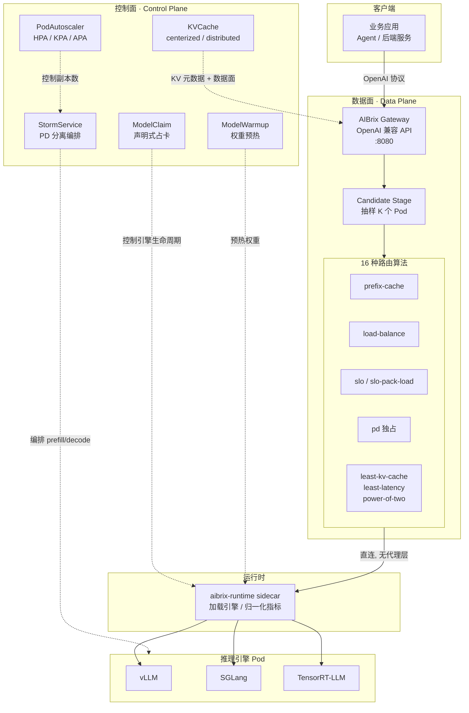
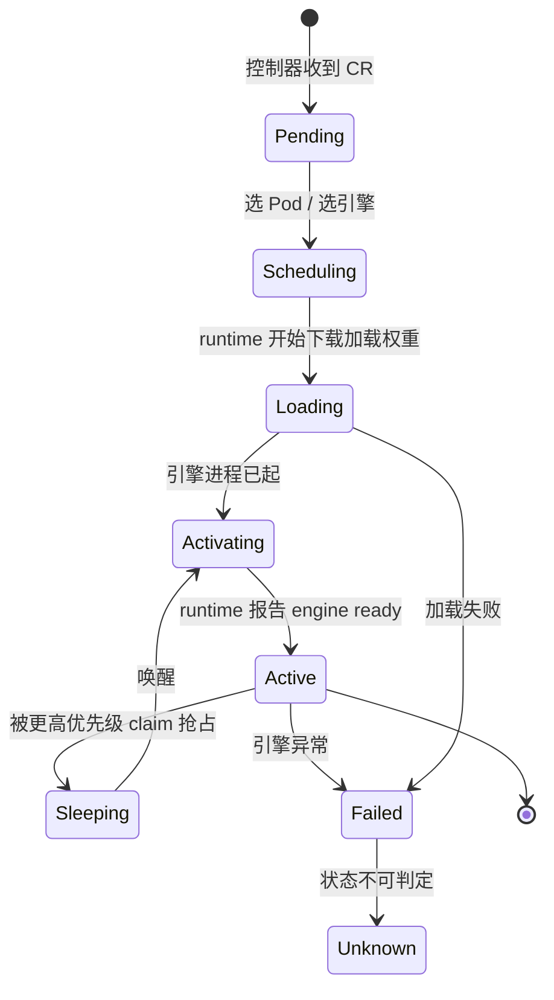
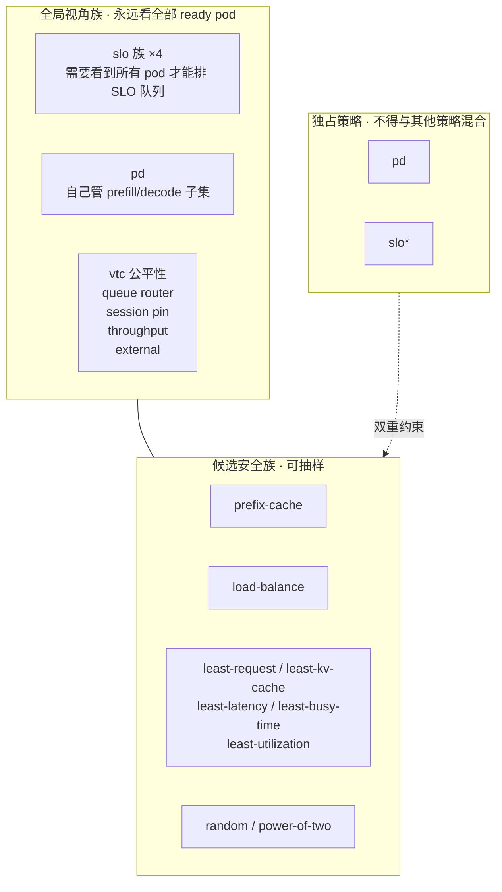
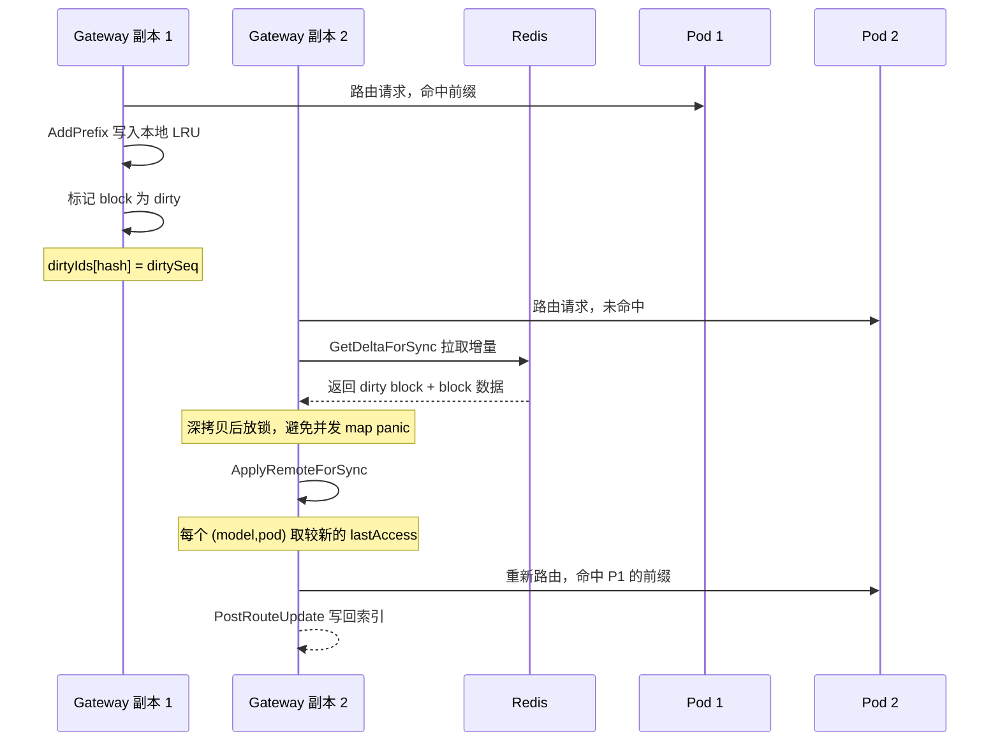
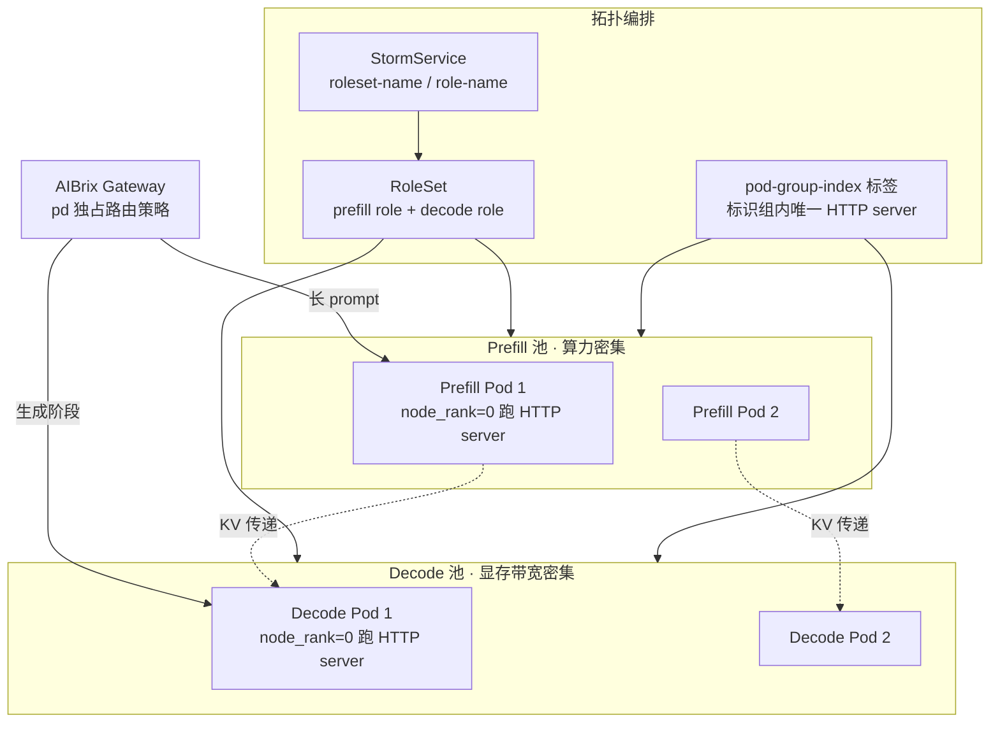
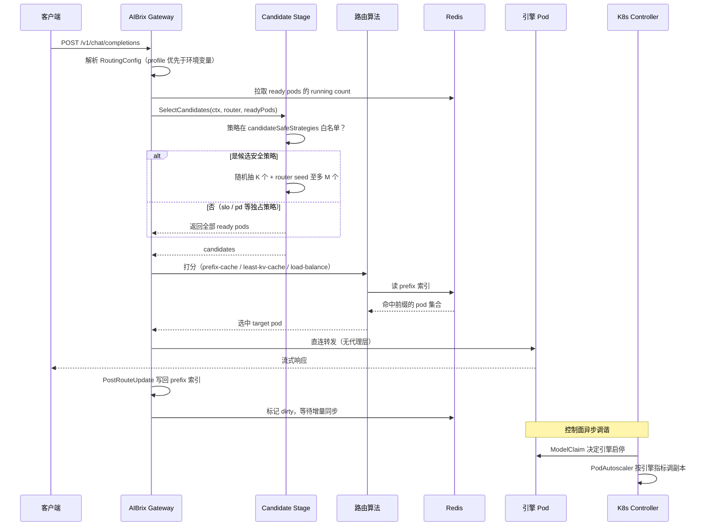

## 引子：AI Gateway 回答了一半的问题

过去两年，AI Gateway 成了 LLM 生产部署的标配。Envoy、Kong、vLLM Semantic Router、各种 `ai-gateway` 项目都在做同一件事：**在请求到达的那一刻，决定把这次请求交给哪个模型、哪个后端**。

这件事本身很有价值，但它只回答了一半的问题。

想象一个真实的场景：你要为客服团队同时提供 `qwen2-7b-instruct`、`llama3-8b`、`deepseek-coder-6b` 三个模型，GPU 型号还不统一（有 A100 也有 A40）。现在到了下午三点，流量高峰，而公司要求「P95 首 token 延迟不超过 400ms，单卡成本不超过 3 美元/天」。

这时候你会遇到一串问题，这些问题**没有一个是请求级网关能回答的**：

- 三个模型加起来权重 22GB，是不是该塞进同一张 A100？还是每张卡只跑一个？
- A40 只有 48GB 显存，装不下 7B 模型加它要的最大 KV cache 吗？
- KV cache 该放显存（快但贵）还是放 GPU 之外（慢但省）？
- 现在流量小，某个模型没人用，它的引擎要不要继续占着显存？
- 临时来一波流量，是加 Pod 还是加副本？加副本要多久？模型权重加载要多久？
- 多轮 Agent 会话是不是应该打到同一个 Pod，才能复用 prefix cache？

**这些问题的主语不是「请求」，而是「Pod」「Replica」「GPU」。**

AIBrix（`vllm-project/aibrix`）就是为回答这些问题而生的。它的 README 第一句写得非常直接：

> AIBrix is a **Kubernetes control plane for production LLM inference**.
> You bring the engine — vLLM, SGLang, or TensorRT-LLM — and AIBrix **routes each request from live engine state**, **scales on inference metrics**, and **manages models, LoRA adapters, and KV cache**.

本文将逐层拆开它的架构：6 个核心 CRD 各自管什么、16 种路由算法如何组合、Candidate Stage 如何把每请求的 O(N) 路由降到 O(K)、Prefix Cache 索引如何跨副本同步、SLO 队列如何用「profile 放宽」满足延迟目标，以及源码注释里那些**诚实的自我批评**——它们往往比功能列表更能说明一个项目的成熟度。

---

## 一、项目定位与核心价值

### 一句话定义

**AIBrix = 面向 LLM 推理的 Kubernetes 控制面 + OpenAI 兼容网关**，由 vLLM 社区的 `vllm-project` 组织维护。

### 仓库统计（2026-11-06 实测）

| 指标 | 值 |
|---|---|
| Stars | **5,181** |
| Forks | 757 |
| 主语言 | **Go 100%** |
| License | Apache-2.0 |
| 创建时间 | 2024-06-10 |
| 最近推送 | 2026-11-05 |
| 仓库大小 | 54,415 KB |
| 树节点数 | **3,534** |
| 最新版本 | v0.8.0（2026-10-09） |
| 白皮书 | arXiv 2504.03648 |

⭐5.2k 在 AI 项目里不算高——但要看跟谁比。vLLM 本身 ⭐60k+，而 AIBrix 解决的是 vLLM **不解决**的那一层（集群编排）。它诞生于 2024 年 6 月，跨了 2 年多、8 个 minor 版本，**这个迭代节奏说明它是被真实生产负载打磨出来的，不是 demo**。

### 能力矩阵（README 原文整理）

| 能力 | 具体做什么 |
|---|---|
| Gateway and routing | OpenAI 兼容 API。基于**引擎实时状态**选 Pod：prefix cache、负载、PD 分离位置，agentic 负载还有 session affinity |
| Multi-engine | vLLM / SGLang / TensorRT-LLM 共用一个网关 |
| LoRA | 把大量低秩适配器打包到共享 base model 的 Pod 上 |
| Model lifecycle | 用 ModelClaim 声明模型，用 ModelWarmup 预热镜像和权重，让扩容更快 |
| Autoscaling | 按**引擎指标**（队列深度、KV cache、token 数）扩缩容 |
| Distributed inference | 用 StormService 跑多节点多角色部署，含 prefill/decode |
| Distributed KV cache | KV cache 卸载到外部，跨引擎复用 |
| Heterogeneous GPUs | 混用 GPU 型号仍能控成本和 SLO（实验性） |
| Runtime | Sidecar：下载权重、加载/卸载 adapter、归一化引擎指标 |

### 关键设计哲学

AIBrix 最核心的一条哲学，藏在它的架构图说明里：

> Requests hit an OpenAI-compatible gateway and go straight to an engine pod.
> **Kubernetes controllers decide what should be running.**

**数据面和数据面之间没有 sidecar 代理**——请求从网关直接打到引擎 Pod。这一点和「网关 + Envoy sidecar 链式代理」的常见做法不同，理由是 LLM 推理的流式响应延迟敏感，每多一跳代理就多一份尾延迟风险。

---

## 二、整体架构：数据面 vs 控制面

AIBrix 的架构可以切成泾渭分明的两半。



**这张图要读出三个信息**：

1. **网关不代理请求**。`Algo → RT → VLLM` 是直连链路，没有 Envoy 在中间做 L7 转换。
2. **控制面不下发请求**。所有虚线都是「声明 → 控制器调谐 → 资源变化」的路径，控制器不碰请求路径。
3. **运行时 sidecar 是唯一的耦合点**。引擎有 vLLM / SGLang / TensorRT-LLM 三种，指标格式各不相同，sidecar 负责归一化。

### 10 个 CRD 类型

AIBrix 的 API 分三个 group（`model.aibrix.ai` / `orchestration.aibrix.ai` / `autoscaling.aibrix.ai`）：

| CRD | 职责 | 属于哪一面的问题 |
|---|---|---|
| **ModelClaim** | 声明「这个模型要跑在某张卡上，占多少显存」 | 模型生命周期 |
| **ModelAdapter** | LoRA adapter 的声明与分发 | 模型生命周期 |
| **ModelWarmup** | 预热镜像与权重 | 模型生命周期 |
| **KVCache** | KV cache 后端（Redis/Etcd 元数据 + 数据面） | 成本治理 |
| **StormService** | 多节点多角色编排（PD 分离的载体） | 拓扑管理 |
| **PodSet / RoleSet / RayClusterFleet / RayClusterReplicaSet** | 通用 Pod 集合、角色集合、Ray 集群 | 拓扑管理 |
| **PodAutoscaler** | 按引擎指标伸缩 | 弹性伸缩 |

---

## 三、核心引擎一：ModelClaim —— 声明式「模型占卡」

这是 AIBrix 最有意思的抽象，也是与所有请求级网关最本质的区别。

### 3.1 问题的本质：显存不是从模型大小推出来的

朴素的想法是「模型多大就占多大显存」。但真实情况是：

```
实际显存占用 = 权重 + CUDA graph + activation workspace + allocator retention + KV cache
```

其中 **allocator retention**（显存分配器保留的碎片）往往占了权重与实际占用之间 gap 的大部分，而它**不随权重线性缩放**——换句话说，你没法从 `artifactURL` 指向的 safetensors 大小算出这个数字。

AIBrix 的解法是：**要求你显式声明两个数字**。

```yaml
# 来自 config/samples/model_v1alpha1_modelclaim.yaml
apiVersion: model.aibrix.ai/v1alpha1
kind: ModelClaim
metadata:
  name: qwen2-7b-sample
spec:
  modelName: qwen2-7b-instruct
  podSelector:
    matchLabels:
      claim.model.aibrix.ai/pool: pool-a
  artifactURL: huggingface://Qwen/Qwen2-7B-Instruct
  engine: vllm
  replicas: 1
  # What one instance needs on one GPU. Measure both figures for your model
  # and engine arguments. Declaring more than it needs wastes room and is
  # safe; declaring less is not.
  perGPU:
    maximumFootprint: 20Gi   # weights, CUDA graphs and allocator retention
    kvFloor: 2Gi             # the KV cache for one request of the maximum length
```

### 3.2 两个数字的精确定义

```go
// 来自 api/model/v1alpha1/modelclaim_types.go
type ModelClaimPerGPU struct {
	// MaximumFootprint is the largest non-KV GPU memory one instance holds on a
	// device: weights, captured CUDA graphs, activation workspaces and
	// allocator retention. It cannot be derived from the artifact size, because
	// most of the gap between the two is allocator retention that does not
	// scale with the weights, so it has to come from a run of this model with
	// these engine arguments.
	//
	// A quantity, so it reads as `30Gi` rather than as a count of bytes nobody
	// can check by eye.
	// +kubebuilder:validation:Required
	MaximumFootprint resource.Quantity `json:"maximumFootprint"`

	// KVFloor is the KV cache one instance must keep on a device to serve at
	// all: enough for one request of the engine's maximum model length at this
	// model's bytes per token, rounded up to the KV allocator's page
	// granularity. Placement holds this much for the instance, reduced to the
	// startup KV capacity when that capacity is known, positive and smaller.
	// This effective floor is held while awake and while sleeping, unless the
	// pool keeps no wake reserve.
	// +kubebuilder:validation:Required
	KVFloor resource.Quantity `json:"kvFloor"`
}
```

注意 `kvFloor` 的定义有多精细：**够跑一条最大长度请求的 KV cache**，按这个模型的 bytes-per-token 算，再**向上取整到 KV allocator 的页粒度**。这不是「留 2GB」这种拍脑袋的数。

### 3.3 ⭐ 整个项目最值得抄走的一段注释

这是 `perGPU` 字段在 `ModelClaimSpec` 里的完整注释：

```go
// 来自 api/model/v1alpha1/modelclaim_types.go
	// PerGPU declares what one instance of this model costs on a single GPU.
	// Placement uses it to keep a card from being promised more memory than it
	// has, and to divide the card between the models on it, so a model is
	// neither started where it cannot fit nor left at its floor while the card
	// has room to spare.
	//
	// A claim without it is not placed. There is no figure the control plane
	// could put here in its place: what an engine holds beyond its weights does
	// not follow from the artifact, so a claim that does not say is a card that
	// cannot be accounted for, and one such claim makes its whole card unusable
	// to every other.
	//
	// Both figures have to be positive, and no more than 1Pi. A figure below
	// 1Mi also has to be a whole number of bytes, and a larger one is rounded
	// up to whole bytes. A claim whose declaration is missing or cannot be
	// used is not placed, and its Scheduled condition says which figure is
	// wrong.
	//
	// The schema leaves it optional, and the controller refuses the claim
	// instead. A claim stored before this field existed has to stay valid. A
	// required field would fail such a claim on its next update. Without CRD
	// validation ratcheting, its finalizer could then never be removed.
	// A missing declaration reads as missing rather than as a cost of zero.
```

逐句拆开，这是**声明式 API 设计的教科书**：

| 设计决策 | 为什么这么定 |
|---|---|
| **缺声明 = 不被放置**（而不是「按 0 算」） | 0 成本会导致一张卡被无限次超卖。「缺失」和「零」是两回事 |
| **schema 里 optional，controller 里拒绝** | CRD 一旦收紧校验（ratchet），历史存量对象下次 update 就失败 → finalizer 永远摘不掉 → 资源卡死 |
| **拒绝时写 `Scheduled` condition 说明哪个数字错了** | 不是抛异常，是可观测的状态 |
| **两者必须为正且 ≤ 1Pi** | 防止有人填 `1Pi` 这样的「无穷大」骗过放置逻辑 |
| **< 1Mi 必须是整字节** | 因为小于页粒度的分配必然浪费 |

> ⭐ **「A missing declaration reads as missing rather than as a cost of zero.」**
> 这一句可以直接搬到任何「资源配额声明式 API」的设计里——包括我们自己的 K8s CRD。

### 3.4 不可变字段的纪律

ModelClaim 有 7 个字段被 kubebuilder 标记为**不可变**：

```go
// 来自 api/model/v1alpha1/modelclaim_types.go
	// Only perGPU can be changed after a claim is created. The other fields decide
	// which engine runs and where, and the engine is started with them only once,
	// so a change would never reach it. To change one, create a new ModelClaim.
	// +kubebuilder:validation:XValidation:rule="has(self.modelName) == has(oldSelf.modelName) && (!has(self.modelName) || self.modelName == oldSelf.modelName)",message="modelName is immutable; create a new ModelClaim instead",fieldPath=".modelName"
```

**推理**：引擎只用这些参数启动一次，之后改 spec 根本传不到引擎进程。所以「改字段」在语义上是**空操作**——那还不如在 API 层直接拒绝，让用户「删了重建」。这比「改完不生效，用户困惑」好得多。

### 3.5 抢占策略：priority 不等于抢占

```go
// 来自 api/model/v1alpha1/modelclaim_types.go
	// Priority determines placement order among ModelClaims that currently have
	// no recorded instance. A higher value is considered before a lower value.
	// Values must be non-negative.
	// Priority alone does not preempt or otherwise change an existing instance.
	// PreemptionPolicy may use it to identify lower-priority sleep victims.
	// Claims with equal priority retain FIFO order. Defaults to zero.
	Priority int32 `json:"priority,omitempty"`

	// PreemptionPolicy controls whether this unplaced ModelClaim may sleep
	// request-idle ModelClaims with a lower placement priority to make GPU room.
	// Defaults to Never.
	PreemptionPolicy ModelClaimPreemptionPolicy `json:"preemptionPolicy,omitempty"`
```

两个策略：`Never` / `SleepLowerPriority`。抢占的**动作是「睡掉」而不是「杀掉」**——被抢占的 claim 进入 Sleeping 态，引擎故意睡着且不可路由，但**已分配实例保留**，这样唤醒时不用重新加载权重。

抢占还有两个前置条件：目标 claim 的 priority **严格更低**，且**当前没有活跃请求**。

### 3.6 ModelClaim 的 8 态生命周期



**`Activating` 态的关键设计**：在这个阶段，热池 Pod 的**路由注解被保持在非路由标记（port 0）**，直到 runtime 报告引擎 ready。这保证网关**不会把请求打到还没起来的引擎**上。

对比一下：很多自建方案里，Pod Ready 了但模型还在加载（vLLM 加载 7B 权重可能要 30 秒到 2 分钟），网关已经开始往里扔请求了。用户看到的是 503 或者超时。AIBrix 把「引擎真的 ready」作为可路由的前提。

---

## 四、核心引擎二：PodAutoscaler —— 三种伸缩策略与双窗口

### 4.1 三种策略的分工

```go
// 来自 api/autoscaling/v1alpha1/podautoscaler_types.go
	// ScalingStrategy defines the strategy to use for scaling. It cannot be changed
	// after creation, because the HorizontalPodAutoscaler that the HPA strategy
	// creates would stay behind. To change it, delete the PodAutoscaler and create
	// a new one.
	// +kubebuilder:validation:Enum={HPA,KPA,APA}
	// +kubebuilder:validation:XValidation:rule="self == oldSelf",message="scalingStrategy is immutable; create a new PodAutoscaler instead"
	ScalingStrategy ScalingStrategyType `json:"scalingStrategy"`
```

| 策略 | 全称 | 机制 |
|---|---|---|
| `HPA` | Horizontal Pod Autoscaler | K8s 原生 HPA，AIBrix 只提供指标 |
| `KPA` | Knative Pod Autoscaling | Knative 风格，支持 panic 短窗 |
| `APA` | AIBrix Pod Autoscaler | AIBrix 自研，AIBrix 自研（见 §4.4） |

**`scalingStrategy` 不可变**，注释理由非常实在：HPA 策略创建的 HorizontalPodAutoscaler 会残留，改策略会造成孤儿资源。

### 4.2 双窗口：一个管稳定，一个管应急

```go
// 来自 api/autoscaling/v1alpha1/podautoscaler_types.go
	// ObserveWindowSeconds controls how much recent metric history is used for stable scaling decisions.
	// If unset, the autoscaler uses its internal default.
	// +kubebuilder:validation:Minimum=1
	// +kubebuilder:validation:Maximum=3600
	ObserveWindowSeconds *int64 `json:"observeWindowSeconds,omitempty"`

	// PanicWindowSeconds controls the short metric window used by KPA panic-mode decisions.
	// If unset, the autoscaler uses its internal default.
	// +kubebuilder:validation:Minimum=1
	// +kubebuilder:validation:Maximum=3600
	PanicWindowSeconds *int64 `json:"panicWindowSeconds,omitempty"`
```

- **Observe 窗口（1–3600s）**：稳定决策用，看长窗口历史
- **Panic 窗口（1–3600s）**：KPA panic 模式用，短窗口应急

### 4.3 预测伸缩：Preview 与 Auto 的分界

```go
// 来自 api/autoscaling/v1alpha1/podautoscaler_types.go
	// Predictive enables forward-looking recommendations derived from the
	// observed metric trend. Preview records the projection in status without
	// changing the replica decision; Auto lets the projection raise the replica
	// floor. When omitted, predictive scaling is disabled.
	Predictive *PredictiveSpec `json:"predictive,omitempty"`
```

| 模式 | 行为 |
|---|---|
| `Preview` | **只记录投影，不改变决策** |
| `Auto` | 投影可以抬高副本**下限**，但**缩容仍归反应式路径** |

「缩容仍归反应式路径」这一条是关键的安全阀：预测模型可能误判趋势，误判导致**缩容**的代价（冷启动、容量骤降）远大于误判导致扩容的代价（多花钱）。

而 `PredictiveStatus` 同时记录三个数字，让「如果不开 Auto 本轮会变吗」这个问题可回答：

| 字段 | 含义 |
|---|---|
| `ReactiveReplicas` | 反应式路径算出的副本数 |
| `PredictedReplicas` | 预测路径算出的副本数 |
| `WouldBeReplicas` | Preview 模式下「若开 Auto 本轮会变吗」的答案 |

### 4.4 5 种指标来源

`MetricSourceType` 有 5 种：`pod` / `resource` / `custom` / `external` / `domain`（已废弃）。常量 `CPU` / `Memory` / `QPS`。

值得注意：**当前 `GetPaMetricSources` 只支持单个 MetricsSource**，传多个会报错。这是个已知的实现限制。

---

## 五、核心引擎三：路由算法与 Candidate Stage

### 5.1 16 种路由算法

```
slo / slo-pack-load / slo-least-load / slo-least-load-pulling   ← SLO 族（默认）
pd                                                            ← 独占，PD 分离
prefix-cache / prefix-cache-preble                             ← 前缀缓存
load-balance                                                 ← 多因子 + 失衡 gate
least-kv-cache / least-gpu-cache(废弃别名) / least-busy-time
least-latency / least-utilization / least-request
power-of-two / throughput / session-affinity / random
```

### 5.2 路由算法的三族划分

16 种算法不是杂乱堆砌，而是按**「需要多少全局视角」**分成三族——这个划分直接决定了它们能不能进 Candidate Stage。



**三族的判据**：

| 族 | 判据 | 能否抽样 | 能否混合 |
|---|---|---|---|
| 全局视角族 | 判断依赖「与池中其余 pod 比较」或「全局公平性」 | **不能** | 视情况 |
| 候选安全族 | 选择只取决于给它的 pod 集合 | **能** | 能 |
| 独占策略 | 自己管 pod 子集 | 不能 | **不能** |

### 5.3 「least-X」模式的统一实现

几乎所有单指标策略都归结为同一个模式：给所有 ready pod 打分 → 按极性选最优 → 并列随机 → 一个都打不出分就随机兜底。

```go
// 来自 pkg/plugins/gateway/algorithms/routeutil/score.go
// RouteByScore is the shared "least-X"/"most-X" routing pattern used by single-metric
// strategies (least-request, least-kv-cache, least-busy-time, ...): it scores
// all ready pods via scorer.ScoreAll, picks the best one per scorer.Polarity() breaking ties
// randomly, and falls back to a uniformly random ready pod when nothing could be scored.
func RouteByScore(ctx *types.RoutingContext, readyPodList types.PodList, scorer types.PodScorer) (*v1.Pod, error) {
	pods := readyPodList.All()
	scores, scored, err := scorer.ScoreAll(ctx, readyPodList)
	if err != nil {
		return nil, err
	}

	targetPod := SelectByScore(pods, scores, scored, scorer.Polarity())
	if targetPod == nil {
		return SelectRandomPodAsFallback(ctx, pods, rand.Intn)
	}

	klog.V(4).InfoS("route_by_score", "request_id", ctx.RequestID, "target_pod", targetPod.Name)
	return targetPod, nil
}
```

### 5.4 ⭐ NaN 安全的选优：一个小细节，大半项目写不对

```go
// 来自 pkg/plugins/gateway/algorithms/routeutil/score.go
// SelectByScore returns the pod with the best score according to polarity (lowest for
// PolarityLeast, highest for PolarityMost), breaking ties uniformly at random. Pods with
// scored[i] == false are ignored. Returns nil if no pod could be scored.
//
// best is seeded with +Inf/-Inf rather than the first scored value so a NaN score (e.g. a
// metric that hasn't warmed up) can never become "best": every comparison against NaN is
// false, so a pod that started as best could never be dethroned or matched by a real value.
func SelectByScore(pods []*v1.Pod, scores []float64, scored []bool, polarity types.Polarity) *v1.Pod {
	var candidates []*v1.Pod
	best := math.Inf(1)
	if polarity == types.PolarityMost {
		best = math.Inf(-1)
	}
	for i, pod := range pods {
		if !scored[i] {
			continue
		}
		s := scores[i]
		switch {
		case (polarity == types.PolarityLeast && s < best) || (polarity == types.PolarityMost && s > best):
			best = s
			candidates = []*v1.Pod{pod}
		case s == best:
			candidates = append(candidates, pod)
		}
	}
	if len(candidates) == 0 {
		return nil
	}
	return candidates[rand.Intn(len(candidates))]
}
```

**问题**：Go 里的 `NaN` 与任何值比较都返回 `false`。如果 `best` 用「第一个打分的值」初始化，而那个值恰好是 NaN（比如指标还没预热），那么：

- `s < best` 对 NaN 永远 false → 后面所有真实分数都**无法替换** best
- `s == best` 对 NaN 也永远 false → NaN pod **永远进不了 candidates**

结果：一个 NaN pod 占住了「最优」位置，真实的最优 pod 永远选不上。**best 永远停在 NaN 上**。

**修法**：用 `+Inf` / `-Inf` 初始化，而不是第一个值。这样 NaN 永远无法通过 `<` 或 `==` 进入 candidates，而真实分数可以正常替换。

这个 bug 在真实的负载均衡器里极难发现——它只在「某个 pod 的指标还没就绪」时触发，表现是「路由偶尔莫名其妙」。

### 5.5 ⭐ 诚实面对指标消失：vLLM V1 的坑

```go
// 来自 pkg/plugins/gateway/algorithms/least/kv_cache.go
// 说明：以下为源码节选，函数体在节选边界处截断，故括号不成对。
// cpuCacheUsage returns the pod's CPU KV-cache usage, or 0 when the engine does not report
// it. vLLM's V1 engine dropped cpu_cache_usage_perc along with KV swapping (it recomputes
// preempted requests instead), so on V1 the metric is simply absent and GPU usage alone
// describes the pod's KV pressure. Treating that as fatal would mark every pod unscored and
// drop this router to its random fallback, which is worse than the load-aware choice this
// router exists for.
func cpuCacheUsage(c cache.Cache, pod *v1.Pod, model string) float64 {
	cpuCache, err := c.GetMetricValueByPodModel(pod.Name, pod.Namespace, model, metrics.CPUCacheUsagePerc)
	if err != nil {
		return 0
	}
```

**这个注释值得单独拎出来讲**。它的推理链是：

1. vLLM V1 引擎随 KV swapping 一起移除了 `cpu_cache_usage_perc`（改为重算被抢占请求）
2. 所以 V1 上这个指标就是**不存在**
3. 如果把「指标不存在」当成致命错误 → 所有 pod 都变 unscored → **整个路由器退化成随机 fallback**
4. 而随机 fallback **比它存在的意义（负载感知）更糟**

所以选择返回 0（视为无 CPU 侧压力，让 GPU 侧指标单独说话），而不是报错。

> ⭐ **这类「优雅降级 vs 正确报错」的抉择，是区分玩具项目和工业项目的分水岭。**
> 大多数教程代码在这里会直接 `return 0, err`；AIBrix 明确论证了为什么这里必须返回 0 且不报错。

同时注意 `least-gpu-cache` 是**废弃别名**——它仍然注册着，保证老的 routing-strategy header 继续能解析，但会转到 `least-kv-cache`。

### 5.6 ⭐⭐ Candidate Stage（RFC #3188）：把每请求 O(N) 降到 O(K)

这是 AIBrix 路由层最有价值的设计。

**动机**：每个策略和负载失衡 gate 都要从 Redis 读**每个 pod** 的跨网关 running count。在 N 个 pod 上路由 = 每请求数次 N-pod 的 Redis 读。100 个 pod 的集群，这个开销不可接受。

**做法**：

```go
// 来自 pkg/plugins/gateway/algorithms/candidates.go
// The candidate stage (RFC #3188) bounds the per-request routing work by K instead of the number
// of ready pods. Every strategy and the load-imbalance gate read each pod's cross-gateway running
// count from Redis, so routing over N pods costs several N-pod Redis reads per request. With
// AIBRIX_ROUTING_CANDIDATE_K > 0, the gateway draws K pods at random, adds up to
// AIBRIX_ROUTING_CANDIDATE_PREFIX_M pods that the router seeds (for prefix-cache, the pods holding
// the longest cached prefix), and runs the gate and the router on that set only. Off by default;
// a model config profile can set both through routingConfig.candidate.
var (
	routingCandidateK       = utils.LoadEnvInt("AIBRIX_ROUTING_CANDIDATE_K", 0)
	routingCandidatePrefixM = utils.LoadEnvInt("AIBRIX_ROUTING_CANDIDATE_PREFIX_M", 16)
)
```

**候选集 = 随机抽 K 个 Pod + router seed 的至多 M 个 Pod**。对 prefix-cache 策略，seed 的正是「持有最长缓存前缀」的那些 pod——**随机抽样 + 定向补充**的组合，既保证了分布性，又不会把最优目标抽掉。

**⭐ 白名单机制**（这是设计上最讲究的地方）：

```go
// 来自 pkg/plugins/gateway/algorithms/candidates.go
// candidateSafeStrategies are the strategies whose choice depends only on the pods they are
// given, so routing over a sample changes which pods compete but not the formulas that judge
// them. Checks that compare a pod with the rest of its pool (the gate's spread, prefix-cache's
// standard-deviation check, the blend's normalization) then compare it with the sample, not the
// fleet. A new strategy is kept off the candidate stage until it is added here.
// Strategies that keep a global view (vtc's fairness, the queue router, session pins, external
// and throughput routers, and the exclusive pd and slo routers) always see every ready pod.
var candidateSafeStrategies = map[string]bool{
	string(RouterLoadBalance):            true,
	string(RouterPrefixCache):            true,
	string(RouterRandom):                 true,
	string(RouterPowerOfTwo):             true,
	string(least.RouterLeastRequest):     true,
	string(least.RouterLeastRequestTopK): true,
	string(least.RouterLeastKvCache):     true,
	string(least.RouterLeastGpuCache):    true,
	string(least.RouterLeastBusyTime):    true,
	string(least.RouterLeastLatency):     true,
	string(least.RouterUtil):             true,
}
```

判据是**「选择只取决于给它的 pod 集合」**。需要全局视角的策略（VTC 公平性、队列路由、session pin、独占的 pd 和 slo）**永远看全部 ready pod**。

> ⭐ **注意最后一句注释：「A new strategy is kept off the candidate stage until it is added here.」**
> 新策略默认**不进入**候选阶段——这是安全的默认值（默认走全量 = 正确但慢），而不是默认进入（默认快但可能错）。

**⭐ 两处诚实的不确定性声明**：

> 「检查会把 pod 与池中其余 pod 比较（gate 的 spread、prefix-cache 的标准差检查、blend 的归一化）→ **此时比较对象是样本而不是整个 fleet**」

也就是说：抽样之后，「负载是否均衡」这个判断只相对于**样本**成立，不相对于整个池子。这是抽样换性能的真实代价，源码里直接写出来了。

### 5.7 抽样算法的两个细节

```go
// 来自 pkg/plugins/gateway/algorithms/candidates.go
// 说明：以下为源码节选，函数体在节选边界处截断，故括号不成对。
	// want < len(readyPods), so k random pods outside the seeds always exist. When the sample is
	// a small share of readyPods, rejection sampling keeps this O(k) instead of touching every pod.
	if 2*want > len(readyPods) {
		for _, i := range rand.Perm(len(readyPods)) {
```

- **样本占比大时**（`2*want > len(readyPods)`）：用 `rand.Perm` 全排列取前 want 个
- **样本占比小时**：用拒绝采样循环，保持 O(k)，不触碰每个 pod

这两个分支的存在说明作者认真考虑过复杂度，不是随手写的。

---

## 六、核心引擎四：Prefix Cache 索引与跨副本同步

### 6.1 前缀缓存路由为什么值钱

Agent 场景下，同一个 system prompt + 对话历史前缀会反复出现。如果路由到持有该前缀的 pod，引擎的 prefix cache 命中率飙升，TTFT（首 token 延迟）大幅下降。

**但这里有个陷阱**：多个 Gateway 副本时，pod A 的缓存信息在 pod B 上看不见。

### 6.2 哈希种子：为什么必须可配置

```go
// 来自 pkg/utils/prefixcacheindexer/hash.go
const (
	defaultPrefixCacheBlockNumber            = 200000
	defaultPrefixCacheBlockSize              = 4
	defaultPrefixCacheEvictionInternalInSec  = 1  // 1 second
	defaultPrefixCacheEvictionDurationInMins = 20 // 20 minutes
	defaultPrefixCacheHashSeed               = uint64(0)
	envPrefixCacheHashSeed                   = "AIBRIX_PREFIX_CACHE_HASH_SEED"
	envStateSyncEnabled                      = "AIBRIX_STATESYNC_ENABLED"
)
```

```go
// 来自 pkg/utils/prefixcacheindexer/hash.go
func prefixCacheHashSeed() uint64 {
	stateSyncEnabled := utils.LoadEnvBool(envStateSyncEnabled, false)

	seedStr, ok := utils.LookupEnv(envPrefixCacheHashSeed)
	if ok && seedStr != "" {
		seed, err := strconv.ParseUint(seedStr, 10, 64)
		if err != nil {
			if stateSyncEnabled {
				klog.Warningf("invalid %s=%q with %s=true, using default %d: %v",
					envPrefixCacheHashSeed, seedStr, stateSyncEnabled, defaultPrefixCacheHashSeed, err)
				return defaultPrefixCacheHashSeed
			}
			klog.Warningf("invalid %s=%q, using random seed: %v", envPrefixCacheHashSeed, seedStr, err)
			return randomPrefixCacheHashSeed()
		}
		return seed
	}

	if stateSyncEnabled {
		return defaultPrefixCacheHashSeed
	}
	return randomPrefixCacheHashSeed()
}
```

**三条分支的逻辑非常清晰**：

| 场景 | 种子 | 为什么 |
|---|---|---|
| 显式 env 且合法 | 用户指定 | 完全可控 |
| 显式 env 但非法 + **stateSync 开启** | 回退到 **0**（固定） | 跨副本哈希必须一致，不能随机 |
| 显式 env 但非法 + stateSync 关闭 | 回退到**随机** | 单副本不需要一致，随机更好防碰撞 |
| 未设置 + stateSync 开启 | **0**（固定） | 同上 |
| 未设置 + stateSync 关闭 | **随机** | 同上 |

**「跨副本哈希必须一致」**——这是分布式缓存索引的基本要求，但很多实现会漏掉，导致不同副本算出不同的前缀哈希，缓存命中率莫名其妙地低。

### 6.3 增量同步：加锁纪律的范例

```go
// 来自 pkg/utils/prefixcacheindexer/hash.go
type PrefixHashTable struct {
	mu       sync.RWMutex
	seed     uint64
	store    lrustore.Store[uint64, Block]
	dirtyIds map[string]uint64 // block hash as string -> dirtySeq of its last change, for delta sync
	dirtySeq uint64
	// deltaSeq is dirtySeq as of the last GetDeltaForSync. It is written under
	// the read lock, so it must be atomic.
	deltaSeq atomic.Uint64
	// now is the clock for pod access times; tests replace it.
	now func() time.Time
}
```

`deltaSeq` 必须在读锁下写，但又要能被原子读——所以用 `atomic.Uint64` 而不是普通 uint64。**这种「锁内写 + 锁外读」的场景必须用原子类型**，否则是数据竞争。

`GetDeltaForSync` 的锁纪律注释（来自 `sync.go`）：

> Snapshot dirty IDs and copy block data under a read lock so the routing path (`seqSearchPrefix`, also an RLock caller) is not blocked during JSON encoding.
> **Block.modelToPods contains maps (reference types), so a deep copy is required before releasing the lock.**

**为什么必须深拷贝**：`Block.modelToPods` 是 `map[string]map[string]time.Time`——Go 的 map 是引用类型。如果在放锁后序列化，路由路径（另一个 RLock 持有者）可能正在改这个 map，**序列化时就会 panic（concurrent map read and map write）**。所以必须 `copyBlock()` 深拷贝后再放锁。

### 6.4 合并规则与诚实的边界声明

`ApplyRemoteForSync` 的合并规则：**每个 (model, pod) 取较新的 lastAccess**，不是整块覆盖。这个设计避免了「一个副本的旧数据覆盖另一个副本的新数据」。

至于边界，源码里写得很坦白：

> 标记 dirty 后又在下次 push 前被 LRU 驱逐的 block **会被跳过**（不发 Redis delete）；
> 陈旧的 Redis key 靠 **per-key TTL 自然老化**；**不要假设跨副本 delete 会立即传播**

这是分布式缓存的经典难题（缓存失效的传播延迟），AIBrix 的解法是**不追求强一致，靠 TTL 自然收敛**。

### 6.5 跨副本同步时序



---

## 七、核心引擎五：SLO 队列与「profile 放宽」

### 7.1 问题：延迟目标和排队策略

SLO 族的路由算法要回答的问题是：「我有一个延迟目标，怎么排队才能满足它？」

AIBrix 的解法不是简单的 FIFO，而是**按 SLO profile 逐档放宽**。

### 7.2 queueOptions 的 4 个开关

```go
// 来自 pkg/plugins/gateway/queue/slo_queue.go
// queueOptions carries the SLOQueue policy switches. Production always runs the
// shipped values, which NewSLOQueue writes down once; tests set a field directly
// after construction to pin a branch that production cannot select.
//
// Switch matrix:
//
//	fifoOnNonSLOViolation: when true, candidates that both rank below zero are
//	  served in arrival order instead of rank order.
//	queueOverallSLO: when true, ranking accounts for the requests already queued
//	  on the head's subqueue (queueRank) instead of ranking the head alone (rank).
//	monogenousGPURouting: when true, a candidate is routed per deployment
//	  profile, most relaxing first; when false, it is routed against the whole
//	  pod set in one call.
//	monogenousGPURoutingOnly: when true, only the most relaxing profile is
//	  tried. It is read only inside the monogenousGPURouting branch, so it
//	  has no effect unless profile routing is on.
type queueOptions struct {
	fifoOnNonSLOViolation    bool
	queueOverallSLO          bool
	monogenousGPURouting     bool
	monogenousGPURoutingOnly bool
}
```

注意 `monogenousGPURoutingOnly` 的注释——「It is read only inside the monogenousGPURouting branch, so it has no effect unless profile routing is on」。这种**开关之间的依赖关系被明确写出来**，省下后来者大量调试时间。

### 7.3 profile 放宽机制

一个请求带多档 SLO profile（按 promptTokens / maxTokens 区间匹配）。排队时：

- `profileLess` 按 rank 升序排 → **第一档是最宽松的**
- relaxer 逐档放宽直到能满足 SLO
- **NaN 排序规则**：NaN rank 排在所有可比较 rank 之后，且两个 NaN 按 key 排序 → 保证「只要有一个 profile 可比较，第一个 profile 就可比较」

**NaN 规则的用意**：如果最宽松的 profile 不可比较（指标缺失），但严格些的可比较，那还是应该用可比较的那个，而不是直接放弃。

### 7.4 全序：让 pick 成为纯函数

`candidateLess` 被设计成**全序**，规则是：

1. 「最宽松 profile 的 rank 更高」的候选先服务（最接近/已超 SLO deadline 的先走）
2. 可比较且 rank 相等 → 按到达顺序
3. 再按 subqueue key

源码注释一句话点破：

> **pick 是排队集合的纯函数，不依赖遍历 subqueue 的偶然顺序**

**这是并发数据结构设计的要点**：如果排序不是全序，两个并发出队可能选出不同的「最优」，同一批请求的处理顺序就取决于遍历顺序——非确定性。做成全序后，pick 就是集合的纯函数，与遍历顺序无关。

### 7.5 FIFO 兜底及其原因标记

```go
// 来自 pkg/plugins/gateway/queue/slo_queue.go
const (
	// Reason label values for gateway_queue_fifo_fallback_total. The FIFO fallback
	// candidate serves a dequeue when no request could be ranked against any profile:
	// either no profile is available for the deployment at all, or the available
	// profiles carry no SLO information.
	queueFallbackReasonNoProfile = "no_profile"
	queueFallbackReasonNoSLOInfo = "no_slo_info"
)
```

兜底发生时有**两个可区分的原因标签**（`no_profile` / `no_slo_info`），并暴露为 Prometheus 指标 `gateway_queue_fifo_fallback_total`。**降级不是静默的，是可观测的**——这是运维视角和 demo 视角的区别。

---

## 八、PD 分离：Prefill / Decode 解耦

### 8.1 为什么需要 PD 分离

LLM 推理有两个阶段，资源特征完全不同：

| 阶段 | 瓶颈 | 特征 |
|---|---|---|
| **Prefill** | 算力（compute bound） | 处理长 prompt，GPU 利用率高，可预测 |
| **Decode** | 显存带宽（memory bound） | 逐 token 生成，GPU 利用率低 |

把它们放在同一个 Pod 上，长 prompt 的 prefill 会阻塞其他请求的 decode。PD 分离把两者拆成不同的 Pod 池，各自独立扩缩。

### 8.2 引擎注册表：调用方永远拿到有效 handler

```go
// 来自 pkg/plugins/gateway/algorithms/pd/engine/registry.go（结构摘要）
// Register(h EngineHandler) 由各引擎文件 init() 调用；
// Resolve(name) 对未知引擎返回 DefaultHandler（调用方永远拿到有效 handler，无需判 nil）
```

三个引擎适配器：`engine/vllm.go` / `engine/sglang.go` / `engine/trtllm.go`。

**`Resolve` 对未知引擎返回 `DefaultHandler` 而不是 nil** —— 调用方不需要写 `if handler == nil` 的分支。这是 Go 里处理「注册表可能查不到」的常见好做法。

### 8.3 PD 分离的拓扑



### 8.4 多节点 TP 的 HTTP server 只有一个 Pod 跑

```go
// 来自 pkg/plugins/gateway/algorithms/pd/pod_labels.go
// IsPodWithHTTPServer：多节点 TP 场景只有 node_rank=0 的 pod 跑 HTTP server
// （pod-group-index == "0"）；无该标签 = 单节点或旧配置 → 兼容包含
```

**标签体系**：`roleset-name` / `role-name` / `stormservice.orchestration.aibrix.ai/pod-group-index`。

兼容策略值得学：**「无该标签 = 单节点或旧配置 → 兼容包含」**——旧的对象没有新标签，不能因为新标签就把它们排除掉。

### 8.5 超时旋钮：0 是有意义的

```go
// 来自 pkg/plugins/gateway/algorithms/pd/decode_watchdog.go
// AIBRIX_DECODE_ABORT_TIMEOUT / AIBRIX_DECODE_ABORT_RETRY_DELAY
// AIBRIX_DECODE_FIRST_RESPONSE_TIMEOUT / AIBRIX_DECODE_RESPONSE_TIMEOUT
// AIBRIX_DECODE_STREAM_IDLE_TIMEOUT
// 注释：前两者 0 是有意义的（0 = 禁用 decode abort / 退化为单次尝试）
```

**「0 表示禁用」而不是「0 表示立即超时」**——这类语义如果不说清楚，运维改配置时必然踩坑。

### 8.6 独占策略：PD 不能和其他策略混用

```go
// 来自 pkg/plugins/gateway/algorithms/router.go
// 独占策略 isExclusiveStrategyName：pd、slo* 会自己管 pod 子集，
// 不得与其他策略混合、也不得被负载失衡 gate 预先收窄 pod 列表
// 注释：「这是 ParseMultiRouterConfig / appendLoadBalanceBlend /
// ResolveExclusiveStrategy 共用的唯一定义，
// 这样独占策略集合不会在各调用点之间漂移」
```

**「唯一定义」** 是关键——如果三个地方各写一份 `isExclusive`，迟早会漂移。单一事实来源在这里被明确落实。

多策略混合的配置串长这样：

```
"prefix-cache:2,least-latency:1,least-request"
```

权重系数必须是 `[0, 1000000]` 的整数，**权重 0 = 跳过该策略**。

---

## 九、端到端数据流

把上面所有模块串起来，一个请求的完整生命周期：



**这张图的核心是「数据面不等人」**：控制面的调谐（模型启停、扩缩容）是异步的，但请求路径上的决策（选哪个 Pod）是同步的、基于**实时引擎状态**的。

---

## 十、与同类项目的设计差异

选三个最容易被混淆的项目对比：

| 维度 | **AIBrix** | vLLM Semantic Router | Agent Router | KServe / Ray Serve |
|---|---|---|---|---|
| **管理单元** | **Pod / Replica / GPU** | 请求 | 请求 | Pod |
| **核心问题** | 谁该活着、模型装哪张卡、KV 放哪 | 这次请求选哪个模型 | 这次请求路由/转换/配额 | 这个 Deployment 该有几个副本 |
| **是否有 LLM 专属语义** | **KV cache、PD、LoRA、prefix、perGPU** | prefix 缓存、选模 | 无（通用 AI Gateway） | **无** |
| **决策时机** | 持续（控制器调谐）+ 请求时（路由） | 请求时 | 请求时 | 持续 + 部署时 |
| **典型动作** | 扩缩容 / 拉权重 / 起停引擎 / 换卡 | 选模型 | 改写请求头体 | 扩缩容 |
| **实现** | Go 100%，Apache-2.0 | Python | Go + Envoy | Python / Java |
| **组织** | `vllm-project` | `vllm-project` | 社区 | KServe / Ray |

### 设计差异的核心

**1. 请求级网关 vs 集群级控制面**

前两者管「这一次请求交给谁」，AIBrix 管「**哪些 Pod 该活着、模型该装在哪张卡上、KV 缓存在哪**」。

**2. LLM 专属语义的有无**

Agent Router 是**通用** AI Gateway——它做路由、协议转换、凭据轮换、配额，但它的世界里没有「KV cache」「prefix 命中率」「prefill 和 decode 的资源特征不同」这些概念。

KServe / Ray Serve 是成熟的 K8s serving 框架，但同样没有 LLM 语义——它们把「模型」当作普通 HTTP 服务，不知道 KV cache 是什么。

**3. 声明式 vs 隐式**

AIBrix 把「哪个模型占哪张卡」变成 `ModelClaim` 这样的声明式 CRD，而不是某个 YAML 配置文件里的隐式约定。这带来 K8s 生态的全部好处：版本控制、RBAC、审计、GitOps。

> ⭐ **一句话总结**：
> 现有 AI Gateway 都在回答「这一次请求交给哪个模型」；
> **AIBrix 第一次把「哪些 GPU 该跑哪些模型、KV 缓存在哪、什么时候该扩」也做成了声明式 K8s API。**

---

## 十一、优缺点分析

### 架构简洁性 / 扩展性 / 易用性

| 优点 | 说明 |
|---|---|
| **声明式 API 设计教科书** | `perGPU` 的「缺失 ≠ 零」语义、7 个不可变字段、4 个 CRD group 的职责切分，每一处都有明确的理由注释 |
| **策略即算法，算法即插件** | 16 种路由算法统一在 `types.Router` 接口下，新增策略只需注册；`candidateSafeStrategies` 白名单机制让「是否可抽样」变成显式声明 |
| **多引擎统一** | vLLM / SGLang / TensorRT-LLM 共用一个 OpenAI 兼容网关，sidecar 负责指标归一化 |
| **控制面与数据面彻底解耦** | 控制器不碰请求路径，请求路径也不依赖控制器实时响应 |
| **诚实** | 源码注释里主动记录自己的缺陷和边界（见下节） |

### 性能 / 复杂度 / 维护性

| 缺点 | 说明 |
|---|---|
| **⭐ 复杂度显著高于请求级网关** | 6+ 个 CRD group、10 个 CRD 类型、多个控制器，运维门槛远高于「装个 nginx 反代」 |
| **候选阶段的语义损失** | 抽样后，「负载均衡」的判断只相对于样本成立，不是全池——源码里承认了这一点 |
| **单一指标源的限制** | `GetPaMetricSources` 当前只支持单个 MetricsSource，多源会报错 |
| **`scalingStrategy` 不可变** | 改策略必须删了重建，运维不够灵活 |
| **`replicas` 字段当前被限制为 1** | CRD 校验是 `Minimum=1 / Maximum=1`，模型级多副本还没放开 |
| **生态仍在早期** | v0.8.0，异构 GPU 明确标注「实验性」 |

### ⭐ 必须诚实指出的两个源码自陈缺陷

**缺陷 1：负载失衡 gate 用原始计数而非容量归一化负载**

```go
// 来自 pkg/plugins/gateway/algorithms/load_balance.go
// TODO: This compares raw running-request counts, not capacity-normalized load.
// In a heterogeneous pool a replica that is simply faster than its peers is expected to carry more concurrent
// requests without being more loaded (the same capacity signal `loadBalanceScore` uses),
// but this gate has no notion of capacity and can flag such a replica as a hotspot
// and exclude it from routing **before any strategy's capacity-aware scoring gets a chance to run**.
// Move this to compare capacity-normalized load instead of raw counts.
```

**这个 TODO 说得非常清楚**：在混合 GPU 池里，一个「只是更快」的副本自然会承载更多并发请求，但这个 gate 不懂容量，会把它误判成热点，**在任何容量感知评分有机会运行之前**就把它排除掉。

**在混合 GPU 集群里（这正是 AIBrix 主打的场景），这个缺陷会实际影响路由质量。**

**缺陷 2：`ModelRouterFactory` 硬编码 SLO 路由器**

工厂函数默认指向 SLO 族，而不是让用户配置默认策略。这意味着「默认行为」和「显式配置」耦合在一起。

---

## 十二、实践：跑起来

### 12.1 安装（来自 README 原文）

```shell
VERSION=v0.8.0

# Dependencies (Envoy Gateway, KubeRay, and friends)
kubectl apply -f "https://github.com/vllm-project/aibrix/releases/download/${VERSION}/aibrix-dependency-${VERSION}.yaml" --server-side

# CRDs ship separately so uninstalling the operator does not delete user resources
kubectl apply -f "https://github.com/vllm-project/aibrix/releases/download/${VERSION}/aibrix-core-crds-${VERSION}.yaml" --server-side

# Controllers, gateway plugins, and supporting services
kubectl apply -f "https://github.com/vllm-project/aibrix/releases/download/${VERSION}/aibrix-core-${VERSION}.yaml"

kubectl get pods -n aibrix-system
```

**注意那句注释**：「CRDs ship separately so uninstalling the operator does not delete user resources」。CRD 单独分发——删 operator 时不会连带删掉用户的 CR。这是 K8s 生态里 operator 的重要惯例（Kubernetes API 弃用策略要求的）。

### 12.2 声明一个模型：ModelClaim

```yaml
# 来自 config/samples/model_v1alpha1_modelclaim.yaml
apiVersion: model.aibrix.ai/v1alpha1
kind: ModelClaim
metadata:
  name: qwen2-7b-sample
spec:
  modelName: qwen2-7b-instruct
  podSelector:
    matchLabels:
      claim.model.aibrix.ai/pool: pool-a
  artifactURL: huggingface://Qwen/Qwen2-7B-Instruct
  engine: vllm
  replicas: 1
  perGPU:
    maximumFootprint: 20Gi
    kvFloor: 2Gi
```

**怎么定这两个数字？** 用这个模型 + 这组引擎参数**实际跑一次**，看显存占用峰值。声明多了浪费（但安全），声明少了放不下（不安全）。注释里说得很明确：「Declaring more than it needs wastes room and is safe; declaring less is not.」

### 12.3 部署分布式 KV Cache

```yaml
# 来自 config/samples/orchestration_v1alpha1_kvcache.yaml
apiVersion: orchestration.aibrix.ai/v1alpha1
kind: KVCache
metadata:
  name: aibrix-deepseek-coder-33b-kvcache
  namespace: aibrix-system
spec:
  mode: centralized
  service:
    type: ClusterIP
    ports:
      - name: service
        port: 9600
        targetPort: 9600
        protocol: TCP
  cache:
    image: aibrix/vineyardd:20241120
    imagePullPolicy: IfNotPresent
    resources:
      requests:
        cpu: "2000m"
        memory: "4Gi"
      limits:
        cpu: "2000m"
        memory: "4Gi"
```

`mode` 有两种：`centralized`（集中式，示例用的是这个，Vineyard 后端）/ `distributed`（分布式，默认值）。元数据后端支持 **Redis / Etcd**，也可以外连已有实例。

### 12.4 配置弹性伸缩

```yaml
# 来自 config/samples/autoscaling_v1alpha1_podautoscaler.yaml
apiVersion: autoscaling.aibrix.ai/v1alpha1
kind: PodAutoscaler
metadata:
  name: podautoscaler-example
  namespace: default
spec:
  scaleTargetRef:
    apiVersion: apps/v1
    kind: Deployment
    name: nginx-deployment
  minReplicas: 1
  maxReplicas: 10
  targetMetric: "CPU"
  targetValue: "10"
  scalingStrategy: "HPA"
```

### 12.5 调优开关速查

| 环境变量 | 默认 | 作用 |
|---|---|---|
| `AIBRIX_ROUTING_CANDIDATE_K` | 0（关闭） | 候选阶段抽样的 Pod 数 |
| `AIBRIX_ROUTING_CANDIDATE_PREFIX_M` | 16 | router seed 的 Pod 数上限 |
| `AIBRIX_PREFIX_CACHE_HASH_SEED` | 随机 / 0 | 前缀哈希种子（stateSync 开启时必须固定） |
| `AIBRIX_STATESYNC_ENABLED` | false | 跨副本状态同步 |
| `AIBRIX_PREFIX_CACHE_BLOCK_NUMBER` | 200000 | LRU block 容量 |
| `AIBRIX_PREFIX_CACHE_EVICTION_DURATION_MINS` | 20 | block 过期时长 |
| `AIBRIX_DECODE_ABORT_TIMEOUT` | — | 0 表示禁用 decode abort |

### 12.6 Benchmark 套件：brixbench

AIBrix 自带独立的 benchmark 套件 `brixbench/`，testdata 用**真实场景矩阵**命名。以这个文件为例：

```
qwen3-8b-tc-rt-02-pd-4p4d-multinode-r16-p1000.yaml
```

文件名本身就是一张参数表，命名规律是 `<模型>-<场景>-pd-<P>p<D>d-<拓扑>-r<并发>-p<请求数>`：

| 片段 | 含义 | 本例取值 |
|---|---|---|
| `qwen3-8b` | 模型 | Qwen3 8B |
| `tc-rt-02` | 压测配置 | throughput 模式，2 并发流 |
| `pd-4p4d` | PD 分离配置 | 4 个 prefill + 4 个 decode |
| `multinode` | 拓扑 | 多节点（对应 `singlenode`） |
| `r16` | 并发数 | 16 |
| `p1000` | 请求总数 | 1000 |

同一套 testdata 下还有 **dynamo** 和 **llmd** 的对照部署——**自带竞品对比的 benchmark 设计**，这在开源推理框架里不常见。

---

## 十三、趋势与总结

### 4 个趋势判断

**1. LLM 推理的运维重心正在从「请求级」转向「集群级」**

早期 AI Gateway 解决的是「请求进哪个模型」。随着模型数量、GPU 型号、agentic 负载的复杂度上升，真正的成本和延迟瓶颈转移到了「**模型怎么摆、卡怎么分、什么时候扩**」。AIBrix 代表的正是这个转向。

**2. 「声明式占卡」会成为 LLM 集群的事实标准**

`perGPU` 的两个数字解决了一个真实且棘手的问题：**显存占用不可从模型大小推导**。一旦这个抽象被广泛接受（KServe、Ray、vLLM 的 K8s 部署方案都可能跟进），那么「模型的部署描述」就会从一堆隐式约定变成一份可审计的声明。

**3. Agentic 负载会推动 prefix cache 和 session affinity 成为一等公民**

多轮 Agent 会话天然重复长前缀。AIBrix 的 prefix-cache 路由 + session affinity（滑动 TTL，每 60s 批量同步）就是为此设计的。随着 agentic 应用占比上升，**「请求级无状态」的假设会越来越站不住脚**。

**4. 推理控制面会成为新的基础设施品类**

AIBrix、Agent Router、vLLM Semantic Router 同属 `vllm-project`——一个社区同时在做「集群级控制面」和「请求级网关」两件事，并让它们互相调用。这说明**推理基础设施正在分层**，而这个分层在 2024 年还不存在。

### 工程经验提炼（可复用到自己的项目）

| 经验 | 出处 |
|---|---|
| **「缺失」不等于「零」** —— 资源声明类 API 的铁律 | `ModelClaimPerGPU` |
| **schema 可选 + controller 拒绝**，避免 CRD 校验棘轮把存量对象卡死 | `ModelClaimSpec.PerGPU` |
| **NaN 用 `±Inf` 初始化 best**，否则 NaN 会永久霸占最优位 | `routeutil.SelectByScore` |
| **指标消失 ≠ 致命错误**，降级到次优信号好过退化成随机 | `least/kv_cache.go` |
| **「谁该活着」是识别控制面的关键问题** | 架构判据 |
| **把开关之间的依赖关系写进注释** | `queueOptions` |
| **抽样后语义会变，诚实说出来** | `candidates.go` |
| **不追求分布式强一致，用 TTL 自然收敛** | `prefixcacheindexer` |
| **单一事实来源，避免多处分叉** | `isExclusiveStrategyName` |

### 总结

AIBrix 的价值不在于它的 16 种路由算法有多花哨，而在于它**把 LLM 推理的管理单元从「请求」提升到了「Pod / GPU」**。

在这个视角下，很多东西自然就通了：

- `perGPU` 为什么必须是两个手填的数字 —— 因为显存占用不可推导
- 为什么 `Activating` 态的 Pod 端口是 0 —— 因为「引擎没 ready」就不该被路由到
- 为什么 session affinity 用滑动 TTL —— 因为 agentic 会话不会「结束」
- 为什么 Candidate Stage 只对「候选安全策略」开放 —— 因为有些判断需要全局视角
- 为什么负载失衡 gate 承认自己不懂容量 —— 因为在混合 GPU 池里「更快」不等于「更忙」

**一个成熟的推理控制面，不只是把请求送到对的地方，还要知道「现在哪些东西不该继续活着」。**

---

## 附录：关键资源

| 资源 | 地址 |
|---|---|
| GitHub 仓库 | https://github.com/vllm-project/aibrix |
| 官方文档 | https://aibrix.readthedocs.io/latest/ |
| 官方博客 | https://aibrix.github.io/ |
| 白皮书 | https://arxiv.org/abs/2504.03648 |
| Slack | https://vllm-dev.slack.com/archives/C08EQ883CSV |
| 最新版本 | v0.8.0（2026-10-09） |
| License | Apache-2.0 |
| 核心 CRD | `model.aibrix.ai` / `orchestration.aibrix.ai` / `autoscaling.aibrix.ai` |

### 本文引用的源码位置

| 文件 | 关键内容 |
|---|---|
| `api/model/v1alpha1/modelclaim_types.go` | `ModelClaimSpec` / `ModelClaimPerGPU` / 抢占策略 / 不可变字段 |
| `api/autoscaling/v1alpha1/podautoscaler_types.go` | `ScalingStrategy` 不可变 / 双窗口 / `PredictiveSpec` |
| `api/orchestration/v1alpha1/kvcache_types.go` | `KVCache` / `MetadataSpec`（Redis / Etcd） |
| `pkg/plugins/gateway/algorithms/routeutil/score.go` | `SelectByScore` 的 NaN 安全 / `RouteByScore` 统一模式 |
| `pkg/plugins/gateway/algorithms/least/kv_cache.go` | vLLM V1 指标消失的降级论证 |
| `pkg/plugins/gateway/algorithms/candidates.go` | Candidate Stage / `candidateSafeStrategies` 白名单 / 抽样算法 |
| `pkg/plugins/gateway/algorithms/load_balance.go` | 失衡 gate 的容量归一化 TODO |
| `pkg/plugins/gateway/algorithms/router.go` | 多策略混合 / 独占策略唯一定义 |
| `pkg/plugins/gateway/queue/slo_queue.go` | `queueOptions` / profile 放宽 / FIFO 兜底原因 |
| `pkg/utils/prefixcacheindexer/hash.go` | 哈希种子三分支 / `PrefixHashTable` 原子字段 |
| `config/samples/*.yaml` | ModelClaim / KVCache / PodAutoscaler 真实样例 |
