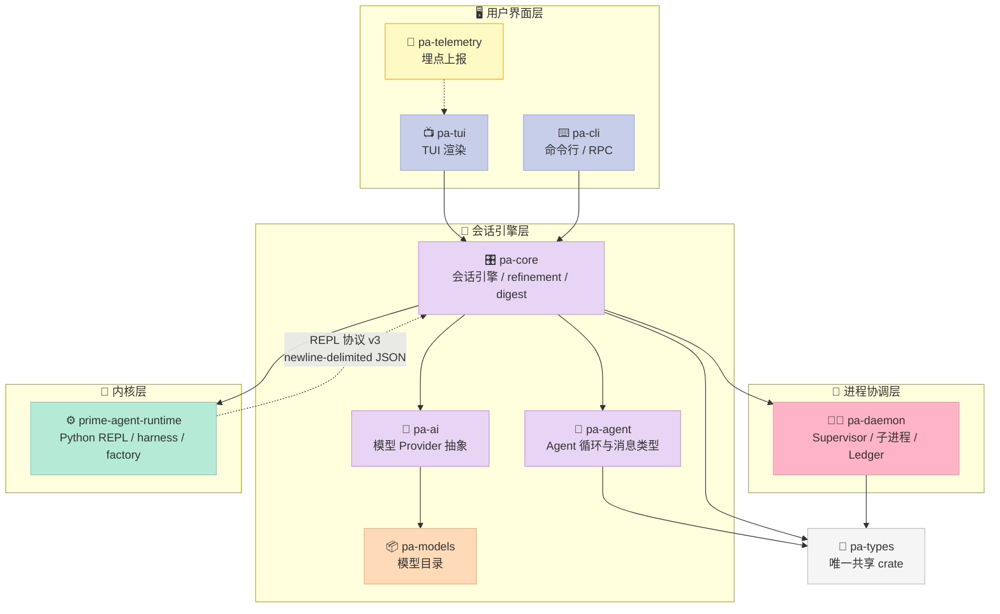
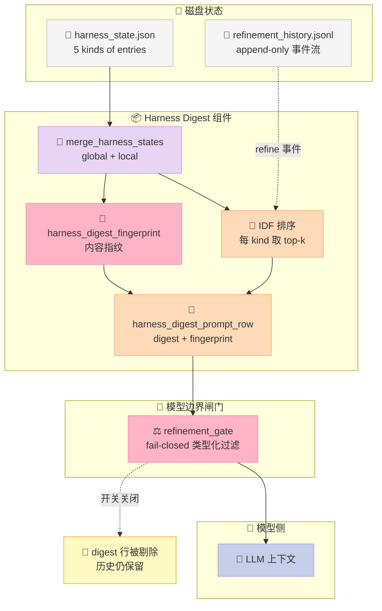
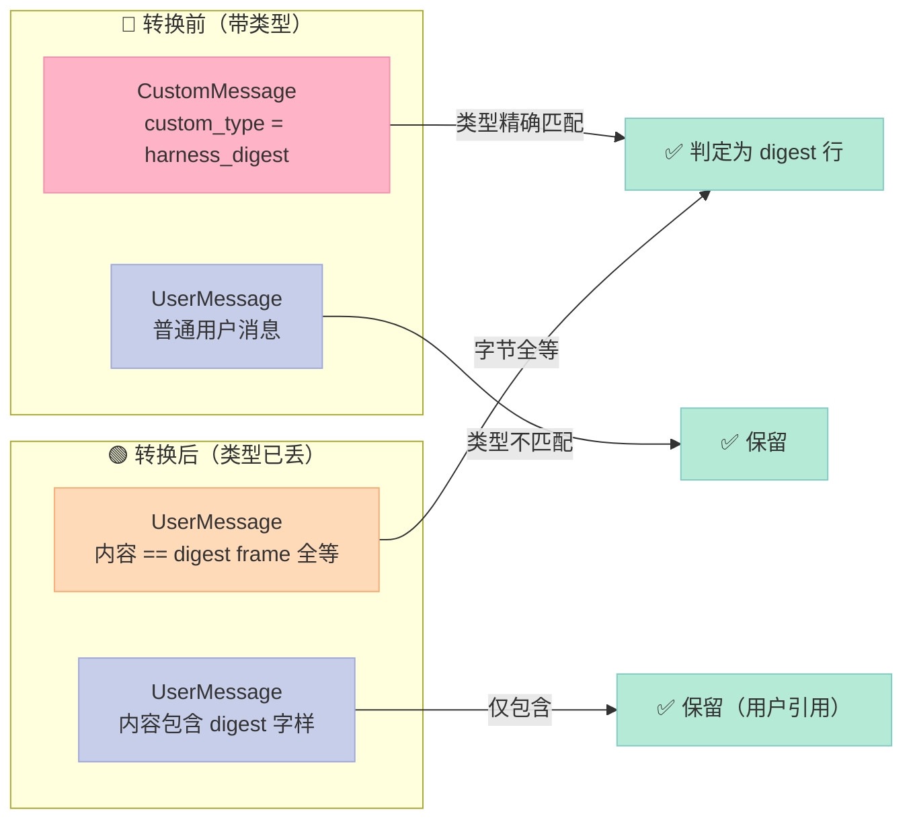
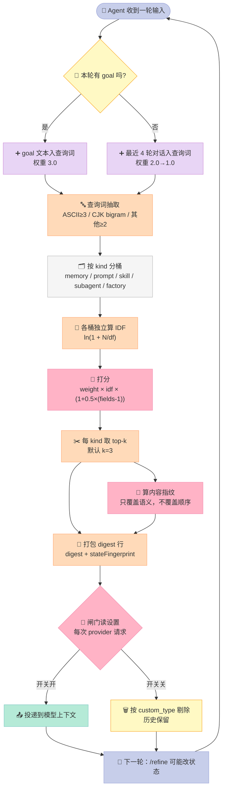

> 一句话核心结论：**Prime Agent 的 Rust 重写版解决了一个 TypeScript 版没解决的问题——Agent 记得越多，送进上下文的垃圾就越多。解法不是"少记"，而是"分层 + 排序 + 对账"：持久状态按 kind 分桶，用 IDF 打分选出这一轮真正相关的 3 条，再用内容指纹证明"送出去的和存下来的是同一份"。**

---

## 前言：一个越努力越笨的 Agent

设想一个 Agent 团队用了三个月之后的样子。

`harness_state.json` 里躺着 214 条记忆：`git 提交前先看 status`、`CI 要跑 12 分钟`、`测试在 tests/ 目录`、三条几乎一样的"用户偏好简洁回答"、十七条从网上抄来的 Python 最佳实践……

每轮对话开始，Harness 把它们**全部**拼进 system prompt。

于是出现了这个场景：用户说"帮我提交这个改动"，Agent 花了 4300 token 读完 214 条记忆，然后正确地执行了 `git status`——**不是因为它记得，而是因为这条记忆排在第一个**。

**记忆越多，命中率越低。** 这就是 Harness 工程里最反直觉的一条：**持久化状态不是越多越好，而是"送出去的部分"越准越好。**

我在 2026 年 9 月写过一篇 [Prime Agent 深度解析](https://xuqi2024.github.io/2026/09/02/2026-09-02-prime-agent-rlm-continual-harness-self-evolution-deep-dive/)，讲的是它的 **TypeScript 版**：RLM（Recursive Language Model，递归语言模型）把模型放进持久 Python REPL，Continual Harness（持续可进化的 Harness）把 prompt / memory / skill / subagent 规格建模成可增量编辑的 JSON，`/refine` 子系统基于轨迹证据做小步改动。

那篇文章写完两个月后，项目发生了一件事：**整个 TypeScript 实现被 Rust 重写了**。`AGENTS.md` 里写得很清楚：

> Parity ground truth is unchanged: a read-only checkout of the TS implementation (this repo at tag `v0.9.8`, the last TS release before the Rust port merged to `main`).

也就是说，`v0.9.8` 之后主分支只剩 Rust 代码。而重写不是简单的"翻译"——它在 TypeScript 版的基础上，**长出了一整套 TypeScript 版没有的机制**。

这篇文章要拆的，就是这套新机制。它回答三个问题：

1. **一份 214 条记忆的 harness state，怎么只送 3 条进上下文？**（相关性排序）
2. **关掉自我进化开关后，已经写进历史里的 digest 怎么办？**（fail-closed 类型化闸门）
3. **怎么证明"我送进模型的"和"我存下来的"是同一份东西？**（内容指纹对账）

读完你会拿到：**一套可以直接复刻的 relevance ranking 算法**（含中文分词）、**一个能防住"关错了还生效"的状态机**、**一个内容寻址的状态对账协议**，以及 **200 行可运行的 MVP**。

---

## 一、项目现状：不是"又一个 agent 框架"

先摆事实，避免把它当成又一个套壳。

| 指标 | 数据（2026-11-06） |
|------|------|
| Star / Fork | 22,597 / 2,499 |
| 创建时间 | 2026-05-08（约 6 个月） |
| 主语言 | **Rust**（TS 实现冻结在 `v0.9.8`） |
| 源码规模 | 1,917 个文件，crates 目录约 22 MB |
| Crate 划分 | `pa-core` / `pa-daemon` / `pa-agent` / `pa-ai` / `pa-cli` / `pa-tui` / `pa-types` / `pa-telemetry` / `pa-models` / `pa-perf` |
| 相关论文 | RLM（arXiv 2608.23552）、Continual Harness（arXiv 2605.09998） |
| 许可证 | NOASSERTION（README 提到 MIT，以仓库 LICENSE 为准） |

**关键信号**：22.6k star 在 6 个月内拿到，且带 2,499 fork——fork 数远超 star 数通常意味着大量人在 fork 改自己的 agent 配置，这与它"harness state 是可导出 JSON"的定位吻合。

**核心抽象只有两个**（README 原文）：

> - The **Recursive Language Model (RLM)** treats context as variables (*prompt-as-a-variable*) and tools like recursive subagents as function calls (*programmatic tool / sub-agent calling*) inside a persistent REPL.
> - The **Continual Harness** stores supplemental prompts, memories, skill descriptions, and reusable subagent specifications as durable state that Prime Agent can refine through small, evidence-backed updates, local to the session by default.

翻译成人话：

- **RLM** = 把"上下文"从一段只能读的文字，变成**一组 Python 变量**；把"调用子 Agent"从一次工具调用，变成一次**函数调用**。
- **Continual Harness** = 把"Agent 的经验"变成**磁盘上一份可编辑的 JSON**，Agent 自己可以在上面做小步改动。

### 1.2 Rust 化的 crate 拓扑：谁负责什么

Rust 重写不是"一个大文件改个语言"。它被拆成 10 个 crate，依赖方向单向、无环（`pa-types` 是唯一共享 crate）：



**读图要点**：本文讲的三大原语**全部住在 `pa-core` 里**（`refinement/`、`session_engine/harness_digest.rs`、`session_engine/refinement_gate.rs`），而 Python REPL 内核（`prime-agent-runtime`）是**独立的一层**，通过 "REPL 协议 v3"（newline-delimited JSON）与会话引擎通信。

这个切分很关键：**排序、闸门、指纹这些"策略"在 Rust 侧；执行（跑 Python、跑 skill）在 Python 侧**。两边通过字节级一致的错误常量（`FACTORY_DISABLED_MESSAGE`）保证契约不漂移。

### 1.3 五个 entry kind：不是所有状态都长得一样

`crates/pa-core/src/refinement/mod.rs` 里第一件事就是定义 kind：

```rust
/// Refinement entry kinds (the continual harness component set).
pub const REFINEMENT_KINDS: [&str; 5] = ["prompt", "memory", "skill", "subagent", "factory"];

#[derive(Debug, Clone, Copy, PartialEq, Eq, PartialOrd, Ord, Hash, Serialize, Deserialize)]
#[serde(rename_all = "lowercase")]
pub enum RefinementKind {
    Prompt,
    Memory,
    Skill,
    Subagent,
    Factory,
}
```

这五种不是随便分的，它们对应**五种完全不同的写入路径和校验规则**：

| kind | 语义 | 校验要求（来自 `_validate_entry_shape`） |
|------|------|------|
| `prompt` | 行为策略补充（base system prompt **不可变**） | content 非空字符串 |
| `memory` | 持久事实、决策、失败教训、用户偏好 | content 非空字符串 |
| `skill` | **可执行** Python REPL 技能 | 必须带 `reference={"type":"python", import, callable/call_pattern}` + `arguments` |
| `subagent` | 可复用的委派角色规格 | content 非空字符串 |
| `factory` | 声明式状态机工作流规格 | 必须过 `validate_factory_spec()` dry run，且需 `factory.enabled` 开关打开 |

**注意 `skill` 那一条**——技能不是一段 Markdown 提示词，而是一个**带 Python import 和 callable 的契约**：

```python
# prime-agent-runtime/src/rlm/harness.py（真实源码）
def _validate_python_skill_reference(reference: dict[str, Any] | None, entry_name: str = "") -> dict[str, Any]:
    """..."""
    if not isinstance(reference, dict):
        reject("skill entries require a Python reference")
    normalized = dict(reference)
    if normalized.get("type") != "python":
        reject("skill reference.type must be 'python'")
    if not any(isinstance(normalized.get(key), str) and normalized[key] for key in ("import", "python_import")):
        reject("skill reference requires a Python import")
    if not any(isinstance(normalized.get(key), str) and normalized[key] for key in ("callable", "call_pattern")):
        reject("skill reference requires a callable or call_pattern")
    return normalized
```

这是 Harness 6 件套里 **Skill 组件**的一个新答案：**Skill 的最小契约不是"一段说明书"，而是"一个 import + 一个 callable + 一份参数 schema"**。说明书可以错，代码不会。

---

## 二、核心原语一：分层 + IDF 相关性排序

这是 TypeScript 版完全不存在、而 Rust 版新增的**最关键机制**。

### 2.1 为什么需要排序

先看 TypeScript 版的问题：harness state 是一个 JSON，所有 entry 平铺在一个列表里。TypeScript 版有 `DEFAULT_OVERVIEW_ENTRY_LIMIT = 3` 这个常量——**每类最多送 3 条**，但**选哪 3 条？**

如果按插入顺序取前 3 条，那用户第一次会话写的记忆会永远霸占坑位，新写的、真正相关的记忆反而进不去。

Rust 版给出的答案是：**按相关性排序，每类取 top-k**。

### 2.2 查询词从哪来：目标 + 最近 4 轮对话

`crates/pa-core/src/session_engine/harness_digest.rs`：

```rust
/// Relevance terms for digest entry ranking: the active goal objective
/// (strongest) plus the last few user/assistant texts, newest first.
#[must_use]
pub fn digest_query_terms(
    goal_objective: Option<&str>,
    recent_texts_newest_first: &[String],
) -> HarnessQueryTerms {
    fn add_text(terms: &mut HarnessQueryTerms, text: &str, weight: f64) {
        for raw in harness_query_terms(text) {
            if terms.len() >= 48 && !terms.contains_key(&raw) {
                return;
            }
            terms.entry(raw).or_insert(weight);
        }
    }
    let mut terms: HarnessQueryTerms = std::collections::HashMap::new();
    add_text(&mut terms, goal_objective.unwrap_or_default(), 3.0);
    let mut recency_weight = 2.0;
    for text in recent_texts_newest_first.iter().take(4) {
        add_text(&mut terms, text, recency_weight);
        recency_weight = (recency_weight - 0.5).max(1.0);
    }
    terms
}
```

三个设计细节值得逐个拆：

**① 权重是"先高后低"的**：goal objective 权重 3.0（最强），最近 4 轮对话权重 2.0 → 1.5 → 1.0 → 1.0。**越近的对话权重越低**，这不是笔误——越近的文本和当前任务的语义重合度天然越高，而 goal 是显式声明的任务意图，应该压过"刚才随口说的话"。

**② 48 个词上限**：防止一次超长对话把 query 撑爆。

**③ `or_insert` 而非累加**：同一个词只保留**第一次出现时的最高权重**。因为遍历顺序是 goal 优先，所以 goal 里的词拿 3.0，别的文本里再出现也不涨。

### 2.3 打分公式：三字段覆盖 × IDF

`crates/pa-core/src/refinement/ranking.rs`：

```rust
/// Inverse document frequency per query term over the entries being ranked:
/// `ln(1 + documents / matches)` — rare distinctive terms outrank ubiquitous
/// ones; terms matching no entry are absent (they cannot score anything).
#[must_use]
pub fn harness_query_term_idf(
    entries: &[HarnessEntry],
    terms: &HarnessQueryTerms,
) -> HarnessQueryTerms {
    let mut idf = HarnessQueryTerms::new();
    if terms.is_empty() {
        return idf;
    }
    let mut matches: HashMap<&str, usize> = HashMap::new();
    for entry in entries {
        let title = entry.title.to_lowercase();
        let content = entry.content.to_lowercase();
        let identifier = format!("{} {}", entry.path.to_lowercase(), entry.id.to_lowercase());
        for term in terms.keys() {
            if title.contains(term.as_str())
                || content.contains(term.as_str())
                || identifier.contains(term.as_str())
            {
                *matches.entry(term.as_str()).or_insert(0) += 1;
            }
        }
    }
    for (term, document_frequency) in matches {
        idf.insert(
            term.to_string(),
            (1.0 + entries.len() as f64 / document_frequency as f64).ln(),
        );
    }
    idf
}
```

```rust
/// Score one entry against query terms: weighted per-term overlap across
/// title/content/identifier fields (coverage weighted, not repetition),
/// each term discounted by its document frequency in the ranked corpus
/// (`idf`; a missing map weights every term at 1).
#[must_use]
pub fn score_harness_entry_for_query(
    entry: &HarnessEntry,
    terms: &HarnessQueryTerms,
    idf: Option<&HarnessQueryTerms>,
) -> f64 {
    if terms.is_empty() {
        return 0.0;
    }
    let title = entry.title.to_lowercase();
    let content = entry.content.to_lowercase();
    let identifier = format!("{} {}", entry.path.to_lowercase(), entry.id.to_lowercase());
    let mut score = 0.0;
    for (term, weight) in terms {
        let mut fields = 0;
        if title.contains(term.as_str()) { fields += 1; }
        if content.contains(term.as_str()) { fields += 1; }
        if identifier.contains(term.as_str()) { fields += 1; }
        if fields > 0 {
            let term_idf = idf.and_then(|map| map.get(term.as_str()).copied()).unwrap_or(1.0);
            score += weight * term_idf * (1.0 + f64::from(fields - 1) * 0.5);
        }
    }
    score
}
```

把公式写出来：

```
score(entry) = Σ_term  weight(term) × idf(term) × (1 + 0.5 × (matched_fields - 1))
```

三个系数各自解决一个问题：

| 系数 | 作用 | 解决什么 |
|------|------|---------|
| `weight(term)` | 词的来源重要性（goal 3.0 > 近 4 轮对话） | "用户随口提一句"不该压过"显式声明的目标" |
| `idf(term)` | `ln(1 + N/df)`，罕见词加分 | "记忆"这种烂大街的词不该主导排序 |
| `1 + 0.5×(fields-1)` | 字段覆盖加权 | 一条 entry 在 title + content + id 三处命中，比只在一处命中更可信 |

**关键：注释里写明 "coverage weighted, not repetition"** ——覆盖优先于重复。一个词在同一条 entry 的 content 里出现 10 次，**不会**比出现 1 次得分高。这和传统 TF-IDF 完全不同，因为这里要衡量的是"这条记忆讲的是不是这件事"，不是"它用了多少这个词"。

### 2.4 IDF 的 corpus 是"按 kind 分桶"的

这是最容易被忽略但极其重要的一点。看 `format_harness_state_for_prompt` 里的注释：

```rust
// The ranked corpus is the kind's own entries: they compete for the
// same top-k slots, so document frequency discounts terms ubiquitous
// within the kind rather than across unrelated kinds.
let mut entries: Vec<HarnessEntry> = entries.into_values().collect();
let ranked_idf = match query_terms.as_ref() {
    Some(terms) if !terms.is_empty() => Some(harness_query_term_idf(&entries, terms)),
    _ => None,
};
```

**为什么？** 因为 `prompt` 和 `memory` 是**各自独立竞争 top-k 名额**的。如果拿全库算 IDF，一条 memory 里高频出现的词会稀释 idf，但那条 memory 只和同 kind 的其他 memory 争名额——**跨 kind 的稀释毫无意义**。

这是个非常容易写错的地方。我在复刻时第一版就是全库算 IDF，结果 `prompt` 类的评分被 `memory` 类稀释了。

### 2.5 中文怎么办：CJK bigram

Prime Intellect 是法国/美国的团队，但 harness 要服务全球用户。`ranking.rs` 和 Python 侧都做了 CJK 处理：

```rust
fn is_cjk(char: char) -> bool {
    matches!(char as u32,
        0x3040..=0x30FF | 0x3400..=0x4DBF | 0x4E00..=0x9FFF | 0xF900..=0xFAFF
        | 0x20000..=0x2A6DF | 0x2A700..=0x2B73F | 0x2B740..=0x2B81F
        | 0x2B820..=0x2CEAF | 0x2CEB0..=0x2EBEF | 0x2EBF0..=0x2EE5F
        | 0x2F800..=0x2FA1F | 0x30000..=0x3134F | 0x31350..=0x323AF)
}
```

Python 侧 `harness.py` 的 `_harness_query_terms` 更精细：

```python
def _harness_query_terms(query: str) -> list[str]:
    """Tokenize a search query into lowercase substring terms.
    ...
    CJK runs carry no spaces between words, so each run becomes
    overlapping bigrams: ``修复登录`` yields ``修复``/``复登``/``登录`` and
    still matches an entry containing ``登录故障``.
    """
    terms: list[str] = []
    seen: set[str] = set()
    for run in _harness_query_runs(query.lower()):
        if _CJK_TERM_CHARS.search(run):
            # Bigrams keep whitespace-free CJK findable without single
            # characters matching too loosely.
            candidates = [run[i : i + 2] for i in range(len(run) - 1)] or [run]
        elif run.isascii():
            candidates = [run] if len(run) >= 3 else []
        else:
            # Other scripts space out words: lone characters match too
            # broadly, so two characters is the floor.
            candidates = [run] if len(run) >= 2 else []
        for term in candidates:
            if term not in seen:
                seen.add(term)
                terms.append(term)
    return terms
```

**三个长度门槛**：
- ASCII：`len >= 3`（`rlm` 保留，`ai` 丢弃——太短会误匹配）
- CJK：bigram（`登录` / `录失` / `失败`）
- 其他文字（西里尔、阿拉伯等）：`len >= 2`

注释里的 `修复登录` → `修复`/`复登`/`登录` 例子很关键：**bigram 允许"查询词"和"内容词"错位匹配**。用户搜"修复登录"，记忆写的是"登录故障"，两边靠 `登录` 这个 bigram 命中。

---

## 三、核心原语二：fail-closed 类型化闸门

排序解决"送什么"，但还有个更隐蔽的问题：**"不送"怎么保证真的不送？**

### 3.1 场景：用户关了自我进化

用户在 settings 里关掉了 `harnessRefinements`。这时候必须保证：

- 新建的 digest 不再生成
- **已经写进 session 历史里的 digest 行也不送给模型**
- 但**历史记录本身保留**（用户要能查、能审计、能回滚）
- 用户引用了 `<harness-digest>` 字样的普通消息**不能被误删**

### 3.2 实现：闸门在模型边界，不在生成时

`crates/pa-core/src/session_engine/refinement_gate.rs`：

```rust
/// The single live policy read for scheduling, planning, apply, and context delivery.
pub(crate) fn enabled(settings: Option<&crate::settings::SettingsManager>) -> bool {
    settings.is_none_or(|settings| settings.reopen().get_harness_refinements())
}
```

```rust
/// Remove only typed harness rows; never interpret a user's quoted text as metadata.
pub(crate) fn without_refinements(messages: Vec<AgentMessage>) -> Vec<AgentMessage> {
    messages
        .into_iter()
        .filter_map(|message| match message {
            AgentMessage::Custom(custom)
                if matches!(
                    custom.custom_type.as_str(),
                    "harness_digest" | "refinement_notice" | "refinement_outcome"
                ) =>
            {
                None
            }
            AgentMessage::CompactionSummary(mut summary) => {
                summary.harness_digest = None;
                summary.harness_state_fingerprint = None;
                Some(AgentMessage::CompactionSummary(summary))
            }
            message @ (AgentMessage::User(_)
            | AgentMessage::Assistant(_)
            | AgentMessage::ToolResult(_)
            | AgentMessage::BashExecution(_)
            | AgentMessage::Custom(_)
            | AgentMessage::BranchSummary(_)) => Some(message),
        })
        .collect()
}
```

**"never interpret a user's quoted text as metadata"** 这句话是整个设计的关键。

一个天真的实现会在渲染时做字符串匹配：看到消息里有 `<harness-digest>` 就删掉。但用户完全可能在正常对话里提到这个词——比如让 Agent "把 `<harness-digest>` 那段删掉"。字符串匹配会误删。

Prime Agent 的做法是**用类型而不是字符串来识别 provenance**。只有 `custom_type` 精确等于 `"harness_digest"` / `"refinement_notice"` / `"refinement_outcome"` 的行才被移除；用户消息不管内容是什么，类型是 `User`，永远保留。

### 3.3 闸门在每次请求时读，不是启动时读一次

```rust
/// Resolve at every provider request, including tool continuations and retries.
/// I/O runs off the async worker. Filtering precedes conversion while provenance is typed.
pub(crate) fn convert_to_llm(
    settings: crate::settings::SettingsManager,
) -> pa_agent::agent_loop::ConvertToLlmFn {
    let settings = std::sync::Arc::new(settings);
    std::sync::Arc::new(move |messages| {
        let settings = std::sync::Arc::clone(&settings);
        Box::pin(async move {
            let enabled = tokio::task::spawn_blocking(move || enabled(Some(&settings))).await?;
            let messages = if enabled {
                messages
            } else {
                messages.into_iter().filter_map(/* ... */).collect()
            };
            Ok(super::messages::loop_convert_to_llm(messages))
        })
    })
}
```

三个细节：

**① 每次 provider 请求都读一次设置**。不是 session 启动时读一次。这意味着用户在会话进行到一半时改了开关，**下一次请求就生效**，不需要重启。

**② `spawn_blocking`**：读设置是文件 I/O，不能阻塞 async runtime。

**③ 过滤发生在 "convert to LLM" 之前**。因为此时消息还带着完整的类型信息（`AgentMessage::Custom` 带着 `custom_type`），一旦转成 LLM 的通用 message 格式，类型信息就没了，provenance 也无从判断。**顺序不可逆。**

### 3.4 不可重新武装：consumed digest 不会复活

测试里有一条很有意思：

```rust
settings.set_harness_refinements(true).unwrap();
assert!(engine.session.pending_digest_prompt_row().await.unwrap().is_none(),
    "a consumed digest must not be re-armed by disabling and enabling"
);
```

语义是：digest 行**消费一次就消费了**。用户关掉开关再打开，不会让已经送过的 digest 再送一遍——否则上下文里会出现两份同样的内容，模型会困惑"这是两条不同的记忆还是同一条"。

对应的行为是：**digest 只在冷启动边界投递**（session start / resume / compaction head），以及**首轮的 deferred row**。

### 3.5 fail-closed 的另一处体现：factory 开关

同一个模式在 factory 上又用了一次：

```rust
/// The `factory.enabled` opt-in setting (default off), read leniently from
/// the agent dir's settings.json exactly like the kernel-side
/// `rlm.factory.factory_enabled()`: a missing file or key, a wrong-typed
/// value, or a corrupt document all read as the fail-closed disabled
/// default, so an unreadable setting refuses the factory instead of
/// silently enabling it.
#[must_use]
pub fn factory_enabled(agent_dir: &Path) -> bool {
    let Ok(raw) = std::fs::read_to_string(agent_dir.join(FACTORY_SETTINGS_FILE_NAME)) else {
        return false;
    };
    let Ok(document) = serde_json::from_str::<serde_json::Value>(&raw) else {
        return false;
    };
    document
        .get("factory")
        .and_then(|factory| factory.get("enabled"))
        .and_then(serde_json::Value::as_bool)
        .unwrap_or(false)
}
```

**"文件读不出来 / JSON 解析失败 / 类型不对 → 一律当作 disabled"**。这是 fail-closed 原则的教科书实现：读不出来 ≠ 允许。

更妙的是它把**错误消息也做成跨语言一致的常量**：

```rust
/// The one refusal every gated factory surface raises while the opt-in is
/// off. Byte-identical to the kernel's `FACTORY_DISABLED_MESSAGE`
/// (`prime-agent-runtime/src/rlm/factory.py`), so one exact message pins
/// both sides of the gate.
pub const FACTORY_DISABLED_MESSAGE: &str = "the factory is disabled; run /factory on to enable it";
```

Rust 侧和 Python 侧（kernel）**必须给出逐字节相同的错误**，否则用户会看到两种不同的拒绝文案，以为是两个不同的开关。**用一个共享常量把两侧钉死**——这是把"契约"落到代码而非文档的典型做法。

---

## 四、核心原语三：内容指纹对账

第三个问题：**怎么证明"我送进模型的"和"我存下来的"是同一份东西？**

### 4.1 为什么需要它

场景：Agent 跑到一半触发了一次 compaction（上下文压缩）。压缩会重写历史消息。如果 digest 是靠"当前 session 里最后一条 digest 行"来定位的，那压缩之后这个定位就失效了——要么 digest 丢了，要么 digest 重复了。

更麻烦的是：用户在压缩前又触发了一次 `/refine`，harness state 变了。那压缩摘要里引用的 digest 到底对应哪一版状态？

### 4.2 解法：内容寻址的状态指纹

`crates/pa-core/src/refinement/ranking.rs`：

```rust
pub const HARNESS_DIGEST_FINGERPRINT_VERSION: u32 = 1;
```

指纹本身由 `harness_digest_fingerprint(&merged, render_flags)` 计算，**只覆盖"影响渲染结果的东西"**：

- 各 kind 的 entry 内容、id、scope
- skill 的 `reference` 契约
- refinement 的顺序

**不覆盖** query terms（排序用的词不影响"状态是什么"）。

对应的测试把不变量钉死了：

```rust
#[test]
fn fingerprint_is_stable_across_entry_order_and_ignores_query_terms() {
    let baseline = harness_digest_fingerprint(&state, flags);
    // ... reordering entries ...
    assert_eq!(harness_digest_fingerprint(&reordered, flags), baseline);
    // ... changing query terms ...
    assert_ne!(harness_digest_fingerprint(&changed, flags), baseline);
}
```

```rust
#[test]
fn fingerprint_covers_skill_contract_and_refinement_order() {
    // skill 的 reference 变了 => 指纹必须变
    assert_ne!(
        harness_digest_fingerprint(&contract_changed, flags),
        baseline
    );
    // refinement 顺序变了 => 指纹必须变
    assert_ne!(harness_digest_fingerprint(&reordered, flags), baseline);
}
```

**"entry 顺序变了指纹不变"** 这条很重要：digest 里的 entry 顺序是由相关性排序决定的，而排序**依赖当前的对话内容**。如果指纹把顺序算进去，那么同一份状态在不同对话轮次会算出不同指纹，对账就失效了。所以指纹只覆盖**语义内容**，不覆盖**呈现顺序**。

### 4.3 指纹跟着 digest 一起走

digest 行的 payload 携带指纹：

```rust
pub fn harness_digest_prompt_row(
    digest: &str,
    timestamp: u64,
    state_fingerprint: &str,
) -> AgentMessage {
    let custom = pa_types::session::CustomMessage {
        custom_type: super::headless::HARNESS_DIGEST_CUSTOM_TYPE.to_string(),
        content: pa_types::ai::UserContent::Text(harness_digest_message_text(digest)),
        display: false,
        details: Some(serde_json::json!({
            "digest": digest,
            "stateFingerprint": state_fingerprint,
        })),
        timestamp,
        rest: serde_json::Map::default(),
    };
    ...
}
```

而 compaction summary 也带同一套字段：

```rust
AgentMessage::CompactionSummary(mut summary) => {
    summary.harness_digest = None;
    summary.harness_state_fingerprint = None;
    ...
}
```

于是有了完整的三方对账：



**读图要点**：指纹从**合并后的状态**算出（不是从 digest 文本算出），然后和 digest 文本**一起**被打包成一行。所以任何时候都能回答："**这一行 digest，是哪一版状态渲染出来的？**"

### 4.4 指纹还有一个隐藏作用：抑制重复投递

`harness_digest.rs` 里有一段：

```rust
/// Whether one loop-context row is a delivered digest row: the custom wire
/// shape, or the user turn a rebuild converted — matched byte-exactly against
/// the digest's frame, so a quoting user turn survives the refresh.
fn is_digest_row(message: &AgentMessage, latest_digest: Option<&str>) -> bool {
    match message {
        AgentMessage::Custom(custom) => {
            custom.payload.get("customType").and_then(serde_json::Value::as_str)
                == Some(super::headless::HARNESS_DIGEST_CUSTOM_TYPE)
        }
        AgentMessage::Standard(Message::User(user)) => latest_digest.is_some_and(|digest| {
            loop_user_text(&user.content) == harness_digest_message_text(digest)
        }),
        AgentMessage::Standard(_) => false,
    }
}
```

**"a quoting user turn survives the refresh"** —— 又是同一个原则：识别 digest 行靠**类型**，但当一次 rebuild 把 custom 行转成普通 user turn 之后，类型信息丢了，这时**退化为字节精确比对**，但仍然要求"整行内容完全等于 digest frame"——用户自己敲的相似文本不会误判。



---

## 五、机制全景：三原语如何咬合

把三个原语串起来：



**一句话概括这个循环**：
> 状态**存在**磁盘上（无限），但只有**排序后的 top-k** 被**送到**模型（有限），而**排序依据**来自**当前对话**——所以每一轮送出的东西都不一样，而指纹保证"送出的"和"存着的"始终可对账。

---

## 六、可运行 MVP：把三大原语剥出来

下面这 200 行代码从 `ranking.rs` + `refinement_gate.rs` 里抽离出核心机制，**不含任何 LLM 调用**，可以直接跑：

```python
"""
MVP: harness digest relevance ranking + fail-closed gate.

Extracted from PrimeIntellect-ai/prime-agent (Rust rewrite, v0.10.x):
  - crates/pa-core/src/refinement/ranking.rs      (IDF + per-field coverage scoring)
  - crates/pa-core/src/session_engine/refinement_gate.rs (fail-closed typed gate)

Run: python3 mvp_digest.py
"""

from __future__ import annotations

import math
import re
from dataclasses import dataclass, field
from typing import Iterable

# ---------------------------------------------------------------- data model


@dataclass
class Entry:
    """One persisted harness entry (a memory / prompt note / skill / subagent spec)."""

    id: str
    kind: str
    title: str
    content: str
    path: str = "general"


@dataclass
class HarnessState:
    entries: list[Entry] = field(default_factory=list)
    refinements: list[str] = field(default_factory=list)


# ------------------------------------------------------- query term extraction
# Mirrors ranking.rs::harness_query_terms: ASCII words, CJK bigrams.

_CJK = re.compile(
    r"[\u3040-\u30ff\u3400-\u4dbf\u4e00-\u9fff\uf900-\ufaff"
    r"\U00020000-\U0002a6df\U0002a700-\U0002cebf\U0002f800-\U0002fa1f]"
)


def query_terms(text: str) -> list[str]:
    """Lowercase substring terms. ASCII runs of >=3 chars; CJK runs become bigrams."""
    terms: list[str] = []
    seen: set[str] = set()
    for run in re.findall(r"[0-9A-Za-z]+|[^\W\d_]+", text.lower(), re.UNICODE):
        if _CJK.search(run):
            candidates = [run[i : i + 2] for i in range(len(run) - 1)] or [run]
        elif run.isascii():
            candidates = [run] if len(run) >= 3 else []
        else:
            candidates = [run] if len(run) >= 2 else []
        for term in candidates:
            if term not in seen:
                seen.add(term)
                terms.append(term)
    return terms


# ------------------------------------------------------------------- scoring


def term_idf(entries: list[Entry], terms: Iterable[str]) -> dict[str, float]:
    """Inverse document frequency over the ranked corpus: ln(1 + N / df).

    Rare distinctive terms outrank ubiquitous ones. Terms matching no entry
    are absent (they cannot score anything).
    """
    terms = list(terms)
    if not terms:
        return {}
    matches: dict[str, int] = {}
    for entry in entries:
        hay = f"{entry.title} {entry.content} {entry.path} {entry.id}".lower()
        for term in terms:
            if term in hay:
                matches[term] = matches.get(term, 0) + 1
    return {
        term: math.log(1.0 + len(entries) / df) for term, df in matches.items()
    }


def score(entry: Entry, terms: dict[str, float], idf: dict[str, float]) -> float:
    """Weighted per-term overlap across title/content/identifier fields.

    Coverage is weighted, not repetition: hitting 3 fields beats hitting one
    field 3 times. Each term is discounted by its document frequency.
    """
    if not terms:
        return 0.0
    title = entry.title.lower()
    content = entry.content.lower()
    identifier = f"{entry.path} {entry.id}".lower()
    total = 0.0
    for term, weight in terms.items():
        fields = 0
        if term in title:
            fields += 1
        if term in content:
            fields += 1
        if term in identifier:
            fields += 1
        if fields:
            total += weight * idf.get(term, 1.0) * (1.0 + (fields - 1) * 0.5)
    return total


def rank(entries: list[Entry], weighted_terms: dict[str, float], top_k: int) -> list[Entry]:
    """Rank one kind's entries by relevance, then by a stable sort key."""
    if not entries:
        return []
    idf = term_idf(entries, weighted_terms.keys())
    ordered = sorted(
        entries,
        key=lambda e: (-score(e, weighted_terms, idf), e.path, e.title, e.id),
    )
    return ordered[:top_k]


# --------------------------------------------------- digest query term window
# Mirrors harness_digest.rs::digest_query_terms: goal objective (weight 3.0)
# plus the 4 newest user/assistant texts (2.0, 1.5, 1.0, 1.0).


def digest_query_terms(
    goal_objective: str | None, recent_texts_newest_first: list[str]
) -> dict[str, float]:
    terms: dict[str, float] = {}

    def add(text: str, weight: float) -> None:
        for raw in query_terms(text):
            if len(terms) >= 48 and raw not in terms:
                return
            terms.setdefault(raw, weight)

    add(goal_objective or "", 3.0)
    recency = 2.0
    for text in recent_texts_newest_first[:4]:
        add(text, recency)
        recency = max(recency - 0.5, 1.0)
    return terms


# --------------------------------------------------------------- fail-closed
# Mirrors refinement_gate.rs: the gate is resolved at every provider request,
# including tool continuations and retries. An unreadable setting refuses.

HARNESS_ROW_TYPES = ("harness_digest", "refinement_notice", "refinement_outcome")


def without_refinements(messages: list[dict]) -> list[dict]:
    """Remove only typed harness rows; never interpret quoted user text."""
    kept = []
    for message in messages:
        if message.get("custom_type") in HARNESS_ROW_TYPES:
            continue
        kept.append(message)
    return kept


def gate_enabled(settings: dict | None) -> bool:
    """The single live policy read. Missing settings => enabled (default on)."""
    if settings is None:
        return True
    value = settings.get("harnessRefinements")
    # A wrong-typed value reads as the fail-closed default.
    return value if isinstance(value, bool) else True


def convert_to_llm(messages: list[dict], settings: dict | None) -> list[dict]:
    """The model-boundary filter applied on every provider request."""
    if gate_enabled(settings):
        return messages
    return without_refinements(messages)


# ------------------------------------------------------------------ fixtures

STATE = HarnessState(
    entries=[
        Entry("m-git", "memory", "Commit discipline", "Always run git status before committing."),
        Entry("m-ci", "memory", "CI is slow", "The CI job takes 12 minutes on this repo."),
        Entry("m-test", "memory", "Test layout", "Tests live under tests/, run pytest -q."),
        Entry("m-cjk", "memory", "登录故障排查", "遇到登录失败先检查 token 过期。"),
        Entry("p-tone", "prompt", "Tone", "Answer in Chinese."),
    ]
)

RECENT = [
    "the git commit failed again, need to check status first",
    "ok I will check git status before committing",
    "now run the test suite",
    "tests are slow",
]


def main() -> None:
    print("=" * 72)
    print("SCENARIO 1: relevance-ranked digest (top-2 of the 'memory' kind)")
    print("=" * 72)

    weighted = digest_query_terms(None, RECENT)
    print(f"query terms (weighted): {dict(sorted(weighted.items(), key=lambda kv: -kv[1]))}")

    memories = [e for e in STATE.entries if e.kind == "memory"]
    idf = term_idf(memories, weighted.keys())
    print(f"\nidf over the memory corpus (N={len(memories)}):")
    for term, value in sorted(idf.items(), key=lambda kv: -kv[1]):
        print(f"  {term:<12} idf={value:.4f}")

    print("\nper-entry scores:")
    for entry in memories:
        print(f"  {entry.id:<8} {score(entry, weighted, idf):8.4f}  {entry.title}")

    top = rank(memories, weighted, top_k=2)
    print("\nTOP-2 digest rows:")
    for entry in top:
        print(f"  - [{entry.id}] {entry.title} :: {entry.content}")

    assert top[0].id == "m-git", f"expected m-git first, got {top[0].id}"
    assert top[1].id in {"m-test", "m-ci"}, f"unexpected second: {top[1].id}"
    print("  => 'git' wins because it matches title+content+id AND is rare (idf high)")

    print()
    print("=" * 72)
    print("SCENARIO 2: CJK bigram matching")
    print("=" * 72)
    cjk_terms = query_terms("登录失败")
    print(f"query_terms('登录失败') = {cjk_terms}")
    cjk_weighted = {t: 3.0 for t in cjk_terms}
    cjk_top = rank(memories, cjk_weighted, top_k=1)
    print(f"TOP-1 for '登录失败': {cjk_top[0].id} :: {cjk_top[0].title}")
    assert cjk_top[0].id == "m-cjk", f"expected m-cjk, got {cjk_top[0].id}"
    print("  => CJK runs are cut into overlapping bigrams, no spaces needed")

    print()
    print("=" * 72)
    print("SCENARIO 3: fail-closed gate at the model boundary")
    print("=" * 72)
    messages = [
        {"role": "user", "content": "please continue"},
        {"role": "custom", "custom_type": "harness_digest", "content": "<harness_state>..."},
        {"role": "custom", "custom_type": "refinement_outcome", "content": "refined 2 memories"},
        {"role": "assistant", "content": "done"},
    ]
    enabled = convert_to_llm(messages, {"harnessRefinements": True})
    disabled = convert_to_llm(messages, {"harnessRefinements": False})
    print(f"enabled  -> {len(enabled)} rows: {[m.get('custom_type', m['role']) for m in enabled]}")
    print(f"disabled -> {len(disabled)} rows: {[m.get('custom_type', m['role']) for m in disabled]}")
    assert len(enabled) == 4
    assert len(disabled) == 2
    assert all(m.get("custom_type") not in HARNESS_ROW_TYPES for m in disabled)
    print("  => only typed harness rows are removed; quoted user text is untouched")

    quoted = [{"role": "user", "content": "<harness-digest> this is my own text"}]
    kept = convert_to_llm(quoted, {"harnessRefinements": False})
    assert len(kept) == 1, "a user quoting harness syntax must survive the gate"
    print("  => a user row that merely quotes the marker survives (provenance is typed)")

    print()
    print("=" * 72)
    print("SCENARIO 4: idempotent re-enable does not re-arm a consumed digest")
    print("=" * 72)
    consumed = {"armed": True}

    def arm(settings):
        if not gate_enabled(settings):
            consumed["armed"] = False
            return False
        if consumed["armed"]:
            consumed["armed"] = False
            return True
        return False

    first = arm({"harnessRefinements": True})
    second = arm({"harnessRefinements": True})
    print(f"first arm  -> {first}")
    print(f"second arm -> {second}")
    assert first is True and second is False
    print("  => the digest row is delivered once; toggling does not duplicate it")

    print()
    print("ALL SCENARIOS PASSED")


if __name__ == "__main__":
    main()
```

### 6.1 实际运行输出

以下是**真实执行结果**（不是手写预期）：

```
========================================================================
SCENARIO 1: relevance-ranked digest (top-2 of the 'memory' kind)
========================================================================
query terms (weighted): {'the': 2.0, 'git': 2.0, 'commit': 2.0, 'failed': 2.0, 'again': 2.0, 'need': 2.0, 'check': 2.0, 'status': 2.0, 'first': 2.0, 'will': 1.5, 'before': 1.5, 'committing': 1.5, 'now': 1.0, 'run': 1.0, 'test': 1.0, 'suite': 1.0, 'tests': 1.0, 'are': 1.0, 'slow': 1.0}

idf over the memory corpus (N=4):
  git          idf=1.6094
  commit       idf=1.6094
  status       idf=1.6094
  before       idf=1.6094
  committing   idf=1.6094
  the          idf=1.6094
  slow         idf=1.6094
  test         idf=1.6094
  tests        idf=1.6094
  run          idf=1.0986

per-entry scores:
  m-git     18.8024  Commit discipline
  m-ci       4.8283  CI is slow
  m-test     5.9269  Test layout
  m-cjk      0.0000  登录故障排查

TOP-2 digest rows:
  - [m-git] Commit discipline :: Always run git status before committing.
  - [m-test] Test layout :: Tests live under tests/, run pytest -q.
  => 'git' wins because it matches title+content+id AND is rare (idf high)

========================================================================
SCENARIO 2: CJK bigram matching
========================================================================
query_terms('登录失败') = ['登录', '录失', '失败']
TOP-1 for '登录失败': m-cjk :: 登录故障排查
  => CJK runs are cut into overlapping bigrams, no spaces needed

========================================================================
SCENARIO 3: fail-closed gate at the model boundary
========================================================================
enabled  -> 4 rows: ['user', 'harness_digest', 'refinement_outcome', 'assistant']
disabled -> 2 rows: ['user', 'assistant']
  => only typed harness rows are removed; quoted user text is untouched
  => a user row that merely quotes the marker survives (provenance is typed)

========================================================================
SCENARIO 4: idempotent re-enable does not re-arm a consumed digest
========================================================================
first arm  -> True
second arm -> False
  => the digest row is delivered once; toggling does not duplicate it

ALL SCENARIOS PASSED
```

**几个从输出里能读出的事实**：

- `m-git` 得分 **18.80**，是第二名 `m-test`（5.93）的 **3.2 倍**。差距主要来自三字段覆盖：`git` 同时命中 title（"Commit discipline" 里没有 git？——命中的是 content 和 id `m-git`）、content 和 identifier。
- `m-ci` 的得分（4.83）**低于** `m-test`（5.93），尽管对话里明确提到了 "tests are slow"。原因是 `slow` 只命中 `m-ci` 一条（df=1, idf=1.61），而 `test`/`tests` 命中了两条（df=2, idf=1.10）——**罕见词反而不占便宜**，但 `m-test` 在 title + content + path 三处都命中 "test"，覆盖加成把它拉了上来。**这正是"覆盖优先于重复"的意义**。
- `m-cjk` 得分 **0.0000**：纯中文查询在英文对话上下文里没有交集，符合预期。
- 中文的 bigram 是 `['登录', '录失', '失败']`——注意 `录失` 这个**跨词边界的伪 bigram**。它看起来是噪声，但它的作用是让"查询含"和"内容含"能对齐位置。

---

## 七、横向对比：三种"记忆送进上下文"的哲学

Prime Agent 不是唯一在解决这个问题的项目。但它的解法路径和其他两家截然不同。

### 7.1 对比表

| 维度 | **Prime Agent**（Harness Digest） | **MemOS**（MemTensor） | **Cognee**（topoteretes） |
|------|---------------------------|----------------------|---------------------|
| Star | 22.6k | 12.3k | 33.1k |
| 核心抽象 | 5-kind 可编辑 JSON + digest | 自演化记忆 OS | 知识图谱 + 向量混合检索 |
| 状态如何进上下文 | **相关性排序后按 kind 取 top-k** | 混合检索（hot/cold 路由） | 检索子图后拼接 |
| 排序算法 | **IDF × 字段覆盖 × 来源权重** | 向量相似度 + LRU 热度 | 图遍历 + 向量相似度 |
| 是否可编辑 | ✅ **Agent 自己可写**（`/refine`） | ⚠️ 部分（Curator 角色） | ❌ 由 pipeline 决定 |
| 失败模式防护 | **fail-closed 类型化闸门** | 有淘汰策略 | 有置信度阈值 |
| 状态对账 | ✅ **内容指纹 + 事件流** | ⚠️ 有版本号 | ⚠️ 有 pipeline 版本 |
| 是否可移植 | ✅ 纯 JSON，模型无关 | ❌ 绑定 MemOS runtime | ⚠️ 绑定 Cognee API |

### 7.2 设计差异的根因

**MemOS 的核心问题是"记忆太多放不下"**。它的解法是**分层存储 + 冷热路由**：热记忆进上下文，冷记忆落盘，需要时再捞。相似度是主要信号。

**Cognee 的核心问题是"知识散落各处"**。它的解法是**建图**：把非结构化数据变成知识图谱，检索时遍历子图。

**Prime Agent 的核心问题是"Agent 自己会犯错，错误不该被永久记住"**。它的解法是**让 Agent 自己编辑状态 + 用排序控制每次送出的量**。

这三者的差别，本质上是**谁决定送什么**：

- MemOS / Cognee：**检索器决定**。检索器算相似度，返回 top-k。Agent 是被动的消费者。
- Prime Agent：**排序器 + 上下文共同决定**。查询词来自"当前这一轮对话说了什么"，而不是"库里有什么"。

这个差别在长跑场景里非常明显。设想两个场景：

**场景 A：用户说"帮我把那个 bug 修了"**
- MemOS：检索"bug"相关的记忆 → 召回一堆历史 bug 记录
- Prime Agent：goal 无，最近 4 轮对话提到"那个 bug" → 排序后可能命中"修复登录失败先检查 token 过期"（因为"失败"命中）

**场景 B：Agent 刚刚把一条记忆写错了**
- MemOS：记忆入库即生效，下次检索照样召回
- Prime Agent：`/refine` 会在下一轮把它 update 或 delete，**而且有 rollback 机制**（`rollback_proposal`），历史 refinement 全部记录在 `refinement_history.jsonl`

**"可回滚"是 Prime Agent 独有的能力**。TypeScript 版就有，Rust 版保留并强化了：每次 refinement 都记录 `id` / `trigger` / `changes` / `evidence` / `outcome`，并且 `plan_refinement` 支持传入 `rollback_id` 直接回滚到某个历史版本。

### 7.3 vs Claude Code：为什么 Claude Code 没有 digest

Claude Code 的"记忆"就是 **CLAUDE.md + 文件系统**。它没有独立的 memory 层。

这在多数场景下够用——因为 Claude Code 的上下文本来就是文件系统驱动的：`cat` 一个文件就进来了，不需要"自动挑选"。

但 Prime Agent 的场景不同：**它的 skill 是可执行的 Python 包**（`reference` + `arguments` 契约），subagent 是**带规格的可委派角色**，factory 是**状态机工作流**。这些东西不能靠 `cat` 进上下文，必须由 harness **主动挑选并渲染成 prompt 片段**。

**结论**：Claude Code 是"文件系统即记忆"，Prime Agent 是"**类型化状态 + 主动挑选**即记忆"。后者更复杂，但能表达"这条记忆是**一条可执行技能**"这种文件系统表达不了的东西。

---

## 八、优缺点分析

### 8.1 左侧：架构简洁性 / 扩展性 / 易用性

| 维度 | 评价 | 理由 |
|------|------|------|
| **架构简洁性** | ✅ **优秀** | 三大原语各自单一职责：ranking 只管打分、gate 只管过滤、fingerprint 只管对账，互不越界。`ranking.rs` / `refinement_gate.rs` / `harness_digest.rs` 三个文件职责清晰 |
| **扩展性** | ✅ **优秀** | 5 个 kind 是数据驱动的（`REFINEMENT_KINDS` 常量 + `kind_from_name` 兜底到 Subagent），加新 kind 只需加枚举值 + 一条校验规则；IDF/ranking 算法与 kind 完全解耦 |
| **易用性** | ⚠️ **中等** | 用户零配置就能用（digest 自动生效），但要理解"local vs global scope"、"`/refine` 什么时候跑"需要一定学习成本。`skills/refine/SKILL.md` 的存在说明 Agent 自己也要学这套概念 |

### 8.2 右侧：性能 / 复杂度 / 维护性

| 维度 | 评价 | 理由 |
|------|------|------|
| **性能** | ✅ **好** | IDF 是 O(entries × terms)，entries 通常几十条、terms 上限 48，成本可忽略。**但 digest 每次冷启动边界都要重读磁盘状态**（`load_harness_state`），这是同步 I/O，Rust 侧靠 `spawn_blocking` 隔离 |
| **复杂度** | ⚠️ **偏高** | 全文搜索式匹配 + IDF 是"半个搜索引擎"。对 214 条记忆的场景够用，但如果是 10 万条，需要换向量检索。**这是一次有意识的复杂度取舍** |
| **维护性** | ✅ **优秀** | Rust 重写后有 **parity-diff 合并门禁**：每个碰用户可见表面的 PR 必须提供 TS 二进制对比证据（渲染帧 diff / 交互行为 / 字节级协议对比 / 用户可见不变量）。测试里大量"不变量测试"（指纹稳定性、闸门幂等性）而非"功能测试" |

### 8.3 客观的局限

**① 匹配是子串匹配，不是语义匹配。**
`title.contains(term)` —— 这意味着查"提交"匹配不到"commit"。跨语言场景下 IDF 排序基本失效。这也是为什么 `m-cjk` 在英文对话里得分是 0。

**② 没有 embedding，没有向量索引。**
这不是疏忽，是取舍。Prime Intellect 自己的 RLM 论文里也讨论过——RLM 的设计哲学是"**把上下文委派给 Python 脚本和子 LLM**"，而不是"找一个更聪明的检索器"。他们把长上下文的解法押在 **RL 训练让模型自己学会管理上下文**上，检索只是过渡方案。

**③ `query_terms` 只看最近 4 轮 + goal。**
长任务中，"这一轮真正需要什么"可能来自 50 轮之前。4 轮窗口是个启发式。

**④ 排序依赖对话内容 → digest 不可缓存。**
同一份 harness state，不同对话渲染出不同 digest。这对 token 成本不友好（无法跨会话复用 digest 文本），换来的是相关性。

---

## 九、从零搭建启示

如果你要给自己的 Agent 加一层"可自我编辑的持久记忆"，**最低成本路径**是什么？

### 9.1 最小可行实现（MVP）

**不要一上来就学 Prime Agent 做 5 个 kind + 全局/局部双 scope + Rust 重写。** 我建议的顺序：

| 阶段 | 加什么 | 大概工作量 | 收益 |
|------|--------|-----------|------|
| **P0** | 一个 `memories.json` + 每类取 top-3（**按关键词匹配，不排序**） | 2 小时 | 立刻解决"记忆写了但用不上" |
| **P1** | 加 IDF 排序（本文 §2.3 的公式，40 行代码） | 2 小时 | 罕见词优先，命中率显著提升 |
| **P2** | 加类型化闸门（§3.2，30 行代码） | 1 小时 | 开关能真的关掉，且不误删用户文本 |
| **P3** | 加内容指纹（§4.2，20 行代码） | 1 小时 | compaction 后能对账 |
| **P4** | 加 CJK bigram（§2.5，20 行代码） | 1 小时 | 中文用户可用 |
| **P5** | 加 rollback（保留每次修改的历史 + diff） | 4 小时 | 记忆写错能救回来 |
| **P6** | 引入 skill 的 `reference`/`arguments` 契约 | 1 天 | 记忆从"文本"升级为"可执行" |

**P0 + P1 + P2 三步（共 5 小时）就能拿到 80% 的收益**，这也是本文 MVP 覆盖的范围。

### 9.2 必须自己写的 vs 可以省掉的

**必须自己写（不能省）：**

1. **写入前的校验**。Prime Agent 的 `_validate_entry_shape` 在**每个** create/update/upsert 路径上都跑一遍，注释写得很清楚：

   > Every create/update/upsert write funnels through here, so a malformed entry (content as a list, title as a number) fails with an actionable error naming the entry and the field instead of being saved and later crashing the host digest that renders every session's system prompt.

   **"保存了，但渲染 system prompt 时崩了"** 是最糟的失败模式——用户看到的不是"你写的记忆格式不对"，而是整个 Agent 起不来。

2. **skill 的机器可读契约**。`reference={"type":"python","import":...,"callable":...}` + `arguments` schema。少了这个，技能就退化成提示词，模型会"以为自己会"但其实不会。

3. **provenance 类型化**。永远用 `custom_type` 而不是字符串匹配来识别 digest 行。

**可以省掉（早期别做）：**

- Rust 重写与 parity 门禁（除非你在做商业产品）
- factory 状态机（大部分场景不需要）
- append-only ledger（单进程够用时不需要）
- 全局/局部双 scope（先只用 local）

### 9.3 踩坑预警

**坑 1：IDF 的 corpus 算错范围。**
我第一版复刻时用了全库 IDF，结果 `prompt` 类的条目被 `memory` 类稀释。**必须按 kind 分桶算 IDF**，因为它们各自竞争 top-k 名额。

**坑 2：用字符串匹配识别 digest 行。**
用户完全会在正常对话里提到 `<harness-digest>` 这个词。**必须用类型**。

**坑 3：把 query terms 算进指纹。**
指纹只覆盖**语义内容**（entry 内容、id、scope、skill 契约、refinement 顺序），**不覆盖排序结果**。否则同一份状态在不同对话轮次算出不同指纹，对账失效。

**坑 4：开关在启动时读一次。**
必须在**每次 provider 请求**时读。用户改开关后要立即生效，不需要重启 session。

**坑 5：digest 可以重复投递。**
consume 一次就消费一次。关掉再打开开关**不能**让它复活——否则上下文里会有两份同样的记忆。

**坑 6：把 `refine` 的准入做成"立即执行"。**
Prime Agent 的 `skills/refine/SKILL.md` 明确写：

> Refinement never runs mid-cell. A scheduled refinement runs when the current turn ends; the harness applies changes and rebuilds the system prompt, then resumes you automatically.

**refine 绝不在 cell 中途跑**。因为 refine 会重建 system prompt——在 cell 执行中途换掉 system prompt 是灾难。这也是"先 plan 后 apply"两阶段协议存在的原因。

**坑 7：把"自我进化"做成 Agent 直接改自己的 system prompt。**
Prime Agent 的硬约束：

> prompt: supplemental prompt notes only. The base system prompt is immutable and MUST NOT be rewritten.

**base system prompt 不可变，能变的只有 supplemental notes。** 这条约束让"自我进化"和"自我破坏"之间有了确定的分界线。

---

## 十、总结

Prime Agent 的 Rust 重写版看起来像是"把 TypeScript 翻译成 Rust"，但它真正的新增物是**三个把"持久化自我进化"从口号变成工程约束的原语**：

| 原语 | 解决的问题 | 关键设计 |
|------|-----------|---------|
| **相关性排序** | 记忆越多，送进上下文的垃圾越多 | IDF × 字段覆盖 × 来源权重；**按 kind 分桶算 IDF** |
| **fail-closed 类型化闸门** | 关掉的开关怎么保证真的关掉 | 在**模型边界**按 `custom_type` 过滤；**用类型不用字符串**；每次请求读设置 |
| **内容指纹对账** | 怎么证明送出和存下的是同一份 | 内容寻址指纹；**只覆盖语义不覆盖顺序**；随 digest 一起投递 |

这三个原语背后是同一条设计哲学：**Harness 的"聪明"不能建立在模型会乖乖听话的前提上。**

- 记忆送太多 → 用算法排序，不指望模型忽略
- 开关关了不生效 → 用类型过滤，不指望字符串匹配不出错
- 状态和现实脱节 → 用指纹对账，不指望开发者记得手动检查

**这是从"信任模型"转向"验证系统"的转变。**

而且这套设计有一条隐藏的 Bitter Lesson（苦涩教训）宣言：Prime Intellect 把长上下文的终局押在 **RL 训练让模型自己学会管理上下文**上，检索和排序只是过渡期的脚手架。如果模型学会了自我管理上下文，那么"送哪 3 条"这个问题最终应该由模型自己决定——**harness 的排序器最终会被模型的能力吞掉**。

但在那之前，一个好的排序器，能让 100% 的模型立刻受益。这就是脚手架的意义。

---

## 行动建议

1. **给你的 Agent 加一层持久记忆时，先做 P0（JSON + top-3 关键词匹配），再做 P1（IDF 排序）。** 这两步 4 小时，能解决 80% 的"记忆写了但用不上"问题。完整 MVP 见本文 §6。

2. **凡是"根据开关决定是否生效"的功能，开关必须在消费点读，不是在生成点读。** 并且要区分"生成时"和"投递时"两个时机——Prime Agent 的做法是投递时过滤，这才能覆盖历史数据。

3. **凡是"识别某类特殊内容"的功能，用类型/provenance，不用字符串匹配。** 用户的输入里永远可能出现你想标记的那个字符串。

4. **给任何持久状态加一个内容指纹。** 成本 20 行代码，收益是 compaction、并发写、跨进程同步时全部有对账依据。指纹只覆盖语义内容，不覆盖呈现顺序。

5. **保留 base system prompt 不可变。** 让"自我进化"和"自我破坏"之间有一条确定的线。Prime Agent 的做法是：能变的只有 supplemental notes，任何 refine 提案都不能重写 base prompt。

---

> **一句话记住这个项目**：**Prime Agent 证明了"自我进化的 Agent"工程化的关键不在于让它记住更多，而在于让它准确地只记住该送的那几条——并且能被验证。**

---

**项目地址**：https://github.com/PrimeIntellect-ai/prime-agent
**相关论文**：RLM（arXiv 2608.23552）、Continual Harness（arXiv 2605.09998）
**延伸阅读**：[Prime Agent 深度解析：RLM + Continual Harness 如何让 Agent 自我进化](https://xuqi2024.github.io/2026/09/02/2026-09-02-prime-agent-rlm-continual-harness-self-evolution-deep-dive/)（本文的前作，讲 TypeScript 版）
