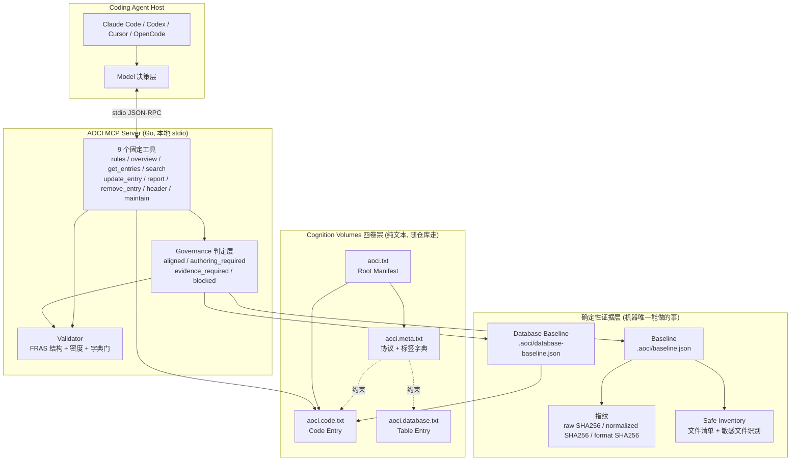
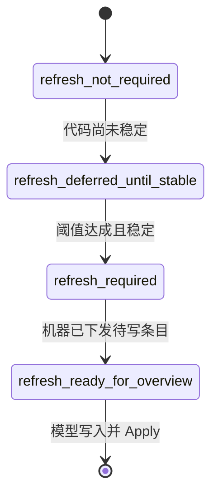
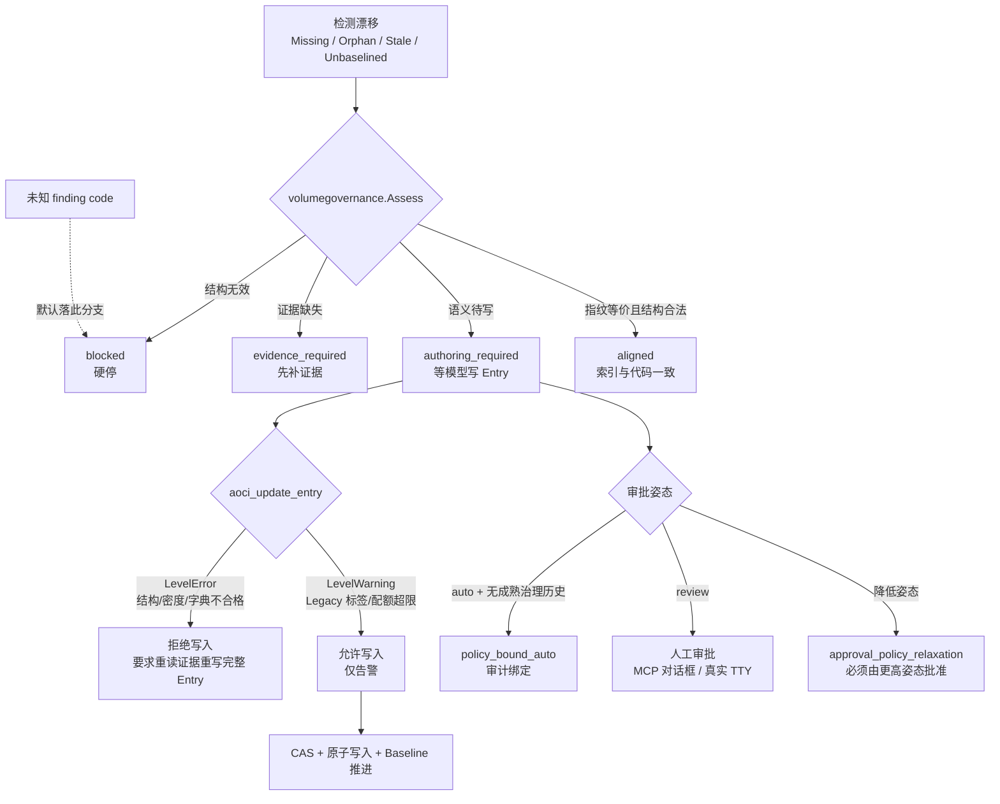
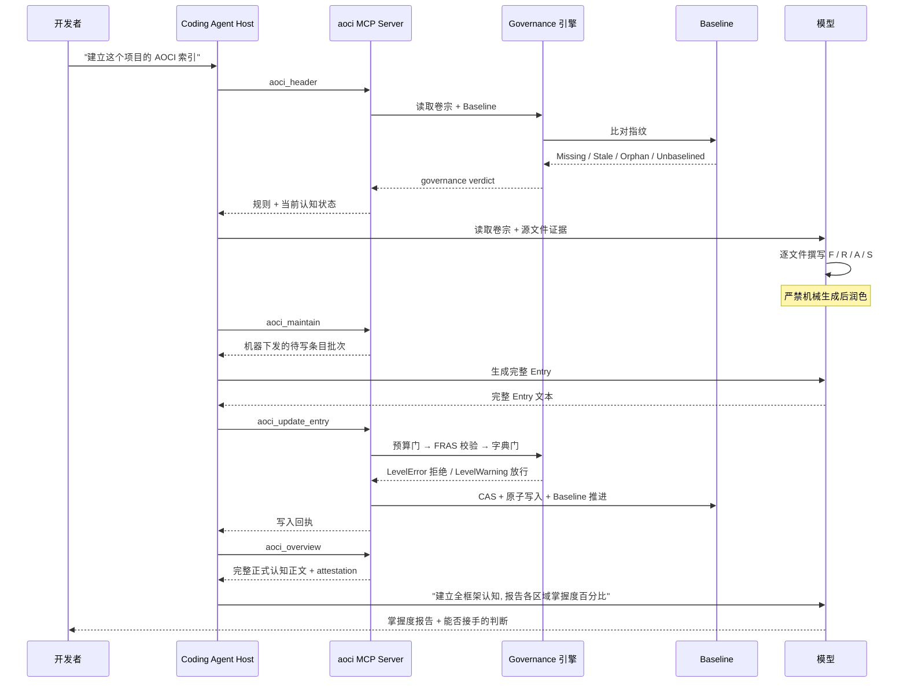

## 引子：每个 Coding Agent 都在重复做同一件事

你让 Claude Code 或 Codex 改一个函数。它做三件事：

1. 打开仓库，`rg` 一遍，找候选文件；
2. 读 `README`、读几个相关源文件，试着拼出这个系统的结构；
3. 改完，提交。

然后你开新会话，问它另一个问题。它又从头 `rg` 一遍。

这不是模型不够聪明——这是**架构缺失**。仓库里没有任何一份「这个系统是什么样」的持久化制品，于是每次会话都要用昂贵的上下文窗口去重建一份临时的、不可复用的理解。窗口用完了，理解就丢了。

2026 年下半年，一类新的工具开始浮现：**不再让 Agent 去「搜索」代码，而是给 Agent 一份「已经写好的系统说明书」**。这类工具和已有的代码知识图谱（CodeGraph、codebase-memory-mcp）有一个根本区别：

- 代码知识图谱解析出的是**符号与调用关系**——它是**机器解析的结构**；
- 而 AOCI-CODE 做的是**让模型自己用自然语言逐文件撰写「这一行是干什么的、它和谁耦合、什么不能改错」**，然后用机器去**校验这份自然语言制品的合规性**。

这就是本文的主角：**[`aoci-spec/aoci-code`](https://github.com/aoci-spec/aoci-code)**，一个 Go 写的本地 MCP Server，⭐1,872，FSL-1.1-MIT，2026-08-08 建仓，11 月还在高频提交。它自己管自己叫 **AOCI（AI-Oriented Cognition Infrastructure）**——面向 AI 的认知基础设施。

它的自我定位一句话说清：

> **A persistent, Git-versioned map of your entire codebase — written by your coding agent, governed by a local MCP server.**
> （一份由你的 Coding Agent 亲手写、由本地 MCP Server 治理的、随 Git 版本化的全仓库地图。）

有意思的是，这个项目的价值并不在技术新颖性，而在**它的克制**和**它的诚实**。它的规范文件里反复出现一句话：

> The program may collect deterministic evidence, identify a target, compute fingerprints and identities, detect drift, validate format and lengths, verify references when their namespace is formal, and run existing governance. It **must not** select a tag or generate, prefill, summarize, compress, truncate, delete, reorder, rewrite, or complete F/R/A/S. A mechanically generated draft followed by model polishing is also prohibited.

翻译成人话：**机器不许替模型写任何一个字的语义内容。** 机器只做三件事——收集证据、算指纹、验格式。这条边界划得极细，也是全文最值得学的地方。

---

## 一、项目定位与核心价值

### 1.1 它到底解决什么问题

官方 README 的说法很克制：

> It reports how well it knows each area, then picks up development from there.

翻译：Agent 接手一个已有系统时，**先建立全局认知，再动第一行代码**。

它解决的是三个具体痛点：

| 痛点 | 传统做法 | AOCI-CODE 的做法 |
|---|---|---|
| 每次会话重新理解系统 | Agent 自己 grep + 读文件 | 读一次 Git 里的 `aoci.code.txt` |
| 理解无法跨会话/跨 Agent 传递 | 存在上下文窗口里，会话结束即消失 | 存在仓库里，Git 版本化，换 Agent 也能读 |
| 索引会过时 | 手工维护 / 干脆不管 | Baseline 指纹比对，四态漂移检测，MCP 自动下发待更新条目 |

### 1.2 仓库统计

| 项 | 值 |
|---|---|
| 仓库 | [`aoci-spec/aoci-code`](https://github.com/aoci-spec/aoci-code) |
| Stars | 1,872 |
| Forks | 227 |
| Open Issues | 11 |
| 主语言 | Go（100%） |
| License | FSL-1.1-MIT（Fair Source / source-available，非标准 OSI 开源） |
| 创建时间 | 2026-08-08 |
| 最近推送 | 2026-11-07 |
| 仓库体积 | 10,474 KB |
| Git tree 节点 | 1,935 |
| 自带索引条目 | 491 条 FRAS Entry（`aoci.code.txt` 236 KB） |
| MCP 工具数 | 9（固定，不可改名） |

⚠️ 关于 License 需要提醒一句：**FSL-1.1-MIT 不是 OSI 开源许可**，它是一种「Fair Source」条款——有使用期限（默认 2 年）且要求商业使用公开可用。它比 MIT 严格，比 AGPL 宽松。想在生产环境商用前请自行确认条款。

### 1.3 官方 Topics 透露的定位

20 个 topics 里最说明问题的几个：

```
code-indexing  code-intelligence  repo-map  ai-context
context-engineering  database-schema  local-first  agents-md
```

`local-first` + `database-schema` 这两个词组合，在整个 AI Agent 工具生态里几乎独一份。

---

## 二、整体架构：五层 + 四卷宗

### 2.1 顶层架构



### 2.2 关键设计：机器只做确定性部分

整个 AOCI 的能力边界可以用一张表划清：

| 机器（确定性）能做 | 模型（语义）必须做 |
|---|---|
| 采集证据、定位目标 | 写 F（职责） |
| 计算指纹与身份 | 写 R（强关联） |
| 检测漂移（四态） | 写 A（稳定契约） |
| 校验格式与长度 | 写 S（系统约束） |
| 校验引用（当命名空间是正式的） | 选择标签 `[CG9L]` |
| 执行既有治理 | 判定「这条关系强不强」 |
| 原子写入 + CAS + Ledger | 判断「哪个文件必须一起更新」 |

**右边那一列，机器一行都不许代劳。** 这条边界带来一个非常反直觉但极其重要的推论：

> 索引的正确性，**不是**由 AOCI 保证的，而是由「模型写对了 + 机器验了格式」共同保证的。

README 的 FAQ 直接承认了这一点：

> **Does an all-green AOCI result prove that the semantics are correct?**
> **No.** A green result proves that the encoded structural and governance conditions hold. What the model wrote still has to be checked against source code, schema, tests, runtime results, and human review.

一个全绿的 AOCI 结果，**不能**证明语义正确。绿灯只证明「结构条件与治理条件成立」。模型写了什么，仍然要对着源码、schema、测试、运行时结果和人工评审去核对。

这是我在整个 AI Agent 工具生态里见过的**最诚实的一句自我评价**。

---

## 三、核心抽象一：FRAS 四字段条目格式

### 3.1 一行条目的解剖

AOCI 的索引就是一个纯文本文件，一行一个文件（或一张表）。这是它自己仓库里的真实条目：

```text
.gitattributes[CG3T]: F:Normalizes repository text line endings for deterministic hashes and cross-platform collaboration | R:- | A:- | S:autocrlf rewrites would mark the whole tree stale
```

另一条信息量更大的：

```text
Makefile[CG9M]: F:Defines build, preflight, format, test, connector-replay, license, full, verify, coverage-floor, fuzz, self-axis, migration-drill, ladder, and release targets | R:code:scripts/check-opengauss-connector.sh,code:scripts/check-licenses.sh,code:scripts/release/manifest/main.go,code:scripts/blackbox/ladder.py,code:scripts/check-coverage-floors.sh,code:internal/buildinfo/buildinfo.go,code:scripts/blackbox/legacy-migration/main.go,code:scripts/blackbox/mcp_upgrade.py | A:make fast,make full,make verify,make axis-self,make fuzz-smoke,make legacy-migration | S:fmt covers the main module and AOCI-owned connector patches only, keeping the upstream mirror byte-identical; race times out at 30 minutes
```

格式定义来自 `spec/public/aoci-object-fras-v2.txt`：

```text
  object_name[tag]: F:... | R:... | A:... | S:...
```

四个字段的语义，规范里写得很死：

- **F（Function）** — 一个核心职责或目的命题。**它不是清单。**
  > F is one core function or purpose proposition. It is not an inventory.
- **R（Relations）** — 为理解或安全修改该对象**必须一并考虑**的那一组强关联。**它不是完整依赖图。**
  > R is the selected set of strong relations that must be considered to understand or safely modify the object. It is not a complete dependency graph.
- **A（Access）** — 稳定的访问契约或被外部依赖的契约。**它不是所有方法/字段/调用方/查询的列表。**
  > A is the stable access or externally relied-upon contract. It is not a list of all methods, fields, callers, queries, or helpers. Use `-` when no meaningful stable contract exists.
- **S（System Constraint）** — **高熵**的系统约束认知。

### 3.2 S 字段的两道准入闸门

S 是整个格式里最有价值、也最难写对的字段。它必须同时通过两个问题：

```text
1. Can it be inferred directly from object name, tag, F, R, or A?
   It is admissible only when the answer is no.

2. Could deleting it cause a model to modify code, data, or lifecycle incorrectly?
   It is admissible only when the answer is yes.
```

第 1 条排除「可推断的废话」，第 2 条排除「低后果的细节」。只有「**不可推断 + 错了会出事**」的内容才配进 S。

看几个真实例子：

- `.gitattributes` 的 S：`autocrlf rewrites would mark the whole tree stale` —— 不可从代码推断，且改错会让整棵树变成 Stale；
- `Makefile` 的 S：`fmt covers the main module and AOCI-owned connector patches only, keeping the upstream mirror byte-identical` —— 不可推断，改错就破坏了上游镜像的一致性；
- `CHANGELOG.md` 的 S：`Pointer tests read the top ## v heading as current` —— 不可推断，改错会让指针测试读错版本。

**这就是「源码注释自陈缺陷」的最佳实践形态**：AOCI 把「代码结构无法表达的隐性知识」提炼成一个独立的、密度受限的字段。S 字段的配额按重要性分档：

```text
#S quota: C9-8≤600 C7-4≤200 C3-1≤50
```

> Quotas are maxima, never writing targets.

C9（核心）条目可以写 600 字符的 S，C3（支撑）只能写 50。**高重要性文件才配拥有长约束**。

### 3.3 标签系统：紧凑 A+B+C+[D]+E

标签不是自由文本，而是一套五轴分类：

```text
compact A+B+C+[D]+E
```

`[CG9L]` 展开就是：

| 轴 | 含义 | 取值 |
|---|---|---|
| A | 层（Layer） | `C`-Code / `D`-Database |
| B | 模块（Module） | `G`-General / `S`-Schema |
| C | 重要性（Importance） | 9=core 8=high-frequency 7=business 5=routine 3=supporting 1=edge |
| D | （可选） | 当前 Meta 未启用 |
| E | 规模（Scale） | L=large>400行 M=medium 200-400 S=small 100-200 T=tiny<100 |

Meta 文件里完整声明了这套字典：

```text
#[Tag dictionary: code]
#A Layer: C-Code
#B Module: G-General
#C Importance: 9-core 8-high-frequency 7-business 5-routine 3-supporting 1-edge
#E Scale: L-large>400 M-medium200-400 S-small100-200 T-tiny<100
```

规范里还有一个很讲究的细节：

> Starter A and B each reserve **Z** for evidence that is understood but does not fit a named category; **missing or insufficient evidence is not Z** and a dictionary gap is not an S constraint.

`Z` = 「我懂了，但归不进任何命名类别」。**证据不足不能用 `Z` 冒充**。这个区分很关键——它把「我不知道」和「我知道了但没有对应分类」明确分开了，避免了 Agent 用 `Z` 掩盖无知。

### 3.4 密度上限：字符数与条目数双限

`internal/machinecontract/numeric.go` 定义了硬上限：

| 字段 | 字符上限 | 条目数上限 |
|---|---|---|
| F | 160 runes | 1 |
| R | 360 runes | ≤ 8 |
| A | 400 runes | ≤ 6 |

规范里有一句防止「复制粘贴膨胀」的规则：

> Field count, column count, index count, foreign-key count, or caller count **never expands a limit**.

这些数字是在 **875 条**既有正式 Code Entry 上校准出来的。有意思的是，记录里还留着一次「刻意不施加」的决策：

> 15 distinct Entries would receive a density finding… They are **deliberately not applied**.

**故意不施加**——这是工业级项目少见的克制。

---

## 四、核心抽象二：Cognition Volumes 四卷宗

### 4.1 四卷宗与「单一权威」原则

AOCI 的索引不是一个大文件，而是**四个有明确分工的卷宗**，每个卷宗在某一层拥有**唯一权威**：

| 卷宗文件 | 唯一权威范围 |
|---|---|
| `aoci.txt` | 仓库身份、布局、依赖（Root Manifest） |
| `aoci.meta.txt` | 共享 FRAS 协议、S 纪律、标签字典 |
| `aoci.code.txt` | Code 段落 + 模型撰写的文件 Entry |
| `aoci.database.txt` | Database 命名空间段落 + 每张表的 Entry |

`aoci.txt` 全文只有 7 行：

```text
#AOCI-ROOT-MANIFEST: 1
#Format-Version: cognition-volumes/v1
#Locale: en-US
#Project: public-candidate
#Global-Invariants: -
#Volume: id=meta kind=meta path=aoci.meta.txt format=meta-v1 depends=- state=enabled
#Volume: id=code kind=code path=aoci.code.txt format=object-fras-v2 depends=meta state=enabled
```

> Root, Meta, and the participating object Volumes together form the **Whole-Index**.

### 4.2 单一权威 + 冲突即缺陷

`docs/contract-authority.md` 的核心规则：

> **When a current implementation fact disagrees with a published Spec, treat it as a defect and stop silently reinterpreting either side as the 'new standard'.**

当「实现的现状」和「已发布的 Spec」冲突时——**把它当缺陷处理，不要默默把任何一边重新解释成「新标准」**。

这解决了一个真实存在的工程病：很多项目的 Spec 写了 A，代码实现成了 B，然后大家假装 B 就是新 A，规范从此失效。AOCI 的做法是：**冲突即 bug，必须显式修**。

### 4.3 身份的三态：present / absent / invalid

卷宗体系里，卷宗的状态不是简单的「有/无」：

> Undeclared = `absent`, declared-valid = `present`, declared-broken = `invalid`; **Empty-present and absent are distinct identity states.**

**「存在但为空」和「不存在」是两种不同的身份状态。** 这个区分在增量更新和 diff 场景下极其有用——它让「空索引」和「无索引」不会被混为一谈。

### 4.4 Section Root 是历史坐标，不是路径

索引里的段落头长这样：

```text
===/<repository>/internal/fs/===
```

Meta 文件里专门解释了它的语义：

> `#Section root: /<repository> stands for the root of the checkout holding this index, never a real path`
> `===/<repository>/=== opens the root directory and ===/<repository>/<dir>/=== opens the repository-relative directory <dir>`

也就是说：段落根 `/<repository>` **不代表仓库真实位置**，它是「索引自己在哪个 checkout 里」的历史坐标。规范里进一步强调：

> it is **not** the active repository location, a path used to read source, or part of a Code object's semantic identity.

**这是为了让索引可以跨机器、跨 checkout 移动。** 索引文件跟着仓库走，换台机器 clone 下来，段落根不变，语义身份不变。

---

## 五、核心抽象三：Baseline 与四态漂移检测

### 5.1 三重指纹

`internal/baseline/hash.go` 为每个文件算**三个**摘要：

1. **Raw SHA-256** — 流式计算全部字节；
2. **Normalized SHA-256** — 只把 CRLF 折叠成 LF（≤4 MiB、前 8000 字节无 NUL、孤立 CR 保留原样）；
3. **Format SHA-256** — 仅对 `.go` 文件，走 `go/format.Source` 的输出。

安全边界写得很清楚：

```text
//   - no handling of a BOM, a lone CR, a trailing newline, or any other byte difference;
//   - a NUL within the first 8000 bytes means binary, and no normalized fingerprint is produced;
//   - above 4 MiB only the raw fingerprint is produced; the degradation is always toward stricter;
//   - the normalized fingerprint is never used for CAS or the Stage source binding.
```

注意最后一条：**归一化指纹永远不用于 CAS（比较并交换）和 Stage 源绑定**。归一化只用于「判断是否 Stale」，不用于「判断内容相同」——**降级方向永远是朝更严格**。

### 5.2 「变了」的判定函数

整个系统的「变了没有」判定收敛到一个函数 `EquivalentFingerprints`：

- raw SHA 相同 → 相等；
- 否则，若允许容忍行尾且**双方都有**归一化指纹且相等 → 相等 + 标记 `LineEndingOnly`；
- 否则 → **Stale**。

### 5.3 四态漂移

`internal/baseline/detect.go` 定义了 Code 漂移的四态：

```text
//	Missing     = on disk, not in the index;
//	Orphan      = in the index, not on disk;
//	Stale       = on both sides, but the fingerprints are not equivalent;
//	Unbaselined = on both sides, but the Baseline lacks the file.
```

| 状态 | 含义 | 处理 |
|---|---|---|
| **Missing** | 磁盘上有，索引里没有 | 新增，需要模型写 Entry |
| **Orphan** | 索引里有，磁盘上没了 | 删除候选，需重新举证 |
| **Stale** | 两边都有，指纹不等价 | 更新，需要模型重写 |
| **Unbaselined** | 两边都有，但 Baseline 没记录 | 首次建基线 |

`Unbaselined` 这一态很关键——它把「刚刚 `git add` 进来的新文件」和「已建索引但内容变了」区分开。前者只需建基线，后者需要模型重新思考语义。

### 5.4 刷新阈值：不是每次都刷

漂移检测是确定性的，但**触发刷新是有阈值的**。默认阈值是 **30 个**不同的路径处于「真实语义 Stale、可操作 Missing 或 Pending Curation」状态。

这个阈值可以由团队改（`cognition_refresh_threshold`，范围 1–100000），但——

> `.aoci/config.local.json` **cannot** override it.

本地个人配置**不能**覆盖它。这是刻意的：团队级策略不应该被单机上的临时配置悄悄改掉。

### 5.5 刷新状态机



配套的 **Cognition Levels** 是一个五级阶梯：

```text
no_cognition → index_loaded → delivery_verified → cognition_verified → cognition_governed
```

最高一级 `cognition_governed` 的可靠性条件写得极严：

> Complete transport, 100-percent object coverage, a passing **Challenge** (at least 80 percent of ordinals fully correct with at most one object identity miss), passing **Attestation**, aligned governance.

注意那个 **Challenge** 的定义——**至少 80% 的序数项完全正确，且最多只允许一个对象身份识别错误**。这是一个**用考试验证模型是否真的读懂了系统**的机制：不是问 Agent「你懂吗」，而是给出题目让它答，答对 80% 才算 `cognition_verified`。

**这是我在这类工具里见到的最硬的验证设计**。绝大多数「Agent 理解度」设计都是自我声明的，AOCI 用了可证伪的方式。

---

## 六、核心抽象四：Governance 判定与四级裁决

### 6.1 四种治理结论

`internal/volumegovernance/facts.go` 的治理事实集产出四种结果：

| 结果 | 含义 |
|---|---|
| `aligned` | 索引与代码一致 |
| `authoring_required` | 需要模型补写条目 |
| `evidence_required` | 需要先补齐证据 |
| `blocked` | 硬停 |

优先级是 **blocked > observed-pending > evidence > authoring > aligned**。

而 `GovernanceAligned = StructureValid && Result == aligned`。

### 6.2 治理裁决流程



### 6.3 默认臂是 blocked

这是全文我最欣赏的一个设计细节：

> **The default arm below means blocked**, so a new code that nobody classifies silently becomes a hard stop.

一个 `switch` 语句里，**没有分类的新代码默认落进 `blocked` 分支**——而不是落进「忽略」或「当作已处理」。

**默认拒绝而非默认放行**，这是安全工程的铁律，被用在了「代码认知治理」这个看似温和的场景上。而且同一文件里，**未知的 finding code 也默认 `blocked`**：

> `internal/volumegovernance/facts.go` deliberately defaults unknown finding codes to `blocked`.

后果是：**AOCI 自己出 bug 的时候，它会把自己锁住，而不是装作没事。**

### 6.4 校验的二级结构

`internal/index/validator.go` 把校验分成两级：

| 级别 | 行为 | 典型命中 |
|---|---|---|
| `LevelError` | **硬拒绝，写入被拒** | 多行条目、结构错乱、文件名 ≠ 路径末段、缺 F/R/A/S、**重复的 F/R/A 前缀** |
| `LevelWarning` | 允许写入 | 标签无法解析、演化叙事类词汇、S 超配额（Legacy） |

「重复的 F/R/A 前缀」这一项的注释特别有意思——它是被计数而非布尔判断的：

> **repeated** F/R/A prefixes (counted, not boolean — a bug a human caught in "live run eight")

**一个 bug 被人在真实运行（"live run eight"）里抓到，然后修法是把它从布尔判断改成计数判断。** 这类注释是本系列最想挖掘的素材——它记录的不是「我们做了什么」，而是「我们踩过什么坑」。

而校验失败时的处理原则，措辞非常重：

> **a failed validation is never corrected silently, since silent correction teaches the agent to keep sending dirty data.**

**校验失败绝不静默纠正——因为静默纠正会教会 Agent 继续送脏数据。**

这一条和上一期讲的 hol-guard 的「未知输入归一化保留 original_type 证据」是同一个哲学：**不要替模型擦屁股，因为擦屁股等于训练模型继续犯错。**

### 6.5 写入链路的完整顺序

`internal/mcptools/tools_write.go` 的写入管线：

```text
预算门禁 (budget gate)
  → ValidateEntryLineWith        (FRAS 结构)
  → relations 检查                (仅告警)
  → CheckTagsAgainstDict          (标签字典门)
  → E-scale 检查                  (仅告警)
  → CAS + 原子写入 + Baseline 推进
```

### 6.6 审批：三种机制

`internal/bootstrapapply/approval.go`：

| 机制 | 触发条件 | 记录内容 |
|---|---|---|
| `RecordApproval` | 人工确认 | 精确的 envelope 摘要 |
| `RecordHostDialogApproval` | MCP 宿主对话框 | 受团队 `human_approval_channel` 约束 |
| `RecordPolicyBoundAutoApproval` | `automation.mode=auto` 且无成熟治理历史 | actor = `aoci-policy` |

审批绑定四样东西：`D2AApprovalDigest`、`ApplyEnvelopeDigest`、`ApprovedWriteSet`（`reflect.DeepEqual` 比较）、以及它自己的规范化 JSON SHA-256。

但注释里有一句极其诚实的限定：

> **It is an audit binding, not cryptographic authentication.**

**这是审计绑定，不是密码学认证。** 它保证「事后能证明当时批过什么」，但不保证「当时操作的一定是那个人」。

还有一条元规则：

> **A posture may not ratify its own weakening.**

**一个姿态（posture）不能批准自己的削弱。** 降低审批强度这个动作本身，不能由当前的低姿态自己批准——必须升到更高姿态的人来批。

---

## 七、Database Cognition：完全离线的表级索引

### 7.1 为什么这是个难点

代码索引的输入是文件，路径即身份。数据库不一样：表没有路径，改个名就换了身份，而且「表的语义」比「文件的语义」更依赖上下文。

AOCI 给数据库建了一套**独立的证据门控**模型。

### 7.2 数据库的九种状态

```text
cognition_current     cognition_missing      cognition_stale
cognition_unbaselined cognition_orphan       evidence_unavailable
evidence_invalid      source_disabled
```

比代码的四态多得多——因为数据库多了「证据本身不可得/不可信/被禁用」这几种现实情况。

### 7.3 表的规范身份

```text
database://<source>/<namespace>/<table>
```

例如 `database://primary/public/orders`。

### 7.4 边界：程序绝不做的九件事

规范里给数据库角色划了一条非常清晰的禁区：

> It **never**:
> - derives F from a table name;
> - copies every FK into R or every caller into A;
> - infers S from `status`, `deleted_at`, `tenant_id`, or timestamps;
> - emits a semantic draft for later polishing;
> - truncates or repairs a candidate;
> - reads business rows or reconnects during Maintain/Apply.

注意第三条——**绝不从 `status`、`deleted_at`、`tenant_id`、时间戳这些字段名去推断 S**。这类字段名是「看起来像软删除」的惯用法，但**具体语义必须由人/模型根据实际业务确认**，不能靠名字猜。这是防幻觉的关键一条。

### 7.5 全离线承诺

> Database Maintain, status, candidate validation, and Apply are **offline**. They do not read a credential environment value, open a socket, query a table, or issue DDL/DML.

**维护、状态查询、候选校验、应用——全部离线。** 不读凭据环境变量、不开 socket、不查表、不发 DDL/DML。

连接串通过**环境变量名**引用，凭据永不落盘。整个项目对数据库的唯一访问是「读取目录元数据」，且必须由用户显式声明。

### 7.6 改名如何处理

> A rename shows as **old orphan plus new missing; neither side is changed automatically.**

表改名 = 旧表变 Orphan + 新表变 Missing，**两边都不自动动**。因为「改名」这个动作背后可能是「新建一张表」，也可能是「重命名」，机器分不清，所以交给模型判断。

---

## 八、9 个 MCP 工具

工具名是**固定的**，`internal/mcptools/server.go` 里写明了原因：

> the nine tool names are fixed (aoci_rules/aoci_overview/aoci_get_entries/aoci_search/aoci_update_entry/aoci_report/aoci_remove_entry/aoci_header/aoci_maintain); **renaming breaks the AGENTS.md template and experiment reproducibility**;

| 工具 | 作用 |
|---|---|
| `aoci_rules` | 取当前生效的规则（Meta / 协议 / 字典） |
| `aoci_overview` | 取完整正式认知正文 + 证明（分块交付） |
| `aoci_get_entries` | 按 scope 取条目 |
| `aoci_search` | 在条目里检索 |
| `aoci_header` | 取卷宗头信息 |
| `aoci_maintain` | 取机器下发的**待写条目批次** |
| `aoci_update_entry` | 原子写入一批完整 Entry |
| `aoci_report` | 报告（**0.2.0 起是 no-op，不写任何东西**） |
| `aoci_remove_entry` | 移除重新举证过的 orphan |

`aoci_maintain` 的三种意图：

```text
intent=cognition_optimization | human_approval | observe_review
```

注释说：**The intent adds no tool** —— 意图不新增工具，只是改变行为。

### 8.1 MCP Server 的三条铁律

`internal/mcptools/server.go` 头部注释：

```text
// Iron rule: in stdio mode stdout carries only the JSON-RPC protocol stream,
// and every log goes to stderr; any leftover println poisons the protocol stream
// and the client disconnects silently
//
//   - every tool call reads index/baseline/config fresh; ... a cached view breaks
//     the first commandment "a stale index is more dangerous than none";
//
//   - a panic inside a handler is recovered by guard: recorded on stderr and
//     returned as an MCP error result, never crashing the process;
//
//   - an error response holds the next-step suggestion and no Go stack trace.
```

**第一戒：过期的索引比没有索引更危险。** 所以每次工具调用都重新读 index/baseline/config，**绝不用缓存视图**。理由也讲得实在——索引会通过 MCP 之外的渠道变化：用户在编辑器里手改、`git pull` 拉下来别人的改动。

**错误响应只给下一步建议，不给 Go 栈信息。** 错误模型是 `Fail{Code,Msg,Hint}`，单向的「结构 → 措辞」，反向耦合（把措辞解析回结构）被明令禁止。

### 8.2 引擎公共 API：一个实现，三种进入方式

```go
package engine

func Open(path string) (*Repository, error)
func (r *Repository) Root() string
func (r *Repository) Locale() string
func (r *Repository) IndexPath() string
func (r *Repository) Cognition() (*Cognition, error)
func (r *Repository) Overview(scope string) (*Overview, error)
func (r *Repository) Governance() (*Governance, error)
func (r *Repository) Identity() (*Identity, error)
func (r *Repository) NewMCPServer() (*mcp.Server, error)
func (r *Repository) ServeStdio(ctx context.Context) error
func (r *Repository) Connect(ctx context.Context) (*Session, error)
func (s *Session) Tools(ctx context.Context) ([]string, error)
func (s *Session) Call(ctx context.Context, tool string, args any) (*ToolResult, error)
func (s *Session) Close() error
func Version() string
func Commit() string
var ErrLayoutUnsupported = errors.New("engine: operation requires the Volumes v1 layout")
```

设计哲学写在 `engine/doc.go` 与 `engine/overview.go` 的注释里：

> Overview is the complete formal cognition body of one scope, **exactly the bytes aoci_overview delivers for that scope**, plus the delivery plan the repository's chunk budget implies.

**引擎的 `Overview()` 返回的就是 MCP 工具返回的那些字节**——不是「类似的东西」，是**逐字节相同**。这样嵌入式调用和 MCP 调用不会产生行为分叉。

`engine/overview.go` 里还有一个细节：

```go
if set.LayoutMode != cognition.LayoutVolumesV1 {
    return nil, ErrLayoutUnsupported
}
```

Legacy 布局上直接返回错误，而不是「尽力而为地降级」。**明确的失败优于模糊的成功。**

---

## 九、端到端数据流



### 9.1 首次建索引的成本

官方给的数据：

> about an hour per 200,000 lines of code, depending on the model and the agent's speed. It runs in batches and resumes where it stopped if interrupted.

**每 20 万行代码约 1 小时**，分批执行，中断可续。

规模上限的说法也很具体：

> The practical limit is the size of the index, not the line count: a 700,000-line commercial system is developed this way today, with an index of about **300K tokens**.

70 万行的商业系统，索引约 30 万 token。这个数字说明：**索引本身就接近甚至超过了部分 Agent 的上下文窗口**，所以才需要「分块交付 + 容量止损」。

### 9.2 容量止损（capacity stop）

`docs/cognition-refresh.md` 记录的一个真实问题：

> when the Whole-Index doesn't fit the Host context, **the session never starts its task**; the server then answers `delivery_mode=capacity_stop` with no body.

索引装不进宿主上下文时，**会话根本不开始任务**，服务器回 `delivery_mode=capacity_stop` 且**不带正文**。

这是一个「宁可什么都不做，也不要塞进一个被截断的认知」的设计。

### 9.3 Maintain 批次的预算

```text
默认 50 个目标 / 上限 200
maintain_transport_budget_bytes 默认 24 KiB
最多 4 个并行兄弟批次 (code_cognition_parallel_batches)
最终 Apply 携带 terminal_proof
```

---

## 十、⭐ 必须诚实指出的源码自陈缺陷

这是本系列的核心特色。AOCI 的源码和文档里**主动记录了自己的边界**，而且记录得极其具体。以下全部是原文引用。

### 缺陷 1：语义漂移无法被自动检测 ★★★

`docs/cognition-volumes.md`：

> **Machine maintenance watches source bytes**, so an Entry whose file did not change can still go semantically stale when the system around it moves — a removed mechanism its S still cites, a renamed contract its F still describes.

**机器监控的是源字节，不是语义。** 一个文件本身没变，但周边系统变了——它 S 里引用的机制被删了，它 F 里描述的契约被改名了——这条 Entry 就已经语义陈旧，而机器**检测不到**。

这是 AOCI 架构最根本的一个洞：**字节级漂移检测 + 语义级内容，两者之间存在一个不可跨越的缝隙。**

### 缺陷 2：R 字段（关系）从不被交叉验证 ★★★

`internal/index/relations.go`：

> this checker does not resolve where an R target points, does not query the filesystem, does not judge whether a target exists, is the same entity, or is duplicated, and **builds no relation graph**.

`docs/cognition-volumes.md` 说得更直白：

> The machine never compares one Entry's relations against another Entry — **that graph is what the model builds by reading the Whole-Index.**

**关系图是靠模型读完整索引时在脑子里建出来的。** 机器不建图、不校验目标是否存在、不判断重复。

也就是说：**AOCI 索引里 R 字段的正确性，100% 依赖模型，而机器连「这个 R 指向的文件还在吗」都不查。** 这和缺陷 1 是一体两面。

### 缺陷 3：绿灯不等于语义正确（README FAQ）

> **No.** A green result proves that the encoded structural and governance conditions hold. What the model wrote still has to be checked against source code, schema, tests, runtime results, and human review.

### 缺陷 4：AOCI 明确声明「不是知识图谱系统」

> **AOCI-CODE is not a knowledge-graph system.** … it owns **no second state-management system, no independent write path, and no new fact store**.

### 缺陷 5：确定性专用，没有模型在环

> **Deterministic-only** | No host model in the loop: … **new entries still require a model or a human author.**

### 缺陷 6：明确「未实现」清单 ★★

`docs/cognition-volumes.md` 的 **Explicitly not implemented** 一节，完整列出：

- 自动或未批准的 Legacy-to-Volume 迁移；
- 已迁移卷宗收到认知写入后的通用回滚；
- Bootstrap 之后的 Root/Meta 更新、卷宗删除、身份变更；
- 并行多卷宗事务或独立恢复系统；
- 由 Maintain 或 Entry Apply 声明/创建 Database 卷宗；
- **自动的数据库 FRAS 生成**。

`spec/public/aoci-database-table-fras-v1.txt` 独立重申：

> Automatic table cognition generation and formal Database Volume creation **still do not exist**.

### 缺陷 7：指纹缓存会漏掉「touch -r」式修改 ★★

`.aoci/fingerprints.json` 缓存（`aoci-fingerprint-cache/v1`）的判定要求：同 size + 同 mtime + mtime 比 hash 旧 2 秒以上（git 的 racily-clean 规则）。它自己承认：

> **A write that preserves both size and mtime (touch -r over new content) can be missed, even when Git detects it.**

`touch -r` 覆盖内容但保留时间戳——Git 能发现，AOCI 的缓存会漏。

### 缺陷 8：Go 格式化器的成本是它配套哈希的 63 倍

`internal/baseline/hash.go`：

> **HashFile runs go/format.Source on every Go file, which profiles at 94.7% of HashFile against 1.5% for the SHA-256 it supplements — the formatter is roughly 63x the hash it accompanies.**

这是一个**自己量化自己的性能缺陷**的项目。94.7% 的时间花在格式化上，而格式化只是为了多算一个 SHA-256。

同时还留了一个已知残留：

> One residual is accepted knowingly … a .go file that does not parse produces no formatted digest here, yet **a prior claiming one for those exact bytes would be carried over**.

### 缺陷 9：三个「假绿灯」历史 bug ★★

`internal/index/dict.go`：

> **CheckTagsAgainstDict skipped every entry silently** (a dictionary-gate false green…) — the tests here stayed green while the real machine broke.

`internal/index/escale.go`：

> the third false-green case, after the P-15 missing tag and the P-21 dictionary line

`internal/index/quota.go`：

> objects.go used to hold a fourth copy of the quota judgement… a repository that had relaxed its declaration was told 500 and refused at 200, and no edit could clear it.

**三个不同的「假绿灯」，都是「校验被静默跳过」导致的。** 注释里那句「the tests here stayed green while the real machine broke」是这类项目文档里最有价值的一句话——它承认**测试全绿而线上机器是坏的**。

### 缺陷 10：删除操作曾静默制造假 Stale

`internal/mcptools/tools_remove.go`：

> the advance was skipped silently → **every removal manufactured a false Stale**; the tests stayed green because the fixture had no baseline.

### 缺陷 11：配置默认值冻结

`internal/config/config.go`：

> **Existing-repository limitation (a known cost): applyFallbacks fills defaults only when the field is nil**, so an explicit list already on disk freezes the old defaults.

### 缺陷 12：治理不是操作系统边界

`internal/scopechange/plan.go`：

> **Migration boundary (an explicit trade-off)** … governance is flow control, not an operating-system boundary, and failing closed on every unknowable historical receipt would make the first transaction of every existing repository after an upgrade suddenly demand a human approval.

**「治理是流程控制，不是操作系统边界」**——它不阻止恶意代码，它只让流程合规。

### 缺陷 13：条目级预算而非文件级绕过

`docs/managed-scope-and-budget.md`：

> There is **deliberately no per-file bypass** for this [staleness].

以及一个很有分寸的表述——**预算是状态报告，不是硬闸门**：

> The Whole-Index thresholds only name the budget status: they **neither refuse a write nor govern what a model can receive**.

### 缺陷 14：S 覆盖率只是提示

> It is a hint, not a gate.

### 缺陷 15：敏感文件默认拒绝

`docs/safe-inventory-and-scope-refresh.md`：

> tracked sensitive files "are not silently opened. The default is **fail closed with required human review**."

### 缺陷 16：估算就是估算

`internal/ledger/ledger.go`：`EstimateTokens is rough`。

### 缺陷 17：没有生产级 Taskrun 包

`docs/cognition-refresh.md`：

> There is no production Taskrun package or persistent conversation file.

---

## 十一、与同类项目对比

### 11.1 五维对照

| 维度 | **AOCI-CODE** | CodeGraph / codebase-memory-mcp | Understand-Anything | RepoMap 类工具 | PageIndex（向量检索式 RAG） |
|---|---|---|---|---|---|
| **产出物形态** | 模型撰写的**自然语言** FRAS 条目 | 符号 / 调用**图** | 知识图谱 | 文件树摘要 | 推理式**目录树** |
| **谁生成** | **模型**（机器禁止代劳） | 机器（解析） | 混合 | 机器 | LLM 推理 |
| **存储载体** | Git 里的**纯文本** | 数据库 / 图 | 图存储 | 通常不持久化 | 文档结构 |
| **跨会话/跨 Agent** | ✅ 天然（Git 带走） | ❌ 需重建索引 | ❌ | ❌ | ⚠️ 依赖文档 |
| **失效检测** | 三重指纹 + **四态漂移** | 索引重建 | 手动 | 无 | 文档变更即失效 |
| **治理强度** | ✅ 硬校验 + 治理裁决 + 审批 | ❌ | ❌ | ❌ | ❌ |
| **能表达「不可推断的约束」** | ✅ **S 字段专治此事** | ❌ | ⚠️ 弱 | ❌ | ❌ |
| **数据库 schema** | ✅ **表级离线索引** | ❌ | ❌ | ❌ | ⚠️ 仅文档 |
| **机器能验证语义正确吗** | ❌ **明确不能**（README FAQ） | ⚠️ 部分（结构可验） | ⚠️ | ❌ | ❌ |

### 11.2 设计差异的三个层次

**差异一：产物是「机器可验证的结构」还是「机器不可验证的自然语言」。**

CodeGraph 解析出符号图，它的正确性**可以被机器验证**（图的结构对不对是客观的）。AOCI 产出的是自然语言，它的正确性**机器验不了**——所以 AOCI 的整套设计都在解决「既然验不了语义，那就把可验证的部分（格式、指纹、治理、漂移）做到极致，并在文档里明说语义验不了」。

这是一条完全不同的工程路线。**AOCI 用「可验证性的诚实边界」换取了「不可验证语义的最大表达力」。**

**差异二：谁拥有「理解」这件事。**

CodeGraph 的模型是「Agent 问，我查」——知识图谱是服务端，回答是即时的。AOCI 的模型是「Agent 先自己写下来，再读」——理解是**Agent 写出来的制品**，是仓库的一部分。

这个转换带来一个质变：**AOCI 的索引可以被 Git diff。** 团队里换了个人、换了模型、开了新会话，索引照样能用。而且**索引的每一次变化都是一次 code review 对象**——「这个 Entry 的 S 字段为什么被改了」是一个可以讨论的问题。

**差异三：故障模式的分布。**

CodeGraph 出问题 → 检索不到，返回空。
AOCI 出问题 → **两种截然不同的故障**：

- **机器侧故障**（指纹错、校验漏、治理误判）→ 由 Baseline、Validator、Governance 三层兜底，且默认臂是 `blocked`；
- **模型侧故障**（模型写错了 S、漏了 R）→ **机器检测不到**。

AOCI 把两类故障**明确区分开**，并且只对第一类提供保障，对第二类明确说「我不保证」。

### 11.3 与 Agent Memory 类项目的正交关系

AOCI 常被归到「agent memory」类（它的 topics 里确实有 `agent-memory`），但它和已有的 Memory 项目**不是一回事**：

| 维度 | Agent Memory 类（mem0 / cognee / graphiti 等） | **AOCI-CODE** |
|---|---|---|
| 存什么 | **对话历史、事实、经验** | **代码结构与系统约束** |
| 谁写 | 抽取器 / LLM 自动 | **模型手写，机器禁止代劳** |
| 什么时候写 | 对话过程中 | **代码变更后（Maintain 批次）** |
| 载体 | 向量库 / 图库 / DB | **Git 里的纯文本** |
| 生命周期 | 会话/项目级 | **与代码同生命周期（可 diff / 可回滚）** |

一句话：**Agent Memory 记的是「我们聊过什么」，AOCI 记的是「这个系统是什么样的」。**

---

## 十二、优缺点分析

### 12.1 左侧：架构简洁性 / 扩展性 / 易用性

| 维度 | 评价 |
|---|---|
| **架构简洁性** | ⭐⭐⭐⭐⭐ **极佳**。索引就是纯文本，格式一行一条，可 `cat` 可 `grep` 可 `diff`。四个卷宗、9 个工具、零外部服务、零凭据、零网络。复杂度全部收敛在「机器只做确定性的部分」这条边界之内 |
| **扩展性** | ⭐⭐⭐⭐ **好**。新增一个卷宗（未来的 API / Deployment 卷宗）只需定义自己的身份与证据契约。标签字典是数据（写在 Meta 里），不是代码。但新卷宗的事务支持被明确列为「未实现」 |
| **易用性** | ⭐⭐⭐ **中等**。安装流程要「init → scan → 重启 Agent → 建索引」，而且**必须先重启**——因为 MCP server 是 init 写的，当前会话没加载它。首次建索引按每 20 万行 1 小时计。对非专业用户门槛不低 |

### 12.2 右侧：性能 / 复杂度 / 维护性

| 维度 | 评价 |
|---|---|
| **性能** | ⭐⭐⭐ **一般**。`HashFile` 里 `go/format.Source` 占 94.7% 时间，是配套 SHA-256 的 63 倍。首次建索引以小时计。日常维护受 30 路径阈值、50 条批次、24 KiB 传输预算三层限制 |
| **复杂度** | ⭐⭐ **偏高**。37 个 internal 包、`volumegovernance` 单包 56KB、`scopechange/plan.go` 单文件 67KB。治理状态机、审批事务、CAS + Ledger + Recovery 管线的组合，对使用者是黑盒，对维护者是重负 |
| **维护性** | ⭐⭐⭐⭐ **好但有前提**。Git 版本化让索引变更可 diff 可回滚；`docs/` 190+ 份文档写得极其严谨。**但前提是模型愿意正确写**——模型侧错误无机器兜底。索引规模随代码线性增长，30 万 token 已经接近部分宿主的上下文上限 |

### 12.3 一句话总结

> **AOCI-CODE 用「治理的重量」换取了「模型的表达自由」，并且把这条交换的成本，明确写在了文档第 9 节里。**

---

## 十三、实践：安装与使用

### 13.1 安装

```bash
# 从 GitHub Releases 下载并按安装指引校验（README 建议至少完成 basic 级别校验）
gh auth login
gh release download v0.2.0-rc1 --repo aoci-spec/aoci-code

# 或从源码构建
git clone https://github.com/aoci-spec/aoci-code.git
cd aoci-code
mkdir -p build
make build
./build/aoci --version
```

### 13.2 让 Agent 接管初始化

官方推荐的做法是**把 README 交给 Agent 本身**，让它执行 init / scan：

```text
AOCI-CODE project: https://github.com/aoci-spec/aoci-code

Download the newest release package, pre-releases included, for this operating system and
CPU architecture from https://github.com/aoci-spec/aoci-code/releases, and follow the
installation instructions on the Release page to verify it. ...

1. Run init to initialize AOCI and integrate MCP for the current host ...
2. Run scan
   scan takes its file inventory from Git, so do not add the cognition assets
   init writes (aoci.txt, aoci.meta.txt, aoci.code.txt, AGENTS.md) to .gitignore
   or .git/info/exclude — an ignored asset is silently skipped and the index
   cannot be built.
3. Tell me to restart the agent so the newly written MCP server takes effect
```

⚠️ 注意第 2 步里那个警告：**被 `.gitignore` 忽略的索引资产会被静默跳过，索引就建不起来。** 这是一个真实的坑。

### 13.3 建索引（需重启后）

```text
First confirm the AOCI MCP server is connected, then build the AOCI index for this
project. When it is complete, give me the AOCI panel link.
```

### 13.4 验证 Agent 的掌握度

```text
Using only AOCI, establish whole-framework cognition of this project, tell me your
mastery of each area as a percentage, and whether you can take over development.
```

### 13.5 数据库索引

```text
Build the AOCI database index for this project.
```

连接串通过环境变量名引用，**凭据永不落盘**。

### 13.6 本地校验

```bash
# 校验索引与代码是否对齐
aoci verify --json

# 查看治理结论
aoci check

# 启动本地状态面板
aoci ui --detach --json
```

### 13.7 嵌入式使用（Go）

```go
package main

import (
	"context"
	"fmt"
	"log"

	"github.com/aoci-spec/aoci-code/engine"
)

func main() {
	repo, err := engine.Open("/path/to/your/repo")
	if err != nil {
		log.Fatal(err)
	}

	gov, err := repo.Governance()
	if err != nil {
		log.Fatal(err)
	}
	fmt.Printf("aligned=%v result=%s next=%s\n",
		gov.Aligned, gov.Result, gov.NextRequiredAction)
	fmt.Printf("drift: missing=%d orphan=%d stale=%d unbaselined=%d\n",
		gov.Drift.Missing, gov.Drift.Orphan,
		gov.Drift.Stale, gov.Drift.Unbaselined)

	ov, err := repo.Overview("all")
	if err != nil {
		log.Fatal(err)
	}
	fmt.Printf("entries=%d tokens~%d chunks=%d sha256=%s\n",
		ov.EntryCount, ov.EstimatedTokens, ov.ChunkCount, ov.SHA256[:12])

	ctx := context.Background()
	sess, err := repo.Connect(ctx)
	if err != nil {
		log.Fatal(err)
	}
	defer sess.Close()

	tools, err := sess.Tools(ctx)
	if err != nil {
		log.Fatal(err)
	}
	fmt.Println("mcp tools:", tools)
}
```

---

## 十四、趋势判断与工程经验提炼

### 14.1 四个趋势

**趋势一：「Agent 上下文」正在从「运行时产物」变成「仓库制品」。**

过去两年，Agent 的上下文管理方案（memory、rag、context compression）都在**运行时**解决——会话开始时检索、会话中压缩。RAG 类项目有 30+ 篇写过了。AOCI 换了个位置：**把理解写进仓库**，让它成为版本化制品。这个位置的好处是：可 diff、可 review、可回滚、跨 Agent、跨会话、跨人。

**「理解」是代码库的一部分，而不是 Agent 的私有记忆。**

**趋势二：「谁生成知识图谱」正在从「机器解析」转向「模型撰写 + 机器校验」。**

CodeGraph 那一派假设：结构可以自动抽出来，所以让机器抽。问题在于，**代码里最重要的信息恰恰不在结构里**——「这个文件的 S 字段别改」「这个契约改了会炸」。

AOCI 的答案是：**结构归机器（指纹、格式、治理），语义归模型（S 字段专治不可推断的约束），中间用校验器把关。** 这可能是 2026 年下半年 Agent 工具设计的一个新范式。

**趋势三：「确定性专用」正在成为 Agent 基础设施的卖点。**

AOCI 反复强调：**The engine calls no model, holds no credential, and reaches no remote service.** 加上全离线、全本地、无凭据存储。**在企业环境里，一个「不联网、不存凭据、纯本地」的基础设施层，价值可能超过它本身的认知能力。**

**趋势四：数据库正在成为 Agent 上下文的一等公民，但「表级认知」是块硬骨头。**

AOCI 把数据库当成独立卷宗、独立状态机（9 态）、独立证据门控，而不是「把 schema 塞进 code 索引」。原因很实在：**表的语义比文件更依赖上下文**——同一个 `status` 字段，在 A 系统是启用标记，在 B 系统是审批流状态。**靠字段名推断必然出错**，所以 AOCI 明确禁止从 `status`/`deleted_at`/`tenant_id` 推断 S。

### 14.2 七条可复用的工程经验

1. **机器与模型的边界要写进规范，且要具体到「不许做什么」**。AOCI 不是写「机器辅助写索引」，而是逐条列举「不得生成、预填、摘要、压缩、截断、删除、重排、改写、补全 F/R/A/S」，并追加「机械草稿 + 模型润色也被禁止」。**抽象的边界不可执行，枚举的边界可以。**

2. **默认臂应该是拒绝**。`switch` 的 default 分支落 `blocked`，未知 finding code 也落 `blocked`。一个把「没分类的新代码」当成「已处理」的系统，会静默腐烂。

3. **校验失败绝不静默纠正**。因为静默纠正会训练模型继续送脏数据。同样的道理：校验失败要**要求模型重读完整证据、重新生成完整条目**，而不是替它补全。

4. **「不可推断 + 错了会出事」是知识压缩的正确标准**。AOCI 的 S 字段两问法可以直接搬到任何「给 Agent 写摘要」的场景：先问能不能推断，再问删了会不会出事，两个都是「否」才准入。

5. **用可证伪的方式验证 Agent 的理解度，而不是让它自陈**。AOCI 的 Challenge 机制（至少 80% 序数项完全正确，最多允许一个对象身份识别错误）比任何「你对这个项目理解多少分」的自问自答都硬。

6. **关系图/语义正确性验不了，就明说验不了**。README FAQ 那句「No. 绿灯只证明结构与治理条件成立」是整个项目最有价值的一句话。**明确的能力边界，比模糊的乐观更有用。**

7. **自我量化的性能缺陷值得单独说**。「格式化器是它配套哈希的 63 倍」「94.7% vs 1.5%」——把这种数字写进源码注释，会让后来者立刻知道这里的优化优先级在哪。

### 14.3 最后

AOCI-CODE ⭐1.9k，在 538 篇 AI Agent 文章的存量里不算显眼。但它代表了一个我认为会被更多项目复制的形态：

> **把「Agent 对系统的理解」当作一个需要被编写、被校验、被版本化、被治理的正式制品。**

它没有发明新的检索技术，没有提出新的模型能力，但它做了一件很少有人做、而几乎所有 Agent 工具迟早都要面对的事——**给理解本身定一个格式，然后守住这个格式。**

而它最令人respect的地方是：在这个格式里，最重要的字段（S，系统约束）被明确限定为「**机器无法生成的东西**」。

---

## 附录：关键资源

| 资源 | 地址 |
|---|---|
| 仓库 | https://github.com/aoci-spec/aoci-code |
| Release | https://github.com/aoci-spec/aoci-code/releases/tag/v0.2.0-rc1 |
| FRAS v2 规范 | `spec/public/aoci-object-fras-v2.txt` |
| MCP Runtime 规范 | `spec/public/aoci-mcp-runtime-v1.txt` |
| Engine Library 规范 | `spec/public/aoci-engine-library-v1.txt` |
| Database Table FRAS 规范 | `spec/public/aoci-database-table-fras-v1.txt` |
| 契约权威文档 | `docs/contract-authority.md` |
| 认知卷宗文档 | `docs/cognition-volumes.md` |
| 认知刷新文档 | `docs/cognition-refresh.md` |
| 托管范围与预算 | `docs/managed-scope-and-budget.md` |
| 数据库认知编写 | `docs/database-cognition-authoring.md` |
| 中文 README | `README.zh-CN.md` |
| License | FSL-1.1-MIT（Fair Source，非 OSI 开源） |
| 版本 | v0.2.0-rc1 |
