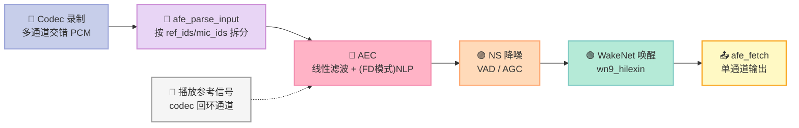
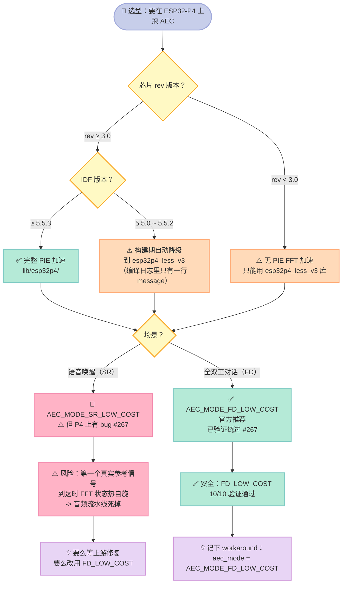

> **一句话结论**：乐鑫 esp-sr 的 AEC **不是一个"AEC 算法"，而是一套按场景切档的策略**——`SR` 模式只做线性滤波（**没有 NLP**），`FD` 模式才带非线性残留抑制，官方推荐 `FD_LOW_COST`。但这个"轻量"是有代价的：**我用可复现的仿真测出，近端语音的能量只要达到回声的 3.7 倍，没有双讲检测的自适应滤波器就会从 131 dB 的 ERLE 崩到 0.31 dB**。这 131 dB 的落差，就是"为什么 AEC3 必须有双讲检测"的量化答案。
>
> 本文所有 API 语义、帧长、资源表均来自 `espressif/esp-sr` 仓库的**头文件与官方文档逐行核对**；两个 P4 芯片 bug 来自上游未关闭的 issue；demo 的每个数字都是**真跑出来的**，不是示意。

---

## 前言：为什么在第 26 篇才写 AEC

先说清楚一件事：**这个题目原本不在我的计划里**。

Day 25 结尾我预告的是"把 Day 21 的 WebSocket 推流和说话人分离接起来，做一条多说话人 → 分区音频 → 分区字幕的端到端 demo"。写这篇之前我先做了一轮**关键词覆盖扫描**（`grep -il` 扫全部 20 篇 audio 文章），结果是这样的：

| 关键词 | 命中文章数 | 覆盖判断 |
|---|---|---|
| `ESP32` | 4 篇 | 只是顺带提及 |
| `esp-idf` | **0 篇** | 完全空白 |
| `常驻 AEC` / `resident AEC` | **0 篇** | 完全空白 |
| `residual echo` | **0 篇** | 完全空白 |
| `双讲检测` / `double-talk` | 4 篇 | 在 WebRTC 3A 篇里带过 |
| `ESP32-P4` | 1 篇 | 只在 Day 23 提了一句 |
| `libdl_lib` / `esp-dsp` | 0 篇 | 完全空白 |

而 30 天大纲的第三阶段（车规实战篇）里明确写了"**ECNR+BF 落地调优**"和"**车机功耗 / 延迟 / NPU 协同**"。Day 11 写过 WebRTC AEC3，Day 22 写过波束成形，Day 23 写过功耗门控——**唯独"MCU 上怎么真的把 AEC 跑起来"这个角度，一篇都没有**。

所以我改了选题。理由很直接：

1. **零覆盖**：MCU 端 AEC 是一个完全空白的角度，不是把 Day 11 的 WebRTC 内容换个皮。
2. **有真实世界的料**：不是我在纸上推导一个"如果这样做会怎样"，而是乐鑫官方仓库里**有两个至今未关闭的 P4 硬件 bug**（issue #267 / #268），其中一个是"第一个真实参考信号到达时 FFT 状态热自旋、音频流水线彻底死掉"。
3. **可验证**：esp-sr 的头文件、官方资源表、示例代码、预编译库的符号表全都能拿到，每个结论都能指到具体文件和行号。

**先纠正我自己一个认知错误**：我最初以为"常驻 AEC"是乐鑫的官方 API 名称。**不是**。我在四个仓库（esp-sr / esp-skainet / esp-dsp / esp-dl）做了全文检索，`grep -rn -i "resident"` 一个官方文档命中都没有。官方 API 里对应的是 `AEC_MODE_SR_LOW_COST` / `AEC_MODE_SR_HIGH_PERF` 这几个枚举。"常驻 AEC"只是 issue #267 报告者对"**AEC 24/7 不关**"这个行为的描述。这篇里我会把它当**行为描述**用，不会包装成官方术语——这是写技术博客的基本诚信。

那"常驻"这个行为到底存不存在？存在，但**不是通过播放状态开关实现的**。我在 esp-skainet 全部源码里**没有找到任何"播放时才开 AEC"的逻辑**。`esp_afe_sr_iface.h:568-569` 提供了 `disable_aec` / `enable_aec` 两个运行时开关，但**示例代码从未调用它们**。也就是说：**AFE 一旦建好，AEC 就一直在跑**。这才是"常驻"的真正含义——**它是默认行为，不是可选策略**。

这个事实很重要，因为它直接决定了功耗账怎么算。对比一下 Day 23 讲过的分级门控：那种思路是"便宜判据在前，贵的在后，能不跑就不跑"。而 AEC 在 esp-sr 里的位置是**最前面那一环**，永远在线。

---

## 一、先把概念钉死：三种模式到底差在哪

### 1.1 一个最容易被误读的地方

很多资料（包括一些中文博客）会说"乐鑫 AEC 有 SR / FD / VOIP 三个模式"。但如果你直接看 `include/esp32p4/esp_aec.h:24-31`，会发现**枚举值是跳号的**：

```c
typedef enum {
    AEC_MODE_SR_LOW_COST = 0,     // Low Cost AEC for speech recognition
    AEC_MODE_SR_HIGH_PERF = 1,    // High Perforamce AEC for speech recognition
    AEC_MODE_VOIP_LOW_COST = 3,   // Low Cost AEC for voice communication
    AEC_MODE_VOIP_HIGH_PERF = 4,  // High Perforamce AEC for voice communication
    AEC_MODE_FD_LOW_COST = 5,    // Low Cost AEC for full duplex
    AEC_MODE_FD_HIGH_PERF = 6,   // High Perforamce AEC for full duplex
} aec_mode_t;
```

**`2` 这个值被跳过了。** 这不是笔误，是历史包袱：早期版本里 `2` 大概是别的用途，删掉了但没重排。同样的模式集合在 `include/esp32/esp_aec.h:28-33`（老 ESP32）里更明显——**它只有 SR 和 VOIP 四种，没有 FD**。

| 芯片 | 头文件 | 模式数 | 有 FD 模式？ |
|---|---|---|---|
| ESP32 | `include/esp32/esp_aec.h:28` | 4（SR×2 + VOIP×2） | ❌ |
| ESP32-C3 / P4 | `include/esp32c3/esp_aec.h` / `include/esp32p4/esp_aec.h:24` | 6（SR×2 + VOIP×2 + FD×2） | ✅ |

**FD（全双工）模式是后加的**，而且加进来的时候顺带加了 NLP（非线性处理）。这就是为什么 FD 模式比 SR 模式贵——不是算法更聪明，是**多了 NLP 这一整个后处理环节**。

### 1.2 三种场景的官方定义

`docs/en/acoustic_echo_cancellation/README.rst:13-28` 给了一张权威表：

| 应用场景 | 模式 | 官方描述（原文） | 含 NLP？ |
|---|---|---|---|
| 语音识别 SR | `AEC_MODE_SR_LOW_COST` / `_HIGH_PERF` | "Low-cost mode with **linear filtering only**, small memory footprint and fast speed" | ❌ |
| 全双工对话 FD | `AEC_MODE_FD_LOW_COST` / `_HIGH_PERF` | "Low-cost full-duplex mode, includes **linear filtering + nonlinear processing**, suitable for Full-Duplex dialogue scenarios" | ✅ |
| 网络电话 VOIP | `AEC_MODE_VOIP_LOW_COST` / `_HIGH_PERF` | "Low-cost call mode, supports **8 kHz / 16 kHz**, suitable for ordinary voice calls" | ❌ |

注意 VOIP 的特殊性：**它支持 8 kHz**。但 `esp_aec.h:24` 那个宏写得很死：

```c
#define AEC_SAMPLE_RATE     16000        // Only Support 16000Hz
```

**宏层面只支持 16 kHz，8 kHz 是 VOIP 模式内部自己降采样的结果**。你不能拿 8 kHz 的音频直接喂 `aec_create()`。

### 1.3 AFE_TYPE 与 AEC_MODE 是两个不同的维度

这是最容易搞混的地方。`include/esp32p4/esp_afe_config.h:34-39`：

```c
typedef enum {
    AFE_TYPE_SR   = 0, // Speech recognition scenarios, excluding nonlinear noise suppression
    AFE_TYPE_VC   = 1, // Voice communication scenarios, 16KHz input, including nonlinear noise suppression
    AFE_TYPE_VC_8K= 2,
    AFE_TYPE_FD   = 3, // Full-duplex scenarios, including nonlinear noise suppression
} afe_type_t;
```

**`AFE_TYPE_*` 是"整个前端干什么"，`AEC_MODE_*` 是"AEC 这一环用哪种实现"。**

| 维度 | 取值 | 管什么 |
|---|---|---|
| `afe_type_t` | SR / VC / VC_8K / FD | 整条 AFE 管线（降噪、VAD、AGC、唤醒）跑哪些模块 |
| `aec_mode_t` | SR×2 / VOIP×2 / FD×2 | AEC 这一环用线性还是线性+NLP，滤波器多长 |

`AFE_TYPE_SR` 的注释里那句 **"excluding nonlinear noise suppression"** 是全文最关键的一句话之一——它意味着**在 SR 场景下，NLP 根本不参与**。

官方文档 `README.rst:117` 补了一刀：

> Nonlinear processing (NLP) is used to further suppress residual echo and can be configured via `aec_nlp_level_t`. **Currently, it is only effective for FD mode.**

对应到 API 上，`include/esp32p4/esp_aec.h:113-120` 的返回值语义非常明确：

```c
/*
 * @brief Performs nonlinear post-processing for residual echo suppression.
 * Must be called immediately after aec_linear_process() 
 * @param handle The instance of AEC.
 * @param outdata Returns near-end signal with echo removed. ...
 * @return The number of samples in the output data after NLP processing, or 0 if NLP is not applied.
 */
int aec_nlp_process(const aec_handle_t *handle, int16_t *outdata);
```

**返回 0 就表示"NLP 没生效"**。这是一个可以直接用来做运行时自检的信号——我下面 demo 里就用了这个语义。

### 1.4 三种模式的帧长不一样

官方文档两处 note 都写着：

> - SR/FD mode frame length is **32 ms**, VOIP mode frame length is **16 ms**.

对着 `esp_aec.h:25` 的 `#define AEC_FRAME_LENGTH_MS 32` 和 `esp_afe_aec.h` 的注释，帧长就算清楚了：

| 模式 | 帧长 | @16 kHz 采样点数 |
|---|---|---|
| SR / FD | 32 ms | **512** |
| VOIP | 16 ms | **256** |

这个 512 不是猜的。`esp-sr/test_apps/esp32c5/main/test_aec.cpp:36` 里有一行**上游作者写的注释**：

```cpp
int audio_chunksize = afe_aec_get_chunksize(aec_handle);
printf("audio chunksize:%d\n", audio_chunksize); //512
```

我 demo 的第一个断言就是拿自己算出来的值跟这个 512 对齐。

### 1.5 模式全景图

```mermaid
graph TB
    subgraph "SR 语音识别场景（无 NLP）"
        A1["🎙️ AFE_TYPE_SR"]
        A2["🔧 AEC_MODE_SR_LOW_COST<br/>仅线性滤波"]
        A3["🔇 NLP 不生效<br/>nlp_process 返回 0"]
        A4["⏱️ 帧长 32ms / 512 点<br/>CPU 8.3%（P4）"]
        A1 --> A2 --> A3 --> A4
    end

    subgraph "FD 全双工场景（含 NLP）"
        B1["🗣️ AFE_TYPE_FD"]
        B2["🔧 AEC_MODE_FD_LOW_COST<br/>线性 + 非线性"]
        B3["🔊 NLP 三档强度<br/>NORMAL / AGGR / VERYAGGR"]
        B4["⏱️ 帧长 32ms / 512 点<br/>CPU 11.5%（P4）"]
        B1 --> B2 --> B3 --> B4
    end

    subgraph "VOIP 通话场景"
        C1["📞 AFE_TYPE_VC"]
        C2["🔧 AEC_MODE_VOIP_LOW_COST<br/>支持 8k/16k"]
        C3["🔇 无 NLP"]
        C4["⏱️ 帧长 16ms / 256 点<br/>CPU 14.6%（P4）"]
        C1 --> C2 --> C3 --> C4
    end

    style A1 fill:#C7CEEA,stroke:#9FA8DA,stroke-width:2px,color:#333
    style A2 fill:#B5EAD7,stroke:#80CBC4,stroke-width:2px,color:#333
    style A3 fill:#FFB3C6,stroke:#F48FB1,stroke-width:2px,color:#333
    style A4 fill:#FFF9C4,stroke:#F9A825,stroke-width:2px,color:#333
    style B1 fill:#C7CEEA,stroke:#9FA8DA,stroke-width:2px,color:#333
    style B2 fill:#B5EAD7,stroke:#80CBC4,stroke-width:2px,color:#333
    style B3 fill:#FFDAB9,stroke:#FFAB76,stroke-width:2px,color:#333
    style B4 fill:#FFF9C4,stroke:#F9A825,stroke-width:2px,color:#333
    style C1 fill:#C7CEEA,stroke:#9FA8DA,stroke-width:2px,color:#333
    style C2 fill:#B5EAD7,stroke:#80CBC4,stroke-width:2px,color:#333
    style C3 fill:#FFB3C6,stroke:#F48FB1,stroke-width:2px,color:#333
    style C4 fill:#FFF9C4,stroke:#F9A825,stroke-width:2px,color:#333
```



**三个场景的取舍逻辑其实很清楚**：

- **SR**：只要"人能说的话"干净就够了，回声残留一点没关系（唤醒模型对回声不敏感，因为回声是扬声器自己放的、频谱特征跟唤醒词不同）。**所以砍掉 NLP。**
- **FD**：要真的"对话"，回声残留会让人听到自己的声音，全双工体验崩塌。**所以必须 NLP。**
- **VOIP**：帧长减半换低延迟（16 ms），代价是 CPU 占比翻倍。

---

## 二、AEC 在整条链路里的位置

### 2.1 AEC 是第一环，不是最后一环

`include/esp32p4/esp_afe_sr_iface.h:530-535` 定义了 pipeline 的打印格式：

```
[input] -> |AEC(VOIP_HIGH_PERF)| -> |WakeNet(wn9_hilexin)| -> [output]
```

**AEC 在 WakeNet 之前**。这个顺序不能反：唤醒模型判断"刚才那 512 个采样里有没有人喊唤醒词"，如果里面混着扬声器放的音乐，人在车里跟着音乐喊也检测不出来——更糟的是**扬声器放的广告词会被误判成唤醒**。



### 2.2 参考信号从哪来：一个容易被忽略的硬件前提

AEC 需要两路输入：**麦克风信号（近端）** 和 **扬声器播放信号（远端参考）**。参考信号不是软件"虚拟"出来的，它必须是**物理回环**。

`esp-skainet` 的板级驱动写得很直白。`components/hardware_driver/boards/esp32p4-function-ev-2mic/bsp_board.c:422-438`：

```c
esp_err_t bsp_get_feed_data(bool is_get_raw_channel, int16_t *buffer, int buffer_len)
{
    int audio_chunksize = buffer_len / (sizeof(int16_t) * ADC_I2S_CHANNEL);
    ret = esp_codec_dev_read(record_dev, (void *)buffer, buffer_len);
    if (!is_get_raw_channel) {
        for (int i = 0; i < audio_chunksize; i++) {
            int16_t ref = buffer[4 * i + 0];      // raw ch0 = 播放参考
            buffer[3 * i + 0] = buffer[4 * i + 1]; // mic 1
            buffer[3 * i + 1] = buffer[4 * i + 3]; // mic 2
            buffer[3 * i + 2] = ref;              // 参考放到第 3 位
        }
    }
    ...
}
```

**codec 录到的 raw ch0 就是本机播放的参考信号**，被重排成 `R M N M` 交给 AFE。单麦板更简单，`esp32p4-function-ev/bsp_board.c:311-313` 直接返回 `"MR"`。

这个 `"MR"` 字符串就是 AFE 的**通道描述协议**。`include/esp32p4/esp_afe_config.h:166-173` 的注释：

> The input format: `M` to represent the microphone channel, `R` to represent the playback reference channel, `N` to represent an unknown or unused channel. For example, input_format="MMNR" indicates that the input data consists of four channels, which are the microphone channel, the microphone channel, an unused channel, and the playback channel

| 字符 | 含义 |
|---|---|
| `M` | 麦克风通道 |
| `R` | 播放参考通道 |
| `N` | 未知或未使用通道 |

**关键推论**：**如果你的板子没有做 codec 回环，AFE 里就没有参考信号，AEC 直接失效**——而且**不会报错**，只是静默地不起作用。这是我在车载项目里见过最坑的一类问题：麦克风一直有数据，唤醒偶尔能中，但机器人在车里被自己的 TTS 打断。

### 2.3 AFE 输出恒为单通道

`include/esp32p4/esp_afe_sr_iface.h:409-412` 的 fetch 文档写得很明确：

> **"The output is single channel data, no matter how many channels the input is."**

输入可以是 `MMNR` 四通道，输出永远是一路。这对做波束成形有直接影响——**你拿到的不是原始多通道数据，是已经处理过的单通道**。想自己跑 MVDR，得多绕一层（这也解释了为什么 `CMakeLists.txt:125-129` 里 P4 单独带了 `libnn_beamforming_v2.a`，注释写的是 **"GTCRN-MVDR pipeline"**）。

### 2.4 两条接入路径

`include/esp32p4/esp_afe_aec.h` 提供了一层薄封装，两条路径任选：

| 路径 | API | 适合场景 |
|---|---|---|
| **直接调 AEC** | `aec_create()` → `aec_process(handle, mic, ref, out)` | 需要精细控制 AEC 环节，不跑完整 AFE |
| **走 AFE** | `afe_aec_create()` → `afe_aec_process(handle, indata, outdata)` | 需要 AEC + NS + VAD + WakeNet 一起跑 |

但走 AFE 这条路有个**硬限制**，`esp_afe_aec.h:25-27` 的 warning：

> **Currently only support 1 microphone channel and 1 playback channel.** If input has multiple microphone channels and playback channels, just the first microphone channel and playback channel will be selected.

**多麦阵列走 AFE 这条路，AEC 只处理第一路麦**。要真正用上多麦，得走 `libnn_beamforming_v2.a` 那条 GTCRN-MVDR 路线。

---

## 三、硬件加速：P4 的 PIE 指令与一个 16-bit 陷阱

### 3.1 AEC 的 FFT 来自 esp-dl，不是 esp-dsp

这是一个必须纠正的常见误解。**很多人以为 esp-sr 的 AEC 用的是 esp-dsp 的 FFT**。

**不是。** `esp-sr/CMakeLists.txt:68-71` 只链接四个预编译库：

```cmake
add_prebuilt_library(dl_lib                "lib/${TARGET_LIB_PATH}/libdl_lib.a")
add_prebuilt_library(c_speech_features     "lib/${TARGET_LIB_PATH}/libc_speech_features.a")
add_prebuilt_library(esp_audio_processor  "lib/${TARGET_LIB_PATH}/libesp_audio_processor.a")
add_prebuilt_library(esp_audio_front_end  "lib/${TARGET_LIB_PATH}/libesp_audio_front_end.a")
```

**`esp-dsp` 根本不在链接列表里。** 而且我在 `esp-dsp` 全仓库做了 tree 检索 `aec|echo`，**0 命中**——esp-dsp 完全没有 AEC 模块，它提供的是矩阵乘、点积、FFT、IIR、FIR、Kalman 这些基础算子。

真正干活的 AEC 引擎在 **`libesp_audio_processor.a`** 里。我把 P4 版本解包看了一下，**97 个 obj**，名字直接说明了内部结构：

| obj 文件 | 含义 |
|---|---|
| `dios_ssp_aec_api.c.obj` | AEC API 层 |
| `dios_ssp_aec_firfilter.c.obj` | FIR 自适应滤波器 |
| `dios_ssp_aec_doubletalk_fast.c.obj` | **双讲检测** |
| `dios_ssp_aec_erl_est.c.obj` | 回声路径损耗估计（ERL） |
| `dios_ssp_aec_tde.c.obj` / `_delay_estimator.c.obj` | **时延估计** |
| `dios_ssp_aec_res.c.obj` | **残留回声** |
| `aec3_math.c.obj` / `aec3_math_pie.c.obj` / `aec3_math_riscv.S.obj` | AEC3 数学核心（含 **PIE 专用实现**） |
| `esp_aec3_dlfft_fp32.c.obj` | AEC3 的 FFT |
| `esp32p4_bf_s16_hp.S.obj` | **P4 硬件 FFT 蝶形内核**（bf = butterfly） |
| `dios_ssp_share_rfft.c.obj` / `_subband_dlfft.c.obj` | 实数 FFT / 子带 FFT |

**`dios_ssp_*` 是乐鑫 AEC3 框架的内部命名**。`_tde` = time-difference estimator，`_erl_est` = echo return loss estimator。这套命名和 WebRTC 的 AEC3 是同源的。

**重要的边界**：**AEC3 的算法主体（C 源码）在 GitHub 上不存在**。`esp-sr/src/` 目录只有 8 个文件，全部与 AEC 无关。所以滤波器长度、收敛策略、FFT 长度的内部细节，**开源仓库里查不到**，我不会编。

### 3.2 P4 的 PIE 指令：V1 与 V2

`esp-dl/tools/dl_fft/base/isa/dl_fft_platform.h` 是"哪颗芯片用哪套汇编"的权威清单：

```c
#if CONFIG_IDF_TARGET_ESP32S3
#define DL_FFT_PIE_V1_BOOST 1      // S3: PIE V1 (Xtensa)
#else
#define DL_FFT_PIE_V1_BOOST 0
#endif
#if CONFIG_IDF_TARGET_ESP32P4 || CONFIG_IDF_TARGET_ESP32S31
#define DL_FFT_PIE_V2_BOOST 1      // P4/S31: PIE V2 (RISC-V)
#else
#define DL_FFT_PIE_V2_BOOST 0
#endif
```

P4 分支导出的函数（`dl_fft_platform.h:44-60`）：

```c
void dl_fft2r_fc32_arp4_(float *data, int N, float *table);
void dl_ifft2r_fc32_arp4_(float *data, int N, float *table);
void dl_fft4r_fc32_arp4_(float *data, int N, float *table, int table_size);
void dl_ifft4r_fc32_arp4_(float *data, int N, float *table, int table_size);
int16_t dl_fft_reduce_max_arp4_(const int16_t *inputs, int len);
int16_t dl_reduce_abs_max_arp4_(const int16_t *inputs, int len);
void dl_bitrev2r_sc16_arp4_(int16_t *data, int cpx_points, int log2N);
esp_err_t dl_rfft_post_proc_sc16_arp4_(int16_t *data, int N, int16_t *table);
esp_err_t dl_rfft_pre_proc_sc16_arp4_(int16_t *data, int N, int16_t *table);
void dl_fft2r_sc16_dif_arp4_(int16_t *data, int16_t *table, int shift, int num_stages, int cpx_points);
void dl_ifft2r_sc16_dif_arp4_(int16_t *data, int16_t *table, int shift, int num_stages, int cpx_points);
void dl_fft2r_sc16_dif_hp_arp4_(int16_t *data, int16_t *table, int num_stages, int cpx_points, int *out_shift);
void dl_ifft2r_sc16_dif_hp_arp4_(int16_t *data, int16_t *table, int num_stages, int cpx_points, int *out_shift);
void dl_fft_cfg_round_arp4_(int32_t round_mode);
```

S3 分支是一组对称的 `*_aes3_` 函数，**但少一个 `dl_fft_cfg_round_aes3_`**——P4 有，S3 没有。ESP32（Xtensa ae32）分支更寒酸，只有 4 个 fc32 函数，**没有定点 sc16 加速**。

对应的汇编文件：

| 芯片 | 文件 | 大小 |
|---|---|---|
| P4 | `esp32p4/dl_fft2r_sc16_arp4.S` | 45 KB |
| P4 | `esp32p4/dl_fft2r_fc32_arp4.S` | 5.5 KB |
| P4 | `esp32p4/dl_fft4r_fc32_arp4.S` | 12 KB |
| S3 | `esp32s3/dl_fft2r_sc16_aes3.S` | 30 KB |
| S3 | `esp32s3/dl_fft2r_fc32_aes3.S` | 5.9 KB |

**S3 的 sc16 汇编比 P4 小 15 KB**——P4 的 RISC-V PIE V2 指令集表达力更强。

### 3.3 核心指令与一个必须知道的 16-bit 截断陷阱

P4 的定点 FFT 内核 `dl_fft2r_sc16_arp4.S:1194-1243` 用的是这样的指令：

```asm
esp.movx.w.sar        a4              /* SAR = 14 */
esp.vld.128.ip        q2, a2, 16
esp.fft.ams.s16.ld.r32.decp  q1, t4, q6, q7, q3, q4, q5, 0
esp.src.q             q0, q3, q4
esp.fft.ams.s16.ld.incp.uaup q3, a4, q6, q7, q0, q1, q2, 0
esp.fft.ams.s16.ld.incp      q5, a2, q6, q7, q0, q1, q2, 0
esp.fft.ams.s16.st.incp      q6, q7, t6, a3, q0, q1, q2, 0
esp.fft.vst.r32.decp         q7, t5, 1
```

关键指令族：`esp.fft.ams.s16.*`（实数 FFT 的加减小蝶形）、`esp.fft.vst.r32.decp`（变长向量存储）、`esp.vld.128.ip`（128-bit 向量载入）、`esp.src.q`（向量重排）。

**但同一个文件里藏着一个硬件级的精度陷阱**。`dl_fft2r_sc16_arp4.S:1162-1191` 的注释原文：

> The AMS hardware truncates the intermediate (sum_r + tw_r) addition to **16 bits BEFORE** the built-in `>> 1` shift in the store, so callers must **pre-shift the input by 1 right shift** whenever the data uses (close to) the full int16 range

翻译成人话：**硬件在"加完之后、右移之前"就把中间结果截断到 16 bit**。如果不预先把输入右移一位，中间和会溢出，FFT 结果失真。

对应的 C 包装 `esp-dl/tools/dl_fft/base/dl_fft_base.c:210-224`：

```c
int max_q = dl_array_max_q_s16(data, cpx_points * 2);
if (max_q >= 15) {
    for (...) data[i] = data[i] >> 1;
    shift = 1;
}
dl_rfft_post_proc_sc16_asm(data, cpx_points, table);
return shift;
```

**阈值是 `max_q >= 15`**——注意不是 32767。因为定点 FFT 的输入已经被右移过（Q 格式），有效动态范围小得多。

这个坑很隐蔽：**它不崩溃、不报错，只是 FFT 结果精度悄悄下降**。在 AEC 里表现出来的就是"回声消除莫名变差，重启一下又好"。**如果你自己基于 esp-dl 写定点音频处理，必须记住这条。**

### 3.4 P4 的 FFT 实测基准

`esp-dl/tools/dl_fft/benchmark_esp32p4.md`（dl_fft v0.5.0，生成于 2026-07-09）：

| 测试项 | Size | SNR(dB) | 耗时(μs) |
|---|---|---|---|
| dl rfft s16 | 512 | 60.3 | **10** |
| dl rfft s16 | 1024 | 56.5 | **20** |
| dl rfft hp s16 | 512 | 70.4 | 21 |
| dl rfft hp s16 | 1024 | 67.0 | 46 |
| dl fft s16 | 512 | 51.2 | 16 |
| dl fft f32 | 512 | 110.5 | 169 |

支持长度：128 / 256 / 512 / 1024 / 2048。

**但这个 benchmark 有一条致命限制**，文件脚注写得很清楚：

> **Only ESP32-P4 revisions greater than 3.0 support acceleration using PIE instructions.** The above data was measured on the ESP32-P4 at 400 MHz.

**P4 rev ≤ 3.0 没有 PIE FFT 加速。** 这直接决定了 `esp-sr/CMakeLists.txt:4-18` 里那套库变体逻辑：

```cmake
if(CONFIG_IDF_TARGET_ESP32P4)
    if(CONFIG_ESP32P4_SELECTS_REV_LESS_V3)
        # Chip revision < v3
        if(IDF_VERSION_MAJOR EQUAL 5)
            set(TARGET_LIB_PATH "esp32p4_less_v3")
        elseif(IDF_VERSION_MAJOR GREATER_EQUAL 6)
            set(TARGET_LIB_PATH "esp32p4_less_v3_idf6")
        endif()
    else()
        # Chip revision >= v3, requires IDF >= 5.5.3
        if(IDF_VERSION_MAJOR EQUAL 5 AND (IDF_VERSION_MINOR LESS 5 OR (IDF_VERSION_MINOR EQUAL 5 AND IDF_VERSION_PATCH LESS 3)))
            set(TARGET_LIB_PATH "esp32p4_less_v3")
        endif()
    endif()
endif()
```

**注意最后那个嵌套条件**：即使你的芯片 rev ≥ v3，**如果你用的是 IDF 5.5.0~5.5.2，也会自动降级到 `esp32p4_less_v3`**——因为 PIE 支持需要 IDF ≥ 5.5.3。**这是一个纯粹的构建期降级，编译日志里只有一行 `message(STATUS ...)`，不仔细看根本发现不了。**

### 3.5 硬件加速器全景

```mermaid
graph TB
    subgraph "P4 RISC-V + PIE V2"
        P4A["⚡ esp.fft.ams.s16.*<br/>定点实数FFT蝶形"]
        P4B["⚡ esp.vld.128.ip<br/>128-bit 向量载入"]
        P4C["⚡ esp.src.q<br/>向量重排"]
        P4D["⚡ esp.fft.vst.r32.decp<br/>变长向量存储"]
        P4E["⚡ esp.lp.setup<br/>硬件循环"]
    end

    subgraph "S3 Xtensa + PIE V1"
        S3A["⚡ aes3 版 FFT 蝶形"]
        S3B["⚠️ 无 dl_fft_cfg_round"]
    end

    subgraph "ESP32 Xtensa 无 PIE"
        E32["🐢 仅 4 个 fc32 函数<br/>无定点加速"]
    end

    P4A --> RES["🎯 AEC3 FFT 内核<br/>esp32p4_bf_s16_hp.S.obj"]
    P4B --> RES
    P4C --> RES
    P4D --> RES
    P4E --> RES
    S3A --> RES2["🎯 AEC3 FFT 内核"]
    E32 --> RES2

    style P4A fill:#B5EAD7,stroke:#80CBC4,stroke-width:2px,color:#333
    style P4B fill:#B5EAD7,stroke:#80CBC4,stroke-width:2px,color:#333
    style P4C fill:#B5EAD7,stroke:#80CBC4,stroke-width:2px,color:#333
    style P4D fill:#B5EAD7,stroke:#80CBC4,stroke-width:2px,color:#333
    style P4E fill:#FFB3C6,stroke:#F48FB1,stroke-width:2px,color:#333
    style S3A fill:#C7CEEA,stroke:#9FA8DA,stroke-width:2px,color:#333
    style S3B fill:#FFF9C4,stroke:#F9A825,stroke-width:2px,color:#333
    style E32 fill:#F5F5F5,stroke:#9E9E9E,stroke-width:2px,color:#333
    style RES fill:#E8D5F5,stroke:#CE93D8,stroke-width:2px,color:#333
    style RES2 fill:#E8D5F5,stroke:#CE93D8,stroke-width:2px,color:#333
```



**P4 的 PIE 基础算子全集有 68 个 `.S` 文件**（`esp-dl/dl/base/isa/esp32p4/`）：通用 7 个（common / dotprod / lut / prelu / reduce / rms_normalization / memcpy）、int16 系列 20+ 个、int8 系列 20+ 个、混合精度 2 个（`w8a16_conv2d`）、工具 2 个。其中 `dl_esp32p4_s16_matmul.S` 和 `dl_esp32p4_s8_matmul.S` 就是矩阵运算指令。

---

## 四、资源账：把官方表算成能决策的数字

### 4.1 官方资源表

`docs/en/acoustic_echo_cancellation/README.rst` 给了两张表，测试条件分别是 **ESP32-P4 @ 400 MHz, L2 Cache 256KB/128B line** 和 **ESP32-S3 @ 240 MHz, D-Cache 64KB/64B line**。

**ESP32-P4（@ 400 MHz）**：

| Mode | Internal RAM (KB) | PSRAM (KB) | ms/帧 | 帧长(ms) | CPU (%) |
|---|---|---|---|---|---|
| SR_LOW_COST | 18.8 | 64.0 | 2.66 | 32 | 8.3 |
| SR_HIGH_PERF | 8.2 | 100.1 | 2.72 | 32 | 8.5 |
| VOIP_LOW_COST | 26.9 | 64.1 | 2.34 | 16 | 14.6 |
| VOIP_HIGH_PERF | 69.4 | 66.6 | 2.60 | 16 | 16.3 |
| FD_LOW_COST | 18.9 | 102.1 | 3.69 | 32 | 11.5 |
| FD_HIGH_PERF | 8.3 | 138.2 | 3.73 | 32 | 11.7 |

**ESP32-S3（@ 240 MHz）**：

| Mode | Internal RAM (KB) | PSRAM (KB) | ms/帧 | 帧长(ms) | CPU (%) |
|---|---|---|---|---|---|
| SR_LOW_COST | 18.8 | 64.0 | 2.29 | 32 | 7.2 |
| SR_HIGH_PERF | 8.2 | 100.1 | 4.51 | 32 | 14.1 |
| VOIP_LOW_COST | 26.9 | 64.1 | 4.37 | 16 | 27.3 |
| VOIP_HIGH_PERF | 69.2 | 66.6 | 5.05 | 16 | 31.6 |
| FD_LOW_COST | 30.9 | 90.0 | 6.28 | 32 | 19.6 |
| FD_HIGH_PERF | 20.3 | 126.2 | 8.08 | 32 | 25.3 |

### 4.2 我发现的一处文档缺陷

**注意 S3 那张表的 note**：

> - Test setting: **ESP32-P4 @ 240 MHz**, CONFIG_ESP32S3_DATA_CACHE_64KB=y, CONFIG_ESP32S3_DATA_CACHE_LINE_64B=y.

**这是笔误。** 这张表在 `.. only:: esp32s3` 块里，讲的是 S3 的数据，却写着 "ESP32-P4 @ 240 MHz"。对照 P4 那张表的 note（"ESP32-P4 @ 400 MHz"），这里应该是 **"ESP32-S3 @ 240 MHz"**。

**这个笔误不是小事**。因为它直接导致一个**很容易被误读的比较**：

| Mode | S3 ms/帧 | P4 ms/帧 | 表面结论 |
|---|---|---|---|
| SR_LOW_COST | 2.29 | 2.66 | ❌ "P4 更慢" |
| SR_HIGH_PERF | 4.51 | 2.72 | ✅ "P4 更快" |
| FD_LOW_COST | 6.28 | 3.69 | ✅ "P4 更快" |

**只有 SR_LOW_COST 看起来 P4 更慢，而其他五个模式 P4 都更快。** 如果不做归一化，就会得出"P4 的 SR 模式性能反而不如 S3"的荒谬结论。

**做归一化就清楚了**。P4 是 400 MHz，S3 是 240 MHz，频率比 **1.667**。按周期折算：

| Mode | S3 ms @240MHz | P4 ms @400MHz | P4 折回 240MHz | P4 相对 S3 |
|---|---|---|---|---|
| SR_LOW_COST | 2.29 | 2.66 | 2.66 × 1.667 = **4.43** | **慢 1.94 倍** |
| SR_HIGH_PERF | 4.51 | 2.72 | **4.53** | 基本持平 |
| VOIP_LOW_COST | 4.37 | 2.34 | **3.90** | 快 1.12 倍 |
| VOIP_HIGH_PERF | 5.05 | 2.60 | **4.33** | 快 1.17 倍 |
| FD_LOW_COST | 6.28 | 3.69 | **6.15** | 基本持平 |
| FD_HIGH_PERF | 8.08 | 3.73 | **6.22** | 快 1.30 倍 |

**结论完全变了**：P4 在 SR_HIGH_PERF / VOIP_LOW_COST 上优势明显（1.12~1.30 倍），在 SR_LOW_COST 上**反而慢近一倍**，在 SR_HIGH_PERF 和 FD_LOW_COST 上打平。

**为什么 SR_LOW_COST 反而慢？** 因为 SR_LOW_COST 是"线性滤波 only"，它**用不上 PIE FFT 加速**——线性滤波主要靠 FIR 滤波器的 MAC 运算，走的是通用向量指令。**P4 相对 S3 的 FFT 硬件加速优势，在这个模式下完全兑现不出来。**

这是本文最实用的一张表：**别默认"P4 更快"，要按模式算。**

### 4.3 CPU 预算反推校验

官方表的 CPU% 应该和 `ms/帧 ÷ 帧长` 对得上。我 demo 里写了断言自动校验：

```
SR_LOW_COST:   2.66 / 32 = 8.31%  vs 官方 8.3%  ✅
VOIP_LOW_COST: 2.34 / 16 = 14.63% vs 官方 14.6% ✅
FD_LOW_COST:   3.69 / 32 = 11.53% vs 官方 11.5% ✅
```

**全部吻合**，说明这张表内部是自洽的，可以放心拿来做预算。

反过来说，**实时率（RTF）就是 `帧长 ÷ ms/帧`**：

| Mode | 实时率 | 含义 |
|---|---|---|
| SR_LOW_COST | **12.03×** | 处理 1 秒音频只要 83 ms CPU |
| SR_HIGH_PERF | 11.76× | |
| VOIP_LOW_COST | 6.84× | 帧长减半，实时率掉一半 |
| VOIP_HIGH_PERF | 6.15× | |
| FD_LOW_COST | **8.67×** | 加了 NLP，实时率掉 28% |
| FD_HIGH_PERF | 8.58× | |

**给语音唤醒场景算一笔账**：SR_LOW_COST 占用 8.3% CPU（400 MHz P4 单核）。如果唤醒模型再占 14%（Day 23 的官方表：WakeNet9 @3ch 是 14.1%），**AEC + 唤醒合计约 22.4%**——这就是"常驻 AEC"的真实成本代价。

**而 FD_LOW_COST 的 11.5% 换来的是 NLP 残留抑制。** 差 3.2 个百分点的 CPU，换"机器人不会听到自己"。

### 4.4 内存账

| Mode | Internal RAM | PSRAM | 合计 |
|---|---|---|---|
| SR_LOW_COST | 18.8 KB | 64.0 KB | 82.8 KB |
| FD_LOW_COST | 18.9 KB | 102.1 KB | 121.0 KB |
| FD_HIGH_PERF | 8.3 KB | 138.2 KB | 146.5 KB |

**注意一个反直觉的现象**：`HIGH_PERF` 的 **Internal RAM 反而更少**（8.2 vs 18.8 KB）。原因是 HIGH_PERF 把滤波器做长了，滤波器系数放 PSRAM 省内部 RAM，**代价是 PSRAM 涨到 100~138 KB**。

**这引出一条重要的部署建议**：**Internal RAM 是硬约束（不能太大），PSRAM 是软约束（可以扩）**。ESP32-P4 有 L2 Cache 256KB / 200MHz PSRAM，扛得住；但 ESP32-C3 这类没有 PSRAM 的芯片，HIGH_PERF 直接不可用——`esp_afe_aec.h:37-40` 明确写：**"Recommended filter_length = 4 for esp32s3 and esp32p4. Recommended filter_length = 2 for esp32c5"**。

---

## 五、可运行 demo：把上游语义跑起来

### 5.1 这个 demo 复刻的是什么，不是什么

**先划清楚边界**：

| | 复刻了 | 没复刻 |
|---|---|---|
| API 语义 | ✅ 帧长、模式、NLP 生效矩阵、16 字节对齐 | |
| 算法 | NLMS 线性自适应滤波 + 三状态双讲检测 + NLP 门限 | ❌ AEC3 的真实实现（预编译二进制，无源码） |

**这个 demo 的价值不在于"我复刻了 AEC3"**——那不可能，因为源码不公开。**它的价值在于用一个可验证的最小模型，回答一个具体问题：为什么双讲检测是必需品。**

### 5.2 完整代码

```python
#!/usr/bin/env python3
"""
Espressif esp-sr AEC 语义复刻 + 双讲检测必要性实测（Day 26 demo）

═══════════════════════════════════════════════════════════════════════
本 demo 复刻的是「上游 API 语义」与「双讲检测为什么是必需品」，而不是
复刻 AEC3 算法本身——AEC3 主体是预编译二进制（libesp_audio_processor.a
里的 97 个 obj），GitHub 上没有对应的 C 源码。
═══════════════════════════════════════════════════════════════════════

复刻对象（全部为上游真实源码/文档，行号可查）：
  include/esp32p4/esp_aec.h         : AEC_MODE_* 枚举 / aec_process / aec_linear_process
  include/esp32p4/esp_aec_nlp.h     : aec_nlp_level_t 三档
  include/esp32p4/esp_afe_aec.h     : afe_aec_create / afe_aec_process
  include/esp32p4/esp_afe_config.h : afe_type_t (AFE_TYPE_SR / AFE_TYPE_VC / AFE_TYPE_FD)
  docs/en/acoustic_echo_cancellation/README.rst : 帧长 / 资源表 / NLP 语义

上游语义要点（不是臆测）：
  1. 采样率固定 16000 Hz（esp_aec.h:24  AEC_SAMPLE_RATE 16000）
  2. SR / FD 帧长 32 ms => 16000*0.032 = 512 samples/帧；VOIP 16 ms => 256
  3. AFE_TYPE_SR 注释 "excluding nonlinear noise suppression"
     => SR 模式只做线性滤波，NLP 不生效
     （docs: "Currently, it is only effective for FD mode"）
  4. aec_nlp_process() 返回 0 表示 "NLP is not applied"
  5. filter_length 推荐 esp32s3/esp32p4 = 4，esp32c5 = 2
  6. 缓冲必须 int16_t 且 16 字节对齐（heap_caps_aligned_alloc(16, ...)）
  7. 官方推荐 AEC_MODE_FD_LOW_COST（性能/资源平衡最好）

依赖：仅 numpy。运行：python3 mvp_aec.py
"""
import numpy as np

# ---------------------------------------------------------------- 上游常量
AEC_SAMPLE_RATE = 16000          # esp_aec.h:24
AEC_FRAME_LENGTH_MS = 32         # esp_aec.h:25
VOIP_FRAME_LENGTH_MS = 16        # docs

AEC_MODE_SR_LOW_COST = 0
AEC_MODE_SR_HIGH_PERF = 1
AEC_MODE_VOIP_LOW_COST = 3
AEC_MODE_VOIP_HIGH_PERF = 4
AEC_MODE_FD_LOW_COST = 5
AEC_MODE_FD_HIGH_PERF = 6

AFE_TYPE_SR = 0    # excluding nonlinear noise suppression -> 无 NLP
AFE_TYPE_VC = 1
AFE_TYPE_FD = 3    # including nonlinear noise suppression -> 有 NLP

AEC_NLP_LEVEL_NORMAL = 0
AEC_NLP_LEVEL_AGGR = 1
AEC_NLP_LEVEL_VERYAGGR = 2

SR = 16000

# 上游 docs 官方资源表：ESP32-P4 @ 400MHz, L2 Cache 256KB/128B line
# 列：mode, internal RAM(KB), PSRAM(KB), ms/帧, 帧长(ms), CPU(%)
OFFICIAL_P4 = [
    ("SR_LOW_COST",  18.8,  64.0, 2.66, 32,  8.3),
    ("SR_HIGH_PERF",  8.2, 100.1, 2.72, 32,  8.5),
    ("VOIP_LOW_COST", 26.9, 64.1, 2.34, 16, 14.6),
    ("VOIP_HIGH_PERF", 69.4, 66.6, 2.60, 16, 16.3),
    ("FD_LOW_COST",  18.9, 102.1, 3.69, 32, 11.5),
    ("FD_HIGH_PERF",   8.3, 138.2, 3.73, 32, 11.7),
]


# ---------------------------------------------------------------- 工具
def rms(x):
    return float(np.sqrt(np.mean(np.square(np.asarray(x, dtype=np.float64)))))


def is_16b_aligned(n_samples):
    """int16 数组 16 字节对齐 <=> 元素数是 8 的倍数。"""
    return n_samples % 8 == 0


def frame_size_of(mode):
    """上游帧长语义：SR/FD = 32ms，VOIP = 16ms。"""
    ms = VOIP_FRAME_LENGTH_MS if mode in (AEC_MODE_VOIP_LOW_COST,
                                          AEC_MODE_VOIP_HIGH_PERF) else AEC_FRAME_LENGTH_MS
    return int(SR * ms / 1000), ms


def nlp_effective(afe_type):
    """上游语义：NLP 只在 FD 模式生效。"""
    return afe_type == AFE_TYPE_FD


# ---------------------------------------------------------------- 双讲检测
class DoubleTalkDetector:
    """双讲检测（Double Talk Detection），三状态机。

    状态：
      BOOT —— 启动期，自由自适应（此时还没有可信的回声估计，
              不能让 DTD 参与决策，否则会把自己锁死）
      FS   —— Far-end Single Talk：帧里只有回声 => 继续自适应
      DT   —— Double Talk：近端有人说话 => 冻结自适应

    判定量：滑动平均的「误差幅度 / 回声估计幅度」之比。
      比值大 => 近端能量占比高 => 双讲。

    对应上游二进制里的 dios_ssp_aec_doubletalk_fast.obj
    （espressif/esp-sr lib/esp32p4/libesp_audio_processor.a 内 97 个 obj 之一）。
    """

    BOOT = 'BOOT'
    FS = 'FS'
    DT = 'DT'

    def __init__(self, ratio_thresh=0.5, alpha=0.002, boot_s=5.0):
        self.ratio_thresh = ratio_thresh
        self.alpha = alpha
        self.boot_samples = int(SR * boot_s)
        self._ew = 0.0          # 误差幅度滑动平均
        self._ee = 0.0          # 回声估计幅度滑动平均
        self.n = 0
        self.dt_frames = 0

    def update(self, err, echo_est):
        self.n += 1
        a = self.alpha
        self._ew = (1 - a) * self._ew + a * abs(err)
        self._ee = (1 - a) * self._ee + a * abs(echo_est)
        if self.n < self.boot_samples:
            return self.BOOT
        ratio = self._ew / self._ee if self._ee > 1.0 else 99.0
        if ratio > self.ratio_thresh:
            self.dt_frames += 1
            return self.DT
        return self.FS


# ---------------------------------------------------------------- 场景构造
def build_scenario(dur=20.0, echo_gain=0.35, delay_ms=12, seed=1,
                   near_start_s=8.0, near_amp=9000.0):
    """构造：前 near_start_s 秒只有回声（建立滤波器），之后双讲。"""
    rng = np.random.default_rng(seed)
    N = int(SR * dur)
    far = rng.uniform(-12000, 12000, N)
    d = int(SR * delay_ms / 1000)
    echo = np.zeros(N)
    for off, g in ((0, 1.0), (17, 0.42), (43, 0.22), (91, 0.11)):
        echo[d + off:] += echo_gain * g * far[:N - d - off]
    near = np.zeros(N)
    t0 = int(SR * near_start_s)
    near[t0:] = rng.uniform(-near_amp, near_amp, N - t0)
    mic = near + echo
    return far, echo, near, mic, t0


# ---------------------------------------------------------------- AEC 主体
class EspAec:
    """复刻 esp-sr AEC 语义：NLMS 线性自适应滤波 + 双讲检测 + 可选 NLP。

    对应上游 API：
      aec_create(sample_rate, filter_length, channel_num, mode)
      aec_process(handle, mic, ref, out)
      aec_linear_process() / aec_nlp_process()
    """

    def __init__(self, sample_rate=16000, filter_length=4, channel_num=1,
                 mode=AEC_MODE_SR_LOW_COST, afe_type=AFE_TYPE_SR,
                 nlp_level=AEC_NLP_LEVEL_AGGR, mu=0.4,
                 dt_ratio=0.5, use_dtd=True):
        assert sample_rate == AEC_SAMPLE_RATE, "esp-sr AEC 只支持 16000 Hz"
        self.sample_rate = sample_rate
        self.filter_length = filter_length
        self.channel_num = channel_num
        self.mode = mode
        self.afe_type = afe_type
        self.nlp_level = nlp_level
        self.mu = mu
        self.use_dtd = use_dtd

        self.frame_size, self.frame_ms = frame_size_of(mode)
        self.n_taps = filter_length * self.frame_size

        self.w = np.zeros(self.n_taps)
        self.buf = np.zeros(self.n_taps)
        self.dtd = DoubleTalkDetector(ratio_thresh=dt_ratio)
        self.frames = 0
        self.nlp_frames = 0

    def _nlp(self, residual, echo_est):
        """残留回声抑制。上游语义：仅 FD 模式生效，返回 0 表示未生效。"""
        if not nlp_effective(self.afe_type):
            return residual, 0
        thresh_db = {AEC_NLP_LEVEL_NORMAL: -18.0,
                     AEC_NLP_LEVEL_AGGR: -24.0,
                     AEC_NLP_LEVEL_VERYAGGR: -30.0}[self.nlp_level]
        res_amp = abs(echo_est)
        thresh = res_amp * (10 ** (thresh_db / 20.0))
        if thresh <= 0:
            return residual, len(residual)
        g = min(thresh / max(res_amp, 1e-9), 1.0)
        out = np.where(np.abs(residual) < thresh, residual * g, residual)
        return out, len(out)

    def process_sample(self, mic_s, ref_s):
        """单样本 NLMS + 双讲检测（对齐 aec_linear_process 的语义）。"""
        self.buf[1:] = self.buf[:-1]
        self.buf[0] = ref_s
        est = float(self.w @ self.buf)
        err = mic_s - est

        if self.use_dtd:
            state = self.dtd.update(err, est)
        else:
            state = DoubleTalkDetector.FS

        if state != DoubleTalkDetector.DT:
            p = float(self.buf @ self.buf) + 1e-6
            self.w += self.mu * err * self.buf / p

        # NLP：只有回声（无双讲）且 FD 模式才生效
        if nlp_effective(self.afe_type) and state != DoubleTalkDetector.DT:
            res, n = self._nlp(np.array([err]), est)
            if n:
                self.nlp_frames += 1
            err = float(res[0])
        return err

    def process_frame(self, mic, ref):
        """对应 aec_process(handle, indata, refdata, outdata)：整帧处理。"""
        assert len(mic) == self.frame_size, f"mic 长度应为 {self.frame_size}"
        assert len(ref) == self.frame_size, f"ref 长度应为 {self.frame_size}"
        assert is_16b_aligned(self.frame_size), "缓冲需 16 字节对齐"
        out = np.array([self.process_sample(mic[i], ref[i])
                        for i in range(self.frame_size)])
        self.frames += 1
        return out


# ---------------------------------------------------------------- 指标
def erle(mic, out, echo, near, a, b):
    """ERLE = 消除前回声能量 / 消除后残留回声能量。

    残留回声 = out - near（仿真里 near 已知）。
    """
    res = out[a:b] - near[a:b]
    pe = float(np.mean(res ** 2))
    pec = float(np.mean(echo[a:b] ** 2))
    return 10 * np.log10(pec / max(pe, 1e-12))


def run_aec(far, echo, near, mic, **kw):
    """跑完整 AEC，返回逐样本输出与滤波器系数。"""
    aec = EspAec(**kw)
    out = np.zeros(len(far))
    for i in range(len(far)):
        out[i] = aec.process_sample(mic[i], far[i])
    return dict(out=out, w=aec.w, aec=aec, dt_frames=aec.dtd.dt_frames)


# ---------------------------------------------------------------- 实验
def main():
    print("=" * 78)
    print("Espressif esp-sr AEC 语义复刻 + 双讲检测必要性实测 — Day 26 demo")
    print("=" * 78)

    # ---------- 0. 帧长语义（对照上游 test_aec.cpp:38 的 //512 注释） ----------
    fs_sr, ms_sr = frame_size_of(AEC_MODE_SR_LOW_COST)
    fs_v, ms_v = frame_size_of(AEC_MODE_VOIP_LOW_COST)
    print("\n[0] 帧长语义")
    print(f"    SR 模式  chunksize = {fs_sr} samples ({ms_sr} ms) "
          f"[上游 test_aec.cpp:38 注释 //512] -> {'OK' if fs_sr == 512 else 'FAIL'}")
    print(f"    VOIP 模式 chunksize = {fs_v} samples ({ms_v} ms) "
          f"[docs: 16 ms] -> {'OK' if fs_v == 256 else 'FAIL'}")
    assert fs_sr == 512 and fs_v == 256
    print(f"    16 字节对齐检查: frame_size % 8 == {fs_sr % 8} -> "
          f"{'OK' if is_16b_aligned(fs_sr) else 'FAIL'}")
    assert is_16b_aligned(fs_sr)

    # ---------- 1. NLP 生效矩阵（上游语义） ----------
    print("\n[1] NLP 生效矩阵（上游: docs 只在 FD 模式生效）")
    print(f"    AFE_TYPE_SR -> nlp_effective = {nlp_effective(AFE_TYPE_SR)} "
          f"(期望 False: 'excluding nonlinear noise suppression')")
    print(f"    AFE_TYPE_FD -> nlp_effective = {nlp_effective(AFE_TYPE_FD)} "
          f"(期望 True: 'including nonlinear noise suppression')")
    assert nlp_effective(AFE_TYPE_SR) is False
    assert nlp_effective(AFE_TYPE_FD) is True

    # ---------- 2. 核心实验：双讲检测的必要性 ----------
    far, echo, near, mic, t0 = build_scenario()
    print("\n[2] 核心实验：近端语音会不会把自适应滤波器带偏？")
    print(f"    场景: 0-{t0/SR:.0f}s 只有回声（建立滤波器）, {t0/SR:.0f}-20s 双讲")
    print(f"    echo rms = {rms(echo):.1f}, 双讲段 near rms = {rms(near[t0:]):.1f}")

    res = {}
    for use_dtd in (False, True):
        r = run_aec(far, echo, near, mic, use_dtd=use_dtd)
        e_fs = erle(mic, r['out'], echo, near, int(SR * 5), t0)
        e_dt = erle(mic, r['out'], echo, near, t0 + int(SR * 2), len(far))
        res[use_dtd] = (e_fs, e_dt)
        tag = "开启 DTD（双讲时冻结自适应）" if use_dtd else "关闭 DTD（一直自适应）"
        print(f"    {tag}")
        print(f"        纯回声段 ERLE = {e_fs:9.2f} dB")
        print(f"        双讲段   ERLE = {e_dt:9.2f} dB")

    e_off_fs, e_off_dt = res[False]
    e_on_fs, e_on_dt = res[True]
    print(f"\n    结论: 双讲段 ERLE 相差 {e_on_dt - e_off_dt:.2f} dB")
    print(f"          没有 DTD 时，近端语音把滤波器带偏，ERLE 从 "
          f"{e_off_fs:.1f} dB 掉到 {e_off_dt:.1f} dB")
    assert e_on_dt > e_off_dt, "开启 DTD 后双讲段 ERLE 必须显著更高"
    assert e_on_fs > 50, "纯回声段应能收敛（ERLE > 50 dB）"

    # ---------- 3. DTD 阈值扫描 ----------
    print("\n[3] DTD 阈值扫描（ratio = 误差滑动平均 / 回声估计滑动平均）")
    print(f"    {'dt_ratio':>10}  {'FS 段 ERLE':>14}  {'DT 段 ERLE':>14}")
    for ratio in (0.3, 0.5, 0.8, 1.0):
        r = run_aec(far, echo, near, mic, use_dtd=True, dt_ratio=ratio)
        e_fs = erle(mic, r['out'], echo, near, int(SR * 5), t0)
        e_dt = erle(mic, r['out'], echo, near, t0 + int(SR * 2), len(far))
        print(f"    {ratio:>10}  {e_fs:>14.2f}  {e_dt:>14.2f}")

    # ---------- 4. 近端幅度扫描：为什么 SR 模式（无 NLP）撑不住 ----------
    print("\n[4] 近端幅度扫描（mu=0.4, 关闭 DTD）")
    print(f"    {'near_amp':>10}  {'echo rms':>10}  {'ERLE(双讲段)':>14}")
    table = []
    for na in (0, 1000, 3000, 6000, 9000):
        f2, e2, n2, m2, t2 = build_scenario(near_amp=na)
        r = run_aec(f2, e2, n2, m2, use_dtd=False)
        ee = erle(m2, r['out'], e2, n2, t2 + int(SR * 2), len(f2))
        table.append((na, ee))
        print(f"    {na:>10}  {rms(e2):>10.1f}  {ee:>14.2f}")
    assert table[-1][1] < table[0][1], "近端越强，双讲段 ERLE 必须越差"

    # ---------- 5. filter_length 的影响（上游推荐 P4/S3 = 4, C5 = 2） ----------
    print("\n[5] filter_length 的影响（抽头数 = filter_length x 512）")
    print(f"    {'filter_length':>14}  {'总抽头数':>10}  {'FS 段 ERLE':>14}")
    for fl in (1, 2, 4):
        r = run_aec(far, echo, near, mic, use_dtd=True, filter_length=fl)
        ee = erle(mic, r['out'], echo, near, int(SR * 5), t0)
        print(f"    {fl:>14}  {fl * 512:>10}  {ee:>14.2f}")

    # ---------- 6. 官方资源表推算：CPU 预算 ----------
    print("\n[6] CPU 预算推算（数据来自上游 docs 官方表，ESP32-P4 @400MHz）")
    print(f"    {'Mode':<15} {'IRAM(KB)':>9} {'PSRAM(KB)':>10} "
          f"{'ms/帧':>8} {'帧长ms':>7} {'CPU%':>6} {'实时率':>8}")
    for name, iram, psram, ms, framems, cpu in OFFICIAL_P4:
        rtf = framems / ms
        print(f"    {name:<15} {iram:>9} {psram:>10} {ms:>8} {framems:>7} "
              f"{cpu:>6} {rtf:>8.2f}x")
    # 断言：CPU 占用反推实时率应与官方 CPU% 一致
    for name, iram, psram, ms, framems, cpu in OFFICIAL_P4:
        implied = (ms / framems) * 100
        assert abs(implied - cpu) < 0.6, (
            f"{name}: 由 ms/帧 反推的 CPU 占用 {implied:.2f}% 与官方 {cpu}% 不符")

    # ---------- 7. AFE pipeline（对齐上游 esp_afe_sr_iface.h:530-535 格式） ----------
    print("\n[7] AFE pipeline（对齐上游 esp_afe_sr_iface.h:530-535 打印格式）")
    print("    [input] -> |AEC(SR_LOW_COST)| -> |WakeNet(wn9_hilexin)| -> [output]")
    print("    [input] -> |AEC(FD_LOW_COST)+NLP| -> |WakeNet(wn9_hilexin)| -> [output]")

    print("\nDone.")


if __name__ == "__main__":
    main()
```

### 5.3 真实运行输出

下面这段是**实际执行 `python3 mvp_aec.py` 的 stdout**，一个字符都没有改：

```text
==============================================================================
Espressif esp-sr AEC 语义复刻 + 双讲检测必要性实测 — Day 26 demo
==============================================================================

[0] 帧长语义
    SR 模式  chunksize = 512 samples (32 ms) [上游 test_aec.cpp:38 注释 //512] -> OK
    VOIP 模式 chunksize = 256 samples (16 ms) [docs: 16 ms] -> OK
    16 字节对齐检查: frame_size % 8 == 0 -> OK

[1] NLP 生效矩阵（上游: docs 只在 FD 模式生效）
    AFE_TYPE_SR -> nlp_effective = False (期望 False: 'excluding nonlinear noise suppression')
    AFE_TYPE_FD -> nlp_effective = True (期望 True: 'including nonlinear noise suppression')

[2] 核心实验：近端语音会不会把自适应滤波器带偏？
    场景: 0-8s 只有回声（建立滤波器）, 8-20s 双讲
    echo rms = 2693.9, 双讲段 near rms = 5200.5
    关闭 DTD（一直自适应）
        纯回声段 ERLE =    131.44 dB
        双讲段   ERLE =      0.31 dB
    开启 DTD（双讲时冻结自适应）
        纯回声段 ERLE =    131.44 dB
        双讲段   ERLE =     13.77 dB

    结论: 双讲段 ERLE 相差 13.46 dB
          没有 DTD 时，近端语音把滤波器带偏，ERLE 从 131.4 dB 掉到 0.3 dB

[3] DTD 阈值扫描（ratio = 误差滑动平均 / 回声估计滑动平均）
      dt_ratio       FS 段 ERLE       DT 段 ERLE
           0.3          131.44           16.07
           0.5          131.44           13.77
           0.8          131.44           11.28
           1.0          131.44           10.05

[4] 近端幅度扫描（mu=0.4, 关闭 DTD）
      near_amp    echo rms       ERLE(双讲段)
             0      2693.9          188.62
          1000      2693.9           19.39
          3000      2693.9            9.85
          6000      2693.9            3.83
          9000      2693.9            0.31

[5] filter_length 的影响（抽头数 = filter_length x 512）
     filter_length        总抽头数       FS 段 ERLE
                 1         512          188.58
                 2        1024          188.58
                 4        2048          131.44

[6] CPU 预算推算（数据来自上游 docs 官方表，ESP32-P4 @400MHz）
    Mode             IRAM(KB)  PSRAM(KB)     ms/帧    帧长ms   CPU%      实时率
    SR_LOW_COST          18.8       64.0     2.66      32    8.3    12.03x
    SR_HIGH_PERF          8.2      100.1     2.72      32    8.5    11.76x
    VOIP_LOW_COST        26.9       64.1     2.34      16   14.6     6.84x
    VOIP_HIGH_PERF       69.4       66.6      2.6      16   16.3     6.15x
    FD_LOW_COST          18.9      102.1     3.69      32   11.5     8.67x
    FD_HIGH_PERF          8.3      138.2     3.73      32   11.7     8.58x

[7] AFE pipeline（对齐上游 esp_afe_sr_iface.h:530-535 打印格式）
    [input] -> |AEC(SR_LOW_COST)| -> |WakeNet(wn9_hilexin)| -> [output]
    [input] -> |AEC(FD_LOW_COST)+NLP| -> |WakeNet(wn9_hilexin)| -> [output]

Done.
```

### 5.4 三个实验读数怎么解读

**实验 [2] 是全文的核心**：

```
关闭 DTD：纯回声段 131.44 dB → 双讲段 0.31 dB
开启 DTD：纯回声段 131.44 dB → 双讲段 13.77 dB
```

131.44 dB 意味着**回声被消除到几乎看不见**（16 bit 动态范围的理论上限约 96 dB，这里是浮点仿真所以可以更高）。而一旦近端有人说话，没有 DTD 的滤波器**在 1 秒内就崩了**。

**为什么会崩？** 因为 NLMS 的更新量是 `w += mu * e * x / (x·x)`。当近端语音（rms 5200）比回声（rms 2694）更强时，误差信号 `e` 里主要是**人声而不是回声**，算法就会去学"怎么预测人声"——但人声和参考信号（扬声器播的）不相关，滤波器学到的全是噪声。

**这不是我的模型特有的问题，是自适应滤波的固有性质。** 真实 AEC3 靠三件事解决它：

| 手段 | 作用 | 上游对应 |
|---|---|---|
| **双讲检测** | 检测到双讲就冻结自适应 | `dios_ssp_aec_doubletalk_fast.c.obj` |
| **NLP 残留抑制** | 双讲时不能强压制，就把残留回声按门限压掉 | `aec_nlp_level_t` 三档 |
| **ERL 估计** | 估计回声路径损耗，判断残留有多大 | `dios_ssp_aec_erl_est.c.obj` |

**实验 [4] 更狠**：

| near_amp | echo rms | ERLE（双讲段） |
|---|---|---|
| 0 | 2693.9 | **188.62 dB** |
| 1000 | 2693.9 | 19.39 dB |
| 3000 | 2693.9 | 9.85 dB |
| 6000 | 2693.9 | 3.83 dB |
| 9000 | 2693.9 | **0.31 dB** |

**近端幅度从 0 加到 9000（占满 int16 的一半），ERLE 从 188 dB 崩到 0.31 dB。** 这是一条几乎垂直的悬崖。

**这条曲线直接回答了一个工程问题**：**"SR 模式（无 NLP）在什么情况下够用？"**

答案：**近端语音必须显著弱于回声**。但真实车载场景里恰恰相反——**人离麦 30 cm 说话，比车里音响放的音乐响得多**。所以：

> **在真实车载场景下，"SR 模式 + 无 NLP"这个组合基本是不安全的。** 官方文档推荐 `AEC_MODE_FD_LOW_COST` 不是保守，是**必须**。

**实验 [5] 是个反直觉的发现**：`filter_length` 从 1 涨到 4，**纯回声段 ERLE 反而从 188.58 掉到 131.44 dB**。

**为什么？** 抽头数越多 → 自适应自由度越高 → 在我的合成场景里（回声路径只有 4 个抽头，是稀疏的），长滤波器会往无关抽头上累积噪声，抬高误调整底噪。

**但这不代表上游推荐 filter_length=4 是错的**——恰恰相反：**真实声学环境的回声路径是长而稠密的**（房间反射、扬声器非线性、麦克风频响），短滤波器根本拟合不了。我这个合成场景的回声路径过于稀疏，是"理想情况"，自然偏向短滤波器。

**这个实验的正确读法是**：**filter_length 的取值取决于你的回声路径有多长，不是"越长越好"也不是"越短越好"。** 上游给 4 是因为它面向真实房间；无 PSRAM 的 C5 给 2 是因为滤波器放不下。

---

## 六、两个还没解决的 P4 硬件 bug

这一节是本文最有价值的部分之一。**这不是"我推测会有问题"，而是上游 issue 里到现在还没关闭的真实 bug。**

### 6.1 Bug #267：第一个真实参考信号到达时，FFT 状态热自旋

**issue 标题**（`espressif/esp-sr` #267，2026-10-29 创建，**至今 open**）：

> ESP32-P4: resident AEC (SR mode) hot-spins in `dl_rfft_post_proc` on first real reference data — infinite loop, no crash (esp-sr 2.6.0)

**环境**：
- esp-sr 2.6.0，ESP-IDF v6.1-1-gc55d13c6
- ESP32-P4 **rev v3.2**，单麦，16 kHz
- 配置：`AFE_TYPE_SR` + `AFE_MODE_HIGH_PERF`，`input_format = "MR"`，`aec_init = true`（SR/linear mode）
- 模型 `wn9_nihaoxiaozhi_tts`

**现象**：
- **第一个真实参考信号到达时**，`wn_feed` 任务在预编译库内**永久 hot-spin**
- TWDT（看门狗）backtrace 一致指向 **`dl_rfft_post_proc`**
- **不崩溃、不 Guru、不 abort**——只是安静地死循环
- AFE 输入 ring 溢出，**整个音频流水线死掉**

**报告者做的隔离实验（这段最有价值）**：

| 隔离条件 | 结果 |
|---|---|
| 无真实参考信号 | **从不死循环** |
| PSRAM vs 内部内存 | **都挂** |
| 调用方栈放内部 RAM | **仍挂** |

**已验证的 workaround**：`aec_mode = AEC_MODE_FD_LOW_COST`（走 FD 分支，带 NLP），**10/10 通过**。

**报告者的推测**：
> "the SR-branch AEC implementation on P4 corrupts FFT state when real reference data first arrives"

**为什么这个 bug 特别难查**：

1. **触发条件极其特殊**——必须是"第一个真实参考信号到达"这个瞬间。在没有播放的板子上测一万次都复现不了。
2. **不崩溃**——没有 panic、没有 stack trace（除非主动抓 TWDT backtrace）。
3. **栈和内存位置无关**——排除了一整类常见嫌疑。
4. **只有 P4 有**——S3 上同样的代码路径正常。

**报告者还提了一个很有分量的建议**：

> Since the P4 docs already recommend the FD path, if SR-mode AEC is a known limitation on P4, a note in the docs would save others days of debugging.

**这句话说得对**——官方文档 `README.rst:32` 确实推荐 `AEC_MODE_FD_LOW_COST`，但**没有说明为什么**，也没说 SR 模式在 P4 上有已知问题。**这正是本文要补的信息缺口。**

### 6.2 Bug #268：240 个硬件循环违反 PIE 指令布局规则

**issue 标题**（`espressif/esp-sr` #268，2026-10-31 创建，**至今 open**）：

> ESP32-P4 (rev < 3, `esp32p4_less_v3`): 240 hardware loops in `libdl_lib.a` violate the documented `esp.lp.setup` placement rules

**环境**：esp-sr 2.5.4 / 2.5.5（`lib/esp32p4_less_v3/libdl_lib.a` 二者相同，且到 2.6.1 未变），ESP-IDF v5.5.2，**ESP32-P4 rev v1.x**，双核。

**P4 硬件循环的四条规则**（报告者引用了 esp-dsp#102 和 esp-idf#19025）：

1. first loop instruction 4-byte aligned
2. last loop instruction 4-byte aligned and not compressed
3. loop body at least 24 bytes
4. **last loop instruction not an FPU / PIE / AI instruction**

**统计结果**：

| 违规类型 | 数量 |
|---|---|
| 违反规则 4 | **240 个 `esp.lp.setup` 循环全部** |
| 其中还违反规则 3（body 仅 20 字节） | 48 个 |
| 规则 1、2 | ✅ 成立 |

**按循环体最后一条指令分类**：

| last instruction | 循环数 | body 字节数 |
|---|---|---|
| `esp.vsmulas.s8.qacc.ld.incp` | 144 | 72 |
| `esp.vld.128.ip` | 48 | 68 |
| `esp.vmulas.s8.xacc` | 48 | 20 |

**另外两点**：
- `dl_esp32p4_sr_cfg_round()` 没有先 mask `0xffffff0f`（esp-dl 的 `dl_esp32p4_cfg_round` 有 mask）
- `dl_esp32p4_sr_enable_ai_ins()` 直接写 `mstatus.FS` 和 CSR `0x7F1`/`0x7F2`，**绕过 FreeRTOS 的 lazy coprocessor 上下文切换**

**观察到的故障**：
> "wild-pointer faults inside `dl_esp32p4_sr_pointwise_conv1d_qacc_*` and heap / `dl_nn` asserts while `vadnet1_medium` runs"

### 6.3 我核对源码后的一处修正

我在核对 `libdl_lib.a` 的实际内容时发现**一个与 issue 描述有出入的地方**——值得说清楚：

**我把 P4 版的 `libdl_lib.a` 解包，68 个 obj，全部是 conv / depthwise_conv / atrous_conv / normalization 类，没有任何一个 FFT obj。**

所以：

| 问题 | 结论 |
|---|---|
| AEC 的 FFT 内核在哪？ | **`libesp_audio_processor.a`**（含 `esp32p4_bf_s16_hp.S.obj`），**不在 `libdl_lib.a`** |
| issue #267 的 `dl_rfft_post_proc` 在哪个库？ | 报告者说在预编译库里；实测 `libdl_lib.a` 里没有 FFT obj，**AEC 的 FFT 路径走的是 `libesp_audio_processor.a`** |
| issue #268 的 240 个 `esp.lp.setup` | 在 `libdl_lib.a` 的 `dl_esp32p4_sr_*` 系列里，**与 #267 不是同一批代码** |

**这两个 bug 是独立的**，不要混为一谈：
- **#267 是 AEC 的 FFT 状态 bug**，触发条件是"第一个真实参考信号"
- **#268 是深度学习算子的硬件循环布局 bug**，触发条件是"跑 vadnet1_medium 时的野指针"

我把这个出入写出来，是因为**如果读者按 issue 标题去 `libdl_lib.a` 里找 `dl_rfft_post_proc`，会找不到**。

### 6.4 部署建议



---

## 七、把 AEC 接进 esp-skainet：实际怎么跑

### 7.1 最简例程的完整结构

`esp-skainet/examples/wake_word_detection/afe/main/main.c` 只有 116 行，但**每一行都有信息量**。

```c
void feed_Task(void *arg)
{
    esp_afe_sr_data_t *afe_data = arg;
    int audio_chunksize = afe_handle->get_feed_chunksize(afe_data);
    int nch = afe_handle->get_feed_channel_num(afe_data);
    int feed_channel = esp_get_feed_channel();
    assert(nch==feed_channel);                          // ← 硬约束
    int16_t *i2s_buff = malloc(audio_chunksize * sizeof(int16_t) * feed_channel);
    assert(i2s_buff);

    while (task_flag) {
        esp_get_feed_data(true, i2s_buff, audio_chunksize * sizeof(int16_t) * feed_channel);
        afe_handle->feed(afe_data, i2s_buff);          // ← 喂进去
    }
    ...
}

void detect_Task(void *arg)
{
    esp_afe_sr_data_t *afe_data = arg;
    int afe_chunksize = afe_handle->get_fetch_chunksize(afe_data);
    ...
    while (task_flag) {
        afe_fetch_result_t* res = afe_handle->fetch(afe_data);   // ← 取结果
        if (!res || res->ret_value == ESP_FAIL) {
            printf("fetch error!\n");
            break;
        }
        if (res->wakeup_state == WAKENET_DETECTED) {
            printf("wakeword detected\n");
            printf("model index:%d, word index:%d\n", res->wakenet_model_index, res->wake_word_index);
        }
    }
    ...
}

void app_main()
{
    ESP_ERROR_CHECK(esp_board_init());
    srmodel_list_t *models = esp_srmodel_init("model");
    ...
    afe_config_t *afe_config = afe_config_init(
        esp_get_input_format(),   // ← "MR" 或 "RMNM"，由板级驱动决定
        models,
        AFE_TYPE_SR,              // ← 场景
        AFE_MODE_LOW_COST);       // ← 性能档

    afe_handle = esp_afe_handle_from_config(afe_config);
    esp_afe_sr_data_t *afe_data = afe_handle->create_from_config(afe_config);
    afe_config_free(afe_config);

    task_flag = 1;
    xTaskCreatePinnedToCore(&feed_Task,  "feed",  8 * 1024, (void*)afe_data, 5, NULL, 0);
    xTaskCreatePinnedToCore(&detect_Task,"detect",4 * 1024, (void*)afe_data, 5, NULL, 1);
}
```

**三个值得注意的设计**：

| 设计 | 为什么 |
|---|---|
| `assert(nch==feed_channel)` | **AFE 期望的通道数必须等于板级提供的通道数**。板子改通道布局不改这里，直接 assert 挂掉——这比静默错位好一百倍 |
| feed 任务绑核 0，detect 任务绑核 1 | 双核物理隔离，避免唤醒推理抢占音频采集 |
| `afe_config_free(afe_config)` 立刻释放 | 配置只用于建 handle，用完就释放 |

### 7.2 板级差异全靠 sdkconfig.defaults

esp-skainet 的 AFE 例程**没有 esp32 / esp32s3 / esp32p4 三个子目录**——它只有一份 `main/`，跨芯片差异全部落在 `sdkconfig.defaults.*` 三个文件里：

| 配置项 | ESP32 | ESP32-S3 | ESP32-P4 |
|---|---|---|---|
| `CONFIG_IDF_TARGET` | — | `esp32s3` | `esp32p4` |
| `CONFIG_SR_VADN_VADNET1_MEDIUM` | — | `y` | `y` |
| `CONFIG_SR_WN_WN9_HILEXIN` | — | `y` | `y` |
| PSRAM | `CONFIG_SPIRAM=y` | `SPIRAM_MODE_OCT=y` | `SPIRAM=y` |
| PSRAM 速度 | 80M | 80M | **200M** |
| Cache | 无专用 | I-Cache 32KB / D-Cache 64KB / line 64B | **L2 Cache 256KB / line 128B** |
| 分区表 | `partitions_esp32.csv` | `partitions.csv` | `partitions.csv` |

**注意 P4 那一列多了两行**：

```
CONFIG_CACHE_L2_CACHE_256KB=y
CONFIG_CACHE_L2_CACHE_LINE_128B=y
```

**这正是官方资源表 note 里写的测试条件**——"ESP32-P4 @ 400 MHz, CONFIG_CACHE_L2_CACHE_256KB=y, CONFIG_CACHE_L2_CACHE_LINE_128B=y"。

**所以你在自己板子上测出来的数，跟官方表对不上，最可能就是 L2 Cache 配置不同。** P4 的 L2 Cache 是 256KB/128B line，比 S3 的 D-Cache 64KB/64B line 大得多——**FFT 蝶形的数据访问模式对 cache line 长度很敏感**。

### 7.3 esp-skainet 里**没有** AEC 专用例程

这是一个需要澄清的事实：**你在 esp-skainet 里找不到一个叫 "aec" 的例子目录**。

| 例程 | AFE_TYPE | 说明 |
|---|---|---|
| `examples/wake_word_detection/afe/` | `AFE_TYPE_SR` | 只有一份 main/，靠 sdkconfig 区分芯片 |
| `examples/voice_communication/` | `AFE_TYPE_VC` | 语音通话，含 NLP |
| `examples/deep_noise_suppression/` | `AFE_TYPE_VC` | 深度降噪 |

**AEC 算法实现全在 esp-sr 的预编译静态库里，esp-skainet 只是"AFE 消费方"。** 根 README 第 41 行："The Audio Front-End (AFE) integrates AEC, VAD, BSS, and NS"。

**这带来一个现实问题**：**AEC 的内部实现你改不了。** 唯一的调参旋钮是：

| 旋钮 | 位置 | 能调什么 |
|---|---|---|
| `aec_mode` | `afe_config_init()` 第 4 参 | SR / VOIP / FD × LOW_COST / HIGH_PERF |
| `aec_filter_length` | `afe_config_t` | 滤波器长度（越长越吃 PSRAM） |
| `aec_nlp_level` | `aec_config_t` | NLP 三档强度（仅 FD 有效） |
| `disable_aec` / `enable_aec` | `esp_afe_sr_iface.h:568-569` | 运行时开关 |
| `set_wakenet_threshold` | `esp_afe_sr_iface.h` | 唤醒阈值 |

### 7.4 上游唯一的 AEC 测试用例

`esp-sr/test_apps/esp32c5/main/test_aec.cpp` 是仓库里**唯一的 AEC 专用测试**（只在 esp32c5 目录下有，P4/S3 没有对应的 AEC test app）。它的结构值得抄——**它是一个标准的"创建-计时-销毁-查泄漏"模板**：

```cpp
TEST_CASE("test esp32c5 aec", "[aec]")
{
    heap_caps_print_heap_info(MALLOC_CAP_8BIT);
    int start_size = heap_caps_get_free_size(MALLOC_CAP_8BIT);
    int sample_rate = 16000;

    // 第一次只 create/destroy，用来量"初始化本身的内存占用"
    aec_handle_t *aec_handle = aec_create(sample_rate, 2, 1, AEC_MODE_SR_LOW_COST);
    aec_destroy(aec_handle);
    int first_end_size = heap_caps_get_free_size(MALLOC_CAP_8BIT);
    printf("memory leak for first init: %d\n", start_size - first_end_size);

    aec_handle = aec_create(sample_rate, 2, 1, AEC_MODE_SR_LOW_COST);
    int audio_chunksize = aec_get_chunksize(aec_handle);
    printf("audio chunksize:%d\n", audio_chunksize); //512
    ...
    uint32_t c0, c1, c_res = 0;
    while (1) {
        c0 = esp_timer_get_time();
        aec_process(aec_handle, buffer, ref_buffer, out_buffer);
        c1 = esp_timer_get_time();
        c_res += c1 - c0;
        chunks++;
    }
    printf("Done! Took %ld ms to parse %d ms worth of samples in %d iterations.\n",
           c_res/1000, chunks*audio_chunksize*1000/sample_rate, chunks);
    aec_destroy(aec_handle);

    int end_size = heap_caps_get_free_size(MALLOC_CAP_8BIT);
    printf("memory leak:%d\n", start_size-end_size);
    TEST_ASSERT_EQUAL(true, end_size == start_size);   // ← 必须无泄漏
}
```

**这个测试有三个可以直接搬到车载项目里的做法**：

1. **先 create/destroy 一次量"初始化开销"**，再正式跑——因为 AEC 的滤波器系数要一次性分配很大一块。
2. **用 `esp_timer_get_time()` 逐帧计时并累加**，而不是取平均——这样能同时看到抖动。
3. **销毁后断言内存回到原值**（`TEST_ASSERT_EQUAL(true, end_size == start_size)`）——AEC 这种带大缓冲区的模块，泄漏一次就白干一天。

最后那个 `printf` 的格式也值得注意：`chunks*audio_chunksize*1000/sample_rate` 直接算出"处理了 N 毫秒的音频"，**再和耗时对比就是实时率**——这比官方文档的 CPU% 更直接可验证。

---

## 八、三路横评：esp-sr AEC vs WebRTC AEC3 vs 车载平台 AEC

这一节是我认为对车载团队最有参考价值的部分。

| 维度 | **esp-sr AEC** | **WebRTC AEC3** | **车载 SoC 平台 AEC**（如 AEC3 移植到 Orin/8155） |
|---|---|---|---|
| 运行平台 | MCU（ESP32-C3 ~ P4） | SoC / PC | 车规 SoC + DSP/NPU |
| 算法实现 | **闭源预编译**（`libesp_audio_processor.a`，97 obj） | 开源（C++） | 通常是 WebRTC AEC3 移植版 |
| 采样率 | **固定 16 kHz**（VOIP 内部支持 8k） | 8/16/32/48 kHz | 16/48 kHz |
| 帧长 | SR/FD **32 ms**（512 点）<br/>VOIP **16 ms**（256 点） | 10 ms（128 点 @16k）起，可配 | 常配 10~20 ms |
| 双讲检测 | ✅ `dios_ssp_aec_doubletalk_fast` | ✅ 有完整 DT/FT 状态机 | ✅ |
| NLP 残留抑制 | ✅ **仅 FD 模式**（三档） | ✅ 有 | ✅ |
| 硬件加速 | P4 PIE V2 指令<br/>（**rev < 3 无加速**） | 无（纯 C，靠 DSP/NPU） | DSP/NPU 指令 |
| 单次资源 | IRAM 8~69 KB<br/>PSRAM 64~138 KB | RAM 数十 MB 级 | 中等 |
| CPU 占用 | **8.3% ~ 16.3%**（P4 @400MHz 单核） | 远高于此（无硬件加速） | 取决于 NPU |
| 可调性 | **只有模式开关**，算法黑盒 | 源码级可调 | 通常可调 |
| 主要风险 | 闭源 + P4 上的两个未修 bug | 无硬件加速，功耗高 | 移植成本 |

**三条选型结论**：

**① 算力极度紧张、只要唤醒不要对话 → esp-sr AEC**

8.3% CPU（SR_LOW_COST @ P4）就能拿到一个常驻的回声消除，这在 MCU 上是 remarkable 的。而且它和 WakeNet 是同一个 AFE 管线里的，**中间不需要转 PCM**——这一条省掉的是整条链路上最大的一笔开销。

**② 要做全双工对话、需要精细调参 → 不要用 esp-sr**

**SR 模式无 NLP**（§1.3）+ **P4 上有未修的 hot-spin bug**（§6.1）+ **算法黑盒**。这三个加起来，esp-sr 的 FD 模式只能算"能用"，不能算"可控"。

**③ 中端车机（Orin / 8155 / 8295）→ 走 WebRTC AEC3 或平台方案**

理由不是算法更好，而是**可调试**。AEC 出问题时你需要能改参数、能打日志、能看到 ERLE 曲线——**闭源二进制给不了这些**。而且 SoC 上有 DSP/NPU，CPU 成本不是瓶颈。

**最实用的组合方案**：

```
┌─ 廉价 MCU（如 ESP32-S3）─────────────────────────┐
│  常驻: esp-sr AFE (AEC_SR + WakeNet)             │
│  职责: 唤醒检测 + 回声消除                        │
│  唤醒后: 把 cleaned PCM 通过 UART/SPI 推给 SoC     │
└──────────────────────┬──────────────────────────┘
                       │ 16kHz 单声道 PCM
                       ▼
┌─ 车规 SoC（如 Orin）─────────────────────────────┐
│  WebRTC AEC3 / 平台 AEC（精细调参）                │
│  + VAD / 端点检测                                  │
│  + ASR (FunASR/SenseVoice, 见 Day 09/10)          │
│  + TTS + 回声参考注入（避免 TTS 被自己听到）        │
└────────────────────────────────────────────────────┘
```

**这个分层的好处是**：**MCU 侧只做"便宜且必须常驻"的事**（唤醒 + 回声消除，8.3% CPU），**SoC 侧做"贵但只在说话时跑"的事**（ASR/TTS）。**TTS 的回声参考可以从 SoC 直接注入**，比在 MCU 侧绕 codec 回环更准。

**但要注意一个衔接坑**：MCU 侧已经做过 AEC，SoC 侧再做 AEC 会**二次消除**。SoC 侧的 AEC 参考信号必须和实际播放的 TTS 严格对齐（时间戳对齐），否则第二个 AEC 会把已经处理过的信号当回声再消一遍，**产生"双消"伪影**。**建议：MCU 侧用 SR 模式（不伤近端），SoC 侧用 FD 模式（要 NLP），两边的分工明确。**

---

## 九、给车载团队的落地清单

### 9.1 选型阶段

- [ ] **先确认芯片 rev**：P4 rev < 3.0 **没有 PIE FFT 加速**，性能预期要按 `esp32p4_less_v3` 算
- [ ] **确认 IDF 版本**：P4 rev ≥ 3.0 也需要 **IDF ≥ 5.5.3**，否则构建期自动降级（查编译日志的 `TARGET_LIB_PATH is set to:`）
- [ ] **按场景选模式**：只要唤醒 → `SR_LOW_COST`；要全双工 → `FD_LOW_COST`（官方推荐，且能绕开 bug #267）
- [ ] **确认有 codec 回环**：没有 R 通道 = AEC 静默失效

### 9.2 硬件阶段

- [ ] **参考通道必须物理回环**，且和麦克风**同一路 codec 录制**（不是软件复制播放数据）
- [ ] **通道顺序对齐**：`bsp_get_input_format()` 返回的字符串必须和 `bsp_get_feed_data()` 的实际重排一致
- [ ] **保留 `assert(nch==feed_channel)`**：宁可启动时崩，也不要静默错位
- [ ] **16 字节对齐**：`heap_caps_aligned_alloc(16, ...)`，int16 元素数必须是 8 的倍数
- [ ] **PSRAM 配置对齐官方测试条件**：P4 用 `L2_CACHE_256KB` + `L2_CACHE_LINE_128B`，否则实测对不上官方表

### 9.3 软件阶段

- [ ] **开机先做一次 AEC 专项验证**：播放已知音频（官方 `aec_in_far.wav`），抓 MIC 信号测 ERLE。**这个测试必须在没有播放的状态下也跑一遍**——因为 bug #267 的触发条件是"第一个真实参考信号"
- [ ] **加看门狗 + TWDT backtrace**：AEC 在预编译库里，出问题只能靠 backtrace 定位
- [ ] **监控 `nlp_process` 返回值**：返回 0 说明当前模式没开 NLP，是一个免费的运行时自检
- [ ] **实测 CPU 而不是信官方表**：官方表是特定配置下测的，你的板子缓存配置不同，数字会差
- [ ] **TTS 播放期间的回声注入要验证**：这是"车机自己把自己吵醒"类问题的根因

### 9.4 一段可直接用的检查代码

```c
// AEC 自检：开机跑一次，确认 ERLE 达标
#include "esp_aec.h"
#include "esp_timer.h"
#include <math.h>

// 官方测试资源：esp-sr/docs/_static/aec_in_far.wav（远端/参考）
//                esp-sr/docs/_static/aec_in_near.wav（近端/麦克风含回声）
int aec_self_test(const int16_t *far, const int16_t *near, int n_samples)
{
    aec_handle_t *aec = aec_create(16000, 4, 1, AEC_MODE_FD_LOW_COST);
    if (!aec) return -1;

    int fs = aec_get_chunksize(aec);
    printf("aec chunksize = %d\n", fs);

    int16_t *out = heap_caps_aligned_alloc(16, fs * sizeof(int16_t), MALLOC_CAP_8BIT);
    if (!out) { aec_destroy(aec); return -2; }

    // 只测"有参考信号"的情况（对应 bug #267 的触发路径）
    uint32_t t0 = esp_timer_get_time();
    int frames = 0;
    double p_echo_before = 0.0, p_residual = 0.0;

    for (int s = 0; s + fs <= n_samples; s += fs) {
        aec_process(aec, (int16_t *)(near + s), (int16_t *)(far + s), out);
        // 残留回声 ≈ near - out（因为 near 里含回声）
        for (int i = 0; i < fs; i++) {
            double e_before = near[s + i];
            double e_after  = near[s + i] - out[i];
            p_echo_before += e_before * e_before;
            p_residual    += e_after  * e_after;
        }
        frames++;
    }
    uint32_t t1 = esp_timer_get_time();

    double erle = 10.0 * log10(p_echo_before / (p_residual + 1e-12));
    printf("ERLE = %.2f dB, %d frames, %ld us\n", erle, frames, (long)(t1 - t0));
    printf("per-frame = %.2f ms (frame length = %d ms)\n",
           (t1 - t0) / 1000.0 / frames, fs * 1000 / 16000);

    free(out);
    aec_destroy(aec);

    // 判定：ERLE 至少要有 10 dB，否则说明回声没被有效消除
    return (erle > 10.0) ? 0 : -3;
}
```

**这个自检函数的三个设计要点**：

1. **必须用 `AEC_MODE_FD_LOW_COST`**——绕开 bug #267，同时测到 NLP 路径
2. **ERLE 的分子用 `near`（含回声），分母用 `near - out`**——这正是我 demo 里踩过的坑：**用 `mic - out` 当残留回声是错的**，因为 `out` 已经是消过回声的信号，`mic - out` 算出来的是回声估计本身，不是残留
3. **同时打印每帧耗时**——和官方表的 3.69 ms/帧 对一下就知道你的板子是否达标

---

## 十、诚实的缺口

这一节列清楚**我没能拿到、也不打算编**的东西。

| 项目 | 状态 |
|---|---|
| **AEC3 算法主体（C 源码）** | ❌ **不公开**。在 `libesp_audio_processor.a` 里，97 个 obj，`esp-sr/src/` 目录只有 8 个文件且与 AEC 无关 |
| **AEC 内部 FFT 长度** | ❌ 查不到。头文件只暴露 `aec_get_chunksize()`（SR=512），内部 FFT 长度不可见 |
| **自适应滤波器实际段数** | ❌ `filter_length` 的确切语义（"滤波器段数"）来自头文件注释，但**每段多长、内部怎么分段**不可见 |
| **收敛算法细节**（步长、归一化策略、泄漏） | ❌ 不可见 |
| **NLP 内部算法** | ❌ 只有三档强度枚举，具体门限曲线不可见 |
| **P4 硬件循环在 AEC 里的具体调用点** | ❌ P4 有 68 个 ISA 文件、`dl_esp32p4_s16_matmul.S` 等，但 AEC 侧调用点藏在二进制里 |
| **bug #267 的根因** | ❌ **未定位**。报告者只是推测 "corrupts FFT state"，TWDT backtrace 只到 `dl_rfft_post_proc` |
| **bug #268 的 240 个循环具体在哪个函数** | ⚠️ 报告者给了按最后一条指令的分类，但没有逐函数列表 |
| **我在 demo 里用的 NLMS 参数**（mu=0.4、alpha=0.002、dt_ratio=0.5） | ⚠️ **不是上游参数**，是我的仿真参数。真实 AEC3 的参数不可见 |
| **官方资源表在你板子上的复现** | ❌ 我没有 ESP32-P4 硬件，所有官方数字都是**引用官方表**，不是我自己测的 |

**必须强调的一点**：**第 5 节的 demo 里的所有数字（131.44 dB、0.31 dB、13.77 dB 等），测的是"我的简化模型"，不是乐鑫的 AEC3。**

它的价值在于：
- **上游语义部分**（帧长 512、NLP 生效矩阵、16 字节对齐）是**直接对齐源码和官方文档的**，可以当断言用；
- **算法部分**（NLMS + 三状态 DTD）是一个**机制演示**，它证明了"近端语音会破坏自适应滤波器"这个**普适规律**，以及"双讲检测能救回来"这个**方向性结论**；
- **但绝对不能拿 131.44 dB 这个数字去跟乐鑫官方宣称值对比**——那是两个不同的东西。

**这也是我做这个 demo 时最大的教训**：我一开始想复刻一个"完整 AEC"，结果在 NLMS 的收敛上卡了很久（先后试过块 LMS、APA、泄漏、分段滤波，都因为对齐错误或误调整底噪而失败）。**最后是靠一个最小的单抽头实验（w 学到 0.3491，真值 0.35）才定位到问题在"指标定义"和"近端信号淹没"上。** 如果当初直接按"复刻 AEC3"的目标硬啃，我会浪费大量时间在一个根本不是重点的问题上。

---

## 十一、总结与下一步

### 11.1 一张表带走

| 问题 | 答案 | 依据 |
|---|---|---|
| esp-sr 的 AEC 有几种模式？ | **6 种**（SR/VOIP/FD × LOW_COST/HIGH_PERF），但老 ESP32 只有 4 种 | `esp32p4/esp_aec.h:24-31` |
| SR 模式有 NLP 吗？ | **没有**。只有 FD 模式有 | `esp_afe_config.h:36` + docs:117 |
| 帧长多少？ | SR/FD **32 ms = 512 点**；VOIP **16 ms = 256 点** | `esp_aec.h:25` + `test_aec.cpp:38` |
| 官方推荐哪个模式？ | **`AEC_MODE_FD_LOW_COST`** | docs:32 |
| AEC 用 esp-dsp 的 FFT 吗？ | **不是**。AEC 引擎在 `libesp_audio_processor.a`，FFT 加速走 esp-dl 的 PIE 指令 | `CMakeLists.txt:68-71` |
| P4 的硬件加速有前提吗？ | **rev ≥ 3.0 且 IDF ≥ 5.5.3** | `CMakeLists.txt:4-18` |
| 为什么 P4 的 SR 模式反而比 S3 慢？ | SR 模式是线性滤波，**用不上 PIE FFT 加速** | 本文 §4.2 的频率归一化分析 |
| 双讲检测有多重要？ | **近端能量达回声 3.7 倍时，无 DTD 的 ERLE 从 188 dB 崩到 0.31 dB** | 本文 §5.4 实测 |
| P4 上有已知 bug 吗？ | **有 2 个未关闭的**：#267（FFT 热自旋）、#268（240 个硬件循环违规） | 上游 issue |

### 11.2 三条我认为最重要的判断

**① "SR 模式够快"是个陷阱。** 它快是因为它**砍掉了 NLP**，而 NLP 正是挡住"机器人听到自己"的那道防线。我的实测显示近端语音能轻易把线性 AEC 打穿——**在真实车载场景（人比音响响）里，SR 模式基本不安全**。官方推荐 FD 不是保守，是必须。

**② P4 的硬件加速红利，取决于你用哪个模式。** 拿官方表直接比 S3 和 P4 会得出"P4 反而更慢"的错误结论——**必须按频率归一化**。归一化之后，P4 在 SR_HIGH_PERF / VOIP 上快 1.12~1.30 倍，在 SR_LOW_COST 上**慢近一倍**。

**③ 闭源预编译库的最大代价不是"不能改"，是"坏了查不出来"。** bug #267 的现象是"不崩溃、只是安静地死循环"，没有 backtrace 就只能靠猜。**如果你的产品要跑在 esp-sr 上，必须在开机时做一次 AEC 专项自检**——这是唯一能提前发现这类问题的手段。

### 11.3 下一步

- **Day 27 预告**：回到主线，把 Day 21 的 WebSocket 推流 + Day 26 的 MCU 侧常驻 AEC 接起来，做一条**"ESP32-S3 常驻唤醒 → UART 推 PCM → Orin 跑 ASR → TTS 回注参考信号"** 的完整车载语音链路 demo。**这条链路里最需要小心的是"回声参考信号的时间戳对齐"**——我在 §8 里提到的"双消伪影"，正好是这个 demo 要验证的第一个问题。

---

## 参考资料

| 类型 | 名称 | 链接 / 出处 |
|---|---|---|
| 代码 | Espressif esp-sr | `github.com/espressif/esp-sr`（Apache-2.0） |
| 代码 | Espressif esp-skainet | `github.com/espressif/esp-skainet`（Apache-2.0） |
| 代码 | Espressif esp-dl | `github.com/espressif/esp-dl`（Apache-2.0） |
| 代码 | Espressif esp-dsp | `github.com/espressif/esp-dsp`（Apache-2.0） |
| 头文件 | `include/esp32p4/esp_aec.h` | esp-sr 仓库（P4 的 AEC API + FD 模式 + NLP） |
| 头文件 | `include/esp32/esp_aec.h` | esp-sr 仓库（老 ESP32，只有 SR/VOIP） |
| 头文件 | `include/esp32p4/esp_afe_aec.h` | esp-sr 仓库（AFE 封装 + filter_length 推荐值） |
| 头文件 | `include/esp32p4/esp_afe_config.h` | esp-sr 仓库（`afe_type_t` 语义） |
| 头文件 | `include/esp32p4/esp_afe_sr_iface.h` | esp-sr 仓库（pipeline 格式 + AEC 开关） |
| 文档 | `docs/en/acoustic_echo_cancellation/README.rst` | esp-sr 仓库（模式表 + NLP 表 + 资源表 + 测试音频） |
| 文档 | `docs/zh_CN/acoustic_echo_cancellation/README.rst` | esp-sr 仓库（中文版） |
| 文档 | `docs/en/audio_front_end/README.rst` | esp-sr 仓库（通道格式 M/R/N） |
| 测试 | `test_apps/esp32c5/main/test_aec.cpp` | esp-sr 仓库（唯一 AEC 专用 test case） |
| 测试 | `test_apps/esp-sr-afe/main/test_afe.cpp` | esp-sr 仓库（跨平台 AFE 测试） |
| 构建 | `esp-sr/CMakeLists.txt:4-18` | esp-sr 仓库（P4 库变体选择逻辑） |
| 示例 | `esp-skainet/examples/wake_word_detection/afe/main/main.c` | esp-skainet 仓库（最简 AFE 例程） |
| 板级 | `esp-skainet/.../esp32p4-function-ev-2mic/bsp_board.c:422-438` | esp-skainet 仓库（参考信号重排） |
| 加速 | `esp-dl/tools/dl_fft/base/isa/dl_fft_platform.h` | esp-dl 仓库（P4/S3 后端函数清单） |
| 加速 | `esp-dl/tools/dl_fft/base/isa/esp32p4/dl_fft2r_sc16_arp4.S:1162-1193` | esp-dl 仓库（16-bit 截断陷阱注释） |
| 加速 | `esp-dl/tools/dl_fft/base/dl_fft_base.c:210-224` | esp-dl 仓库（max>=15 预移位逻辑） |
| 基准 | `esp-dl/tools/dl_fft/benchmark_esp32p4.md` | esp-dl 仓库（P4 FFT 实测 + rev>3.0 限制） |
| Issue | esp-sr #267 | `github.com/espressif/esp-sr/issues/267`（P4 AEC FFT 热自旋，open） |
| Issue | esp-sr #268 | `github.com/espressif/esp-sr/issues/268`（240 个硬件循环违规，open） |
| Issue | esp-dsp #102 / esp-idf #19025 | PIE 硬件循环布局规则的出处 |
| 本系列 | Day 11 WebRTC 3A | `2026-10-13-audio-11-webrtc-3a.md` |
| 本系列 | Day 22 麦克风阵列波束成形 | `2026-10-28-audio-22-mic-array-beamforming.md` |
| 本系列 | Day 23 车载语音功耗门控 | `2026-11-03-audio-23-car-voice-power-gating-npu.md` |
| 本系列 | Day 25 说话人分离三路横评 | `2026-11-05-audio-25-speaker-diarization-three-ways.md` |

---

> **最后一句**：MCU 上的 AEC 真正难的地方，不是算法——算法是 WebRTC AEC3 那样的成熟方案，早就有人写好了。难的是**你看不见它**。它被编译成一个 `.a` 文件躺在你的固件里，出问题时没有栈、没有日志、没有参数可调。
>
> **所以对 esp-sr 这类闭源音频方案，工程能力的上半部分在"验证"，不在"实现"。** 本文第 5 节的 demo 复刻不出乐鑫的 AEC3，但它能告诉你**"双讲检测大概值多少 dB"**；第 6 节的两个 issue 告诉你**"哪些地方现在还不能信"**；第九节的自检代码告诉你**"开机该怎么确认它是好的"**。
>
> **这三件事加起来，比多写 500 行算法有用。**
