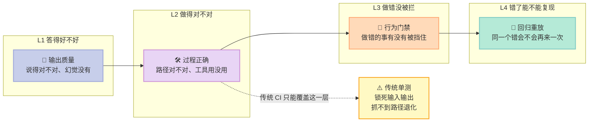
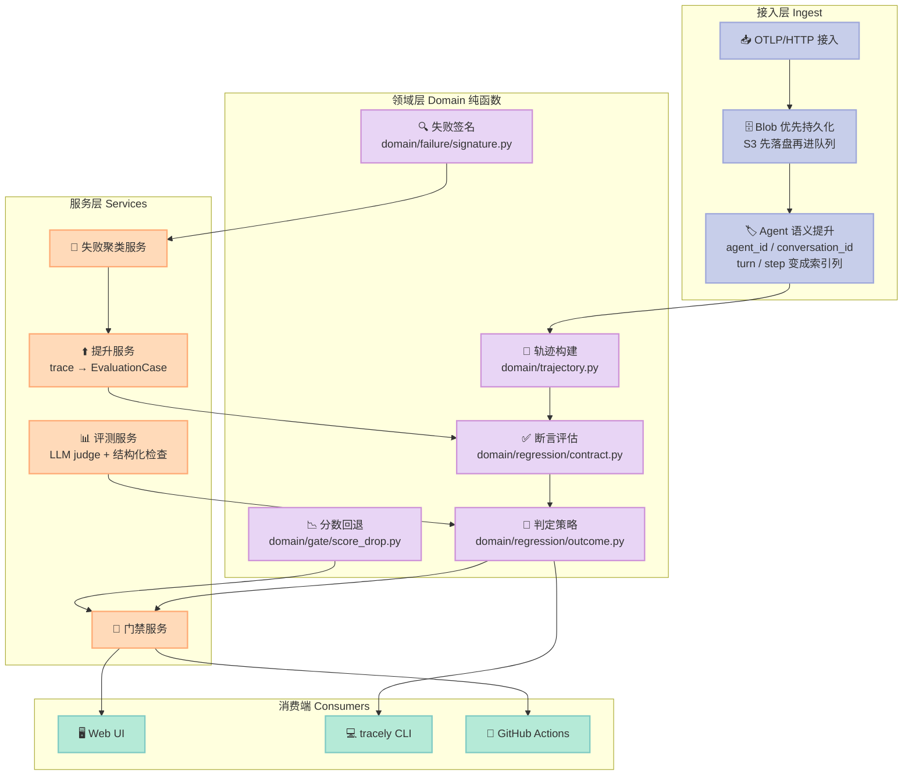
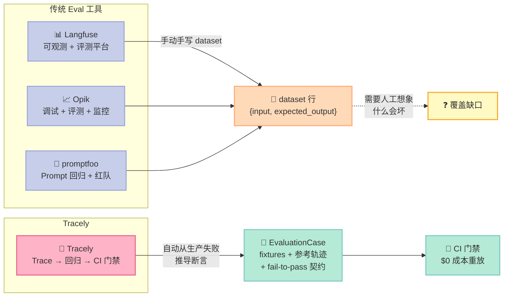

## 零、先给一张坐标系：Agent 质量保障的四个台阶

在进入 Tracely 之前，先摆清楚一件事：**给 Agent 做质量保障，和给传统软件做质量保障，是完全不同的工程问题。** 传统软件的 bug 是"代码没按预期执行"，而 Agent 的 bug 有四类，每一类需要完全不同的工具：



**L1（答得好不好）** 是 2024-2025 年 LLM 时代的核心战场——评测集、LLM-as-judge、RAG 质量。工具最多，也最卷。

**L2（做得对不对）** 是 2025-2026 年 Harness 时代的核心——轨迹（trajectory）、步骤断言、路径比较。Agent 工具链（Langfuse、Opik）主要在这里发力。

**L3（做错没被拦）** 是 2026 年 Agent 开始自己提交 PR 之后才出现的刚需——不可绕过的 CI 门禁。

**L4（错了能不能复现）** 是最少有人做、但价值最高的一层——把一次真实失败变成可无限重放的确定性测试。

**Tracely 是少数同时覆盖 L3 和 L4 的开源项目**，而且 L4 的实现方式（trace-first + fail-to-pass 契约）是目前唯一一套完整可用的方案。这就是我选它做本周主角的原因。

## 引子：一个测试用例，凭什么从一次线上事故里长出来

2026 年秋天，一个叫 Tracely 的开源项目在 GitHub 上冒出来。不到一个月，⭐ 涨到 946，fork 85。它的 README 开头不讲架构，不讲部署，只写一句话：

> **The recorded run _is_ the test.**
> （录下来的那次运行，就是测试本身。）

这句话背后藏着一个整个 Agent 工程圈都还没解决好的问题。

我们先摆出今天大多数团队的真实处境。你做了一个 Coding Agent，接了 8 个工具，每天跑两万次。上周三它给一个 500 美元的退款订单走了 50 美元——因为你 prompt 里写的是 "refund the amount",模型理解为"金额小就自己处理"。这个 bug 在生产环境躺了四天。

现在你要写一个回归测试，防止它再犯。你会怎么写？

```python
def test_refund_above_threshold():
    result = agent.run("订单 A12345 金额 500 美元，客户要求退款")
    assert result.amount == 500          # ← 期望值从哪来？
    assert "escalate_to_human" in result.tools_called
```

第一个问题立刻浮现：**`result.amount == 500` 这个期望值，只能由你手写**。而你手写它的那个瞬间，你其实是在猜"什么情况下会坏"。你在猜，而不是在记录。

第二个问题更隐蔽：这个测试跑起来要真的调模型、真的调支付网关。于是它**慢**（一次十几秒）、**贵**（一次几毛钱）、**不确定**（模型今天换个说法，测试就红了）。于是团队把它标成 `@pytest.mark.flaky`，三个月后没人再理它。

第三个问题最要命：**测试写的是"期望值"，不是"路径"**。上面那个断言只检查了最终金额，它完全不在乎 Agent 走没走 `check_refund_policy` → `get_order` → `issue_refund` 这条路径。如果哪天模型换了个顺序、或者直接跳过了 `check_refund_policy` 但恰好算出了 500，这个测试照样绿。**路径退化（path regression）检测不到。**

Tracely 的整个架构，就是围绕这三个问题展开的。

---

## 一、项目定位：它站在 Harness 6 件套的哪个位置

Tracely（[`jwuthri-cloud/Tracely-ai`](https://github.com/jwuthri-cloud/Tracely-ai)）的自我描述是 **"Trace-native CI/CD for AI agents"**。它不生产 Agent，不托管 Agent，它是**给 Agent 当 CI 的那一层**。

用 Harness 6 件套的框架来定位它：

| 组件 | Tracely 里的对应物 | 说明 |
|------|-------------------|------|
| **Rule** | `skills/tracely/SKILL.md` | 给 Coding Agent 的操作手册：怎么接 SDK、怎么 promote、怎么跑 gate |
| **Skill** | 同上 + `design/` 下的 22 篇架构文档 | 不是"加载一个 SOP"，而是把工程知识固化成可执行约定 |
| **Sub-Agent** | `Fleet` 视图（像素办公室） | 每个 agent 是一个角色，handoff 是角色走动——用来向不懂 waterfall 的人解释多 Agent 系统 |
| **Workflow** | `tracely simulate` / `tracely gate` 两种模式 | 多轮对话模拟 vs 已提升用例的 CI 重放 |
| **Script** | `.github/actions/tracely-gate` + `tracely` CLI | **不可绕过的门控**：exit code 非零 = PR 挂掉 |
| **MCP** | `/mcp` server（tracely 2.x） | 让 Agent 自己查询"我这次跑得怎么样" |

但真正独特的位置在**第 5 个格子：Script**。这是整个 Harness 工程里最被低估的一环。

**为什么 Script 组件在 2026 年下半年才变成刚需？** 因为前两年 Agent 的失败模式是"输出不对"——那是 Rule 和 Skill 能治的。而 2026 年的 Agent 越权越深：它自己写代码、自己提交 PR、自己跑部署。失败模式从"答错"变成了"**做错事**"。而"做错事"必须有一个**不可绕过的物理关卡**来拦。

Tracely 就是那个关卡。

```
生产事故 ──▶ 一条 trace（发生了什么）
              │
              ├─▶ 在线评测（这次失败了吗）──▶ 失败聚类（31 次失败 = 1 个 issue）
              │                                     │
              │                                     ▼
              │                              提升为回归用例（fail-to-pass 契约）
              │                                     │
              │                                     ▼
              └────────────────────────▶ CI 门禁（重放历史 fixture，$0 成本）
                                                │
                                                ▼
                                          拦下这个 PR
```

> **核心主张：可观测性到 dashboard 就结束了。**
> Tracely 的 README 有一节叫 "Why another agent-observability tool?"，第一句是："Because observability stops at the dashboard. You can see that your agent broke — then what?"
> 它的答案不是"给你更多图"，而是"**给你一个会红的 CI check**"。

---

## 二、架构分析：机制与策略的分离

Tracely 的后端是一个 FastAPI + Celery + ClickHouse + Postgres + Redis + MinIO 的六件套，代码量不小（`backend/tracely/` 下光 Python 文件就过百）。但它的**架构智慧全在 `domain/` 层**——那是一层**纯函数**，没有 I/O、没有 settings、没有 DB 句柄。

这种分层不是洁癖，它带来一个具体的工程收益：**UI 的手动重放、CLI 的 `tracely gate`、CI 门禁，三条路径调用的是同一个契约函数**。`services/regression_service.py` 的注释里写得很清楚：

> Graded through the SAME contract the gate applies, so a judge the gate would treat as advisory cannot promote a case here.

翻译过来就是：**你在界面上点"重放"看到的结论，和 CI 里判红/判绿依据的逻辑，是同一段代码**。不会出现"界面显示通过、CI 却拦下来"这种最消耗团队信任的割裂。



三层各自可插拔：

- **接入层**换掉：OTLP 是通用标准，LangChain / OpenAI Agents / CrewAI / Claude Agent SDK / Google ADK 都有自动埋点装饰器（`sdk/tracely_sdk/auto_*.py` 覆盖了 12 个框架）。
- **领域层**换不掉：这是它的**护城河**。轨迹语义、断言语义、判定语义是资产。
- **消费端**换掉：CLI、GitHub Action、未来的 GitLab CI，都是薄壳。

**Less is More 检查**：哪些组件是"模型自己能学会的"，哪些是"外部物理世界必需的"？

- **模型自己能学会的**：判断一段回答好不好、总结一段对话、写一条评估理由——这些全交给 LLM judge，Tracely 不自己发明质量标准。
- **外部物理世界必需的**：**"这次重放到底跑了没有"、"这个检查到底执行了没有"、"这个 PR 到底能不能合并"** —— 这些是物理世界的事实，不能交给模型推断。Tracely 把大量代码花在这三件事上。

这就是它的取舍：**质量判断外包给模型，可信性判断留给自己。**

---

## 三、核心机制一：轨迹（Trajectory）——测的是"路"，不是"答案"

Tracely 的 `domain/trajectory.py` 只有 160 行，但它定义了整套评测的语义基础。

### 3.1 从 span 到轨迹

一条 trace 在 ClickHouse 里是一堆 span 行。`build_trajectory()` 把它们转成 `Trajectory`：

```python
@dataclass
class TrajectoryStep:
    span_id: str
    parent_span_id: str
    kind: str          # llm / tool / agent / subagent / delegate / skill ...
    name: str
    level: str         # "ERROR" 表示这层出错
    status: str
    tool_calls: list[str] = field(default_factory=list)
    output: Any = None
    input: Any = None


@dataclass
class Trajectory:
    trace_id: str
    agent_run_id: str
    steps: list[TrajectoryStep] = field(default_factory=list)
```

关键在于 `kind` 的映射表（原文照抄）：

```python
_KIND = {
    "GENERATION": "llm", "TOOL": "tool", "AGENT": "agent", "SUBAGENT": "subagent",
    "RETRIEVER": "retriever", "CHAIN": "step", "GUARDRAIL": "guardrail",
    "EMBEDDING": "llm", "EVALUATOR": "step", "SPAN": "step", "EVENT": "other",
    "DELEGATE": "delegate", "SKILL": "skill",
}
```

这张表是**机制与策略分界线的具体体现**：Tracely 规定了"轨迹里有哪些种类的步骤"（机制），但"什么算失败"完全交给可插拔的 evaluator（策略）。

### 3.2 "请求了但没执行"——静默失败缺口

这是我认为 Tracely 最锋利的单个设计。轨迹里有两种工具集合：

```python
def tool_sequence(traj: Trajectory) -> list[str]:
    """The ordered tool names the agent actually executed (TOOL-type spans)."""
    return [st.name for st in traj.steps if st.kind == "tool"]


def requested_tools(traj: Trajectory) -> list[str]:
    """Tools the model asked for (tool_call_names on any step), de-duplicated in first-seen order.
    A 'silent failure' is a requested tool that was never executed — so this can exceed
    tool_sequence()."""
    seen: list[str] = []
    for st in traj.steps:
        for t in st.tool_calls:
            if t and t not in seen:
                seen.append(t)
    return seen
```

**为什么这个区分是刚需？** 因为 LLM 的失败模式里，有一类特别隐蔽：**模型正确地"决定"要调用 `escalate_to_human`，但代码里那个 dispatch 分支没实现，于是这步被静默吞掉**。从最终输出看，Agent 说了"已为您处理退款"，一切正常。日志里工具调用记录也是完整的——因为模型确实请求了。

但工具根本没跑。

如果你的测试只断言 `tool_sequence()`，这个 bug 抓不到。如果你的测试断言 `requested_tools()`，那它**主动要求**修复后的 Agent 必须真的调用那个工具——而且因为 source trace 自己就没有执行它，**source 必然 FAIL，修复版必然 PASS**。fail-to-pass 契约自动成立。

对应的代码：

```python
def required_tools(traj: Trajectory) -> list[str]:
    """Tools a faithful run of this case must execute: every tool this run actually executed, plus
    any tool the model requested but never ran (the silent-failure gap). Keyed off the latter so a
    promoted silent failure asserts the fix really calls the tool — and the source, which didn't,
    FAILs (fail-to-pass)."""
    executed = tool_sequence(traj)
    return executed + [t for t in requested_tools(traj) if t not in executed]
```

### 3.3 把"工具错了"和"Agent 错了"分开

```python
def split_errors(traj: Trajectory) -> tuple[list[str], list[str]]:
    """(tool_errors, run_errors): erroring TOOL steps (the replayed environment) vs the agent's
    own erroring steps. Lets a case tolerate tool failures while still gating on the run outcome."""
    tool_errs = [st.name for st in traj.steps if st.level == "ERROR" and st.kind == "tool"]
    run_errs = [st.name for st in traj.steps if st.level == "ERROR" and st.kind != "tool"]
    return tool_errs, run_errs
```

这个区分直接映射到一条业务语义：

- **工具报错**（支付网关返回 502）→ 这是**被重放的外部环境**，不是 Agent 的错。修复应该是"网关重试"或"优雅降级"。
- **Agent 自己报错**（抛异常、模型返回空）→ 这是**必须拦下来**的。

所以断言里有一个 `allow_tool_errors` 开关。开启它的条件是"source trace 同时有 tool error 和 run error"——也就是"这次事故是'工具挂了，Agent 也没处理好'"。这种情况下用例要容忍工具继续报错，但仍然对 Agent 的最终行为负责。

### 3.4 四种匹配模式

```python
def tools_satisfied(mode: str, produced: list[str], reference: list[str]) -> tuple[bool, list[str], list[str]]:
    """agentevals match modes over the tool sequence. Returns (ok, missing, extra)."""
    missing = [t for t in reference if t not in produced]
    extra = [t for t in produced if t not in reference]
    if mode == "strict":
        ok = produced == reference
    elif mode == "unordered":
        ok = sorted(produced) == sorted(reference)
    elif mode == "subset":
        ok = len(extra) == 0
    else:
        ok = len(missing) == 0
    return ok, missing, extra
```

`strict`（完全一致，含顺序）/ `unordered`（集合一致）/ `subset`（不许多调用）/ `superset`（不许漏调用）——四个语义给不同成熟度的项目用。Tracely 的默认提升策略是 `superset`，理由后面会讲：**这条选择本身就是一道防线。**

---

## 四、核心机制二：fail-to-pass 契约——只有"能区分好坏"的用例才配进门禁

这是 Tracely 最容易被低估、但工程价值最高的机制。

### 4.1 一个"提升"操作做了什么

`services/regression_service.py` 的 `promote_trace()` 把一条失败的 trace 变成一个回归用例。关键在 `_build_assertions()`：

```python
@staticmethod
def _build_assertions(traj: Trajectory) -> dict:
    """What the fixed agent must do, derived from the trace that broke.

    Deliberately tool NAMES, never tool ARGUMENTS. The reference here is a production failure,
    not a golden run: asserting the recorded args would assert the bug, and an agent fixed to
    pass the right ones would fail this case for ever. A trace whose only fault was bad
    arguments therefore yields a case its own source PASSES — `_record_fail_to_pass` leaves
    that DRAFT and unvalidated, which is the honest answer ("this one can't discriminate")
    rather than a gate that is green on a bug or red on a fix.
    """
    ref_tools = required_tools(traj)
    src_tool_errs, src_run_errs = split_errors(traj)
    allow_tool_errors = bool(src_tool_errs and src_run_errs)
    return {
        "no_error": True,
        "required_tools": ref_tools,
        "match_mode": "superset",
        "allow_tool_errors": allow_tool_errors,
    }
```

我把这段注释逐句翻译一下，因为它是整个文章里最值得学的一段工程思维：

> **刻意只锁工具"名字"，绝不锁工具"参数"。**
> 这里的参考来自一次生产失败，不是一次"黄金运行"：**断言录下来的参数 = 断言那个 bug 本身**，一个被修好（传对了参数）的 Agent 反而会永远挂在这个用例上。

这解释了一个很多工具会做错的事。假设你的 bug 是"退款金额传错成 50 而不是 500"。最直觉的做法是：把这次 trace 录下来，断言 `issue_refund(amount=50)`。听起来很精确，实际上是**把 bug 焊死在了测试里**。修复之后 Agent 传 500，测试红；测试红，开发者去改测试；改完测试，bug 的保护就没了。

Tracely 的处理是**诚实地说"这个用例区分不了"**：

### 4.2 用例能不能进门禁，由它自己能否区分决定

```python
def _record_fail_to_pass(self, case, spans, trace_id, quality_results=None) -> str:
    """The source (failing) trace must currently FAIL the case for it to be PROMOTED — either
    structurally (the tool/error contract) OR on a required answer-quality judge (a hallucination
    whose trace is structurally clean). Graded through the SAME contract the gate applies, so a
    judge the gate would treat as advisory cannot promote a case here.
    Otherwise the case is a non-discriminating no-op and stays DRAFT.
    ...
    """
    outcome = grade_case(self.eval_service, case, spans, quality_results=quality_results or [])
    recorded = outcome.verdict
    case.fail_to_pass_validated = recorded == "FAIL"
    case.status = "PROMOTED" if case.fail_to_pass_validated else "DRAFT"
    ...
    return recorded
```

规则简单到可以一句话说完：

> **source trace 自己必须 FAIL 这个用例。用例能 PASS 自己的 source，就说明它区分不了新旧，保持 DRAFT，不进门禁。**

这条规则的价值不在"省了一个测试"，而在**防止 CI 门禁变成噪音**。一个永远绿的测试比没有测试更危险——它给人虚假的安全感。

### 4.3 质量评委也能提升用例

```python
# Answer-quality judges that the SOURCE trace failed → the case guards against them too,
# so a hallucination with a structurally-clean trace is still promotable + gate-able.
quality_results = self._grade_source_quality(project_id, spans)
quality_failed = [r.name for r in quality_results if r.verdict == "FAIL"]
if quality_failed:
    assertions["quality"] = {"score_names": quality_failed}
```

这一段解决的是**"结构上没毛病，但答案在胡说"**的场景。比如 Agent 引用了一个不存在的政策条款——轨迹上每个工具都调对了，但它就是编的。

这种 bug 用纯结构断言抓不到，但**它当初为什么会被判 FAIL？** 因为质量评委判了 FAIL。所以把那个评委的名字写进用例的期望里，以后每次门禁都会重新问一遍："这次答案还对吗？"

于是提升路径变成两条：
- **结构失败**（工具没调 / 报错）→ 结构断言锁住
- **语义失败**（幻觉 / 低质量）→ 质量评委锁住

---

## 五、核心机制三：UNAVAILABLE ≠ PASS——门禁最容易被忽略的漏洞

如果这篇博客只能留一段代码，我会留这一段。

### 5.1 四态判定

`domain/regression/outcome.py` 定义了四个判定状态，而不是两个：

```python
PASS, FAIL, INCOMPLETE, SKIP, UNAVAILABLE = "PASS", "FAIL", "INCOMPLETE", "SKIP", "UNAVAILABLE"
# Bumped when the aggregation rules below change, so a stored result says which policy made it.
POLICY = "required-checks/v1"

# The gate statuses, worst last. NO_COVERAGE (suite exercised nothing) and INCOMPLETE (a case
# could not be fully checked) both block; FAIL names an actual regression.
GATE_SEVERITY = {"PASS": 0, "NO_COVERAGE": 1, "INCOMPLETE": 2, "FAIL": 3}
```

传统 CI 只有 pass/fail。但对 Agent 评测来说有第三种情况：**评测本身没跑起来**。

- LLM judge 的 API key 没了
- fixture bundle 文件损坏
- 重放时 agent 进程崩了
- ClickHouse 查询超时

这时候如果按二值逻辑，"没有 FAIL 记录" = PASS，那么**一次基础设施抖动就会让你的回归门禁静悄悄地放行一个真正有问题的 PR**。

Tracely 的处理：

```python
def aggregate(checks: list[Check], execution: Execution) -> str:
    """The verdict policy. Order matters: a behavioural FAIL outranks an execution problem so the
    two stay distinguishable even when both block; an unavailable REQUIRED check can never be
    read as a pass; advisory checks never decide."""
    required = [c for c in checks if c.required]
    if any(c.status == FAIL for c in required):
        return FAIL
    if not execution.complete or any(c.status == UNAVAILABLE for c in required):
        return INCOMPLETE
    return PASS
```

三行代码，三条不变量：

1. **行为 FAIL 优先于执行问题**——两者都拦 PR，但要能区分"这代码坏了"和"这检查跑不动"
2. **UNAVAILABLE 的必选检查绝不能被读成 PASS**
3. **advisory 检查不参与决策**（下面会讲 advisory 是什么）

### 5.2 期望的评委没返回结果 = UNAVAILABLE

```python
expected = list(((assertions.get("quality") or {}).get("score_names")) or [])
got = {q.get("score_name"): q for q in quality or []}
for name in expected:
    q = got.get(name)
    if not execution.complete:
        checks.append(Check(f"quality:{name}", quality_blocks, UNAVAILABLE,
                           f"not evaluated: {execution.problem}"))
    elif q is None:
        checks.append(Check(
            f"quality:{name}", quality_blocks, UNAVAILABLE,
            "judge returned no result (no LLM key for this workspace, judge disabled or "
            "deleted, or it errored)",
        ))
    ...
```

注释里那句 "An empty or partial list never implies the answer was checked" 是整段代码的题眼。

**这是所有"LLM-as-judge"系统最大的静默失效点。** 你配了一个质量评委，某天它因为超时挂了。你的聚合逻辑收了一个空列表——"没有失败记录"，于是打绿。团队以为质量门禁在工作，实际上它已经三天没工作了，而且没人知道。

Tracely 把它变成 UNVAILABLE，标红，拦 PR。

### 5.3 Advisory：主观判断不该拦 PR

```python
def is_failing(scores: Iterable[dict], advisory: Sequence[str]) -> bool:
    """True iff any score is a FAIL on an evaluator not in the advisory set."""
    adv = set(advisory)
    return any(s.get("verdict") == "FAIL" and s.get("name") not in adv for s in scores)
```

这个模块的 docstring 甚至记录了一次重构的历史：

> This replaces the old `name != 'tracely.run.quality'` magic string (which special-cased one judge and was applied to the threads-list dot but not the trace badge or session verdict, so the same trace could show a green dot in the list and "EVALS FAIL" on its detail page).

**同一个 trace 在列表页显示绿点、在详情页显示 EVALS FAIL** —— 这是所有自研评测系统都会犯的低级但致命的 bug。Tracely 的解法是把 advisory 变成 evaluator 的一个属性，并且规定"**这里是唯一应用这条规则的地方**"：

> The advisory set is now a per-evaluator property (`config.advisory`) and this is the ONE place the Python read paths apply it; the ClickHouse readers apply the identical rule in SQL via `name NOT IN {advisory}`.

Python 和 SQL 两条读路径必须给出同一答案。这种"**规则只有一处定义**"的纪律，是我认为这个项目最值得学的工程习惯。

### 5.4 门禁聚合：最坏状态决定整体

```python
def gate_status(passed, failed, skipped, incomplete, total, *, require_full_coverage=False) -> str:
    """Aggregate case verdicts into the gate status — the policy table, in order:

        any FAIL                          → FAIL          a known regression came back
        no cases at all                   → PASS          nothing to protect yet (vacuous; the UI
                                                          must not present this as a first test)
        any INCOMPLETE                    → INCOMPLETE    a case could not be fully checked
        nothing passed (all SKIP)         → NO_COVERAGE   the run exercised none of the suite
        some SKIP + full coverage required → NO_COVERAGE
        otherwise                         → PASS
    """
```

注意 `no cases at all → PASS` 旁边那句括号里的提醒：

> **(vacuous; the UI must not present this as a first test)**

空真（vacuous truth）。一个套件里零个用例，逻辑上"没有任何失败"= 通过。但**界面绝不能把这显示成"你的第一个测试通过了"**——那是欺骗。Tracely 在代码注释里专门留了这条约束，说明他们踩过这个坑。

而 `NO_COVERAGE`（全部 SKIP，即一次都没真正跑）是**拦 PR 的**。这跟传统 CI 的直觉相反：传统 CI 里"没跑测试"通常不算失败。但对 Agent 门禁来说，"没跑"意味着**这次 PR 的行为完全没被验证过**，放行等于裸奔。

---

## 六、失败聚类：把 31 次失败变成 1 个 issue

线上一次事故往往是成片的——同一个 bug 触发 31 次。Tracely 需要把它们合成一个 issue，否则你的 issue 列表会被淹没。

### 6.1 结构签名：廉价的第一层聚类

`domain/failure/signature.py` 的注释直接说明了问题：

> Exact hashing alone splits LLM-judge prose into one cluster per trace ("the response is not helpful" vs "the answer is not a helpful reply").

如果直接对失败文本做哈希，两句意思一样但措辞不同的 judge 评论会分成两个簇。Tracely 的解法是**掩码 + 哈希**：

```python
_MASK_PATTERNS = [
    (re.compile(r"\b[0-9a-f]{8,}\b", re.I), "<id>"),  # hex/uuids
    (re.compile(r"\b\d+(\.\d+)?\b"), "<n>"),          # numbers
    (re.compile(r"'[^']*'|\"[^\"]*\""), "<*>"),        # quoted strings
]
_WS = re.compile(r"\s+")

def mask(text: str) -> str:
    """Strip volatile bits so failures with the same shape but different ids/values collapse.
    Whitespace is collapsed too — a traceback rendered with `\\n` vs spaces is the same failure."""
    out = text
    for pat, repl in _MASK_PATTERNS:
        out = pat.sub(repl, out)
    return _WS.sub(" ", out).strip()
```

签名由两半组成：**失败的 evaluator 集合** + **掩码后的失败文本**：

```python
sig = " || ".join(failed) + " ## " + " || ".join(comment_list)
key = hashlib.sha256(sig.encode()).hexdigest()[:16]
```

### 6.2 文本覆盖阈值：为什么 0.9 这个数字很重要

哈希只是**第一次查找**用的 key。真正常的判定在 `matches()`：

```python
# Above this text similarity, two failures are the same issue no matter which evaluators
# tripped — a pydantic error captured by the outcome check on one trace and by a judge on the
# next must not become two clusters. Below it, a disjoint failed-evaluator set keeps genuinely
# different failure modes apart even when their wording overlaps.
_TEXT_MATCH_OVERRIDE = 0.9
```

```python
def matches(self, other_signature: str, threshold: float) -> bool:
    sim = similarity(tokens(text_part(self.signature)), tokens(text_part(other_signature)))
    if sim >= _TEXT_MATCH_OVERRIDE:
        return True
    mine, theirs = eval_names(self.signature), eval_names(other_signature)
    if mine and theirs and mine.isdisjoint(theirs):
        return False
    return sim >= threshold
```

这个 `0.9` 的设计意图非常精准，值得逐条拆：

**规则 1（sim ≥ 0.9 → 同簇）**：失败文本几乎一模一样，就一定是同一个问题，**不管 evaluator 集合是否相同**。原因写在注释里：evaluator 集合会"抖动"（advisory judge、采样、不同的 eval 批次），而底层错误文本是稳定的。**按集合相等来分簇，正是生产上产生重复簇的原因。**

**规则 2（evaluator 集合不相交 → 不同簇）**：反方向的保护。如果两次失败碰巧措辞相似（比如都在说 "timeout"），但一个是被结构化检查抓的、一个是被 LLM judge 抓的，它们可能是**两个不同的问题**，不该合并。

相似度用的是 **Jaccard** 而不是包含度，注释解释了原因：

```python
def similarity(a: frozenset[str], b: frozenset[str]) -> float:
    """Jaccard overlap of two token sets. Jaccard (not containment) on purpose: containment
    merges any short failure into a longer unrelated one that happens to include its words."""
    return len(a & b) / len(a | b)
```

包含度（containment）会把任何一条短失败并进一条碰巧包含它某个词的长失败里。Jaccard 不会。

而且样板词表把"每个 judge 评论都会重复的词"全部剔除，但**故意保留否定词**：

```python
# Negations are deliberately KEPT — "helpful" and "not helpful" must not look alike.
```

这是个很多人会踩的坑：做文本相似度时通常会一起干掉 "not"，于是"回答有帮助"和"回答没有帮助"变成同一个词。Tracely 明确保留。

### 6.3 什么时候不用 UMAP

`domain/failure/clustering.py` 里有个反直觉的判断：

```python
# UMAP is deliberately NOT used on small n: it is a manifold learner that, given few or
# near-identical vectors, scatters them and HDBSCAN then finds phantom clusters.
```

```python
if n < 4:
    return [0] * n  # too few to cluster meaningfully -> one group
if n < self.umap_min_n:
    # 直接在余弦距离上跑 HDBSCAN
else:
    # 先 UMAP 降维，再 HDBSCAN
```

**小样本不用 UMAP** —— 因为 UMAP 是流形学习器，在少量或高度重复的向量上会把它们打散，然后 HDBSCAN 找出根本不存在的簇。这是很多 RAG / 评测项目在生产上"聚类结果莫名其妙"的常见原因。

---

## 七、门禁的另一面：分数回退检测

还有一类失败，**verdict 根本抓不到**。

Tracely 的 `domain/gate/score_drop.py` 开头就点破了：

> A scenario gate that passes can still be worse than the last one: every conversation clears its bar while the goal-completion judge slides from 0.9 to 0.6. **Verdicts can't see that; means can.**
> （一个通过的 scenario 门禁仍然可能比上一次更差：每个对话都过了及格线，而目标完成度评委从 0.9 滑到 0.6。**verdict 看不见这个，mean 可以。**）

这是二值判定的天生盲区。如果你的及格线是 0.7，那么从 0.95 掉到 0.75 全是绿的。

```python
def score_drops(current, baseline, threshold, exclude=()) -> list[ScoreDrop]:
    """Evaluators whose mean fell by at least `threshold` (absolute) vs `baseline`, worst first."""
    skip = set(exclude)
    per_name: dict[str, list[tuple[float, float]]] = {}
    unit_scale: dict[str, bool] = {}
    for sid, cur_scores in current.items():
        base_scores = baseline.get(sid)
        if not base_scores:
            continue
        for name, cur_vals in cur_scores.items():
            base_vals = base_scores.get(name)
            if name in skip or not cur_vals or not base_vals:
                continue
            in_unit = all(0.0 <= v <= 1.0 for v in (*cur_vals, *base_vals))
            unit_scale[name] = unit_scale.get(name, True) and in_unit
            per_name.setdefault(name, []).append((_mean(base_vals), _mean(cur_vals)))
    ...
```

三个设计决定值得学：

**1. 按 scenario 逐个比较，再对两次都跑过的 scenario 求平均。** 注释写得很清楚：

> Compared PER SCENARIO, then averaged over the scenarios both runs drove. Pooling all scores per run instead would turn "this PR ran a different subset" into a fake regression (or hide a real one).

如果两次门禁跑的 scenario 集合不同（这次跑了 3 个场景，上次跑了 5 个），把所有分数倒进一个池子里平均，就会**凭空造出一次回归**，或者**掩盖一次真回归**。逐 scenario 对齐才是正确的。

**2. 只比较 [0, 1] 量纲的 evaluator。**

```python
in_unit = all(0.0 <= v <= 1.0 for v in (*cur_vals, *base_vals))
...
if not unit_scale[name]:
    continue
```

延迟检查的分是毫秒（3000、3500），跟 judge 的 0.8 不在同一个量纲上，算"绝对跌幅"毫无意义。

**3. 用绝对阈值而非相对百分比。** `base - cur >= threshold`。相对百分比会让基线越高的指标越容易被判为"没跌"——从 0.95 掉到 0.75 是 21% 的跌幅，而从 0.2 掉到 0.1 是 50%，但前者显然更严重。

---

## 八、横向对比：Tracely 和 Langfuse / Opik / promptfoo 的根本差异

这一节必须先说清楚：**Langfuse（37k⭐）、Opik（23k⭐）、promptfoo（27k⭐）都是极其优秀的项目**，Tracely（946⭐）和它们不是同一量级。但它们解决的问题**确实不同**，而且 Tracely 在一个点上做得比它们都彻底。

### 8.1 核心差异：数据集 vs 轨迹

Tracely 的 `design/part2-tracely/05-regression-testing.md` 有一张对照表，我直接引用它的核心对比：

| 维度 | 数据集行（行业惯例） | Tracely `EvaluationCase` |
|---|---|---|
| 单元 | `{input, expected_output}` JSON | 一次生产 trace 的**冻结切片** + 录制的 fixtures |
| 断言什么 | 最终输出的相似度 | **完整参考轨迹**（Steps / ToolCalls / handoffs）+ 可选输出评分 |
| 确定性 | 重跑命中真实工具和模型 → flaky、昂贵 | **hermetic 重放**录制好的 fixture → 确定性、免费 |
| 溯源 | 无 | `source_trace_id`、`failure_cluster_id`、`agent_version_first_failed` |
| 正确性契约 | "平均分没掉" | **fail-to-pass**：必须在坏版本上 FAIL，在修复版上 PASS |
| 来源 | dataset-first（先攒，再测） | **trace-first**（生产失败 → 聚类 → 起草 → 确认 → 永久） |

Tracely 自己的总结最狠：

> The dataset model cannot express "the exact failure trajectory we saw last Tuesday must not recur." The `EvaluationCase` is *defined* by that trajectory.

**"数据集模型无法表达'上周二我们看到的那条确切的失败轨迹不许再发生'。"** 因为数据集行的结构是 `{input, expected_output}`，**它没有地方放轨迹**。这不是功能没做，是数据模型本身表达不了。

### 8.2 三个竞品的不同定位



**Langfuse**（37k⭐，MIT）：事实上的可观测性标准，OTLP 原生、trace 树做得最好。它的评测模块是 dataset-first 的——你建 dataset、写期望值、跑 experiment。它的强项是"看清楚发生了什么"，弱项是"**然后呢**"。

**Opik**（23k⭐，Apache-2.0，Comet 出品）：在 Langfuse 基础上加了在线监控和模拟（simulation）。它的 simulation 概念和 Tracely 的 `mode=simulate` 有点像，但 Tracely 的 simulate 产出的是**可复用的场景（scenario）**，且能同时跑"录制重放"和"实时多轮对话"两种模式。

**promptfoo**（27k⭐，MIT）：最强的领域是 **prompt 回归 + 红队**。它有成熟的 YAML 断言语法和 50+ 种内置断言类型，测试用例**通常也是手写 YAML**。但它测的对象偏"prompt + 静态输入"，对"Agent 走过的路径"的建模较弱。

**Tracely** 的差异不在功能列表，在**数据模型的方向**：

- 三者都从"人手写期望"出发 → Tracely 从"生产已经发生的事实"出发。
- 三者的正确性契约是"分数没下降" → Tracely 是"必须在坏版本上 FAIL"（fail-to-pass）。
- 三者的测试跑起来要调真模型（贵、慢、flaky） → Tracely 重放录制好的 fixture（$0、确定性）。

### 8.3 一个诚实的评价

Tracely 的架构设计水平**明显高于**它的社区体量。946⭐ 的项目里有 22 篇设计文档、140+ 个后端测试、5 个 agent 框架的自动埋点、6 种存储的完整部署方案——这是大厂团队的工作量。

它的短板也很清楚：

- **生态薄**。Langfuse 有 37k⭐ 和无数集成，Tracely 只有自己。SDK 自动埋点覆盖 12 个框架，但每多一个框架就多一份维护负担。
- **ClickHouse 依赖重**。整套东西要 ClickHouse + Postgres + Redis + MinIO + Celery 五个组件才能跑起来，self-host 门槛不低。
- **单人主导**。近 30 天只有 26 次 commit，虽然质量极高，但 bus factor = 1。
- **Judge 校准还在早期**。Tracely 有 judge calibration 界面（标 human review 看一致率），但这个功能本身说明"LLM judge 的可靠性"这个问题在它这里**还没有完全解决**。

---

## 九、优缺点分析

### 9.1 左侧：架构简洁性 / 扩展性 / 易用性

**架构简洁性：优秀。** `domain/` 层的纯函数设计是教科书级别的。每个模块的 docstring 第一行就声明了它的边界：

```python
"""Fail-to-pass contract evaluation: ...

Pure: no I/O, no settings, no DB. The match modes come from `agentevals` and live in
`domain/trajectory.py`."""
```

`outcome.py` 甚至把策略版本号写进了结果：

```python
# Bumped when the aggregation rules below change, so a stored result says which policy made it.
POLICY = "required-checks/v1"
```

**半年后有人改了聚合规则，历史 verdict 能自己说清"我当时是被哪版策略判的"**。这个细节的成本几乎为零，收益是历史数据永久可解释。

**扩展性：优秀。** 三层解耦得很干净：
- 换接入源 → 加个 OTLP 导出或 SDK 装饰器（已有 12 个自动埋点）
- 换评测逻辑 → 在 `default_registry` 注册新 evaluator，`kind = "structural"` 或 `"llm"`
- 换消费端 → CLI / GitHub Action 是薄壳，退出码就是契约

**易用性：中等。** 好的一面：CLI 只有一个命令 `tracely gate`，GitHub Action 有 `mode=simulate`（无需在 CI 里跑 Agent 代码）和 `mode=gate`（重放已提升用例）两种模式。坏的一面：自托管要拉起 6 个服务；`tracely.yaml` 的 endpoint 注册表、`TRACELY_RUN_ID` 环境变量约定，都需要读文档。

### 9.2 右侧：性能 / 复杂度 / 维护性

**性能：优秀。** hermetic 重放是纯本地计算——不调模型、不调工具，一次门禁跑几十个用例的边际成本接近零。这是它相对 promptfoo / Langfuse eval 的**数量级优势**。

**复杂度：高。** 六件套基础设施 + ClickHouse 的 OLAP schema + OTLP 归一化三种 message 约定 + 26 个数据库迁移……对于一个"想给 Agent 加个 CI 门禁"的团队，这个门槛不低。

**维护性：分化明显。**
- `domain/` 层：极好。纯函数、有测试、边界清晰。
- `services/` 层：一般。重度依赖 SQLAlchemy session + ClickHouse，事务边界复杂（`promote_trace` 里那段"一个提升 = 一个事务，blob 先写再 commit，ClickHouse 写在 commit 之后"的注释说明作者踩过坑）。

### 9.3 关键加分项：连"门禁自己不能作恶"都想到了

GitHub Action 里有一段我反复读了两遍的代码：

```yaml
# GitHub does not give secrets to fork or Dependabot pull requests, so `api`/`key` arrive
# empty there and no gate is possible. Skip rather than fail: a check that CANNOT run must
# not report a red X on every dependency bump. A key that IS set but wrong still fails.
if [ -z "$TRACELY_API" ] || [ -z "$TRACELY_KEY" ]; then
  echo "::notice title=Tracely gate skipped::No TRACELY_API/TRACELY_KEY available..."
  exit 0
fi
```

**"一个跑不起来的检查，绝不能给每一个依赖升级 PR 报红叉。"** 这句话背后是一个真实的工程判断：门禁的可信度来自"它红了就一定有问题"。如果门禁天天因为环境原因报红，团队就会习惯性地忽略它——**一个被忽略的门禁等于没有门禁**。

还有一处安全细节：

```yaml
# Inputs come in as env vars, never interpolated into the script: `${{ }}` would paste an
# attacker-controlled agent name straight into the shell.
env:
  AGENT: ${{ inputs.agent }}
```

GitHub Actions 最经典的漏洞就是 `${{ }}` 直接插进 `run:` 块。这里全部走 `env:`，攻击者控制的 agent 名字进不了 shell。

---

## 十、从零搭建启示：如果你要复刻这个思路

### 10.1 最小可行实现（MVP）

不需要 ClickHouse，不需要 Redis，不需要前端。**一个 Python 文件 + 一个 JSON fixtures 文件**就能拿到 Tracely 80% 的核心价值。

下面是本文的完整复刻（抽离自 Tracely 的 `domain/trajectory.py` + `domain/regression/contract.py` + `domain/regression/outcome.py` 三个纯函数模块，约 300 行，可直接运行）：

```python
"""
tracely_mvp.py — 从 jwuthri-cloud/Tracely-ai 抽离的核心机制复刻

抽离自三个文件（都是 "pure: no I/O" 的领域层）：
  backend/tracely/domain/trajectory.py          — 轨迹模型 + 工具序列提取
  backend/tracely/domain/regression/contract.py — 断言评估
  backend/tracely/domain/regression/outcome.py   — 判定策略（PASS/FAIL/INCOMPLETE）
"""
from __future__ import annotations

import json
from dataclasses import dataclass, field
from typing import Any


# ── 第一部分：轨迹模型（对应 domain/trajectory.py）──
@dataclass
class TrajectoryStep:
    kind: str
    name: str
    level: str = "DEFAULT"          # "ERROR" 表示这一层出错
    tool_calls: list[str] = field(default_factory=list)
    input: Any = None

    @property
    def errored(self) -> bool:
        return self.level == "ERROR"


@dataclass
class Trajectory:
    steps: list[TrajectoryStep] = field(default_factory=list)

    def executed_tools(self) -> list[str]:
        return [s.name for s in self.steps if s.kind == "tool"]

    def requested_tools(self) -> list[str]:
        seen: list[str] = []
        for s in self.steps:
            for t in s.tool_calls:
                if t and t not in seen:
                    seen.append(t)
        return seen

    def required_tools(self) -> list[str]:
        executed = self.executed_tools()
        return executed + [t for t in self.requested_tools() if t not in executed]

    def split_errors(self) -> tuple[list[str], list[str]]:
        tool_errs = [s.name for s in self.steps if s.errored and s.kind == "tool"]
        run_errs = [s.name for s in self.steps if s.errored and s.kind != "tool"]
        return tool_errs, run_errs


# ── 第二部分：断言评估（对应 domain/regression/contract.py）──
def tools_satisfied(mode, produced, reference):
    missing = [t for t in reference if t not in produced]
    extra = [t for t in produced if t not in reference]
    if mode == "strict":
        ok = produced == reference
    elif mode == "unordered":
        ok = sorted(produced) == sorted(reference)
    elif mode == "subset":
        ok = len(extra) == 0
    else:
        ok = len(missing) == 0
    return ok, missing, extra


def evaluate_assertions(assertions, match_mode, traj):
    produced = traj.executed_tools()
    ref_tools = assertions.get("required_tools", [])
    mode = assertions.get("match_mode", match_mode or "superset")
    tools_ok, missing, extra = tools_satisfied(mode, produced, ref_tools)

    allow_tool_errors = assertions.get("allow_tool_errors", False)
    tool_errs, run_errs = traj.split_errors()
    if not assertions.get("no_error", True):
        error_ok = True
    elif allow_tool_errors:
        error_ok = len(run_errs) == 0
    else:
        error_ok = not (tool_errs or run_errs)

    forbidden = [t for t in assertions.get("forbidden_tools") or [] if t in produced]
    limits = assertions.get("max_tool_calls") or {}
    over = [f"{t}: called {produced.count(t)}x, max {n}"
            for t, n in limits.items() if isinstance(n, int) and produced.count(t) > n]

    passed = tools_ok and error_ok and not forbidden and not over
    detail = {
        "passed": passed, "tools_ok": tools_ok, "error_ok": error_ok,
        "missing_tools": missing, "extra_tools": extra,
        "forbidden_hit": forbidden, "count_violations": over,
        "tool_errors": tool_errs, "run_errors": run_errs, "match_mode": mode,
    }
    return ("PASS" if passed else "FAIL"), detail


# ── 第三部分：判定策略（对应 domain/regression/outcome.py）──
PASS, FAIL, INCOMPLETE = "PASS", "FAIL", "INCOMPLETE"


@dataclass
class Check:
    name: str
    required: bool
    status: str          # PASS / FAIL / UNAVAILABLE
    reason: str = ""


@dataclass
class Execution:
    mode: str = "unknown"
    problem: str = ""    # 非空 = 没跑完

    @property
    def complete(self) -> bool:
        return not self.problem


def aggregate(checks, execution):
    required = [c for c in checks if c.required]
    if any(c.status == FAIL for c in required):
        return FAIL
    if not execution.complete or any(c.status == "UNAVAILABLE" for c in required):
        return INCOMPLETE
    return PASS


def evaluate_contract(assertions, match_mode, traj, *, quality=None,
                      quality_blocks=True, execution=None):
    execution = execution or Execution()
    _, detail = evaluate_assertions(assertions, match_mode, traj)
    checks: list[Check] = []

    if not execution.complete:
        why = f"not evaluated: {execution.problem}"
        checks.append(Check("tools", True, "UNAVAILABLE", why))
        if assertions.get("no_error", True):
            checks.append(Check("no_error", True, "UNAVAILABLE", why))
    else:
        reason = ""
        if detail["missing_tools"]:
            reason = "missing tools: " + ", ".join(detail["missing_tools"])
        elif not detail["tools_ok"]:
            reason = f"tool sequence mismatch (mode={detail['match_mode']})"
        checks.append(Check("tools", True, PASS if detail["tools_ok"] else FAIL, reason))

        if assertions.get("no_error", True):
            err_reason = ""
            if detail["run_errors"]:
                err_reason = "run failed: " + ", ".join(detail["run_errors"])
            elif not detail["error_ok"]:
                err_reason = "errors: " + ", ".join(detail["tool_errors"] + detail["run_errors"])
            checks.append(Check("no_error", True, PASS if detail["error_ok"] else FAIL, err_reason))

        if assertions.get("forbidden_tools"):
            hit = detail.get("forbidden_hit") or []
            checks.append(Check("forbidden_tools", True, FAIL if hit else PASS,
                               ("called: " + ", ".join(hit)) if hit else ""))
        if assertions.get("max_tool_calls"):
            over = detail.get("count_violations") or []
            checks.append(Check("call_counts", True, FAIL if over else PASS, "; ".join(over)))

    expected = list(((assertions.get("quality") or {}).get("score_names")) or [])
    got = {q.get("score_name"): q for q in quality or []}
    for name in expected:
        q = got.get(name)
        if not execution.complete:
            checks.append(Check(f"quality:{name}", quality_blocks, "UNAVAILABLE",
                               f"not evaluated: {execution.problem}"))
        elif q is None:
            checks.append(Check(f"quality:{name}", quality_blocks, "UNAVAILABLE",
                               "judge returned no result"))
        elif q.get("verdict") == FAIL:
            checks.append(Check(f"quality:{name}", quality_blocks, FAIL, str(q.get("comment") or "")))
        elif q.get("verdict") == PASS:
            checks.append(Check(f"quality:{name}", quality_blocks, PASS, str(q.get("comment") or "")))
        else:
            checks.append(Check(f"quality:{name}", quality_blocks, "UNAVAILABLE", "judge gave no verdict"))

    return aggregate(checks, execution), checks


# ── 第四部分：场景演示 ──
def build_broken_run() -> Trajectory:
    """生产事故：Agent 请求了 escalate_to_human，但从来没调用它（静默失败）。"""
    return Trajectory(steps=[
        TrajectoryStep(kind="llm", name="gpt-4o",
                       tool_calls=["get_order", "issue_refund", "escalate_to_human"]),
        TrajectoryStep(kind="tool", name="get_order"),
        TrajectoryStep(kind="tool", name="issue_refund"),
        TrajectoryStep(kind="llm", name="gpt-4o"),
    ])


def build_fixed_run() -> Trajectory:
    return Trajectory(steps=[
        TrajectoryStep(kind="llm", name="gpt-4o",
                       tool_calls=["get_order", "issue_refund", "escalate_to_human"]),
        TrajectoryStep(kind="tool", name="get_order"),
        TrajectoryStep(kind="tool", name="issue_refund"),
        TrajectoryStep(kind="tool", name="escalate_to_human"),
        TrajectoryStep(kind="llm", name="gpt-4o"),
    ])


def build_broken_args_run() -> Trajectory:
    """另一种事故：工具调了，但参数错了（退款金额传成 50 而不是 500）。"""
    return Trajectory(steps=[
        TrajectoryStep(kind="llm", name="gpt-4o", tool_calls=["get_order", "issue_refund"]),
        TrajectoryStep(kind="tool", name="get_order"),
        TrajectoryStep(kind="tool", name="issue_refund", input={"amount": 50}),
        TrajectoryStep(kind="llm", name="gpt-4o"),
    ])


def promote(traj: Trajectory) -> dict:
    """把一次失败的运行"提升"成一个回归用例。

    关键：断言只锁工具"名字"，不锁参数。因为参考轨迹来自一次"失败的生产运行"，
    锁住当时的参数等于把 bug 本身固化下来。
    """
    tool_errs, run_errs = traj.split_errors()
    return {
        "no_error": True,
        "required_tools": traj.required_tools(),
        "match_mode": "superset",
        "allow_tool_errors": bool(tool_errs and run_errs),
    }


def show(title, verdict, checks):
    print(f"\n  {title}")
    print(f"    verdict = {verdict}")
    for c in checks:
        flag = {PASS: "PASS", FAIL: "FAIL", "UNAVAILABLE": "UNAVAIL"}.get(c.status, c.status)
        print(f"    [{flag:<8}] {c.name:<18} {c.reason}")


def run_demo():
    print("=" * 72)
    print("Tracely MVP — 生产失败 → 回归用例 → CI 门禁")
    print("=" * 72)

    broken = build_broken_run()
    fixed = build_fixed_run()

    print("\n[1] 从一次失败的生产运行推导断言")
    assertions = promote(broken)
    print(f"    实际执行: {broken.executed_tools()}")
    print(f"    模型请求: {broken.requested_tools()}")
    print(f"    静默失败: {[t for t in broken.requested_tools() if t not in broken.executed_tools()]}")
    print(f"    断言      : {json.dumps(assertions, ensure_ascii=False)}")

    print("\n[2] fail-to-pass 契约：坏版本必须 FAIL，好版本必须 PASS")
    v_bad, c_bad = evaluate_contract(assertions, "superset", broken)
    show("坏版本 (source trace)", v_bad, c_bad)
    v_good, c_good = evaluate_contract(assertions, "superset", fixed)
    show("修复版本 (candidate)", v_good, c_good)
    print(f"\n    fail-to-pass 成立? {'YES' if v_bad == FAIL and v_good == PASS else 'NO'}")
    print(f"    结论: 该用例能区分好坏版本 -> 状态 PROMOTED，可以进 CI 门禁")

    print("\n[3] 参数级 bug 的诚实处理（只锁工具名时无法区分）")
    bad_args = build_broken_args_run()
    assertions_args = promote(bad_args)
    v_args, c_args = evaluate_contract(assertions_args, "superset", bad_args)
    show("参数错的 source trace", v_args, c_args)
    print(f"    source 自己 {v_args} -> 无法区分新旧 -> 保持 DRAFT，不进门禁")
    print(f"    (Tracely 原生做法是加 tool_args 断言：amount == 500)")

    print("\n[4] 评测跑不起来 = INCOMPLETE，不是 PASS")
    v_incomplete, c_inc = evaluate_contract(
        assertions, "superset", fixed, quality=[],
        execution=Execution(mode="recorded", problem="fixture bundle is empty"))
    show("评委不可用 / fixture 损坏", v_incomplete, c_inc)

    print("\n[5] 门禁聚合：最坏状态决定整体")
    scenarios = [("用例 A (已修复)", v_good), ("用例 B (新回归)", FAIL),
                 ("用例 C (评委挂了)", v_incomplete)]
    for name, v in scenarios:
        print(f"    {name:<20} {v}")
    order = {PASS: 0, "INCOMPLETE": 2, FAIL: 3}
    overall = max((v for _, v in scenarios), key=lambda v: order[v])
    print(f"    门禁整体 = {overall}  -> PR 被拦下")


if __name__ == "__main__":
    run_demo()
```

**实际运行输出**（`python3 tracely_mvp.py`，本文实测）：

```
========================================================================
Tracely MVP — 生产失败 → 回归用例 → CI 门禁
========================================================================

[1] 从一次失败的生产运行推导断言
    实际执行: ['get_order', 'issue_refund']
    模型请求: ['get_order', 'issue_refund', 'escalate_to_human']
    静默失败: ['escalate_to_human']
    断言      : {"no_error": true, "required_tools": ["get_order", "issue_refund", "escalate_to_human"], "match_mode": "superset", "allow_tool_errors": false}

[2] fail-to-pass 契约：坏版本必须 FAIL，好版本必须 PASS

  坏版本 (source trace)
    verdict = FAIL
    [FAIL    ] tools              missing tools: escalate_to_human
    [PASS    ] no_error           

  修复版本 (candidate)
    verdict = PASS
    [PASS    ] tools              
    [PASS    ] no_error           

    fail-to-pass 成立? YES
    结论: 该用例能区分好坏版本 -> 状态 PROMOTED，可以进 CI 门禁

[3] 参数级 bug 的诚实处理（只锁工具名时无法区分）

  参数错的 source trace
    verdict = PASS
    [PASS    ] tools              
    [PASS    ] no_error           
    source 自己 PASS -> 无法区分新旧 -> 保持 DRAFT，不进门禁
    (Tracely 原生做法是加 tool_args 断言：amount == 500)

[4] 评测跑不起来 = INCOMPLETE，不是 PASS

  评委不可用 / fixture 损坏
    verdict = INCOMPLETE
    [UNAVAIL ] tools              not evaluated: fixture bundle is empty
    [UNAVAIL ] no_error           not evaluated: fixture bundle is empty

[5] 门禁聚合：最坏状态决定整体
    用例 A (已修复)           PASS
    用例 B (新回归)           FAIL
    用例 C (评委挂了)          INCOMPLETE
    门禁整体 = FAIL  -> PR 被拦下
```

**场景 3 是这个 MVP 最值得看的地方**：参数错了的 source trace，自己 PASS 了自己的用例。按 fail-to-pass 契约，它无法区分新旧版本，所以**保持 DRAFT，不进门禁**。Tracely 宁可交出"这一条我管不了"，也不放一个绿色的、实际保护不了任何东西的门禁进去。

### 10.2 哪些组件是必须的，哪些可以先省略

**必须的（没有就等于没有门禁）：**

| 组件 | 最小实现 | 为什么不能省 |
|------|---------|-------------|
| **轨迹模型** | 从你的日志里抽出 `(kind, name, tool_calls, errored)` | 没有轨迹就只是断言最终字符串，测不出路径退化 |
| **请求 vs 执行的区别** | 两个集合，差集 = 静默失败 | 这是抓"看起来跑完了其实少做一件事"的唯一办法 |
| **fail-to-pass 校验** | source 必须 FAIL，否则不进套件 | 否则门禁会被无法区分的用例污染 |
| **三态判定** | PASS / FAIL / INCOMPLETE | 二值判定会把"评测挂了"静默放行 |
| **录制重放** | 把 tool/LLM 的输入输出录成 JSON | 不重放就要调真模型 = 慢 + 贵 + flaky |

**可以先省略：**

- ClickHouse（几十条 trace 用 SQLite 够了）
- Redis / Celery（同步跑就行）
- 前端（先 `tracely gate` 一个 CLI 命令）
- 语义聚类（先用结构签名 + token 重叠）
- 分数回退检测（等你的评测有了连续分数再上）
- 多 agent / handoff 支持（先跑单 agent）

### 10.3 踩坑预警（都是我在读源码时看到的真实陷阱）

**坑 1：把参数录进断言，等于把 bug 焊死。**
这是最容易犯、后果最严重的坑。录下来的参数是**故障现场**，不是**正确期望**。要么只锁名字（Tracely 的默认），要么由人手工写期望（`tool_args` 断言需要人工介入）。

**坑 2：用"没报错"当"没问题"。**
评测没跑起来 ≠ 通过。必须显式区分 UNAVAILABLE。这个坑几乎所有自研评测系统都会踩，而且**踩了之后很难发现**——因为结果是绿的。

**坑 3：同一个规则在两条读路径上不一致。**
Tracely 原来用魔法字符串 `name != 'tracely.run.quality'` 判 advisory，结果列表页绿、详情页红。修法是：规则只在 `domain/evaluation/verdict.py` 定义一次，SQL 侧用等价条件。**如果你在 Python 里判了，SQL 里也得判，且要写测试保证一致。**

**坑 4：小样本上用 UMAP。**
UMAP 在少量/重复向量上会造出根本不存在的簇。`n < 4` 直接归一组，`n` 小时直接跑余弦距离 HDBSCAN。

**坑 5：文本相似度时把否定词一起干掉。**
"helpful" 和 "not helpful" 会变成同一个词，判 FAIL 和判 PASS 被合并。否定词必须保留。

**坑 6：两次门禁的 scenario 集合不同，却把分数混在一起平均。**
必须**逐 scenario 对齐**后再平均，否则"这次跑的子集不同"会变成假回归，或者掩盖真回归。

**坑 7：门禁自己因环境原因天天报红。**
fork PR 没有 secrets、Dependabot PR 没有 secrets。正确做法是**跳过**（exit 0 + notice），不是失败。一个被忽略的门禁等于没有门禁。

**坑 8：只看 verdict 会漏掉分数下滑。**
所有对话都过及格线，但目标完成度从 0.9 滑到 0.6——verdict 全绿。需要额外的分数回退检测，而且必须**按 scenario 对齐 + 只比 [0,1] 量纲**。

---

## 十一、总结：Harness Engineering 的第三次范式转移

回到文章开头那个退款 bug。

用 Tracely 的思路，你会这样处理它：

**第 1 天（事故当天）**：那条 trace 已经在系统里了。失败聚类把它和另外 30 次同类失败合并成一个 issue。

**第 2 天**：有人点了"提升为回归用例"。系统自动推导出断言：`required_tools = [get_order, issue_refund, escalate_to_human]`、`no_error = true`。然后它做 fail-to-pass 校验——**source trace 自己 FAIL**（因为 `escalate_to_human` 根本没执行），所以用例有效，进套件。

**第 3 天**：开发提交修复。CI 跑 `tracely gate`：
- 重放录制好的 fixture（$0，20 秒）
- 新版本的轨迹里 `escalate_to_human` 出现了 → 用例 PASS
- 但质量评委发现退款金额还是 50 → 另一个用例 FAIL
- **PR 被拦下**

**全程没有一行手写测试。** 没有 flaky 标记，没有 `expected_output` 需要人工猜，没有人在凌晨被告警吵醒。

这就是我认为 Harness Engineering 正在发生的第三次范式转移：

| 阶段 | 核心问题 | 解法 | 代表项目 |
|------|---------|------|---------|
| **第一次**（2024-2025） | 模型答不对怎么办？ | Prompt 工程 / RAG / 微调 | LangChain、Cohere |
| **第二次**（2025-2026） | 模型做事的**过程**怎么约束？ | Rule / Skill / Sub-Agent / Hook | Claude Code、Cursor、agents-md |
| **第三次**（2026 下半年） | 模型**做错事**怎么自动发现并拦住？ | Trace → 回归 → 不可绕过的 CI 门禁 | Tracely 及后来者 |

第一次范式解决"说什么"，第二次解决"怎么做"，第三次解决"**做错了谁负责**"。

而第三次的核心洞察只有一句：

> **生产环境已经免费告诉了你什么会坏。整套评测体系的正确起点，不是"人工想象可能的失败"，而是"把已经发生的失败原样保存下来"。**

### 行动建议

1. **今天就能做的**：在你的 Agent 里把"模型请求的工具"和"实际执行的工具"记成两个字段。对比它们的差集——这就是静默失败率的现成度量。
2. **本周可以做的**：在你的 CI 里加一个最简门禁：断言"必须调用某个工具" + "不许有 error span"。不需要框架，一个 50 行的 Python 脚本就够。
3. **一个月内可以做的**：把最近 10 次真实事故的 trace 手工整理成 JSON fixtures，让 CI 重放它们。**先不追求自动化提升**——先有 10 个能红的测试，比有 0 个自动生成器强。
4. **别做的事**：不要手写 `expected_output`。你的期望值是猜的，生产轨迹是事实。**事实永远比猜测贵，也比猜测准。**
5. **警惕的**：任何"评测跑不起来就当通过"的实现。在你的代码里搜一下"空结果"分支——它大概率藏着整个系统最危险的一个 if。

---

> **本文项目**：[jwuthri-cloud/Tracely-ai](https://github.com/jwuthri-cloud/Tracely-ai) — ⭐946 · MIT · 2026-10-11 建仓 · Tracely: Trace-native CI/CD for AI agents
> **核心原语**：轨迹（trajectory）· 静默失败缺口（requested vs executed）· fail-to-pass 契约 · UNAVAILABLE ≠ PASS · 结构签名 + 文本覆盖阈值聚类 · 分数回退检测
> **所属系列**：Harness Engineering 实战 · 组件位：**Script（硬关卡 / 可执行验证）**
